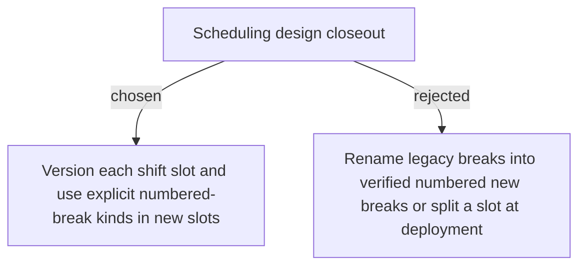

# Identify attendance lifecycle and preserve legacy stored event values

> Updated 2026-11-20. Every shift uses six attendance actions in development. The previous requirement for a shift-by-shift transition is superseded. See [the current installation guide](../handover.md#210-เตรียมตารางงานและการลงเวลา-6-ขั้น).

On 2026-11-17 the owner confirmed the consolidated recap and requested the scheduling spec (“ยืนยันชุดนี้ เขียน spec ต่อ”). This records the corresponding accepted choice in [the closeout review](../requirements-gathering/2026-11-17-scheduling-design-closeout.md).

Preserve existing four stored event values and audit interpretation. New explicit break kinds distinguish both cycles. Select cutover before receiving opens; stale incompatible clients refresh without writing. Transfer confirmation is separate from the six normal attendance events.

Accepted design only. This does not approve application implementation, schema/database/runtime changes, deployment or publication. The scheduling spec will define the contracts and acceptance cases before an implementation plan is approved.
