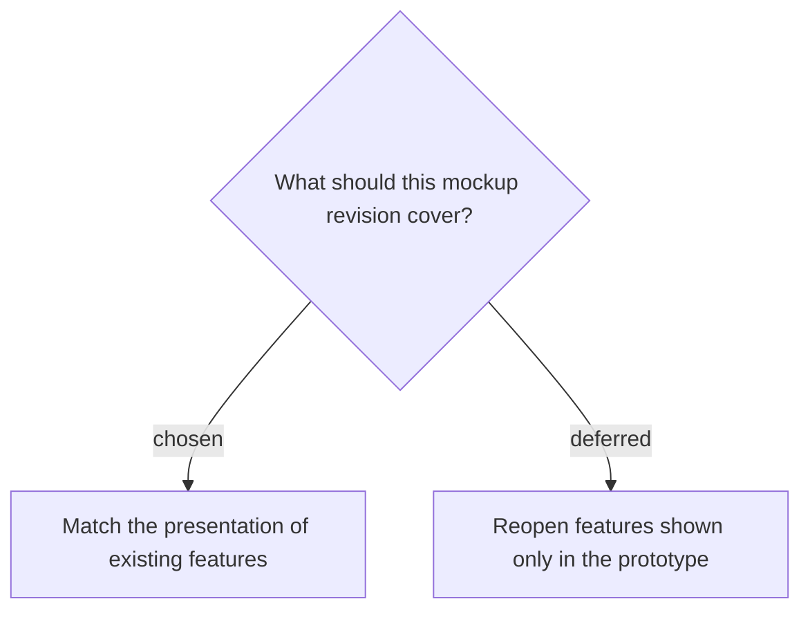

# Match the mockup for existing features

On 19 November 2026 the owner chose to use the [UX/UI mockup](../design/ux-audit/mockups.html) as the visual reference for existing features. Match layout, spacing, typography, and component appearance with the app's actual data and controls. The earlier decisions on the historical Dashboard chart, global search and scheduling rollout still govern their scope. Existing permissions, QR flows and printed sign requirements still apply.
