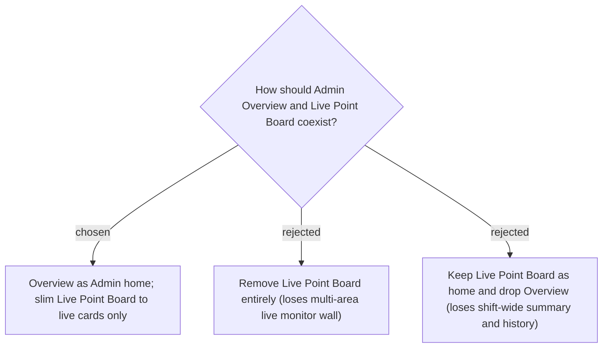

# Admin overview home and slim live point board

On 19 November 2026 the owner decided to make **ภาพรวม** (`/admin/overview`) the Admin landing page (`homeOf('admin')`) while keeping **สถานะจุด** (`/dashboard`) as a slim live point-card monitor only. Duplicated building progress summaries and redundant overview widgets are removed from `/dashboard` so the two screens have clear, non-overlapping purposes: `/admin/overview` for shift-wide summaries, historical inspection, and drill-through; `/dashboard` for live real-time point cards.
