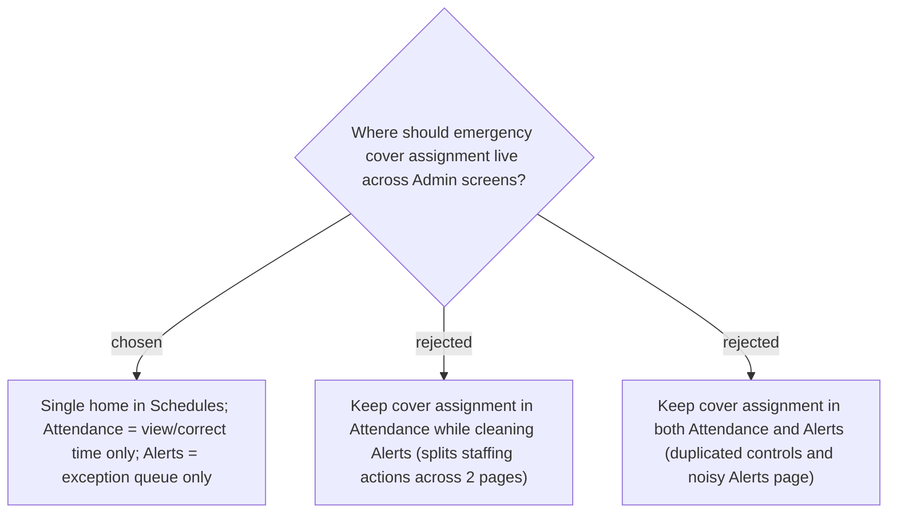

# Consolidate cover assignment under Schedules and keep Alerts/Attendance single-purpose

On 19 November 2026 the owner chose **Option B** after reviewing the interactive mockup:
- **ตารางงาน** (`/admin/schedules`) is the single home for all staffing actions (regular baselines, weekly days-off, leave, relief assignments/loans, midshift transfers, and emergency cover assignments).
- **การเข้างาน** (`/admin/attendance`, including Overview drill-through `ScopedAttendanceActions`) focuses solely on viewing who is present per Area and correcting actual attendance times (with a link to `/admin/schedules` when an Area has no assigned Cleaner).
- **รายการที่ขึ้นเตือน** (`/admin/alerts`) focuses solely on the exception review queue (blocked scans, far-GPS flags, and missing shift-out alerts), removing the duplicated `EmptyAreas` and `CoversThisShift` sections.
