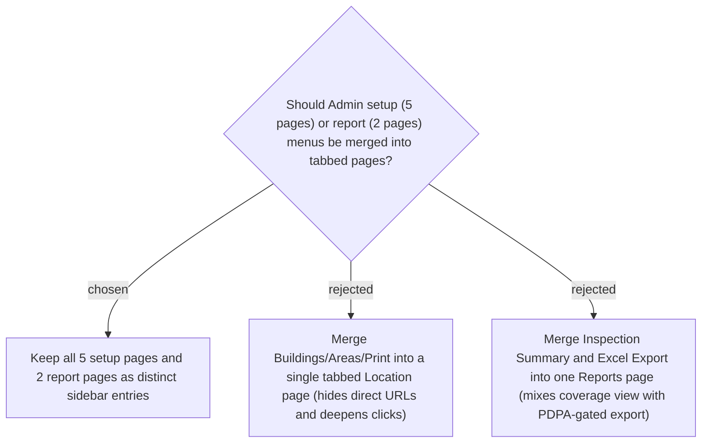

# Keep Admin setup and report menus distinct

On 19 November 2026 the owner decided to keep the five Admin setup entries (`พื้นที่และป้าย`, `ตึก`, `พิมพ์ป้าย`, `บัญชีผู้ใช้`, `ประวัติการแก้ไข`) and two report entries (`สรุปการตรวจ`, `ส่งออก Excel`) distinct in the sidebar, as each has a clear, non-overlapping purpose once Dashboard/Overview and Attendance/Alerts/Schedules are cleanly separated.
