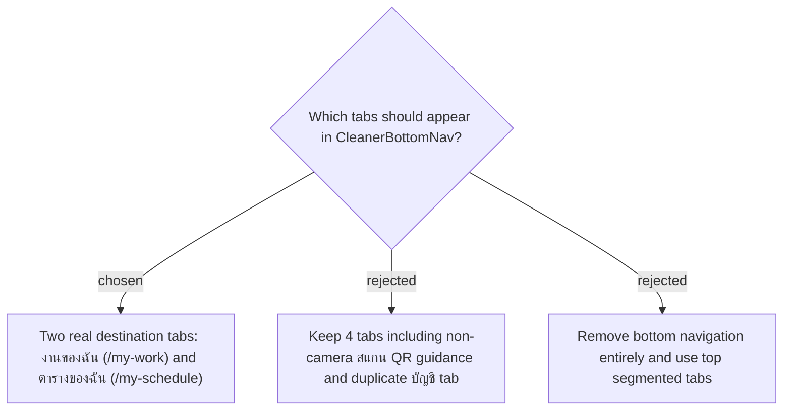

# Simplify Cleaner bottom navigation to two real tabs

On 19 November 2026 the owner decided to simplify `CleanerBottomNav` from four tabs to two real navigation tabs: **งานของฉัน** (`/my-work`) and **ตารางของฉัน** (`/my-schedule`). The **สแกน QR** tab (which could not open a camera and only showed inline guidance) and the **บัญชี** tab (which duplicated the top header's user identity and sign-out action) are removed so every control performs a real navigation action.
