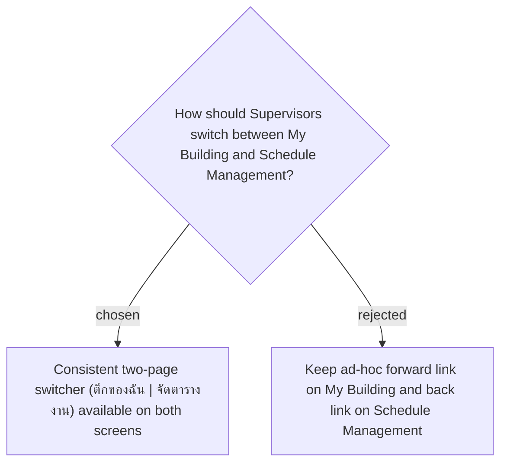

# Supervisor consistent two-page switcher

On 19 November 2026 the owner decided to give Supervisors a consistent two-page switcher (**ตึกของฉัน** `/my-building` and **จัดตารางงาน** `/schedule-management`) across both screens so they can move between inspection queues and roster scheduling in one tap, matching the simplified two-tab mental model used for Cleaners.
