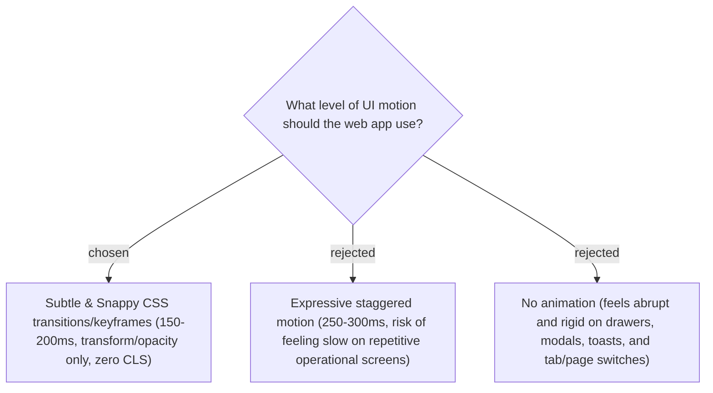

# Subtle and snappy motion system

On 19 November 2026 the owner requested subtle, snappy motion across the web app using pure CSS `transform` and `opacity` transitions/keyframes in `frontend/src/index.css` (zero new dependencies, preserving the 200 kB gzip bundle budget and `CLS = 0`):
- **Drawers & Modals:** `150–200ms ease-out` slide/scale-in with backdrop fade.
- **Toasts & Notes:** smooth slide-up + fade-in entrance.
- **Buttons, Cards & Tabs:** subtle press feedback (`active:scale-[0.98]`) and hover color/border transitions (`150ms`).
- **Route / Tab Views:** gentle `150ms` opacity fade-in.
- **Accessibility:** disable/reduce motion automatically under `@media (prefers-reduced-motion: reduce)`.
