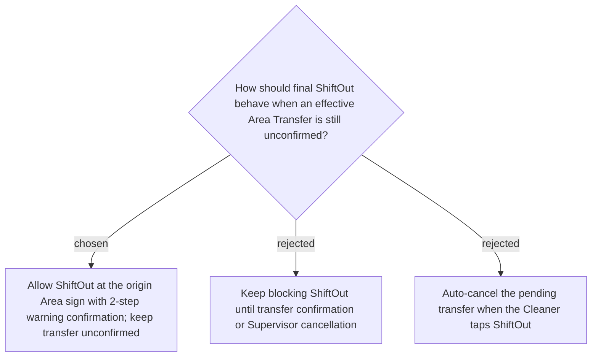

# Allow confirmed final ShiftOut at origin sign during pending transfer

On 20 November 2026 the owner chose to allow final `ShiftOut` at the origin Area's Check-In Sign while an Area Transfer is in effect and unconfirmed (`IsTransferPending`):

- **Origin sign only:** Only `ShiftOut` at `FromAreaId` is allowed while pending. All break actions (`Break*`), Service Point scans, and any attendance action at the destination sign (`ToAreaId`) remain refused with `409 transfer-pending`. The destination sign continues to offer only `ยืนยันเข้าพื้นที่ใหม่`.
- **Explicit 2-step confirmation:** `CheckInPage` requires a 2-step warning confirmation (`ยืนยันเลิกงานโดยไม่ย้ายพื้นที่`, combined with any skipped-break gap markers) and sends `confirmPendingTransfer: true` to `POST /api/attendance`; requests without `confirmPendingTransfer: true` are still refused with `409 transfer-pending`.
- **No auto-cancellation and no fake arrival:** Recording `ShiftOut` leaves the `AreaTransferInstruction` row as `instructed` (unconfirmed) for Supervisor visibility and records zero destination arrival evidence, matching [0200](facility-0200-half-day-final-departure-records-actual-shift-out.md), [0202](facility-0202-allow-eligible-leave-check-in-with-explicit-schedule-review.md), and [0205](facility-0205-allow-eligible-day-off-check-in-with-explicit-schedule-review.md). Subsequent arrival confirmation after final `ShiftOut` remains refused.
