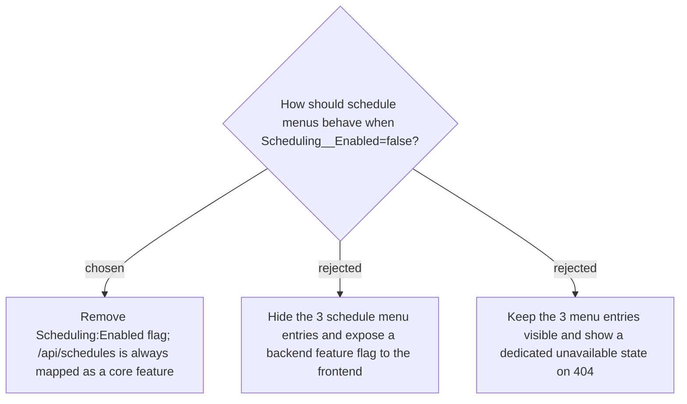

# Remove Scheduling:Enabled feature flag and always enable scheduling

On 20 November 2026 the owner decided to remove the `Scheduling:Enabled` feature flag altogether:

- The first deployment uses a fresh database with Cleaner Scheduling enabled from day one, and Admin emergency cover assignment (`CoverDrawer`) lives under `/admin/schedules` ([0225](facility-0225-consolidate-cover-assignment-under-schedules.md)).
- Keeping a disabled-feature mode created dead navigation items across Cleaner, Supervisor, and Admin views and violated the development-stage principle of maintaining one current path without legacy toggles.
- `SchedulingSettings.Enabled`, `ScheduleEndpoints.UseScheduleFeatureGate()`, the `if (!settings.Enabled)` route guard, and `Scheduling:Enabled` in `appsettings.json` / `scripts/e2e.py` are removed in place. `Scheduling:CommandSigningKey` and `Scheduling:HistoryStartsAt` remain configuration-driven as before.
