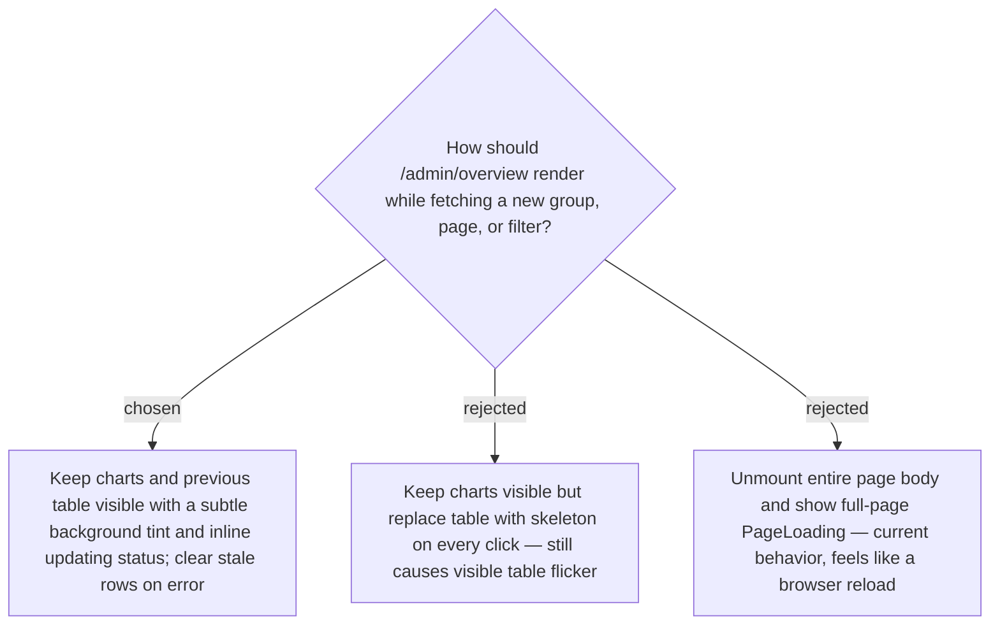

# Overview smooth transition without full-page unmount

On `/admin/overview`, reading `query.currentData` directly caused `response` to become `undefined` on every group, bar, page, or filter click, unmounting all charts and tables and showing full-page `PageLoading`. We decided to keep the last valid snapshot rendered with a subtle background tint and an inline updating indicator on `AreaResults` while a new context is fetching, while strictly clearing stale rows and showing an error + retry control if the new context request fails (preserving the no-stale-data-on-error invariant).

The table keeps full text and control contrast while it waits. Its context label and links come from the visible snapshot. Returning to a cached selection still waits for a successful read before replacing the snapshot. A refresh within the same selection can keep the last successful result on error.
