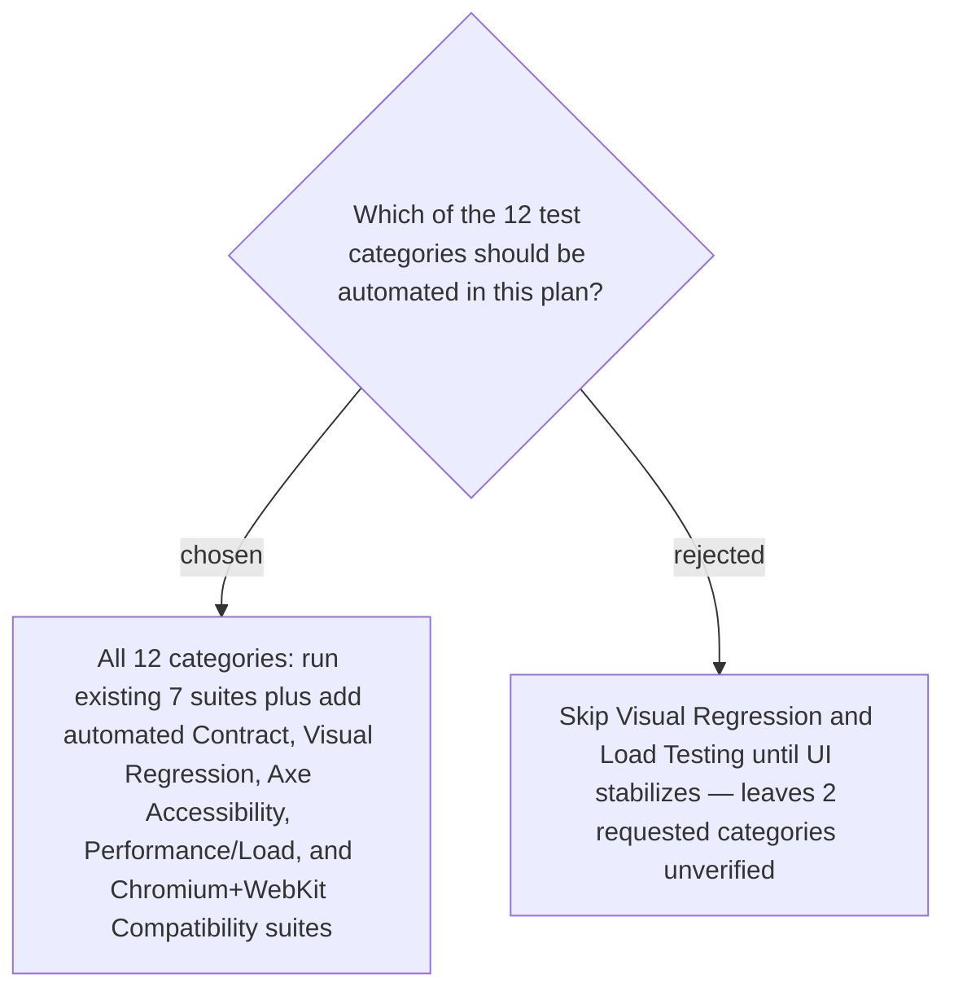

# Twelve-category automated verification suite

The repository already covers 7 of the 12 verification categories (Unit, Component, Integration, API, E2E, Regression, Security). We decided to close all 5 remaining gaps with repeatable automated suites (Contract, Visual Regression, Accessibility via axe-core, Performance/Load, and Chromium + WebKit Compatibility) alongside an Overview smooth-transition regression test so all 12 categories can be verified end-to-end.
