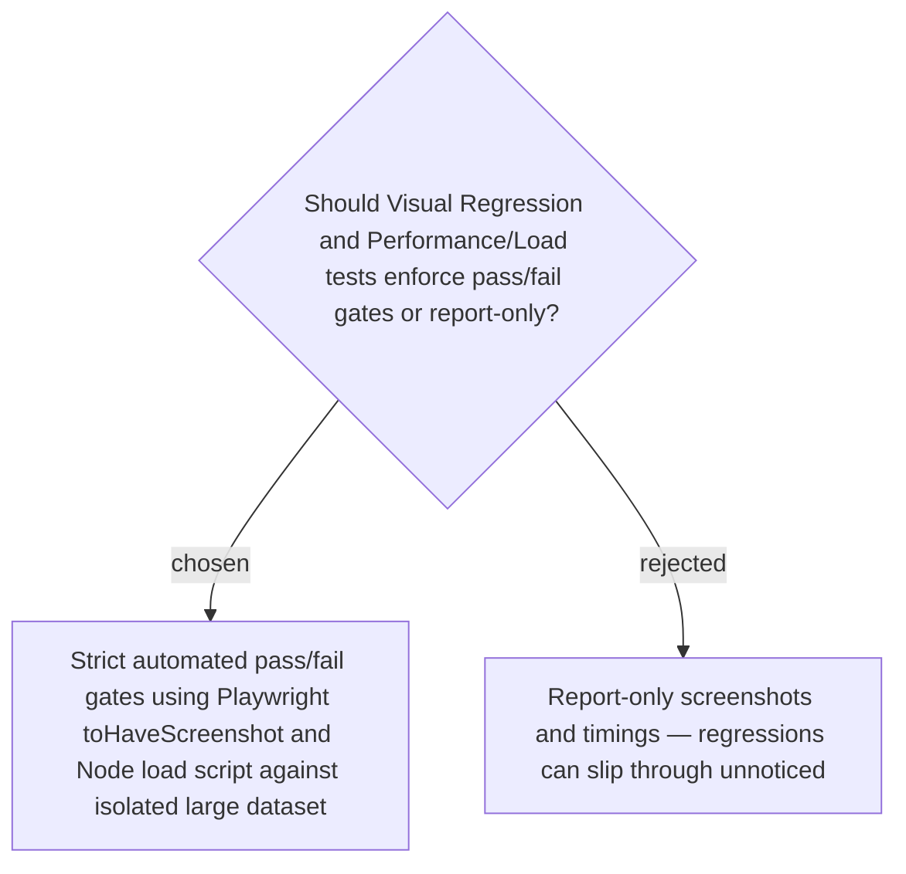

# Strict automated gates for visual regression and load tests

Visual Regression (#8) will enforce pixel-diff thresholds via Playwright `toHaveScreenshot()` on key screens (`/admin/overview`, `/admin/schedules`, `/my-work`, `/my-building` at 1280px and 375px), and Performance/Load (#10) will run a Node concurrent load benchmark against an isolated `--dataset large` API instance asserting 0% error rate and p95 latency budgets (`<= 500ms` Overview, `<= 200ms` Service Points and My Work). Accessibility (#9) uses `@axe-core/playwright` with zero critical/serious violations, and Compatibility (#12) runs core E2E flows on Chromium and WebKit.
