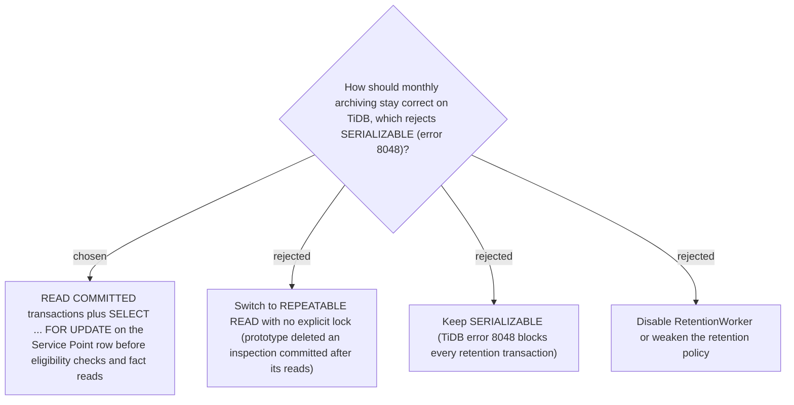

# Retention archive locks the Service Point row instead of using SERIALIZABLE

TiDB v8.5.6 rejects `SERIALIZABLE` with MySQL error 8048. A disposable `REPEATABLE READ` prototype passed the stock retention fixtures, but a two-connection archive test showed it could delete an inspection committed between the archive's fact reads and its summary insert. Replacing `SERIALIZABLE` with `REPEATABLE READ` alone therefore loses the guarantee that the summary, dependent cleanup and source deletion describe the same month.

The chosen strategy keeps one transaction per Service Point and month, but:

- Opens it at `READ COMMITTED` on MySQL/TiDB (`SERIALIZABLE` remains for SQLite, matching the other persistence code). Under TiDB's `REPEATABLE READ` the transaction snapshot can predate a writer that committed while the archive waited for the row lock; `READ COMMITTED` gives each post-lock read a fresh snapshot so that writer's row is included.
- Takes `SELECT ... FOR UPDATE` on the `service_points` row before checking the month marker or reading facts, including for a month with no facts. `scan_records` and `inspections` both have a foreign key to that row, and MySQL/TiDB lock the parent row during the child insert, so a concurrent submission or inspection either commits before the archive reads (and is included) or waits until the archive commits.
- Re-reads eligibility after the lock, skips the whole month if any submission or inspection is younger than the annual cutoff, deletes only the captured IDs under the same cutoff, and fails the transaction if a captured row could not be deleted. A new source left behind also fails the transaction.
- Detaches the summary marker after every attempt so a failed rollback cannot leave a tracked marker, and leaves retries to the worker: a deadlock or lock timeout rolls back the whole month and the existing 15-minute retry runs it again. Partial months are impossible because marker, cleanup and deletes commit together.

The Service Point lock is deliberately coarse. Retention runs at 02:00 Asia/Bangkok and holds the lock for one short month transaction, so a concurrent write at that time can wait briefly; a rare deadlock is resolved by the worker retry. See [facility-0055](facility-0055-data-retention-and-pdpa-before-production.md) for the unchanged 90-day GPS and one-calendar-year record policy.
