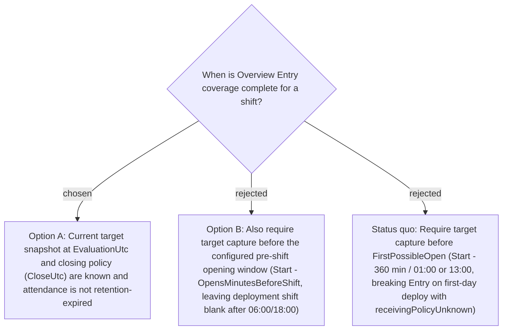

# Overview Entry availability decoupled from pre-shift opening policy

In `OverviewAvailability.Calculate`, `Entry` (`พื้นที่ที่ลงเวลาเข้าแล้ว`) previously gated completeness on `receivingKnown`, which required `timeline.ReceivingHistory[0].EffectiveAt <= FirstPossibleOpen` (`StartUtc - 360 min`) and `TargetCaptureFromUtc <= FirstPossibleOpen`. Whenever production first booted after `01:00` (Day shift) or `13:00` (Night shift), `OverviewHistoryBootstrap.EnsureAsync` set `CaptureStartedAtUtc` to the deployment time, causing `Entry` to drop to `partial` (`receivingPolicyUnknown`, `ยังไม่ทราบเวลาปิดรับข้อมูล`) and render `—` instead of `1/1 (100%)` on the donut chart even though the Area and `ShiftIn` check-in were present (`พบ 1 พื้นที่`).

We adopt **Option A**: decouple `Entry` completeness from pre-shift opening policy capture (`openingKnown`). `Entry` now requires only that the current target snapshot at `EvaluationUtc` be complete and readable, that the shift's closing policy (`CloseUtc`, evaluated at shift end / `EvaluationUtc`) be known and readable (`closingKnown`), and that the shift's attendance window remain within the 1-year retention cutoff (`AttendanceAfterUtc`). Pre-shift `openingKnown` continues to serve solely as the tighter check for `attendancePartlyExpired`; when target capture started after `FirstPossibleOpen`, the retention check retains its conservative fallback to `FirstPossibleOpen` (`StartUtc - 360 min`), ensuring no attendance row from a live or recent shift can ever be misclassified as complete if it might have been pruned.

`History` (`รอบที่ผ่านมาในกะนี้`) remains strictly independent and continues to require target history capture from `StartUtc` (`07:00` / `19:00`) across `[StartUtc, EvaluationUtc]` (`timeline.HistoryComplete`). Mid-shift first deployment therefore shows accurate live Entry, Work, and Inspection charts immediately while honestly marking prior-round `History` as `partial` (`targetCoverageMissing`) and excluding that partial shift from `OverviewAvailability.CalculateSupportedBounds`.
