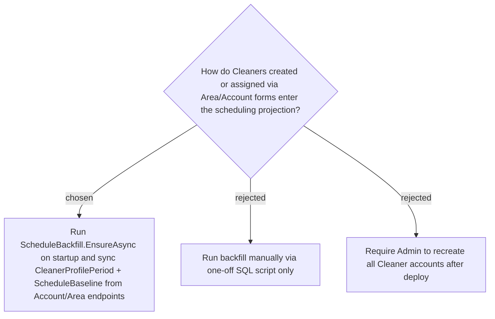

# Backfill schedule records on startup and sync Area assignments

On production (`f9c3644`), assigning an Area through `AdminAreaEndpoints` (`AreaCleaners.ApplyAsync`) updated only `users.AreaId` without writing `CleanerProfilePeriod` or `ScheduleBaseline`, while `AdminAccountEndpoints` wrote only `CleanerProfilePeriod` when an Area was already set and skipped creating a `ScheduleBaseline`. In addition, `ScheduleBackfill.EnsureAsync` was never invoked at application startup, leaving `ScheduleStore.ReadWeekAsync` with `historyStartsAt = DateOnly.MaxValue` (`unavailable`, rendering `"ไม่มีข้อมูลของสัปดาห์นี้"`).

We decide to:
1. Run `ScheduleBackfill.EnsureAsync` idempotently during API startup in `Program.cs` (inside the non-Testing migration/bootstrap block), defaulting `historyStartsAt` to `SchedulingSettings.HistoryStartsAt ?? ScheduleAuthority.BusinessDate(clock.GetUtcNow().UtcDateTime)` so existing accounts with known `AreaId`/`BuildingId` and `Shift` immediately gain their initial `CleanerProfilePeriod` and `ScheduleBaseline` (and Supervisors gain `SupervisorScopePeriod`).
2. Synchronize `CleanerProfilePeriod` and `ScheduleBaseline` inside the same database transaction whenever `AdminAreaEndpoints` (`AreaCleaners.ApplyAsync`) assigns or clears a Cleaner's Area, or `AdminAccountEndpoints` creates/updates/activates/deactivates a Cleaner account.

Manual one-off SQL backfill and recreating accounts were rejected because they repeat the same drift whenever Admins use the Area setup screen (`facility-0045`) after deployment. This complements [facility-0215](facility-0215-effective-dated-scheduling-records-and-scoped-projection.md) without altering historical rows prior to the synchronization date.
