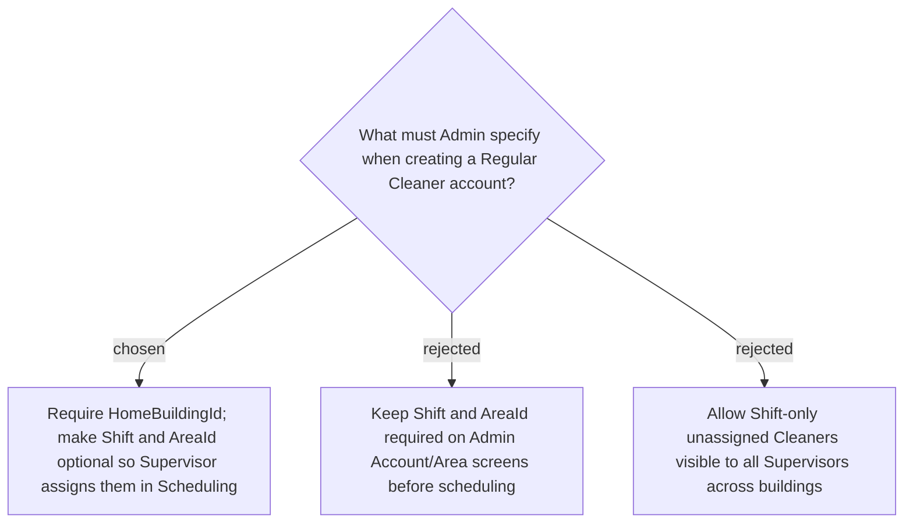

# Regular Cleaners require a home building with optional initial shift and Area

Previously, `AccountChecks.ReadPlaceAsync` derived a Regular Cleaner's building solely from `AreaId` and skipped creating `CleanerProfilePeriod` when `AreaId` was absent, while `CleanerProfilePeriod.Shift` was non-nullable in the schema (`SchedulingModel`). Because Supervisors manage schedules within their assigned building(s), a newly created Regular Cleaner without an initial Area never appeared on any Supervisor's roster.

We decide that Admin specifies a **home building (`HomeBuildingId`)** when creating or editing a Regular Cleaner (derived automatically from `Area.BuildingId` if an initial Area is selected, or chosen explicitly when `AreaId` is omitted), and **both `Shift` and `AreaId` are optional** on Regular Cleaner accounts. Making `CleanerProfilePeriod.Shift` nullable (`Shift?`) allows creating the dated `CleanerProfilePeriod` immediately on account creation so the Cleaner appears in their building Supervisor's schedule management table as unassigned (`ยังไม่จัดกะ/พื้นที่`), ready for the Supervisor to assign Shift and Area.

Requiring Admin to assign Shift/Area upfront was rejected because operational assignment belongs to the Supervisor (`facility-0131`); letting unassigned Cleaners float across all buildings was rejected because it breaks per-building Supervisor boundaries. This extends [facility-0215](facility-0215-effective-dated-scheduling-records-and-scoped-projection.md) and refines [facility-0040](facility-0040-area-is-the-unit-of-assignment.md) / [facility-0134](facility-0134-cleaners-retain-regular-areas-with-dated-exceptions.md).
