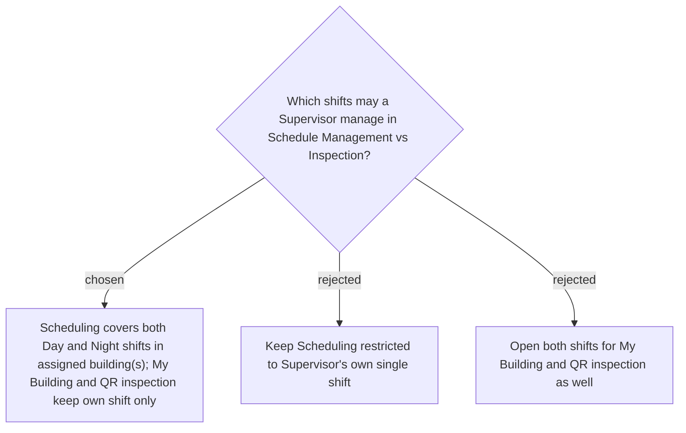

# Supervisor scheduling covers both shifts within assigned buildings

Under [facility-0132](facility-0132-supervisor-scheduling-scoped-to-own-building-and-shift.md) and [facility-0141](facility-0141-supervisor-shares-building-scope-for-view-schedule-and-inspection.md), a Supervisor's dated `ScopePeriod` restricted viewing, scheduling, and QR inspection to the Supervisor's own `(BuildingId, Shift)`. In practice, a building's Supervisor is responsible for arranging all Cleaners in that building across both Day and Night shifts (including moving a Cleaner between shifts), while field inspection still happens strictly during the Supervisor's own active shift.

We amend [facility-0132](facility-0132-supervisor-scheduling-scoped-to-own-building-and-shift.md) and [facility-0141](facility-0141-supervisor-shares-building-scope-for-view-schedule-and-inspection.md) for **scheduling operations only**:
- `ScheduleAuthority` introduces building-level scheduling checks (`CanManageSchedule` / `CanCorrectScheduleHistory`) that authorize a Supervisor for **both Day and Night shifts** (and unassigned-shift Cleaners) within any building covered by their dated `ScopePeriod` on the target date.
- `ScheduleStore.ReadWeekAsync`, `ScheduleCommandHandlers`, `TransferCommandHandlers`, `ReliefCommandHandlers`, `TeamAttendanceEndpoints`, `ScheduleCommandService`, `ScheduleNotifications`, and `SchedulePage` allow Supervisors to read, filter (`ทุกกะ` / `กะเช้า` / `กะดึก`), and schedule both shifts inside their assigned building(s).
- `SupervisorScope.WithoutCover` and `MyBuildingEndpoints` (`/my-building` and `/api/inspections/*`) remain unchanged and keep enforcing the Supervisor's own shift (`facility-0048`).

Keeping scheduling single-shift was rejected because Supervisors could not assign Shifts or arrange Night-shift staffing for their building; opening inspection across shifts was rejected to preserve off-shift scan blocking (`BlockedScan`).
