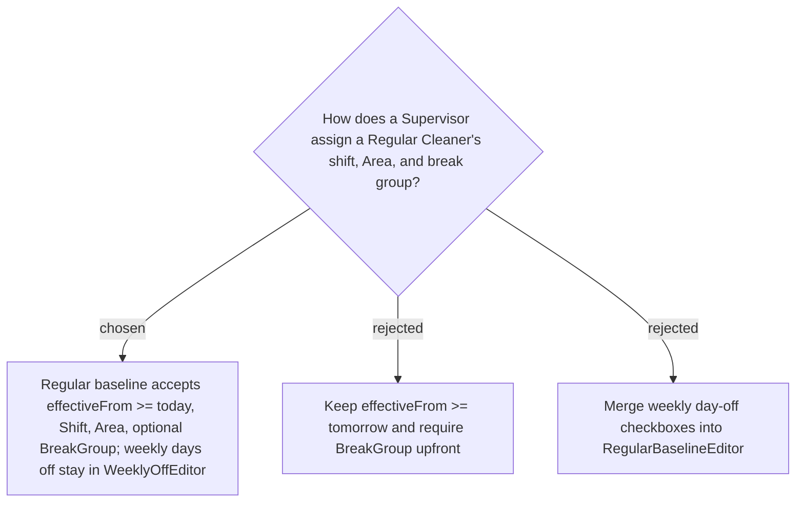

# Regular baseline editor starts today or later with Shift and optional break group

Previously, `SetRegularBaselineHandler` (`ScheduleBaselineWrite.ApplyRowAsync`) and `RegularBaselineEditor` required `EffectiveFrom > businessDate` (tomorrow or later), lacked a Shift field, and the UI required selecting a BreakGroup before reviewing. A newly onboarded Cleaner assigned to work today could not receive a baseline effective immediately on the current business date, nor could a Supervisor set Area and Shift before deciding BreakGroup.

We amend [facility-0187](facility-0187-regular-timetable-has-a-selected-future-start-date.md) and [facility-0188](facility-0188-regular-timetable-editor-reviews-changes-before-save.md):
1. `SetRegularBaselineHandler` accepts `EffectiveFrom >= actor.BusinessDate` (today or future).
2. `set-regular-baseline` accepts an optional `shift` (`Day` or `Night`) so a Supervisor can assign or change a Cleaner's shift starting on `EffectiveFrom`, closing/updating `CleanerProfilePeriod` at `EffectiveFrom`.
3. `BreakGroup` remains optional (`null` allowed in `ScheduleBaselineDay` and UI), while `AreaId` + `Shift` enforce the 1-Cleaner-per-`(AreaId, Shift)` uniqueness rule and `Area.ShiftPattern` (`DayOnly` rejects `Night`).
4. When `EffectiveFrom == actor.BusinessDate`, `users.AreaId` and `users.Shift` compatibility projections are synchronized atomically inside the command transaction so live check-in, `AccountView`, and `AdminAreaEndpoints` stay consistent.
5. Weekly day-off selection remains separated in `WeeklyOffEditor` (`set-weekly-days-off`, [facility-0190](facility-0190-supervisor-selects-cleaner-days-off-by-week.md) and [facility-0191](facility-0191-weekly-days-off-use-the-multi-person-roster-layout.md)) rather than duplicating per-week checkboxes inside the baseline editor.

Enforcing `EffectiveFrom > today` was rejected because it blocks immediate same-day onboarding; merging weekly days off into the baseline editor was rejected to preserve the multi-person weekly day-off roster and week isolation rules (`facility-0190`, `facility-0191`).
