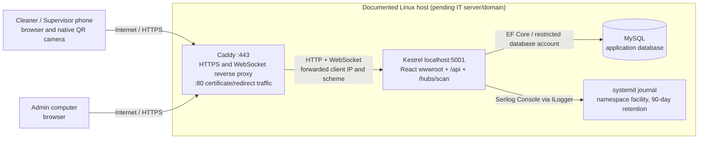
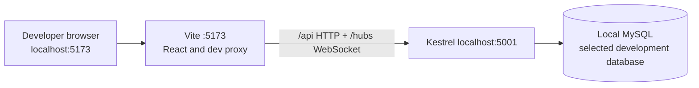
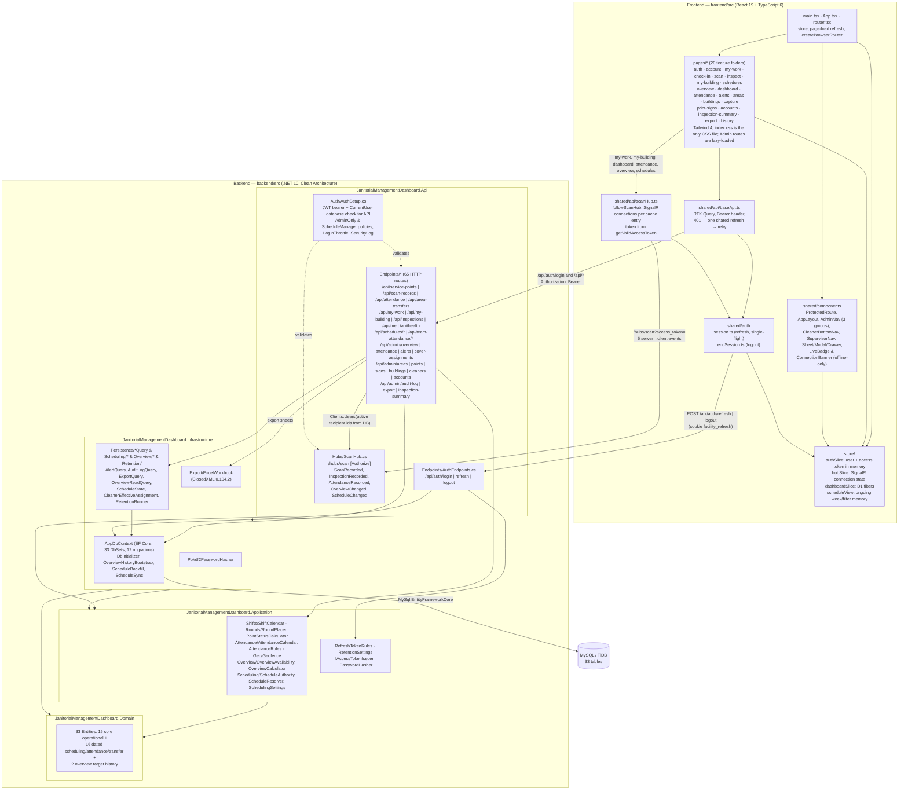
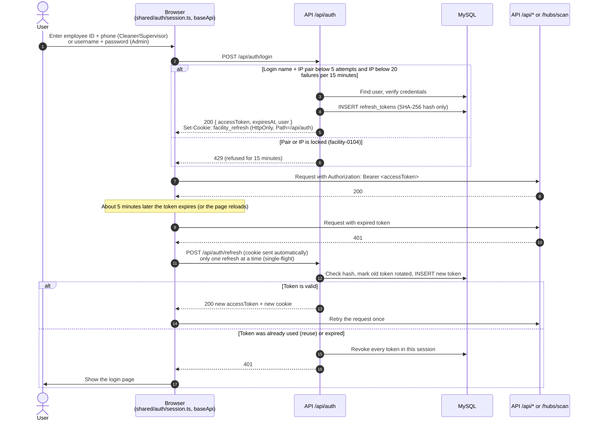
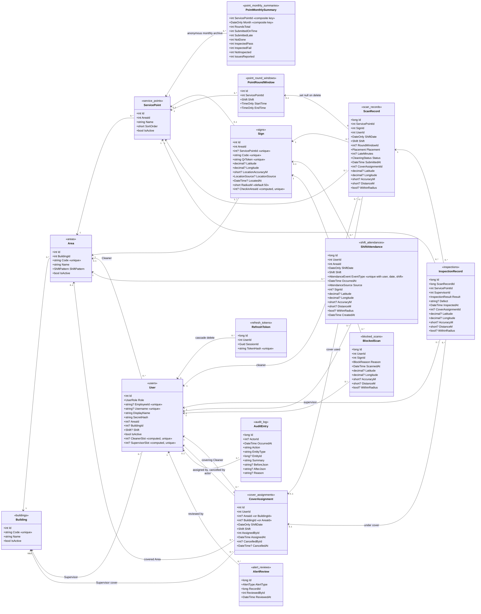

# Architecture — how the Janitorial Management Dashboard is connected

Describes the application code as of 2026-11-23 (`master`, including Overview Target History, Dated Scheduling & 6-stage shift-aware attendance, TiDB-compatible `READ COMMITTED` retention, and the multi-viewport responsive UI) and the documented deployment topology; current checkout/publication status is in [handoff](handoff.md). See [code map](code-map.md) for files and [ADRs](adr/README.md) for decisions.

## 1. Deployment and network

Production requires a fixed public HTTPS domain because workers use mobile data and phone GPS requires a secure context (facility-0049). The API serves the built React app and `/api` and `/hubs` from one origin (facility-0067). Vite is used for development only.

The server OS is still undecided. The following is the **Linux deployment documented in [handover.md](handover.md)**, not a claim that the server is already running:



| Boundary | Documented rule |
|---|---|
| Internet → host | Public HTTP/HTTPS ports 80/443 terminate at Caddy; browsers use HTTPS |
| Caddy → API | Kestrel listens on loopback only; trust `X-Forwarded-For` and `X-Forwarded-Proto` from loopback for one hop (0104, 0106) |
| API → MySQL | Database is not a browser endpoint; use the application's own database account |
| Browser security | App middleware sets CSP, frame denial, nosniff, no-referrer and Permissions-Policy; HSTS on HTTPS outside Development, excluding localhost; `/api` gets `no-store` (0106) |
| Browser → signs | Printed QR URLs use the origin of the print page, so permanent signs need the fixed HTTPS domain |

The app migrates its selected database on startup, bootstraps `OverviewHistoryBootstrap` and `ScheduleBackfill`, and validates `Scheduling:CommandSigningKey` (>= 32 UTF-8 bytes, logging an error if missing or too short so reads still work while schedule command saves refuse until configured). Development alone adds synthetic fixtures and exposes Swagger; Production has no seed or Swagger and creates the first Admin from private settings (0092, 0093). It refuses a missing connection string or JWT signing key. Never publish Development fixtures with real data.

### Local development and phone trials



Use the explicit port 5001 to override the launch profile's 5225 default and match `vite.config.ts`. Alternatively, `npm --prefix frontend run build:api` writes the frontend to the API's ignored `wwwroot`; browse localhost:5001 directly without Vite. Both use one browser origin, so no cross-origin cookie setup is needed.

For phone trials, a Cloudflare Quick Tunnel provides temporary HTTPS to localhost:5001 (handover §2.9). Its URL changes on each start. Same-WiFi HTTP (facility-0003) is historical and remains useful only for development that does not require phone GPS; facility-0049 supersedes it for real use. No current firewall or running-service state is implied by this diagram.

---

## 2. Component diagram — what talks to what

The frontend follows [Frontend Target Tree (0025)](adr/facility-0025-frontend-target-tree.md) and [Frontend Router Shape (0026)](adr/facility-0026-frontend-router-shape.md).



Project references follow Clean Architecture: `Api → Application, Infrastructure`; `Infrastructure → Application, Domain`; `Application → Domain`; `Domain` depends on nothing.

> Note: [facility-0004](adr/facility-0004-app-architecture.md) plans Mediator handlers in `Application`. The code does not use Mediator yet. The endpoint handlers live in `Endpoints/` (AuthEndpoints, MeEndpoints, ServicePointEndpoints, ScanRecordEndpoints, AttendanceEndpoints, CoverAssignmentEndpoints, MyWorkEndpoints), use `AppDbContext` directly, and `Program.cs` only composes them. The Admin pages add `AdminAccountEndpoints` (accounts, plan 5) and `AdminExportEndpoints` (Excel export, plan 5) beside the earlier Admin endpoints. Plan 6 adds `InspectionEndpoints`, `MyBuildingEndpoints` and `AdminInspectionSummaryEndpoints`. `PointNotifications` sends point changes to the Admins and to the building's Supervisors, addressed by account id (`Hubs/SubjectUserIdProvider`).

**Excel export (facility-0053).** `POST /api/admin/export` reads rows through `ExportQuery` (attendance, submissions, and the active points with their Round Windows, from which the "ไม่ได้ทำ" rows are computed by `ExportRules`). `ExportSheets` turns them into sheets and `Infrastructure/Export/ExcelWorkbook` writes the `.xlsx` with ClosedXML 0.104.2 (MIT licence, the only package plan 5 added). Every cell is written as text (dates `yyyy-MM-dd`, times `HH:mm`), so a name such as `=1+1` can never become a formula when the Admin opens the file. Column widths are fixed, because auto-fit needs fonts that the server may not have. The inspection set adds the "การตรวจงาน" sheet (`InspectionHistoryQuery`, `InspectionHistory.FinishedRounds`): the Inspection Records plus ไม่ได้ตรวจ / ไม่ได้แก้ rows for closed shifts. Each export writes one `EXPORT_EXCEL` audit row with the range, building, sets and row counts, and no row content.

**First Admin and reset-admin (facility-0092).** After the migration (and the Development seed), `FirstAdmin.EnsureAsync` creates one Admin from the server's `FirstAdmin__Username`, `FirstAdmin__Password` and `FirstAdmin__DisplayName`, only while no Admin row exists at all. A bad value stops the startup and names the setting, never the password. Started as `JanitorialManagementDashboard.Api reset-admin <username>`, `Program` migrates, runs `Commands/ResetAdminCommand` (password asked twice with the typing hidden), and exits without serving, so it needs only the connection string. Both go through `Persistence/ServerAdminAccounts` and write audit rows whose actor is null, which the history shows as "ระบบ". The handover guide is `docs/handover.md`.

---

## Live updates, sessions and operational limits

- Six cache-entry modules use `followScanHub`: My Work (`myWorkApi`), My Building (`myBuildingApi`), Dashboard (`dashboardApi`), Attendance (`attendanceBoardApi`), Overview (`overviewApi`), and Schedules (`schedulesApi`). My Work, Attendance, Overview, and Schedules refetch on scoped invalidation events; Dashboard and My Building patch point cards. Admin boards also poll every 30 s and refetch on focus. Push failures after saving are logged; they do not turn the saved record into an HTTP failure.
- All followers listen for browser offline/online so SignalR reconnects and refetches after 1 s on reconnect (`ADMIN_HUB_SERVER_TIMEOUT_MS` 10 s for Admin, 30 s for phones; server pings every 5 s per facility-0107). In the UI, `LiveBadge` and `ConnectionBanner` read `useOnlineStatus` (`navigator.onLine` + `online`/`offline`) and show `"ขาดการเชื่อมต่อ"` only when the browser is actually offline — transient SignalR reconnects recover silently in the background.
- Every push looks up active recipients in the database at send time. There is no `admins` connection group. Deactivation blocks the next protected API read and stops subsequent pushes, although an already open socket may remain connected (0105). Phone/password changes revoke refresh tokens; existing access tokens can last up to 5 minutes.
- Login Lock combines a login-name/IP pair (5 attempts per 15 minutes, cleared by success) and an IP-wide failure cap of 20. IPv6 is normalized to /64. The counters are in memory on one server (0104).
- `ILogger` writes through Serilog, Console only. Linux's journal is the retained Server Log; no request logging or external sink is configured (0103).
- The retention runner (0055, 0236) clears raw GPS at 90 days, deletes annual attendance/blocked scans and transactionally archives old point/months into anonymous summaries using `READ COMMITTED` + `SELECT ... FOR UPDATE` on `service_points` for MySQL/TiDB compatibility (`SERIALIZABLE` stays on SQLite). RetentionWorker starts after ApplicationStarted, catches up and runs nightly at 02:00 Bangkok; failures retry after 15 minutes. Whole-month archive semantics and configuration are in [data-retention.md](data-retention.md). PDPA notice/HR-before-production work was removed by the owner on 2026-11-03. Excel import is shelved. See [handoff](handoff.md) for the remaining work.

---

## Dated scheduling, attendance, and overview

The scoped week read goes through `ScheduleStore` and the pure `ScheduleResolver`. It loads dated identities (`CleanerProfilePeriod`, with nullable `Shift` for newly onboarded Regular Cleaners per facility-0239), Supervisor building periods (`SupervisorScopePeriod`), baselines and overrides with the selected week's days. Startup runs `ScheduleBackfill.EnsureAsync` and account/area writes call `ScheduleSync` so dated scheduling authority stays synchronized with setup tables (facility-0238). Cleaner reads are scoped to their own account; Supervisor reads cover both Day and Night shifts within their dated assigned buildings (facility-0240), while `/my-building` and QR inspections stay scoped to the Supervisor's own shift; Admin can select any building and shift.

`ScheduleCommandService` validates a server-issued command identity (signed with `Scheduling:CommandSigningKey`, >= 32 UTF-8 bytes) and locks the relevant anchors in a consistent global order (`ScheduleBaselineAnchor` before `ScheduleScopeAnchor`). Regular baseline setup allows `EffectiveFrom >= businessDate` (same-day onboarding) with explicit `Shift` and optional `BreakGroup` (facility-0241). The handler applies its business changes and stores audit facts and the receipt in the same transaction. After commit the server sends `ScheduleChanged` scoped invalidation so affected screens can refetch an authorised read. The UI preserves a draft when a revision changes or a result remains uncertain.

Attendance uses a 6-stage lifecycle per shift (Day: เข้างาน, พักเที่ยง, กลับจากพักเที่ยง, พักบ่าย, กลับจากพักบ่าย, เลิกงาน; Night and cross-shift headers: พักรอบ 1 / พักรอบ 2) and keeps actual timestamps in UTC. The scan, correction and transfer-confirmation paths take the same person-slot lock while checking current facts. `CleanerEffectiveAssignment` and `EffectiveDutyReader` resolve the Cleaner's dated assignment, relief or transfer status. The attendance board includes accepted relief assignments and projects historical entry evidence separately from current responsibility. It counts a destination Area as entered only from accepted arrival evidence or an initial check-in.

Combined Overview (`/admin/overview`) reads immutable `overview_target_revisions` + `overview_target_state` (bootstrapped at startup by `OverviewHistoryBootstrap`) alongside `scan_records.round_origin_id`. `OverviewAvailability.Calculate` decouples `Entry` availability from pre-shift opening policy so mid-shift first deployments report complete Entry coverage while keeping History partial until a full shift is captured (facility-0237). [Code paths](code-map.md#dated-scheduling-and-actual-attendance) · [Cutover and rollback](handover.md#210-เตรียมตารางงานและการลงเวลา-6-ขั้น)

## 3. Sequence diagram — a scan reaches the dashboard in real time

> Note (plan 11): the phone side is plan 8's `pages/scan`; the Admin side is `pages/dashboard`, whose `getServicePoints` cache entry follows the hub with `followScanHub`. Plan 9's Supervisor live updates and plan 11's attendance board are in the section 2 diagram.

This is the main flow: a Cleaner submits a Scan Record and the Admin Dashboard updates.

```mermaid
sequenceDiagram
    autonumber
    actor Cleaner
    participant Phone as Phone browser<br/>(pages/scan ScanPage)
    participant Vite as Same-origin host<br/>(Caddy in deployment / Vite in dev)
    participant Api as API :5001<br/>(Endpoints/*)
    participant DB as MySQL
    participant Hub as ScanHub<br/>/hubs/scan
    participant Dash as Admin browser<br/>(pages/dashboard, getServicePoints cache)

    Note over Dash,Hub: Earlier: an Admin opened the Dashboard; its WebSocket to /hubs/scan<br/>(?access_token=<JWT>) was authenticated; recipients are read at send time (facility-0105)

    Cleaner->>Phone: Scan QR with phone camera → opens /scan/{qrToken}
    Phone->>Vite: GET /api/service-points/by-token/{qrToken}<br/>Authorization: Bearer <JWT>
    Vite->>Api: forward
    Api->>DB: SELECT sign → point, this shift's Round Windows, Scan and Inspection Records
    DB-->>Api: rows
    Api-->>Phone: 200 PointStatusDto (no QR Token)

    Note over Cleaner,Phone: Before any scan the Cleaner records Shift-In at the Area's check-in sign:<br/>it opens /check-in/{qrToken}, and the press sends POST /api/attendance with a fresh GPS fix

    Cleaner->>Phone: Choose Normal / Issue (+ tags, notes), tap submit
    Phone->>Vite: POST /api/scan-records { qrToken, status, issueTags, notes,<br/>latitude, longitude, accuracyM }
    Vite->>Api: forward
    Note right of Api: The scanner is the user in the JWT,<br/>never a field in the body (facility-0017)
    Api->>Api: CurrentUser (401), Cleaner only (403),<br/>validate tags and note, status, GPS via GpsInput.TryRead (400)
    Api->>DB: Find sign by QR Token → active point and Area (404 if none)
    DB-->>Api: sign, point, Area
    alt Sign is in another Area and the Cleaner has no active Cover Assignment for this shift slot
        Api->>DB: INSERT blocked_scans (OTHER_AREA)
        Api-->>Phone: 403 (sign's Area code and name)
    end
    Api->>Api: AttendanceCalendar.SlotFor(user.Shift, now) → 409 outside the attendance window
    Api->>DB: Read today's attendance events
    Api->>Api: AttendanceRules.IsOnDuty(...) → 409 if not on duty (Shift-In to Shift-Out, breaks do not block)
    Api->>Api: RoundFactsQuery + RoundPlacer.Place(...) → OnTime / Late / Rework / OffRound (facility-0047)
    Api->>Api: GpsStamping.StampGps → latitude, longitude, accuracy, distance, within radius (no verdict if the sign has no coordinates)
    Api->>DB: INSERT scan_records (shift, round, placement, GPS, cover assignment)
    DB-->>Api: OK
    Api->>Api: PointStatusCalculator.Calculate(...)
    Api->>DB: Read active Admin ids and scoped active recipients
    Api->>Hub: Clients.Users(adminIds).SendAsync("ScanRecorded", dto)
    Note right of Hub: Sent for the Dashboard's running shift (ShiftCalendar), not the Cleaner's attendance slot
    Note right of Hub: PointNotifications also sends to the building's Supervisors and Area's Cleaners, including current covers (Clients.Users)
    Hub-->>Dash: "ScanRecorded" (WebSocket push)
    Dash->>Dash: followScanHub hands the card to the cache entry, updateCachedData replaces that point's card, no page reload (a point not on the page: GET /api/service-points again)
    Note over Dash: Every open, every 30 s and on window focus the Dashboard asks GET /api/service-points again (facility-0061), and after every hub start or reconnect (facility-0064)
    Api-->>Phone: 201 Created { scanRecordId, placement, lateMinutes, newPointStatus, submittedAt,<br/>distanceM, withinRadius }
```

---

## 4. Sequence diagram — login, token refresh and page reload

The access token (JWT, 5 minutes) lives only in browser memory. The refresh token lives in an HttpOnly cookie
that the browser sends only to `/api/auth` ([facility-0011](adr/facility-0011-jwt-api-authentication.md) – [facility-0016](adr/facility-0016-refresh-token-sliding-30-days.md)).



---

## 5. Class diagram — data stored in MySQL



The diagram above shows the 15 core operational tables (the original pilot schema is also illustrated in `docs/design/database.html`). The full EF Core model (`AppDbContext.cs`, 12 migrations) currently contains **33 tables**: those 15 core tables, **16 dated scheduling/attendance/transfer tables** (`supervisor_scope_periods`, `cleaner_profile_periods`, `schedule_baselines`, `schedule_baseline_days`, `weekly_day_offs`, `weekly_day_off_choices`, `schedule_exceptions`, `relief_assignments`, `area_transfers`, `area_transfer_confirmations`, `attendance_gaps`, `schedule_anchors`, `schedule_baseline_anchors`, `schedule_scope_anchors`, `schedule_command_receipts`, `schedule_changes`), and **2 overview target history tables** (`overview_target_revisions`, `overview_target_state`). Point Status is not stored: the API computes it on every read from the point's current Round Window, that shift's Scan Records and their Inspection Records (`Application/Rounds/PointStatusCalculator`, [facility-0047](adr/facility-0047-cleaning-rounds-are-time-windows.md)). A Scan Record's round is decided once, when it is saved (`Application/Rounds/RoundPlacer`). A Cover Assignment lets one Cleaner work another Area in their own regular shift; it lapses when that Cleaner's attendance window for the shift closes ([facility-0069](adr/facility-0069-attendance-scan-window-60-minutes-around-the-shift.md)). A Supervisor's Cover Assignment names a building instead of an Area, for one shift by the clock (facility-0048); a CHECK keeps exactly one of the two. An Inspection Record keeps the GPS of the inspection; outside the sign's radius it is the `INSPECTION_GPS` alert. Blocked Scans and Audit Log rows are history the Admin reads on the alert and history pages and that no one edits (facility-0041, facility-0051). An Alert Review records that the Admin closed one alert ("คุยแล้ว ปิดเตือน") on a Blocked Scan or a scan outside its sign's radius, one per alert; a missing Shift-Out is never reviewed, it closes when the Admin fills the time (facility-0051).

---

## Connection summary

| From | To | Protocol | Auth | Configured in |
|---|---|---|---|---|
| Browser (deployment) | Caddy → API | HTTPS / WebSocket | JWT or auth cookie | `docs/handover.md`, `Program.cs` |
| Browser (development) | Vite `:5173` | HTTP on localhost | — | `frontend/vite.config.ts` |
| Vite proxy (development) | API `:5001` `/api/*` | HTTP/JSON | `Authorization: Bearer <JWT>` | `frontend/vite.config.ts` |
| Vite proxy (development) | API `:5001` `/hubs/scan` | WebSocket (SignalR) | `?access_token=<JWT>` (hub paths only) | `Auth/AuthSetup.cs`, `frontend/src/shared/api/scanHub.ts` (`followScanHub`) |
| Browser | Same-origin `/api/auth/*` | HTTPS/JSON (HTTP on localhost in dev) | HttpOnly cookie `facility_refresh` | `Endpoints/AuthEndpoints.cs` |
| API | MySQL `:3306` | MySQL protocol via EF Core | `ConnectionStrings:DefaultConnection` | `appsettings.Development.json` (developer machine only); a server sets `ConnectionStrings__DefaultConnection` in its env file (facility-0093, `docs/handover.md`) |
| API | itself on startup | — | — | `Program.cs`: migrate, synthetic seed only in Development, then FirstAdmin settings if no Admin exists |
