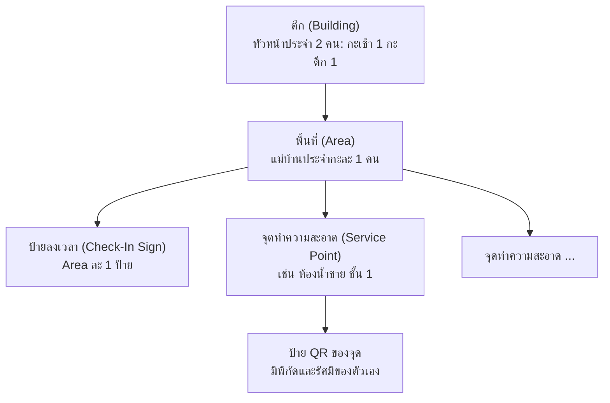
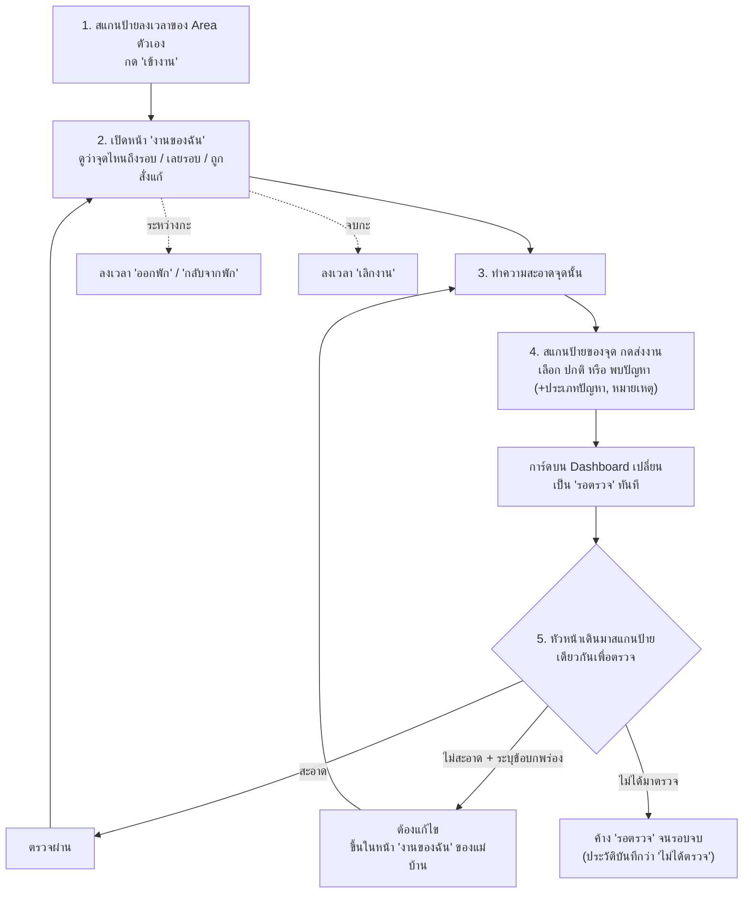

# ภาพรวมระบบ Facility Real-time Dashboard (สำหรับ PM)

เอกสารนี้อธิบายว่าระบบทำอะไร ใครใช้ กติกาทางธุรกิจมีอะไรบ้าง และตอนนี้ทำไปถึงไหนแล้ว โดยไม่ลงรายละเอียดทางเทคนิค
ข้อมูล ณ วันที่ 3 พ.ย. 2026

- คำศัพท์ทั้งหมดของระบบอยู่ใน [CONTEXT.md](../CONTEXT.md)
- เหตุผลเบื้องหลังแต่ละกติกาอยู่ใน [docs/adr/](adr/) (อ้างเป็นเลข เช่น facility-0047)
- คำตอบของพี่เลี้ยงที่เป็นที่มาของกติกาส่วนใหญ่อยู่ใน [2026-10-06-supervisor-answers.md](requirements-gathering/2026-10-06-supervisor-answers.md)

---

## 1. ระบบนี้คืออะไร

ระบบบนเว็บที่ใช้ติดตามงานทำความสะอาดในโรงงานแบบเรียลไทม์ แม่บ้านและหัวหน้าใช้มือถือของตัวเองสแกนป้าย QR ที่ติดไว้หน้างาน แล้ว Admin เห็นผลบนหน้าจอทันทีโดยไม่ต้องกดรีเฟรช

**ปัญหาที่ระบบแก้ (3 ข้อ):**

| ด้าน | ปัญหาเดิม | ระบบช่วยอย่างไร |
|---|---|---|
| 1. คนมาครบไหม | แตะบัตรไม่ได้บอกว่าแม่บ้านเข้าพื้นที่ของตัวเองจริง | แม่บ้านลงเวลาที่ป้ายของพื้นที่ตัวเอง พร้อมตรวจพิกัด GPS |
| 2. จุดไหนทำแล้ว | ไม่รู้ว่าจุดไหนทำแล้ว จุดไหนเลยเวลา | การ์ดของทุกจุดเปลี่ยนสีตามรอบเวลาและการส่งงาน |
| 3. หัวหน้าตรวจจริงไหม | ไม่มีหลักฐานว่าหัวหน้าเดินตรวจ และไม่มีขั้นตอนสั่งแก้งาน | หัวหน้าต้องสแกนป้ายที่จุดเพื่อตรวจ และสั่งแก้งานได้ |

**ขนาดของโรงงานจริง:** 6 ตึก, 70–72 พื้นที่ (Area), แม่บ้านประมาณ 170 คน, 2 กะ

---

## 2. ใครใช้ระบบ

| บทบาท | บนหน้าเว็บเรียก | เข้าระบบด้วย | ใช้บน | ทำอะไร |
|---|---|---|---|---|
| แม่บ้าน (Cleaner) | แม่บ้าน | รหัสพนักงาน + เบอร์โทร | มือถือตัวเอง เน็ตตัวเอง | ลงเวลา, ทำความสะอาด, สแกนส่งงาน, แจ้งปัญหา |
| หัวหน้างาน (Supervisor) | หัวหน้า | รหัสพนักงาน + เบอร์โทร | มือถือ | เดินตรวจงานที่ส่งแล้ว ให้ผ่าน หรือสั่งแก้ |
| ผู้ดูแลระบบ (Admin) | แอดมิน | ชื่อผู้ใช้ + รหัสผ่าน | คอมพิวเตอร์ | ดูภาพรวม, ตั้งค่าพื้นที่และป้าย, จัดการบัญชี, แก้เวลา, มอบหมายทำแทน, ส่งออก Excel |

- login ครั้งเดียวแล้วระบบจำไว้ 30 วัน (ถ้าไม่ได้ใช้เลย 30 วันต้อง login ใหม่) และ login ได้หลายเครื่อง
- ระบบไม่ลบบัญชี ใช้วิธีปิดใช้งาน ประวัติเดิมยังอยู่ครบ

---

## 3. โครงสร้างของสถานที่

- **ตึก** มีหลาย **Area** แต่ละ Area อยู่ในตึกเดียว
- **Area** คือหน่วยของการมอบหมายงาน แม่บ้านอยู่ Area เดิมทุกวัน กะละ 1 คน
  - Area แบบ 2 กะ (เช้า 07:00–19:00 และดึก 19:00–07:00) มีแม่บ้านประจำ 2 คน
  - Area แบบกะเช้าอย่างเดียว (เช่น Office) มีแม่บ้าน 1 คน กะดึกจุดของ Area นี้ขึ้น "นอกเวลา"
- **ป้ายมี 2 แบบ:** ป้ายลงเวลา (1 ป้ายต่อ Area) และป้ายของแต่ละจุดทำความสะอาด ทุกป้ายเป็นกระดาษพิมพ์ QR
- ทุก Area ทำงานทุกวัน ไม่มีวันหยุดของ Area

---

## 4. หนึ่งกะของแม่บ้าน ตั้งแต่ต้นจนจบ

---

## 5. กติกาทางธุรกิจ

### 5.1 การลงเวลา (Shift Check-In)

- **จุดประสงค์คือยืนยันว่าแม่บ้านเข้าพื้นที่ของตัวเองแล้ว ไม่ใช่ระบบลงเวลาทำงานของบริษัท** จึงไม่คิดสาย ไม่คิดกลับก่อน และไม่ใช้คิดค่าจ้าง (facility-0050)
- ลงเวลา 4 ครั้งต่อกะ ตามลำดับ: **เข้างาน → ออกพัก → กลับจากพัก → เลิกงาน** (ไม่พักก็ข้ามไปเลิกงานได้) หน้าจอแสดงเฉพาะปุ่มที่กดได้ในขั้นนั้น (facility-0031)
- **ต้องลงเวลาเข้างานก่อน ถึงจะส่งงานได้** ส่งงานได้ตั้งแต่เข้างานจนถึงเลิกงาน ช่วงพักก็ยังส่งได้
- ลงเวลาได้ตั้งแต่ 60 นาทีก่อนกะเริ่ม ถึง 60 นาทีหลังกะจบ (facility-0069)
- สแกนซ้ำในกะเดียว ระบบยึดเวลาแรก
- ลืมลงเวลา แบตหมด หรือไม่มีเน็ต: **Admin เพิ่มหรือแก้เวลาให้ได้ ต้องใส่เหตุผลทุกครั้ง** ระบบเก็บค่าเดิมไว้และติดป้าย "แก้โดย Admin" แม่บ้านและหัวหน้าแก้เองไม่ได้ (facility-0051)
- ลืมกดเลิกงาน: ปล่อยว่างไว้ แล้วขึ้นเตือนให้ Admin เติม

### 5.2 รอบทำความสะอาด (Round Window)

แต่ละจุดมีรอบเป็น **ช่วงเวลา** ของตัวเอง ตั้งแยกกะเช้า/กะดึก เช่น ห้องน้ำรอบ 07:00–09:00 และ 16:00–18:00 (facility-0047)

การส่งงานนับเป็นของรอบไหน ดูจากเวลาที่ส่ง (ตัวอย่างใช้รอบ 07:00–09:00 และ 16:00–18:00):

| ส่งตอนไหน | ระบบนับเป็น | ตัวอย่าง |
|---|---|---|
| อยู่ในช่วงของรอบ | งานของรอบนั้น ตรงเวลา | ส่ง 08:10 → รอบ 07:00 |
| หลังรอบจบ และรอบนั้นยังไม่มีใครส่ง | งานของรอบนั้น แต่ **ส่งช้า** (เก็บว่าช้ากี่นาที) | ส่ง 09:40 → รอบ 07:00 ช้า 40 นาที |
| หลังรอบจบ และหัวหน้าสั่งแก้รอบนั้น | การแก้งานของรอบนั้น | ส่ง 11:00 → แก้งานรอบ 07:00 |
| หลังรอบจบ และรอบนั้นส่งไปแล้ว | **ส่งเพิ่ม (ไม่นับรอบ)** บันทึกไว้แต่การ์ดไม่เปลี่ยน | ส่ง 15:30 → ไม่นับรอบใด |

- ไม่มีเวลาผ่อนผัน เลย 09:00 แล้วยังไม่ส่ง = เลยเวลาทันที
- **รอบใหม่เริ่ม การ์ดเริ่มใหม่เสมอ** ไม่ค้างรอหัวหน้าหรือรอแก้งาน ผลของรอบเก่าเก็บในประวัติเป็น "ไม่ได้ทำ", "ไม่ได้ตรวจ" หรือ "ไม่ได้แก้"

### 5.3 สถานะบนการ์ดของแต่ละจุด (Point Status)

ระบบคำนวณสดจากรอบปัจจุบัน ถ้าตรงหลายข้อ ใช้ข้อที่อยู่บนสุด:

| ลำดับ | สถานะ | ความหมาย |
|---|---|---|
| 1 | ต้องแก้ไข | หัวหน้าตรวจแล้วไม่สะอาด แม่บ้านยังไม่ส่งงานแก้ |
| 2 | เลยเวลา | รอบจบแล้ว ยังไม่มีการส่งงาน |
| 3 | รอตรวจ | ส่งงานแล้ว หัวหน้ายังไม่ตรวจ |
| 4 | ตรวจผ่าน | หัวหน้าตรวจแล้วสะอาด |
| 5 | ยังไม่ทำ | อยู่ในช่วงรอบ ยังไม่ส่งงาน |
| 6 | ยังไม่ถึงรอบ | กะเริ่มแล้ว แต่รอบแรกยังไม่เริ่ม (แสดงเวลารอบถัดไป) |
| 7 | นอกเวลา | Area ที่ทำเฉพาะกะเช้า ในช่วงกะดึก |

**การแจ้งปัญหา (Issue)** เช่น ก๊อกรั่ว ของชำรุด ไม่ใช่สถานะการ์ด แต่เป็น **ป้ายสีแดงแยก** บนการ์ด การ์ดยังเป็นไปตามรอบตามปกติ ป้ายแดงหายเมื่อการส่งงานครั้งถัดไปของจุดนั้นเป็น "ปกติ" (facility-0046)

### 5.4 การตรวจงานของหัวหน้า (Inspection)

- หัวหน้าประจำ **ตึก + กะ** (ตึกละ 2 คน: เช้า 1 ดึก 1) ตรวจได้ทุก Area ในตึกตัวเอง เฉพาะในกะของตัวเอง (facility-0048)
- หัวหน้า **ไม่ต้องลงเวลา**
- ตรวจได้เฉพาะงานที่ส่งในรอบปัจจุบัน ถ้ารอบนี้ยังไม่มีการส่ง หน้าจอบอกว่า "รอบนี้แม่บ้านยังไม่ส่งงาน" และไม่มีปุ่มตรวจ
- ผลตรวจมี 2 แบบ: **สะอาด** หรือ **ต้องแก้ไข** (ต้องเขียนข้อบกพร่อง) ถ้าต้องแก้ แม่บ้านแก้แล้วส่งใหม่ หัวหน้าตรวจซ้ำได้
- **ตรวจกี่ครั้งก็ได้ หรือไม่ตรวจเลยก็ได้** ระบบไม่บังคับและไม่ประเมินผลหัวหน้าเอง Admin ดูหน้า "สรุปการตรวจ" แล้วประเมินเอง (เช่น สัปดาห์นี้หัวหน้า A ตรวจไม่ครบทุกจุด)

### 5.5 กันการโกง: GPS และสแกนผิดพื้นที่

**ปัญหาที่กัน:** แม่บ้านถ่ายรูป QR เก็บไว้แล้วสแกนจากที่อื่น (ห้องพัก ตึกอื่น ที่บ้าน)

- **ทุกการสแกน (ลงเวลา ส่งงาน ตรวจงาน) ต้องอ่าน GPS ได้** ถ้าปิด Location จะสแกนไม่ได้เลย (facility-0036, 0037)
- ระบบเทียบพิกัดมือถือกับพิกัดของป้าย รัศมีเริ่มต้น 50 เมตร Admin ปรับได้ทีละป้าย (10–500 เมตร) (facility-0038)
- **อยู่นอกรัศมี = ระบบรับไว้ แต่ติดธง "ไกลป้าย"** ไม่ปฏิเสธ แล้วขึ้นเตือนให้ Admin เรียกคุย (facility-0035)
- ข้อจำกัดที่ยอมรับแล้ว: GPS ในอาคารยืนยันได้แค่ระดับตึก ไม่ได้ระดับห้อง

**สแกนผิดพื้นที่ = บล็อก** (facility-0041, 0048)

- แม่บ้านสแกนป้ายของ Area อื่น หรือหัวหน้าสแกนจุดในตึกอื่นหรือนอกกะตัวเอง → ระบบ **ไม่บันทึก** แจ้งบนมือถือ และขึ้นเตือนให้ Admin เห็น
- ตัดสินจากป้ายที่สแกน ไม่ใช่จาก GPS

**การมอบหมายทำแทน (Cover Assignment)**

- วันที่แม่บ้านประจำไม่มา Area นั้นขึ้นว่า "ยังไม่มีคน" Admin มอบหมายแม่บ้านของ Area อื่นให้ทำแทน **เฉพาะกะนั้น** หมดกะแล้วสิทธิ์หมดเอง (มอบหมายล่วงหน้าได้ไม่เกิน 7 วัน)
- ไม่มีแม่บ้านสำรอง คนทำแทนจึงทำทั้ง Area ตัวเองและ Area ที่ได้รับมอบหมาย
- ใช้กับหัวหน้าที่ตรวจแทนตึกอื่นด้วย
- ระบบไม่เก็บตารางวันหยุดของแม่บ้าน

### 5.6 ส่งงานไม่ได้เพราะไม่มีเน็ต

หน้าจอบอกชัดว่า **"ยังไม่ได้บันทึก"** พร้อมปุ่มส่งใหม่ แม่บ้านเดินไปที่มีสัญญาณแล้วกดส่ง เวลาที่บันทึกคือเวลาที่เซิร์ฟเวอร์ได้รับ ระบบไม่เก็บไว้ในมือถือแล้วส่งทีหลัง (facility-0052)

---

## 6. หน้าจอในระบบ

**แม่บ้าน (มือถือ)**
- หน้าลงเวลา (เปิดจากป้ายลงเวลา)
- หน้าส่งงาน (เปิดจากป้ายของจุด)
- **งานของฉัน:** ทุกจุดใน Area ตัวเองและ Area ที่ทำแทน แสดงรอบปัจจุบัน รอบถัดไป จุดที่เลยเวลา และจุดที่ถูกสั่งแก้พร้อมข้อบกพร่อง ใช้แทนการแจ้งเตือนเด้งขึ้น อัปเดตเองแบบเรียลไทม์

**หัวหน้า (มือถือ)**
- หน้าตรวจงาน (เปิดจากป้ายของจุดเดียวกับแม่บ้าน)
- **ตึกของฉัน:** ทุกจุดในตึกตัวเอง จุดที่รอตรวจขึ้นก่อน อัปเดตเองแบบเรียลไทม์

**Admin (คอมพิวเตอร์)**

| หน้า | ใช้ทำอะไร |
|---|---|
| Dashboard | การ์ดสถานะทุกจุด แยกตาม Area อัปเดตสด กรองตามตึก สถานะ และจุดที่มีปัญหา (Admin เท่านั้นที่เปิดได้) |
| การเข้างาน | แต่ละ Area มีคนหรือยังในกะนี้ เพิ่ม/แก้เวลาพร้อมเหตุผล |
| รายการที่ขึ้นเตือน | 5 แบบ: ลงเวลาไกลป้าย, ส่งงานไกลป้าย, ตรวจงานไกลป้าย, สแกนผิดพื้นที่/ผิดตึก/นอกกะ, ลืมลงเวลา Admin กดปิดเตือนเมื่อคุยแล้ว และมอบหมายทำแทนได้จากหน้านี้ |
| จัดการ Area และป้าย | ตึก, Area, จุด, เวลารอบ, รัศมี, พิกัดป้าย, ออก QR ใหม่ (ป้ายเก่าใช้ไม่ได้ทันที), พิมพ์ป้าย |
| บัญชีผู้ใช้ | เพิ่ม แก้ ปิด/เปิดบัญชี เปลี่ยนเบอร์โทร รีเซ็ตรหัสผ่าน Admin |
| สรุปการตรวจ | การตรวจของหัวหน้าแต่ละคนตามช่วงวัน: ตรวจกี่ครั้ง งานที่ส่งแล้วไม่ได้ตรวจ สั่งแก้กี่ครั้ง จุดที่ไม่ได้ตรวจเลย |
| ส่งออก Excel | ดาวน์โหลดการลงเวลา การส่งงาน การตรวจงาน ช่วง 1–31 วัน (ใช้แทนหน้ารายงาน) |
| ประวัติ Admin | ทุกการแก้ของ Admin: ใคร เมื่อไร ก่อน → หลัง และเหตุผล อ่านอย่างเดียว |

ตั้งค่าพิกัดป้าย: Admin เอามือถือไปยืนที่ป้ายแล้วกด "ใช้ตำแหน่งตรงนี้"

---

## 7. ข้อมูลที่เก็บ และเก็บนานเท่าไร (facility-0055)

| ข้อมูล | เก็บ | หลังจากนั้น |
|---|---|---|
| พิกัด GPS ดิบ | 90 วัน | ลบพิกัด เหลือแค่ระยะห่างและผลในรัศมี/นอกรัศมี |
| การลงเวลา | 1 ปี | ลบ |
| การส่งงานและการตรวจงาน | 1 ปี | เหลือสรุปรายเดือนต่อจุด ไม่มีชื่อคน |
| ประวัติ Admin | เท่ากับข้อมูลที่ถูกแก้ | ลบพร้อมกัน |

> **สร้าง implementation แล้วใน branch retention:** งานอัตโนมัติทำตอนเริ่มระบบและทุกคืน ล้าง GPS หลัง 90 วัน ลบการลงเวลา/สแกนที่ถูกบล็อกหลัง 1 ปี และสรุป/ลบการส่งงานกับการตรวจเป็นเดือนเต็มตาม [คู่มือ retention](data-retention.md) สรุปยังอยู่โดยไม่มีชื่อคน ดู [handoff](handoff.md) สำหรับผลตรวจและสถานะเผยแพร่
> การลบส่งงาน/ตรวจงานใช้ขอบเดือน: เช่น พ.ย. 2026 ลบถึง ต.ค. 2025 จึงอาจเก็บเกินวันครบรอบ 1 ปีจนเดือนถัดไป

---

## 8. สิ่งที่ระบบตั้งใจ "ไม่ทำ"

ตกลงกับพี่เลี้ยงแล้ว เพื่อให้ขอบเขตชัด:

- ไม่คิดสาย / กลับก่อน และไม่ใช้คิดค่าจ้าง
- ไม่ประเมินผลหรือให้คะแนนใคร แค่แสดงข้อมูลให้ Admin ตัดสินเอง
- ไม่มีแจ้งเตือนเด้งขึ้น ไม่ส่ง LINE (ใช้หน้า "งานของฉัน" แทน)
- ไม่เก็บงานไว้ในมือถือตอนไม่มีเน็ต
- ไม่มีหน้ารายงาน (ใช้ส่งออก Excel แทน)
- ไม่ลบบัญชี จุด Area หรือตึกจากหน้าจัดการ ใช้ปิดใช้งานแทน ส่วนรายการธุรกรรมและ GPS มีกติกาลบตามข้อ 7
- ไม่มีถ่ายรูป ไม่ใช้ NFC ไม่ใช้จอแท็บเล็ต QR (เลือก GPS เพราะไม่ต้องซื้ออุปกรณ์)
- ไม่เก็บตารางวันหยุด (Admin มอบหมายทำแทนเอง)
- หน้าจอภาษาไทยภาษาเดียว

---

## 9. สถานะโครงการตอนนี้

**เจ้าของนับงานพัฒนาตามขอบเขตที่ตกลงว่าเสร็จแล้ว** เหลือติดตั้งและทดลองใช้งานจริง งานนำเข้า Excel พักไว้ ส่วนงาน retention มี implementation ใน branch นี้ตามข้อ 7

**ทำเสร็จแล้ว (อยู่บน master):**
- ฟีเจอร์ทั้งหมดในข้อ 4–6: ลงเวลา, ส่งงาน, แจ้งปัญหา, ตรวจงาน, สั่งแก้, GPS, บล็อกสแกนผิดพื้นที่, ทำแทน, งานของฉัน, ตึกของฉัน, หน้า Admin ทั้ง 8 หน้า, ส่งออก Excel, ประวัติ Admin
- หน้าตาใหม่ (Enterprise Light) ตามแบบที่อนุมัติแล้ว
- ระบบความปลอดภัยของการ login และบันทึกเหตุการณ์ด้านความปลอดภัยของ server ผ่าน Serilog
- Login Lock ตามคู่ชื่อ + IP, ปิดบัญชีมีผลทันทีต่อ API/ข่าวสด และ security headers (facility-0104–0106)
- แจ้งการเชื่อมต่อหลุดเร็วขึ้น: browser แจ้ง offline แล้วขึ้นป้ายทันที; หน้า Admin รอ server เงียบ 10 วินาที (facility-0107)
- คู่มือติดตั้งบน server จริง ([handover.md](handover.md)) และสคริปต์เริ่มระบบ
- ชุดทดสอบอัตโนมัติ รวมการทดสอบผ่านหน้าเว็บจริงด้วยข้อมูลจำลองขนาดใหญ่ (เพิ่ม 600 Area จากข้อมูลตั้งต้น รวม 602 Area และ 1,127 บัญชี) บน Chromium, WebKit และ Firefox โดยยังไม่แทนการทดสอบ iPhone และ GPS จริง

**ขอบเขตนำร่อง (Pilot):** 1 Area มีป้ายลงเวลา 1 ป้าย และจุดทำความสะอาดอย่างน้อย 1 จุด ผู้ใช้คือแม่บ้านของ Area นั้นและหัวหน้าที่ตรวจ เพื่อพิสูจน์ระบบจริงก่อนขยายครบ 70–72 Area (facility-0043)

**ยังค้าง / รอคนอื่น:** ยังไม่มีหลักฐานยืนยันว่าขึ้น server จริงหรือทำ field pilot แล้ว และการตัดสินใจ 3 พ.ย. 2026 ยกเลิกงานประกาศ PDPA/ใบยินยอมและการคุย HR ก่อน production ในขอบเขตโครงการ (facility-0055) ระยะเก็บข้อมูลยังเหมือนเดิม

| เรื่อง | รอใคร | หมายเหตุ |
|---|---|---|
| ติดตั้งบน server จริง | ฝ่าย IT | ต้องได้ server และ domain และเปิดจากอินเทอร์เน็ตผ่าน HTTPS เพราะแม่บ้านใช้เน็ตมือถือ (facility-0049) และมือถืออ่าน GPS ได้เฉพาะหน้า HTTPS ยังไม่ได้เลือกว่า server เป็น Linux หรือ Windows |
| ไฟล์ Excel ที่ส่งออกไปแล้ว ใครเก็บ ลบเมื่อไร | ยังไม่ได้ตัดสิน | อยู่นอกการลบอัตโนมัติ |
| งานลบ/สรุปข้อมูลอัตโนมัติ (ข้อ 7) | ตรวจบน host ตอน deploy | implementation อยู่ใน branch retention; ยืนยันผลตรวจ/สถานะเผยแพร่ใน handoff |
| นำเข้าตึก/Area/จุดจากไฟล์ Excel | พักไว้ตามที่เจ้าของโปรเจกต์สั่ง | ระหว่างนี้กรอกผ่านหน้า Admin ซึ่งพอสำหรับนำร่อง 1 Area |
| ติดตั้งหน้างาน | Admin | กรอก Area จุด และเวลารอบ พิมพ์ป้ายไปติด แล้วยืนที่ป้ายแต่ละป้ายเพื่อเก็บพิกัด |

**กำหนดเวลา:** ฝึกงานจบ 30 พ.ย. 2026 งานที่แนะนำให้ทำต่อเป็นอันดับแรกคือติดตั้งบน server จริง
