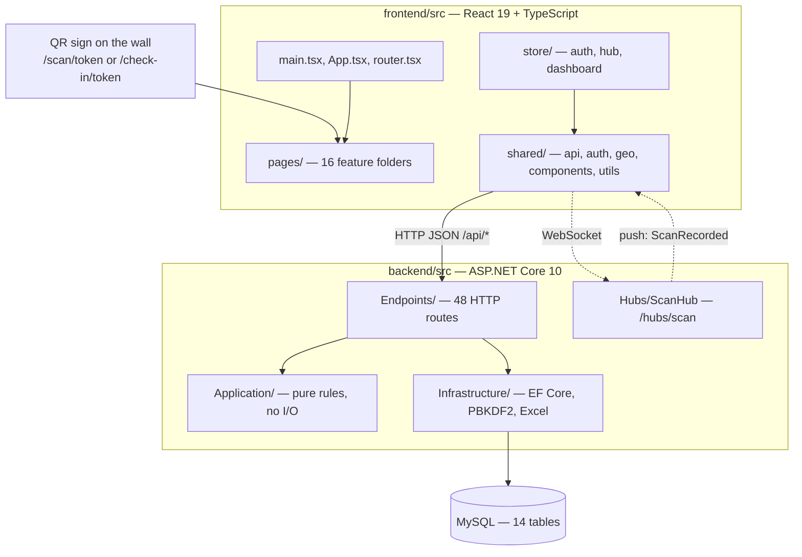
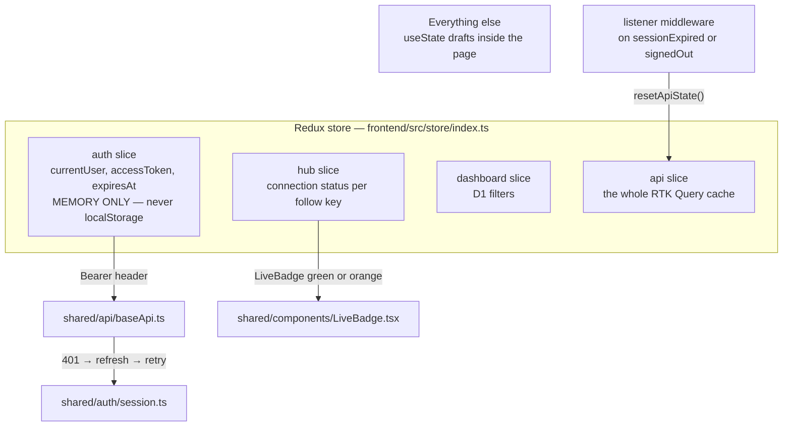
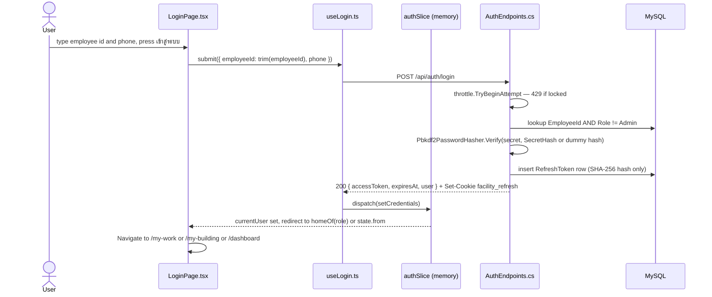
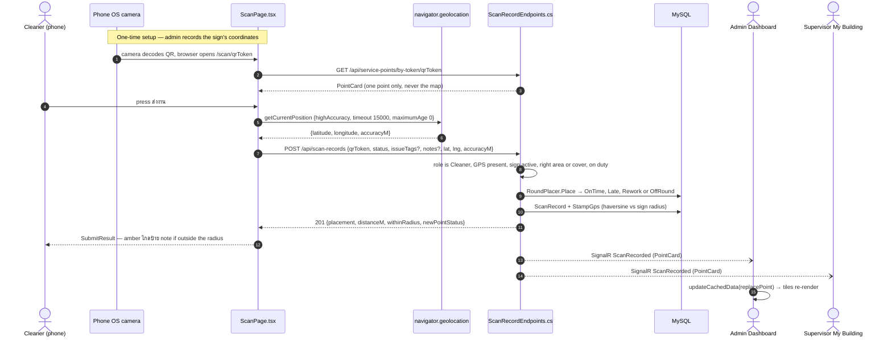
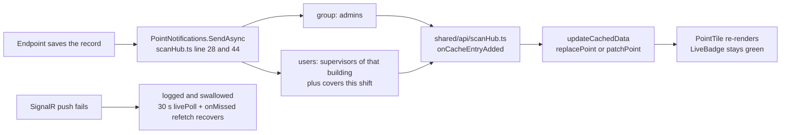
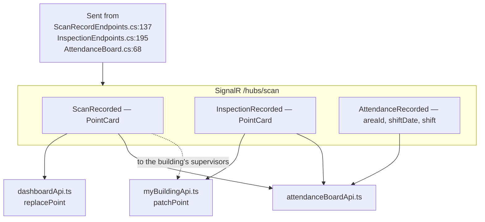
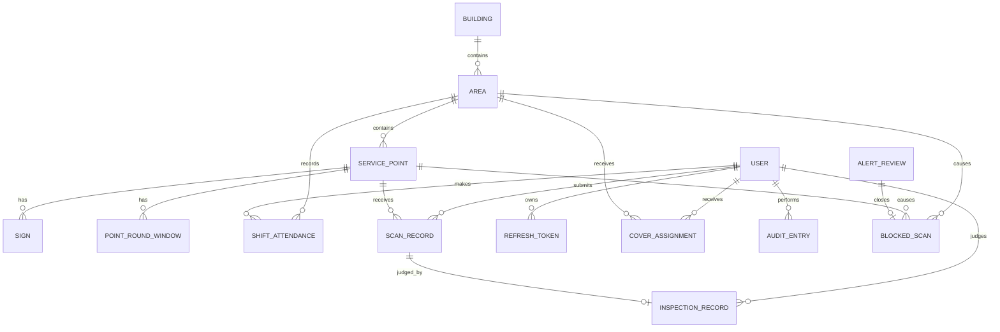

# Code Map — which file does what

> **Read this when you open the repo and do not know where anything is.**
> `docs/architecture.md` explains how the parts *connect* (deployment, network, MySQL schema).
> This page explains what each *file* is for, and walks the two flows everyone asks about first: **login** and **scan → GPS → dashboard**.
> Decisions behind the code are in [docs/adr/](adr/). Words are in [CONTEXT.md](../CONTEXT.md).



The picture above is the whole system: a phone opens a URL from a printed QR sign, React renders the page, the page talks to the API over `/api/*`, the API applies the pure rules, EF Core writes MySQL, and any change is pushed back to open dashboards over SignalR.

---

## Table of contents

- [Part 1 — What this app does](#part-1--what-this-app-does)
- [Part 2 — Where to start reading](#part-2--where-to-start-reading)
- [Part 3 — Frontend file map](#part-3--frontend-file-map)
- [Part 4 — Route table](#part-4--route-table)
- [Part 5 — State management](#part-5--state-management)
- [Part 6 — Backend file map](#part-6--backend-file-map)
- [Part 7 — Login flow](#part-7--login-flow)
- [Part 8 — Scan, GPS and real-time flow](#part-8--scan-gps-and-real-time-flow)
- [Part 9 — API reference](#part-9--api-reference)
- [Part 10 — Data model](#part-10--data-model)
- [Part 11 — Tests that pin behaviour](#part-11--tests-that-pin-behaviour)
- [Part 12 — Things that are unclear](#part-12--things-that-are-unclear)

---

## Part 1 — What this app does

A factory cleaning-inspection system: cleaners scan a printed QR sign at each service point to record that they cleaned it, supervisors scan the same sign to judge the work, and admins watch everything live on a dashboard. GPS is captured on every scan so the record proves the person was physically at the sign. Three roles, three different home pages, one URL per sign.

**Tech stack**

| Layer | What |
|---|---|
| Frontend | React 19.2.8, TypeScript, Vite 8, react-router 7, Redux Toolkit + RTK Query, Tailwind 4, Vitest |
| Real-time | `@microsoft/signalr` — one hub at `/hubs/scan`, server → client only |
| Backend | ASP.NET Core 10 Minimal API (no controllers), Clean Architecture split Api → Application → Infrastructure → Domain |
| Persistence | EF Core 10 + `MySql.EntityFrameworkCore`, snake_case tables, 4 migrations |
| Auth | JWT access token 5 minutes (HS256) + rotating refresh token in an `HttpOnly` cookie scoped to `/api/auth` |
| Passwords | PBKDF2-HMAC-SHA256, 600 000 iterations |
| Tests | xUnit — 62 API test files, 25 unit test files; Vitest for the frontend |

---

## Part 2 — Where to start reading

If you have just opened the repo, read in this order. Each step is one file.

| # | Question in your head | File to open | What you will see |
|---|---|---|---|
| 1 | "What routes exist?" | `frontend/src/router.tsx` | The whole route table as data. 90 lines, no magic. |
| 2 | "What runs at boot?" | `frontend/src/main.tsx` | Store → session refresh → tap feedback → render. Then `App.tsx` (three providers, that is all). |
| 3 | "How does the page get data?" | `frontend/src/shared/api/baseApi.ts` | The single `createApi`. Every request in the app goes through this one file: Bearer header, 401 → refresh → retry, timeouts, cache tags. |
| 4 | "How does login work?" | [Part 7](#part-7--login-flow) | Full trace with file names. |
| 5 | "How does a scan work?" | [Part 8](#part-8--scan-gps-and-real-time-flow) | Full trace with file names. |
| 6 | "What does the server do with a request?" | `backend/src/FacilityRealtime.Api/Program.cs` | Composition root, numbered 1–9 in comments. Then any file in `Endpoints/`. |
| 7 | "Where are the business rules?" | `backend/src/FacilityRealtime.Application/` | Pure static classes, no database, no HTTP. The easiest code in the repo to read and test. |

**Three habits that make this repo readable**

1. **One folder per feature.** `frontend/src/pages/scan/` owns the cleaner's scan page and nothing else. A page may not import another page — `eslint.config.js` enforces it.
2. **One API file per feature.** Each page folder has an `*Api.ts` that calls `baseApi.injectEndpoints`. Grep for a route string there and you will find the caller.
3. **Rules live apart from I/O.** Everything that decides *yes/no* sits in `backend/src/FacilityRealtime.Application/` as a static class. Endpoints only read input, call a rule, and write.

---

## Part 3 — Frontend file map

Root: `frontend/src/` — 109 `.tsx` files, of which 61 are page components.

### Root files

| File | One line |
|---|---|
| `main.tsx` | Boot: create store → `setupListeners` → `startSession()` (refresh before React) → tap feedback → render. |
| `App.tsx` | Three nested providers only: `<Provider store>` → `<SessionGate>` → `<RouterProvider>`. No context, no toast provider, no theme provider. |
| `router.tsx` | The entire route table as plain data. No loaders, no actions — RTK Query owns data loading. |
| `index.css` | Tailwind 4 setup and the `@theme` design tokens that mirror `design-system/facility/MASTER.md`. |

### shared — the layer every page may import

| Folder | Files worth knowing | Purpose |
|---|---|---|
| `shared/api/` | `baseApi.ts` | **The single `createApi`.** `baseUrl = ${origin}/api`, Bearer header from `state.auth.accessToken`, `baseQueryWithReauth` (401 → one shared refresh → retry once, skipped for `/auth/*`), `SEND_TIMEOUT_MS = 20_000`, tag types, and the two standard hook options `freshOnOpen` and `livePoll` (30 s + refetch on focus). |
| | `types.ts` | Every server DTO shared by pages. 47 imports. Note: the server omits null fields, so test with truthiness. |
| | `adminSetupApi.ts`, `attendanceBoardApi.ts`, `alertListApi.ts`, `myWorkApi.ts` | Endpoints shared by more than one page. |
| | `scanHub.ts` | `followScanHub()` — one SignalR connection per RTK Query cache entry, retry ladder, `onMissed` refetch on every reconnect. |
| | `scanAnswers.ts` | Non-hook helpers: `blockedScanOf` (403 + areaCode = a blocked scan), `isNotSent` (why the send failed). |
| `shared/auth/` | `session.ts` | Single-flight `refreshSession`, `startSession`, `getValidAccessToken`, `abandonSession`. Raw `fetch` to `/api/auth/refresh` with a 15 s timeout. |
| | `endSession.ts` | Logout: forget locally → await in-flight refresh → `POST /api/auth/logout`. |
| | `roles.ts` | `homeOf(role)`: cleaner → `/my-work`, supervisor → `/my-building`, admin → `/dashboard`. |
| `shared/geo/` | `readLocation.ts` | 41 lines. The only place the browser geolocation API is called. See [Part 8](#part-8--scan-gps-and-real-time-flow). |
| `shared/components/` | 20 `.tsx` | The reusable library. Most-used first: `Note.tsx` (30 page imports), `styles.ts` (29), `Button.tsx` (25), `Field.tsx` (14), `StatusChip.tsx` (8), `Boxes.tsx` (8), `Toast.tsx` (6), `Modal.tsx` (4). Router-only: `ProtectedRoute`, `AppLayout`, `AdminNav`, `ByRole`, `HomeRedirect`, `SessionGate`, `CrashScreen`. |
| `shared/utils/` | `thaiTime.ts` (34 imports), `getErrorMessage.ts` (31), `labels.ts` (26), `dateRange.ts` (11), `pointText.ts`, `tapFeedback.ts` | Pure helpers. `thaiTime.ts` is the Asia/Bangkok clock — every time you see a strange time, look here first. |
| `shared/version/` | `buildInfo.ts` | The build commit shown on the login pages. |

### pages — 16 feature folders

| Folder | Purpose | Key files |
|---|---|---|
| `auth/` | Both login screens | `LoginPage.tsx`, `AdminLoginPage.tsx`, `useLogin.ts` (the hook both pages share), `authApi.ts` |
| `my-work/` | Cleaner's own task list | `MyWorkPage.tsx`, `workRules.ts` (status buckets) |
| `check-in/` | Shift in/out at the area's check-in sign | `CheckInPage.tsx`, `checkInApi.ts`, `AttendanceTimeline.tsx` |
| `scan/` | **Cleaner submits cleaning at a sign** | `ScanPage.tsx` (state machine), `SubmitForm.tsx`, `SubmitResult.tsx`, `sendFailed`/`OffDuty`, `scanApi.ts`, `scanRules.ts` |
| `inspect/` | **Supervisor judges that submission — same URL, different role** | `InspectPage.tsx`, `InspectForm.tsx`, `NothingToInspect.tsx`, `DistanceLine.tsx`, `inspectApi.ts`, `inspectRules.ts` |
| `my-building/` | Supervisor's queue of what to inspect next | `MyBuildingPage.tsx`, `buildingRules.ts`, `myBuildingApi.ts` (hub follow) |
| `dashboard/` | Admin live point board (D1) | `DashboardPage.tsx`, `PointTile.tsx`, `boardRules.ts`, `dashboardApi.ts` (hub follow) |
| `attendance/` | Admin attendance board + corrections (D2) | `AttendancePage.tsx`, `CorrectionForm.tsx`, `attendanceRules.ts` |
| `alerts/` | Empty areas, covers, alert list (D3) | `AlertsPage.tsx`, `CoversThisShift.tsx`, `alertRules.ts` |
| `areas/` | Area / point / sign setup (D4, D10) — largest folder, 23 files | `AreasPage.tsx`, `PointEditor.tsx` (301 lines), `SignPanel.tsx` (235), `signRules.ts` (radius 10–500 m) |
| `accounts/` | Account CRUD, no delete (D6) | `AccountsPage.tsx`, `CreateAccountForm.tsx`, `SecretForms.tsx` |
| `print-signs/` | QR sign printing (D5) | `PrintSignsPage.tsx`, `qr.ts` + `printRules.ts` — `signUrl()` builds `/scan/<token>` |
| `capture/` | Admin records a sign's GPS standing at the site (M17) | `CapturePage.tsx`, `captureLocation.ts` (30 s, median of ≥3 readings) |
| `inspection-summary/` | Per-supervisor tallies (D7) | `InspectionSummaryPage.tsx`, `summaryRules.ts` |
| `export/` | Excel export (D8) | `ExportPage.tsx`, `exportRules.ts` (1–31 days), `saveFile.ts` |
| `history/` | Audit log with infinite scroll (D9) | `HistoryPage.tsx`, `historyRules.ts` (max 92 days) |

### store

Three slices plus RTK Query — see [Part 5](#part-5--state-management).

### test

`renderApp.tsx` (renders App with a memory router), `fakeServer.ts` (fake `fetch`), `fakeSignalR.ts`, `fakeGps.ts`, `fakeDownload.ts`, plus fixtures per role. `fakeGps.ts` is how tests script the phone's location without a phone.

---

## Part 4 — Route table

From `frontend/src/router.tsx`. Guards come from `shared/components/ProtectedRoute.tsx`, role homes from `shared/auth/roles.ts`.

| Path | Page file | Roles allowed |
|---|---|---|
| `/` | `shared/components/HomeRedirect.tsx` → `homeOf(role)` | any |
| `/login` | `pages/auth/LoginPage.tsx` | public |
| `/login/admin` | `pages/auth/AdminLoginPage.tsx` | public |
| `/my-work` | `pages/my-work/MyWorkPage.tsx` | cleaner |
| `/check-in/:token` | `pages/check-in/CheckInPage.tsx` | cleaner |
| `/scan/:token` | `shared/components/ByRole.tsx` → cleaner: `pages/scan/ScanPage.tsx`, supervisor: `pages/inspect/InspectPage.tsx` | cleaner, supervisor |
| `/my-building` | `pages/my-building/MyBuildingPage.tsx` | supervisor |
| `/dashboard` | `pages/dashboard/DashboardPage.tsx` (lazy) | admin |
| `/admin/attendance` | `pages/attendance/AttendancePage.tsx` (lazy) | admin |
| `/admin/alerts` | `pages/alerts/AlertsPage.tsx` (lazy) | admin |
| `/admin/inspection-summary` | `pages/inspection-summary/InspectionSummaryPage.tsx` (lazy) | admin |
| `/admin/export` | `pages/export/ExportPage.tsx` (lazy) | admin |
| `/admin/areas/:areaId?` | `pages/areas/AreasPage.tsx` (lazy) | admin |
| `/admin/areas/new` | `pages/areas/AreaFormPage.tsx` (lazy) — outranks `:areaId?` | admin |
| `/admin/areas/:areaId/edit` | `pages/areas/AreaFormPage.tsx` (lazy) | admin |
| `/admin/print` | `pages/print-signs/PrintSignsPage.tsx` (lazy) | admin |
| `/admin/accounts` | `pages/accounts/AccountsPage.tsx` (lazy) | admin |
| `/admin/history` | `pages/history/HistoryPage.tsx` (lazy) | admin |
| `/admin/areas/:areaId/capture` | `pages/capture/CapturePage.tsx` (lazy) | admin |
| `*` | inline `StatusScreen` 404 | anyone |

Admin routes are lazy-loaded so phones never download them ([facility-0062](adr/facility-0062-phone-bundle-budget-200kb-gzip.md)).

**The guard's own comment is the important part:** `ProtectedRoute.tsx` lines 7–9 say it *"hides pages, it does not protect data: the server's policies do that."* Never assume a hidden button means a forbidden action — check the endpoint.

---

## Part 5 — State management



| Slice | File | Holds |
|---|---|---|
| `auth` | `store/slices/authSlice.ts` | `currentUser`, `accessToken`, `expiresAt`, `isBootstrapping`, `signedOutByUser`. **Memory only — nothing is ever written to localStorage** (facility-0013). Refreshing the tab forgets the token on purpose; the cookie brings it back. |
| `hub` | `store/slices/hubSlice.ts` | `connections: Record<key, 'connecting'｜'live'｜'reconnecting'>` — one key per SignalR follow. |
| `dashboard` | `store/slices/dashboardSlice.ts` | The D1 filter row: building, status, issue-only. |
| `api` | `baseApi.reducerPath` | The RTK Query cache — all server state. |

**Rules of thumb**

- **Server data → RTK Query.** There is no axios and no plain `fetch` for data. The only two raw `fetch` calls in `src` are `shared/auth/session.ts:43` and `shared/auth/endSession.ts:18`.
- **Form drafts → local `useState`.** Heaviest users: `pages/areas/SignPanel.tsx` (8), `pages/export/ExportPage.tsx` (6), `pages/areas/PointEditor.tsx` (6).
- **No React Context anywhere** — grep for `createContext` returns 0 hits.
- **Refetch policy** is one of two constants from `baseApi.ts`: `freshOnOpen` (phone and setup pages ask again every open) or `livePoll` (admin live pages, 30 s + on focus).
- **SignalR push** is wired in exactly three cache entries via `onCacheEntryAdded → followScanHub`: `pages/dashboard/dashboardApi.ts`, `pages/my-building/myBuildingApi.ts`, `shared/api/attendanceBoardApi.ts`.

---

## Part 6 — Backend file map

Solution `backend/FacilityRealtime.slnx` — four projects, no controllers.

### `FacilityRealtime.Api`

| Path | Purpose |
|---|---|
| `Program.cs` | Composition root, numbered 1–9 in comments: services → middleware → migrate → hub → endpoint groups → SPA fallback. |
| `Endpoints/` (31 files) | All HTTP routes. `*Endpoints.cs` registers routes; the rest are helpers (`ThaiLabels`, `GpsInput`, `ApiResults`, `BlockedScans`, `PointNotifications`, `ExportSheets`, `AdminQuery`, `AccountChecks`, read-model builders). |
| `Auth/` | `AuthSetup.cs` (JWT bearer, `AdminOnly` policy, SignalR query-string token), `JwtAccessTokenIssuer.cs`, `JwtKeys.cs`, `AuthClaims.cs`, `CurrentUser.cs`. |
| `Hubs/ScanHub.cs` | Server → client only, **zero hub methods**. Admin connections join the `"admins"` group on connect. |
| `DTOs/` (14 files) | One request/response record set per feature. |
| `wwwroot/` | The built frontend, copied in by `npm run build:api`. |

### `FacilityRealtime.Application` — read this first, it is the rules

Pure static classes, no database, no HTTP, fully unit-tested:

| Area | Files |
|---|---|
| `Auth/` | `LoginThrottle`, `PhoneNumber`, `RefreshTokenRules`, `JwtSettings`, `IPasswordHasher` |
| `Geo/` | **`Geofence.cs`** (haversine distance + within-radius verdict), `GpsStamping.cs` |
| `Rounds/` | **`RoundPlacer.cs`** (OnTime / Late / Rework / OffRound), `PointStatusCalculator`, `RoundWindow`, `RoundRules` |
| `Attendance/` | `AttendanceRules`, `AttendanceCalendar`, `AreaAttendance`, `AttendanceSettings` |
| `Inspections/` | `InspectionRules` (what may be judged), `SupervisorScope`, `InspectionSummary` |
| `Common/` | `ThaiTime` — Asia/Bangkok ↔ UTC. Every wall-clock conversion goes through here. |
| Others | `Accounts/AccountRules`, `Alerts/AlertKind`, `Signs/SignCodes`, `Export/ExportRules`, `Shifts/ShiftCalendar` |

### `FacilityRealtime.Infrastructure`

| Path | Purpose |
|---|---|
| `Persistence/AppDbContext.cs` | All EF mapping: 14 `DbSet`s, snake_case columns, unique indexes, computed columns, check constraints. |
| `Persistence/*Query.cs` | Reusable read models: `PointBoardQuery`, `RoundFactsQuery`, `AlertQuery`, `AuditLogQuery`, `ExportQuery`, `InspectionHistoryQuery`. |
| `Auth/Pbkdf2PasswordHasher.cs` | PBKDF2-HMAC-SHA256, 600 000 iterations, `pbkdf2-sha256$…` format. Also used for the phone number-as-secret. |
| `Export/ExcelWorkbook.cs` | ClosedXML `.xlsx` writer. |
| `Migrations/` | 4 migrations + model snapshot, applied at startup with `MigrateAsync()`. |
| `Persistence/DbInitializer.cs` | Dev-only seed (`admin` / `admin1234`). Never runs outside Development. |

### `FacilityRealtime.Domain`

15 files in `Entities/` (14 tables + `IGpsStamped` marker) and 12 in `Enums/`. No behaviour.

**Design shape to internalise:** endpoints inject `AppDbContext` directly. There is no repository layer and no service layer for business logic. If you go looking for `IOrderService`, it does not exist here — the rule is a static class in `Application`, the endpoint calls it.

---

## Part 7 — Login flow

There are two login screens because the three roles authenticate differently: cleaners and supervisors have no password, only employee ID + phone (facility-0054); admins have username + password.

### The files, in the order the request travels

| Step | File | What happens |
|---|---|---|
| 1 | `pages/auth/LoginPage.tsx` | Two fields. Client-side validation is **only** HTML5 `required` plus `.trim()` on the employee id — no format check. Submit at lines 21–24 calls `submit({ employeeId, phone })`. |
| 2 | `pages/auth/useLogin.ts` | The hook both login pages share: `submit` → `login(body).unwrap()` → `dispatch(setCredentials(response))`. Maps errors: 401 → the page's own Thai message, 429 → throttle message, otherwise `getErrorMessage()`. |
| 3 | `pages/auth/authApi.ts:7` | `POST /auth/login` — the RTK Query mutation. |
| 4 | `shared/api/baseApi.ts:14-25` | `prepareHeaders` attaches `Authorization: Bearer <accessToken>` if one exists. |
| 5 | `backend/.../Endpoints/AuthEndpoints.cs:35-83` | `LoginAsync` — see the numbered steps below. |
| 6 | `store/slices/authSlice.ts:27-33` | `setCredentials` copies `user`, `accessToken`, `expiresAt` into **memory**. |
| 7 | `shared/components/ProtectedRoute.tsx` + `shared/auth/roles.ts` | Next navigation: `state.from` if there was one, else `homeOf(role)`. |

### What LoginAsync actually does, lines 46 to 82

1. Pick the credential mode — `byEmployeeId` if `request.EmployeeId` is non-empty (line 46).
2. Over-long login name → bare `401`, nothing recorded (49–53).
3. **Role-separated lookup** (55–57): employee mode matches `EmployeeId` **and** `Role != Admin`; admin mode matches `Username` **and** `Role == Admin`. This is the only thing stopping someone logging into the wrong form.
4. **Throttle** (61–67): key is `user:{id}` if the account matched, otherwise the typed name. 5 failures in 15 minutes → `429`.
5. **Dummy hash** (69): `hasher.Verify(secret, user?.SecretHash ?? DummyPasswordHash)` — an unknown account still pays one full PBKDF2 run, so timing cannot reveal whether an account exists.
6. `user is null || !user.IsActive || !secretMatches` → `401` with **no body and no cookie** (70–73). Wrong password, unknown id and deactivated account are indistinguishable **by design**.
7. Success → reset throttle, insert a `RefreshToken` row storing **only the SHA-256 hash** (77–79), write the cookie (81), return `{ accessToken, expiresAt, user }` (82).

### The two tokens

| | Access token | Refresh token |
|---|---|---|
| What | JWT, HS256 | 256 random bits, base64url — not a JWT |
| Lifetime | **5 minutes** (`JwtSettings.AccessTokenMinutes`) | **30 days**, rotated on every use |
| Where it lives | `store/slices/authSlice.ts` — Redux memory, gone on refresh | `facility_refresh` cookie: `HttpOnly`, `SameSite=Strict`, **`Path=/api/auth`** |
| What is in the DB | nothing (verified per request) | only `RefreshTokenRules.Hash(token)` |
| Claims | `sub`, `preferred_username`, `name`, `role` | — |

### Session lifecycle

**Attachment** — `shared/api/baseApi.ts:14-25`. Every RTK Query request carries the Bearer header.

**Refresh fires in exactly three places** (there is no timer):

| Trigger | Code |
|---|---|
| Page load | `main.tsx:16` `void startSession(store.dispatch)` — deliberately outside React so StrictMode cannot fire two. The splash `SessionGate.tsx` waits for it so a live session never flashes the login page. |
| Any 401 on a non-auth request | `baseApi.ts:39-41` — refresh, then **retry once**. `isAuthCall` excludes `/auth/*` so a wrong password never triggers a refresh. |
| SignalR connect / reconnect | `session.ts:94-101 getValidAccessToken` — refreshes if less than 30 s remain (`REFRESH_MARGIN_MS`), otherwise returns the stored token. |

**Single flight** — `session.ts:12`. All callers share one refresh promise, because *"the server treats a second use of the same refresh token as theft and ends the session."*

**Outcomes** — `session.ts` returns `'refreshed' | 'rejected' | 'offline'`:

- `rejected` (401/403) → `dispatch(sessionExpired())` → listener middleware resets the whole API cache → `ProtectedRoute` sees `currentUser === null` → redirect to `/login` **with** `state.from`, so the person lands back where they were.
- `offline` (network down, 5xx, non-JSON 200, 15 s timeout) → **session kept**. A phone losing signal must not log the person out.

**Server side of refresh** — `AuthEndpoints.cs:85-131` with `RefreshTokenRules.Decide`: rotate normally; reuse after the 30 s grace revokes the **whole session** (two holders means theft); re-reading the user each refresh is what makes an admin deactivation take effect within 5 minutes (ADR facility-0012).

**Logout** — `shared/auth/endSession.ts`: forget locally → `abandonSession()` (bumps `sessionEpoch` so an in-flight refresh cannot log you back in) → `POST /api/auth/logout`.



### The failure table you will actually hit

| Failure | Handled where | User sees |
|---|---|---|
| Empty field | HTML5 `required` | native browser bubble, request never sent |
| Wrong employee id **or** wrong phone | `AuthEndpoints.cs:70-73` → 401 | `รหัสพนักงานหรือเบอร์โทรไม่ถูกต้อง` |
| Wrong admin credentials | same 401 path | `ชื่อผู้ใช้หรือรหัสผ่านไม่ถูกต้อง` |
| Deactivated account | same 401 path, indistinguishable on purpose | same message as wrong credentials |
| 5 failures in 15 min | `LoginThrottle` → 429 | `กรอกผิดหลายครั้ง รอสักครู่แล้วลองใหม่` |
| Network / timeout during login | `getErrorMessage.ts` | `เชื่อมต่อเซิร์ฟเวอร์ไม่ได้ ตรวจสอบอินเทอร์เน็ตแล้วลองใหม่` |
| Access token expired mid-session | `baseApi.ts:39-41` refresh + retry | nothing — silent retry |
| Refresh refused | `session.ts:63-66` → `sessionExpired()` | bounced to `/login` with `state.from` kept |
| Refresh offline / 5xx / timeout | `session.ts` → `'offline'` | nothing, session kept |
| Reused refresh token after 30 s grace | `AuthEndpoints.cs:111-115` revokes session | bounced to login |
| Deactivated while a refresh is in flight | `AuthEndpoints.cs:118-122` revokes **all** that user's sessions | bounced to login; every other device dies too |
| Role changed | re-read on refresh; guard `ProtectedRoute.tsx:21-30` | `ไม่มีสิทธิ์เปิดหน้านี้` with a link home |

---

## Part 8 — Scan, GPS and real-time flow

### What "scan" means here

**There is no camera code in this repo.** The app never decodes a QR itself. What happens is: the sign carries a printed URL, the phone's own camera or OS scanner opens it, the browser lands on `/scan/<qrToken>` and React takes over.

```ts
// frontend/src/pages/print-signs/printRules.ts:23-24
export function signUrl(kind, token) {
  return `${window.location.origin}/${kind === 'check-in' ? 'check-in' : 'scan'}/${token}`;
}
```

`uqr` is in `package.json` only for **printing** signs (`pages/print-signs/qr.ts`).

The token lives on the `signs` row (`Sign.QrToken`) and appears in no list response — *"whoever holds a sign's QR Token may see that one point"* (facility-0059).

### The three screens behind one URL

| Route | File | Purpose |
|---|---|---|
| `/scan/:token` as cleaner | `pages/scan/ScanPage.tsx` | submit that the point was cleaned |
| `/scan/:token` as supervisor | `pages/inspect/InspectPage.tsx` | judge that submission — same URL, `ByRole.tsx` picks the page |
| `/admin/areas/:areaId/capture` | `pages/capture/CapturePage.tsx` | **setup, not scanning**: the admin stands at the sign and records the coordinates the geofence will later compare against |

Related: `/check-in/:token` (`pages/check-in/`) is the shift in/out sign — same GPS and blocked-scan components, different endpoint.

### GPS — readLocation, the whole file

```ts
{ enableHighAccuracy: true, timeout: 15_000, maximumAge: 0 }
```

`maximumAge: 0` means never a cached fix — the comment says *"a cached fix may be from before the person walked to the sign."*

It **never rejects**. Every branch resolves to `{ kind: 'fix', fix }` or `{ kind: 'denied' | 'unavailable' | 'insecure' }`:

| Condition | Returned |
|---|---|
| `window.isSecureContext === false` (plain http) | `insecure` — the API is never touched |
| `!('geolocation' in navigator)` | `unavailable` |
| error callback with `PERMISSION_DENIED` | `denied` |
| anything else, including the 15 s timeout | `unavailable` |

**No automatic retry and no cache.** Retry is user-driven: the failure screen's button re-runs the whole `send()`. Four callers: `ScanPage.tsx:44`, `InspectPage.tsx:55`, `inspectApi.ts:67` (inside the query), `CheckInPage.tsx:54`.

### The geofence: flag, never block

`backend/src/FacilityRealtime.Application/Geo/Geofence.cs`:

```csharp
var distance = (int)Math.Round(DistanceMeters(...));   // haversine, R = 6_371_000 m
return new GeofenceResult(distance, distance <= radiusM && phone.AccuracyM <= radiusM);
```

Three things follow from that one line, and they surprise people:

1. **Both distance and accuracy must fit the radius.** A precise fix taken 400 m away is still flagged.
2. **Outside the radius does not stop the save.** Tests assert this explicitly: `ScanRecordEndpointTests.Far_scan_is_saved_and_flagged` and `InspectionScanEndpointTests.Far_from_the_sign_is_flagged_not_blocked` both expect **201 with `withinRadius: false`**. The admin sees it later as an alert (`AlertQuery.cs:44-49`).
3. **A sign that was never captured gives no verdict at all** — `Evaluate` returns `null` distance.

Default radius is 50 m (`Sign.cs:32`), editable per sign in 10–500 m (`pages/areas/signRules.ts`).

**`BlockedScanScreen.tsx` is not the geofence.** It renders *scope* blocks — wrong area, wrong building, outside your shift — returned as 403 by `Endpoints/BlockedScans.cs`, which also writes a `blocked_scans` row.

**The one exception to "flag, never block": GPS is required.** `GpsInput.TryRead` returns 400 if coordinates are missing — *"facility-0036: without a location the scan is refused."*

### The submission, step by step



**Order of validation inside `CreateAsync`** (`ScanRecordEndpoints.cs:28-144`) — knowing this order tells you *which* error a user is looking at:

| # | Check | Failure |
|---|---|---|
| 1 | Authenticated and `Role == Cleaner` | 401 / 403 *"การส่งงานใช้สำหรับแม่บ้านเท่านั้น"* |
| 2 | Tags ≤ 200 chars, note ≤ 1000, status is a valid enum | 400 |
| 3 | **GPS present and in range** | 400 *"ต้องเปิดตำแหน่งและอนุญาตให้เว็บอ่านตำแหน่งก่อนสแกน"* |
| 4 | Sign exists, point and area active | 404 *"ไม่พบป้ายนี้ หรือจุดนี้ปิดใช้งานแล้ว"* |
| 5 | Same area **or** a live cover for this shift | 403 + a `blocked_scans` row |
| 6 | On duty (in shift, not already signed out) | 409 *"ตอนนี้ไม่อยู่ในกะของคุณ"* etc. |
| 7 | Round placement — **not** a duplicate check | never fails |
| 8 | Write `ScanRecord`, stamp GPS, broadcast `ScanRecorded` | — |

**There is no "already scanned" rejection.** `RoundPlacer.cs:17-39` simply places a second submission as `OffRound` or `Late` and the result screen says so (*"ส่งเพิ่มแล้ว (ไม่นับรอบ)"*).

### How the dashboard updates without a refresh



- **Hub:** `Hubs/ScanHub.cs` at `/hubs/scan`. Zero methods — strictly server → client. Admins join `"admins"` on connect. Since 2026-10-26 the **Cleaners of the point's Area (both shifts) and anyone covering it** get the point events too; their My Work page asks the server again when one arrives, on open and on "อัปเดต".
- **Three events:** `ScanRecorded`, `InspectionRecorded` (both → admins + the building's supervisors + the Area's Cleaners and covers), `AttendanceRecorded` (→ admins only).
- **Auth on the socket:** the access token goes in the query string, accepted **only** for `/hubs` paths (facility-0011) — browsers cannot set headers on a WebSocket.
- **Three subscribers:** `pages/dashboard/dashboardApi.ts`, `pages/my-building/myBuildingApi.ts`, `shared/api/attendanceBoardApi.ts` — one connection per cache entry.
- **The safety net:** `livePoll` = 30 s poll + refetch on focus. Pushes are best effort; a failure is logged and swallowed because the record is already committed.
- **Badge:** `shared/components/LiveBadge.tsx` reads `hubSlice` — green `SignalR Live` or orange `Connecting...`.

### Scan failure table

| Failure | Handled where | User sees |
|---|---|---|
| GPS permission denied | `readLocation.ts:37` → `LocationHelp.tsx:32-50` | full-screen *"เปิดตำแหน่งก่อนส่งงาน"* with Android/iPhone steps + retry |
| GPS unavailable / 15 s timeout | `LocationHelp.tsx:51-56` | *"มือถือยังหาตำแหน่งไม่เจอ ลองเดินไปใกล้หน้าต่าง"* + retry |
| Page on plain http | `readLocation.ts:20-22` → `LocationHelp.tsx:20-29` | *"หน้านี้ต้องเปิดผ่าน https"* — **no retry button** |
| No signal / 5xx / 20 s timeout | `scanAnswers.ts isNotSent` → `SendFailed.tsx` | *"ยังไม่ได้บันทึก"*, choices kept in memory, ส่งใหม่ re-reads GPS fresh |
| Outside the geofence | server → `withinRadius: false` | **still saved**; amber *"ไกลป้าย: ห่างป้าย N ม."*, later an admin alert |
| Wrong area / building / shift, no cover | server 403 → `BlockedScanScreen.tsx` | big message + *"ไม่ได้บันทึกงาน"*, nothing stored except the blocked row |
| Off duty | server 409, pre-checked client-side by `scanRules.ts:45-54` | `OffDuty.tsx` shown before the form |
| Sign unknown / point deactivated | server 404 | `StatusScreen` *"ไม่พบป้ายนี้ หรือจุดนี้ปิดใช้งานแล้ว"* |
| Work changed while the supervisor looked away | `InspectionEndpoints.cs:174-177` → 409 | *"งานของจุดนี้เปลี่ยนไประหว่างที่คุณตรวจ"* — the verdict is discarded, page re-scans |
| Nothing to inspect | `InspectionRules.cs:36-44` | `NothingToInspect.tsx`, refusal shown as the heading, **no button** |
| Push lost | `scanHub.ts` reconnect + `onMissed` refetch | badge turns orange, data recovers |

---

## Part 9 — API reference

48 HTTP routes. `frontend/src/shared/api/baseApi.ts:16` adds the `/api` prefix, so the frontend `url` values below are relative to it.

**How to read the Why column:** it answers *"what business goal does this call serve, what breaks without it?"* — not "what does it fetch". If you are deciding whether an endpoint is essential while changing something, the Why is the row that matters.

### Auth

| Method | Route | Handler | Why |
|---|---|---|---|
| POST | `/api/auth/login` | `AuthEndpoints.cs:29` → `LoginAsync:35` | Three roles authenticate differently — staff use employee id + phone, admins use username + password. Without it, GPS-stamped scans would be anonymous. The throttle and dummy hash exist so an attacker cannot tell "no such account" from "wrong phone". |
| POST | `/api/auth/refresh` | `AuthEndpoints.cs:30` → `RefreshAsync:85` | Access tokens last 5 minutes (privacy on a shared phone), so the browser needs a way to stay logged in. Re-reading the user each refresh is what makes an admin deactivation land within 5 minutes. |
| POST | `/api/auth/logout` | `AuthEndpoints.cs:31` → `LogoutAsync:133` | Kills the session server-side; otherwise a left-behind cookie keeps minting tokens for 30 days. |
| GET | `/api/me` | `MeEndpoints.cs:12` | Fresh self state. **No frontend caller found** — see [Part 12](#part-12--things-that-are-unclear). |
| GET | `/api/health` | `Program.cs:97` | Liveness for curl and tunnel probes. No frontend caller. |

### Cleaner

| Method | Route | Handler | Called by | Why |
|---|---|---|---|---|
| GET | `/api/my-work` | `MyWorkEndpoints.cs:16` | `shared/api/myWorkApi.ts` | The cleaner's own beat plus covered areas. Without it the phone page has nothing to render. |
| GET | `/api/attendance/signs/{token}` | `AttendanceEndpoints.cs:25` | `pages/check-in/checkInApi.ts:32` | Fails fast on page open when a sign was deactivated, instead of the cleaner discovering it at the end of a shift. |
| POST | `/api/attendance` | `AttendanceEndpoints.cs:23` → `RecordAsync:29` | `pages/check-in/checkInApi.ts:15` | The payroll and legal record of who was on site. GPS + sign binding is the only evidence the person was physically there. |
| GET | `/api/attendance/me` | `AttendanceEndpoints.cs:24` | **none found** | Current shift and next allowed event. |
| GET | `/api/service-points/by-token/{token}` | `ServicePointEndpoints.cs:20` | `pages/scan/scanApi.ts:29` | Resolves a scanned sign to exactly one point, so a photo of a QR cannot leak the facility map. |
| POST | `/api/scan-records` | `ScanRecordEndpoints.cs:24` → `CreateAsync:28` | `pages/scan/scanApi.ts:32` | **The core work product**: "this point was cleaned, at this time, by this person." Round placement, point status, inspections, exports and alerts are all derived from these rows. |

### Supervisor

| Method | Route | Handler | Called by | Why |
|---|---|---|---|---|
| POST | `/api/inspections/scan` | `InspectionEndpoints.cs:27` → `ScanAsync:84` | `pages/inspect/inspectApi.ts:72` | Stores nothing — it shows the supervisor the current submission (or a refusal reason). The two-step design exists so a supervisor can only judge what they were actually shown. |
| POST | `/api/inspections` | `InspectionEndpoints.cs:28` → `CreateAsync:132` | `pages/inspect/inspectApi.ts:84` | Closes the loop: unverified cleaning is not accepted. `Rework` sends the cleaner back with the defect text. |
| GET | `/api/my-building` | `MyBuildingEndpoints.cs:20` | `pages/my-building/myBuildingApi.ts:31` | The supervisor's walking queue, rework-first. |

### Admin setup

| Method | Route | Handler | Called by | Why |
|---|---|---|---|---|
| GET | `/api/admin/buildings` | `AdminAreaEndpoints.cs:18` | `shared/api/adminSetupApi.ts:113` | Picker options used across many pages. |
| GET | `/api/admin/cleaners` | `AdminAreaEndpoints.cs:19` | `adminSetupApi.ts:117` | Same. |
| GET | `/api/admin/areas` | `AdminAreaEndpoints.cs:20` | `adminSetupApi.ts:105` | Area summaries with counts. |
| GET | `/api/admin/areas/{id}` | `AdminAreaEndpoints.cs:22` | `adminSetupApi.ts:109` | Area detail: points, windows, signs. |
| POST | `/api/admin/areas` | `AdminAreaEndpoints.cs:31` → `CreateAsync:66` | `pages/areas/areaFormApi.ts:17` | Creates the area **and** its check-in sign in one transaction. |
| PUT | `/api/admin/areas/{id}` | `AdminAreaEndpoints.cs:32` → `UpdateAsync:115` | `areaFormApi.ts:21` | Renaming or moving an area drops night windows for a DayOnly pattern. |
| POST | `/api/admin/areas/{id}/deactivate` | `AdminAreaEndpoints.cs:33` → `SetActiveAsync:172` | `areaFormApi.ts:25` | Deactivate, never delete — history must keep the name. |
| POST | `/api/admin/areas/{id}/activate` | `AdminAreaEndpoints.cs:35` | `areaFormApi.ts:26` | Re-open. |
| POST | `/api/admin/areas/{areaId}/points` | `AdminPointEndpoints.cs:19` → `CreateAsync:28` | `pages/areas/areasApi.ts:15` | A point is meaningless without its sign and round windows. |
| PUT | `/api/admin/points/{id}` | `AdminPointEndpoints.cs:20` → `UpdateAsync:80` | `areasApi.ts:19` | Unchanged windows keep their ids so a live round keeps its records. |
| POST | `/api/admin/points/{id}/deactivate` | `AdminPointEndpoints.cs:21` → `SetActiveAsync:136` | `areasApi.ts:23` | Leaves the dashboard, cannot be scanned, history kept. |
| POST | `/api/admin/points/{id}/activate` | `AdminPointEndpoints.cs:23` | `areasApi.ts:24` | Re-open. |
| PUT | `/api/admin/signs/{id}/location` | `AdminSignEndpoints.cs:23` → `SetLocationAsync:29` | `adminSetupApi.ts:122` | Sets the coordinates the geofence compares against. Site capture beats map pick. |
| PUT | `/api/admin/signs/{id}/radius` | `AdminSignEndpoints.cs:24` → `SetRadiusAsync:95` | `areasApi.ts:31` | A wrong radius makes every scan "off-site". |
| POST | `/api/admin/signs/{id}/regenerate-token` | `AdminSignEndpoints.cs:25` → `RegenerateTokenAsync:129` | `areasApi.ts:36` | Kills the printed QR at once — the only way to de-authorise a lost sign. |

### Admin accounts

| Method | Route | Handler | Why |
|---|---|---|---|
| GET | `/api/admin/accounts` | `AdminAccountEndpoints.cs:23` | All accounts including deactivated (~180 rows, filtered client-side). |
| POST | `/api/admin/accounts` | `AdminAccountEndpoints.cs:25` → `CreateAsync:42` | Provisioning. Staff secrets are the phone number, hashed as `SecretHash`. |
| PUT | `/api/admin/accounts/{id}` | `AdminAccountEndpoints.cs:26` → `UpdateAsync:146` | Slot-uniqueness: one cleaner per area-shift, one supervisor per building-shift. |
| POST | `/api/admin/accounts/{id}/deactivate` | `AdminAccountEndpoints.cs:27` → `SetActiveAsync:203` | **The only off-boarding mechanism** — revokes every refresh token and frees the area slot. No delete exists so history keeps names. |
| POST | `/api/admin/accounts/{id}/activate` | `AdminAccountEndpoints.cs:29` | Re-open only if the slot is free. |
| PUT | `/api/admin/accounts/{id}/phone` | `AdminAccountEndpoints.cs:31` → `ChangePhoneAsync:257` | Changing the secret forces every device to log in again. |
| PUT | `/api/admin/accounts/{id}/password` | `AdminAccountEndpoints.cs:32` → `ResetPasswordAsync:288` | Temporary admin password, told out of band, sessions revoked. |

### Admin operations

| Method | Route | Handler | Why |
|---|---|---|---|
| GET | `/api/admin/attendance` | `AdminAttendanceEndpoints.cs:24` → `GetBoardAsync:29` | Board D2: who is in each area this shift. |
| PUT | `/api/admin/attendance` | `AdminAttendanceEndpoints.cs:25` → `CorrectAsync:47` | Corrections require a reason and are audited — a payroll record you can silently edit is worthless. |
| GET | `/api/admin/alerts` | `AdminAlertEndpoints.cs:21` → `ListAsync:27` | The exception queue: blocked scans, GPS flags, missing shift-out. |
| POST | `/api/admin/alerts/review` | `AdminAlertEndpoints.cs:22` → `ReviewAsync:46` | "คุยแล้ว ปิดเตือน" — one review per alert, audited, so "we talked about it" is a record not folklore. |
| POST | `/api/admin/cover-assignments` | `CoverAssignmentEndpoints.cs:23` → `AssignAsync:29` | The **only** legitimate way to work outside your area or shift; without it every cross-area scan becomes a blocked scan. |
| DELETE | `/api/admin/cover-assignments/{id}` | `CoverAssignmentEndpoints.cs:24` → `CancelAsync:255` | Cancel closes duplicate twins too. |
| GET | `/api/admin/cover-assignments/candidates` | `CoverAssignmentEndpoints.cs:25` → `ListCandidatesAsync:301` | Ranked: those who already scanned this area first. |

### Admin reports

| Method | Route | Handler | Why |
|---|---|---|---|
| GET | `/api/admin/audit-log` | `AdminAuditLogEndpoints.cs:20` → `ListAsync:28` | Every admin mutation is attributable. Read-only, because rewriting it would defeat the point. Max 92 days, 500 rows. |
| GET | `/api/admin/audit-log/actors` | `AdminAuditLogEndpoints.cs:21` | Actor filter options. |
| POST | `/api/admin/export` | `AdminExportEndpoints.cs:24` → `ExportAsync:28` | **POST not GET** precisely because downloading personnel data is itself an audited action. The file omits coordinates, phones, QR tokens and passwords. |
| GET | `/api/admin/inspection-summary` | `AdminInspectionSummaryEndpoints.cs:26` → `GetAsync:30` | How much of the beat was actually checked — supervisor coverage evidence. |

### Non-HTTP routes

| Route | Where | Why |
|---|---|---|
| `/hubs/scan` | `Program.cs:94` | The SignalR hub. |
| any non-`/api`, non-`/hubs`, extension-less path | `Program.cs:119` `MapFallbackToFile` | Serves `index.html` so a printed QR link opens the SPA instead of a 404. |

### The events, all of them



---

## Part 10 — Data model



14 tables, defined in `Infrastructure/Persistence/AppDbContext.cs`, snake_case. Nothing is ever deleted — only deactivated.

**Invariants the schema itself enforces** (you cannot code around them):

| Invariant | Where |
|---|---|
| One attendance event per user / shift / type — first press wins | unique index, `AppDbContext.cs:174` |
| One cleaner per area-shift, one supervisor per building-shift | stored computed unique columns, `AppDbContext.cs:104-114` |
| A cover is an area **or** a building, never both | check constraint, `AppDbContext.cs:195-197` |
| Every stored `DATETIME` is UTC; shifts and round windows are Thai wall clock | `Application/Common/ThaiTime.cs` |

**Enums worth memorising** (`Domain/Enums/`): `UserRole` (cleaner | supervisor | admin), `Shift`, `AttendanceEvent`, `CleaningStatus`, `InspectionResult` (Passed | Rework), `Placement` (OnTime | Late | Rework | OffRound), `BlockReason`, `AlertType`.

---

## Part 11 — Tests that pin behaviour

If you are about to change something, read its test first — in this repo the tests are the tightest specification available.

| Behaviour | Test |
|---|---|
| Login, throttle, role-separated forms, cookie flags | `backend/tests/.../Auth/LoginTests.cs` (14 tests) |
| Refresh rotation, 30 s reuse grace, deactivation, role change | `backend/tests/.../Auth/RefreshTests.cs` (11 tests) |
| Token expiry, query-string token accepted only for hubs | `backend/tests/.../Auth/ProtectedEndpointTests.cs` |
| Scan placements, second scan, blocked area, **far scan saved and flagged** | `backend/tests/.../Points/ScanRecordEndpointTests.cs` |
| Supervisor scan gates, **far scan flagged not blocked**, covers | `backend/tests/.../Inspections/InspectionScanEndpointTests.cs` |
| Haversine maths and the within-radius rule | `backend/tests/.../UnitTests/GeofenceTests.cs` |
| Live push reaches the building's supervisors only | `backend/tests/.../Inspections/SupervisorLiveTests.cs` |
| A failed push still returns 201 and keeps the record | `backend/tests/.../Inspections/LiveUpdateFailureTests.cs` |
| Session refresh, single flight, logout ordering | `frontend/src/shared/auth/session.test.ts` (4 describe blocks) |
| Bearer header, refresh-then-retry-once, login never triggers refresh | `frontend/src/shared/api/baseApi.test.ts` |
| Exact GPS options, denied vs unavailable vs insecure | `frontend/src/shared/geo/readLocation.test.ts` |
| Two-tap submit, location help, resend with fresh GPS, blocked scan | `frontend/src/pages/scan/ScanPage.test.tsx` (422 lines) |
| Open = fresh GPS + scan, 409 re-scan flow | `frontend/src/pages/inspect/InspectPage.test.tsx` (520 lines) |
| A pushed card changes a tile without asking the server | `frontend/src/pages/dashboard/DashboardPage.test.tsx` |
| Route guards per role | `frontend/src/router.test.tsx` |

Test harness: `frontend/src/test/` — `fakeServer.ts` (fake `fetch`), `fakeSignalR.ts`, `fakeGps.ts` (scripted location answers), `renderApp.tsx`.

---

## Part 12 — Things that are unclear

Documented here so you do not waste an afternoon on them.

1. **No frontend caller for `GET /api/me`, `GET /api/attendance/me`, `GET /api/health`.** Exhaustive grep of `frontend/src` finds only backend, test and doc hits. They may be leftovers or tool-facing (curl / tunnel probe).
2. **Which app decodes the QR is not in this repo.** There is no camera or decoder dependency. The printed URL in `printRules.ts:23-24` implies the phone's OS camera, but no file says so.
3. ~~My Work has no live push.~~ Fixed 2026-10-26: `myWorkApi.ts` follows the hub, and `PointNotifications` sends to the Area's Cleaners (facility-0052 and 0058 amended).
4. **`session.ts:63` treats a 403 from refresh as session over, but the backend only ever returns 401 there.** The 403 branch looks defensive.
5. **`throttle` state is in memory** — a restart forgets every count (`LoginThrottle.cs:16`). Single-server assumption.
6. **No idle-timeout warning.** `expiresAt` is read only by `getValidAccessToken`; nothing schedules on it.
7. **No rate limiting on `POST /api/scan-records`** beyond round placement.
8. **Two discrepancies in `docs/architecture.md`:** it lists an `area-form (D10)` folder that in code is `pages/areas/AreaFormPage.tsx`, and it says every page is `Page.tsx + pageApi.ts + page.css` — in reality only 5 pages have a `.css` and 3 feature folders have no api file of their own (`my-work`, `capture`, `auth` use `shared/api` or a differently-named file).
9. **React version is 19.2.8**, not 18.
10. **`pages/.DS_Store` is a stray file** checked into the repo.

---

## Related documents

| Document | Answers |
|---|---|
| [`docs/architecture.md`](architecture.md) | How the parts connect: deployment, ports, network, component diagram, MySQL schema |
| [`docs/adr/`](adr/) | **Why** the code is shaped this way — the ADRs are the spec |
| [`../CONTEXT.md`](../CONTEXT.md) | What every word in the product means (glossary) |
| [`handoff.md`](handoff.md) | Current branch, what is done, what the owner still owes a check on |
| `design-system/facility/MASTER.md` | How it looks and why |
