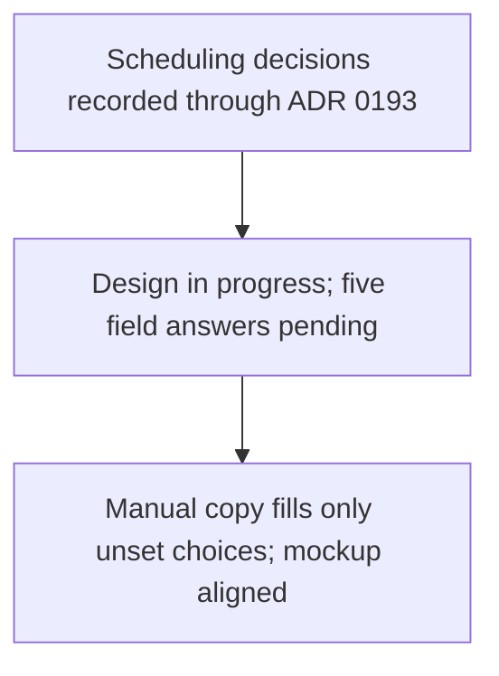

# Handoff: current status and next steps

Updated 2026-11-17 (Asia/Bangkok). Read this first every session and update it after every task (owner's rule). This repository is public; keep secrets and real personnel data outside it.



**Local cleanup of unrelated files (2026-11-17):** at the owner's request, deleted only untracked/ignored, regenerable material, after confirming none of it is tracked (`git ls-files` returned zero for every path). Removed: `.run/e2e/` (100 Playwright runs, 7.8 GB; Firefox profile folders needed `chmod -RN` because they carried a `group:everyone deny delete` ACL), `backend/**/bin` and `obj` (300 MB build output), `.superpowers/sdd/` (6.4 MB old subagent review notes), `frontend/dist`, `playwright-report`, `test-results`, `backend/src/JanitorialManagementDashboard.Api/wwwroot`, untracked `.postman/` and `postman/` scaffolding, the old-name leftover `backend/src/FacilityRealtime.Api/`, stray root `bin/` and `obj/`, `backend/.idea`, `docs/requirements-gathering/.idea`, `scripts/__pycache__` and 14 `.DS_Store` files. Kept deliberately: `frontend/node_modules` (281 MB, needed to run tests), `.run/scan-trial-20261112/` (32 MB, holds the trial `trial.env` credentials), the other small `.run` review logs, `Manual/*.docx`, `.agents`/`.claude` skills, `skills-lock.json` and all project source, docs, ADRs and design-system files. Also deleted the eight local branches already merged into `master` and pruned six stale remote refs. Repository size dropped from roughly 8.6 GB to 354 MB; `git status` is clean and `master` still equals `origin/master`. Historical `.run/e2e/<run>` paths quoted in older handoff sections no longer exist; regenerate with `npm --prefix frontend run e2e`. Because `bin`/`obj` were removed, the next backend build restores and compiles from scratch. No tracked file, application source, schema, database, ADR or documentation content was deleted, and no product decision changed.

**Design records published for machine transfer (2026-11-17):** at the owner's explicit request (“commit push pr merge … ผมจะย้ายไปทำบนอีกเครื่อง”), committed `e3a770b` and merged [PR #154](https://github.com/ThodsaphonSonthiphin/Facility-Real-time-dashboard/pull/154) into `master` at `7e2218b`. The PR carries 97 documentation files: ADRs 0114–0193 (80 new), the four requirements records, the overview dashboard design spec and its 11-task implementation plan, plus `CONTEXT.md`, the ADR index and amendment pointers on 0031/0040/0041/0047/0048/0050/0051/0075. Verification before merge: 534 relative Markdown links across 96 changed documents resolved, `git diff --check` clean, pre-commit hook passed (frontend lint, TypeScript build, full frontend test suite). No application, schema, runtime, configuration or database file changed; the “อย่าเพิ่ง implement” hold, the five open Supervisor field topics and the unfinalised recap/spec/plan gates are unchanged. Untracked `.postman/` and `postman/` were deliberately excluded (empty Postman scaffolding, unrelated to the design work) and remain local only. Continue on another machine from a fresh clone of `master` at `7e2218b`.

**Overview plan delta review (2026-11-17):** at the owner's request, reviewed the held overview spec and 11-task plan against ADRs 0131–0193 (all 63 records; full reads of 0136, 0144–0146, 0153–0158, 0161–0164, 0170–0175, 0178, 0183, 0184, 0187, 0189) plus the cited source (`AttendanceEvent`, `ShiftAttendance`, `AreaAttendance`, `AdminNav`, `labels`, `router`, `attendanceRules`). Recorded [the delta review](superpowers/reviews/2026-11-17-overview-plan-assumption-delta.md): 6 deltas and 9 non-deltas. Deltas changed the plan's working assumptions, not the product numbers: six-action/leave rebase condition for the attendance union and Area detail (0146/0153/0154/0164/0168/0169); day off/leave never closes an Area or changes the three entry categories, and “replacement pending” is not cover (0136/0156–0158), while a relief `ShiftIn` at the assigned Area sign counts as entry (0155); Admin default is all buildings in the clock shift with the night shift's start date (0183/0184) and no schedule-page week/filter memory; reconnect recovery keeps the stale wording until a read succeeds (0172); final Admin menu order keeps `ตารางงาน` after `การเข้างาน` (0178); and the plan's stale baseline (`7853ae6` plus uncommitted docs and Postman directories) was corrected to `master` `55932c6` clean with PR #154 merged. Spec §12 and the plan's new delta section carry the binding notes; Task 8/9/10 steps were amended. No product decision, ADR, application/schema/database change, runtime operation or publication. After the owner's explicit approval, committed locally as a docs-only change; the pre-commit hook passed frontend lint and all 546 frontend tests; not pushed, and no PR was opened. The implementation hold is unchanged; both execution styles remain unselected.

## Resume here: next local session (2026-11-17)

**Latest actual-work clarification:** after accepting the dated-break rule in [0189](adr/facility-0189-regular-break-changes-preserve-dated-break-overrides.md), the owner explained that the Supervisor uses an A4 roster with Cleaner names and chooses days off separately by week: Cleaner A may be off Monday in week 1 and Tuesday in week 2. The same weekday is common, but is not mandatory throughout the month. Recorded [0190](adr/facility-0190-supervisor-selects-cleaner-days-off-by-week.md), superseding 0135's fixed-weekday-only restriction. Updated the glossary, current requirements, ADR amendments/index and the Supervisor packet's agreed-design summary. This is actual-work clarification, not an answer to any of the five still-open field topics, and not a request for paper import, printing/export or a monthly view.

**Latest layout choice:** after both mockups were shown as PNGs, the owner selected **“2 แบบที่สอง”**, meaning **ตารางรวมรายคน**. Recorded [0191](adr/facility-0191-weekly-days-off-use-the-multi-person-roster-layout.md). Use the weekly multi-person roster with Cleaner names, previous-week references, editable current-week day-off choices in each row and review before saving. The canonical mockup now opens the selected grid first; the one-person version is retained only as comparison material, not a requirement for another supported product mode. No fixture count, mandatory day-off count, copying/defaults, batch/API atomicity, retrospective/post-start policy or relief reassignment is accepted by this layout choice. The owner then selected **“มีปุ่มคัดลอก (แนะนำ)”**. [0192](adr/facility-0192-weekly-days-off-have-an-explicit-copy-previous-week-action.md) adds a Supervisor-triggered “คัดลอกวันหยุดจากสัปดาห์ก่อน” action for the editable target-week roster, followed by adjustments/review before saving. Copying is explicit, covers day-off choices only and does not save immediately. The owner then selected **“เติมเฉพาะคนที่ยังไม่ได้เลือก (แนะนำ)”**. [0193](adr/facility-0193-copy-previous-week-days-off-fills-only-unset-choices.md) preserves saved/current local target choices and fills only unset people. The canonical mockup now includes the explicit button and unset-choice placeholders. Copy remains local/editable, cancellation restores saved choices and review/save remains separate. No popup is pending.

Earlier related choices remain: [0187](adr/facility-0187-regular-timetable-has-a-selected-future-start-date.md) future start date including midweek for regular Area/break changes; [0188](adr/facility-0188-regular-timetable-editor-reviews-changes-before-save.md) review before saving; [0189](adr/facility-0189-regular-break-changes-preserve-dated-break-overrides.md) applicable dated first-break overrides survive a new regular group; [0190](adr/facility-0190-supervisor-selects-cleaner-days-off-by-week.md) week-specific day-off choices replace the fixed-only assumption. The Area/break editor no longer has the lone repeating-day-off control. The owner’s earlier “งง” was clarified before the explicit break-override choice; “ขอดู Mockup” and “เปิดหน้าเว็บไม่ได้” were not layout selections.

**Delivery fallback:** the owner cannot open the inline/web preview. Use static PNGs directly in chat for further visual reviews. The latest copy-button picture is `dayoff-copy-qa/after-copy.png` (desktop), with `after-copy-mobile.png` and `before-copy.png` in the same directory. Earlier selected-layout pictures remain in `dayoff-comparison-qa/`. They were captured from clean initial states with local Chromium, external requests blocked and the owned browser closed. Do not require reopening the inaccessible preview to review a later change.

Other independent **design** work remains: relief-baseline editing; normal six-action attendance/skip/missing-time correction surfaces; source-grounded technical impact and storage/API options; acceptance-case outlines. No application implementation is authorized.

**Next agent:** continue the existing scheduling design, without repeating accepted menu/week/filter/future-start-date/editor-layout/dated-break-precedence questions or asking whether the five field answers are available again unless the owner signals new information. Next: continue from the completed copy-button mockup and owner feedback; resolve only genuinely remaining design details or proceed with the independent design activities below. There is no pending popup. Do not re-ask whether the copy button is wanted or whether it overwrites entered target choices. Do not re-ask the already selected day-off layout. Do not silently choose automatic copying/defaults between weeks or assume a monthly screen or paper import/export. Week-specific day-off choices and the multi-person roster layout are accepted under 0190/0191. Do not silently choose retrospective correction, ongoing-shift freezing, relief borrowing or partial-leave rules. Questions should be short Thai, one concrete visible example at a time, using the popup tool. The owner found a prior combined algorithm question confusing; its components were accepted only through subsequent separate answers.

- **Canonical decisions and unresolved items:** [requirements record](requirements-gathering/2026-11-16-supervisor-scheduling-requirements.md), [ADR index](adr/README.md), and [five-question Supervisor packet](requirements-gathering/2026-11-16-supervisor-workflow-confirmation.md). All five field topics still await answers: relief pool/team and borrowing; partial-leave coverage; leave departure/return scans; unexpected off/leave-day attendance; and person/Area changes after work starts. User last said “ยังครับ”. Do not omit partial leave to bypass its dependencies.
- **Latest accepted set:** 0165–0167 save protection; 0168–0169 shift-boundary six-action cutover and stale-page compatibility; 0170–0172 live freshness with preserved input; 0173–0175 dated history and actual-scan separation; 0176–0186 menu/entry/week/filter behavior; 0187 selected future start date for regular-Cleaner timetable changes; 0188 regular-Cleaner editor layout and review-before-save sequence; 0189 preserved applicable dated first-break overrides when the regular group changes; 0190 permits different day-off choices in different weeks and amends the fixed-only assumption; 0191 selects the multi-person weekly day-off roster; 0192 selects an explicit prior-week-copy action followed by adjustments/review; 0193 fills only unset target choices and preserves entered ones. The detailed paragraphs below and linked ADRs carry the exact boundaries. 0163 supersedes automatic round movement in 0162. Latest recorded ADR is 0193; re-scan every ref/worktree before assigning the next number.
- **Design gate:** no final decision recap, scheduling spec or scheduling implementation plan has been approved. Follow `grill-then-plan`: converge, confirm the mandatory decision recap, write/review the spec, then invoke `sp-writing-plans` after spec approval. No scheduling application/schema/database/runtime changes or publication are authorized. The [earlier overview plan](superpowers/plans/2026-11-16-combined-overview-dashboard.md) remains held; its affected assumptions were reviewed on 2026-11-17 ([delta review](superpowers/reviews/2026-11-17-overview-plan-assumption-delta.md)) and the plan is now executable once the owner explicitly authorizes it.
- **Current checkout, verified at handoff:** `master` at `7853ae6` (PR #153 merge), shown equal to the local `origin/master` tracking ref; no fetch or live GitHub verification was performed. There are numerous pre-existing modified/untracked design records (including ADRs 0114–0186, requirements, overview spec/plan) and Postman directories. Preserve them; do not clean/reset. This handoff adds no commit, push or PR.

**Mockup source, verified present:** `/Users/macbookair/.codex/visualizations/2026/11/16/01a1e35a-cb6e-7920-87dc-50ada17b12f4/facility-scheduling.html`, SHA-256 `71475c9c793cb9d8455571294e7d622acec54a6196af0ad54a7ade5a3e0335ce`. Reuse this source; QA previews are not the deliverable. It contains accepted layout/navigation, the Area/break baseline editor, and the weekly day-off roster selected in 0191, shown first in the comparison carousel; the non-selected one-person alternative remains as review material. The selected roster’s direct preview now starts on synthetic 30 November–6 December: Cleaner 01 already has Wednesday, while the other five day-off choices are unset. This prepared partial roster exercises the copy button; it is not an automatic future-week default. The retained individual comparison stays on its earlier example week. The selected roster shows a previous-week reference; this is not a replacement for accepted initial-week/filter rules, which are not fully simulated. The new editor's future-date range and limited same-building Area choices are demonstration limits, not accepted product policy. Pure regular break-group changes now preserve applicable explicit dated group overrides under 0189. Area, leave and non-working-date conflicts still stop the simulation. The weekly day-off proposal changes one selected week, leaves other saved fixture choices alone and does not automatically rearrange relief staff. A single day-off choice, seeded fixtures and the earlier/current-week editing stop are demonstration limits, not accepted business/default policies. Relief weekly editing, partial-leave save and relief-pool selection remain incomplete. Latest QA/backup files are in `/Users/macbookair/.codex/visualizations/2026/11/17/01a1e763-7ca1-7063-a9f5-82f9d3e88777/dayoff-copy-qa/`; the previous default-selection QA remains in `dayoff-selected-qa/`; comparison QA and static PNGs remain in `dayoff-comparison-qa/`; previous weekly-off QA remains in `weekly-off-qa/`; preceding baseline QA remains in `baseline-qa/`; earlier navigation QA remains in its previous chat directory. The source's prior-date directory may need write escalation. Both old installers expect their own pre-edit backup and must not be rerun as-is.

**Verification scope:** checkout remains `master` at `7853ae6`; pre-existing design/Postman changes preserved. Chromium passed eight weekly day-off edit/review responsive cases at 1024/736/375/320 px, week isolation, previous-week preservation, the old off-day returning to planned work, back-to-edit preservation, no-change validation and working-date break-override preservation under 0189. Four-role navigation and previous selected-date/leave interactions passed all 32 responsive cases. No page-script errors; mobile editor and desktop review screenshots visually inspected. External requests were blocked, so host icons/Tweak were not visually verified. The iframe blocks native form submission; review uses a local button with date validity checks. Sandboxed Chromium hit macOS Mach-port restrictions; automatically approved headless checks succeeded and closed their browsers. The automatically approved canonical-source replacement checked against the backup first. These checks validate the mockup only. Accepted design clarifications are recorded above; no application tests, application/schema/database/runtime changes, commit or publication. No server or database is needed for the next design activity.

**Latest comparison validation (2026-11-17):** runtime carousel next/previous controls, preserving row drafts across variants, unsaved-week guard, two-person synthetic save, prior-week preservation and shared saved choices passed. Eight grid edit/review responsive cases passed at 1024/736/375/320 px; reran the individual editor’s eight responsive cases and week/break checks. No page-script errors. Visually inspected the desktop grid and compact phone rows. External requests were blocked; host icons/Tweak remain outside visual verification. No new ADR or application tests/runtime/database operation/publication. The preceding four-role/32-case result is retained from the earlier weekly-off revision, not rerun for this comparison.

**Selected-layout verification (2026-11-17):** scanned 25 local refs plus worktree/uncommitted ADR names before assigning 0191. Updated related ADR amendments/index, requirements and this handoff. Reordered the same mockup’s two preview sections only. Chromium confirmed grid-first opening, review/back, switching to the retained comparison and preservation of the edited row; no page-script errors. Source replacement verified the pre-edit backup first. No application tests, runtime/database changes, commit or publication. Older responsive results above are retained, not rerun for this section-order change.

**Copy-feature answer capture (2026-11-17):** scanned all 25 local refs plus worktree/uncommitted ADR names before assigning 0192. Updated 0190/0191 amendment pointers, requirements/index and this handoff. No mockup revision, application tests, runtime/database operation, commit or publication. Current source hash and pictures remain the selected-roster revision above. No final recap/spec/plan approval follows.

**Latest copy-button validation (2026-11-17):** scanned 25 local refs plus worktree/uncommitted ADR names before assigning 0193. Recorded target precedence and updated related documentation. Added the explicit button, prepared unset fixture choices and incomplete-day-off annotations in the same mockup. Chromium passed saved/local-choice protection (including weekday zero/Monday), fill-only behavior, no immediate save (cancel restores saved values), editable copied choices, review/back, repeated copy without overwrite, unchanged source week and personal-view reflection after synthetic save. Four copied-grid responsive checks passed at 1024/736/375/320 px; reran the individual's eight edit/review cases and week/break checks. No page-script errors. Visually inspected desktop/mobile copy PNGs. External requests were blocked. Original replacement checked against its backup. No application tests, schema/database/runtime changes, commit or publication. Missing source choices, staff changes, partial-roster save/publication and mandatory day-off count remain unresolved product policies. No popup is pending.

### Suggested skills for the next session

**Latest answer capture (2026-11-17):** recorded 0187 (future start date), 0188 (editor layout/sequence), 0189 (applicable dated first-break overrides preserved) and 0190 (week-specific days off). Amended related ADRs, updated the glossary, requirements/index, Supervisor packet summary and this handoff. Scanned all 25 local branch/remote refs plus worktree/uncommitted ADR filenames before numbering; no live fetch. After the answer captures, revised the synthetic mockup for the weekly day-off proposal and the accepted 0189 break-only rule. No application tests, runtime/database operation, commit or publication. The verification counts above concern the synthetic mockup, not a scheduling application implementation. Five field topics and final recap/spec/plan gates remain open.

- Project `grill-then-plan`: `.agents/skills/grill-then-plan/SKILL.md` — continue the existing interview/design and preserve recap/spec gates; read its UI-mockup reference before rendering. No new skill invocation from the owner is needed to resume the already requested workflow.
- `visualize:visualize`: `/Users/macbookair/.codex/plugins/cache/openai-curated-remote/visualize/1.0.103/skills/visualize/SKILL.md` — load the full skill and `mockups.md` before editing/rendering the existing mockup. Consult `design-system/janitorial/MASTER.md`, its phone page override and `docs/agents/frontend-standards.md`. Prior session used inline visualization because DesignSync/rendered-Artifact tools were unavailable; recheck available tools. Render an updated visualization in the final reply when delivering a revision.
- Project `wait-what`: `.agents/skills/wait-what/SKILL.md` — use if a question does not land; simplify the visible scenario instead of expanding algorithm detail.
- Project `sp-writing-plans`: `.agents/skills/sp-writing-plans/SKILL.md` — only after the eventual scheduling spec approval; not the next immediate step.

## New Supervisor scheduling requirements: active design session (2026-11-16)

**Current frontier:** owner asked to accelerate by routing real workflow/authority questions to the Supervisor in one batch, while the project resolves routine UI/technical details. Use [the five-question confirmation packet](requirements-gathering/2026-11-16-supervisor-workflow-confirmation.md), including a compact agreed-design summary for the Supervisor to correct only where needed. The owner has NOT chosen whether unexpected off/leave-day attendance is accepted/flagged or blocked. Scheduling layout remains accepted (0160), configured rounds stay unchanged with no automatic rescheduling (0163 supersedes 0162), and old four-action history stays original (0164). No final recap/spec/plan approval or implementation authorization. The chronological interview trail below includes superseded next steps; this frontier and latest ADR amendments take precedence.

**Next action:** owner takes the consolidated packet to the Supervisor: relief pool/team ownership and borrowing; partial-leave replacement work; partial-leave departure/return scans; unexpected attendance on an off/full-leave date; and post-start person/Area changes. Continue useful project-owned design/source verification independently, with routine UI/implementation choices reviewed as a set. Do not keep asking the owner field-workflow hypotheticals or choose those policies from earlier recommendations.

**Supervisor question wording revised (2026-11-17):** at the owner's explicit request, used the project `management-talk` skill to rewrite [the same five-question packet](requirements-gathering/2026-11-16-supervisor-workflow-confirmation.md) for discussion with the field Supervisor. Plain Thai now explains what each question seeks, uses named fictional staff and explicit times, and leaves space for actual examples. Partial leave has separate return-to-work and leave-through-shift-end examples. The questions come first; the prior-agreement check and project-only notes follow. Removed reader-facing Workflow/Requirement/API/mockup terminology, retained all five unresolved topics, actual-practice-first wording, and the option to say a case never occurs. Examples do not select policies or prove field confirmation. No new ADR, scope approval, implementation, app test or external message. Reviewed topic/meaning coverage, local link, Markdown fences and whitespace; application source remains unchanged.

**Grilling resumed; save protection accepted (2026-11-17):** the owner invoked `grill-then-plan`, then selected “ใช้ตามที่แนะนำ” for the project-owned save-protection set. Recorded separately: [0165](adr/facility-0165-scheduling-rejects-stale-overwrites.md) rejects stale overwrites while preserving local input for comparison; [0166](adr/facility-0166-repeated-schedule-save-applies-once.md) applies a repeated save command once; [0167](adr/facility-0167-check-uncertain-schedule-save-before-retry.md) resolves an uncertain save outcome before retrying. Details are in the requirements record's “Project-owned save behavior review” section. These apply to new scheduling writes, do not select storage/key shapes, widen authority or retrofit unrelated endpoints, and do not create shared drafts/offline editing. Existing cover duplicate checks alone do not prove the new guarantees. Read the invoked skill/formats, requirements packet, relevant visibility/layout ADRs, glossary excerpts, recent commits and current My Work/cover source. The five-question Supervisor routing, final recap/spec/plan gates and overview implementation hold remain unchanged. No mockup revision, implementation, application test, runtime/database operation or publication.

**Attendance cutover accepted (2026-11-17):** the owner selected “ใช้ตามที่แนะนำ” for the next set. Recorded [0168](adr/facility-0168-six-action-attendance-starts-at-a-shift-boundary.md): ongoing slots finish with four actions; six actions begin together for an explicitly selected future shift slot prepared before its receiving window opens, including early check-in. A slot already receiving old-flow attendance cannot be selected. Recorded [0169](adr/facility-0169-refresh-stale-attendance-pages-for-new-flow.md): pre-update attendance pages refresh before new-flow writes, with incompatible submissions rejected without effects and the compatibility requirement scoped to changed-contract consumers. The server owns lifecycle selection; old-flow slots and unrelated callers retain their applicable contracts. The 13:00/day-old/night-new example is illustrative, not a deployment commitment. Preserve overnight start-date attribution and existing receiving windows. Source confirms fixed four-action AttendanceRules/AttendanceEvent and no lifecycle field in ShiftAttendance; cutover storage/protocol remains for the spec. Requirements/index and 0164 amendment updated. Five Supervisor field questions, final recap/spec/plan gates and implementation hold remain unchanged. No application/runtime/database changes or application tests.

**Schedule freshness accepted (2026-11-17):** the owner selected “ใช้ตามที่แนะนำ”. Recorded [0170](adr/facility-0170-open-schedule-views-refresh-on-change.md) for automatic latest authorized reads on relevant changes, [0171](adr/facility-0171-schedule-refresh-preserves-unsaved-input.md) for notifying editors without wiping local input, and [0172](adr/facility-0172-schedule-views-show-staleness-and-refetch-on-reconnect.md) for visible possible staleness plus refetch after reconnect. Preserve existing read scopes and 0165 stale-write rejection; no shared drafts, offline editing or background notifications. Updated the requirements/index and 0165 amendment. Checks passed for three new ADRs and requirements (65 local links, balanced fences/whitespace), plus tracked document diff checks. No application changes/tests/runtime/database operations/publication.

**Schedule history accepted (2026-11-17):** the owner selected “ใช้ตามที่แนะนำ”. Recorded [0173](adr/facility-0173-later-timetable-changes-preserve-earlier-schedules.md): later regular timetable changes do not automatically rewrite earlier dated schedules; [0174](adr/facility-0174-show-unavailable-schedule-history-without-inference.md): unavailable history is stated explicitly, not inferred from current assignments; [0175](adr/facility-0175-schedule-edits-do-not-rewrite-actual-scan-times.md): editing the plan does not change or fabricate actual scan times, whose accepted correction permissions/reasons/provenance remain. Deliberate retrospective schedule corrections, ongoing-shift freeze timing and effective-date UI are still unchosen; retention is not extended. Requirements/index updated. No final recap/spec/plan, mockup revision, implementation, application tests, runtime/database operations or publication.

**Field answers not yet available (2026-11-17):** the owner replied “ยังครับ” to the status check on the five-question Supervisor packet. No actual field answer was supplied; all five remain open. Continue independent project-owned design without choosing operational policies. No new field decision/ADR and no repetition of operational hypotheticals.

**Navigation accepted (2026-11-17):** continued `grill-then-plan` with a visual review of project-owned navigation. Updated the same scheduling mockup source (path under 0160; SHA-256 `f574d3ae19b2c4e055193f07d0df2d0f077dd13f38850754edcb25be5e819bdb`): propose “ตารางของฉัน” before the Cleaner work list, “จัดตารางงาน” before the Supervisor building list, and “ตารางงาน” in Admin's tracking menu after attendance. Entry/back controls are interactive; no QR/GPS is required to view authorized schedules, while scanning actions retain their existing requirements. No change to login landing defaults or field authority. Updated the prototype's old two-question label/state to five. The owner selected “ใช้ตำแหน่งตามแบบนี้”. Recorded separately in 0176 (Cleaner entry), 0177 (Supervisor entry), 0178 (Admin menu) and 0179 (authorized reading independent of QR/GPS). The recommended position before the work/building list is selected; the optional bottom variant is not. Updated requirements/index and 0159/0160 amendment pointers. Reviewed full visualize skill/mockups guide, UI-mockup reference, product design standards and actual router/PhoneScreen/My Work/My Building/AdminNav structure. Reload the full visualize skill before any later mockup edit. QA artifacts/backup are under `/Users/macbookair/.codex/visualizations/2026/11/17/01a1e71e-14df-7cc3-abba-79f31e5fa3f5/scheduling-navigation-qa/`; the original source is the deliverable. Chromium passed four-role navigation, prior scheduling interactions, and 32 responsive cases at 1024/736/375/320 px, plus desktop sidebar at 1100 px; no page-script errors. Phone/Admin screenshots visually inspected. External requests were blocked, so host icons/Tweak were not visually verified. Sandbox launch initially failed on a macOS Mach-port restriction; automatically approved headless checks passed and closed their browser. The automatically approved source replacement checked against the backup to avoid overwriting concurrent edits. No application tests, runtime/database changes, commit/publication or final recap/spec/plan approval. Navigation is accepted; initial date defaults and date range remain open. The five field questions remain open.

**Cleaner initial week accepted (2026-11-17):** the owner replied “งง” to the combined initial-date/own-window/overnight/Admin/return-state popup; no part of that set was accepted then. Re-pitched with one concrete Cleaner example using wait-what. The owner selected “เปิดสัปดาห์นี้ให้เลย”: opening “ตารางของฉัน” on 17 November shows 16–22 November immediately without requiring a week choice first. Recorded [0180](adr/facility-0180-cleaner-schedule-opens-current-week.md) and updated requirements/index. This resolves only first-opening current-week display for regular/relief Cleaners; do not infer approval of the proposed own-window algorithm, overnight week-boundary handling, Supervisor/Admin defaults or return-state persistence. No mockup or application change. Keep subsequent questions short with one visible scenario.

**Cleaner return week accepted (2026-11-17):** the owner selected “จำสัปดาห์ที่เพิ่งดู”. Recorded [0181](adr/facility-0181-cleaner-schedule-restores-last-viewed-week-on-return.md): after viewing next week, returning to My Work and reopening the schedule during the same ongoing use restores next week. First opening remains this week under 0180. Added the 0180 amendment and requirements/index links. This does not choose persistence across logout/reload/new tabs, individual selected-day restoration or Supervisor/Admin defaults. No application tests, mockup/application/runtime/database changes or publication.

**Shared-role week behavior accepted (2026-11-17):** the owner selected “ใช้แบบเดียวกัน”. Recorded [0182](adr/facility-0182-all-scheduling-roles-share-week-navigation-defaults.md): Supervisor and Admin schedules use the same two behaviors as Cleaners—first opening immediately shows this week; return navigation during the same ongoing use restores the week just viewed. Added 0180/0181 scope-extension pointers and requirements/index updates. This does not accept the earlier combined own-window algorithm, selected building/day/shift defaults, cross-login persistence or overnight week-boundary handling. No mockup/application/runtime/database changes, application tests or publication.

**Ongoing night-shift week accepted (2026-11-17):** the owner selected “เห็นสัปดาห์ของกะที่กำลังทำ”. Recorded [0183](adr/facility-0183-ongoing-night-shift-keeps-its-start-week-on-first-open.md): a Cleaner/Supervisor first opening at 02:00 Monday while working a Sunday-start night shift sees the week containing that Sunday (example 16–22 November), not the newly started calendar week. This is an initial-view exception to 0180/0182, with amendment pointers; a deliberately selected/restored week is preserved. It does not approve the full own receiving-window algorithm, after-shift case or Admin initial shift filter. Updated requirements/index; no mockup/application/runtime/database changes, tests or publication.

**Admin initial filters accepted (2026-11-17):** the owner selected “เริ่มทุกตึกของกะปัจจุบัน”. Recorded [0184](adr/facility-0184-admin-schedule-starts-all-buildings-current-shift.md): first opening shows all buildings in the current clock shift (10:00 example: day shift), with building/shift changes available. The accepted question also uses the night shift start date as in the previous example, so the initial week contains that clock slot's start date. This refines initial Admin selection only, not a deliberately restored week or field eligibility. Added 0182 amendment and requirements/index links. Return filter restoration and Supervisor first-opening building defaults remain open. No mockup/application/runtime/database changes, application tests or publication.

**Schedule filter restoration accepted (2026-11-17):** the owner selected “จำตึกและกะที่เพิ่งดู”. Recorded [0185](adr/facility-0185-scheduling-restores-building-and-shift-filters-on-return.md): Supervisor/Admin returning from another page during the same ongoing use restore applicable building/shift filters with the last viewed week (example: Admin, building B, night shift, next week). This grants no new Supervisor shift/building rights; initial Admin filters apply when there is no return selection. Added 0182/0184 amendment pointers and requirements/index updates. Cross-logout/reload/new-tab persistence and individual day restoration remain unchosen. No application tests, mockup/application/runtime/database changes or publication.

**Supervisor initial buildings accepted (2026-11-17):** the owner selected “เห็นทุกตึกที่รับผิดชอบก่อน”. Recorded [0186](adr/facility-0186-supervisor-schedule-starts-with-all-assigned-buildings.md): first opening shows all assigned buildings in the Supervisor's own shift, with a filter to one assigned building; an existing return selection under 0185 takes precedence. This selects a view default, not wider authority or a relief-pool policy. Updated requirements/index. No mockup/application/runtime/database changes, application tests or publication.

**Navigation/defaults set checkpoint (2026-11-17):** all popups in this set have answers; latest ADR is 0186. Accepted 0176–0186 cover role entry placement, schedule reading without QR/GPS, initial/return week behavior, ongoing night-shift week handling, Admin/Supervisor initial filters and authorized return filter restoration. Do not restart or repeat these choices. The prior combined own-window/default algorithm was never accepted wholesale. Selected-day details, cross-logout/reload/new-tab persistence, date range, after-shift receiving-window view defaults, full weekly-baseline editing and storage/API design are not all resolved; this is not final convergence. The five actual workflow questions remain awaiting the owner's Supervisor conversation, per “ยังครับ”. Next integrate actual field answers when available and continue necessary independent project-owned verification/design without inventing those policies. No final recap/spec/plan/implementation authorization; the overview plan remains held.

**Independent-work assessment (2026-11-17):** the owner asked what can proceed without the field answers. Recommended next: complete the weekly-baseline editing mockup (regular Area, recurring day off and break group), distinguishing a dated edit from a recurring change and reviewing its effective-date behavior. Other independent design work: normal six-action attendance/explicit missing-action flow and accepted missing-time correction surfaces; source-grounded impact and storage/API options for scope, dated history, save protection and old/new compatibility; and acceptance-case outlines for already accepted behavior. Keep relief ownership/borrowing, partial-leave cover/scans, unexpected attendance and post-start reassignment explicitly unresolved. These are candidate design activities, not newly selected product policies, a final spec/implementation plan or authorization to implement. No new ADR or application/runtime/database changes; assessment only.

**Owner's routing instruction (2026-11-16):** “อันไหนที่มันเกี่ยวกับ Workflow ... ถามหัวหน้างานก่อน ... อันไหนที่คิดว่าเราตัดสินใจได้เราก็ตัดสินใจกันเลย ... ผมเหลือเวลาไม่เยอะแล้ว”. The current unexpected-attendance question therefore has no A/B answer and is now a field question. Prepared the Thai Supervisor packet with five concrete questions, answer spaces, and a compact summary of prior owner-approved design for one field check. It distinguishes actual operations/authority from project-owned UI/storage/API/testing choices, permits “does not occur”, and does not assume central relief staffing, a partial-leave cover pattern, extra leave scans, an unexpected-attendance policy or a mid-shift transfer workflow. This overrides one-at-a-time owner grilling for field questions, not the final recap/spec/plan gates. No external message sent; owner will gather answers. No new ADR because no new product policy was selected. Existing ADRs remain the owner-approved design record, not proof of direct Supervisor confirmation of every choice. The mockup source is unchanged; its two-question label reflects the earlier review, while the current packet is the authoritative five-question list.

The owner invoked `grill-then-plan` to revise requirements and eventually adapt the website using new Supervisor field input. Recorded the input and unresolved details in [Supervisor scheduling requirements](requirements-gathering/2026-11-16-supervisor-scheduling-requirements.md): two breaks per shift, staggered first-break groups chosen by the Supervisor, common second break, and Supervisor responsibility for Area assignments, days off and substitutes. Day times supplied: 10:00–11:00 or 11:00–12:00, then 16:00–17:00 (the originally truncated end time was confirmed in facility-0147). Evening times supplied: 22:00–23:00 or 23:00–24:00, then 04:00–05:00. The owner later clarified in facility-0148 that “พักก่อนทำ OT” means break 2, taken together by the whole shift. Full shift hours were subsequently confirmed in facility-0150: day 07:00–19:00 and night 19:00–07:00 for regular and relief staff. Do not infer payroll scope, strict planned-time scan enforcement, or new shift-date attribution.

First question answered A: the Supervisor records Area assignments, break groups, days off or leave, and substitutes directly in a web screen; Admin does not have to enter every decision. Captured immediately in [facility-0131](adr/facility-0131-supervisor-manages-cleaner-schedules-in-web.md), with glossary and amendment pointers. Second question answered A: each Supervisor manages only their own assigned building and shift; recorded in [facility-0132](adr/facility-0132-supervisor-scheduling-scoped-to-own-building-and-shift.md). This is a team scope, not a restriction on the clock time when schedules may be edited. Cross-team borrowing of substitutes remains open. Third question answered A: Admin may view and arrange or edit schedules across all buildings and shifts, retaining who-changed-what history; recorded in [facility-0133](adr/facility-0133-admin-manages-schedules-across-buildings-and-shifts.md). Fourth question answered A: Cleaners retain regular Areas, with Area changes or cover only on selected days; recorded in [facility-0134](adr/facility-0134-cleaners-retain-regular-areas-with-dated-exceptions.md). The Supervisor need not re-enter routine assignments every day. Replacement versus additional work and QR/cover details remain open. After asking what a one-off day-off change meant, the owner answered the rephrased weekly-practice question A: each Cleaner has a fixed recurring weekly day off, such as every Sunday; recorded in [facility-0135](adr/facility-0135-cleaners-have-recurring-weekly-days-off.md). This does not accept one-off swaps, a number of days off, or Sunday for everyone. Added a glossary term and an amendment to 0050. Sixth decision confirmed A: when the regular Cleaner has a day off, the Area still requires all usual rounds and the Supervisor arranges a substitute; recorded in [facility-0136](adr/facility-0136-regular-day-off-keeps-all-area-cleaning-rounds.md). A personal day off does not reduce the Area work target. Seventh decision: the owner explicitly corrected the existing cover model. Dedicated relief Cleaners (แม่บ้านสำรอง/สแปร์) have no regular Areas; they cover A on Monday and B on Tuesday when those are the respective regular Cleaners' days off. Regular Cleaners do not handle an extra Area to cover these absences. Captured in [facility-0137](adr/facility-0137-dedicated-relief-cleaners-cover-days-off.md), with glossary and 0040/0041/0134/0136 amendment pointers. The regular-Area decision applies to regular staff, not the relief pool. The building/shift-scope question did not receive a direct scope answer: the owner instead explained that relief staff need six days of assigned work per week. If five days cover regular absences, the Supervisor assigns another Area on the remaining workday; captured in [facility-0138](adr/facility-0138-relief-cleaners-receive-six-days-of-assigned-work.md). Do not infer permission to cross buildings or shifts, help an already staffed Area, a fixed relief day off, or a hard validation blocking draft schedules. The owner then selected B in the rephrased scope question: the additional Area may be in another building; recorded in [facility-0139](adr/facility-0139-relief-cleaners-may-work-across-buildings.md). This confirms relief staff mobility, not permission for Supervisors to edit other buildings' schedules or for relief staff to cross shifts. Home-building affiliation also remains open. The owner corrected the premise of the assignment-author question: a Supervisor may be responsible for several buildings, and Supervisor A assigns the relief Cleaner. Recorded in [facility-0140](adr/facility-0140-supervisor-may-schedule-multiple-assigned-buildings.md). This amends 0132's single-building assumption to an assigned set of buildings and retains the own-shift boundary; it does not grant access to every building. When one Supervisor covers both buildings, do not invent separate source/destination actors. Coordination between genuinely different Supervisors remains open. Source check confirms User.BuildingId, the unique computed SupervisorSlot and SupervisorScope.WithoutCover currently model one building. The owner confirmed A: the same assigned building set governs work visibility, scheduling and QR inspection within the Supervisor's assigned shift; recorded in [facility-0141](adr/facility-0141-supervisor-shares-building-scope-for-view-schedule-and-inspection.md). Existing inspection eligibility and timing rules are not otherwise changed. The owner then selected A: one regular responsible Supervisor per building and shift, with no overlapping regular responsibility in that shift; one Supervisor may still manage several buildings. Recorded in [facility-0142](adr/facility-0142-one-regular-supervisor-per-building-and-shift.md). This does not remove temporary inspection covers or force a Supervisor to exist before a building can be created. The owner confirmed A: each relief Cleaner has a regular shift and keeps it when working different buildings on different dates; recorded in [facility-0143](adr/facility-0143-relief-cleaners-keep-a-regular-shift.md). This does not select shift hours, OT rules, or permanent shift-change behavior. The owner then selected A: a relief Cleaner receives one Area for the whole shift on that day, not several Areas or time-split duties; recorded in [facility-0144](adr/facility-0144-relief-cleaner-takes-one-area-for-the-whole-shift.md). This does not decide how to handle corrections after work starts or apply a new validation to every existing cover caller. The owner selected A: relief work repeats as a weekly timetable, with changes on selected dates; recorded in [facility-0145](adr/facility-0145-relief-schedules-repeat-weekly-with-dated-overrides.md), with a glossary term and amendment to 0075. Other dates retain the regular timetable. This does not approve regular day-off swaps or dictate storage expansion or a new global date horizon. The owner confirmed A for breaks: both departure and return are scanned for both break cycles, making six normal attendance actions per shift; recorded in [facility-0146](adr/facility-0146-two-breaks-use-six-scanned-attendance-actions.md), with glossary and 0031/0050 amendments. No decision yet on identifiers/storage, forced timing, missing scans, submission during breaks or conversion of old four-action history. The owner confirmed A: day-shift break 2 is 16:00–17:00; recorded in [facility-0147](adr/facility-0147-day-shift-second-break-is-1600-to-1700.md). This is the planned break time, not strict scan-time enforcement. The owner clarified that pre-OT means break 2, taken simultaneously by the entire shift, while break 1 is staggered in two Supervisor-assigned groups; the night shift follows the same pattern. Captured in [facility-0148](adr/facility-0148-first-break-staggered-second-break-shared-before-ot.md), with a Break Group glossary term. The example 50 people/25 per group is not a site headcount or an equal-group validation. The owner selected A: actual break scan times are accepted and shown against the timetable, without rejection solely for planned-break deviation; recorded in [facility-0149](adr/facility-0149-break-scans-record-actual-times-against-plan.md). The 11:10 example stays 11:10, not 11:00. This does not remove eligibility, ordering or shift-window checks or add a lateness alert. Added Break Schedule to the glossary. The owner confirmed A: both regular and relief Cleaners keep full planned shifts, 07:00–19:00 day or 19:00–07:00 night; recorded in [facility-0150](adr/facility-0150-cleaners-keep-full-day-and-night-shift-hours.md). Individually shortened no-OT planned shifts are not added. This does not force actual Shift-Out to the exact scheduled time or change the receiving window. The owner selected A: regular Area Cleaners have a default first-break group and the Supervisor may change it for a selected date; recorded in [facility-0151](adr/facility-0151-regular-cleaners-have-default-break-groups-with-dated-changes.md). Other dates keep the default. This does not impose equal group sizes or assign a group to relief staff automatically. The owner confirmed A: a relief Cleaner initially uses the first-break group of the replaced person, and the Supervisor may change it for the selected date; recorded in [facility-0152](adr/facility-0152-relief-break-group-defaults-to-replaced-cleaner.md). Inheritance capture timing, later default changes and missing-group fallback still need definition. The owner selected A: explicitly skip a missing intermediate break action and record the next actual action, leaving the skipped time empty and visible; recorded in [facility-0153](adr/facility-0153-missing-break-scan-can-be-skipped-without-fabricating-time.md). The example is missing return from break 1, then actual departure for break 2. This does not waive initial check-in, fabricate times or allow arbitrary unordered/duplicate scans. The owner asked for clarification of adding/correcting times. Reframed as filling an empty field after verifying the real time, then the owner selected A: the responsible Supervisor may fill missing times for their team and Admin may also do so, with a reason and who-entered-it history. Captured in [facility-0154](adr/facility-0154-supervisor-may-fill-missing-team-attendance-with-reason.md), with glossary and 0051 amendments. Do not broaden the clarified answer to general Supervisor overwriting of existing scans; those edits retain the current Admin-only baseline. Verified the current attendance correction endpoint group is Admin-only. The owner confirmed A: a relief Cleaner uses the Check-In Sign of the Area assigned for that date for all six normal attendance actions; recorded in [facility-0155](adr/facility-0155-relief-attendance-uses-the-assigned-area-sign.md), with glossary and 0041 amendments. No central team sign or fake permanent Area is introduced. The spec must resolve no-assignment and post-start-change cases while preserving overnight shift-date and receiving-window behavior. The owner selected A: Supervisor records leave after it has been agreed, with no Cleaner request/approval workflow in the app; recorded in [facility-0156](adr/facility-0156-supervisor-records-agreed-leave-without-request-workflow.md). Do not invent the external communication/approval channel. Added Leave to the glossary. The owner selected B: leave must include half-day/hourly partial shifts as well as full shifts; recorded in [facility-0157](adr/facility-0157-recorded-leave-includes-partial-shifts.md). This does not silently revoke one-Area/full-shift relief assignments in 0144 or add individually shortened no-OT shifts. The owner did not choose a partial-leave replacement arrangement: after a simpler morning/afternoon example, they said they do not know and asked to take it back to the Supervisor later. Marked it **awaiting field confirmation** in the requirements record, with a concrete two-row example; no new ADR or assumed answer. Keep 0144 as the normal relief rule while the partial-leave application/exception remains unresolved; 0157 still requires partial leave support. Do not approve a final spec/plan with this dependency silently guessed. The owner confirmed A for the independent full-shift case: save known leave even if no relief Cleaner is available, and show “รอจัดคนทำแทน”; recorded in [facility-0158](adr/facility-0158-full-shift-leave-can-be-saved-with-replacement-pending.md), with a Replacement Pending glossary term. It is planned staffing status, not proof of physical absence; Area work remains required. Partial-leave replacement is still deferred for Supervisor confirmation. The owner then said they do not know whether relief staff are shared or belong to each Supervisor and asked whether this should be decided by the project or confirmed with the Supervisor. Recommended field confirmation because this determines staffing ownership and assignment authority. Added this as the second **awaiting Supervisor confirmation** question, with a copyable question in the requirements record. No shared-pool or team-specific model was accepted, and no new ADR was created. Both this and partial-leave replacement remain unresolved for the final spec/plan. The owner selected A: Cleaners may view only their own schedule (Area duties, break group, days off and leave) on mobile, with no editing rights; recorded in [facility-0159](adr/facility-0159-cleaners-can-view-their-own-schedule-read-only.md). UI placement/date range are not yet accepted. The first interactive scheduling mockup was shown and the owner subsequently accepted its layout in facility-0160; both deferred field questions remain open. No final recap/spec/plan approval yet. Extra leave departure/return actions, overnight interval entry and other partial-leave semantics remain open. Relief break grouping, missed scans/corrections, schedule/round interaction, relief QR entry, leave and operational edge cases still need discussion; remaining cross-team/conflict/effective-date/history questions are in the requirements record. All other scheduling rules remain open. Continue one question at a time, review a UI mockup when ready, confirm the decision recap, write and obtain approval of the written spec, then invoke `sp-writing-plans`. This skill invocation does not authorize skipping those gates or starting implementation, and it does not start the held overview plan.

Read the invoked skill and formats, relevant domain/attendance/cover ADRs, source and recent commits. Verified `AttendanceRules` permits only Shift-Out after Break-In, the EF unique attendance index permits one event of each type per person/shift, and cover endpoints are Admin-only. Existing submission during breaks is permitted until Shift-Out; do not silently change this. Relief-flow source check found Cleaner accounts may already have no Area (`AccountChecks`), but cover candidates exclude them and the attendance endpoint requires the regular-Area sign. Do not claim account creation requires a regular Area, or that an unassigned account already provides a usable relief workflow. QR/attendance behavior remains to be designed. Observed `master` at `7853ae6`; preserved all earlier local overview docs and Postman directories. Documentation changes only; no application/schema/database/runtime changes, application tests, commits or publication. The existing overview spec/plan must have affected assumptions reviewed after scheduling rules converge.

**First scheduling mockup delivered for review (2026-11-16):** source `/Users/macbookair/.codex/visualizations/2026/11/16/01a1e35a-cb6e-7920-87dc-50ada17b12f4/facility-scheduling.html`; reuse this exact file for revisions. Followed the invoked UI-mockup reference, full `visualize` skill and mockups guide plus project design standards and current mobile source. No DesignSync or generic rendered-Artifact authoring tool is exposed, so used the rendered inline-visualization fallback, styled with Enterprise Light tokens and system fonts. Reload the full visualize skill before creating or updating the visualization after compaction.

The first preview uses only synthetic data for a day-shift week starting 16 November: Supervisor A/B weekly timetable plus responsive selected-day rows, a single-date first-break edit, full-shift leave with “รอจัดคนทำแทน”, a read-only view of the existing relief weekly pattern, and own read-only regular/relief Cleaner views. No real account, API, GPS or database calls. View-switch controls and sample dates are review aids, not product navigation or default-date decisions. Weekly baseline editing, candidate-pool/borrowing selection and a full Admin view are not simulated; the accepted night-shift policy is not separately previewed in this first mockup. Partial-leave form fields are visible, while its save/replacement simulation explicitly remains pending. Do not treat those prototype limits as removal of accepted requirements.

JavaScript syntax and local Chromium interactions passed: own-view isolation, recurring relief Areas, dated group override leaving another date unchanged, full-shift leave with replacement pending, and disabled deferred partial-leave simulation. All three views fit at 1024/736/375/320 px (12 responsive cases), with no page-script errors. Inspected desktop/mobile screenshots under the source directory's `scheduling-qa/`; the saved QA wrapper is not the deliverable. Initial sandbox launch failed on macOS Mach-port permission; the automatically approved local headless check outside the sandbox passed and closed its own browser. External network requests were blocked, so host icons/Tweak integration were not visually verified locally. No application test suite, app server/tunnel, schema/database operation, commit or publication.

**Scheduling layout accepted:** the owner selected A, “รูปแบบหน้าจอใช้ได้ คุยรายละเอียดที่เหลือต่อ”; recorded in [facility-0160](adr/facility-0160-scheduling-mockup-layout-accepted.md). Use the current mockup layout as the starting point and revise the same source if needed. Mock state showing Supervisor view/date 16 November is a preview selection, not a new product default. The owner then confirmed A: work submission remains allowed after Shift-In and before Shift-Out even when a break return is missing; recorded in [facility-0161](adr/facility-0161-missing-break-return-does-not-block-work-submission.md). Keep the missing time visible; no automatic return entry or attendance-state change follows from submitting work. Other submission eligibility and recorded-leave behavior are not waived. The owner selected B: automatically move cleaning rounds when they conflict with planned breaks, instead of warning only; captured in [facility-0162](adr/facility-0162-cleaning-rounds-move-automatically-when-breaks-conflict.md), with glossary and 0047 amendments. This is a new requirement; do not implement a warning-only design. The discussed round 10:00–10:30 lies fully inside break 10:00–11:00. **Latest correction:** instead of selecting either scope, the owner clarified “ตารางงานมันจะไม่ชนกับเวลาพักอยู่แล้วครับ”. Reopened facility-0162 and marked its earlier automatic-rescheduling selection as requiring confirmation because it arose from a hypothetical clash. Do not implement automatic rescheduling as an unconditional accepted requirement. Next confirm whether to remove automation and keep configured rounds, or retain it as an exceptional-case feature. No per-date/permanent scope or replacement design is accepted yet; algorithm questions apply only if automation remains. Scope, duration, partial overlaps, collisions/cascades, shift-end overflow and started-work behavior are not accepted yet. Before spec approval, review every effective-round consumer and the held overview target/history plan, with scoped compatibility for older callers lacking new schedule data. The mockup source is unchanged and layout acceptance does not settle these rules. Read-only verification of RoundRules and PointStatusCalculator found that they use point round windows and work facts, with no employee break-schedule input. Read-only source verification reconfirmed `AttendanceRules.IsOnDuty` allows submission from Shift-In until Shift-Out, regardless of break state; the new requirement has not yet changed that rule. This is not the final chronological recap or spec gate. Both deferred Supervisor questions still need confirmation: partial-leave replacement periods, and relief pool/team ownership/borrowing authority. Other operational details remain open in the requirements record. The held overview implementation plan has not started, and no new scheduling spec/plan has been written.

**Latest round-scope correction resolved (2026-11-16):** the owner selected A to keep configured cleaning-round times and exclude automatic break-driven rescheduling; recorded in [facility-0163](adr/facility-0163-keep-configured-rounds-without-automatic-break-rescheduling.md), superseding 0162. The earlier selection for automatic movement came from a hypothetical collision, followed by the owner's field clarification that work schedules already avoid breaks. Do not implement automatic movement, permanently rewrite point windows, or add an assumed conflict-warning/validation replacement. Round movement scope/duration/collision/overflow questions are no longer this branch's work. The new roster, two-break lifecycle, accepted scheduling layout and two deferred Supervisor questions remain unchanged. The owner confirmed A for older history: retain four-action records as originally recorded, without invented second-break times or false missing-break-2 indicators, and begin six-action expectations with shifts using the new flow; recorded in [facility-0164](adr/facility-0164-preserve-legacy-four-action-attendance-history.md). Exact shift cutover and compatibility for pre-update callers must be defined in the spec. Next ask whether a regular Cleaner arriving at their own Area on a date marked off/full-shift leave may record actual attendance with a schedule discrepancy, or must have the schedule corrected first. Documentation only; no mockup/application/runtime/database changes or repeat application tests.

## Handoff reading (2026-11-17, second reading this day)

Read this handoff in full (539 lines) at the owner's request. The current scheduling frontier and five-question Supervisor packet above remain unchanged; the overview implementation hold remains in force. Observed checkout: `master` at `55932c6` (“docs: record local cleanup of regenerable artifacts (#1)”), no ahead/behind marker against the local `origin/master` tracking ref, `git status` clean (the uncommitted design/ADR/glossary/Postman material described in the older sections was already published in PR #154 / committed since, so nothing is pending locally). No fetch or live GitHub verification was performed. Only this reading record was changed. No new product decision, source review, application test, runtime/database operation, commit or publication.

## Cleaner scheduling requirement interview preparation (2026-11-16)

The owner learned from Cleaners that individual work schedules and days off differ, some take multiple breaks, and Supervisors arrange the schedules. The owner will gather requirements again from Cleaners and Supervisors and explicitly requested an interview question list using `grill-then-plan`. Scope for this turn is interview preparation, not interviewing the owner one question at a time or producing a new implementation plan. Prepared [30 interview questions](requirements-gathering/2026-11-16-cleaner-scheduling-questions.md), grouped by audience/topic, plus four hypothetical scenarios and examples to collect. Questions distinguish actual practice from desired behavior, individual days off from Area closure, planned schedules from recorded events, and staff schedules from point rounds; include scheduling authority, covers, inspection handover, dashboard targets and historical changes.

Read the invoked skill, glossary, relevant attendance/Area ADRs, recent local commits and current attendance rules/calendar/state/persistence indexes. Confirmed the existing flow permits only ShiftOut after BreakIn, with one event per type/person/shift; existing ADR 0050 excludes individual day-off scheduling. New field information is evidence to investigate, not an approved replacement design. Do not treat existing overview spec/plan as already accommodating these requirements: review affected assumptions after answers arrive. No new design decision/ADR, glossary change, application/schema/database/runtime operation, test run, commit or publication. The prior implementation hold remains in force. Existing uncommitted overview documents and Postman material are preserved.

**Plain-language interview form:** the owner supplied a selected subset with a duplicated scheduling section and invoked `management-talk`. After audience clarification, the owner explicitly chose a simple-language interview form for Cleaners and Supervisors, with answer spaces, duplicate removal and sentence repairs. Created [20-question interview form](requirements-gathering/2026-11-16-cleaner-scheduling-interview-form.md): four audience/topic sections, continuous numbering and one answer space per question. Preserved the supplied scope rather than restoring all 30 original preparation questions. Uses “หัวหน้างาน” and “ผู้ดูแลระบบ” with the role names introduced once; no answers or field rules were invented. This is an interview-preparation artifact, not a leadership status report or accepted system design. No Word/PDF requested or produced, no external message sent, and no application/runtime/database changes or implementation authorization.

## Combined overview dashboard design session (2026-11-16)

The owner invoked `grill-then-plan` for one overview web page with a Power BI-like presentation, showing where cleaning and Supervisor inspection remain outstanding. The owner explicitly wants a mockup after grilling and before proceeding with the design/plan. Read the handoff, glossary, design system, relevant round/report/attendance decisions and current Dashboard and Inspection Summary source. Existing boards distinguish Areas from Service Points and current-round status from historical inspection counts; do not collapse these into an unconfirmed metric.

Observed checkout: `master` at `7853ae6`, tracking `origin/master`; existing handoff changes and untracked `.postman/` and `postman/` were preserved. The owner selected A: manager/Admin across the factory, with a building filter; recorded in [facility-0114](adr/facility-0114-overview-dashboard-admin-audience.md). This uses existing Admin access, not a new account role. Next clarify whether the main view shows current-round status, cumulative results within the shift, or both. No mockup, spec or implementation plan is accepted yet. No application/runtime/database changes, tests, commit or publication performed.

The owner clarified the desired interaction: shift-level Area coverage (hypothetical 90/100), clickable metrics/charts reveal matching Areas, then selecting an Area navigates to a detail page filtered to it. Recorded in [facility-0115](adr/facility-0115-overview-dashboard-drill-through-to-area.md). This supersedes the immediate A/B/C time-scope question: first propose understandable coverage, cleaning and inspection groups, then resolve their definitions one at a time. Inspection Summary historical counts differ from current-point status. Attendance `present` includes working, break and done; `covered` is separate and can exist without a cover Shift-In, so it is not proof of physical entry at the target Area. Existing pages lack the exact requested Area deep links.

The owner selected A for entry counting: once recorded as entered during the selected shift, an Area remains counted through breaks and shift-out. Recorded in [facility-0116](adr/facility-0116-overview-entry-count-persists-within-shift.md); `CONTEXT.md` names this Area Entry Coverage. Break/shift-out counts are supporting information. The proposed coverage / cleaning / inspection grouping is not yet approved as a final metric set.

The owner also selected A to preserve earlier missed cleaning/inspection rounds in the selected shift, even if a later round passes. Separate earlier missed-round outcomes from work requiring follow-up now; recorded in [facility-0117](adr/facility-0117-overview-preserves-missed-rounds-within-shift.md). Existing round reset and current-round-only inspection rules remain intact.

The owner selected A for primary cleaning progress: count fully submitted Areas, with point counts as supporting detail. Four submitted out of five required points still means the one Area is incomplete; “submitted completely” is separate from “inspection passed.” Recorded in [facility-0118](adr/facility-0118-overview-cleaning-completion-counts-whole-areas.md); glossary adds Area Submission Completion.

The owner selected A for the primary inspection metric: fully inspected Areas, including Rework results, with correction work shown separately. Five inspected points with one Rework result still mean one Area inspected completely. Recorded in [facility-0119](adr/facility-0119-overview-inspection-count-measures-coverage.md); glossary adds Area Inspection Coverage.

The owner selected A to exclude future rounds from current completion targets: morning work can be complete before the afternoon round starts; upcoming work is shown separately, and counts change as new rounds start. Recorded in [facility-0120](adr/facility-0120-overview-completion-excludes-future-rounds.md). Past missed-round outcomes remain separate.

The owner selected B for period controls: default to the current shift, with selectable date and morning/night shift including earlier dates; recorded in [facility-0121](adr/facility-0121-overview-selects-date-and-shift.md). Preserve date/shift/building when drilling through; historical point details need additional work and must not silently show current data. Read the existing summary endpoint: its historical counts use active Supervisors/current place metadata and finished-round history, so do not reuse its figures as the new Area metrics without verifying semantics.

The owner selected A to allow an Area in multiple follow-up groups: e.g. incomplete cleaning and pending inspection. Count each Area once per group; group totals can overlap and must not be summed or presented as slices of one pie. Recorded in [facility-0122](adr/facility-0122-overview-follow-up-area-groups-can-overlap.md).

The owner selected A for entry/cover presentation: 90 recorded entry / five assigned cover without regular entry / five with neither. Recorded in [facility-0123](adr/facility-0123-overview-separates-entry-cover-and-unassigned.md). “No recorded entry” may drill to the latter ten, with assignment status visible. A cover assignment alone is not proof of target-Area entry. Core rules are now sufficient for a first mockup; show proposed layout and list-to-detail interaction for review before writing the spec. Exact partial-submission/rework eligibility and historical evaluation/retention semantics still need confirmation before spec approval. Read the UI mockup reference and full `visualize` skill plus mockups guide: no DesignSync tool is exposed; use a rendered inline visualization in the authorized thread visualization directory, with project Enterprise Light styling. Reload the full visualize skill before creating or updating a visualization after compaction. No application implementation or plan started.

**First interactive mockup delivered for review:** inline source `/Users/macbookair/.codex/visualizations/2026/11/16/01a1e200-ca3c-7c62-9a26-60b1ec6ac403/facility-overview.html`. Reuse this exact file for revisions. Enterprise Light palette/type and the actual embedded project logo; synthetic 100-Area data with three primary progress panels, actionable overlapping follow-up groups, per-building comparison, earlier missed-round outcomes, matching Area list and a filtered destination preview. Date, shift and building changes update all figures; selecting an Area preserves context, and Back preserves filters. The proposed list is below the overview; layout and destination previews are not accepted yet. Optional host controls compare ring/bar progress and visibility of the building section. No real API calls or personnel data.

Local Chromium checks passed: 90/70/60 initial counts and expected category lists, two-step drill-through, historical date/night-shift/building preservation and Back navigation; no page overflow at 1024, 736, 375 or 320 px, no page-script errors. Desktop/mobile screenshots were inspected; final recheck passed after varied building fixtures and shift-specific round labels. Preview checks blocked external network requests, so host-provided icons were not part of local visual verification. Application test suites were not run because this is a standalone design mockup. Owner review is pending; do not write the spec until the mockup/remaining rules and mandatory decision recap are confirmed, then follow the skill's separate spec approval and planning handoff gates. No runtime/database changes, application code, commit, push or publication.

**Owner accepted the mockup, then explicitly held implementation:** “โอเคชอบเลยครับ” followed by “อย่าเพิ่งลงมือ implement นะครับ บอกผมก่อนว่าจะทำอะไร.” Recorded in [facility-0124](adr/facility-0124-overview-mockup-layout-accepted.md). This supersedes the pending visual-review status above, not the outstanding metric/history semantics or recap/spec gates. Explain the intended application changes before any implementation: new Admin overview, selected-shift aggregation, matching Area lists and context-preserving deep links to relevant detail pages, plus verification. Continue only design/planning work within the invoked skill; no implementation authorization has been given. The latest widget state (building A, issue category) is a preview interaction, not a requirement that defaults must change. No spec or implementation plan written yet.

**Read-only verification after the owner's “โอเค”:** inspected `RoundRules`, `PointStatusCalculator`, `RoundOutcomes`, `InspectionRules`, `InspectionHistory`, `RoundFactsQuery`, `InspectionHistoryQuery`, entity fields and the retention guide. Existing point status returns to PendingInspection when a submission is newer than the latest inspection; this includes a rework resubmission. The earlier accepted example only establishes that a Rework result counts as inspected, not whether coverage persists after a new submission. Next ask this explicitly: retain the Area's inspected-complete count with a separate reinspection queue, or reset completion until the new submission is inspected (recommend the latter to match latest-work completion).

Historical constraints verified: submitted round times are copied on Scan Records; unsubmitted deleted/changed schedules and historical Area/point activation/roster are not preserved as complete daily snapshots. Existing history/export helpers use current place metadata/schedules and finalize missing-round outcomes only after the shift attendance window closes; they do not directly provide the requested earlier-round omissions during a running shift. Retention removes attendance after one calendar year and converts older submission/inspection details to anonymous monthly point summaries; those summaries cannot reconstruct daily Area drill-through. Resolve the acceptable historical scope/fidelity before spec approval. No application code, runtime, database, spec, plan or publication changes were made; only this handoff note was added.

The owner selected B for rework resubmission: inspection completion resets until the latest correction is inspected; prior inspection history remains. Recorded in [facility-0125](adr/facility-0125-overview-inspection-completion-tracks-latest-submission.md), with an amendment pointer in 0119 and a sharpened glossary definition. Next resolve the historical range (recommend using the retained detailed-data window, approximately one year, without extending retention), then historical target fidelity after setup changes. RetentionSettings.RecordYears defaults to one and RetentionRunner uses calendar-year cutoffs; monthly archives are not daily drill-through sources. No implementation authorization or spec approval has been given.

The owner selected A for historical range: use the retained detailed-data window (approximately one year), without extending retention. Recorded in [facility-0126](adr/facility-0126-overview-history-uses-retained-detail-window.md). Dates must reflect complete available detail; missing history is not zero. Additional read-only inspection found structured before/after Audit Entries for Area changes and Point window edits, but no ready-made target-by-shift snapshot. Some paths (e.g. switching an Area to day-only) log only the number of removed night windows in the Area amendment, so the existence of Audit Log alone does not prove complete historical target reconstruction. Next ask whether historical targets must remain those of the selected shift (requiring additional target-history capture for future shifts, with explicit limitations before capture starts) or may be recalculated using current settings with a clear caveat. Recommend preserving the original shift target. No application implementation has started.

The owner selected A for target fidelity: historical targets must remain those of the selected shift (100 yesterday remains 100 after ten Areas are deactivated today). Additional target-history capture from feature start and explicit limitations for earlier periods are accepted design requirements. Recorded in [facility-0127](adr/facility-0127-overview-history-preserves-original-shift-target.md); glossary adds Shift Target. This does not choose snapshot timing/table shape or authorize implementation. Next present the mandatory chronological decision recap (0114–0127) and reference the accepted mockup; wait for recap confirmation before writing the design spec. The spec must then verify and define capture consistency, current-versus-closed-shift evaluation, partial submissions, existing workflow scope and retention behavior. Mockup acceptance remains valid; its sample dates/numbers are not actual historical availability. No spec, implementation plan, application/database changes or publication yet. The implementation hold remains in force.

**Recap confirmed; written spec awaiting approval (2026-11-16):** the owner replied “OK” to the mandatory 0114–0127 decision recap. Wrote [combined overview design](superpowers/specs/2026-11-16-combined-overview-dashboard-design.md), referencing the accepted mockup. Added proposed (not accepted) technical ADRs [0128](adr/facility-0128-overview-target-configuration-revisions.md), [0129](adr/facility-0129-overview-preserves-round-origin-identity.md) and [0130](adr/facility-0130-overview-shares-scoped-read-model.md), and linked the design records from the ADR guide. Proposed persistence: structural target revisions plus serialization head, and nullable non-FK ScanRecord round-origin identity; no migration or application implementation was performed.

Load-bearing checks found and corrected an important boundary in the draft: Cleaner ScanRecordEndpoints uses their own shift through AttendanceCalendar's before/after-shift window (default 60 minutes), while Supervisor InspectionEndpoints uses the clock's ShiftCalendar slot. Therefore distinguish scheduled shift end from receiving-window closure; do not seal the last round at 07:00/19:00 or add historical inspection rights. Receiving policy is part of proposed target history. Inspected actual setup transactions/removal paths, startup/seed, source record identity, existing read semantics, routes, polling and retention; the spec has a source evidence table. It defines partial-submission cases, availability/null versus zero, context-scoped destination modes, common server predicates and validation only for the new read path.

Self-review and document-link/fence/whitespace checks are part of this design-only delivery; application tests and database/runtime checks were not run. Next obtain the owner's explicit approval of the written spec before invoking `sp-writing-plans`. Then produce the plan only and stop. Recap approval does not approve the spec, and spec/plan approval does not revoke the owner's explicit implementation hold. No code, schema, runtime, database, commit, push or publication changes.

Final documentation verification passed across 19 documents: 140 local links, 24 Mermaid blocks with balanced fences, no trailing whitespace/unresolved markers, proposed status retained for 0128–0130, and `git diff --check`. Mermaid diagrams were structurally reviewed as source, not claimed as rendered in a browser. The spec and proposed ADRs are the new deliverables of this turn; earlier design-session docs and unrelated Postman directories remain preserved.


**Implementation plan written; implementation still held (2026-11-16):** after receiving the design spec, the owner explicitly invoked `sp-writing-plans` and supplied its instructions. Treated this as authorization to proceed to planning from that spec, without re-requesting the same planning permission. Marked the spec and technical ADRs 0128–0130 accepted as the design basis for the plan; this is not evidence that they have shipped. Created [combined overview implementation plan](superpowers/plans/2026-11-16-combined-overview-dashboard.md), with 11 dependent reviewable tasks, exact source/test boundaries, public interfaces, test examples/commands, schema/capture/retention/read/UI/drill-through/live-refresh work and a spec coverage table. It preserves Tailwind/shared controls over the conflicting MUI example in react-structure, while retaining hook/UI separation. It calls out the existing JWT real-clock vs test business-clock constraint, explicit-null DTOs under global null omission, MySQL serialization/read-race proofs and runner-owned synthetic E2E history.

Only planning/design status documents were edited. No application code, database/schema, migration, running service, runtime settings, commits, push, issue creation or publication were changed. Documentation validation and plan self-review are recorded below when complete; no future implementation tests in the plan have been run or claimed as passed. Next let the owner review the plan and choose Subagent-Driven or Inline Execution **when explicitly authorizing implementation**. Merely accepting the plan or choosing a style without an instruction to start does not override “อย่าเพิ่ง implement.” Preserve existing Postman directories and all earlier uncommitted design work.

Plan verification completed: self-reviewed spec coverage, public type/signature consistency and unresolved-marker scan; corrected test login/clock order, provider detection without a new SQLite dependency, historical ownership, metadata hash no-op behavior and exact legacy attendance route. Documentation checks passed across 24 documents / 146 local links / 29 Mermaid source blocks; 11 tasks and 62 unchecked work steps. All named existing modified-source paths resolve, including files created by earlier plan tasks. Mermaid source/fences were checked, not rendered; planned code/test examples have not been compiled or executed. `git diff --check` passed; backend/frontend working-tree status is unchanged.

## Local phone scan trial (2026-11-12)

At the owner's request, stopped the earlier Development API and Vite and started a separate Production-mode trial with an empty dedicated database, `facility_scan_0bc4cda5_test`, and its own restricted MySQL user. The existing `facility_dashboard` database was preserved. Before login verification, the only populated tables were `users` (one Admin), `audit_log` (first-Admin creation) and EF migration history (six migrations); all operational/setup tables were empty. No Development fixtures were seeded.

Published the current API and production frontend under ignored `.run/scan-trial-20261112/app/`. Private settings and credentials are in that ignored directory with mode 600; never commit their contents. Start again with `scripts/janitorial.sh start .run/scan-trial-20261112/trial.env`. The API listens on localhost:5001 (exec session `31360`). Quick Tunnel (session `64275`) points there: `https://packets-recruiting-core-southampton.trycloudflare.com`. Public `/login/admin` returned HTTP 200 and public `/api/health` returned healthy; local Admin login returned 200 with a Secure refresh cookie and the verification session was logged out. Automatic approval rejected sending the Admin password through the public tunnel, so authenticated public login was not tested. Both trial API and tunnel remain running. The owner will configure the blank system and test actual phone scanning/GPS; that field check is pending. QR signs must be generated from the current tunnel URL, which changes on tunnel restart. Frontend TypeScript and production build and API Release publish passed (existing NU1510 warning).

## สถานะส่งมอบสำหรับพี่เลี้ยงและทีมรับช่วง

**พัฒนาตามขอบเขตที่ตกลงเสร็จแล้ว** แม่บ้านลงเวลาและส่งงาน หัวหน้าตรวจและสั่งแก้ แอดมินดูว่าใครเข้างาน งานไหนเลยเวลา และมอบหมายคนทำแทนได้ ระบบลบและสรุปข้อมูลเก่าอัตโนมัติรวมเข้าโครงการแล้วใน PR #147 ส่วน Flowchart ภาษาไทยรวมแล้วใน PR #149

| เรื่อง | สถานะและขั้นต่อไป |
|---|---|
| คู่มือผู้ใช้ | ฉบับปรับภาษา v1.5 อยู่ในไฟล์ที่ส่งในแชต ส่วน[ฉบับที่เผยแพร่ในโครงการคือ Word v1.4](../Manual/Janitorial_Management_Dashboard_User_Manual_TH_v1.4.docx) การแสดงผลในโหมดอ่านและโหมดแก้ไขของ Word Online ยังต้องยืนยัน |
| ติดตั้งบนเครื่องจริง | รอทีมรับช่วงและ IT ยืนยันเครื่อง ระบบปฏิบัติการ และที่อยู่เว็บ HTTPS แล้วตรวจการสำรองและกู้คืนฐานข้อมูลกับการลบข้อมูลเก่าบนเครื่องจริง |
| ทดลองใช้ในพื้นที่เดียว | หลังได้ที่อยู่เว็บจริง แอดมินตั้งค่าพื้นที่และติดป้าย QR ให้แม่บ้านกับหัวหน้าลองลงเวลา ส่งงาน ตรวจ และแก้จากมือถือจริง รวมถึงตรวจการอ่านตำแหน่งบน iPhone ปัจจุบันยังไม่มีบันทึกยืนยันผลทดลองหน้างาน |
| นำเข้าข้อมูลจาก Excel | เป็นงานเสริม เพิ่มตึก พื้นที่ ห้อง และบัญชีผ่านหน้าแอดมินได้ |

ขอบเขตของผู้ฝึกงานคือพัฒนาระบบและส่งต่อคู่มือ การติดตั้งและทดลองใช้จริงเป็นขั้นตอนของทีมรับช่วง ดู [ขอบเขตงานผู้ฝึกงาน](adr/facility-0109-internship-development-and-handover-scope.md) และ [งานที่เหลือและรายการตรวจ](#remaining-work-and-checks)

เริ่มจาก [ภาพรวมระบบ](business-overview.md) สำหรับพี่เลี้ยง [Flowchart ทั้งสามบทบาท](role-workflows.md) สำหรับผู้ใช้ และ [คู่มือส่งมอบและติดตั้ง](handover.md) สำหรับทีม IT

## Plain-language Thai user manual v1.5 (2026-11-11)

Delivered `Janitorial_Management_Dashboard_User_Manual_TH_v1.5.docx` as a separate Word file in the chat artifacts. Simplified the wording for cleaners, supervisors and admins in 158 text blocks. Replaced terms such as “ติดธง”, “ผูกพื้นที่” and “HH:mm” with explanations readers can act on. Checked relevant control names against the current frontend and kept the original test screenshots. The cover notes that wording in some screenshots may differ from the current website.

Rendered with LibreOffice and TH Sarabun New. Reviewed 41 pages and verified all 44 contents links, 30 captioned screenshots and the editable cover blanks. The document accessibility audit reported zero findings. Word Online reading and editing modes still need verification. The published copy is v1.4. SHA-256 for v1.5 is `f3e59ad75b58d2faee31ebe9fa0803af33d97d5efbe6609e20807c1e61224dcf`.

## User manual v1.4 publication (2026-11-10)

The owner authorized publishing the Thai Word manual through a PR to `master` under decision map #1. The supplied DOCX matches the SHA-256 of the validated v1.4 delivery and contains screenshots from synthetic test data. The README links to the manual. The unused root `Logo.png` was removed locally after verifying that the web PNGs are tracked and the source file has no runtime references.

[PR #153](https://github.com/ThodsaphonSonthiphin/Facility-Real-time-dashboard/pull/153) merged into `master` at `7853ae6` on 2026-11-10 at 14:24 Asia/Bangkok. Source commit `e2dc793` passed the pre-commit hook's lint, TypeScript and 546 frontend tests. GitGuardian passed, and independent review confirmed the committed DOCX and links. Local `master` matches `origin/master`, and the merged DOCX matches the validated v1.4 SHA-256.

## Project logo concept (2026-11-10)

Delivered a 2172 × 724 px transparent logo draft in the chat artifacts. It combines an office building, an inspection check mark and a cleanliness sparkle with the canonical project name.

The owner then requested the emblem alone in the browser tab. Cropped it from `Logo.png` into a transparent 64 × 64 px `frontend/public/favicon.png`, linked it from the shared `frontend/index.html` and removed the old Vite SVG. The production frontend build passed and copied the PNG byte-for-byte. Chromium verified the shared icon link and decoded the served PNG on both login routes in a local Vite preview. The API was stopped during that static check. Independent diff review found no issues. This is a local change.

At the owner's request, also displayed the same emblem at 32 px to the left of the system name in the shared Admin sidebar (`AppLayout.tsx`). The frontend production build, changed-file lint and 47 targeted tests passed. Chromium with synthetic Admin responses verified the Dashboard at widths of 1280 and 375 px, the shared logo on Excel export, and the existing print and login scope. Independent diff review found no issues. The sidebar update is local.

The owner clarified that the sidebar should use the full supplied `Logo.png`, including the project name. Replaced the icon and separate title with the full image in `AppLayout.tsx`. The web copy is `frontend/public/admin-logo.png` (648 × 216 px, transparent, uncropped), displayed at up to 216 px wide. The Admin role label and browser-tab favicon remain separate. The production build and asset comparison, changed-file lint and 47 targeted tests passed. Chromium with synthetic Admin responses verified the running local Dashboard at 1280 and 375 px, the shared Excel export sidebar, and the print and login scope. Independent diff review found no issues. The local frontend and API are still running for review.

At the owner's request, removed the visible “แอดมิน” label below the sidebar logo. The build, changed-file lint and 19 routing and navigation tests passed. Chromium with synthetic Admin responses verified the logo and menu on the running Dashboard without the label.

At the owner's request, replaced the system-name text above the headings on `/login` and `/login/admin` with the full logo. Both pages and the Admin sidebar render the same `ProjectLogo` component and PNG. The production build, changed-file lint and 31 authentication, routing and navigation tests passed. Chromium verified both login routes on the running local Vite server at widths of 375 and 1280 px, including the logo, form and links between the pages, with the session endpoint mocked as signed out.

Implemented item 1 of the repository layout audit with the owner's authorization. Moved the full PNG from `frontend/public/admin-logo.png` to `frontend/src/shared/assets/project-logo.png` byte-for-byte, and changed `ProjectLogo` to import it. The production frontend build emitted a hashed PNG under `dist/assets/`, and `/favicon.png` was copied unchanged. Frontend lint and 31 targeted tests passed. Chromium loaded and decoded the hashed image on `/login`, `/login/admin` and `/dashboard` in a temporary Vite preview with synthetic session and Admin responses. The preview was shut down after verification.

## Website copy merged in PR #151 (2026-11-10)

The owner authorized publication of the Thai website copy changes. Commit `14294c5` references decision map #1 and passed the pre-commit hook's lint, TypeScript and all 546 frontend tests. GitGuardian passed on that PR head. An independent review of the exact committed diff reported no findings. GitHub merged it into `master` at `4a1d8a7` at 11:31 Asia/Bangkok. The local `master` is synchronized with `origin/master`. [PR #151](https://github.com/ThodsaphonSonthiphin/Facility-Real-time-dashboard/pull/151)

## Repository layout skill guidance (2026-11-10)

Used `ask-matt` to identify the installed `improve-codebase-architecture` skill for architecture-level placement problems and `code-review` for checking a specific diff against documented rules. For a path-only audit, start with the frontend target-tree ADR, ESLint boundaries and framework asset conventions. The logo's source and served assets were used as examples. No layout audit, file moves, or application changes were made.

Implemented audit item 2 at the owner's request. Cover Assignment code shared by Alerts and Attendance now lives in `frontend/src/shared/cover/`. The Alerts-specific form and review mutation live in `frontend/src/pages/alerts/`, and the generic `SearchBox` lives in `frontend/src/shared/components/`. Both RTK Query modules inject into the same `baseApi` with the existing endpoint definitions and cache tags. The code map records the new ownership. Frontend lint, production build and all 546 tests passed. A production-preview Chromium smoke test with mocked responses assigned a cover in Alerts, cancelled it in Attendance, and verified the refreshed board with the parent drawer still open. The preview was shut down. Independent review found no issues.

Implemented audit item 3 at the owner's request. The ADR index now lists both records for each of 0025 and 0026 with topic names and full-path links. Current guides, cross-references in ADRs and source comments point to the specific record. Historical filenames, decision text, archived plans and test titles are preserved. Independent review found three ambiguous references in the Supervisor requirements record, which now link to the Shift Check-In ADR. The frontend syntax comparison and backend diff confirmed comment-only source changes. Frontend lint and all 73 targeted routing, login, check-in and scan tests passed.

The owner authorized commit, push and merge of the project branding and all three layout audit items under decision map #1. The publication includes the web PNGs, Cover Assignment module organization and ADR references.

[PR #152](https://github.com/ThodsaphonSonthiphin/Facility-Real-time-dashboard/pull/152) merged into `master` at `fd3b0be` on 2026-11-10 at 14:16 Asia/Bangkok. Source commit `2dccc06` passed the pre-commit hook's lint, TypeScript and 546 frontend tests, the production frontend build, GitGuardian, and an independent review of the exact diff. Local `master` matches `origin/master`. The source `Logo.png`, Word manual, Postman files and unrelated local handoff notes were kept outside the PR.

## Local review stopped (2026-11-10)

Ran the current checkout in Development for the owner's logo review. Vite used `http://localhost:5173` and the API used `http://localhost:5001` with the confirmed local `facility_dashboard` database. The Admin login and Dashboard routes returned HTTP 200, and API health passed through Vite. Startup found the schema current, and retention reported zero records changed. The owner accepted the logo changes and asked to stop. Both processes and their launchers exited, and both ports are closed. Logs and historical PID files are in the ignored `.run/local-logo-review/` directory. The earlier wording review logs are in `.run/local-wording-review/`.

## Plain-language website copy (2026-11-10)

Simplified Thai website copy for Cleaners, Supervisors and Admins. The changes cover location and connection help, attendance, submission and inspection results, cover assignments, account setup, round and sign settings, and report and export guidance. The local diff is limited to displayed text, including API messages shown on the web, and the corresponding tests. It follows the project's existing menu and status vocabulary. [Approved website terms](adr/facility-0085-ui-words-from-the-users-not-the-glossary.md)

Frontend lint, production build, and all 546 tests passed. Reran the 27 inspection and 14 dashboard tests after their last assertion edits. Backend passed 357 unit and 702 API tests with six MySQL-specific cases skipped. All 17 inspection scan API tests passed again after the final heading change. Chromium on the final build passed seven workflow cases and a separate navigation layout check using small synthetic datasets. The earlier large-dataset run passed 35 of 36 cases. The navigation check timed out while loading service points, and the API log records a MySQL read timeout. The same case passed on the small dataset. The runners confirmed cleanup of all three owned databases.

## Plain-language handover documentation (2026-11-10)

Updated the README, business overview, handover and this handoff with a Thai reading path by audience, the office-floor example and the latest recorded delivery status. Corrected the stale branch status for automatic data retention. The existing IT command blocks and task history are retained.

Checked 61 local links and anchors and compared the IT instructions with the previous guide. The owner authorized publishing these four files through a PR to `master`, tracking decision map #1.

## Role workflow publication (2026-11-10)

The owner authorized publishing the flowcharts and the related November 10 handoff notes through a PR to `master`. The publication tracks the project's decision map #1. The November 6 local notes, Word manual and Postman files are outside this publication.

## Plain-language role workflow revision (2026-11-10)

Rewrote the [three role flowcharts](role-workflows.md) for the owner's mentor after feedback about unclear terms. All seven diagrams use a single office-building example. The page distinguishes the QR sign for attendance from the QR at each room, explains the cleaning schedule with clock times, and retains the exact Thai menu and status labels where readers need to find them on screen. Kept the Saturday cover scenario and moved source links to the end. Rechecked the mentor's requirements, relevant rules, and on-screen wording. All seven Mermaid diagrams parsed and all 12 local links resolved. Verification was source-based without a browser render or live application test.

## Role workflow diagrams (2026-11-10)

Added [Cleaner, Supervisor and Admin flowcharts](role-workflows.md) as a Thai reference for the current workflow. Verified the glossary and ADRs against the relevant routes, forms, endpoints and rules at `187b2c8`. The page covers attendance, round placement, inspection and rework, Admin setup and exceptions, and the Saturday cover example. This documented existing behavior without requiring a new domain decision. All seven diagrams passed the Mermaid parser, and the document links and anchors resolved. Verification was source-based; browser rendering and live application behavior were not verified in this task.

## Cleaner cover explanation (2026-11-10)

Explained the Saturday absence example with a Mermaid flowchart. Checked `facility-0041`, `0050`, `0075` and `0084` against the Admin attendance and alerts screens and the cover, check-in and submission endpoints. The regular Area assignment stays in place. The Admin can assign a same-shift Cleaner from another Area up to seven days ahead in the UI. The substitute checks in at their own sign and submits point work in both Areas for the assigned date and shift. The attendance label “มีคนทำแทน” can appear on assignment before the substitute checks in. This was a source-based explanation with no application tests or runtime changes.

## Codebase, handoff and ADR reading (2026-11-10)

Read this handoff first, then the glossary, code map, architecture, ADR index and key decisions and amendments through `facility-0113`. Traced the React router, session and RTK Query cache, Cleaner attendance and submission, Supervisor inspection and rework, scoped SignalR updates, API startup, EF mappings and the retention worker. Current scope follows `facility-0109`–`0111`: agreed development is complete, deployment is outside the intern's scope, and Excel import is optional. The retention and rename merges are recorded below. The ADR index still lists `0107` as latest and describes retention as branch work. Deployment-host and one-Area pilot evidence and acceptance of the v1.4 manual remain pending in the handoff.

Local checkout is `master` at `187b2c8`, with no ahead/behind marker against the local `origin/master` reference. Preserved the existing handoff notes and untracked `.postman/`, `Manual/` and `postman/`. This pass focused on the main flows and relevant ADRs. No app tests, runtime/database operations or live GitHub checks were performed.

## Codebase and documentation onboarding (2026-11-06)

The owner requested reading the handoff, codebase and related documentation. Read the handoff first, then the project agent rules, glossary, architecture, code-map entry sections, business overview, ADR reading guide and scope/name ADRs 0109–0111 and 0113, plus deployment, E2E, retention and frontend design guidance. Traced actual frontend bootstrap/routes/store/session/API code, backend startup/login/refresh/submission/inspection, round placement/status rules, geofencing, scoped notifications and retention worker/runner; sampled EF mappings and the hub client. This is context onboarding, not an exhaustive code review or a fresh validation run.

Observed local checkout: `master`, HEAD `187b2c8`, tracking `origin/master` with no ahead/behind marker. The pre-existing production-readiness note in this file and untracked `Manual/` remain preserved. Some dated guide summaries still say retention is on a branch or name 0107 as the latest ADR; the latest handoff and ADR amendments take precedence: retention and rename are merged, ADRs reach 0113, development is complete, deployment is outside the intern's responsibility and Excel Import is optional. Production/field evidence and manual acceptance remain pending as recorded below. No fetch/live GitHub check, tests, application/configuration changes, runtime/database operations, commit, push or merge; only this onboarding record was added.

## Production readiness assessment (2026-11-06)

The owner asked whether the web app is ready for Production. Assessed checkout `master` at `187b2c8` by reading the current handoff, deployment/retention/E2E guides, scope ADRs and actual API startup/authentication code. Conclusion: agreed feature development is complete and the code is a candidate for deployment and a controlled one-Area pilot; full production readiness is not yet demonstrated. Recorded verification is frontend lint/build/546 tests and backend 357 unit + 702 API tests, with six MySQL-only tests skipped in the latest rename run; earlier real-MySQL/E2E evidence remains historical. No tests were rerun for this assessment and no live production environment was inspected.

Outstanding operational evidence: actual server/OS/fixed HTTPS domain and Production configuration; real-domain headers/forwarded client IP and journal checks; migration rehearsal, backup restoration/rollback and initial/nightly retention on the target host; one-Area end-to-end acceptance with real phones, QR signs, GPS and the real-iPhone permission retry. Existing E2E is single-worker functional coverage, so concurrent capacity at the intended rollout size remains unmeasured. Code inspection confirms `Program.cs` maps `/api/health` to an unconditional healthy response without querying MySQL: it demonstrates HTTP liveness, not database readiness; dependency-aware monitoring is a recommended operational improvement, not an already implemented check. Review/test migrations before production, consistent with Microsoft EF Core guidance: https://learn.microsoft.com/en-us/ef/core/managing-schemas/migrations/applying?tabs=dotnet-core-cli .

Deployment remains outside the intern's development responsibility (facility-0109). Optional Excel import is not a release blocker (facility-0110), and this assessment does not reinstate the removed PDPA/HR project work or claim a new legal assessment. No application/configuration change, runtime startup, database operation, deployment, commit, push or merge was performed. Only this assessment record was added to the handoff.

## PR #148 merged; current checkout is master (2026-11-06)

The owner authorized commit, push and merge. [PR #148](https://github.com/ThodsaphonSonthiphin/Facility-Real-time-dashboard/pull/148) merged `codex/rename-project-files` into `master` at `a9c2e03` on 2026-11-06 (11:34 Asia/Bangkok). Source commit `8d15838` contains the Janitorial Management Dashboard display/file/folder/.NET rename, reference updates, upgrade/rollback guide fix and documentation. GitGuardian passed on exact PR head `8d15838e5c340ac5f145759c43cfe7e8c8014b2f`; independent whole-branch review of `837f03c..8d15838` found no Critical, Important or Minor findings. The commit's required pre-commit hook passed frontend lint, TypeScript and all 546 tests. Earlier backend/build/simulation evidence remains valid because application source is unchanged since that verification: 357 unit + 702 API tests passed, six MySQL-only tests skipped; no production deployment/upgrade, browser/device or live database check is claimed.

The local checkout is now `master`, fast-forwarded to the merged `origin/master`, at `/Users/macbookair/Projects/Janitorial-Management-Dashboard`. This post-merge documentation refresh records the actual integration; its commit also runs the required hook and is pushed to `master`. Use `git log -3 --oneline` and `git status --short --branch` for the final documentation commit and tracking state. The only intentionally untracked material is the unchanged pre-existing `Manual/` Word manual, excluded from this source publication. No application process, tunnel, migration, database write or deployment was started. Earlier feature-branch/uncommitted/publication-pending notes below are historical and superseded by this section; the P2 upgrade-guide finding is resolved.

## Rename publication authorized (2026-11-06)

The owner explicitly authorized updating the documentation, committing, pushing and merging the completed Janitorial Management Dashboard rename and reviewed upgrade/rollback fix. This supersedes earlier no-commit/push/merge limitations for this work. Publication uses branch `codex/rename-project-files`, based on `837f03c`, with issue #1 from AGENTS.md. The current source has passed frontend lint/build/546 tests, 357 unit + 702 API tests (six MySQL-only tests skipped), shell checks, source/reference integrity checks and independent reviews. The P2 upgrade-guide finding is fixed and independently re-reviewed; temporary filesystem simulations cover upgrade/rollback with old and new DLL names. Pre-commit checks and final whole-branch review run before merge. Repository identity and existing database/JWT/deployment identities remain unchanged; this publication does not deploy the application.

The pre-existing untracked `Manual/Janitorial_Management_Dashboard_User_Manual_TH_v1.4.docx` remains local and is excluded from this source rename publication. Earlier manual handoff notes are preserved. No application process, tunnel or database write is needed. Use the later publication/merge record and live Git status for final PR, commit and tracking state.

## Rename upgrade/rollback review finding fixed (2026-11-06)

The owner authorized fixing the P2 finding from the follow-up rename review. Updated only section 2.8 of `docs/handover.md`: back up the existing service/environment and runner before replacement; change both `ExecStart` and `FACILITY_APP_DLL` to `JanitorialManagementDashboard.Api.dll`; reload systemd before starting; and restore matching application/configuration/database/runner versions before restarting on rollback. The guide keeps existing database/JWT values, avoids rerunning `init`, and protects environment backups with mode 600. This resolves and supersedes the pending-fix note in the review section below.

Validation: independently reviewed the focused documentation diff with no Critical/Important/Minor findings. Temporary synthetic filesystem checks passed old-DLL-to-new-DLL and already-renamed upgrade/rollback scenarios, exact configuration restoration, environment backup permissions, unchanged database/JWT sentinel values, Bash syntax and command order. Verified content outside section 2.8 is unchanged from the pre-fix guide; `git diff --check` passes. No real systemd host, application process, migration, database backup/restore or production upgrade was run; simulation does not certify deployment behavior. No application source/configuration changes or repeat app suites for this documentation-only fix. Handoff updated; branch remains `codex/rename-project-files`, with all naming work local and uncommitted; no staging, commit, push or merge.

## Follow-up review of the project rename (2026-11-06)

The owner requested reviewing the completed rename using `sp-receiving-code-review`. Reviewed the full uncommitted working tree against HEAD `837f03c`, including untracked renamed files, with separate independent Standards and Spec reviews. Standards found no actionable violations; Spec found one P2 issue, verified against the original guide and clean publish output: `docs/handover.md` section 2.8 replaces the app then starts the existing service, but an installation configured from the old guide still points `ExecStart` and `FACILITY_APP_DLL` to `FacilityRealtime.Api.dll`, which the renamed publish no longer contains. Before upgrading an existing installation, document changing both to `JanitorialManagementDashboard.Api.dll`, running `systemctl daemon-reload`, and restoring matching configuration on rollback. This finding supersedes the earlier blanket no-findings assessment for operational upgrade documentation. The source rename itself has no other findings. This was a review request; the upgrade guide has not been repaired yet.

Fresh verification from the new root: frontend lint and all 546 tests passed; existing rebuilt .NET binaries passed 357 unit + 702 API tests (`--no-build --no-restore`), with six MySQL-only tests skipped because no isolated connection is configured; the shell runner suite and `git diff --check` passed. Independently checked all original tracked paths survive their mapping, all 10 ProjectReference entries across seven projects resolve, and all 45 tooling links resolve. No fresh browser/device, live MySQL or production upgrade/rollback test. Only this review record was added; application code/configuration, databases and runtime were unchanged. Nothing was staged, committed or pushed; branch remains `codex/rename-project-files`.

## Project file/folder rename (2026-11-06)

The owner extended the rename request to files and folders. Current branch is `codex/rename-project-files`, based on `837f03c`; all work remains local and uncommitted. The new .NET basename/namespace is `JanitorialManagementDashboard`: solution, all seven source/test/seed project directories and project files, assemblies, resources, test-factory type/file and references were updated together. Operational scripts are now `scripts/janitorial.sh` and `scripts/janitorial.test.sh`; the design system is `design-system/janitorial/`; npm package name is `janitorial-management-dashboard`. Guides, source links, E2E publishing/seeding and `build:api` use the new paths. This supersedes the earlier note below that .NET/path identifiers remained unchanged.

Stable ADR IDs/prefix, map slug and GitHub URLs retain their values from AGENTS.md. Existing database names, EF migration IDs/schema, user-secrets ID, JWT issuer/audience, deployment service/path/journal settings and `FACILITY_*` configuration keys are preserved for compatibility. No owner database migration/reset, runtime startup, commit, push, PR, merge or GitHub repository rename. Pre-existing manual notes, display-name edits and `Manual/` are preserved. Validation: frontend lint, TypeScript/production build and all 546 tests passed. Renamed .NET solution: 357 unit + 702 API tests passed, with six MySQL-only tests skipped because no throwaway database connection was configured. The model-versus-migration-snapshot test passes without connecting to a database. E2E seed tool build, clean API publish, Bash syntax/runner tests and E2E Python syntax pass; no E2E browser/database run was performed. All 1,057 inventoried tracked paths survive the mapping (293 file paths renamed), seven project references resolve, 195 previously valid Markdown file links and 18 heading links still resolve; dependency versions, migration IDs and manual hashes are unchanged. Independent read-only review found no Critical/Important/Minor findings. The existing NU1510 package warning remains unrelated to this rename. Main JS 120.66 kB gzip; CSS 8.61 kB gzip. No fresh browser visual or field/device verification.

Root folder moved successfully from `/Users/macbookair/Projects/Facility-Real-time-dashboard` to `/Users/macbookair/Projects/Janitorial-Management-Dashboard` on 2026-11-06. After moving, reopen this project in Codex/VS Code using the new path; their registered project entries were not edited. Post-move verification passed: frontend production rebuild; restored/rebuilt .NET solution with 25 API hosting/harness + 7 common-password/migration-metadata tests (zero skipped); shell runner suite; mapped-path/reference/manual-integrity checks; all 45 project tool symlinks resolve; `git diff --check`. Removed 282 obsolete old-named generated files only from renamed projects' `bin/obj` folders; current assembly dependency manifests reference the new names. Historical `.run` artifacts were preserved. No application behavior changed and nothing was staged or published.

## Project display name updated (2026-11-06)

The owner requested reading the handoff/codebase and renaming the project to **Janitorial Management Dashboard**. Read the handoff, glossary, canonical-name ADR, code map/architecture and frontend/backend entry points. Applied the existing canonical name to both Login screens, the Admin sidebar, browser title, Swagger API label, health service label and main project/developer guides. Amendment in [facility-0113](adr/facility-0113-canonical-project-name.md) records the expanded application-display scope. Repository/path, .NET namespaces, database names, JWT issuer/audience and other technical identifiers retain their existing values; dated history/plans/mockups remain historical.

Checkout remains `master`, HEAD `837f03c`, tracking `origin/master`. Changes are local and uncommitted; no commit, push, PR or merge. Preserved the pre-existing manual v1.3/v1.4 handoff notes and untracked `Manual/` directory. No owner application server, tunnel or database migration was started. Validation: frontend lint, TypeScript/production build and all 546 tests passed; 34 focused API harness/hosting/security-header tests passed (zero skipped). The initial sandboxed .NET run failed to open MSBuild named pipes; the approved run outside the sandbox passed. Main JS is 120.66 kB gzip and CSS 8.61 kB gzip. Independent diff review found no Critical/Important/Minor issues; long-name wrapping was checked in source, not rendered in a browser. Source search confirms no old display name remains in the changed runtime surfaces/current main guides; `git diff --check` passes. No physical-device/field or fresh browser visual verification was performed.

## PR #147 merged; current checkout is master (2026-11-06)

The owner explicitly requested merge. [PR #147](https://github.com/ThodsaphonSonthiphin/Facility-Real-time-dashboard/pull/147) merged `codex/automatic-data-retention` into `master` at `0b9c422` on 2026-11-06. It includes retention `190cbf4`, repository cleanup `b69910a`, and documentation `ade025f`. GitGuardian passed on the exact reviewed PR head; independent whole-branch review of `577a1c6..ade025f` approved with no Critical, Important or Minor findings. The backend evidence remains the recorded 708 API + 357 unit tests (zero skipped); no new backend/database run was needed because the backend source is unchanged since that verified commit. Frontend lint, TypeScript and all 546 tests passed before publication.

The local checkout was switched to `master` and fast-forwarded to the merged remote. This post-merge handoff refresh records the actual integration and updates the live pending lists; its documentation commit also runs the required pre-commit hook. No application process, tunnel or database migration was started. Deployment-host retention checks, production deployment and field/device checks remain unconfirmed; deployment remains outside the intern's responsibility. Earlier dated feature-branch/uncommitted/merge-not-authorized notes below are historical and superseded by this section. Use `git status --short --branch` and `git log -2 --oneline` for the final documentation commit and tracking state.

## Cleanup and documentation delivery (2026-11-06)

The owner authorized completing the two proposed commits and pushing them to `codex/automatic-data-retention`. Cleanup is committed as `b69910a` (`chore: remove duplicate and unrelated project tooling (#1)`). The second commit publishes the already-written glossary/ADR amendments, ADRs 0108–0113, Login walkthrough and handoff records. Both commits reference decision map issue #1 from `AGENTS.md`. This authorization covers commit/push of the existing work; no PR or merge into master is part of this task. Retention at `190cbf4` remains on the same feature branch awaiting separate integration.

Pre-publication checks: the cleanup commit's required pre-commit hook passed frontend lint, TypeScript and all 546 tests; the documentation commit runs the same hook. The Login walkthrough's structural checker passes, 56 sampled documentation/HTML local links resolve and all 45 remaining local skill entries/symlinks resolve. Staging the previously untracked HTML exposed five whitespace-only blank lines; trimmed them and reran its checker successfully. The other 900 existing source/artifact hashes are unchanged. Application source, runtime and databases are unchanged. Use `git log -2 --oneline` and `git status --short --branch` for the exact final documentation commit and remote tracking state; earlier sections below record their original pre-publication state.

Independent review found one retained workflow still delegating to deleted ADO skills. Repaired all four test-case workflow handoffs to the retained GitHub counterparts and removed the unrelated career-skill pointer from the advice skill, then amended the cleanup commit. The required hook passed again (lint, TypeScript, 546 tests); scoped re-review confirms no remaining functional findings.

## Repository cleanup (2026-11-06)

The owner explicitly requested deleting unnecessary/unrelated project material. Removed the redundant `agent/skills/` tree (170 tracked files): all skill bodies and supporting-file bytes matched `.agents/skills/`; only SKILL front matter/formatting differed. Kept the `.agents/skills/` installation and its `.claude/skills/` links for relevant development/GitHub workflows. Removed 12 unrelated or ADO-oriented skill sets from the project-local installation: `career-growth`, `practice-english-writing`, `crm-archaeology`, `ado-auth`, `ado-create-work-items`, `ado-writeback-tracking`, `classify-work-items`, `extract-findings`, `findings-to-ado-backlog`, `my-work`, `triage-findings`, and the ADO-first `daily` router. Removed their 12 Claude symlinks and lock entries as well: 219 tracked file/symlink deletions total, with 45 local skills remaining. No global skill/plugin installations were touched. Also removed the duplicate directory's ignored Finder metadata and the old Terminal/chat-cleanup advice sections from the historical handoff. Project presentation decisions, requirements, ADRs, user/technical documentation and the Login walkthrough remain project delivery material and were preserved.

Verification: all 901 pre-cleanup hashes covering existing source, scripts, design assets, ADRs and the Login walkthrough match; all 45 retained lock entries have their local SKILL.md and resolving Claude symlinks; no retained tracked Markdown links point to deleted files; `git diff --check` passes. No application tests were rerun for tooling/documentation deletion. Previously uncommitted documentation work was preserved. Cleanup is local and uncommitted; no application/database/runtime changes, commit, push, PR or merge were performed.

Follow-up status question: confirmed Codex Changes reflects the uncommitted cleanup plus earlier documentation work (219 deleted, 5 modified and 7 untracked files); nothing is staged. Explained that `+`/`-` counts added/deleted lines, with most deletions from duplicate/unrelated skills. Suggested separate cleanup and documentation commits; the question itself did not authorize committing or publishing.

## Context reading (2026-11-06)

**Repository scope and delivery status follow-up:** the owner asked what is unrelated to the project and what remains uncommitted/unpushed/unmerged. General career/English/Dynamics/Dataverse/Azure DevOps skills under `.agents/skills` and `agent/skills` are tooling rather than application features; the old Terminal/chat-cleanup advice is unrelated to application behavior. Presentation and user-manual records are project delivery material. No cleanup was requested or performed. Live read-only GitHub checks on 2026-11-06 confirmed remote `codex/automatic-data-retention` at `190cbf42433df4d84e23f5b2b935769e9bcf19da`, one commit ahead of `master`, zero behind, with no PR for that branch and no open PRs. Retention is therefore committed and pushed, but not merged. Ten local documentation/artifact files remain uncommitted: `CONTEXT.md`, ADR 0056, this handoff, new ADRs 0108–0113, and `docs/problem-description/2026-11-03-login-walkthrough.html`; no frontend/backend source edits are pending in the working tree. Only this note was added; no commit, push, PR or merge was performed.

The owner requested reading the handoff, ADRs and codebase. Read the current handoff, glossary, ADR reading guide, key architecture/Area/round/GPS/retention/origin decisions and latest local ADRs 0108–0113; explored the file map and actual frontend bootstrap/routes/store/session/API, backend startup/auth/submission/rules/EF mapping, scoped live notifications and retention worker/runner. This was context onboarding, not an exhaustive source review or a fresh validation run.

Observed checkout: `codex/automatic-data-retention`, HEAD `190cbf4` (`feat: automate GPS and annual data retention (facility-0055) (#1)`); local status shows tracking `origin/codex/automatic-data-retention` without ahead/behind markers. No fetch or live GitHub check was performed. Existing glossary, ADR, handoff and Login walkthrough edits remain uncommitted and preserved. Latest decisions 0109–0110 take precedence over older pending lists: requirement development is complete, deployment is outside the intern's responsibility, and Excel Import is optional. The user manual v1.2 is delivered with owner acceptance pending, as recorded below. No application source/database/runtime changes, tests, commit, push or merge were performed; only this session note was added.

## User manual delivered (2026-11-05)

**Word Online compatibility repair, version 1.4 (2026-11-06):** the owner reported different Editing/Reading layouts in Microsoft Word Online, oversized overlapping screenshots and unexpected italic text. Created `Janitorial_Management_Dashboard_User_Manual_TH_v1.4.docx` in this chat's private `user-manual-word-online/` artifacts. Source inspection found all 29 grouped figures had inner dimensions inconsistent with their outer inline dimensions, duplicate Title/Heading style IDs, missing Normal/DefaultParagraphFont base definitions, invalid OOXML property order and repeated bookmark IDs. These are confirmed file defects; their exact causal contribution to Word Online's rendering and the italic symptom was not reproduced in that application.

Replaced all 30 figures with ordinary inline PNG pictures exported at 300 dpi from the previously inspected layout; all 84 A/B/C labels are now part of their figure image. Inner/outer picture extents match exactly, with no grouped/floating objects. Screenshot callout letters are no longer independently editable; surrounding instructions, captions, tables and contents remain editable. Repaired styles/property order/bookmark IDs and explicitly set upright text for both Latin and complex scripts. Retained embedded TH Sarabun New Regular/Bold and removed unused italic font faces. Content is unchanged except the cover version. Preserved 41 A4 pages, 38 topics, 30 captions, 44 contents links and editable URL/support blanks.

Validation: full bundled DOCX schema validator now passes (including XSD, relationships and ID uniqueness), 45 unique bookmark pairs, matching picture extents, all topic/contents page values, caption adjacency and page bounds pass. Final rendering visually inspected on all 41 pages; accessibility audit has 0 high/medium/low findings. Source schema failures and deterministic repair/validation scripts are retained privately. Final DOCX SHA-256: `f49f951699790387c31a4d17bacadd27a80000db1fd42430190be39f40af413e`. No connected Word session or Chrome browser surface was available: **actual Word Online Editing/Reading parity remains unverified**, and must not be claimed as tested. Deliver only DOCX; internal PDF/PNGs are QA artifacts. No application/runtime/database changes, app tests, commit or publication; prior handoff edits preserved. Owner acceptance remains pending.

**Formal layout revision, version 1.3 (2026-11-06):** the owner supplied a reference PDF and two screenshots, requesting TH Sarabun, descriptive captions beneath screenshots, dotted contents leaders and a professional layout. Created `Janitorial_Management_Dashboard_User_Manual_TH_v1.3.docx` in this chat's private `user-manual-sarabun/` artifacts. It supersedes version 1.2: **41 A4 pages, 38 topics, 30 numbered centered captions, 44 clickable contents entries across two pages** (six chapters plus 38 topics). Cleaner, Supervisor and Admin retain separate chapters. Set TH Sarabun New throughout (16 pt body, 15 pt tables/callout explanations, 18/20/22 pt heading hierarchy), 2.54 cm margins, running title/page numbers and thin screenshot frames. Embedded all four full TH Sarabun New font faces from the SIPA publisher's f0nt.com release; font permission bits and reversible OOXML obfuscation were checked. This is a professional layout, with no claim of certification against an ISO document standard.

Preserved all original screenshot media bytes and 360 procedural/table/explanation blocks from version 1.2. The earlier **29 native screenshot groups / 84 A/B/C markers** remain; all 30 figures now use inline placement and stay with their captions, eliminating independent floating anchors. Retained editable website/support blanks and the verified test-environment provenance; revised the cover version/layout date only. The supplied documents were visual references, not sources of application instructions. Private artifacts retain the reproducible restyling script, input hash, font source/hashes, page map and validation records. Rendered and visually inspected all 41 pages; verified every topic's actual page against the cached contents values, caption adjacency, all 84 marker bounds, ZIP/XML/relationships, unique drawing IDs and font properties. Final accessibility audit: 0 high/medium/low findings. Rendering used bundled LibreOffice, not native Microsoft Word. DOCX SHA-256: `1a2c544d5d12401f7997b49a34491e881c3dda0153eb3eb14ff8da78a8c1b763`. Internal PDF renders are QA only; Word remains the sole deliverable. No application tests/runtime/database changes, commit or publication. Owner acceptance remains pending.

**Callout layout correction, version 1.2:** the owner reported that A/B/C were not on the screenshots in version 1.1. Those letters had independent page/paragraph anchors (a mix of VML and DrawingML), so their placement could differ from the screenshot. Created `Janitorial_Management_Dashboard_User_Manual_TH_v1.2.docx` in this chat's private `user-manual-callout-fix/` artifacts. Each marked figure is now ONE native Word DrawingML group containing the original screenshot and its letters in the same local coordinate space: **29 groups / 84 markers**, with one additional unmarked screenshot. No independently anchored letters remain. Refined several marker positions against the actual controls and captions. All original embedded media bytes and the version 1.1 instructions remain unchanged; only the cover version changes to 1.2.

Verified the OOXML group structure and marker bounds, proportional positioning under scaling, ZIP/XML/internal relationships, unique drawing IDs and 38 contents links. Rendered **40 pages / 30 screenshots**, with all **84 markers inside their screenshots**; visually inspected every marked figure and the final refinements. Final accessibility audit: 0 high/medium/low findings. Verification used bundled LibreOffice rendering; no connected native Word session was available, so do not claim an actual Microsoft Word application check. Private artifacts retain the reproducible grouping script, before/after layout evidence and validation. Final DOCX SHA-256: `f959c7c200a05f8e868b48a28962d890c8ec481e0929f9594c6955fbdd8174fe`. This is a document-only layout fix; no application tests/runtime/database changes, commit or publication. Version 1.2 supersedes the earlier Word links; owner acceptance is still pending.

**Skill routing follow-up:** the owner invoked `ask-matt` to ask which skill fits user manuals. Read the actual `document-what-shipped` and `docx` instructions; recommended the former for evidence-grounded website instructions (one documentation page per run) and the latter for Word creation/editing and rendered layout verification. This was a skill recommendation only; the delivered manual was not changed.

**Manual reviewed with the requested skills:** the owner then explicitly requested `document-what-shipped` content verification and `docx` Word delivery. Created **version 1.1**, `Janitorial_Management_Dashboard_User_Manual_TH_v1.1.docx`, in this chat's private `user-manual-review/` artifacts. It supersedes version 1.0 and retains 40 pages, 30 original screenshots and 38 clickable contents entries. Corrected 16 paragraphs: My Work receives live inspection updates (confirmed without refreshing), the card is `ทำอันนี้ก่อน`, account/point edit buttons show `แก้`, an Area rename uses `บันทึก แล้วไปพิมพ์ป้าย`, corrected-time cells show the short pencil `แก้` marker, and the attendance repeat rule/provenance/manual Excel setup are clearer. The cover still has editable URL/support blanks. No new product behavior was introduced.

Fresh real API/MySQL/Chromium verification: **31 passed, 0 failed, 0 skipped**, across owned runs `20261105081713_41e94e03` (11), `20261105082034_d474b015` (19) and `20261105082805_8cf259bc` (1). All three ownership manifests confirm `cleaned: true`. The documentation-only live-update spec was archived privately and removed from the project. This is sampled functional verification, not a full suite or physical device/site/pilot check. Private records include the before snapshot/hash, reproducible revision script, 370 content-block evidence rows over 38 sections, source hashes, screenshot-label readings and validation. ZIP/XML/internal relationships, original media bytes, unique drawing IDs and 38 contents anchors passed; rendered output has 40 Thai pages with no text outside the page. All 16 changed render pages were visually inspected; the other 24 are pixel-identical to the previously inspected version. Final accessibility audit: 0 high/medium/low findings. The skill's full XSD validator could not start because the bundled Python runtime lacks `defusedxml`; independent structure/render checks passed. Internal PDF renders are QA only. No application source/owner database changes, commit, push or publication; unrelated edits preserved. Owner acceptance remains pending.

The owner invoked `grill-me` to define a website user manual. The agreed audiences are Cleaner, Supervisor and Admin; technical maintainers remain covered separately by `docs/handover.md` (facility-0111).

Both question rounds are accepted: Thai text with exact on-screen menu/button names; **Word only** (no PDF deliverable); one document divided by role, with beginner-oriented numbered steps, screenshot callouts, expected results and troubleshooting. Admin covers initial setup and all current daily menus. Deployment URL and support contact remain editable blanks on the cover.

Created `Janitorial_Management_Dashboard_User_Manual_TH.docx` in this chat's private `user-manual/` artifacts: **40 pages, 30 actual application screenshots using synthetic data, 38 clickable contents entries**. Content was checked against current frontend/backend behavior, including QR regeneration, GPS, attendance corrections, covers, alerts, summaries, Excel export and Admin history. Rendered pages were visually inspected; ZIP/XML relationships, contents bookmarks, unique drawing IDs and preservation of original screenshot bytes passed validation. Internal PDF/page renders are QA artifacts only. Owner acceptance of the finished document is not yet recorded.

Captured current screens through the real API/MySQL Chromium E2E runner using isolated synthetic databases; successful capture workflows covered all three roles and supplemental Admin details. This was targeted screenshot verification, not a rerun of the full application suite. All six owned capture runs (20261105065807_ffe56a35, 20261105065953_b196d670, 20261105070124_5eb62cb5, 20261105070410_92c62c48, 20261105071436_7216074e, 20261105072050_833eba80) have `cleaned: true`; temporary capture specs were archived privately and removed from the project. No application source or owner database changes, commit or publication were made. Existing unrelated working-tree edits are preserved.

## Screenshot location lookup (2026-11-05)

The owner asked where to find website images. Confirmed retained application screenshots under `.run/e2e/20261103032049_2644e513/test-results/`, including Admin dashboard, Cleaner My Work and Supervisor My Building. These are synthetic E2E data from 2026-11-03. Tracked static image assets are `frontend/public/favicon.svg` and `frontend/public/icons.svg`. No application/runtime changes or new screenshots were made.

Follow-up: supplied the Admin การเข้างาน screenshot from `offline-the-attendance-pag-ba2bd--up-when-it-is-back-dataset-desktop/test-finished-1.png` in that run; visually confirmed the attendance board is visible, filtered to a synthetic Area.

The owner requested multiple people instead of that single filtered row. Supplied `attendance-cover-assignmen-87ccd-e-the-parent-drawer-dataset-desktop/test-finished-1.png` from the same run, visually confirmed with an empty search and multiple assigned-person/Area rows visible. It is a test screenshot; the visible rows show not yet checked in.

The owner then requested many more images. Collected 20 distinct original PNGs into the chat's private visualization artifacts (`website-screenshots/`, `website-screenshots-20.zip`), with a Thai HTML gallery: eight attendance/related views (morning/night, WebKit alternative, searched working Area, GPS distance, time correction history and before/after mobile check-in), plus twelve other system views. Sources are retained synthetic E2E screenshots from 2026-11-03; `sources.json` records their source paths and SHA-256 hashes. Verified all copied bytes match sources, all 20 image hashes are distinct, gallery has 20 entries and ZIP passes CRC with 20 PNGs. No image contents, application/runtime or database changes; no new screenshots captured.

## Automatic data retention (implemented 2026-11-03, merged 2026-11-06)

The owner selected both 90-day GPS cleanup and annual deletion/monthly summaries. Implementation `190cbf4` and its documentation are now in `master` through PR #147 (`0b9c422`), merged on the owner's explicit request. The feature was based on PR #146 (`577a1c6`). Deployment-host startup/nightly verification remains; integration is complete.

- Implementation: validated `Retention` config, scoped RetentionRunner and background worker after ApplicationStarted, immediate catch-up then 02:00 Bangkok daily, 15-minute failure retry. GPS SQL batches clear only raw coordinates/accuracy on all four operational tables, preserving derived flags and sign setup coordinates. Annual attendance/blocked scans and their typed dependent history are removed; expired tokens have a 30-day grace; old covers remain while retained sources reference them.
- Monthly archive: summary-only migration `20261103080826_PointMonthlySummaries`, 15 tables / 6 migrations total. Per-point/month anonymous counts, marker+source deletion in one serializable transaction, safe retry/rollback, recently timestamped old-shift records deferred. Whole-month semantics follow the original design: November2026 archives October2025 and earlier, preserving twelve completed months plus current month. Missing-round counts inherit current Excel schedule semantics; historical copied submitted windows remain counted.
- Independent review caught one orphan-history race: a late Admin alert-review write can land after its source is deleted. Fixed with a bounded typed orphan sweep on every run, including source-existence rechecks in DELETE. Red/green late-insert and select→delete race regressions prove the fix. Scoped re-review approved: no Critical/Important/Minor findings remain.
- **Final validation:** full backend on an isolated own MySQL instance: **708 API +357 unit passed, 0 skipped** (`.run/retention-mysql/final-backend-tests.log`). Covers real migration/model/provider/bulk updates, monthly archive and orphan cleanup. Focused red/green tests cover all four GPS tables, exact cutoffs, leap/year/month boundaries, anonymity/counts, current-data protection, idempotence, rollback and worker startup/schedule/retry/cancellation. Frontend unchanged; no browser E2E rerun for this backend maintenance feature. Documentation verification: 11 Markdown files /150 local links and anchors passed, code fences and `git diff --check` passed; 6 migrations /15 DbSets confirmed.
- Temporary MySQL used its own datadir and port33079. Tests removed their database; instance shut down, port verified closed and only this task's temporary datadirs removed. Test/server logs retained under ignored `.run/retention-mysql`. The owner's MySQL instance/data and application runtime were not touched.
- Guide: [data-retention.md](data-retention.md); [approved design](superpowers/specs/2026-11-03-data-retention-design.md); [implementation plan](superpowers/plans/2026-11-03-data-retention.md). Actual nightly behavior on the selected deployment host still needs an operating check at deploy; deterministic worker tests pass.

## Checkout and tracker

- Reconciliation baseline: `master`, `aa1963d` (PR #145 merged). Before publication, GitHub checked 2026-11-03: no open PRs; the only open issue was [decision map #1](https://github.com/ThodsaphonSonthiphin/Facility-Real-time-dashboard/issues/1).
- Documentation refresh delivery branch: `codex/reconcile-project-docs`. The owner explicitly authorized commit, push, PR and merge on 2026-11-03. Confirm the resulting checkout/merge with `git status --short --branch` and `git log -5 --oneline`; the reconciliation baseline above is not the post-merge HEAD. Before this task, only `docs/handoff.md` was modified; those notes are preserved in [handoff history](history/handoff-through-2026-11-03.md).
- ADRs run through **facility-0113**, published in `master` through PR #147. Use the next available number when a new decision is actually made; no number is reserved for the optional import.

## Project status

The owner counts the agreed application build as **done** (2026-11-02). Production deployment and the one-Area field pilot remain; neither is confirmed completed. The internship ends 2026-11-30.

| Scope | Current state |
|---|---|
| Cleaner/Supervisor/Admin workflows | Built and merged: attendance, submission, inspection/rework, GPS flags, scope blocks, covers, live boards, setup, accounts, summaries, Excel export and Admin history |
| Enterprise Light UI and forms | Built, merged and visually accepted by the owner (2026-10-31); Tailwind migration and earlier visual checks are complete |
| First Admin, reset-admin, safe start and deploy guide | Built and merged; actual production-host checks remain |
| Server Log through Serilog | Merged PR #135; Console only, retained by the host journal on Linux (facility-0103, 0095–0099) |
| Account deactivation, Login Lock, security headers | Merged PRs #138–#140 (facility-0104–0106) |
| Attendance date/shift race and iPhone location retry | Merged PRs #141–#142; real-iPhone retry check remains |
| Faster lost-link badge | Merged PR #144 (facility-0107): browser offline event immediately; Admin server timeout 10 s, phones 30 s, server ping 5 s |
| PDPA notice / HR discussion before production | Removed from project scope by the owner, merged PR #145; retention rules remain (facility-0055 amendment 2026-11-03) |
| Excel import | Not built; optional under facility-0110, which supersedes the import-before-full-rollout condition in 0056. Manual setup remains available |
| Automatic retention deletion / monthly summaries | Implemented, verified and merged as PR #147 (facility-0055); deployment-host operating check remains |

## Remaining work and checks

1. **Deploy:** IT supplies the server and fixed public HTTPS domain. Server OS is not yet selected. [handover.md](handover.md) covers Linux/systemd/Caddy; a Windows choice needs an equivalent operating guide. At deployment verify forwarded client IP in a `Login failed ... from <client IP>` journal line, HTTPS security headers including HSTS through the real domain, real Serilog/journal output, and `scripts/janitorial.test.sh` on Linux.
2. **Pilot:** one Area, one check-in sign and at least one cleaning point, its Cleaners and Supervisor (facility-0043). Admin enters buildings/Areas/points/rounds/accounts, prints from the fixed HTTPS origin, installs signs and captures each sign's location. Verify actual GPS/radius accuracy, four attendance events and submit → inspect → rework → pass at the site.
3. **Device/site checks:** the new location denied → allowed retry still needs a real iPhone. During the pilot verify real signal loss, phone camera reading the installed QR and signs printed from the fixed HTTPS origin. Earlier UI/sign visual acceptance is complete (including the owner's paper-print acceptance recorded 2026-10-27); this does not reopen those completed checks. Browser-engine E2E does not prove behavior at the pilot site.
4. **Retention operation:** code is complete, verified and merged as PR #147. At deployment apply the summary migration and verify the startup/nightly retention log. Exported Excel ownership/deletion remains undecided and outside automatic database retention.
5. **Import, only when the owner resumes it:** private spreadsheets were inspected read-only on 2026-11-02. B1's six Areas contain 19 points expressed as room-type counts; the round-time sheet is for B2. Open questions: B1 round source, split time windows across breaks, and storing square metres. The owner requested hyphenated Area codes, but current `SignCodes` accepts only A–Z/0–9 (2–20 characters); resolve this explicitly in a new ADR before code. No import, schema or code-format change is approved by this documentation task. Detailed findings remain in the history's import section.

The owner's WD presentation is in an active `grill-then-plan` design session: Mentors/stakeholders, English, 2–3 minutes, submission 9 November 2026 at 17:00 and session 12 November 2026. Story order and internship scope are confirmed; final slide content/spec/plan remain unapproved. See the presentation preparation section below. Rehearsal guidance must distinguish built features from unmeasured field results.

## Latest recorded validation (not rerun by this documentation task)

The following is the **pre-retention baseline** from facility-0107 on 2026-11-03. Current retention validation is recorded in the current-task section above:

| Check | Recorded result |
|---|---|
| Frontend | 546 tests passed; lint and TypeScript passed |
| Backend | 352 unit + 686 API tests passed, 5 skipped |
| Chromium, large, headed, 350 ms | 36 passed (`.run/e2e/20261103032049_2644e513`) |
| WebKit, large, headed, 350 ms | 34 passed, 2 skipped (`.run/e2e/20261103032521_a71d78d8`) |
| Firefox, large, headed, 350 ms | 33 passed, 3 skipped (`.run/e2e/20261103032944_0bd4136c`) |

The badge was observed immediately after emulated offline, data caught up in 0.3–1.4 s after reconnect, and server silence produced the badge in 5.4–6.8 s. These are recorded functional observations, not concurrent load or field measurements. [E2E guide](testing/e2e.md) explains coverage, skips and ownership/cleanup.

Security assessment 2026-11-02 originally reported 2 Medium, 3 Low, 2 Info, no Critical/High. F1–F4 and F7 were fixed in #138–#140; F5 (development dependency advisories) and F6 (Development-only Info) were not scheduled. The detailed security report remains outside this public repository. This is not a claim of a fresh assessment.

## Bring the app back up locally

At the earlier documentation baseline, no listeners were found on 5001, 5173 or 5101. The retention task started only its own isolated test MySQL on33079 and stopped/removed it after validation. No owner application API, tunnel or browser was started. Do not assume an old trial runtime or build still exists.

The owner clarified 2026-11-02 that **`facility_dashboard` is their own development database and may be used**. The older blanket prohibition was withdrawn. Confirm the selected database before any command that migrates or writes; never reset it as routine setup. Keep existing private connection/JWT settings and inspect only redacted targets.

For the existing local Development configuration, from the repo root:

```bash
# Terminal 1: auto-migrates the selected database and adds synthetic Development fixtures
dotnet run --project backend/src/JanitorialManagementDashboard.Api --launch-profile http --urls http://localhost:5001
# Terminal 2
npm --prefix frontend ci
npm --prefix frontend run dev -- --host localhost --port 5173 --strictPort
```

Open `http://localhost:5173/login/admin`. `http` is the launch-profile name in `Properties/launchSettings.json`; the explicit URL overrides its 5225 default to match Vite. Private user-secrets override matching Development JSON settings. Required connection string and JWT signing key stay outside git. See [README](../README.md) for initial setup and synthetic accounts.

For a shareable phone trial with synthetic data, use [handover §2.9](handover.md#29-ทดลองบนเครื่องตัวเองก่อน-ไม่มี-server): build the frontend, use a dedicated trial database and private env file with `scripts/janitorial.sh`, then start `cloudflared tunnel --url http://localhost:5001` in another Terminal. A Quick Tunnel gets a new URL each time; permanent pilot signs require a fixed HTTPS domain. Plain LAN HTTP cannot read phone GPS.

For automated browser verification, the runner builds and starts its own isolated API/database:

```bash
npm --prefix frontend run e2e -- --dataset large
# Optional: E2E_BROWSER=webkit or E2E_BROWSER=firefox before the command
```

Do not reuse old fixed-name E2E database instructions. Explicit cleanup must name one owned `.run/e2e/<run>` directory; see [testing/e2e.md](testing/e2e.md).

## Owner rules and documentation map

- Reply in Thai, short and direct. Use the popup tool for questions when needed.
- Obtain the owner's approval before merging PRs or another contributor's work. The owner approved commit, push, PR and merge for this documentation refresh on 2026-11-03.
- Real MySQL tests use isolated throwaway databases, and the E2E runner owns its unique databases/users. The owner's development database is not disposable.
- If root authentication is needed, have the owner enter the password locally; never record or print it in chat, tracked files or memory.
- ADR decisions and amendments take precedence over historical plans and wireframes. This task reconciles existing decisions; it makes no new product decisions.
- [Business overview](business-overview.md): Thai summary for PMs and project status.
- [Architecture](architecture.md) and [code map](code-map.md): actual connections, files and request flows.
- [ADR reading guide](adr/README.md) and [CONTEXT.md](../CONTEXT.md): current decisions and domain vocabulary.
- [Handover](handover.md): deploy and operate; [E2E guide](testing/e2e.md): run browser checks.
- [Historical handoff](history/handoff-through-2026-11-03.md): old task/validation logs, import findings and advice-only conversations. Historical pending lists are not the current backlog.

## This task: documentation reconciliation (2026-11-03)

Read the handoff, domain docs, relevant ADRs and current source; verified GitHub issue/PR state and local checkout. Updated current guides, glossary and amendment pointers; preserved the full earlier handoff as history. Validation: 24 Markdown files checked, 174 local links/anchors and code fences passed; referenced filenames and stale claims checked; archive preservation verified; `git diff --check` passed. Latest three-engine counts were cross-checked against the retained local reports. The initial documentation reconciliation did not rerun application tests or change runtime/database state. Publication uses the repository's pre-commit hook (frontend lint, TypeScript and tests); its outcome is recorded in the PR. No application source or database changes are included.

## Login explanation walkthrough (2026-11-03)

The owner invoked `problem-description` to explain Login from entry through database persistence and chose a Login screen mock with the diagram. Added [interactive Login walkthrough](problem-description/2026-11-03-login-walkthrough.html): one self-contained HTML file, diagram mode, 26 scenes (0–25), nine drillable terms and 28 verified source links. It traces `main.tsx`/session bootstrap, form/RTK Query, `AuthEndpoints`, normalization/throttling/PBKDF2, `User`/`RefreshToken` mapping, `SaveChangesAsync`, JWT/cookie storage, failures, multiple logins, refresh rotation and logout. Includes Admin/Supervisor differences and the Entity-to-column table.

Grounded in checkout `codex/automatic-data-retention` at `190cbf4`, with synthetic personnel/token/date examples explicitly labelled. The core distinction is that account creation stores `users.secret_hash`; successful Login reads the existing User and inserts a refresh-token hash into `refresh_tokens`. No application or database changes, server startup, commit, push or merge were performed for this explanation.

Validation: assembled with the skill's engine/diagram pack/drawer and passed its mandatory checker. DOM verification passed all 676 scene-to-scene transitions, Next/Previous/Reset, registry/unique IDs, glossary/see-also links, exact `CONTEXT.md` definitions, source paths and palette reuse. Headless Chromium passed real navigation through all 26 scenes, keyboard term opening, see-also/back and drawer cleanup; desktop 1440px and mobile 390px have no page overflow and keep navigation visible. No browser runtime errors. Application test suites were not rerun for this standalone explanatory artifact.

## Internship presentation preparation (2026-11-04)

**One-page project update, 2026-11-05:** the owner supplied a new `[ProjectID] SMM Internship Project Check-in.pptx` and requested an understandable project update plus a script, limited to this page and under three minutes. Produced a one-slide English update using the first template page, excluding its unrelated NEO example. Canonical name: Janitorial Management Dashboard. Content uses the confirmed reporting-based problem, area coverage/cleaning/inspection story, development complete with tested workflows, remaining user guides and technical handover, and expected benefits without invented metrics. Deployment/pilot remain adoption steps for the receiving team. November 30 is labelled as a handover target, not a newly confirmed commitment. Names, mentor details and project ID were not supplied for this version and were not invented; the photo card was repurposed for project status. A 249-word English script is in speaker notes and a separate text file, targeting roughly 2:40 at 100 words/minute with pauses. Deliverables remain in the chat's private `janitorial-update` artifact directory. Visually inspected the rendered one-page output and corrected process text overflow; ZIP integrity, XML parsing, internal relationships, slide count, removal of template placeholders/example metrics passed; rendered page boundaries were checked visually. The full schema validator could not run because its optional `defusedxml` dependency is unavailable. No source attachment, application, database, commit, push, merge or submission changes.

Prepared a three-slide English SMM internship presentation using the owner's supplied PowerPoint template, with a short English script in speaker notes and a separate rehearsal file for the 2–3 minute limit. Content covers personal/project introduction, background, objectives, scope, October work, the planned November deployment/pilot/handover, expected outcomes and current progress. Core workflows are described as built/tested; production deployment and the field pilot remain pending, with no measured field improvement claimed. The owner supplied department and mentor details; a photo with the mentor still needs adding before submission. Deliverables and all personal details remain outside this public repository in the chat's private artifact directory. No application, database, branch, commit or publication changes were made by this presentation task.

**Owner feedback and revision:** the owner rejected the first deck's content and clarified that this is a project update with actual project images, presented like a graduation project. The owner then supplied the five-part story: who/personal project introduction, problem, scope and plan, current progress, and expected benefits for WD. Prepared a replacement **five-slide** deck in that order, using the supplied template's branding plus actual application screenshots from the retained synthetic E2E run. All seven original required topics remain covered; the editable timeline appears with objectives/scope on slide 3. A 263-word English script is included in speaker notes and a separate rehearsal file. Screenshots are labelled as test data; deployment and field pilot remain pending and WD benefits remain expected. The revised deliverables live in the chat's private `smm-presentation-v2` artifact directory, outside this public repository. Owner acceptance of the revision is not yet recorded.

**Scope correction from the owner:** source slides **1 and 2 are already the owner's work and must remain unchanged**. Add project content only from slide 3 onward. Prepared the next revision as seven slides: the original first two slides plus five project-content slides (overview, background, objectives/scope/timeline, current progress, expected WD benefits). Kept the first two source slide XML/relationship files and all 161 transitive dependency parts byte-identical, including their original layouts and masters. Content screenshots remain synthetic test examples. Private artifact directory: `smm-presentation-v3`; the rehearsal script covers all seven slides in 291 English words. Do not substitute the earlier five-slide revision or treat the owner's existing opening slides as material to redesign.

**New planning session, 2026-11-04:** the owner explicitly invoked `grill-then-plan` and asked to read the supplied template and WD announcement before agreeing slide content. Inspected all three source slides as XML and rendered images, without modifying the PPTX. Slide 1 has personal/project fields and a mentor-photo placeholder; slides 2 and 3 repeat seven topic prompts (overview, problem/background including area/process, objectives, scope, timeline, expected outcome, current progress). Neither the supplied announcement nor slide text explicitly fixes the final slide count. Announcement supplies the previously unknown audience/duration: Mentors and stakeholders, English, 2–3 minutes per team, one PPTX per team/project; submission 9 November 2026 at 17:00 and onsite session 12 November 2026, 16:00–17:00, arrival 15 minutes early (Asia/Bangkok). File naming uses all members' English full names joined with underscores. Treat these as presentation requirements, not authorization to submit or send email. Grilling begins with the actual pre-project process for checking cleaning completion and supervisor inspection; do not invent paper/Excel/LINE usage or measured improvements. No new design choice, spec, implementation plan, deck revision, submission, or publication approved in this session yet. Prior first-two-slides preservation instruction above remains recorded.

**Owner's baseline clarification:** Admin currently relies on what Supervisors report and accepts those reports; Admin has no independent visibility into which assigned Areas Cleaners have entered, which Areas lack Cleaners, whether cleaning has been completed satisfactorily, or whether Supervisors actually inspected. The owner's "100 Areas" was a hypothetical example, not a replacement for documented site counts. Do not infer paper, Excel or LINE as the reporting medium. Presentation wording must respect existing system limits: GPS is recorded at each action, not continuous worker tracking; cleaning quality is represented by the Supervisor's inspection result rather than independently sensed by the software (facility-0037 also records GPS's inability to distinguish rooms/floors). Next grilling question proposes ordering the story as Area coverage, cleaning completion, then inspection evidence; this ordering is not accepted yet.

**Story order accepted:** the owner selected Area coverage → Cleaning progress → Inspection records in the next popup reply. Recorded in [facility-0108](adr/facility-0108-smm-presentation-story-order.md), a presentation-only decision with no application behavior change. This supersedes the preceding paragraph's pending-order note; the highest local ADR is now facility-0108. Next confirm whether the recorded deployment/pilot status has changed before agreeing the Current progress and Timeline content. No final slide count, new deck revision, design spec or plan is approved yet.

**Owner's scope correction:** development against Requirements is complete. The owner is **not responsible for Deploy**. Remaining internship deliverables are a user manual and handover documentation for the successor who will take the system into actual use; deployment and pilot remain system-adoption steps, not the intern's unfinished development tasks. Recorded in [facility-0109](adr/facility-0109-internship-development-and-handover-scope.md). The owner also explicitly made Excel Import optional (Cleaner/Area/Service Point data are examples): manual entry is available, though laborious. Recorded in [facility-0110](adr/facility-0110-excel-import-is-optional.md), superseding 0056's mandatory import-before-full-rollout condition; 0056 has an amendment pointer. This is not authorization to implement Import now. Existing `docs/handover.md` covers deployment/operations; no dedicated end-user manual was found in tracked docs. Do not claim either document package has been accepted. Next question identifies intended documentation recipients before agreeing the final delivery timeline and expected outcome. Highest local ADR is now facility-0110; no final slide count/spec/plan/new deck is approved.

**Documentation audiences accepted:** the owner selected both end users and system maintainers. Recorded in [facility-0111](adr/facility-0111-handover-documentation-audiences.md). User documentation covers Cleaner, Supervisor and Admin; technical handover supports the successor maintaining the system. Proposed (not yet approved) deck structure: preserve source slides 1–2, then Problem/background, Solution/objectives/scope with actual app images, Current progress, and Timeline/expected WD benefits, six slides total targeting about 2 minutes 30 seconds. Earlier seven-slide deck remains a historical revision rather than an approved final count. No new PPTX, spec or implementation plan created in this design session yet.

**Six slides and corrected project name accepted:** the owner chose the six-slide proposal and corrected the Project name to **Janitorial Management Dashboard**. Recorded in [facility-0112](adr/facility-0112-smm-presentation-six-slides.md) and [facility-0113](adr/facility-0113-canonical-project-name.md); `CONTEXT.md` now records the canonical name. Preserve the source first two slides' layout/content except for the specifically authorized Project Name correction on slide 1. Do not rename repository/application identifiers. Six-slide structure and target timing are now accepted, superseding the preceding pending-count paragraph. Next show the mandatory decision recap and obtain confirmation before writing the design spec; no spec, implementation plan or new PPTX has been created in this design session. No application changes or deployment work are authorized by the presentation task.

**Latest steering: external slide authoring:** the owner confirmed the decision recap and authorized writing a spec, then interrupted before any spec was written. Supplied a private four-page plain-English PDF as the desired presentation reference and clarified that actual application screenshots are unnecessary, while a visual timeline is required. The PDF includes stale statements about a pending full-process check and required Excel import; latest owner-confirmed scope/status takes precedence. Subsequently the owner asked to stop local slide production and instead provide the agreed project overview plus the complete English speaking script to take to ChatGPT Web. Deliver a self-contained copyable brief: canonical project name, actual reporting-based problem, three roles, development complete, user/technical documentation remaining, optional Import/manual entry available, Deploy outside the intern's responsibility, expected benefits only, and a six-slide story with a visual timeline. Use the new PDF's plain-English/WD visual style; do not insist on the superseded original agenda slide or screenshot-based layout. Keep all personal details from the PDF out of this public repository. No new spec, implementation plan, PPTX or PDF was authored, no source attachment modified, and no presentation was submitted or sent. The response is a text handoff for external authoring, not a request for another approval gate.
