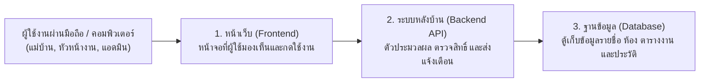

# เอกสารส่งมอบโครงการสำหรับผู้ดูแลโครงการ (PM Handover Guide)

**ชื่อโครงการ:** Janitorial Management Dashboard (ระบบติดตามงานทำความสะอาดด้วย QR Code)
**อัปเดตล่าสุด:** 24 พฤศจิกายน 2026
**กลุ่มผู้อ่าน:** ผู้จัดการโครงการ (PM), พี่เลี้ยงโครงการ และผู้ประสานงาน (เขียนด้วยภาษาทั่วไป ไม่ต้องมีพื้นฐานด้านโปรแกรมมิ่ง)

---

## 1. สรุปสั้นที่สุดใน 1 นาที

- **สถานะงานพัฒนา:** ตัวระบบพัฒนาและทดสอบครบตามขอบเขตที่ตกลงไว้แล้ว (รวมถึงหน้าภาพรวมผู้บริหาร, ระบบจัดตารางงานแม่บ้านทั้งกะเช้า-กะดึก, การลงเวลา 6 จังหวะ, การแจ้งเตือนเรียลไทม์, การออกรายงาน Excel และคู่มือผู้ใช้ภาษาไทยฉบับ PDF)
- **สิ่งที่เหลืออยู่:** เหลือเพียงขั้นตอน **การนำระบบขึ้นเครื่องเซิร์ฟเวอร์จริง (Deploy)** และการทดลองใช้กับพนักงานจริงในพื้นที่นำร่อง
- **บทบาทของ PM:** คุณ **ไม่จำเป็นต้องติดตั้งหรือ Deploy ระบบเอง** หน้าที่ของ PM คือเก็บรักษาสิทธิ์การเข้าถึงโครงการ, ประสานงานขอทรัพยากรที่จำเป็นจากฝ่าย IT/พนักงานประจำ, ส่งเอกสารชุดนี้ต่อให้ทีมเทคนิค และตรวจรับงานตาม Checklist ในเอกสารนี้

---

## 2. เข้าใจระบบแบบง่ายๆ (ไม่ต้องรู้ศัพท์โปรแกรม)

ระบบนี้ทำงานเหมือนร้านค้าที่มี 3 ส่วนทำงานร่วมกัน:



| ส่วนประกอบ | เปรียบเทียบง่ายๆ | หน้าที่ในระบบนี้ |
|---|---|---|
| **1. หน้าเว็บ (Frontend)** | หน้าร้าน / หน้าจอตู้กด | หน้าเว็บที่แม่บ้านใช้สแกน QR, หัวหน้าใช้ตรวจงาน-จัดตาราง, แอดมินใช้ดูภาพรวมและพิมพ์ป้าย QR |
| **2. ระบบหลังบ้าน (Backend API)** | พนักงานหลังร้าน | รับข้อมูลจากการสแกน ตรวจสอบเวลาและพิกัด ส่งแจ้งเตือนทันที และสร้างไฟล์ Excel |
| **3. ฐานข้อมูล (Database)** | ตู้เก็บเอกสาร | เก็บข้อมูลตึก ห้อง พนักงาน ตารางงาน ประวัติการทำความสะอาด และประวัติการตรวจสอบ |

### ทางเลือกในการนำระบบขึ้นใช้งานจริง (ให้ PM หารือร่วมกับทีม IT)

ระบบนี้ออกแบบให้เลือกติดตั้งได้ 2 รูปแบบ ขึ้นอยู่กับนโยบายของบริษัท:

| รูปแบบ | อธิบายแบบเข้าใจง่าย | เหมาะกับเมื่อไร |
|---|---|---|
| **แบบที่ 1: เซิร์ฟเวอร์ของบริษัทเอง (Linux Server 1 เครื่อง)** | รวมทั้ง 3 ส่วนไว้ในเครื่องเซิร์ฟเวอร์ของบริษัทเครื่องเดียว บริษัทดูแลและเก็บข้อมูลเองทั้งหมด | เหมาะสำหรับใช้งานจริงระยะยาว และองค์กรที่ต้องการเก็บข้อมูลไว้ภายในเอง (**แนะนำ**) |
| **แบบที่ 2: บริการคลาวด์ (Cloud)** | แยกฝากไว้กับผู้ให้บริการคลาวด์ (เช่น หน้าเว็บบน Vercel, หลังบ้านบน Render, ฐานข้อมูลบน TiDB หรือ MySQL Cloud) ไม่ต้องซื้อเครื่องเอง | เหมาะสำหรับต้องการเปิดใช้งานทดลองอย่างรวดเร็ว โดยยังไม่มีเครื่องเซิร์ฟเวอร์ของบริษัท |

---

## 3. สิ่งที่ทำเสร็จแล้ว vs สิ่งที่ต้องทำต่อหลังรับมอบ

| รายการ | สถานะ | หมายเหตุ |
|---|---|---|
| โค้ดโปรแกรมทั้งหน้าเว็บและหลังบ้าน | เสร็จแล้ว | อยู่ใน GitHub branch `master` และผ่านชุดทดสอบอัตโนมัติทั้งหมด |
| คู่มือผู้ใช้งานภาษาไทย (แม่บ้าน, หัวหน้า, แอดมิน) | เสร็จแล้ว | ไฟล์ [Janitorial_Management_Dashboard_User_Manual_TH_v2.0.pdf](../Manual/Janitorial_Management_Dashboard_User_Manual_TH_v2.0.pdf) มีภาพหน้าจอและลูกศรชี้จุดกดทุกขั้นตอน |
| คู่มือติดตั้งและดูแลระบบสำหรับทีม IT | เสร็จแล้ว | ไฟล์ [docs/handover.md](handover.md) มีคำสั่งครบทุกขั้นตอน |
| การคัดแยกไฟล์สำหรับ Deploy (Ignore files) | เสร็จแล้ว | ตั้งค่าแยกไฟล์ที่ไม่จำเป็นสำหรับ Deploy ไว้เรียบร้อย (`.vercelignore`, `frontend/.vercelignore`, `backend/.dockerignore`, `.dockerignore`) |
| จัดหาเครื่องเซิร์ฟเวอร์ / ชื่อเว็บ (Domain) / HTTPS | **รอทำต่อ** | PM ประสานงานขอจากฝ่าย IT |
| นำระบบขึ้นเครื่องจริง (Deploy) และสร้างบัญชีแอดมิน | **รอทำต่อ** | พนักงานประจำ / ฝ่าย IT ดำเนินการตาม [docs/handover.md](handover.md) |
| พิมพ์ป้าย QR ติดหน้างานจริง และทดลองใช้ 1 พื้นที่ | **รอทำต่อ** | แอดมินและหัวหน้างานดำเนินการหลังเว็บเปิดใช้งานได้แล้ว |

---

## 4. แผนที่ไฟล์สำคัญ: ต้องส่งอะไรให้ใครบ้าง

ภายในโฟลเดอร์โครงการมีหลายไฟล์รวมกันอยู่ ทั้งโค้ดโปรแกรม เอกสาร และเครื่องมือช่วยพัฒนา PM ไม่ต้องเปิดดูทุกไฟล์ ให้เลือกส่งเฉพาะไฟล์ที่ตรงกับผู้รับดังนี้:

| ผู้รับ | ไฟล์ที่ต้องส่งให้ | เอาไว้ใช้ทำอะไร |
|---|---|---|
| **ผู้บริหาร / พี่เลี้ยง / ผู้ประสานงาน** | 1. เอกสารนี้ (`docs/pm-handover.md`)<br>2. [ภาพรวมระบบภาษาธุรกิจ](business-overview.md) | ทำความเข้าใจภาพรวมระบบ ประโยชน์ที่ได้ ขอบเขต และแผนส่งต่อ |
| **แม่บ้าน / หัวหน้างาน / แอดมิน (ผู้ใช้จริง)** | 1. [คู่มือผู้ใช้ภาษาไทย PDF v2.0](../Manual/Janitorial_Management_Dashboard_User_Manual_TH_v2.0.pdf)<br>2. [แผนภาพขั้นตอนการทำงานทั้ง 3 บทบาท](role-workflows.md) | ใช้อบรมและเปิดดูวิธีใช้งานทีละขั้นในหน้างานจริง |
| **พนักงานประจำ / ฝ่าย IT (ผู้ Deploy)** | 1. ลิงก์ GitHub Repository ของโครงการ<br>2. [คู่มือติดตั้งและดูแลระบบสำหรับทีม IT](handover.md)<br>3. [สถาปัตยกรรมระบบ](architecture.md) และ [แผนที่โค้ด](code-map.md)<br>4. [สถานะงานล่าสุด](handoff.md) | ใช้ติดตั้งระบบขึ้นเซิร์ฟเวอร์ ตั้งค่าความปลอดภัย สำรองข้อมูล และดูแลต่อในอนาคต |

### อธิบายโฟลเดอร์ในโครงการ (อันไหนใช้ Deploy จริง อันไหนไม่ต้อง Deploy)

| โฟลเดอร์ / ไฟล์ | จำเป็นต้องใช้ตอน Deploy ไหม | อธิบายสั้นๆ |
|---|---|---|
| `frontend/` | **จำเป็น** | โค้ดหน้าเว็บที่ผู้ใช้เปิดดู |
| `backend/src/` และ `backend/Dockerfile` | **จำเป็น** | โค้ดระบบหลังบ้านและตัวสร้างแพ็กเกจสำหรับเซิร์ฟเวอร์ |
| `scripts/janitorial.sh` | **จำเป็น (เฉพาะแบบ Linux Server)** | สคริปต์ช่วยตั้งค่าไฟล์ระบบและกู้คืนบัญชีแอดมินบน Linux |
| `Manual/` | ไม่ต้อง Deploy | เก็บไฟล์คู่มือผู้ใช้ PDF (เก็บไว้แจกพนักงาน) |
| `docs/` และ `design-system/` | ไม่ต้อง Deploy | เอกสารอธิบายระบบ คู่มือส่งมอบ และมาตรฐานการออกแบบ |
| `backend/tests/`, `backend/tools/`, `frontend/e2e/` | ไม่ต้อง Deploy | ชุดทดสอบอัตโนมัติและข้อมูลจำลองสำหรับนักพัฒนา |
| `.agents/`, `.claude/`, `AGENTS.md`, `CONTEXT.md` | ไม่ต้อง Deploy | ไฟล์กฎและเครื่องมือช่วยพัฒนาด้วย AI (ตั้ง ignore ไว้แล้ว) |

---

## 5. Checklist สำหรับ PM (4 ขั้นตอนจนเปิดใช้งานจริง)

### ขั้นที่ 1: วันรับมอบงานจากผู้พัฒนา

- [ ] ตรวจสอบว่าเข้าถึงลิงก์ GitHub Repository ได้จริง (และตัดสินใจว่าจะโอนเข้า GitHub ของบริษัทหรือไม่)
- [ ] ดาวน์โหลดและเก็บสำเนาคู่มือผู้ใช้ [Janitorial_Management_Dashboard_User_Manual_TH_v2.0.pdf](../Manual/Janitorial_Management_Dashboard_User_Manual_TH_v2.0.pdf) ไว้ในโฟลเดอร์กลางของทีม
- [ ] ยืนยันว่าไม่มีไฟล์รหัสผ่านจริงหรือรายชื่อพนักงานจริงถูกอัปโหลดไว้ใน GitHub
- [ ] กรอกตารางข้อมูลส่งมอบในหัวข้อที่ 9 ของเอกสารนี้เก็บไว้เป็นหลักฐาน

### ขั้นที่ 2: สิ่งที่ PM ต้องเตรียมและขอจากฝ่าย IT (ก่อนนัดวัน Deploy)

PM สามารถส่งรายการ 4 ข้อนี้ให้ฝ่าย IT เตรียมไว้ล่วงหน้า:

- [ ] **ชื่อเว็บ (Domain Name)** ที่จะใช้จริง เช่น `cleaning.company.co.th` พร้อม **HTTPS** (ต้องมีรูปแม่กุญแจบนแถบเว็บ)
- [ ] **เครื่องเซิร์ฟเวอร์ Linux (Ubuntu 24.04+)** หรือ **บัญชี Cloud** ที่เปิดใช้งานจากอินเทอร์เน็ตมือถือ 4G/5G ได้ (ไม่ติดอยู่แค่ใน Wi-Fi ออฟฟิศ เพราะแม่บ้านใช้เน็ตมือถือส่วนตัวสแกน QR)
- [ ] **ฐานข้อมูล MySQL 8 ขึ้นไป** (หรือ TiDB v8.5+)
- [ ] **กำหนดรายชื่อผู้ที่จะเป็นแอดมินหลักอย่างน้อย 2 คน** สำหรับเริ่มเข้าระบบและดูแลบัญชีพนักงาน

### ขั้นที่ 3: ส่งมอบให้พนักงานประจำ Deploy และตรวจรับงาน

เมื่อพนักงานประจำติดตั้งตาม [docs/handover.md](handover.md) เสร็จแล้ว PM สามารถตรวจรับเองได้ด้วย 5 ข้อนี้ (ไม่ต้องดูโค้ด):

- [ ] **เปิดเว็บผ่านมือถือด้วยเน็ต 4G/5G ได้จริง** และที่อยู่เว็บขึ้นต้นด้วย `https://` ไม่มีคำเตือนความปลอดภัย
- [ ] **แอดมินเข้าสู่ระบบได้** ที่หน้า `/login/admin` และสร้างบัญชีแอดมินคนที่ 2 เรียบร้อยแล้ว
- [ ] **เพิ่มข้อมูลตั้งต้นได้** (สร้างตึก 1 ตึก, พื้นที่ 1 พื้นที่, จุดทำความสะอาด 1 ห้อง, บัญชีหัวหน้า 1 คน และแม่บ้าน 1 คน)
- [ ] **พิมพ์ป้าย QR และสแกนด้วยมือถือจริงผ่าน** ทั้งป้ายลงเวลาเข้างานและป้ายส่งงานที่ห้อง โดยมือถือยอมส่งตำแหน่ง GPS ได้ปกติ
- [ ] **หน้าจออัปเดตอัตโนมัติ** เมื่อลองสแกนส่งงานจากมือถือ หน้าจอแอดมินบนคอมพิวเตอร์อัปเดตสถานะเองโดยไม่ต้องกดรีเฟรช

### ขั้นที่ 4: ทดลองใช้จริงในพื้นที่นำร่อง (Pilot)

- [ ] เลือกพื้นที่นำร่อง 1 พื้นที่ (เช่น ห้องน้ำชั้น 1 ของ 1 อาคาร)
- [ ] ติดป้าย QR จริงหน้างาน และให้แอดมินยืนหน้าป้ายเพื่อกดบันทึกพิกัดจริงของป้าย
- [ ] แจกคู่มือ PDF และให้แม่บ้าน + หัวหน้างานทดลองใช้งานจริงทั้งกะเป็นเวลา 1–2 สัปดาห์ เพื่อตรวจระยะ GPS สัญญาณมือถือ และขั้นตอนการทำงาน ก่อนขยายไปยังตึกอื่น

---

## 6. ข้อความตัวอย่างสำหรับ PM ก๊อปปี้ส่งให้พนักงานประจำ / ฝ่าย IT

สามารถคัดลอกข้อความด้านล่างไปส่งทาง LINE, Microsoft Teams หรืออีเมลได้เลย (เปลี่ยนเฉพาะข้อความในเครื่องหมาย `[...]`):

```text
สวัสดีครับ/ค่ะ ขอส่งต่อโครงการระบบติดตามงานทำความสะอาด (Janitorial Management Dashboard)
สำหรับนำขึ้นระบบจริง (Deploy) ครับ/ค่ะ

ตัวระบบพัฒนาและทดสอบเสร็จครบแล้ว รายละเอียดและคู่มือทั้งหมดอยู่ใน GitHub Repository นี้:
- GitHub Repository: [ใส่ลิงก์ GitHub ของโครงการ] (branch: master)
- คู่มือติดตั้งและตั้งค่าเซิร์ฟเวอร์ทีละขั้น: docs/handover.md
- โครงสร้างระบบและแผนที่โค้ด: docs/architecture.md และ docs/code-map.md
- คู่มือผู้ใช้งานจริง (PDF): Manual/Janitorial_Management_Dashboard_User_Manual_TH_v2.0.pdf

สิ่งที่ระบบต้องการเบื้องต้น:
1. ชื่อเว็บ (Domain) พร้อม HTTPS ที่เปิดใช้งานจากเน็ตมือถือ 4G/5G ได้
2. เซิร์ฟเวอร์ Linux (Ubuntu 24.04+) + MySQL 8+ (หรือ Deploy แบบ Cloud ตามรายละเอียดใน docs/handover.md)
3. ตั้งค่า Environment Variables ตามคู่มือ (รวมถึงฐานข้อมูล, Jwt__SigningKey, Scheduling__CommandSigningKey อย่างน้อย 32 ไบต์ และ FirstAdmin สำหรับสร้างแอดมินคนแรก)

หากติดตั้งเสร็จแล้ว รบกวนแจ้งชื่อเว็บ (URL) เพื่อให้ทีมเริ่มตรวจรับและพิมพ์ป้าย QR สำหรับพื้นที่นำร่องครับ/ค่ะ
ขอบคุณครับ/ค่ะ
```

---

## 7. ข้อควรระวังสำคัญ 5 ข้อ (ห้ามพลาด)

1. **ห้ามนำรหัสผ่านหรือข้อมูลพนักงานจริงขึ้น GitHub:** ปัจจุบัน Repository นี้ตั้งค่าเป็นสาธารณะ (Public) ข้อมูลที่เป็นความลับทั้งหมด เช่น รหัสฐานข้อมูล คีย์ระบบ หรือไฟล์ `.env` จะต้องเก็บไว้ในเครื่องเซิร์ฟเวอร์เท่านั้น หากต้องการใช้งานภายในองค์กรจริง แนะนำให้ฝ่าย IT เปลี่ยน Repository เป็น Private หรือย้ายเข้าองค์กรก่อน
2. **ตกลงชื่อเว็บ (Domain) ให้แน่นอนก่อนพิมพ์ป้าย QR:** เพราะป้าย QR ทุกใบมีลิงก์ที่อยู่เว็บฝังอยู่ หากเปลี่ยนชื่อเว็บในภายหลัง จะต้องพิมพ์และติดป้าย QR ใหม่ทั้งหมด
3. **ต้องเปิดผ่าน HTTPS เท่านั้น:** เบราว์เซอร์บนมือถือ (ทั้ง iPhone และ Android) จะบล็อกการใช้งานกล้องและ GPS หากเว็บไม่ได้ใช้ HTTPS ซึ่งจะทำให้แม่บ้านสแกนและตรวจระยะป้ายไม่ได้
4. **ควรมีบัญชีแอดมินที่ใช้งานได้จริงอย่างน้อย 2 คนเสมอ:** เพื่อที่เวลาแอดมินคนหนึ่งลืมรหัสผ่าน ลาพักร้อน หรือลาออก อีกคนจะสามารถรีเซ็ตรหัสผ่านผ่านหน้าเว็บได้ทันทีโดยไม่ต้องขอให้ฝ่าย IT เข้าไปกู้ระบบหลังบ้าน
5. **ให้ฝ่าย IT ลบรหัสผ่านแอดมินตั้งต้นหลังเข้าใช้งานครั้งแรก:** หลังสร้างแอดมินคนแรกและตั้งรหัสผ่านใหม่ผ่านหน้าเว็บแล้ว ให้ทีม IT ลบบรรทัด `FirstAdmin__Password` ออกจากไฟล์ค่าตั้งเซิร์ฟเวอร์เพื่อความปลอดภัย

---

## 8. พจนานุกรมคำศัพท์แบบภาษาคน (เผื่อได้ยินทีม IT พูดถึง)

| คำศัพท์ | ความหมายแบบเข้าใจง่าย |
|---|---|
| **Deploy** | การนำโปรแกรมที่เขียนเสร็จแล้ว ไปติดตั้งบนเครื่องเซิร์ฟเวอร์จริงให้ทุกคนเปิดใช้งานผ่านเว็บได้ |
| **GitHub / Repository (Repo)** | ตู้เก็บโค้ดต้นฉบับและเอกสารทั้งหมดของโครงการ (เหมือน Google Drive สำหรับโปรแกรมเมอร์) |
| **Frontend / Backend** | Frontend = หน้าจอเว็บที่ผู้ใช้เห็นและกด / Backend = ระบบหลังบ้านที่คิดคำนวณและบันทึกข้อมูล |
| **Database (MySQL / TiDB)** | ฐานข้อมูลที่ใช้เก็บข้อมูลทั้งหมดของระบบ เช่น ชื่อพนักงาน ห้อง และประวัติการทำงาน |
| **Domain และ HTTPS** | Domain = ชื่อเว็บ เช่น `cleaning.company.co.th` / HTTPS = ระบบเข้ารหัสความปลอดภัย (รูปแม่กุญแจ) |
| **Environment Variable / `.env`** | ไฟล์หรือช่องตั้งค่าความลับบนเซิร์ฟเวอร์ เช่น รหัสผ่านฐานข้อมูล และกุญแจความปลอดภัย (ห้ามแจกจ่ายสาธารณะ) |
| **Migration** | ขั้นตอนที่ระบบสร้างตารางในฐานข้อมูลให้อัตโนมัติตอนเปิดใช้งานครั้งแรก |
| **Real-time (SignalR)** | ระบบที่ทำให้หน้าจอแอดมินและหัวหน้าอัปเดตข้อมูลเองทันทีเมื่อแม่บ้านสแกน โดยไม่ต้องกดรีเฟรชหน้าเว็บ |
| **Ignore file (`.vercelignore` / `.dockerignore`)** | รายชื่อไฟล์ที่ไม่ต้องส่งขึ้นเซิร์ฟเวอร์ตอน Deploy (เช่น เอกสาร คู่มือ ไฟล์ทดสอบ) เพื่อให้ติดตั้งเร็วและปลอดภัยขึ้น |

---

## 9. บันทึกข้อมูลการส่งมอบ (กรอกก่อนส่งต่อให้ PM)

| รายการ | รายละเอียด |
|---|---|
| วันที่ส่งมอบ | `[กรอกวันที่ส่งมอบ]` |
| ลิงก์ GitHub Repository | `https://github.com/ThodsaphonSonthiphin/Facility-Real-time-dashboard` |
| Branch หลักที่ใช้ Deploy | `master` |
| ผู้ส่งมอบ (ผู้พัฒนา) / ช่องทางติดต่อ | `[กรอกชื่อและช่องทางติดต่อนอก repo]` |
| ผู้รับมอบ (PM / ผู้ประสานงาน) | `[กรอกชื่อ PM]` |
| ผู้รับช่วงติดตั้งต่อ (พนักงานประจำ / IT) | `[กรอกชื่อเมื่อมอบหมายแล้ว]` |
| รูปแบบการ Deploy ที่เลือก | `[ ] Linux Server ของบริษัท` / `[ ] Cloud (Vercel + Render + Database)` |
| ชื่อเว็บ (Domain) ที่วางแผนจะใช้ | `[กรอกเมื่อฝ่าย IT ยืนยัน]` |
