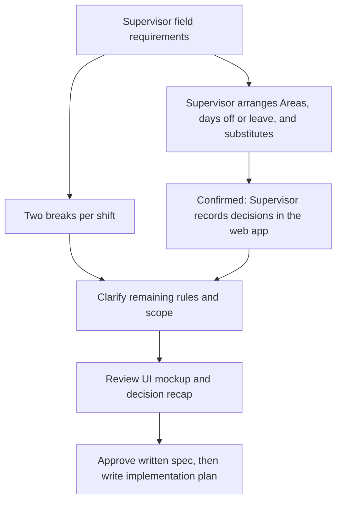

# New Cleaner scheduling requirements from a Supervisor

Source: requirements supplied by the owner on 2026-11-16, attributed to a Supervisor. These are field inputs for a new design session. Unresolved details below must not be silently inferred from the old system or the earlier overview plan.

## Reported break times

Cleaners take two breaks per shift. The Supervisor chooses the groups for the staggered first break.

| Owner's shift label | First break, group 1 | First break, group 2 | Second break, everyone together |
|---|---|---|---|
| กะเช้า | 10:00–11:00 | 11:00–12:00 | 16:00–17:00, end time confirmed in facility-0147 |
| กะเย็น | 22:00–23:00 | 23:00–24:00 | 04:00–05:00 |

The owner originally placed “พักก่อนทำ OT” in the first-break descriptions, then explicitly clarified that it means break 2. Break 1 has two staggered Supervisor-assigned groups; break 2 is simultaneous for everyone in that shift, including the same arrangement at night. See facility-0148. The owner subsequently confirmed full day-shift 07:00–19:00 and night-shift 19:00–07:00 hours for both regular and relief staff in facility-0150; “กะเย็น” in the initial input refers to this night shift. No payroll or OT calculation requirement has been established. The spec must state how existing overnight shift-date attribution and receiving windows are preserved.

## Reported scheduling responsibilities

- The Supervisor determines which Cleaner works in which Area.
- The Supervisor determines days off and assigns substitutes. The owner also raised leave and subsequently chose Supervisor recording of already-agreed leave, without an in-app request/approval workflow (facility-0156).
- Actual-work clarification on 2026-11-17: the Supervisor uses an A4 roster with Cleaner names and selects days off by week. A person may be off Monday in week 1 and Tuesday in week 2. The same weekday is common but not compulsory throughout the month. Other paper fields and paper import/printing/export requirements were not supplied.

## Confirmed design decisions

1. The Supervisor records Area assignments, break groups, days off or leave, and substitutes directly through a web screen, rather than requiring Admin to enter every decision. See [facility-0131](../adr/facility-0131-supervisor-manages-cleaner-schedules-in-web.md).
2. Each Supervisor manages their own assigned building set and shift. Originally phrased as one building in 0132; 0140 later confirms that a Supervisor may be responsible for multiple buildings. Cross-team coordination remains a separate open question. See [facility-0132](../adr/facility-0132-supervisor-scheduling-scoped-to-own-building-and-shift.md).
3. Admin may view and arrange or edit schedules across all buildings and shifts, with history identifying who changed what. See [facility-0133](../adr/facility-0133-admin-manages-schedules-across-buildings-and-shifts.md).
4. Cleaners retain regular Areas; change the Area or assign cover only on selected days. Routine assignments do not need daily re-entry. See [facility-0134](../adr/facility-0134-cleaners-retain-regular-areas-with-dated-exceptions.md).
5. The Supervisor may select different days off in different weeks for each Cleaner; repeating the same weekday is common, not compulsory for the whole month. [facility-0190](../adr/facility-0190-supervisor-selects-cleaner-days-off-by-week.md) supersedes the fixed-only restriction in [facility-0135](../adr/facility-0135-cleaners-have-recurring-weekly-days-off.md). Automatic copying/defaults between weeks remain unchosen.
6. An Area still requires all usual cleaning rounds when its regular Cleaner has a day off; the Supervisor arranges a substitute. See [facility-0136](../adr/facility-0136-regular-day-off-keeps-all-area-cleaning-rounds.md).
7. Substitutes are dedicated relief Cleaners (แม่บ้านสำรอง/สแปร์) with no regular Areas. They cover A on A's day off and B on B's day off; regular Cleaners do not take on an extra Area to provide this cover. See [facility-0137](../adr/facility-0137-dedicated-relief-cleaners-cover-days-off.md).
8. Relief Cleaners need six days of assigned work per week. If absence cover fills five days, the Supervisor assigns another Area on the remaining workday. See [facility-0138](../adr/facility-0138-relief-cleaners-receive-six-days-of-assigned-work.md).
9. That other Area may be in another building. This establishes relief staff mobility, not wider management rights for Supervisors. See [facility-0139](../adr/facility-0139-relief-cleaners-may-work-across-buildings.md).
10. A Supervisor may be responsible for multiple buildings and assign relief work between those buildings. Do not assume the source and destination have different Supervisors. See [facility-0140](../adr/facility-0140-supervisor-may-schedule-multiple-assigned-buildings.md).
11. The same assigned building set governs viewing work, scheduling and QR inspection, within the Supervisor's assigned shift. See [facility-0141](../adr/facility-0141-supervisor-shares-building-scope-for-view-schedule-and-inspection.md).
12. Each building has one regular responsible Supervisor per shift; two Supervisors in the same shift do not share regular responsibility for the same building. One Supervisor may still manage multiple buildings. See [facility-0142](../adr/facility-0142-one-regular-supervisor-per-building-and-shift.md).
13. Each relief Cleaner has a regular shift. They may work different buildings on different dates but keep that shift rather than receive day/night assignments individually by date. See [facility-0143](../adr/facility-0143-relief-cleaners-keep-a-regular-shift.md).
14. A relief Cleaner takes one Area for the whole shift on a selected day; do not split that shift among multiple Areas. See [facility-0144](../adr/facility-0144-relief-cleaner-takes-one-area-for-the-whole-shift.md).
15. Relief timetables repeat weekly and permit changes on selected dates without changing other dates' regular assignments. See [facility-0145](../adr/facility-0145-relief-schedules-repeat-weekly-with-dated-overrides.md).
16. Both break departures and returns require scans: enter work → leave break 1 → return break 1 → leave break 2 → return break 2 → leave work. Normal attendance therefore has six actions per shift. See [facility-0146](../adr/facility-0146-two-breaks-use-six-scanned-attendance-actions.md).
17. Day-shift break 2 is 16:00–17:00, completing the end time originally supplied as “17:”. See [facility-0147](../adr/facility-0147-day-shift-second-break-is-1600-to-1700.md).
18. Break 1 has two staggered groups; break 2 is the pre-OT break and is simultaneous for everyone in the shift. The night shift follows the same pattern. The 50-person/25-per-group example is illustrative, not a headcount or enforced group capacity. See [facility-0148](../adr/facility-0148-first-break-staggered-second-break-shared-before-ot.md).
19. Record actual break scan times and show them against the timetable; do not reject a break scan just because it is outside the planned break window. Normal eligibility/order/shift checks still need definition. See [facility-0149](../adr/facility-0149-break-scans-record-actual-times-against-plan.md).
20. Both regular and relief Cleaners retain full planned shifts: day 07:00–19:00 or night 19:00–07:00. Do not add individually shortened no-OT planned shifts from the earlier ambiguous wording. See [facility-0150](../adr/facility-0150-cleaners-keep-full-day-and-night-shift-hours.md).

21. Regular Area Cleaners have a default first-break group with changes permitted on selected dates; other dates retain the default. See [facility-0151](../adr/facility-0151-regular-cleaners-have-default-break-groups-with-dated-changes.md).
22. A relief Cleaner initially uses the first-break group of the person being replaced; the Supervisor may change the relief person's group for that date. See [facility-0152](../adr/facility-0152-relief-break-group-defaults-to-replaced-cleaner.md).
23. A forgotten intermediate break scan may be explicitly skipped to record the next actual action. Keep the missing time empty and visible; do not generate it automatically. This does not waive initial check-in. See [facility-0153](../adr/facility-0153-missing-break-scan-can-be-skipped-without-fabricating-time.md).
24. The responsible Supervisor may fill a missing verified actual time for their team, as may Admin, with a reason and history. The clarified answer does not grant general Supervisor rights to overwrite existing scans. See [facility-0154](../adr/facility-0154-supervisor-may-fill-missing-team-attendance-with-reason.md).
25. A relief Cleaner uses the Check-In Sign of the Area assigned for that date for all six normal attendance actions. No central team sign is introduced. See [facility-0155](../adr/facility-0155-relief-attendance-uses-the-assigned-area-sign.md).
26. Supervisors record leave after it is agreed. This scope does not add Cleaner leave-request forms or in-app approval. See [facility-0156](../adr/facility-0156-supervisor-records-agreed-leave-without-request-workflow.md).
27. Recorded leave must support partial shifts, including half-day and hourly leave, as well as full shifts. How relief assignments cover those intervals is not yet chosen. See [facility-0157](../adr/facility-0157-recorded-leave-includes-partial-shifts.md).
28. Known full-shift leave can be saved before a substitute is found; show “รอจัดคนทำแทน” until assignment. This is staffing-plan status, not proof of actual physical absence or a resolution of partial-leave cover. See [facility-0158](../adr/facility-0158-full-shift-leave-can-be-saved-with-replacement-pending.md).
29. Cleaners may view only their own schedule on mobile—Area duties, breaks, days off and leave—without editing it. See [facility-0159](../adr/facility-0159-cleaners-can-view-their-own-schedule-read-only.md).
30. The owner accepted the proposed scheduling mockup layout as the basis for continuing design; this is not spec or implementation approval. See [facility-0160](../adr/facility-0160-scheduling-mockup-layout-accepted.md).
31. A missing return-from-break scan does not prevent work submission after Shift-In and before Shift-Out; keep the missing time visible without auto-filling it. Other submission checks remain. See [facility-0161](../adr/facility-0161-missing-break-return-does-not-block-work-submission.md).
32. **Superseded:** automatic round movement was initially chosen for a hypothetical clash; the owner then clarified the actual timetable already avoids breaks. The proposal in [facility-0162](../adr/facility-0162-cleaning-rounds-move-automatically-when-breaks-conflict.md) was superseded by 0163.
33. Keep configured cleaning-round times and exclude automatic break-driven rescheduling from this work. No substitute conflict-warning/validation feature is implicitly added. See [facility-0163](../adr/facility-0163-keep-configured-rounds-without-automatic-break-rescheduling.md).

34. Keep old four-action attendance history as originally recorded; do not invent or falsely flag missing break-2 events in old shifts. Begin six-action expectations with shifts using the new flow. See [facility-0164](../adr/facility-0164-preserve-legacy-four-action-attendance-history.md).

35. Reject stale scheduling overwrites after another editor changes the same entry; show the latest saved values and preserve local input for comparison before saving again. See [facility-0165](../adr/facility-0165-scheduling-rejects-stale-overwrites.md).
36. A repeated submission of the same scheduling save command applies once, without duplicate changes or change-history entries. See [facility-0166](../adr/facility-0166-repeated-schedule-save-applies-once.md).
37. After connection loss leaves a scheduling save outcome uncertain, check whether that command committed before another mutation; unresolved outcomes remain explicitly unconfirmed. See [facility-0167](../adr/facility-0167-check-uncertain-schedule-save-before-retry.md).
38. Keep ongoing slots on four-action attendance and begin six actions together at an explicitly selected future shift slot, prepared before its receiving window opens. See [facility-0168](../adr/facility-0168-six-action-attendance-starts-at-a-shift-boundary.md).
39. Pre-update attendance pages must load the current page before new-flow writes; reject incompatible stale actions without effects and scope the compatibility check to changed-contract consumers. See [facility-0169](../adr/facility-0169-refresh-stale-attendance-pages-for-new-flow.md).
40. Open read-only schedule pages automatically fetch the latest authorized schedule after relevant saved changes. See [facility-0170](../adr/facility-0170-open-schedule-views-refresh-on-change.md).
41. Incoming schedule refreshes notify editors of newer saved data without clearing unsaved input; stale-write protection still applies. See [facility-0171](../adr/facility-0171-schedule-refresh-preserves-unsaved-input.md).
42. Show possible schedule staleness during connection loss and refetch after reconnection before claiming the displayed data is current. See [facility-0172](../adr/facility-0172-schedule-views-show-staleness-and-refetch-on-reconnect.md).
43. Changing a regular timetable for a later period does not automatically rewrite earlier dated schedules. See [facility-0173](../adr/facility-0173-later-timetable-changes-preserve-earlier-schedules.md).
44. Explicitly show unavailable historical schedules rather than inferring them from current regular assignments. See [facility-0174](../adr/facility-0174-show-unavailable-schedule-history-without-inference.md).
45. Planned schedule edits do not rewrite or fabricate actual scan times; existing accepted correction rights and provenance remain. See [facility-0175](../adr/facility-0175-schedule-edits-do-not-rewrite-actual-scan-times.md).
46. Regular and relief Cleaners open “ตารางของฉัน” before the My Work list, with a return control. See [facility-0176](../adr/facility-0176-cleaner-schedule-entry-precedes-work-list.md).
47. Supervisors open “จัดตารางงาน” before the My Building list, with a return control. See [facility-0177](../adr/facility-0177-supervisor-schedule-entry-precedes-building-list.md).
48. Admin opens “ตารางงาน” after attendance in the existing tracking menu, using the responsive Admin shell. See [facility-0178](../adr/facility-0178-admin-schedule-menu-follows-attendance.md).
49. Schedule reading after authorized login requires neither a QR scan nor GPS permission; scanning actions retain their existing requirements. See [facility-0179](../adr/facility-0179-schedule-viewing-does-not-require-qr-or-gps.md).
50. On first opening “ตารางของฉัน”, show the Cleaner's current-week schedule immediately instead of requiring week selection first. See [facility-0180](../adr/facility-0180-cleaner-schedule-opens-current-week.md).
51. When a Cleaner returns from My Work to their schedule during the same ongoing use, restore the week just viewed rather than reset to this week. See [facility-0181](../adr/facility-0181-cleaner-schedule-restores-last-viewed-week-on-return.md).
52. Supervisor and Admin schedules share those two week-navigation behaviors: immediately show this week on first opening, and restore the last viewed week on return during the same ongoing use. See [facility-0182](../adr/facility-0182-all-scheduling-roles-share-week-navigation-defaults.md).
53. For a Cleaner/Supervisor first opening during an ongoing night shift crossing from Sunday into Monday, show the week containing that shift's Sunday start rather than advancing solely with the calendar date. See [facility-0183](../adr/facility-0183-ongoing-night-shift-keeps-its-start-week-on-first-open.md).
54. Admin initially sees all buildings in the current clock shift, can filter buildings/change shifts, and uses the night slot's start date/week when applicable. See [facility-0184](../adr/facility-0184-admin-schedule-starts-all-buildings-current-shift.md).
55. Supervisor/Admin returning to scheduling during the same ongoing use restore applicable building/shift filters together with the last viewed week, without widening their authorized scope. See [facility-0185](../adr/facility-0185-scheduling-restores-building-and-shift-filters-on-return.md).
56. Supervisor scheduling initially shows all buildings assigned to that Supervisor in their own shift, with a filter to one assigned building; retained return selection takes precedence. See [facility-0186](../adr/facility-0186-supervisor-schedule-starts-with-all-assigned-buildings.md).
57. In the regular-Cleaner timetable editor, the Supervisor may choose a future start date, including a midweek date, rather than always waiting until the next Monday. See [facility-0187](../adr/facility-0187-regular-timetable-has-a-selected-future-start-date.md).
58. Use the reviewed regular-Cleaner editor sequence: select Cleaner → edit regular Area/day off/break group → choose start date → review changes before saving. See [facility-0188](../adr/facility-0188-regular-timetable-editor-reviews-changes-before-save.md).
59. A new regular first-break group preserves a previously explicit first-break override on a selected working date; other applicable dates use the new regular group. See [facility-0189](../adr/facility-0189-regular-break-changes-preserve-dated-break-overrides.md).
60. The day-off interface must support the Supervisor choosing different weekdays off in different weeks; a single repeating weekday field cannot be its only editing surface. See [facility-0190](../adr/facility-0190-supervisor-selects-cleaner-days-off-by-week.md), amending decision 5 and the day-off portion of the 0188 preview.
61. Use the multi-person weekly day-off roster: show Cleaner names together, previous-week references, editable current-week choices in each row and review before saving. The owner selected the second screenshot. See [facility-0191](../adr/facility-0191-weekly-days-off-use-the-multi-person-roster-layout.md).
62. Add an explicit Supervisor-triggered “คัดลอกวันหยุดจากสัปดาห์ก่อน” action, then adjust changed people and review before saving the target week. It copies day-off choices only; automatic entry-time copying and existing target-choice handling are not selected. See [facility-0192](../adr/facility-0192-weekly-days-off-have-an-explicit-copy-previous-week-action.md).
63. Copying previous-week days off fills only unset target-week choices and keeps already entered saved/local choices. Copied values remain editable and require review/save. See [facility-0193](../adr/facility-0193-copy-previous-week-days-off-fills-only-unset-choices.md), resolving the target-choice question in 0192.

## Questions awaiting Supervisor confirmation

**Current convergence checkpoint:** owner confirmed the consolidated recap and requested the written spec. Accepted project-owned choices are 0208–0222. Read [the scheduling spec](../superpowers/specs/2026-11-17-cleaner-scheduling-design.md) for current contracts; the owner has approved that spec and requested [the implementation plan](../superpowers/plans/2026-11-17-cleaner-scheduling.md). The five field topics have accepted core answers; earlier pending/deferred notes below are historical where superseded. No application implementation authorisation.

**Planned-day-off record order accepted (0205):** otherwise eligible actual check-in may precede explicit web schedule adjustment; show a conflict for the responsible Supervisor and preserve scan time/history. Do not automatically change days off or move relief staff. See [0205](../adr/facility-0205-allow-eligible-day-off-check-in-with-explicit-schedule-review.md). This supersedes pending day-off/check-in-order notes below; staffing outcomes remain for authorised explicit action.

**Midshift transfer accepted (0203–0204):** Supervisor records A → B; a checked-in Cleaner keeps the initial ShiftIn/break progress and scans the destination sign once to confirm actual arrival. No final ShiftOut/second ShiftIn merely to move Areas, no origin-departure scan. Dashboard distinguishes instruction from unconfirmed/confirmed arrival and preserves old A history. See [0203](../adr/facility-0203-midshift-area-transfer-preserves-shift-and-break-progress.md), [0204](../adr/facility-0204-midshift-transfer-requires-one-destination-sign-arrival-confirmation.md). Earlier general sign/attendance-pending statements below are superseded for this core flow; exceptions, staffing conflicts and overview integration details still need specification.

**Leave/check-in order accepted (0202):** otherwise eligible actual check-in can precede explicit web leave cancellation; show the conflict, preserve scan time, and have the authorised Supervisor/Admin cancel leave without automatically moving relief staff. [0202](../adr/facility-0202-allow-eligible-check-in-before-explicit-leave-cancellation-with-visible-conflict.md) supersedes pending leave/check-in-order notes below. Planned-day-off ordering and existing staffing conflicts remain separate.

**Half-day final-departure acceptance (17 November):** owner accepted the sourced recommendation (“โอเคเอาตามนี้”). See [0200](../adr/facility-0200-half-day-final-departure-records-actual-shift-out.md) and [0201](../adr/facility-0201-leave-after-final-departure-makes-later-break-actions-inapplicable.md). This supersedes historical notes below saying final half-day attendance is unanswered; other outstanding questions remain.

**Latest owner answers, 2026-11-17 (supersede unanswered-status claims below):**

- Topic 1: home buildings and requesting surplus staff confirmed in 0194; lending authority remains explicitly deferred.
- Topic 2: whole-shift replacements, but no replacement taking over the remaining shift for the reported half-day/OT departures; essential-task help only (0195).
- Topic 3: no hourly errand leave during the workday, so no invented leave-out/return workflow for that scenario (0196). Final half-day departure attendance is now accepted under 0200/0201: actual-time ShiftOut closes submission, recorded leave makes later covered breaks inapplicable, earlier missing events remain visible.
- Topic 4: work on a day off occurs (0197); work on a leave day requires cancelling leave (0198). Leave/check-in order is resolved in 0202 and planned-day-off order in 0205; existing relief/staffing conflicts still require explicit authorised decisions.
- Topic 5: the responsible building Supervisor may change assignments on site as appropriate/urgent; incoming replacements work “ตามตาราง” (0199). Sign/attendance sequence and exact interpretation of that phrase remain open. A blanket post-start freeze is incompatible with this answer.

These are owner-reported field clarifications, not proof of direct Supervisor sign-off on every prior design decision. No implementation permission follows. Continue with narrow concrete follow-ups only, respecting the deferred borrowing-authority question.

Status check 2026-11-17: the owner replied “ยังครับ” when asked whether any answers from the consolidated five-question packet were available. No field answer was supplied; all five remain open. Continue independent project-owned design without inferring field policy.

**Working mode updated by the owner:** route real workflow/authority questions to the Supervisor in one batch; resolve routine product/implementation details within the project instead of continuing one-by-one hypothetical questions to the owner. The current consolidated packet has **five** workflow questions plus the existing-agreement summary for a quick field check: [Supervisor workflow confirmation](2026-11-16-supervisor-workflow-confirmation.md). The two detailed items below are the earliest deferred questions; the packet also includes partial-leave scans, unexpected off/leave-day attendance, and post-start replacement/Area changes. No answers have been assumed.

### Partial leave: where does the relief Cleaner work outside the leave period?

**Owner's field answer, 2026-11-17:** recorded [0195](../adr/facility-0195-partial-shift-departures-have-no-replacement-but-essential-task-help.md). An assigned replacement works the whole shift. In the reported half-day/OT departure cases nobody takes over the duty for the remainder; essential points such as toilets receive help with rubbish collection or toilet-paper replenishment until work ends. This rejects the old question's assumption that there is always a relief Cleaner starting replacement work at 13:00. Do not infer that the helper owns the Area/all rounds, select their identity or invent a new helper workflow. Leave-then-return, exact OT meaning and scans still need answers. The earlier scenarios below are historical questions, not accepted replacement patterns.

Status: **awaiting field confirmation**. On 2026-11-16 the owner said they do not know and asked to take this question back to the Supervisor later. No option has been selected; do not treat the recommended answer as accepted.

Concrete example for the Supervisor: a regular Cleaner works in Area A in the morning, then takes leave in the afternoon. A relief Cleaner covers Area A in the afternoon. Where does the relief Cleaner work in the morning?

| Possible practice to confirm | Morning | Afternoon |
|---|---|---|
| Same Area for the whole shift | Helps the regular Cleaner in Area A | Covers Area A |
| Different Areas within the shift | Works in Area B | Moves to Area A to cover |

Ask which occurs in actual practice, whether both occur, and who sets the time periods. This is a follow-up question, not permission to implement either pattern. [facility-0144](../adr/facility-0144-relief-cleaner-takes-one-area-for-the-whole-shift.md) remains the accepted normal relief assignment rule; its application or exception for partial leave is unresolved. [facility-0157](../adr/facility-0157-recorded-leave-includes-partial-shifts.md) still requires partial leave support. The final spec and plan must resolve this dependency rather than omit partial leave or silently assume replacement timing.

### Relief staff: shared same-shift pool or a Supervisor's own team?

**Recording mechanism accepted (0207):** source and destination Supervisors agree through the existing channel, then the destination Supervisor records the work in the app. No in-app loan approval workflow. See [0207](../adr/facility-0207-destination-supervisor-records-relief-loan-after-offline-agreement.md). This supersedes the pending web mechanism below; do not re-ask authority or agreement channel selection.

**Authority now accepted (0206):** owner resumed the deferred topic and chose source-building Supervisor agreement before destination Supervisor assignment. [0206](../adr/facility-0206-source-building-supervisor-agrees-before-cross-team-relief-assignment.md) supersedes the agreement-authority deferral below. Next choose outside-web agreement then recording versus in-app approval; do not re-ask who agrees.

Status: **partially answered, 2026-11-17**. The owner explained that relief Cleaners have home buildings, and a short building requests surplus staff from another building. Recorded [0194](../adr/facility-0194-relief-cleaners-have-home-buildings-with-surplus-borrowing.md). This supersedes the earlier no-home-affiliation-answer status, but does not decide who agrees, who records a borrowed assignment or whether the web has an approval step. Do not re-ask shared pool versus home building.

Next question: “ตึก A ขาดคนและจะขอสแปร์ส่วนเกินจากตึก B ใครเป็นคนตกลงให้ส่งมาช่วย?”

**Interview routing update (2026-11-17):** the owner deferred that agreement-authority follow-up and requested topics 2–5 first. Resume with partial-leave coverage; do not repeat the borrowing-authority question now or treat its deferral as approval of any authority model.

Home-building affiliation is now established. Candidate visibility and borrowing authority still require the remaining answer; cross-building mobility does not mean unrestricted access to all relief staff. Multiple-building Supervisor scope under [0140](../adr/facility-0140-supervisor-may-schedule-multiple-assigned-buildings.md) is unchanged. No new implementation permission follows.

## Open questions and decision ownership

On 2026-11-16 the owner explicitly asked to speed up: confirm anything that changes real working procedures with the Supervisor first, and let the project resolve UI/technical details together under the existing authority. This changes interview routing; it does not approve new field policies or revoke already-recorded owner design choices. The Supervisor may correct the compact summary where it does not match actual practice.

Use the [five-question workflow packet](2026-11-16-supervisor-workflow-confirmation.md), rather than asking the owner another sequence of operational hypotheticals:

| Supervisor confirmation needed | Status |
|---|---|
| Relief staff home buildings and borrowing authority | 0194/0206/0207: home buildings; source Supervisor agrees through existing channel, destination Supervisor records; no in-app approval step |
| Partial-leave replacement periods and other Areas during the shift | 0195: no replacement duty for reported half-day/OT departures, essential-task help only; other patterns and helper details not established |
| Actual departure/return scans for partial leave | 0196: no hourly errand leave; 0200/0201: final half-day departure uses actual-time ShiftOut, later breaks covered by leave are inapplicable, earlier missing events stay visible |
| Unexpected regular attendance on a planned day off/full-shift leave | 0197/0198/0202/0205: eligible actual check-in may precede explicit leave cancellation or day-off schedule adjustment, with visible conflict; no automatic relief movement |
| Changing the person or Area after work/check-in has started | 0199/0203/0204: Supervisor-authorised transfer preserves shift/breaks, one destination-sign confirmation; exceptions/current-coverage integration still need specification |

A hypothetical case that does not occur must not silently create another feature. The automatic-round proposal was explicitly removed in facility-0163; configured rounds remain unchanged. Preserve old four-action history under facility-0164. The accepted record-order policies in 0202/0205 now permit otherwise eligible check-in with a visible conflict, followed by explicit authorised leave cancellation/day-off schedule adjustment; this supersedes the earlier pending-policy status.

Project-owned follow-up can proceed from existing standards and accepted requirements: final menu/form details using the accepted layout, storage/API shape, duplicate/concurrent-write handling, scoped read/write authorization, audit/provenance, overnight/date handling, old/new attendance cutover and legacy-caller compatibility, retained-history availability, and appropriate synthetic-data tests. Where a technical choice changes field eligibility or an approval step, send that choice to the Supervisor instead. Record substantive design decisions as they are made and review the consolidated design with the owner; do not turn the field questionnaire into an implementation plan.

The final recap/spec/planning handoff remains pending. Partial leave is still required; do not drop it to avoid its unanswered replacement/scanning questions. The held overview plan still needs affected assumptions reviewed. No implementation or database changes are authorized by this working-mode update.

## Project-owned save behavior review (2026-11-17)

Status: **accepted design**. On 2026-11-17 the owner selected “ใช้ตามที่แนะนำ” for this set. Recorded separately in ADRs [0165](../adr/facility-0165-scheduling-rejects-stale-overwrites.md), [0166](../adr/facility-0166-repeated-schedule-save-applies-once.md) and [0167](../adr/facility-0167-check-uncertain-schedule-save-before-retry.md). The five Supervisor workflow questions remain deferred to the field packet. Routine technical details are reviewed as a set under the owner's routing instruction.

Accepted protection for the new scheduling writes:

| Case | Accepted behavior |
|---|---|
| Supervisor opens an entry, then Admin changes that same entry before the Supervisor saves | Refuse the stale overwrite, show the latest saved values, and preserve the local input for comparison before a new save |
| The same save command is submitted repeatedly because of a slow connection | Apply that command once, without duplicate changes or duplicate change-history entries |
| Connection is lost after sending a save, so the outcome is unknown | Resolve whether the command committed before attempting another mutation; if the result cannot be checked, keep the outcome explicitly unconfirmed |

These decisions do not select storage/version/idempotency-key shapes, widen scheduling authority, resolve competing assignments or mid-shift changes, or retrofit every existing endpoint. Current `CoverAssignmentEndpoints` has duplicate-assignment checks, but those checks alone do not establish these guarantees for the proposed scheduling editor. Preserving local input is not shared draft storage or automatic merging. No scheduling implementation exists in this review; the accepted set is a design basis, not final recap/spec/plan or implementation approval.

## Attendance cutover review (2026-11-17)

Status: **accepted design**. On 2026-11-17 the owner selected “ใช้ตามที่แนะนำ” for the cutover set left open in 0164. Recorded in [0168](../adr/facility-0168-six-action-attendance-starts-at-a-shift-boundary.md) and [0169](../adr/facility-0169-refresh-stale-attendance-pages-for-new-flow.md):

- Choose an explicit shift boundary for six-action attendance; slots before it retain the original lifecycle, including ongoing shifts. Example only: deploy at 13:00, keep that day's day shift on four actions, and start six actions with the night shift.
- Prepare the boundary before the new slot's attendance receiving window opens, including early check-in. Do not split one shift slot between lifecycles or reinterpret an already-recorded old-flow event as a numbered new break. If that slot has already received old-flow attendance, it is unsuitable as the new-flow boundary.
- A pre-update page must refresh before writing attendance to a new-flow slot. Reject incompatible stale actions without writing or fabricating events. Restrict the new compatibility check to the paths that consume the changed attendance contract; do not add global new required inputs to unrelated callers.

The actual deployment date/slot and storage/protocol design are not selected. Existing `AttendanceRules` has a fixed four-event lifecycle; `AttendanceCalendar` uses the person's own shift and a configurable receiving window (default 60 minutes before/after). `ShiftAttendance` and `AttendanceEvent` currently have no lifecycle-version field. These are source observations, not implemented cutover support. Night shifts continue using their start date and the current receiving window. These decisions do not answer the five deferred field questions, authorize implementation, or change Supervisor inspection eligibility.

## Schedule freshness review (2026-11-17)

Status: **accepted design**. On 2026-11-17 the owner selected “ใช้ตามที่แนะนำ” for the schedule-freshness set. Recorded in [0170](../adr/facility-0170-open-schedule-views-refresh-on-change.md), [0171](../adr/facility-0171-schedule-refresh-preserves-unsaved-input.md) and [0172](../adr/facility-0172-schedule-views-show-staleness-and-refetch-on-reconnect.md). Example: a Cleaner is viewing tomorrow's Area A assignment when the responsible Supervisor changes that future assignment to Area B. This does not assume permission to move someone after work starts.

| Current page activity | Accepted behavior |
|---|---|
| Reading a schedule | Automatically fetch the latest authorized schedule after a relevant change |
| Editing with unsaved local input | Notify that newer saved data exists without wiping the input; use the stale-save comparison rule in 0165 |
| Connection interrupted | Clearly indicate that displayed data may be outdated and refetch after reconnection |

These decisions concern the open page, not background push/email/SMS notifications or offline scheduling. Preserve the accepted own-only Cleaner and assigned-building/shift Supervisor scopes. Refresh from authorized reads rather than treating an event as permission to receive someone else's schedule. Precise transport, fallback and refresh timing remain technical details for the spec.

Source evidence: `freshOnOpen` refetches on page open; `myWorkApi` follows scoped scan-hub events and invalidates its read, with missed-event recovery; Admin `livePoll` additionally refetches on focus and a 30-second interval. These are existing mechanisms to consider, not proof that schedules already have live events or authorized reads. No application implementation or final recap/spec/plan approval follows from this accepted set.

## Schedule history review (2026-11-17)

Status: **accepted design**. On 2026-11-17 the owner selected “ใช้ตามที่แนะนำ” for this set. Recorded separately in [0173](../adr/facility-0173-later-timetable-changes-preserve-earlier-schedules.md), [0174](../adr/facility-0174-show-unavailable-schedule-history-without-inference.md) and [0175](../adr/facility-0175-schedule-edits-do-not-rewrite-actual-scan-times.md). These address historical schedule fidelity, independently of the five deferred field workflows:

| Case | Accepted behavior |
|---|---|
| A regular timetable changes for a later period, e.g. next month's Area A becomes B | Earlier dates keep their period's schedule rather than being recomputed from the new default |
| A selected date predates recorded schedule history | Explicitly indicate that schedule history is unavailable; do not fill it from today's regular assignment |
| Someone changes a planned schedule | Keep recorded scan times independent; adding/correcting actual times still uses existing accepted correction permissions and provenance |

This does not prohibit or authorize deliberate retrospective schedule corrections, select when an ongoing shift's schedule freezes, decide effective-date editing UI, or resolve mid-shift transfers. It does not extend retention or recreate deleted data. Exact historic availability and any distinction between original and deliberately corrected plans still need specification from authorized behavior. The held overview target-history decision 0127 is consistent with avoiding recomputation of past facts from current defaults, but it is not already a shipped personal schedule-history feature.

Read-only source evidence: `User` stores current AreaId/BuildingId/Shift; `CoverAssignment` carries a selected ShiftDate/Shift; `ScanRecord` carries ShiftDate/Shift. Those fields do not establish complete weekly-roster/break/leave history. This accepted set is not final recap/spec/plan or implementation approval.

## Navigation mockup review (2026-11-17)

Status: **accepted design**. On 2026-11-17 the owner selected “ใช้ตำแหน่งตามแบบนี้” for this set. Recorded separately in [0176](../adr/facility-0176-cleaner-schedule-entry-precedes-work-list.md), [0177](../adr/facility-0177-supervisor-schedule-entry-precedes-building-list.md), [0178](../adr/facility-0178-admin-schedule-menu-follows-attendance.md) and [0179](../adr/facility-0179-schedule-viewing-does-not-require-qr-or-gps.md). Updated the same scheduling source to show the accepted entry paths:

| Role | Accepted entry |
|---|---|
| Regular and relief Cleaner | “ตารางของฉัน” before the work list on “งานของฉัน”, opening the accepted personal schedule with a return control |
| Supervisor | “จัดตารางงาน” before the building list on “ตึกของฉัน”, opening the accepted team timetable with a return control |
| Admin | “ตารางงาน” in the existing “ติดตามงาน” menu, after attendance; sidebar on a wide screen, wrapping menu above the page on a narrow screen |

Schedule entry is available after authorized login, independently of scanning a QR sign or granting GPS. Existing QR requirements for attendance, work submission and inspection remain. This is navigation, not new authority or a new login landing page. The recommended entry position before the work/building list is accepted; the optional bottom placement is not selected. Sample role switches, the direct-preview switch, date selection and optional top/bottom entry-position control remain review aids rather than product controls or accepted date defaults.

Source remains `/Users/macbookair/.codex/visualizations/2026/11/16/01a1e35a-cb6e-7920-87dc-50ada17b12f4/facility-scheduling.html`; SHA-256 `f574d3ae19b2c4e055193f07d0df2d0f077dd13f38850754edcb25be5e819bdb`. Preserved existing schedule interactions and local edits. Updated the stale two-question disclosure and saved-state count to the authoritative five field questions. Home-screen excerpts and the new Admin shell use synthetic examples; only the status-point and schedule menu links are interactive in the Admin navigation preview. It does not simulate a complete Admin dashboard, candidate selection/borrowing, night-shift editor, server authorization or the accepted backend save/live/history guarantees.

Verification: JavaScript syntax; Chromium entry/back across four roles; own read-only schedules; selected date/building preserved on returning; recurring relief Areas; single-date break edits; full-shift leave with replacement pending; deferred partial-leave action still disabled. All 32 role/home-or-schedule/width combinations fit at 1024/736/375/320 pixels, with no clipped controls or page-script errors; the sidebar was also checked at 1100 pixels. Inspected phone and Admin desktop/mobile screenshots in this chat's `scheduling-navigation-qa` directory. External requests were blocked, so host icons/design controls were not visually verified. The initial sandboxed Chromium launch hit a macOS Mach-port restriction; automatically approved local headless verification passed and closed its own browser. The automatically approved write updated only the original mockup after checking for concurrent changes and retaining a backup. No application tests, app server/tunnel, schema/database changes, commit or publication.

The accepted schedule layout in 0160 and navigation in 0176–0179 form the starting point. This review does not settle the five field questions or constitute final recap/spec/plan approval. Initial dates/date range remain open.

## Initial schedule date review (2026-11-17)

Status: **Cleaner first-opening current week accepted; remaining combined proposals unaccepted**. The owner replied “งง” to the combined initial-date/overnight/Admin/return-state popup. Re-pitched with one concrete Cleaner example: on 17 November, opening “ตารางของฉัน” immediately shows 16–22 November, versus requiring week selection first. The owner selected “เปิดสัปดาห์นี้ให้เลย”; recorded [0180](../adr/facility-0180-cleaner-schedule-opens-current-week.md). This accepts only that simple first-opening behavior. The remaining own receiving-window algorithm, overnight week-boundary case, Supervisor/Admin defaults and return-state details below remain proposals, not decisions.

Original proposed set, retained for context:

- First opening shows the week containing the selected date. For a Cleaner or Supervisor, select their own-shift slot's start date if the current time is in that slot's configured attendance receiving window; otherwise select today's Bangkok date with their own assigned shift.
- For Admin, start with the clock's current shift slot/date. Preserve overnight attribution: at 02:00 on the 18th, the current night shift belongs to the 17th.
- Returning to the schedule after visiting the work/building page during the same ongoing use preserves the selected date and building instead of resetting them. This does not choose persistence across logout, a new tab, reload or a later independent visit.

These are view defaults only. They do not alter shift hours, receiving windows, inspection rights, roster eligibility, read scope, retention or the permitted future/history range. `ShiftCalendar.SlotAt` and `AttendanceCalendar.SlotFor` confirm the existing distinct clock-slot versus own receiving-window attribution; using that distinction in the new schedule default remains unaccepted and unimplemented. Supervisor use of the own-shift receiving window here is for date selection only, not attendance authority. The current mockup's fixed sample date and 52-week cap remain examples, not accepted bounds.

Return-navigation question **accepted**: the owner selected “จำสัปดาห์ที่เพิ่งดู”. A Cleaner browses next week's schedule, returns to My Work, then opens the schedule again during the same ongoing use; retain the week just viewed rather than reset to this week. Recorded [0181](../adr/facility-0181-cleaner-schedule-restores-last-viewed-week-on-return.md). No persistence across logout/reload/new tabs or individual selected-day restoration is chosen; 0180 still governs the first opening. The earlier combined proposal's return-week item is resolved for Cleaners only.

Shared-role week behavior **accepted**: the owner selected “ใช้แบบเดียวกัน” for Supervisor and Admin scheduling—first opening shows this week immediately, and return navigation during the same ongoing use restores the week just viewed. Recorded [0182](../adr/facility-0182-all-scheduling-roles-share-week-navigation-defaults.md). This resolves those two behaviors across all three roles; it does not revive the unaccepted own-window/overnight algorithm, choose building/day/shift defaults, or settle date range and cross-login persistence.

Ongoing overnight week exception **accepted**: the owner selected “เห็นสัปดาห์ของกะที่กำลังทำ”. A night-shift Cleaner/Supervisor works from Sunday 22 November 19:00 to Monday 23 November 07:00 and first opens the schedule at 02:00 Monday; show 16–22 November so their ongoing Sunday-start night shift is visible, rather than 23–29 November solely because the wall-clock date is Monday. Recorded [0183](../adr/facility-0183-ongoing-night-shift-keeps-its-start-week-on-first-open.md). This is an initial-week exception, not a change to shift-date attribution or the pending field workflows; it must not override a week deliberately selected/restored under 0181–0182. It does not settle the after-shift receiving-window case, Admin's initial shift selection or day-shift defaults outside their own shift.

Admin initial filters **accepted**: the owner selected “เริ่มทุกตึกของกะปัจจุบัน”. On first schedule opening, start with all buildings in the current clock shift, with the ability to filter to a building or choose another shift. Example at 10:00: show all buildings' day-shift schedules. The accepted question also specifies the night shift's start date as in the preceding example; the Admin initial week contains that clock slot's start date. Recorded [0184](../adr/facility-0184-admin-schedule-starts-all-buildings-current-shift.md). This concerns initial view filters only, not removing Admin access to other shifts, overriding a deliberately restored week, or resolving relief ownership. Return filter restoration remains unchosen.

Returning filters **accepted**: the owner selected “จำตึกและกะที่เพิ่งดู”. When Supervisor/Admin leave scheduling for another page and return during the same ongoing use, preserve applicable building/shift filters together with the already accepted last viewed week. Example: Admin viewed building B, night shift, next week; return to that same selection. Recorded [0185](../adr/facility-0185-scheduling-restores-building-and-shift-filters-on-return.md). Supervisor shift remains fixed to the authorized own shift; restoration cannot widen rights. No persistence across logout/reload/new tabs or return-day behavior is selected.

Supervisor initial buildings **accepted**: the owner selected “เห็นทุกตึกที่รับผิดชอบก่อน”. On first opening scheduling, show all buildings in their assigned set together, in their own shift, then allow filtering to one assigned building. Example: responsibility for A and B initially shows A+B rather than requiring a single-building choice. Recorded [0186](../adr/facility-0186-supervisor-schedule-starts-with-all-assigned-buildings.md). This chooses an initial filter only, not new authority; existing return selections take precedence under 0185.

Current status after this navigation/defaults set: no unanswered popup from this set remains. ADRs 0176–0186 establish entry placement, authorized reading without QR/GPS, first-opening and return week behavior, the ongoing overnight exception, and Admin/Supervisor initial filters. This is not a claim that every technical/UI detail is finished: selected-day handling, persistence across logout/reload/new tabs, date-range bounds, ongoing-shift receiving-window edge cases, full weekly-baseline editing and technical storage/API details still need resolution within the agreed scope. The original confusing combined algorithm is not accepted wholesale. The five Supervisor workflow answers remain unavailable; continue their original field routing and do not infer those policies from these independent UI decisions. No final design recap/spec/plan or implementation approval has been given.

## Regular-baseline editor: layout accepted (2026-11-17)

**Affected day-off control needs review after 0190:** the later actual-work clarification permits different days off in different weeks. The shown repeating weekday control is insufficient as the only editor. The accepted general sequence remains; no choice of copying/default behavior or monthly/paper interface follows. The following paragraphs describe the reviewed earlier preview.

Owner requested continuation of the regular-timetable editing screen after reading the handoff. Updated the same canonical mockup (path in the first-mockup section below), SHA-256 `d0b0660cc3d55beb1c3acd286caf4fa046c5709a0e08afc84035e921773f68b7`. The owner subsequently selected “ใช้หน้าจอตามนี้ (แนะนำ)”: [0188](../adr/facility-0188-regular-timetable-editor-reviews-changes-before-save.md) accepts its layout and sequence, not the unresolved save/exception policies or implementation.

The new screen selects a regular Cleaner, edits their regular Area, recurring weekly day off and default first-break group, then shows an explicit future start date and a before/after review. Returning to edit retains the entered values. “ลองบันทึกในตัวอย่าง” changes synthetic schedules from the selected date; earlier dates keep their original synthetic baseline. The same existing role navigation, selected-date editor, leave demonstration and read-only Cleaner screens remain available. Relief baseline remains read-only.

**Future start-date choice accepted:** the owner selected “เลือกวันเริ่มใช้เองได้ (แนะนำ)”. Under [0187](../adr/facility-0187-regular-timetable-has-a-selected-future-start-date.md), a planned A102 → A104 move may start on the selected Wednesday 25 November 2026 rather than wait until the following Monday. This does not settle retrospective correction, same-day changes, ongoing-shift freezing or post-start transfers. The editor's future-date bounds and available same-building empty Areas are demonstration limits, not accepted product rules. A future dated exception for the selected Cleaner stops the save simulation instead of deciding how it interacts with a changed baseline. It does not automatically move relief assignments. The owner subsequently accepted the editor layout/sequence under 0188. The mockup has not been revised for these answers, so its start-date proposal caption is now historical wording.

Verification: eight editor/review responsive cases at 1024/736/375/320 px, no-change validation, before/after start-date behavior, recurring off/break changes, back-to-edit preservation, and Cleaner read-only entry passed. Rechecked four-role entry/back and previous selected-date/break/leave interactions across 32 responsive cases; no page-script errors. Visually inspected the mobile editor and desktop review. External requests were blocked, so host icon/Tweak integration remains outside visual verification. QA and pre-edit backup are in this chat's `baseline-qa` directory, named in the handoff. The iframe blocks native form submission; the review control uses a local button with date validity checks. The original source replacement checked against the backup for concurrent changes. No application tests, app runtime/database/schema changes, new ADR, final recap/spec/plan, commit or publication. All five field questions remain pending.

**Later dated-break decision (2026-11-17):** after the owner said “งงหมายถึงยังไงครับ”, re-pitched the distinction between the regular-timetable editor and a previously edited individual date. The owner then explicitly chose “เก็บวันที่ 25 ไว้ที่ 11:00–12:00 (แนะนำ)”. [0189](../adr/facility-0189-regular-break-changes-preserve-dated-break-overrides.md) preserves that applicable dated break when a new 10:00–11:00 regular break starts on 23 November. No selection was inferred from the earlier confusion. Newly incompatible off/leave/Area cases, later baseline revisions and relief inheritance remain unresolved. The mockup's existing blanket stop on future dated exceptions remains a known simulation limitation and must be revised for this now-accepted break-only case. No mockup/application/runtime/database changes or tests for this answer capture.

## First scheduling mockup: layout accepted, operational details pending

### Weekly day-off revision: multi-person roster selected

**Copy target-choice handling accepted (2026-11-17):** the owner selected “เติมเฉพาะคนที่ยังไม่ได้เลือก (แนะนำ)”. [0193](../adr/facility-0193-copy-previous-week-days-off-fills-only-unset-choices.md) keeps existing target-week selections and fills only unset people, including protection for choices already entered locally. Copied values remain editable and review/save is still required. Missing source values, changed membership and partial-roster save/publication policy remain unresolved; no inferred field answer or application implementation follows.

**Copy-button mockup revision:** added the explicit button and unset-choice placeholders to the selected roster in the same canonical source, SHA-256 `71475c9c793cb9d8455571294e7d622acec54a6196af0ad54a7ade5a3e0335ce`. The direct review scenario is now 30 November–6 December, with one previously saved day off and five unset choices. This is prepared fictional data, not an automatic new-week initialization policy. The comparison's individual editor remains on its earlier example week. Copy stages only empty rows with available previous-week choices; it preserves saved/current local choices, remains editable, can be cancelled and still needs review/save. Missing day-off choices are explicitly marked in the synthetic schedule views instead of being shown as a chosen day off. Source-gap and membership cases are not field-confirmed by this demonstration.

Verification: copy preserves saved choices, local selections and Monday's zero-valued weekday; fills only unset people; repeated copy does not overwrite; cancelling copied input proves it was not saved immediately; copied choices remain editable and review/back works. Saving the synthetic target leaves the previous week unchanged and is reflected in the personal read-only schedule. Four copied-grid responsive checks passed at 1024/736/375/320 px; reran the individual's eight edit/review responsive cases, week isolation and dated-break preservation. No page-script errors. Desktop and mobile copied-roster PNGs visually inspected; use `dayoff-copy-qa/after-copy.png` in chat because the owner cannot open the inline preview. External requests were blocked, and host icon/Tweak integration was not visually verified. Original replacement checked against its pre-edit backup. No application tests, application/schema/database/runtime changes, commit or publication; no popup is pending.

**Explicit copy action accepted (2026-11-17):** the owner selected “มีปุ่มคัดลอก (แนะนำ)”. [0192](../adr/facility-0192-weekly-days-off-have-an-explicit-copy-previous-week-action.md) adds a Supervisor-pressed “คัดลอกวันหยุดจากสัปดาห์ก่อน” action for the target week's editable roster, followed by adjustments/review before saving. It does not immediately save or copy other schedule/actual-time data. Existing saved or local target-week choices, absent source choices and staff-membership differences remain unresolved. The next short question concerns whether copying into a partly arranged target week should fill only people without a day-off choice or replace everyone's choices. At that answer capture the button had not yet been added; the subsequent 0193-aligned revision described above now includes it. No application tests or runtime/database operations for this documentation-only capture.

**Layout selected after screenshots:** the owner replied “2 แบบที่สอง”, selecting **ตารางรวมรายคน** under [0191](../adr/facility-0191-weekly-days-off-use-the-multi-person-roster-layout.md). The prior “ขอดู Mockup” and preview-access failure were not selections. Weekly variability is accepted under 0190, and the main day-off editing layout is now the multi-person roster. Automatic copying/defaults, mandatory day-off count, batch/API atomicity, post-start/retrospective behavior and relief reassignment remain unresolved. Keep static screenshots as the review fallback because the owner could not open the inline preview. The same canonical source now opens the selected roster first, SHA-256 `ee5b9b9972d5d30b8ab4ac407d260405b8154e4b686d93b4c077314bd8cbf237`. Only preview section order/initial visibility changed. Chromium passed grid-first opening, review/back, alternate switching and draft preservation with no page-script errors; no application tests or runtime/database operations.

**Comparison requested, no selection yet:** the owner answered the layout question with “ขอดู Mockup”. Added two named previews in the **same source**, “แก้ทีละคน” and “ตารางรวมรายคน”, SHA-256 `08a119eec562b945b346c0cf3cecb18950bf34cd224c50afa166accea63452a1`. The second shows all six fictional regular Cleaners, prior-week days off and editable current-week choices, followed by a review of changed people. Both previews share synthetic saved choices; changing carousel variants keeps staged row input. The multi-person save, unsaved-week guard and compact phone rows are proposed UI behavior, not an accepted layout, batching/API atomicity policy or new authority. No choice was inferred from asking to see the mockup, and no new ADR was created. No new popup was sent before showing the comparison.

Comparison verification: actual runtime carousel next/previous controls, row drafts surviving variant switches, unsaved-week guard, two-person synthetic save, prior-week preservation and shared saved choices passed; eight grid edit/review responsive cases passed at 1024/736/375/320 px with no page-script errors. Reran the individual editor's eight responsive cases and week isolation/break-override checks. Desktop table and phone rows visually inspected. External requests were blocked; host icons/Tweak were not verified. Source replacement checked against its pre-edit backup. Latest QA/backup is this chat's `dayoff-comparison-qa` directory (see handoff). No application tests, application/schema/database/runtime changes, commit or publication.

Revised the same canonical source after 0190, SHA-256 `3a8fe503faad1e4e89b5dfdccdfb7f8484fff3d329cd395e1d1b9831c69ae6c7`. The proposed “จัดวันหยุดรายสัปดาห์” screen chooses a week and regular Cleaner, shows the prior week's saved day off as reference, selects this week's day off and reviews the change before saving synthetic data only for that week. Prepared example: Cleaner 01 is off Monday 16 November in 16–22 November and Tuesday 24 November in 23–29 November. A changed old day off returns to planned work in that selected week. Other weeks keep their saved fixture choices; no new-week copying policy is selected. The existing table has an entry to this editor, while Area/break baseline editing no longer contains the lone “ทุกวัน…” day-off control.

This UI is **proposed**, not accepted by the requirement clarification. Single-day selection is a demonstration limit rather than confirmation of a mandatory day-off count. Existing synthetic weekly fixtures do not establish automatic defaults. Editing the earlier/current example week and cases colliding with existing leave/dated records remain explicitly outside this simulation. No automatic relief reassignment is added. The initial next-week editor is a review scenario, not a change to accepted first-opening schedule defaults.

Also aligned the break-only save simulation with 0189: applicable dated first-break overrides remain when the default group changes. Eight weekly edit/review responsive cases passed at 1024/736/375/320 px, including week isolation, previous-week preservation, previous off-day returning to work, return-to-edit input preservation and dated-break precedence. Rechecked existing four-role navigation and dated-break/leave interactions across 32 responsive cases; no page-script errors. Visually inspected the phone editor and desktop review. External requests were blocked, so host icons/Tweak remain outside visual verification. QA and pre-edit backup are in this chat's `weekly-off-qa` directory (see handoff). Original replacement checked against the backup first. No application tests, application/schema/database/runtime changes, commit or publication. Five field questions and final recap/spec/plan gates remain open.

Inline source: `/Users/macbookair/.codex/visualizations/2026/11/16/01a1e35a-cb6e-7920-87dc-50ada17b12f4/facility-scheduling.html`. Reuse this same source for revisions. This first preview shows a synthetic day-shift week starting 16 November 2026, not actual factory staffing or a new accepted date limit.

| Surface | Included in this preview |
|---|---|
| Supervisor | Weekly timetable for assigned buildings A/B, mobile selected-day rows, selected-date first-break edits, existing relief weekly pattern, full-shift leave with replacement pending |
| Regular Cleaner | Own read-only weekly timetable, selected-day Area/break/day-off/leave detail |
| Relief Cleaner | Own daily Area changing across the week, inherited first-break group with selected-date changes, assigned-Area attendance-sign reminder |
| Partial leave | Form fields shown for review; saving/replacement simulation explicitly deferred pending the Supervisor answer |

The preview does not choose shared versus team-owned relief staff, simulate candidate selection or borrowing approval, finalize partial-leave replacement, or present a complete editing workflow for the weekly baseline. Supervisor/Admin permissions are design requirements; switching example views is only a review control. The overall layout was accepted in facility-0160. Final application navigation/date range and optional table-density controls remain unconfirmed.

No DesignSync tool or generic rendered-Artifact authoring tool is exposed; used the inline visualization fallback with the project's Enterprise Light styling and system font. Checked JavaScript syntax and Chromium interactions: own read-only views, recurring relief Areas, a single-date break edit without affecting another date, full-shift leave retaining pending replacement, and the deliberately deferred partial-leave action. All three example views fit at 1024, 736, 375 and 320 pixels with no page-script errors. Desktop and mobile output were visually inspected. External network requests were blocked during local preview checks; host-provided icon and design-control integration were not part of that local verification. This is mockup-only verification, not application/API/database validation.

The owner accepted the layout in [facility-0160](../adr/facility-0160-scheduling-mockup-layout-accepted.md). The initially deferred two questions are now part of the consolidated five-question Supervisor packet; workflow details remain unresolved. This is not the final decision recap, design spec, implementation plan or permission to implement.

## Existing-system evidence

- `AttendanceRules.NextAllowed` allows only Shift-Out after Break-In; it has no second break cycle. `IsOnDuty` currently permits submission during breaks until Shift-Out.
- `AppDbContext` has a unique attendance index on UserId, ShiftDate, Shift and EventType, preventing a second Break-Out or Break-In of the same type in one shift.
- `CoverAssignmentEndpoints` requires Admin authorization. Existing Cleaner cover is for another Area in the Cleaner's regular shift; this does not prove it fits the new staffing model.
- `User.BuildingId` and `SupervisorScope.WithoutCover` model a single Supervisor building; the unique computed `SupervisorSlot` assumes one active Supervisor per building/shift. Multiple-building scheduling is not already supported.
- `AccountChecks.ReadPlaceAsync` already permits Cleaner accounts with a shift and no Area; this is not yet a relief staffing workflow. `CoverAssignmentEndpoints.ListCandidatesAsync` excludes those accounts, and `AttendanceEndpoints.RecordAsync` accepts only the user's regular-Area sign. The new relief workflow must resolve these limitations.
- [facility-0050](../adr/facility-0050-check-in-confirms-area-presence-not-time-attendance.md) excludes individual day-off schedules in the implemented system. The new design now requires week-specific day-off choices under [facility-0190](../adr/facility-0190-supervisor-selects-cleaner-days-off-by-week.md), amending the fixed-only pattern in [facility-0135](../adr/facility-0135-cleaners-have-recurring-weekly-days-off.md); detailed replacement rules remain pending.

The current checkout is `master` at `7853ae6`. No application implementation, schema/database/runtime changes, or application tests were performed for this requirements session. The existing overview spec and 11-task plan need their affected assumptions reviewed after the new scheduling decisions converge.
