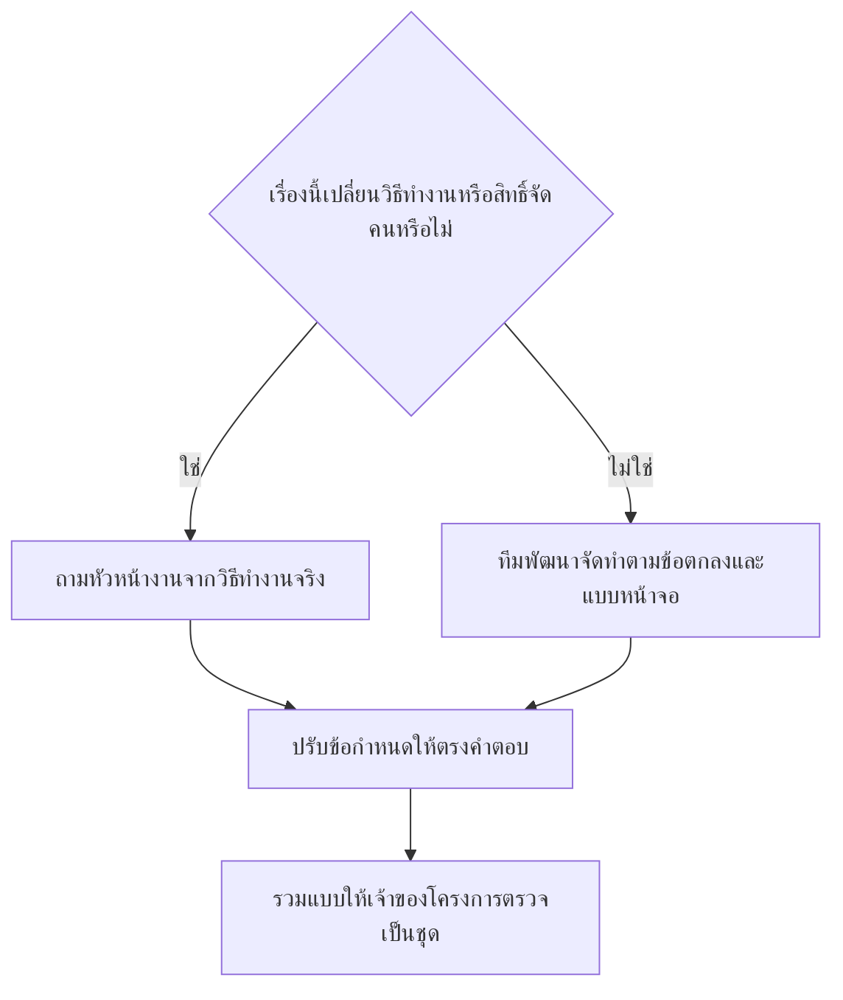

# คำถามคุยกับหัวหน้างาน: การจัดสแปร์ วันลา และการเปลี่ยนงาน

เตรียมวันที่ 16 พฤศจิกายน 2026 · ปรับภาษาและตัวอย่างวันที่ 17 พฤศจิกายน 2026

ขอรบกวนหัวหน้าช่วยอธิบายวิธีจัดงานจริงใน 5 เรื่องด้านล่าง เพื่อให้เว็บรองรับการทำงานได้ถูกต้อง โดยเฉพาะเวลามีคนลา ต้องหาคนทำแทน หรือเปลี่ยนงานระหว่างวัน

ในเอกสารนี้ **“คนประจำ”** หมายถึงแม่บ้านที่มีพื้นที่ดูแลประจำ และ **“สแปร์”** หมายถึงแม่บ้านสำรองที่หัวหน้าจัดไปทำแทนหรือมอบหมายพื้นที่ให้ในแต่ละวัน

ตัวอย่างทุกข้อเป็นเรื่องสมมติ ใช้ช่วยอธิบายคำถามเท่านั้น ขอให้ตอบตามวิธีทำงานจริง หากไม่เคยเกิดกรณีนั้น ตอบว่า “ไม่เคยเกิด” ได้ หากทำต่างจากตัวอย่าง ช่วยเล่าว่าทำอย่างไร โดยใช้ชื่อสมมติได้

## คำถามค้าง 5 ข้อ

### 1. หัวหน้าแต่ละคนเลือกใช้สแปร์คนไหนได้บ้าง?

**อยากทราบ:** สแปร์เป็นกลุ่มที่หัวหน้าทุกคนใช้ร่วมกัน หรือแบ่งไว้ให้หัวหน้าแต่ละคนดูแล และถ้าจะขอใช้คนของหัวหน้าอีกคน ต้องตกลงกับใครก่อน

**ตัวอย่าง:** หัวหน้า ก กับหัวหน้า ข ดูแลคนละกลุ่มตึก วันนี้หัวหน้า ก ขาดคนหนึ่งคน เห็นว่าสแปร์ที่หัวหน้า ข ดูแลยังว่าง จึงอยากให้มาช่วย

ขอให้หัวหน้าช่วยอธิบายว่า:

- ปกติสแปร์แบ่งให้หัวหน้าแต่ละคน หรือใครขาดคนก็เลือกจากสแปร์กลุ่มเดียวกันได้?
- ในตัวอย่าง หัวหน้า ก มอบหมายงานให้สแปร์คนนั้นได้เลยไหม หรือต้องขอให้ใครตกลงก่อน?
- ถ้าต้องตกลงกันก่อน ปัจจุบันคุยกันอย่างไร และต้องการให้เว็บมีขั้นตอนยืนยันด้วยไหม หรือคุยกันตามเดิมแล้วค่อยมาบันทึกงาน?

คำตอบ / ตัวอย่างที่เคยเกิด: ................................................................................

### 2. ถ้าคนประจำลาครึ่งวัน สแปร์ทำอะไรในอีกครึ่งวัน?

**อยากทราบ:** สแปร์ต้องอยู่พื้นที่ที่ทำแทนทั้งกะ หรือหัวหน้าจัดให้ทำพื้นที่อื่นในช่วงที่ยังไม่ต้องทำแทนได้

**ตัวอย่าง:** คุณมะลิดูแลพื้นที่ A มาทำงานตอนเช้า แล้วลาตั้งแต่ 13:00 จนเลิกกะ หัวหน้าจัดคุณสมพรซึ่งเป็นสแปร์มาทำแทนตั้งแต่ 13:00

ขอให้หัวหน้าช่วยเล่าว่า **ก่อนถึง 13:00 คุณสมพรทำงานที่ไหน** เช่น ช่วยคุณมะลิที่พื้นที่ A ตั้งแต่เช้า หรือทำพื้นที่ B ก่อนแล้วค่อยย้ายมาพื้นที่ A หรือจัดแบบอื่น?

ถ้าจัดได้หลายแบบ ช่วยยกตัวอย่างหนึ่งวันที่เกิดจริง ระบุว่าใครทำพื้นที่ไหน ช่วงเวลาใด และใครเป็นคนจัดให้

คำตอบ / ตัวอย่างที่เคยเกิด: ................................................................................

### 3. ถ้าออกไปลาระหว่างกะ ต้องบันทึกเวลาออกและกลับอย่างไร?

**อยากทราบ:** นอกจากหัวหน้าบันทึกช่วงเวลาที่ลาแล้ว ต้องให้แม่บ้านบันทึกเวลาออกไปลาและเวลากลับมาทำงานด้วยหรือไม่

**ตัวอย่างที่ 1 — ลาแล้วกลับมาทำต่อ:** คุณมะลิเข้างานตอน 07:00 ขอลาไปทำธุระ 13:00–15:00 แล้วกลับมาทำงานต่อจนถึง 19:00

ตอนออก 13:00 และกลับ 15:00 ปัจจุบันบันทึกหรือแจ้งใครอย่างไร? ในเว็บต้องให้แม่บ้านสแกน “ออกไปลา” และ “กลับจากลา” เพิ่มด้วยไหม หรือให้หัวหน้าบันทึกช่วงลาไว้ก็พอ?

**ตัวอย่างที่ 2 — ลาจนเลิกกะ:** คุณมะลิขอลาตั้งแต่ 13:00 จนถึงเวลาเลิกกะ 19:00 จึงออกไปตอน 13:00 และไม่ได้กลับมาทำงานอีกในวันนั้น

กรณีนี้ต้องลงเวลาเลิกงานตอนออก 13:00 หรือบันทึกด้วยวิธีอื่น? ขอให้เล่าวิธีที่ใช้จริง

คำตอบ / ตัวอย่างที่เคยเกิด: ................................................................................

### 4. ถ้าวันหยุดหรือวันลาเปลี่ยนเป็นมาทำงาน ต้องทำอะไรก่อนเริ่มงาน?

**อยากทราบ:** ใครเป็นคนตกลงให้มาทำงาน ต้องแก้ตารางตอนไหน และถ้าจัดสแปร์ไว้แล้วจะจัดงานต่ออย่างไร

**ตัวอย่าง:** วันจันทร์คุณมะลิมีวันหยุดประจำ หัวหน้าจัดสแปร์ไปดูแลพื้นที่ A ไว้แล้ว แต่ภายหลังคุณมะลิจะมาทำงานวันจันทร์แทนการหยุด กรณีเดียวกันนี้อาจเป็นวันที่ลงลาเต็มกะไว้แล้วแต่ยกเลิกลา

ขอให้หัวหน้าช่วยอธิบายว่า:

- เคยเกิดกรณีนี้ไหม และใครต้องเป็นคนตกลงให้มาทำงาน?
- แม่บ้านเริ่มงานและลงเวลาได้ก่อน แล้วหัวหน้าค่อยแก้ตาราง หรือหัวหน้าต้องแก้ตารางก่อนจึงเริ่มงานและลงเวลาได้?
- ถ้าจัดสแปร์ไว้แล้ว ให้สแปร์ทำงานที่ไหนต่อ และใครเป็นคนมอบหมาย?

คำตอบ / ตัวอย่างที่เคยเกิด: ................................................................................

### 5. ถ้าเริ่มงานไปแล้ว ต้องเปลี่ยนคนหรือย้ายพื้นที่ ทำอย่างไร?

**อยากทราบ:** มีการเปลี่ยนผู้รับผิดชอบหลังเริ่มงานแล้วหรือไม่ ถ้ามี ส่งต่องานและลงเวลากันอย่างไร ข้อนี้เน้นการเปลี่ยนหลังเริ่มงาน ต่างจากข้อ 2 ที่ถามการจัดคนไว้สำหรับช่วงลา

**ตัวอย่าง:** คุณมะลิสแกนเข้างานที่พื้นที่ A ตอน 07:00 ต่อมาป่วยและต้องกลับบ้านตอน 13:00 หัวหน้าจึงจัดคุณสมพรมาอยู่พื้นที่ A แทนจนเลิกกะ

ขอให้หัวหน้าช่วยอธิบายว่า:

- เคยเปลี่ยนคนหลังเริ่มงานแบบนี้ หรือย้ายคนที่เริ่มงานในพื้นที่หนึ่งไปทำอีกพื้นที่ระหว่างกะไหม?
- ถ้าเคย ขอหนึ่งตัวอย่างว่า ก่อนและหลังเปลี่ยน ใครทำพื้นที่ไหน เปลี่ยนตอนกี่โมง และใครเป็นคนมอบหมาย?
- คนที่ออกจากพื้นที่กับคนที่เข้ามาแทนต้องลงเวลาอะไร ที่ป้ายไหน และส่งต่องานที่ทำค้างไว้อย่างไร?

คำตอบ / ตัวอย่างที่เคยเกิด: ................................................................................

## สรุปที่คุยไว้ ให้หัวหน้าช่วยตรวจ

สรุปนี้มาจากข้อมูลที่ได้รับและแบบเว็บที่คุยกับเจ้าของโครงการไว้ **ยังไม่ได้ยืนยันกับหัวหน้าครบทุกข้อ** ขอให้ช่วยชี้เฉพาะจุดที่ไม่ตรงกับงานจริง ส่วนไหนถูกแล้วไม่ต้องตอบซ้ำ

**เวลางานและเวลาพัก**

| กะ | เวลาทำงาน | พักครั้งที่ 1: กลุ่มแรก | พักครั้งที่ 1: กลุ่มที่สอง | พักครั้งที่ 2: ทุกคนพร้อมกัน ก่อนทำ OT |
|---|---|---|---|---|
| เช้า | 07:00–19:00 | 10:00–11:00 | 11:00–12:00 | 16:00–17:00 |
| ดึก | 19:00–07:00 วันถัดไป | 22:00–23:00 | 23:00–24:00 | 04:00–05:00 วันถัดไป |

**การจัดคนและใช้งานเว็บ**

| เรื่อง | สิ่งที่คุยไว้ |
|---|---|
| คนประจำ | มีพื้นที่ประจำ หัวหน้ากำหนดวันหยุดแยกแต่ละสัปดาห์ได้ เช่น สัปดาห์แรกหยุดจันทร์ สัปดาห์ถัดไปหยุดอังคาร ส่วนใหญ่อาจใช้วันเดิม แต่ไม่บังคับเหมือนกันทั้งเดือน แม้คนประจำหยุด พื้นที่ยังต้องทำความสะอาดครบทุกรอบ |
| สแปร์ | ไม่มีพื้นที่ประจำ แต่มีกะประจำ ปกติดูแลหนึ่งพื้นที่ตลอดกะ หัวหน้าจัดงานให้ครบ 6 วันต่อสัปดาห์ โดยไปทำต่างตึกได้ หากทำแทนคนหยุดครบ 5 วันแล้ว อีกวันหัวหน้าต้องมอบหมายพื้นที่ให้; กรณีลาครึ่งวันหรือบางชั่วโมงยังรอคำตอบข้อ 2 |
| ตารางประจำ | ตั้งตารางสแปร์ให้ใช้ซ้ำทุกสัปดาห์ได้ เช่น จันทร์ทำพื้นที่ A อังคารทำพื้นที่ B หากวันไหนเปลี่ยน ให้แก้เฉพาะวันนั้น |
| ผู้จัดงาน | หัวหน้าจัดพื้นที่ กลุ่มพัก วันหยุด วันลา และคนทำแทนในเว็บเอง หัวหน้าคนหนึ่งดูแลหลายตึกได้ และดูงาน จัดงาน ตรวจงานได้ในตึกและกะที่รับผิดชอบ แต่ละตึกมีหัวหน้าประจำกะละคนเดียว ส่วนผู้ดูแลระบบ (Admin) จัดการได้ทุกตึกทุกกะ โดยเก็บประวัติว่าใครแก้อะไร |
| กลุ่มพัก | คนประจำมีกลุ่มพักครั้งที่ 1 ที่ใช้ตามปกติ หัวหน้าเปลี่ยนเฉพาะวันได้ สแปร์ใช้กลุ่มพักของคนที่ทำแทนก่อน แล้วหัวหน้าเปลี่ยนให้ได้หากจำเป็น ส่วนพักครั้งที่ 2 ทุกคนในกะพักพร้อมกัน |
| การลงเวลา | ปกติสแกน 6 ครั้ง: เข้างาน → ออกพัก 1 → กลับจากพัก 1 → ออกพัก 2 → กลับจากพัก 2 → เลิกงาน สแปร์ใช้ป้ายลงเวลาของพื้นที่ที่ได้รับมอบหมายวันนั้น |
| พักไม่ตรงเวลาหรือลืมสแกน | เก็บเวลาที่สแกนจริงแล้วแสดงเทียบกับตาราง หากลืมสแกนพักบางครั้ง ให้บันทึกครั้งถัดไปได้และแสดงเวลาที่ขาดไว้ หัวหน้าเติมเวลาที่ขาดให้ทีมได้เมื่อยืนยันเวลาจริงแล้ว พร้อมระบุเหตุผลและเก็บประวัติ ผู้ดูแลระบบก็เติมได้; ยังไม่ได้ให้หัวหน้าแก้ทับเวลาสแกนที่มีอยู่ |
| การลา | หัวหน้าบันทึกหลังตกลงกันแล้ว แม่บ้านไม่ต้องยื่นขอลาในเว็บ รองรับลาเต็มกะ ครึ่งวัน และบางชั่วโมง ถ้าลาเต็มกะแต่ยังหาสแปร์ไม่ได้ บันทึกลาไว้ก่อนได้และแสดง “รอจัดคนทำแทน” |
| ส่งงานและรอบทำความสะอาด | ส่งงานได้หลังลงเวลาเข้างานและก่อนลงเวลาเลิกงาน แม้ลืมสแกนกลับจากพัก ใช้เวลารอบทำความสะอาดที่ตั้งไว้ตามเดิม ไม่มีการเลื่อนรอบตามเวลาพักอัตโนมัติ |
| ประวัติลงเวลาเดิม | วันที่ใช้แบบเก่าให้คงข้อมูล 4 ครั้งตามจริง ไม่เติมเวลาพักครั้งที่ 2 ย้อนหลัง และไม่แจ้งว่าขาดเวลารอบนั้น เริ่มใช้ 6 ครั้งกับกะที่เริ่มใช้แบบใหม่ |
| หน้าแม่บ้าน | คนประจำและสแปร์เปิดดูพื้นที่ เวลาพัก วันหยุด และวันลาของตัวเองได้ แต่แก้ตารางเองไม่ได้ |

จุดที่ต้องแก้ / รายละเอียดเพิ่มเติม: ................................................................................

## หมายเหตุสำหรับเจ้าของโครงการและทีมพัฒนา

คำตอบจากหัวหน้าใช้ยืนยันวิธีจัดงาน ผู้มีสิทธิ์มอบหมาย และขั้นตอนลงเวลาตามงานจริง ส่วนรายละเอียดต่อไปนี้ให้ทีมพัฒนาจัดทำตามข้อตกลง แล้วรวมให้เจ้าของโครงการตรวจเป็นชุด

| เรื่อง | ทีมพัฒนาจัดทำต่อได้ |
|---|---|
| หน้าจอและข้อความ | จัดเมนู ช่องกรอก และข้อความให้อ่านง่าย โดยใช้แบบหน้าจอที่เจ้าของยอมรับแล้วและหน้าตาเดิมของเว็บ |
| การบันทึกและแสดงข้อมูล | เลือกวิธีเก็บข้อมูลและเชื่อมหน้าจอ ให้แต่ละคนดูหรือแก้ได้ตามหน้าที่ และเก็บประวัติการเปลี่ยนแปลง |
| ความถูกต้อง | ป้องกันการบันทึกซ้ำ แสดงข้อมูลที่ขาดตามจริง และรักษาประวัติเก่า |
| การทดสอบ | ใช้ข้อมูลสมมติทดสอบตามกติกาที่ตกลง รวมการใช้มือถือ งานกะดึกข้ามวัน และสิทธิ์ของแต่ละคน |

หากรายละเอียดใดทำให้เปลี่ยนวิธีทำงานหรือเพิ่มขั้นตอนขออนุมัติ ต้องกลับไปถามหัวหน้าก่อน ตามหลักในแผนภาพนี้

การปรับเอกสารครั้งนี้เปลี่ยนภาษาและเพิ่มตัวอย่าง ยังไม่มีคำตอบใหม่สำหรับคำถามค้างทั้ง 5 ข้อ เอกสารนี้ใช้รวบรวมข้อมูล ไม่ใช่ข้อกำหนดฉบับอนุมัติหรือแผนเริ่มพัฒนา ข้อออกแบบเดิมยังบันทึกไว้จนกว่าจะมีข้อสรุปใหม่มาแทน

บันทึกรายละเอียดและหลักฐานระบบเดิม: [ข้อกำหนดเรื่องตารางงานแม่บ้าน](2026-11-16-supervisor-scheduling-requirements.md)
