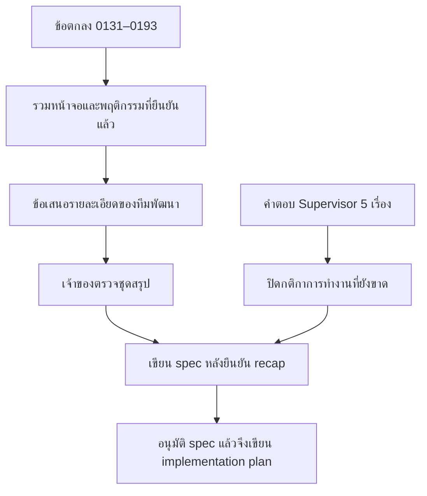

# ชุดปิดแบบตารางงานสำหรับตรวจครั้งเดียว

วันที่ 17 พฤศจิกายน 2026 — เจ้าของยืนยัน recap และสั่งเขียน spec แล้ว รายละเอียดที่เดิมเสนอใน §2–4 บันทึกเป็น ADR 0208–0222; spec อนุมัติแล้วและเขียน implementation plan ต่อ ไม่ใช่คำสั่งเริ่มพัฒนา

เจ้าของขอเร่งออกแบบให้เสร็จ เอกสารนี้จึงรวมข้อเสนอทางเทคนิคและรายละเอียดหน้าจอให้ตรวจเป็นชุด โดยไม่ถามเรื่องที่ตกลงไปแล้วซ้ำ ข้อเสนอใหม่ด้านล่างยังไม่ใช่ ADR ที่ได้รับการยอมรับ และไม่ใช่คำตอบแทน Supervisor

แหล่งหลัก: [ข้อกำหนดและข้อตกลง](2026-11-16-supervisor-scheduling-requirements.md), [คำถาม Supervisor](2026-11-16-supervisor-workflow-confirmation.md), [ADR index](../adr/README.md) และ [glossary](../../CONTEXT.md)

**คำตอบเพิ่มเติม 17 พ.ย. 2026:** [0194](../adr/facility-0194-relief-cleaners-have-home-buildings-with-surplus-borrowing.md) ยืนยันว่าสแปร์มีตึกประจำและขอคนส่วนเกินจากอีกตึกมาช่วยได้ ส่วนที่ระบุว่ารอเรื่องทีม/ยืมสแปร์ด้านล่างจึงเหลือผู้ตกลง ผู้บันทึก การมองเห็นรายชื่อ และขั้นตอนการยืม ไม่ใช่การถามตึกประจำซ้ำ ข้อ 2–5 ยังไม่ได้รับคำตอบ

## 1. แบบหน้าจอที่ตกลงแล้ว

**ยืนยัน 0206–0207:** สแปร์มีตึกประจำ กรณีคนละซุป ต้นทางต้องตกลงให้ปล่อยคนก่อน จากนั้นซุปตึกที่ขอยืมบันทึกงานในเว็บ ไม่เพิ่มขั้นตอนอนุมัติในเว็บ ตึกที่ซุปคนเดียวรับผิดชอบไม่ต้องสร้างผู้อนุมัติคนที่สอง บันทึกการตกลงนอกเว็บไม่ใช่ลายเซ็นของซุปต้นทางในระบบ

**ยืนยัน 0205:** มาทำงานวันหยุดใช้ record-first + visible conflict เช่นเดียวกับ 0202 ซุปปรับตารางวันนั้นอย่างชัดแจ้ง ไม่เปลี่ยนวันหยุด/ย้ายสแปร์เอง ไม่สร้าง hidden pending attendance หรือบล็อก submission เพิ่มเพียงเพราะรอปรับตาราง ข้อนี้แทน pending day-off ordering ในข้อความเก่า

**ยืนยัน 0203–0204:** ย้ายหน้างานใช้คำสั่งซุปและการสแกนป้ายปลายทางยืนยันถึงจริงหนึ่งครั้ง คง initial ShiftIn/ลำดับพัก ไม่ใช้ ShiftOut+ShiftIn ใหม่ ประวัติ A อยู่เดิม Dashboard ยังไม่ยืนยันถึง B จนสแกน ภาพรวมมี D7 เพิ่มแล้ว ต้องปิด integration ของหลักฐานนี้กับ entry projection/current coverage ก่อนเปิด transfer ไม่ถือว่าการทบทวนเดิม 0131–0193 ครอบข้อใหม่นี้อยู่แล้ว

**ยืนยัน 0202:** บันทึกเข้างานที่ผ่านสิทธิ์ตามเวลาสแกนจริงได้ก่อนยกเลิกลาในเว็บ แสดง conflict ให้ซุปตรวจและยกเลิกลาโดยชัดแจ้ง เก็บประวัติ ไม่เลื่อนเวลาสแกนไปตรงเวลายกเลิกลา ไม่ยกเลิกลา/ย้ายสแปร์เอง ข้อนี้แทน pending leave/check-in ordering แต่ไม่เลือก day-off ordering หรือวิธีลงเวลาเมื่อย้ายหน้างาน

**ยืนยัน 0200–0201 หลังค้นข้อมูล:** ลาครึ่งวันแล้วไม่กลับมาใช้ปุ่มเลิกงานเดิมตามเวลาออกจริง แยกรายการลา ส่งงานต่อไม่ได้หลังเลิกงาน จังหวะพักหลังออกที่มีลาครอบช่วงนั้นแสดงไม่ต้องลงเวลาเนื่องจากลา สแกนที่ขาดก่อนออกยังขาดตามจริง ข้อนี้แทน pending early-departure attendance ในข้อความเก่า ไม่ปิดเรื่องการลงเวลาเมื่อย้าย Area หรือสั่ง implement

**คำตอบล่าสุด 0196–0199:** ไม่มีลาเป็นชั่วโมงเพื่อไปทำธุระระหว่างวัน จึงไม่เพิ่ม leave-out/return flow สำหรับกรณีนั้น ลาเต็มกะ/ครึ่งวันยังอยู่ในขอบเขต มีการทำงานในวันหยุด และถ้าทำงานในวันลาให้ยกเลิกลา ซุปประจำตึกเปลี่ยนหน้างานหลังเริ่มกะได้ตามความเหมาะสม/จำเป็นเร่งด่วน คนมาทำแทนทำงาน “ตามตาราง” ยังไม่ระบุ sign/attendance sequence ดังนั้นรายการค้างท้ายเอกสารเป็นการปิดรายละเอียดเหล่านี้ ไม่ใช่การถามว่ากรณีเกิดขึ้นหรือใครเปลี่ยนงานได้อีก และห้ามเสนอ blanket freeze หลังเริ่มกะจนทำงานจริงที่ยืนยันแล้วไม่ได้

**คำตอบภาคสนามเรื่องลาบางช่วง:** [0195](../adr/facility-0195-partial-shift-departures-have-no-replacement-but-essential-task-help.md) ระบุว่าออกครึ่งวัน/กรณี OT ที่เล่าไม่มีคนรับหน้าที่แทนจนจบกะ แต่มีคนช่วยเฉพาะงานจำเป็น เช่น ห้องน้ำ อย่าออกแบบให้ทุกช่วงลาต้องมี partial-shift replacement หรือนับการช่วยงานเป็นมีคนรับแทนทั้ง Area ส่วนสแกนออก/กลับ กรณีลาแล้วกลับมา และรายละเอียดคนช่วยยังเปิดอยู่

| ผู้ใช้/หน้าจอ | สิ่งที่ทำและผลที่ต้องได้ |
|---|---|
| Cleaner: ตารางของฉัน | อ่านตารางของตัวเอง รายวัน/สัปดาห์ เห็น Area กลุ่มพัก วันหยุด วันลา และหน้าที่ของสแปร์ แก้ตารางเองไม่ได้ |
| Supervisor: จัดตารางงาน | ดูเฉพาะตึกที่รับผิดชอบและกะของตน จัด Area กลุ่มพัก วันหยุด วันลา และคนทำแทน ตามขอบเขตที่ยืนยันแล้ว |
| Admin: ตารางงาน | ดูและแก้ทุกตึกทุกกะ มีประวัติผู้แก้ เมนูอยู่หลังการเข้างาน |
| ตารางวันหยุดรวมรายคน | เลือกสัปดาห์ เห็นอ้างอิงสัปดาห์ก่อน แก้วันหยุดแต่ละคน แล้วตรวจทานก่อนบันทึก |
| คัดลอกวันหยุด | กดเอง เติมเฉพาะคนที่ยังไม่ได้เลือก รักษาค่าที่บันทึกหรือกรอกค้างไว้ แก้ค่าที่คัดลอกได้ และยังไม่บันทึกจนกดยืนยัน |
| แก้ Area/กลุ่มพักประจำ | เลือกคน ระบุวันเริ่มใช้ในอนาคต ตรวจค่าก่อน/หลัง แล้วบันทึก กลุ่มพักเฉพาะวันที่ยังใช้ได้ต้องคงอยู่ |
| แก้เฉพาะวันที่ | เปลี่ยนเฉพาะวันที่เลือก ไม่เปลี่ยนตารางประจำหรือวันที่อื่น |
| ประวัติ | แสดงแผนตามช่วงเวลาที่บันทึกจริง วันที่ก่อนมีประวัติแจ้งว่าไม่มีข้อมูล ไม่สร้างจากค่าประจำปัจจุบัน |

เปิดครั้งแรกเป็นสัปดาห์นี้ โดยกะดึกที่ยังทำงานใช้สัปดาห์ของวันเริ่มกะ กลับจากหน้าอื่นระหว่างใช้งานครั้งเดียวกันจำสัปดาห์และตัวกรองที่เพิ่งดู Admin เริ่มทุกตึกของกะตามนาฬิกา Supervisor เริ่มทุกตึกที่ตนรับผิดชอบในกะตน ดูตารางไม่ต้องสแกน QR/GPS การลงเวลายังใช้ข้อกำหนดเดิมที่เกี่ยวข้อง

แบบหน้าจอที่ยืนยันแล้วอยู่ที่ `/Users/macbookair/.codex/visualizations/2026/11/16/01a1e35a-cb6e-7920-87dc-50ada17b12f4/facility-scheduling.html` ใช้ PNG ในแชตสำหรับการตรวจภาพ ไม่เปลี่ยน source หรือสร้างหน้าตาอีกชุดในงานรวบรวมนี้

## 2. ข้อเสนอปิดรายละเอียดหน้าจอของทีมพัฒนา

เจ้าของยืนยันชุดนี้แล้ว บันทึกข้อตกลงใน ADR 0208–0222 และรายละเอียดใน [scheduling spec](../superpowers/specs/2026-11-17-cleaner-scheduling-design.md) ตารางต่อไปคงภาษาข้อเสนอเดิมไว้เป็นที่มาของ recap ไม่ใช่รายการคำถามเปิดอีก

| จุดที่ยังไม่ละเอียด | ข้อเสนอที่ตรวจได้ |
|---|---|
| สัปดาห์ก่อนบางคนไม่มีวันหยุดให้คัดลอก | คงช่องว่างและบอกชื่อคนที่ไม่ได้คัดลอก ห้ามเดาวันให้ |
| รายชื่อคนเปลี่ยนระหว่างสัปดาห์ | จับคู่ด้วยรหัสผู้ใช้ถาวร คัดลอกเฉพาะคนในรายการเป้าหมายที่ผู้แก้มีสิทธิ์ ห้ามจับคู่ด้วยชื่อหรือเพิ่มคนจากสัปดาห์ก่อนเอง |
| เปลี่ยนหน้า/สัปดาห์ขณะกรอก | ให้เลือกอยู่ต่อหรือทิ้งค่าที่ยังไม่บันทึก ปุ่มกลับจากตรวจทานเก็บค่าที่กรอก |
| บันทึกหลายแถว | หนึ่งการยืนยันสำเร็จทั้งหมดหรือไม่เปลี่ยนแถวใดเลย ตรวจสิทธิ์และรุ่นข้อมูลใหม่ใน transaction เดียว หากไม่ผ่านระบุแถวที่ติดปัญหา |
| บันทึกแล้วยังมีช่องว่าง | เสนอให้บันทึกเฉพาะรายการที่จัดแล้วได้ แต่แสดง “ยังจัดไม่ครบ” พร้อมชื่อคน/วันที่ที่ขาดทันที ไม่เพิ่มขั้นตอนเผยแพร่แยก ไม่เดาวันหยุดหรือเปลี่ยนช่องว่างเป็นวันทำงานที่ยืนยัน; ความครบ 6 วันของสแปร์เป็นสถานะตรวจ ไม่บังคับให้เดาข้อมูลเพื่อบันทึกส่วนที่รู้แล้ว |
| มุมมองเริ่มต้นหลัง reload/logout | เสนอให้เริ่มตามกติกาเปิดครั้งแรก ไม่เพิ่มการจำข้าม session ในรอบนี้; การกลับจากหน้าอื่นยังจำตามที่ตกลง |
| ช่วงวันที่เลือกดู | เสนอเลือกสัปดาห์ใดก็ได้ในปฏิทิน แต่แสดงสถานะข้อมูลที่มีจริง ไม่ตีความว่าทุกวันที่เลือกดูแก้ได้หรือมีประวัติ |
| ตารางสแปร์ประจำ | เสนอตารางรวมรายคนตามแนวแบบวันหยุดที่เลือกแล้ว แต่ช่องแต่ละวันเป็น Area/วันหยุด/ยังไม่จัด มีวันเริ่มใช้และตรวจทาน แยกตึกประจำกับตึกที่ไปทำงาน การยืมต้องผ่านการตกลงตาม 0206/0207 |
| จำนวนวันหยุด | เสนอไม่ตั้งโควตาหรือวันหยุดอัตโนมัติจาก fixture รองรับวันที่หัวหน้าระบุ แสดงสิ่งที่บันทึกจริง ไม่แปลงเป้าหมายสแปร์ทำงาน 6 วันเป็นกฎหยุดของแม่บ้านทุกคน |
| สแปร์ทำงานโดยไม่ได้แทนคนใด | เสนอให้ซุปเลือกกลุ่มพักครั้งที่ 1 ให้ชัดเจนก่อนบันทึกรายการทำงานนั้น ไม่ยืมกลุ่มของคนอื่นโดยเดาเอง ส่วนกรณีแทนคนยังใช้ 0152 และ override เฉพาะวันที่ |
| ย้ายระหว่างพัก | เสนอคงสถานะ/จังหวะพักของคนเดิม การยืนยันถึง B ไม่แปลว่าเป็นการกลับจากพักหรือเริ่มพักใหม่ กลุ่มพักใหม่ไม่สร้าง event/เวลาของรอบที่ผ่านไป |
| ยกเลิกคำสั่งย้าย | ก่อนยืนยันถึง B ยกเลิกคำสั่งได้โดยเก็บประวัติ; หลังยืนยันแล้วต้องสร้างการเปลี่ยนแปลงใหม่ที่มีผลไปข้างหน้า ไม่ลบการมาถึงจริง หากเป็นข้อมูลจริงผิดใช้ correction ที่มีสิทธิ์ ไม่เขียนทับ scan จากหน้าแผน |
| แก้แผนย้อนหลัง | เสนอแก้รายการแผนที่บันทึกผิดได้ในขอบเขตสิทธิ์ พร้อมเหตุผลและ audit โดยแยกแผนเดิม/แผนแก้ ไม่เปลี่ยน event/งาน/ผลตรวจเดิม และไม่ใช้เพื่อแอบอนุญาตสแกนย้อนหลัง สิทธิ์ regular baseline ยังเลือกอนาคตตาม 0187 |
| สแปร์ถูกจัดงานไว้แล้ว | เสนอให้แสดง conflict และปฏิเสธการจัดงานหลักที่ทับซ้อนสำหรับคนเดียวกัน ต้องให้ซุปจัดรายการเดิมให้ชัดก่อน ห้ามสแกน/ยืมแล้วลบหรือย้ายงานเดิมเอง ไม่ห้ามช่วยงานจำเป็นเฉพาะจุดด้วยการตีเป็น full-Area assignment |
| ขัดแย้งกับข้อยกเว้นที่ตั้งไว้ | แสดงวันที่และรายการที่ขัดแย้งให้แก้ก่อนส่งคำสั่ง ห้ามลบข้อยกเว้นหรือย้ายสแปร์ให้เอง; กรณีกลุ่มพักที่ยังใช้ได้เก็บไว้ตาม 0189 |

ส่วนตารางสแปร์เป็นข้อเสนอ interaction ที่ยังไม่ได้แสดงภาพยืนยัน ห้ามอ้างว่า mockup เดิมอนุมัติ editor นี้แล้ว การตรวจความครบ 6 วันต้องแยกจากสิทธิ์บันทึกร่าง/ตารางบางส่วนที่ยังไม่ได้ข้อสรุป

## 3. ลงเวลา 6 ครั้งและเวลาไม่ครบ

ลำดับปกติที่ยืนยันแล้ว: เข้างาน → ออกพัก 1 → กลับพัก 1 → ออกพัก 2 → กลับพัก 2 → เลิกงาน แสดงแผนและเวลาจริงแยกกัน ไม่ปฏิเสธเพียงเพราะสแกนคลาดเวลาพักตามแผน

ข้อเสนอหน้าจอ: แสดงการกระทำถัดไปเป็นปุ่มหลัก และแยก “ลืมสแกนครั้งก่อน” ให้ผู้ใช้เลือกจังหวะจริงที่จะทำ จากนั้นแสดงรายการที่จะเว้นก่อนยืนยัน ไม่เดาจากนาฬิกา ช่องที่เว้นเป็น “ไม่ได้สแกน” โดยไม่มีเวลา ไม่อนุญาตข้ามเข้างาน สร้างซ้ำ หรือเรียงการกระทำย้อนกลับ

Supervisor เติมได้เฉพาะเวลาที่ขาดในทีมตน โดยกรอกเวลาจริงที่ตรวจสอบแล้วและเหตุผล Admin ใช้สิทธิ์แก้เวลาตามเดิม แสดงที่มาว่าเป็นสแกนหรือผู้มีสิทธิ์เติม ห้ามขยายสิทธิ์ Supervisor เป็นการเขียนทับสแกนเดิม การส่งงานหลังเข้างานและก่อนเลิกงานยังทำได้แม้ลืมกลับพัก ไม่สร้างเวลากลับพักจากการส่งงาน

กรณีเติมเวลาย้อนหลังต้องตรวจลำดับเวลาตาม lifecycle ของกะนั้นและขอบเขตทีมของวันที่เกี่ยวข้อง ไม่ใช้ตึกปัจจุบันของผู้ใช้เป็นหลักฐานสิทธิ์ย้อนหลังเพียงอย่างเดียว การย้ายคนหลังเริ่มงานใช้ 0203/0204 แยก assignment/arrival ออกจากเวลาเริ่มกะ โดยไม่ขยายสิทธิ์ Supervisor ให้แก้ทับสแกนเดิม

## 4. ข้อเสนอรูปข้อมูลและ API

เป็นข้อเสนอสำหรับ spec ภายหลัง ยังไม่กำหนด migration หรือเปลี่ยนฐานข้อมูลจริง

| กลุ่มข้อมูล | รูปที่เสนอและเหตุผล |
|---|---|
| ขอบเขต Supervisor | ความสัมพันธ์ผู้ใช้–ตึก–กะที่มีช่วงมีผล เพื่อรองรับหลายตึกและตรวจประวัติ ห้ามใช้อำนาจจาก buildingId ที่ client ส่งมา |
| ตารางประจำ | เก็บรุ่นและช่วงวันที่มีผล แยก Area/กลุ่มพักประจำกับ pattern สแปร์ ไม่เขียนทับรุ่นเก่า |
| วันหยุดรายสัปดาห์ | เก็บตามคนและสัปดาห์ แยก unset ออกจากวันหยุดที่เลือกแล้ว ไม่ตีช่องว่างเป็นวันทำงานที่ยืนยันแล้ว |
| ข้อยกเว้น/วันลา | เก็บคน วันที่เริ่มกะ ช่วงเวลาที่เกี่ยวข้อง และที่มา แยกจากตารางประจำ; ลาครึ่งวันแล้วไม่กลับใช้ 0200/0201 ไม่สร้าง hourly-errand leave/return ตาม 0196 และไม่สร้าง partial replacement อัตโนมัติตาม 0195 |
| แผนรายวันที่อ่านได้ | ตัวคำนวณกลางประกอบข้อมูลที่มีผลในวันนั้น ส่งที่มาของค่ากลับไปกับแต่ละช่อง กรณีขัดแย้งแสดงเป็น conflict ไม่เลือกผู้ชนะที่ยังไม่ตกลง |
| การเปลี่ยนแปลง | เก็บผู้แก้ เวลาที่แก้ ค่าเดิม/ใหม่ ขอบเขตคำสั่ง และ revision ในธุรกรรมเดียวกัน แยกจากหลักฐานเวลาสแกน |
| คำสั่งบันทึก | commandId + expected revisions + payload fingerprint; ส่งซ้ำ command เดิม/ข้อมูลเดิมคืนผลเดิม ส่ง key เดิมกับข้อมูลต่างกันปฏิเสธ |
| ผลบันทึกไม่แน่นอน | มี authorized command-status read เก็บผลคำสั่งที่ commit แล้วพร้อม transaction เพื่อเช็กก่อนส่งใหม่ ไม่ตี status ที่ยังพิสูจน์ไม่ได้เป็น failure |
| การยืมสแปร์ | บันทึกคน ตึกต้นทาง/ปลายทาง กะ/วันที่ ผู้บันทึก และการระบุว่าต้นทางตกลงนอกเว็บ ตรวจสิทธิ์ปลายทางและ assignment ที่ทับซ้อน ไม่แสดงเป็น authenticated approval ของซุปต้นทาง |
| Area Transfer | แยกคำสั่งมีผลตามแผนกับ arrival confirmation ที่ผูกป้าย/GPS/เวลาจริง คง initial ShiftIn/ลำดับพัก เก็บการเปลี่ยนแปลงแบบมีลำดับรุ่น ไม่อาศัยแก้ User.AreaId เพื่อสร้างประวัติ |
| Projection ภาพรวมหลัง transfer | เสนอใช้หลักฐาน initial ShiftIn หรือ arrival confirmation ที่ถูกต้องของ Area/slot นั้น โดยนับ Area ID ไม่ซ้ำและคงยอดเคยเข้า A แม้ย้ายแล้ว ก่อนถึง B ยังไม่นับว่าเข้า B แยกยอดเคยเข้าจากผู้รับผิดชอบปัจจุบัน ไม่เพิ่มหมวด/ตัวหาร; ข้อนี้ยืนยันเป็น 0216 และกำหนดสัญญาใน scheduling spec §13 |
| Attendance | รักษาค่า enum เดิมและประวัติ 4 ครั้ง เพิ่มตัวระบุจังหวะใหม่โดยไม่แปล BreakOut/BreakIn เก่าเป็นครั้งที่ 1 ย้อนหลัง เก็บ lifecycle ของ slot ให้ทุกคนใช้กติกาเดียวกัน |

เสนอ API แยก own-read, scoped management-read และ management-write ใช้ service ตรวจสิทธิ์ร่วมกัน ฝั่ง server ตรวจสมาชิกทีม Area กะ วันที่ และสิทธิ์ของทุกแถว การอ่านหน้า Cleaner ต้องใช้ตัวตนจาก session ไม่ยอมรับ userId อื่นเพื่อขยายสิทธิ์

การอ่านตารางตอบ revision, แหล่งที่มาของค่า, สถานะข้อมูลไม่ครบ และเวลาที่อ่านสำเร็จ ส่วนเขียนตอบผลของคำสั่งและ revision ใหม่ Conflict ส่งค่าปัจจุบันให้เปรียบเทียบแต่ไม่ล้าง local input เหตุการณ์ real-time แจ้งให้ refetch ผ่าน authorized read ไม่ส่งตารางบุคคลไปทุกกลุ่ม

เสนอใช้ช่องทาง real-time และรูปแบบ refetch ของโครงการ พร้อม fallback เมื่อ focus/reconnect และ periodic refresh ต้องรักษาป้ายข้อมูลอาจเก่าจนอ่านใหม่สำเร็จจริง รอบ polling และ retention ของ command receipts ต้องระบุใน spec ให้สัมพันธ์กับ retry contract ห้ามเลือกวันหมดอายุโดยทำให้คำสั่งเดิมนำกลับมาใช้ซ้ำได้

## 5. จุดกระทบระบบเดิมที่อ่าน source ยืนยันแล้ว

| หลักฐาน | ผลต่อการออกแบบ |
|---|---|
| `AttendanceEvent.cs` มี ShiftIn/BreakOut/BreakIn/ShiftOut และ `AttendanceRules.cs` ใช้ 4 จังหวะ | ต้องปรับ backend/frontend/DTO/ตัวสรุปพร้อมกันตาม lifecycle; เพิ่มคอลัมน์หน้าจออย่างเดียวไม่พอ |
| `AppDbContext.cs` unique `(UserId, ShiftDate, Shift, EventType)` | การใช้ BreakOut เดิมซ้ำสำหรับพัก 2 จะติด unique ต้องออกแบบรหัส event ใหม่โดยรักษาข้อมูลเก่า |
| `SupervisorScope.WithoutCover` รับ ownBuildingId เดียว และ User มี SupervisorSlot | หลายตึกต้องแก้ทั้ง authorization และข้อกำหนด unique โดยรักษาหนึ่ง Supervisor ประจำต่อตึก/กะ |
| `CoverAssignmentEndpoints` เป็น Admin-only และ candidates ต้องมี AreaId | ห้ามเปิด endpoint เดิมให้ Supervisor แล้วถือว่ารองรับ dedicated relief แล้ว ต้องมีขอบเขตและ candidate policy ใหม่ |
| `AttendanceEndpoints` เทียบป้ายกับ user.AreaId | สแปร์ต้องตรวจ Area ตาม assignment ที่มีผล; 0202/0205 ใช้ visible conflict สำหรับวันลา/หยุด และ 0203/0204 แยก transfer confirmation |
| `ShiftAttendance` เก็บ AreaId และเวลาจริงแต่ไม่มี lifecycle | เก็บ provenance และ cutover เพิ่ม โดยไม่อัปเดตเวลาจริงตามการเปลี่ยนแผน |

Source อยู่ใต้ `backend/src/JanitorialManagementDashboard.Domain/`, `Application/`, `Infrastructure/` และ `Api/` ตามชื่อข้างต้น ตรวจจาก checkout จริงของงานนี้ ไม่ใช่หลักฐานว่าฟีเจอร์ใหม่พัฒนาแล้ว

## 6. กรณีตรวจรับที่เตรียมไว้

1. Supervisor สองตึกในกะเดียวกันเห็น/แก้ได้ทั้งสองตึก แต่ปลอม request ไปตึกอื่นหรือกะอื่นไม่ได้ Cleaner อ่านตารางคนอื่นไม่ได้
2. เปลี่ยนวันหยุดสัปดาห์เป้าหมายไม่เปลี่ยนสัปดาห์ก่อน การคัดลอกรักษาค่าที่บันทึก/กรอกไว้ รวมวันจันทร์ที่อาจแทนด้วยเลข 0 กดยกเลิกแล้วไม่เกิดการบันทึก
3. เปลี่ยน Area เริ่มวันพุธไม่เปลี่ยนวันอังคาร กลุ่มพักเฉพาะวันที่ยังใช้ได้ไม่ถูกลบ ประวัติที่ไม่เคยมีไม่สร้างจากค่าปัจจุบัน
4. สแกนครบ 6 จังหวะได้ตามลำดับ ลืมกลับพัก 1 แล้วเลือกข้ามอย่างชัดเจนไปออกพัก 2 ได้ เวลาที่ขาดยังว่างและมีที่มา
5. Supervisor เติมเวลาที่ขาดในขอบเขตได้พร้อมเหตุผล แต่เขียนทับสแกนเดิม/เติมนอกขอบเขตไม่ได้ ลำดับเวลาผิดถูกปฏิเสธ
6. สแปร์ใช้ป้าย Area ตามวันที่ได้รับมอบหมายได้โดยไม่ต้องเปลี่ยน Area ประจำของบัญชี ตรวจเคสต่างตึกตาม authority ที่ยืนยันภายหลัง
7. สองคนแก้ revision เดียวกัน คนหลังไม่ทับค่าคนแรก local input ยังอยู่ ส่ง command เดิมซ้ำไม่สร้าง audit ซ้ำ
8. ขาดการเชื่อมต่อหลัง server commit ตรวจผลเดิมได้ก่อน retry; สถานะที่ยังไม่ทราบต้องไม่แสดงว่าสำเร็จหรือล้มเหลวแน่นอน
9. หน้าอ่านเปลี่ยนตามข้อมูลใหม่ หน้าแก้ไม่เสีย input กลับออนไลน์แล้ว read ล้มเหลวยังแสดงป้ายข้อมูลอาจเก่า
10. กะดึกข้ามวัน/สัปดาห์ใช้วันเริ่มกะ หน้าค้างเก่าบันทึกลง slot แบบใหม่ไม่ได้ กะเก่าจบด้วย 4 ครั้งและประวัติไม่ถูกแปลง
11. วันหยุด/วันลาไม่ลดรอบทำความสะอาดหรือทำให้ Area ปิด “รอจัดคนทำแทน” ไม่นับเป็นมีคนเข้าแล้ว
12. ลาครึ่งวัน 13:00–19:00 และออกจริง 13:00 เก็บ ShiftOut 13:00; พัก 16:00 แสดงไม่ต้องลงเวลาเนื่องจากลา สแกนก่อน 13:00 ที่ขาดยังแสดงว่าขาดและไม่เติมเวลาเอง
13. มีวันลาแต่ลงเวลาเข้า 07:00 ได้ตามสิทธิ์ ซุปยกเลิกลา 07:10 เวลาเข้าไม่เปลี่ยนเป็น 07:10; conflict เคลียร์หลังคำสั่งยกเลิกสำเร็จเท่านั้น
14. วันหยุดที่มาทำงานรับ actual entry ที่ผ่านสิทธิ์ แสดง conflict รอปรับตาราง ไม่เปลี่ยนวันหยุด/ชดเชยหรือย้ายสแปร์อัตโนมัติ
15. เข้างาน A 07:00 คำสั่งย้ายมีผล 13:00 แต่ถึง B 13:05 เก็บสองเวลาแยก คง ShiftIn เดิม ไม่มี ShiftOut A/ShiftIn B ปลอม Dashboard ยังไม่ยืนยันถึง B ก่อนสแกน และงานเก่ายังอยู่ A
16. ย้ายหลังกลับพัก 1 แล้วไม่เริ่มพัก 1 ใหม่ การย้ายระหว่างพักต้องไม่แอบเติมเวลาหรือแปลง arrival เป็น BreakIn (รายละเอียดนี้เป็นข้อเสนอรอยืนยัน)
17. ยืมข้ามตึกต่างซุป: source agreement นอกเว็บมาก่อน destination assignment ผู้บันทึกคือซุปปลายทาง ไม่ปลอมลายเซ็นซุปต้นทางและไม่เปิดให้แก้ตารางต้นทางทั้งหมด คนละกะยังไม่ให้ยืมตาม regular-shift rule
18. ข้อเสนอปิด D7: initial entry ที่ A นับ A ต่อจนจบ slot, คำสั่งย้ายไม่เพิ่ม entry B, arrival confirmation ที่ B เพิ่ม B ครั้งเดียว, สแกนซ้ำไม่เพิ่ม Area count; รายชื่อคนรับผิดชอบปัจจุบันต้องไม่บอกว่าทำสอง Area พร้อมกัน

นี่คือ outlines สำหรับเขียน tests หลังอนุมัติ ไม่ได้รันทดสอบ application ในงานเอกสารนี้ กรณี partial departure, leave/day-off attendance และ core transfer ได้ผลที่ยืนยันตาม 0200–0205 แล้ว ข้อยกเว้นและข้อเสนอใหม่ต้องใช้ผลหลังยืนยัน recap; ไม่อ้างว่าทดสอบ application แล้ว

## 7. สถานะปิดแบบปัจจุบันและขอบเขตที่ไม่เดาเพิ่ม

| กลุ่ม | สถานะปัจจุบัน |
|---|---|
| สแปร์/ยืมคน | 0194/0206/0207 ยืนยันตึกประจำ ต้นทางตกลงก่อน ปลายทางบันทึก ไม่มี in-app approval |
| คนออกครึ่งวัน/กรณี OT ที่แจ้ง | 0195 ไม่มีคนรับหน้าที่แทนจนจบกะ มีคนช่วยงานจำเป็น; 0200/0201 ลงเวลาออกจริงและแยกพักที่ไม่เกี่ยวข้องจากสแกนที่ลืม |
| ลาเป็นชั่วโมงไปทำธุระแล้วกลับ | 0196 แจ้งว่าไม่เกิด จึงไม่เพิ่ม workflow นี้ |
| มาวันลา/วันหยุด | 0198/0202/0205 รับ actual entry ที่ผ่านสิทธิ์ แสดง conflict ให้ซุปยกเลิกลา/ปรับตาราง ไม่เปลี่ยนแผนหรือย้ายคนอัตโนมัติ |
| ย้ายหลังเริ่มงาน | 0199/0203/0204 ซุปเปลี่ยนงานได้ คงกะ/พักเดิม ยืนยันถึงปลายทางหนึ่งครั้ง |
| รายละเอียดทีมพัฒนา | ข้อเสนอ §2–4 ยืนยันแล้ว บันทึกเป็น 0208–0222; spec ฉบับเต็มอนุมัติแล้ว มี implementation plan แยกและยังไม่เริ่มพัฒนา |
| ภาพหน้าจอ | ตารางหลัก/วันหยุด/Area-break editor ยืนยันแล้วจาก canonical mockup; ภาพยังไม่ได้จำลองทุก flow 0194–0207 และ relief editor ใหม่ ต้องระบุส่วนที่เป็นแบบเดิมกับส่วนใหม่ให้ชัดใน spec |
| Dashboard | D7 เป็น integration gate หาก transfer ขึ้นก่อน/พร้อมภาพรวม ต้องปิด projection ของ arrival กับ entry/current coverage ก่อนทำส่วนนี้ ไม่ใช่การเลือก category/denominator ใหม่แล้ว |

**ไม่ขยายจากข้อมูลที่มี:** คนช่วยเติมกระดาษ/เก็บขยะที่จุดจำเป็นยังไม่ได้ระบุชื่อ บทบาท หรือสิทธิ์สแกน ไม่สร้างเมนูแบ่งงานย่อยหรือให้สิทธิ์สแกนข้าม Area ด้วยตัวเอง และไม่ถือว่าคนช่วยรับผิดชอบแทนทั้งพื้นที่ หากภายหลังต้องการให้บันทึกงานช่วยในเว็บต้องยืนยันขอบเขตเพิ่ม ส่วน “ออก OT” ไม่ถูกกำหนดเป็นเวลาเดียวทั้งโรงงาน: เก็บช่วงลาที่ตกลงและเวลาออกจริง ไม่เพิ่ม payroll หรือสิทธิ์เปลี่ยนกะ

รายการนี้แทนตารางเก่าที่บอกว่าคำถามทั้งห้ายังไม่มีคำตอบ ข้อตกลงหลักทั้งห้าได้รับคำตอบแล้ว เหลือยืนยันข้อเสนอที่ทีมพัฒนารวมไว้และตรวจภาพส่วนใหม่ที่จำเป็น ไม่ย้อนถามข้อตกลงเดิม

## 8. ทางเดินที่สั้นที่สุดจากจุดนี้

ตรวจชุดนี้รวมครั้งเดียว แก้เฉพาะข้อที่ไม่ตรง แล้วบันทึก ADR แยกตามข้อเสนอที่ได้รับเลือก ข้อตกลงหลักภาคสนามครบแล้ว จึงตรวจข้อเสนอทีมพัฒนาและยืนยัน recap ฉบับสุดท้าย เขียนและตรวจ spec จากนั้นขออนุมัติ spec ก่อนจัด implementation plan ไม่กลับไปถามเมนู สัปดาห์ ตัวกรอง เลย์เอาต์ หรือการคัดลอกที่ยืนยันแล้วซ้ำ
