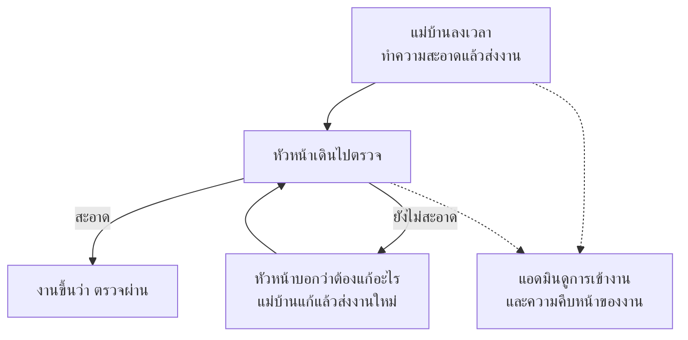
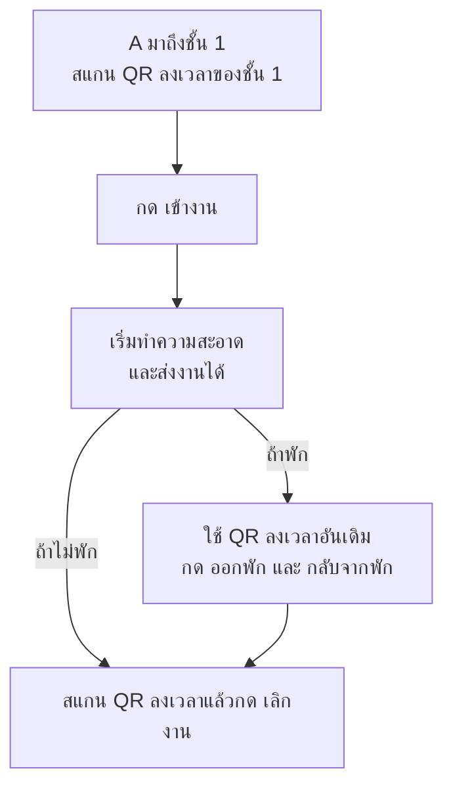
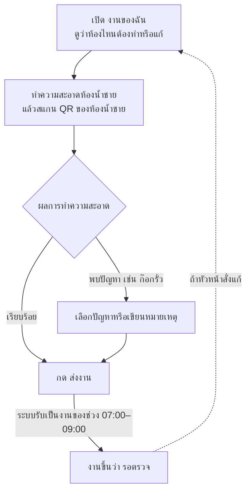
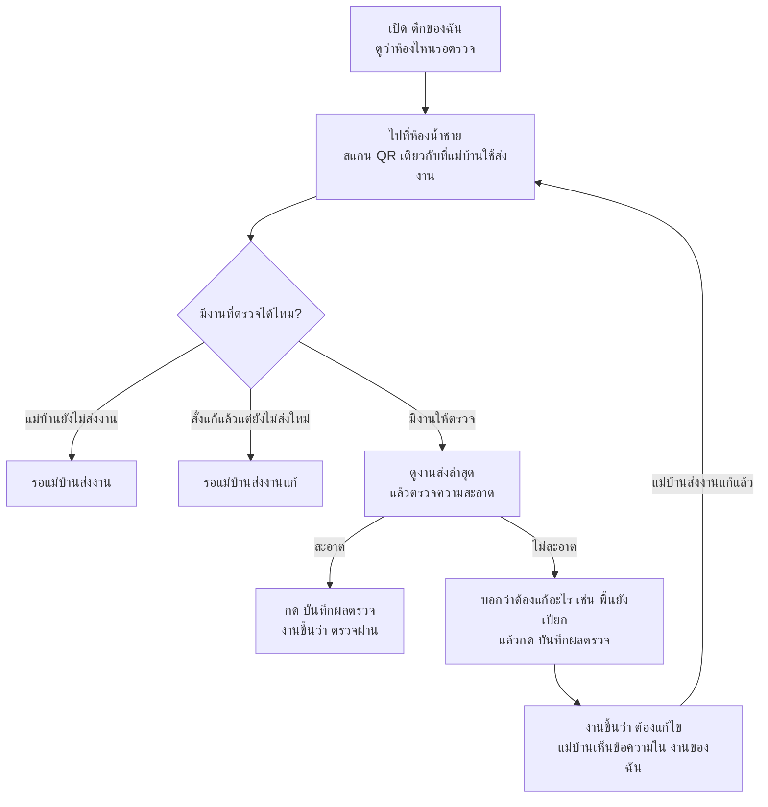
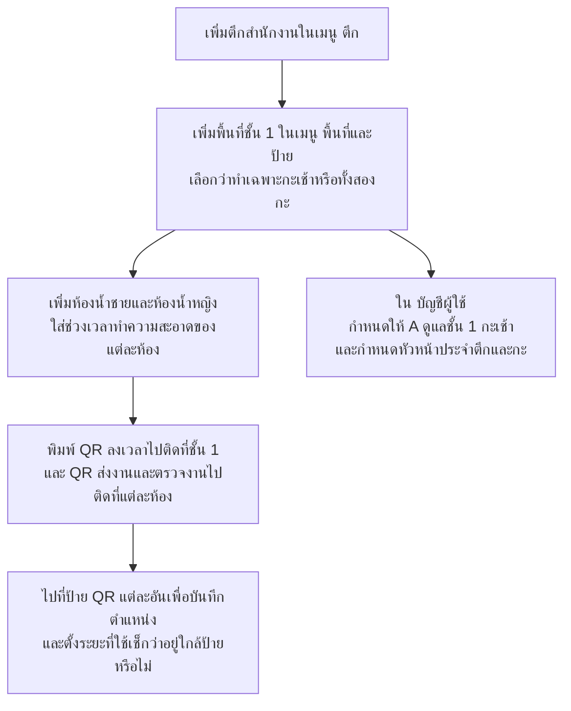
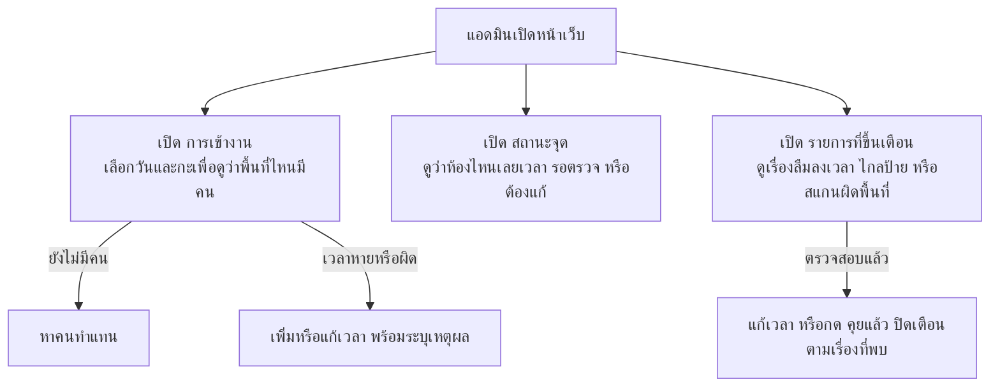
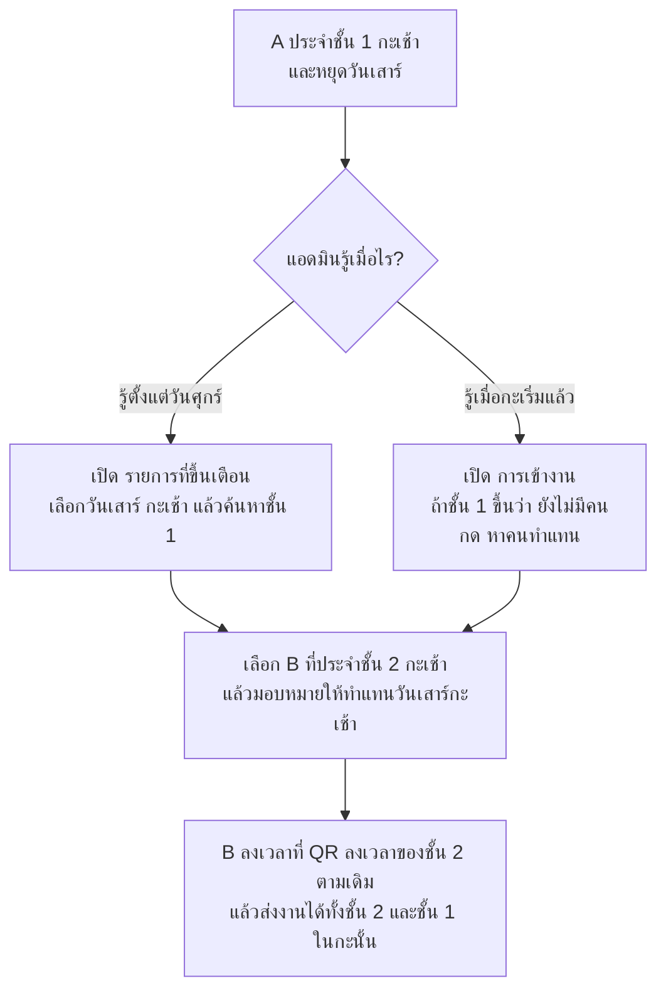

# งานทำความสะอาดในระบบ ใครทำอะไรบ้าง

ก่อนเริ่มงาน แม่บ้านลงเวลาเข้าพื้นที่ พอทำความสะอาดเสร็จก็ส่งงานให้หัวหน้าเดินไปตรวจ ส่วนแอดมินดูว่าพื้นที่ไหนยังไม่มีคน งานไหนเลยเวลา และงานไหนยังรอตรวจ

**ตัวอย่างเดียวที่ใช้ทั้งหน้า** แม่บ้าน A ดูแลชั้น 1 ของตึกสำนักงานในกะเช้า งานที่ต้องทำมีทั้งห้องน้ำชายและห้องน้ำหญิง

| คำบนหน้าเว็บ | ในตัวอย่างนี้หมายถึงอะไร |
|---|---|
| พื้นที่ | ชั้น 1 ที่ A รับผิดชอบในกะเช้า |
| จุดทำความสะอาด | ห้องน้ำชายหรือห้องน้ำหญิง แต่ละห้องมี QR ของตัวเองให้แม่บ้านส่งงานและหัวหน้าตรวจ |
| ป้ายลงเวลา | ป้าย QR สำหรับลงเวลาเข้า พัก และเลิกงาน ชั้น 1 มีป้ายลงเวลา 1 ป้าย แยกจาก QR ของแต่ละห้อง |
| รอบทำความสะอาด | ช่วงเวลาที่กำหนดให้ทำความสะอาดและส่งงาน เช่น ห้องน้ำชาย 07:00–09:00 แต่ละห้องตั้งเวลาได้ต่างกัน |

แม่บ้านประจำพื้นที่ตามกะ ส่วนหัวหน้าดูแลทั้งตึกตามกะ กะเช้า 07:00–19:00 และกะดึก 19:00–07:00 ตามเวลาไทย พื้นที่ที่เปิดเฉพาะกะเช้าจัดคนเฉพาะกะเช้า

## แม่บ้าน (Cleaner)

### 1. ลงเวลาเข้างานที่ป้าย QR ของพื้นที่ตัวเอง

การลงเวลาเข้างานใช้ยืนยันว่าแม่บ้านมาถึงพื้นที่แล้ว หลังจากนั้นส่งงานได้จนกว่าจะลงเวลาเลิกงาน รวมถึงช่วงพัก ระบบรับลงเวลาตั้งแต่ 60 นาทีก่อนเริ่มกะถึง 60 นาทีหลังจบกะตามค่าเริ่มต้น ถ้าลงเวลาผิดหรือลืมลงเวลา แอดมินเพิ่มหรือแก้ให้พร้อมบันทึกเหตุผลได้

### 2. ทำความสะอาดแล้วส่งงานที่ห้องนั้น

ส่งงานได้เฉพาะพื้นที่ที่ตัวเองรับผิดชอบหรือได้รับมอบหมายให้ทำแทนในวันและกะนั้น ถ้าเน็ตหลุดจนขึ้น **“ยังไม่ได้บันทึก”** ให้กด **“ส่งใหม่”** เมื่อมีสัญญาณ ระบบใช้เวลาที่ส่งสำเร็จ ถ้าเลือก **“พบปัญหา”** ข้อความแจ้งปัญหาจะแสดงแยกจากสถานะงาน เช่น **“รอตรวจ”** และหายเมื่อส่งครั้งถัดไปเป็น **“เรียบร้อย”**

**ถ้าส่งงานเร็วหรือช้ากว่าเวลาที่กำหนด** สมมติว่าห้องน้ำชายต้องทำสองครั้ง ครั้งเช้า 07:00–09:00 และครั้งเย็น 16:00–18:00

| A ส่งงานตอนไหน | ระบบบันทึกอย่างไร |
|---|---|
| 06:45 หลังลงเวลาเข้างาน | เก็บเป็นงานที่ส่งเพิ่ม ยังไม่นับเป็นงานช่วง 07:00–09:00 |
| 08:10 | นับเป็นงานช่วง 07:00–09:00 และส่งตรงเวลา ถ้าหัวหน้าสั่งแก้ไว้ จะบันทึกเป็นงานแก้ |
| 09:40 และยังไม่ได้ส่งงานช่วงเช้า | นับเป็นงานช่วง 07:00–09:00 และบันทึกว่าส่งช้า 40 นาที |
| 09:40 และหัวหน้าสั่งแก้งานช่วงเช้าไว้ | นับเป็นงานแก้ของช่วงเช้าได้จนกว่าจะถึง 16:00 |
| 09:40 แต่ส่งงานช่วงเช้าไปแล้วและไม่มีงานแก้ค้าง | เก็บเป็นงานที่ส่งเพิ่ม สถานะงานช่วงเช้าไม่เปลี่ยน |

พอถึง 16:00 หน้าจอจะแสดงงานของช่วงเย็น ส่วนงานช่วงเช้าที่ยังค้างจะดูได้จากประวัติ เช่น **“ไม่ได้ทำ”** **“ไม่ได้ตรวจ”** หรือ **“ไม่ได้แก้”**

## หัวหน้า (Supervisor)

### เดินตรวจงานที่แม่บ้านส่งแล้ว

หัวหน้าไม่ต้องลงเวลา ตรวจได้ในตึกและกะที่รับผิดชอบ รวมถึงตึกที่ได้รับมอบหมายให้ตรวจแทนในวันและกะนั้น ถ้าสแกนผิดตึกหรือนอกกะ ระบบจะไม่ให้ตรวจและขึ้นเตือนให้แอดมินเห็น

หัวหน้าตรวจงานช่วงเช้าได้แม้เลย 09:00 และตรวจซ้ำได้แม้เคยให้ผ่าน เมื่อถึง 16:00 ระบบจะเปิดให้ตรวจงานช่วงเย็นแทนเมื่อแม่บ้านส่งงานแล้ว ถ้ามีงานใหม่เข้ามาระหว่างเปิดหน้าตรวจ ระบบจะแสดงงานล่าสุดให้เลือกผลตรวจใหม่

**ถ้ามือถืออ่านตำแหน่งไม่ได้** แม่บ้านและหัวหน้าต้องเปิดสิทธิ์ตำแหน่งหรือรอให้มือถือจับตำแหน่งได้แล้วลองใหม่ ถ้าอ่านได้แต่ตำแหน่งอยู่ไกลจากป้าย QR หรือคลาดเคลื่อนเกินระยะที่ตั้งไว้ ระบบรับรายการที่ผ่านเงื่อนไขอื่นและขึ้นเตือน **“ไกลป้าย”** ให้แอดมินดู

## แอดมิน (Admin)

### 1. เตรียมสถานที่ ป้าย QR และคนรับผิดชอบ

ช่วงทำความสะอาดของห้องเดียวกันต้องอยู่ในกะและไม่ทับกัน ถ้าต้องออก QR ใหม่ ป้ายเดิมใช้ไม่ได้ทันทีและต้องนำป้ายใหม่ไปติดแทน ถ้าพนักงานออก แอดมินปิดบัญชีได้และยังดูประวัติงานเดิมได้

### 2. ดูว่าใครมา งานถึงไหน และมีอะไรต้องตาม

- ถ้าแม่บ้านยังไม่เคยลงเวลาเข้างานในกะนั้น ให้ดูที่ **“การเข้างาน”** ส่วนเตือน **“ลืมลงเวลา”** จะขึ้นหลังจบกะเมื่อคนที่ลงเวลาเข้างานแล้วมีเวลาขาด เช่น ลืมลงเวลาเลิกงาน
- ใน **“สถานะจุด”** คำว่า **“ยังไม่ถึงรอบ”** คือยังไม่ถึงเวลาที่กำหนด **“ยังไม่ทำ”** คือถึงเวลาแล้วแต่ยังไม่ส่ง **“เลยเวลา”** คือพ้นเวลาส่งแล้วแต่ยังไม่มีงาน และ **“นอกเวลา”** คือไม่มีงานที่กำหนดไว้ในกะนั้น
- ใช้ **“สรุปการตรวจ”** ดูผลตรวจและงานที่หัวหน้าไม่ได้ตรวจ ใช้ **“ส่งออก Excel”** เลือกตึกและช่วงวันที่ 1–31 วัน และใช้ **“ประวัติการแก้ไข”** ดูว่าใครแก้เวลา มอบหมายคนทำแทน หรือส่งออกข้อมูล

### 3. ถ้า A หยุดวันเสาร์ ให้ B ดูแลชั้น 1 เพิ่ม

ระบบไม่ได้เก็บตารางวันหยุดของแม่บ้าน แอดมินจึงเลือกคนทำแทนตามวันที่หยุดจริง โดยทำล่วงหน้าได้สูงสุด 7 วัน คำว่า **“มีคนทำแทน”** บนหน้าการเข้างานแปลว่าแอดมินมอบหมาย B แล้ว ถ้าจะดูว่า B มาถึงหรือยัง ให้ดูเวลาเข้างานของ B การมอบหมายมีผลเฉพาะวันและกะที่เลือก ส่วน A ยังประจำชั้น 1 ตามเดิม ถ้าแผนเปลี่ยนแอดมินยกเลิกได้

บางรายการใน **“รายการที่ขึ้นเตือน”** มีปุ่มให้มอบหมายจากรายการนั้นได้เลย เช่น หัวหน้าสแกน QR ที่ตึกอื่นและแอดมินต้องการให้ช่วยตรวจแทน แอดมินเลือกให้ตรวจแทนเฉพาะตึก วัน และกะนั้น เมื่อมอบหมายสำเร็จ ระบบจะปิดรายการเตือนให้

## ที่มาของกติกา

- [คำตอบของพี่เลี้ยง](requirements-gathering/2026-10-06-supervisor-answers.md)
- [การแบ่งพื้นที่ให้แม่บ้าน](adr/facility-0040-area-is-the-unit-of-assignment.md) · [การมอบหมายตึกให้หัวหน้า](adr/facility-0048-supervisor-assigned-to-building.md)
- [การลงเวลาและจุดประสงค์](adr/facility-0050-check-in-confirms-area-presence-not-time-attendance.md) · [ช่วงเวลาที่ลงได้](adr/facility-0069-attendance-scan-window-60-minutes-around-the-shift.md) · [การแก้เวลา](adr/facility-0051-admin-corrections-and-audit-log.md)
- [เวลาส่งงานและผลที่บันทึก](adr/facility-0047-cleaning-rounds-are-time-windows.md) · [การตรวจและสั่งแก้](adr/facility-0029-supervisor-inspection-workflow.md) · [การแจ้งปัญหา](adr/facility-0046-issue-is-a-tag-not-a-card-status.md)
- [การจัดคนทำแทน](adr/facility-0041-scan-only-own-area-with-cover-assignment.md) · [การมอบหมายล่วงหน้า](adr/facility-0075-covers-assigned-up-to-7-days-ahead.md) · [การเลือกพื้นที่ล่วงหน้า](adr/facility-0084-advance-cover-picks-area-from-searchable-list.md)
