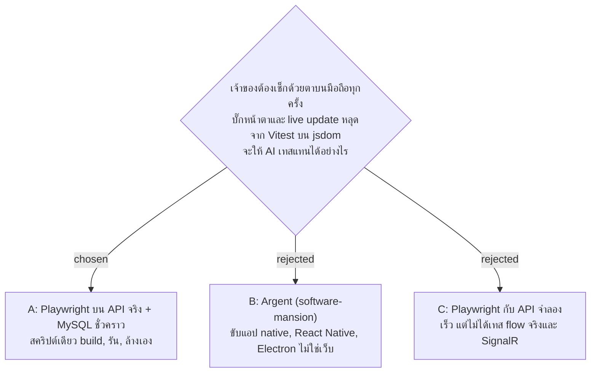

# Playwright End-to-End Tests on a Phone-Sized Browser: Implementation Plan

> **For agentic workers:** REQUIRED SUB-SKILL: Use sp-subagent-driven-development (recommended) or sp-executing-plans to implement this plan task-by-task. Steps use checkbox (`- [ ]`) syntax for tracking.

**Goal:** `npm run e2e` (in `frontend/`) builds the app, runs it on the throwaway database `facility_e2e_test`, checks login, the check-in page, My Work, D1 and the live flow in a real Chromium, then stops the API and drops the database, pass or fail.

**Architecture:**
- `scripts/e2e.sh` owns the run: build, database, the API process (the built dll, pid in `.run/e2e-api.pid`), Playwright, cleanup in an `EXIT` trap.
- `frontend/playwright.config.ts` has two projects, `phone` (390 x 844, touch, GPS at the AR01 check-in sign) and `desktop` (1280 px). Tests sit in `frontend/e2e/phone/` and `frontend/e2e/desktop/`.
- `frontend/e2e/support/` holds the only copies of the seed values, the context options, the login and shift-in steps, and the page watchers (layout shift, text that must never show, held-back requests).

**Tech Stack:** `@playwright/test` (Chromium only), TypeScript 6, bash 3.2+ (macOS), MySQL (Homebrew), .NET 10.

**Spec:** `docs/superpowers/specs/2026-10-28-playwright-e2e-design.md`. Related ADRs: facility-0049 (seed only in Development), facility-0064 (live badge, amended 2026-10-28), facility-0067 (frontend served from `wwwroot`), facility-0093 (scripts, the `facility_dashboard` accident).

## Global Constraints

- The script creates and drops only `facility_e2e_test`. It never names `facility_dashboard`.
- The API runs in Development (the seed) on `E2E_PORT`, default `5101`. It never uses 5001.
- `Jwt__SigningKey` is random per run (`openssl rand -base64 48`) and lives only in the API process's environment.
- Cleanup (stop the API, drop the database, delete `backend/src/FacilityRealtime.Api/wwwroot`) runs on every exit, pass, fail or Ctrl-C. `npm run e2e:clean` does the same by hand.
- Script messages to people are Thai (facility-0093 ruling); code comments are English, as in `scripts/facility.sh`.
- Chromium only. Tests run one at a time (`workers: 1`).
- Tests find elements by role, label and text (`docs/agents/frontend-standards.md`), never by class or test id.
- No fixed sleeps in tests. Waiting is Playwright's auto-waiting assertions; held-back requests use `page.route`.
- CLS limit is `< 0.01`.
- Seed values (made-up, public: `backend/src/FacilityRealtime.Infrastructure/Persistence/DbInitializer.cs`) appear only in `frontend/e2e/support/seed.ts`.
- Every new test is proved once to fail when its bug is put back (the repo's "fails on the old code" rule); the proof is undone before the commit.
- Commits stay on branch `feat/e2e-playwright`. No push, PR or merge without the owner's explicit OK.

## Facts the tasks rely on (checked in the code, 2026-10-28)

- Routes: `/login`, `/login/admin`, `/my-work` (Cleaner home), `/my-building` (Supervisor home), `/dashboard` (Admin home, D1), `/check-in/:token`, `/scan/:token` (`frontend/src/router.tsx`, `frontend/src/shared/auth/roles.ts`).
- Login labels: `รหัสพนักงาน`, `เบอร์โทรศัพท์`; Admin: `ชื่อผู้ใช้`, `รหัสผ่าน`; button `เข้าสู่ระบบ`; wrong phone message `รหัสพนักงานหรือเบอร์โทรไม่ถูกต้อง`.
- Check-in buttons: `เข้างาน`, `ออกพัก`, `กลับจากพัก`, `เลิกงาน` (`frontend/src/shared/utils/labels.ts`); the press POSTs `/api/attendance`.
- My Work: heading `งานของฉัน`, footer button `อัปเดต`, data from `GET /api/my-work`.
- D1: heading `สถานะจุดทำความสะอาด`, one `<h2>` per Area (`AR01 Area 1 ชั้น 1`), one `<li>` per point with an `<h3>` of the point's name; a submitted point's text includes the Cleaner's name. Names come from `GET /api/admin/buildings`. The hub is `/hubs/scan` (`negotiate` first).
- Live badge text: `กำลังเชื่อมต่อ… (อัปเดตทุก 30 วินาที)`, shown only while `reconnecting` since `bdfd581`.
- Submit form: radio tile `เรียบร้อย`, button `ส่งงาน`; the result heading starts with `ส่ง` (`ส่งงานแล้ว`, `ส่งงานแก้แล้ว`, `ส่งเพิ่มแล้ว (ไม่นับรอบ)`).
- Seed: Admin `admin` / `admin1234`; Supervisor `S2001` / `0820000001`; Cleaners `E1001` / `0810000001` / `สมชาย ใจดี` (Day) and `E1002` / `0810000002` / `สมหญิง รักสะอาด` (Night), both AR01; check-in sign `token-checkin-ar01` at 13.756300, 100.501800; point sign `token-restroom-m1` = `ห้องน้ำชาย ชั้น 1`. Restroom rounds: Day 07–09, 16–18; Night 20–22, 03–05.
- Shifts: Day 07:00–19:00, Night 19:00–07:00 Thai time; attendance opens 60 min before and closes 60 min after (`appsettings.json` `Attendance`).
- No login rate limit exists, so the tests may log in as often as they need.
- The pre-commit hook runs `npm run lint`, `npx tsc -b`, `npm test` in `frontend/`.

## File map

| File | Responsibility |
|---|---|
| `scripts/e2e.sh` (create) | `run` and `clean`: the whole run and the cleanup |
| `frontend/package.json` (modify) | `@playwright/test` devDependency; `e2e`, `e2e:clean` scripts |
| `frontend/playwright.config.ts` (create) | projects, base URL, artefacts |
| `frontend/tsconfig.e2e.json` (create), `frontend/tsconfig.json` (modify) | type-check `e2e/` and the config in `tsc -b` |
| `frontend/.gitignore` (modify) | `test-results/`, `playwright-report/` |
| `frontend/e2e/support/seed.ts` | seed values, who is on shift now |
| `frontend/e2e/support/devices.ts` | `phone` and `desktop` context options |
| `frontend/e2e/support/login.ts` | `loginAsEmployee`, `loginAsAdmin` |
| `frontend/e2e/support/attendance.ts` | `shiftInIfOffered` |
| `frontend/e2e/support/pageWatch.ts` | layout shift, text watch, held-back requests, sideways check |
| `frontend/e2e/phone/login.spec.ts` | Cleaner, Supervisor, wrong phone |
| `frontend/e2e/phone/check-in.spec.ts` | check-in page fits and buttons are reachable |
| `frontend/e2e/phone/my-work.spec.ts` | My Work layout shift |
| `frontend/e2e/desktop/dashboard.spec.ts` | Admin login, D1 layout shift, no badge on first connect |
| `frontend/e2e/desktop/live-flow.spec.ts` | phone submission reaches D1 without a reload |
| `docs/adr/facility-0094-playwright-end-to-end.md` (create) | the decision |
| `docs/handover.md`, `docs/code-map.md`, `docs/handoff.md` (modify) | how to run and recover; the map; status |

---

### Task 1: The run: script, config and the login tests

**Files:**
- Create: `scripts/e2e.sh`, `frontend/playwright.config.ts`, `frontend/tsconfig.e2e.json`, `frontend/e2e/support/seed.ts`, `frontend/e2e/support/devices.ts`, `frontend/e2e/support/login.ts`, `frontend/e2e/phone/login.spec.ts`
- Modify: `frontend/package.json`, `frontend/tsconfig.json`, `frontend/.gitignore`

**Interfaces:**
- Produces (used by every later task):
  - `seed.ts`: `interface Employee { employeeId: string; phone: string; name: string }`; consts `admin: { username: string; password: string }`, `supervisor: Employee`, `checkInToken: string`, `restroomToken: string`, `restroomName: string`, `signLocation: { latitude: number; longitude: number; accuracy: number }`; functions `thaiHour(now?: Date): number`, `cleanerOnShift(now?: Date): Employee`, `beforeFirstNightRound(now?: Date): boolean`.
  - `devices.ts`: `phone: BrowserContextOptions`, `desktop: BrowserContextOptions`.
  - `login.ts`: `loginAsEmployee(page: Page, who: Pick<Employee, 'employeeId' | 'phone'>): Promise<void>` (fills and submits, does not assert where it lands); `loginAsAdmin(page: Page): Promise<void>` (asserts it lands on `/dashboard`).
  - Commands: `npm run e2e [-- <playwright args>]`, `npm run e2e:clean`.

- [ ] **Step 1: Install Playwright**

```bash
cd frontend
npm install --save-dev @playwright/test@latest
```

Expected: `package.json` gains `"@playwright/test": "^1.x.y"` under `devDependencies`; `package-lock.json` changes. Write the installed version into the handoff later (Task 5).

- [ ] **Step 2: npm scripts**

In `frontend/package.json` `scripts`, after `"test": "vitest run",` add:

```json
    "e2e": "bash ../scripts/e2e.sh run",
    "e2e:clean": "bash ../scripts/e2e.sh clean",
```

- [ ] **Step 3: Ignore Playwright's output**

Append to `frontend/.gitignore`:

```
# facility-0094: Playwright's results, traces and screenshots of the last run
test-results/
playwright-report/
```

- [ ] **Step 4: Type-check the tests with `tsc -b`**

Create `frontend/tsconfig.e2e.json`:

```json
{
  "compilerOptions": {
    "tsBuildInfoFile": "./node_modules/.tmp/tsconfig.e2e.tsbuildinfo",
    "target": "es2023",
    "lib": ["ES2023", "DOM"],
    "types": ["node"],
    "skipLibCheck": true,

    "module": "nodenext",
    "allowImportingTsExtensions": true,
    "verbatimModuleSyntax": true,
    "moduleDetection": "force",
    "noEmit": true,

    "strict": true,
    "noUnusedLocals": true,
    "noUnusedParameters": true,
    "erasableSyntaxOnly": true,
    "noFallthroughCasesInSwitch": true
  },
  "include": ["playwright.config.ts", "e2e"]
}
```

In `frontend/tsconfig.json` add the reference:

```json
  "references": [
    { "path": "./tsconfig.app.json" },
    { "path": "./tsconfig.node.json" },
    { "path": "./tsconfig.e2e.json" }
  ]
```

- [ ] **Step 5: Seed values**

Create `frontend/e2e/support/seed.ts`:

```ts
/**
 * facility-0094: the Development seed the end-to-end run starts from, copied from DbInitializer.cs. Made-up people and
 * numbers (the repo is public). The only copy in the tests: change it here when the seed changes.
 */
export interface Employee {
  employeeId: string;
  phone: string;
  name: string;
}

export const admin = { username: 'admin', password: 'admin1234' };
export const supervisor: Employee = { employeeId: 'S2001', phone: '0820000001', name: 'สมปอง ตรวจดี' };
const dayCleaner: Employee = { employeeId: 'E1001', phone: '0810000001', name: 'สมชาย ใจดี' };
const nightCleaner: Employee = { employeeId: 'E1002', phone: '0810000002', name: 'สมหญิง รักสะอาด' };

/** AR01's check-in sign, and where the phone stands (the sign's own location, so the distance is 0). */
export const checkInToken = 'token-checkin-ar01';
export const signLocation = { latitude: 13.7563, longitude: 100.5018, accuracy: 5 };

/** A point sign of AR01, about 7 m from the check-in sign: inside the radius. */
export const restroomToken = 'token-restroom-m1';
export const restroomName = 'ห้องน้ำชาย ชั้น 1';

/** The hour on a Thai wall clock (UTC+7, no daylight saving). */
export function thaiHour(now: Date = new Date()): number {
  return (now.getUTCHours() + 7) % 24;
}

/** Day shift 07:00–19:00, Night 19:00–07:00 (ShiftCalendar): the AR01 Cleaner whose shift the clock is in. */
export function cleanerOnShift(now: Date = new Date()): Employee {
  const hour = thaiHour(now);
  return hour >= 7 && hour < 19 ? dayCleaner : nightCleaner;
}

/** 19:00–20:00: the Night shift has started, its first restroom round (20:00) has not, so D1 shows no submission. */
export function beforeFirstNightRound(now: Date = new Date()): boolean {
  return thaiHour(now) === 19;
}
```

- [ ] **Step 6: Context options**

Create `frontend/e2e/support/devices.ts`:

```ts
import { devices, type BrowserContextOptions } from '@playwright/test';
import { signLocation } from './seed.ts';

/** Thai, on Thai time, like every phone and desk the system serves. */
const thai: BrowserContextOptions = { locale: 'th-TH', timezoneId: 'Asia/Bangkok' };

/**
 * facility-0094: a phone the size of an iPhone 13–15, in Chromium, standing at the AR01 check-in sign. Also used for
 * the second context of the live-flow test, so everything a phone needs is here, not in the config's `use`.
 */
export const phone: BrowserContextOptions = {
  ...thai,
  viewport: { width: 390, height: 844 },
  deviceScaleFactor: 3,
  isMobile: true,
  hasTouch: true,
  userAgent: devices['Pixel 7'].userAgent,
  geolocation: signLocation,
  permissions: ['geolocation'],
};

/** An Admin's desk (D1 is a desk page, wireframe D1). */
export const desktop: BrowserContextOptions = {
  ...thai,
  viewport: { width: 1280, height: 800 },
};
```

- [ ] **Step 7: Playwright config**

Create `frontend/playwright.config.ts`:

```ts
import { defineConfig } from '@playwright/test';
import { desktop, phone } from './e2e/support/devices.ts';

// facility-0094: scripts/e2e.sh starts the API on a throwaway database and passes its address here
const baseURL = process.env.E2E_BASE_URL;
if (!baseURL) {
  throw new Error('E2E_BASE_URL is not set: run `npm run e2e`, which starts the API first');
}

export default defineConfig({
  testDir: './e2e',
  // One at a time: the tests share the run's database, and a shift-in changes what the check-in page offers
  workers: 1,
  fullyParallel: false,
  forbidOnly: true,
  retries: 0,
  reporter: [['list'], ['html', { open: 'never' }]],
  use: {
    baseURL,
    browserName: 'chromium',
    screenshot: 'on',
    trace: 'retain-on-failure',
  },
  projects: [
    { name: 'phone', testDir: './e2e/phone', use: phone },
    { name: 'desktop', testDir: './e2e/desktop', use: desktop },
  ],
});
```

- [ ] **Step 8: Login steps**

Create `frontend/e2e/support/login.ts`:

```ts
import { expect, type Page } from '@playwright/test';
import { admin, type Employee } from './seed.ts';

/** The phone login (wireframe M0). Does not check where it lands: a test that expects a refusal uses it too. */
export async function loginAsEmployee(page: Page, who: Pick<Employee, 'employeeId' | 'phone'>): Promise<void> {
  await page.goto('/login');
  await page.getByLabel('รหัสพนักงาน').fill(who.employeeId);
  await page.getByLabel('เบอร์โทรศัพท์').fill(who.phone);
  await page.getByRole('button', { name: 'เข้าสู่ระบบ' }).click();
}

/** The Admin login; an Admin's home is D1 (facility-0058). */
export async function loginAsAdmin(page: Page): Promise<void> {
  await page.goto('/login/admin');
  await page.getByLabel('ชื่อผู้ใช้').fill(admin.username);
  await page.getByLabel('รหัสผ่าน').fill(admin.password);
  await page.getByRole('button', { name: 'เข้าสู่ระบบ' }).click();
  await expect(page).toHaveURL(/\/dashboard$/);
}
```

- [ ] **Step 9: Write the login tests**

Create `frontend/e2e/phone/login.spec.ts`:

```ts
import { expect, test } from '@playwright/test';
import { loginAsEmployee } from '../support/login.ts';
import { cleanerOnShift, supervisor } from '../support/seed.ts';

test('a Cleaner lands on My Work', async ({ page }) => {
  await loginAsEmployee(page, cleanerOnShift());
  await expect(page).toHaveURL(/\/my-work$/);
  await expect(page.getByRole('heading', { name: 'งานของฉัน' })).toBeVisible();
});

test('a Supervisor lands on My Building', async ({ page }) => {
  await loginAsEmployee(page, supervisor);
  await expect(page).toHaveURL(/\/my-building$/);
});

test('a wrong phone number is refused', async ({ page }) => {
  await loginAsEmployee(page, { employeeId: cleanerOnShift().employeeId, phone: '0899999999' });
  await expect(page.getByText('รหัสพนักงานหรือเบอร์โทรไม่ถูกต้อง')).toBeVisible();
  await expect(page).toHaveURL(/\/login$/);
});
```

- [ ] **Step 10: Run the tests with no server to see them fail**

Run: `cd frontend && E2E_BASE_URL=http://localhost:5101 npx playwright install chromium && E2E_BASE_URL=http://localhost:5101 npx playwright test --project=phone`
Expected: FAIL, 3 tests, each with `net::ERR_CONNECTION_REFUSED` (nothing listens on 5101 yet).

- [ ] **Step 11: Write the run script**

Create `scripts/e2e.sh`:

```bash
#!/usr/bin/env bash
# facility-0094: the end-to-end run. Builds the app, starts it in Development (the seed) on the throwaway database
# facility_e2e_test, runs Playwright, then stops the API, drops the database and deletes wwwroot, pass or fail.
# See docs/handover.md section 6.
#
#   scripts/e2e.sh run [playwright args]   the whole run (npm run e2e; extra args go to `playwright test`)
#   scripts/e2e.sh clean                    remove what a killed run left behind (npm run e2e:clean)
set -euo pipefail

repo_root="$(cd "$(dirname "${BASH_SOURCE[0]}")/.." && pwd)"
api_dir="$repo_root/backend/src/FacilityRealtime.Api"
run_dir="$repo_root/.run"
pid_file="$run_dir/e2e-api.pid"
log_file="$run_dir/e2e-api.log"
port="${E2E_PORT:-5101}"
# The only database this script creates or drops. Never facility_dashboard (the trial run of 2026-10-27)
db_name="facility_e2e_test"

fail() { echo "e2e.sh: $*" >&2; exit 2; }
usage() { fail "วิธีใช้: scripts/e2e.sh run [ค่าที่ส่งต่อให้ playwright test] | clean"; }

sql() {
  if [ -n "${E2E_MYSQL_PASSWORD:-}" ]; then
    MYSQL_PWD="$E2E_MYSQL_PASSWORD" mysql -u root --batch --skip-column-names -e "$1"
  else
    mysql -u root --batch --skip-column-names -e "$1"
  fi
}

stop_api() {
  [ -f "$pid_file" ] || return 0
  local pid
  pid="$(cat "$pid_file")"
  kill "$pid" 2>/dev/null || true
  # Up to 10 s, so the next run finds the port free
  for _ in $(seq 1 20); do
    kill -0 "$pid" 2>/dev/null || break
    sleep 0.5
  done
  rm -f "$pid_file"
}

clean() {
  stop_api
  sql "DROP DATABASE IF EXISTS \`$db_name\`" ||
    echo "e2e.sh: ลบฐานข้อมูล $db_name ไม่ได้ ลบเองด้วย: mysql -u root -e 'DROP DATABASE $db_name'" >&2
  rm -rf "$api_dir/wwwroot"
}

wait_for_api() {
  for _ in $(seq 1 120); do
    curl -fs "http://localhost:$port/api/health" >/dev/null 2>&1 && return 0
    if ! kill -0 "$(cat "$pid_file")" 2>/dev/null; then
      tail -n 40 "$log_file" >&2
      fail "API หยุดก่อนพร้อม ดู log ทั้งหมดที่ $log_file"
    fi
    sleep 0.5
  done
  tail -n 40 "$log_file" >&2
  fail "API ไม่ตอบภายใน 60 วินาที ดู log ที่ $log_file"
}

run() {
  command -v mysql >/dev/null || fail "ไม่พบคำสั่ง mysql ติดตั้ง MySQL ก่อน (Mac: brew install mysql แล้ว brew services start mysql)"
  sql "SELECT 1" >/dev/null || fail "ต่อ MySQL ด้วย root ไม่ได้ ถ้า root มีรหัสผ่าน ตั้ง E2E_MYSQL_PASSWORD ก่อนรัน"
  if curl -fs "http://localhost:$port/api/health" >/dev/null 2>&1; then
    fail "มีระบบตอบอยู่ที่พอร์ต $port แล้ว หยุดตัวนั้นก่อน หรือเลือกพอร์ตอื่นด้วย E2E_PORT"
  fi

  mkdir -p "$run_dir"
  trap clean EXIT
  clean # what a killed run may have left

  (cd "$repo_root/frontend" && npm run build:api)
  dotnet build "$api_dir" -c Release --nologo -v quiet
  sql "CREATE DATABASE \`$db_name\` CHARACTER SET utf8mb4 COLLATE utf8mb4_0900_ai_ci"

  local signing_key
  signing_key="$(openssl rand -base64 48)"
  (
    # ASP.NET Core takes its content root (wwwroot) from the working directory
    cd "$api_dir"
    export ASPNETCORE_ENVIRONMENT=Development
    export ASPNETCORE_URLS="http://localhost:$port"
    export ConnectionStrings__DefaultConnection="Server=localhost;Port=3306;Database=$db_name;Uid=root;Pwd=${E2E_MYSQL_PASSWORD:-};CharSet=utf8mb4;"
    export Jwt__SigningKey="$signing_key"
    exec dotnet bin/Release/net10.0/FacilityRealtime.Api.dll
  ) >"$log_file" 2>&1 &
  echo $! >"$pid_file"
  wait_for_api

  cd "$repo_root/frontend"
  npx playwright install chromium
  # ${@+"$@"}: bash 3.2 with `set -u` treats a bare "$@" with no arguments as unbound
  E2E_BASE_URL="http://localhost:$port" npx playwright test ${@+"$@"}
}

case "${1:-}" in
  run) shift; run ${@+"$@"} ;;
  clean) clean ;;
  *) usage ;;
esac
```

Then: `chmod +x scripts/e2e.sh`.

- [ ] **Step 12: Run the whole thing**

Run: `cd frontend && npm run e2e -- --project=phone`
Expected: the build, then `3 passed`. Afterwards all three are true:
- `mysql -u root -e "SHOW DATABASES LIKE 'facility_e2e_test'"` prints nothing
- `ls ../backend/src/FacilityRealtime.Api/wwwroot` says no such file
- `curl -s http://localhost:5101/api/health` fails to connect

- [ ] **Step 13: Check the guards and the cleanup by hand**

1. Port taken: make something answer `/api/health` on 5101 from a scratch folder outside the repo: `d=$(mktemp -d) && mkdir -p "$d/api" && echo ok > "$d/api/health" && python3 -m http.server 5101 -d "$d"` in one terminal; in a second, `cd frontend && npm run e2e`. Expected: `e2e.sh: มีระบบตอบอยู่ที่พอร์ต 5101 แล้ว ...`, exit 2, and no build started. Stop the Python server with Ctrl-C.
2. Killed run: start `npm run e2e`, and once the API is up (`3 passed` not yet printed) kill the terminal's shell with `kill -9 <pid of bash scripts/e2e.sh>`. Then `npm run e2e:clean`. Expected: the API process from `.run/e2e-api.pid` is gone, `facility_e2e_test` dropped, `wwwroot` deleted.
3. `facility_dashboard` untouched: `mysql -u root -e "SELECT COUNT(*) FROM facility_dashboard.users"` gives the same number before and after a run.

- [ ] **Step 14: Lint, types, unit tests**

Run: `cd frontend && npm run lint && npx tsc -b && npm test`
Expected: all clean; the unit test count unchanged (463).

- [ ] **Step 15: Commit**

```bash
git add scripts/e2e.sh frontend/package.json frontend/package-lock.json frontend/.gitignore \
  frontend/tsconfig.json frontend/tsconfig.e2e.json frontend/playwright.config.ts frontend/e2e
git commit -m "test: end-to-end run with Playwright on a throwaway database; login tests"
```

---

### Task 2: Phone layout: check-in page and My Work

**Files:**
- Create: `frontend/e2e/support/pageWatch.ts`, `frontend/e2e/phone/check-in.spec.ts`, `frontend/e2e/phone/my-work.spec.ts`

**Interfaces:**
- Consumes: `loginAsEmployee`, `cleanerOnShift`, `checkInToken` (Task 1).
- Produces (`pageWatch.ts`, used by Task 3):
  - `recordLayoutShifts(page: Page): Promise<void>` — from the next page load on, sums `layout-shift` entries without recent input.
  - `layoutShiftTotal(page: Page): Promise<number>` — waits two frames, returns the sum.
  - `watchForText(page: Page, text: string): Promise<void>` — from the next page load on, notes whether `text` ever appears in the page.
  - `textEverShown(page: Page): Promise<boolean>`.
  - `holdBack(page: Page, url: string, ms: number): Promise<void>` — every request matching the glob `url` waits `ms` before it goes.
  - `sidewaysOverflow(page: Page): Promise<number>` — how many CSS pixels the page is wider than the screen (0 = fits).

- [ ] **Step 1: Page watchers**

Create `frontend/e2e/support/pageWatch.ts`:

```ts
import type { Page } from '@playwright/test';

/** facility-0094: what the tests read back from the page. Set by the init scripts below on every page load. */
declare global {
  interface Window {
    e2eLayoutShift: number;
    e2eTextShown: boolean;
  }
}

/** From the next page load on, sums layout shifts not caused by input: the CLS Lighthouse measured (2026-10-28). */
export async function recordLayoutShifts(page: Page): Promise<void> {
  await page.addInitScript(() => {
    window.e2eLayoutShift = 0;
    new PerformanceObserver((list) => {
      for (const entry of list.getEntries() as unknown as { value: number; hadRecentInput: boolean }[]) {
        if (!entry.hadRecentInput) {
          window.e2eLayoutShift += entry.value;
        }
      }
    }).observe({ type: 'layout-shift', buffered: true });
  });
}

/** The sum so far, after two frames so the last layout has been measured. */
export async function layoutShiftTotal(page: Page): Promise<number> {
  await page.evaluate(
    () => new Promise<void>((resolve) => requestAnimationFrame(() => requestAnimationFrame(() => resolve()))),
  );
  return page.evaluate(() => window.e2eLayoutShift);
}

/** From the next page load on, notes whether `text` ever appears, even for a moment. */
export async function watchForText(page: Page, text: string): Promise<void> {
  await page.addInitScript((wanted) => {
    window.e2eTextShown = false;
    new MutationObserver(() => {
      if (document.body?.textContent?.includes(wanted)) {
        window.e2eTextShown = true;
      }
    }).observe(document, { childList: true, subtree: true, characterData: true });
  }, text);
}

export async function textEverShown(page: Page): Promise<boolean> {
  return page.evaluate(() => window.e2eTextShown);
}

/** Holds every request matching the glob back by `ms`, so a loading phase lasts long enough to measure. */
export async function holdBack(page: Page, url: string, ms: number): Promise<void> {
  await page.route(url, async (route) => {
    await new Promise((resolve) => setTimeout(resolve, ms));
    await route.fallback();
  });
}

/** CSS pixels the page is wider than the screen; 0 means nothing sticks out sideways. */
export async function sidewaysOverflow(page: Page): Promise<number> {
  return page.evaluate(() => Math.max(0, document.documentElement.scrollWidth - window.innerWidth));
}
```

- [ ] **Step 2: Write the check-in test**

Create `frontend/e2e/phone/check-in.spec.ts`:

```ts
import { expect, test } from '@playwright/test';
import { loginAsEmployee } from '../support/login.ts';
import { sidewaysOverflow } from '../support/pageWatch.ts';
import { checkInToken, cleanerOnShift } from '../support/seed.ts';

// Chromium's phone emulation has no toolbar that hides while scrolling, so this cannot catch the 100dvh scroll bug
// of 2026-10-27; it guards the page's layout. A real phone is still the check for that bug (spec, 2026-10-28).
test('the check-in page fits the phone and its buttons can be reached', async ({ page }) => {
  await loginAsEmployee(page, cleanerOnShift());
  await expect(page).toHaveURL(/\/my-work$/);
  await page.goto(`/check-in/${checkInToken}`);

  const firstEvent = page.getByRole('button', { name: /^(เข้างาน|ออกพัก|กลับจากพัก|เลิกงาน)$/ }).first();
  await expect(firstEvent).toBeVisible();
  expect(await sidewaysOverflow(page)).toBe(0);

  await page.evaluate(() => window.scrollTo(0, document.documentElement.scrollHeight));
  await expect(firstEvent).toBeInViewport();
});
```

- [ ] **Step 3: Run it**

Run: `cd frontend && npm run e2e -- --project=phone --grep "check-in"`
Expected: `1 passed`.

- [ ] **Step 4: Prove it fails when the page sticks out**

In `frontend/src/pages/check-in/CheckInPage.tsx`, change the `<main className="flex min-h-[calc(100svh-6.25rem)] flex-col ...` to start `<main className="min-w-[420px] flex min-h-...`. Run Step 3 again.
Expected: FAIL at `expect(await sidewaysOverflow(page)).toBe(0)` with a value above 0.
Undo: `git checkout -- frontend/src/pages/check-in/CheckInPage.tsx`.

- [ ] **Step 5: Write the My Work test**

Create `frontend/e2e/phone/my-work.spec.ts`:

```ts
import { expect, test } from '@playwright/test';
import { loginAsEmployee } from '../support/login.ts';
import { holdBack, layoutShiftTotal, recordLayoutShifts } from '../support/pageWatch.ts';
import { cleanerOnShift } from '../support/seed.ts';

// Measured 0.10 before bdfd581: the footer showed while loading and the list pushed it down
test('My Work does not move while its work loads', async ({ page }) => {
  await loginAsEmployee(page, cleanerOnShift());
  await expect(page).toHaveURL(/\/my-work$/);

  await recordLayoutShifts(page);
  await holdBack(page, '**/api/my-work', 800);
  await page.goto('/my-work');
  await expect(page.getByRole('button', { name: 'อัปเดต' })).toBeVisible();

  expect(await layoutShiftTotal(page)).toBeLessThan(0.01);
});
```

- [ ] **Step 6: Run it**

Run: `cd frontend && npm run e2e -- --project=phone --grep "My Work does not move"`
Expected: `1 passed`.

- [ ] **Step 7: Prove it fails on the old code**

Run: `git checkout bdfd581^ -- frontend/src/pages/my-work/MyWorkPage.tsx`, then Step 6 again.
Expected: FAIL at `toBeLessThan(0.01)` with a value around 0.1.
Undo: `git checkout HEAD -- frontend/src/pages/my-work/MyWorkPage.tsx`.

- [ ] **Step 8: Lint, types, unit tests, then the whole phone project**

Run: `cd frontend && npm run lint && npx tsc -b && npm test && npm run e2e -- --project=phone`
Expected: clean; `5 passed`.

- [ ] **Step 9: Commit**

```bash
git add frontend/e2e
git commit -m "test(e2e): check-in page fits the phone; My Work does not move while loading"
```

---

### Task 3: D1 on the desk: Admin login, layout shift, no badge on the first connect

**Files:**
- Create: `frontend/e2e/desktop/dashboard.spec.ts`

**Interfaces:**
- Consumes: `loginAsAdmin` (Task 1); `recordLayoutShifts`, `layoutShiftTotal`, `watchForText`, `textEverShown`, `holdBack` (Task 2).

- [ ] **Step 1: Write the tests**

Create `frontend/e2e/desktop/dashboard.spec.ts`:

```ts
import { expect, test } from '@playwright/test';
import { loginAsAdmin } from '../support/login.ts';
import { holdBack, layoutShiftTotal, recordLayoutShifts, textEverShown, watchForText } from '../support/pageWatch.ts';

const badge = 'กำลังเชื่อมต่อ… (อัปเดตทุก 30 วินาที)';

test('an Admin lands on D1 and sees AR01', async ({ page }) => {
  await loginAsAdmin(page);
  await expect(page.getByRole('heading', { name: 'สถานะจุดทำความสะอาด' })).toBeVisible();
  await expect(page.getByRole('heading', { name: /^AR01 / })).toBeVisible();
});

// Measured 0.04 before bdfd581: the building picker widened when the names came
test('D1 does not move when the building names arrive', async ({ page }) => {
  await loginAsAdmin(page);

  await recordLayoutShifts(page);
  await holdBack(page, '**/api/admin/buildings', 800);
  await page.goto('/dashboard');
  await expect(page.getByRole('heading', { name: /^AR01 / })).toBeVisible();

  expect(await layoutShiftTotal(page)).toBeLessThan(0.01);
});

// facility-0064 as amended 2026-10-28: the badge flashed on every open. The dropped-hub case is LiveBadge.test.tsx
test('D1 shows no badge while the first live connection is made', async ({ page }) => {
  await loginAsAdmin(page);

  await watchForText(page, badge);
  await holdBack(page, '**/hubs/scan/negotiate*', 1500);
  const negotiated = page.waitForResponse('**/hubs/scan/negotiate*');
  await page.goto('/dashboard');
  await expect(page.getByRole('heading', { name: /^AR01 / })).toBeVisible();
  await negotiated;

  expect(await textEverShown(page)).toBe(false);
});
```

- [ ] **Step 2: Run them**

Run: `cd frontend && npm run e2e -- --project=desktop`
Expected: `3 passed`.

- [ ] **Step 3: Prove the layout-shift test fails on the old code**

Run: `git checkout bdfd581^ -- frontend/src/pages/dashboard/DashboardPage.tsx`, then `npm run e2e -- --project=desktop --grep "building names"`.
Expected: FAIL at `toBeLessThan(0.01)`.
Undo: `git checkout HEAD -- frontend/src/pages/dashboard/DashboardPage.tsx`.

- [ ] **Step 4: Prove the badge test fails on the old code**

Run: `git checkout bdfd581^ -- frontend/src/shared/components/LiveBadge.tsx`, then `npm run e2e -- --project=desktop --grep "no badge"`.
Expected: FAIL, `textEverShown` is `true`.
Undo: `git checkout HEAD -- frontend/src/shared/components/LiveBadge.tsx`.

- [ ] **Step 5: Lint, types, unit tests**

Run: `cd frontend && npm run lint && npx tsc -b && npm test`
Expected: clean.

- [ ] **Step 6: Commit**

```bash
git add frontend/e2e/desktop/dashboard.spec.ts
git commit -m "test(e2e): D1 on the desk: no move when names arrive, no badge on the first connect"
```

---

### Task 4: The live flow: a phone submission reaches D1 without a reload

**Files:**
- Create: `frontend/e2e/support/attendance.ts`, `frontend/e2e/desktop/live-flow.spec.ts`

**Interfaces:**
- Consumes: `loginAsAdmin`, `loginAsEmployee`, `phone`, `cleanerOnShift`, `beforeFirstNightRound`, `checkInToken`, `restroomToken`, `restroomName` (Task 1).
- Produces: `shiftInIfOffered(page: Page): Promise<void>` — opens the AR01 check-in page and presses `เข้างาน` only if it is offered; fails if the server does not record it.

- [ ] **Step 1: Shift-in step**

Create `frontend/e2e/support/attendance.ts`:

```ts
import { expect, type Page } from '@playwright/test';
import { checkInToken } from './seed.ts';

/**
 * Opens AR01's check-in page and presses "เข้างาน" when it is offered. An earlier test in the same run may already
 * have shifted in; then the page offers "ออกพัก" or "เลิกงาน" instead and nothing is pressed.
 */
export async function shiftInIfOffered(page: Page): Promise<void> {
  await page.goto(`/check-in/${checkInToken}`);
  await expect(page.getByRole('button', { name: /^(เข้างาน|ออกพัก|กลับจากพัก|เลิกงาน)$/ }).first()).toBeVisible();

  const shiftIn = page.getByRole('button', { name: 'เข้างาน', exact: true });
  if ((await shiftIn.count()) === 0) {
    return;
  }
  const answer = page.waitForResponse(
    (response) => response.url().endsWith('/api/attendance') && response.request().method() === 'POST',
  );
  await shiftIn.click();
  expect((await answer).ok()).toBe(true);
}
```

- [ ] **Step 2: Write the test**

Create `frontend/e2e/desktop/live-flow.spec.ts`:

```ts
import { expect, test } from '@playwright/test';
import { shiftInIfOffered } from '../support/attendance.ts';
import { phone } from '../support/devices.ts';
import { loginAsAdmin, loginAsEmployee } from '../support/login.ts';
import { beforeFirstNightRound, cleanerOnShift, restroomName, restroomToken } from '../support/seed.ts';

test('a submission from the phone shows on D1 without a reload', async ({ page, browser }, testInfo) => {
  test.skip(beforeFirstNightRound(), '19:00–20:00: the Night shift has no round yet, so D1 shows no submission');
  const cleaner = cleanerOnShift();

  await loginAsAdmin(page);
  const tile = page.getByRole('listitem').filter({ has: page.getByRole('heading', { name: restroomName }) });
  await expect(tile).toBeVisible();
  await expect(tile).not.toContainText(cleaner.name);

  const phoneContext = await browser.newContext({ ...phone, baseURL: testInfo.project.use.baseURL });
  try {
    const cleanerPage = await phoneContext.newPage();
    await loginAsEmployee(cleanerPage, cleaner);
    await expect(cleanerPage).toHaveURL(/\/my-work$/);
    await shiftInIfOffered(cleanerPage);

    await cleanerPage.goto(`/scan/${restroomToken}`);
    await cleanerPage.getByText('เรียบร้อย', { exact: true }).click();
    await cleanerPage.getByRole('button', { name: 'ส่งงาน' }).click();
    await expect(cleanerPage.getByRole('heading', { name: /^ส่ง/ })).toBeVisible();
  } finally {
    await phoneContext.close();
  }

  // D1 polls every 30 s (facility-0061); 10 s means the push brought it
  await expect(tile).toContainText(cleaner.name, { timeout: 10_000 });
});
```

- [ ] **Step 3: Run it**

Run: `cd frontend && npm run e2e -- --project=desktop --grep "submission from the phone"`
Expected: `1 passed` (or `1 skipped` with the message above if the Thai clock is between 19:00 and 20:00; run again outside that hour).

- [ ] **Step 4: Prove it fails without the push**

In `frontend/src/pages/dashboard/dashboardApi.ts`, the `onPoint: (card) => {` callback passed to `followScanHub` applies a pushed `ScanRecorded` card to D1's cache. Put `return;` as its first line, so pushes are dropped. Run Step 3 again.
Expected: FAIL at `toContainText(cleaner.name)` after 10 s (the 30 s poll has not come yet).
Undo: `git checkout -- frontend/src/pages/dashboard/dashboardApi.ts`.

- [ ] **Step 5: The whole run, twice**

Run: `cd frontend && npm run e2e` two times in a row.
Expected: both `9 passed` (or `8 passed, 1 skipped` between 19:00 and 20:00); each run starts from a fresh database. Note the wall time of the second run for the handoff.

- [ ] **Step 6: Lint, types, unit tests**

Run: `cd frontend && npm run lint && npx tsc -b && npm test`
Expected: clean.

- [ ] **Step 7: Commit**

```bash
git add frontend/e2e
git commit -m "test(e2e): a phone submission reaches D1 without a reload"
```

---

### Task 5: Docs: ADR, handover, code map, handoff

**Files:**
- Create: `docs/adr/facility-0094-playwright-end-to-end.md`
- Modify: `docs/handover.md` (new section 6 at the end), `docs/code-map.md` (Part 3, after `### test`), `docs/handoff.md` (new first section, `Last updated` line)

- [ ] **Step 1: Write the ADR (Thai, like facility-0093)**

Create `docs/adr/facility-0094-playwright-end-to-end.md`:

````markdown
# เทส end-to-end ด้วย Playwright บนระบบจริงและฐานข้อมูลชั่วคราว



- วันที่: 2026-10-28
- ที่มา: เจ้าของอยากให้ AI เทสแทน เลือกทาง popup วันที่ 2026-10-28: Playwright แบบถาวร, ตรวจทั้ง flow และหน้าตาบนมือถือ, สคริปต์เดียว (แนวทาง A ของ spec `docs/superpowers/specs/2026-10-28-playwright-e2e-design.md`)
- เกี่ยวข้อง: facility-0049 (seed เฉพาะ Development), facility-0064 (badge), facility-0067 (frontend ใน `wwwroot`), facility-0093 (สคริปต์, เหตุการณ์ `facility_dashboard`)

## Context & Decision

1. **`npm run e2e` คำสั่งเดียว** (`scripts/e2e.sh`): build frontend, สร้าง `facility_e2e_test` ใหม่, รัน API ที่ build แล้วในโหมด Development (ได้ seed) พอร์ต 5101, รัน Playwright, แล้วหยุด API ลบฐานข้อมูล ลบ `wwwroot` ทุกครั้งแม้เทสล้ม สคริปต์ไม่แตะฐานข้อมูลชื่ออื่น `npm run e2e:clean` ล้างของที่ค้างเมื่อรันถูกฆ่ากลางทาง
2. **Chromium อย่างเดียว** สองแบบ: มือถือ 390 x 844 (touch, GPS อยู่ที่ป้ายลงเวลา AR01) และโต๊ะ 1280 px สำหรับ D1 รันทีละเทสเพราะใช้ฐานข้อมูลเดียวกัน
3. **ตรวจหน้าตาด้วยค่าที่วัดได้** (ล้นจอด้านข้าง, ปุ่มอยู่ในจอ, CLS ต่ำกว่า 0.01, ข้อความ badge ไม่โผล่) และเก็บ screenshot ทุกเทสไว้ดู ยังไม่ทำ screenshot เทียบภาพต้นแบบ
4. **ไม่ผูกกับ pre-commit และยังไม่มี CI** เพราะช้า (build + เริ่ม API) แต่ lint และ `tsc -b` ตรวจไฟล์เทสใน pre-commit

## Consequences

- จับไม่ได้: บั๊กเฉพาะ Safari บน iPhone, บั๊ก `100dvh` (Chromium จำลองไม่มีแถบเครื่องมือที่หดได้), GPS จริง, การพิมพ์ D5 บนกระดาษ สามอย่างนี้ยังต้องเช็กบนเครื่องจริง
- เทส flow สดข้ามตัวเองช่วง 19:00–20:00 เวลาไทย เพราะรอบแรกของกะกลางคืนยังไม่เริ่ม
- เปลี่ยน seed ใน `DbInitializer.cs` ต้องแก้ `frontend/e2e/support/seed.ts` ตาม
- ครั้งแรกดาวน์โหลด Chromium ราว 150 MB
````

- [ ] **Step 2: Handover section 6 (Thai)**

Append to `docs/handover.md`:

````markdown

## 6. เทส end-to-end (`npm run e2e`)

ให้ AI หรือคนรับช่วงต่อเทสหน้าจอจริงแทนการกดเอง (facility-0094) รันบนเครื่องนักพัฒนา ห้ามรันบน server

ต้องมี: MySQL ในเครื่อง (`root` ไม่มีรหัส หรือตั้ง `E2E_MYSQL_PASSWORD`), .NET 10, Node, `openssl` ครั้งแรกจะดาวน์โหลด Chromium ราว 150 MB

```bash
cd frontend
npm install
npm run e2e                                  # ทั้งหมด
npm run e2e -- --project=phone               # เฉพาะหน้ามือถือ
npm run e2e -- --grep "check-in"             # เฉพาะเทสที่ชื่อมีคำนี้
npx playwright show-report                   # ดูผล, screenshot และ trace ของรอบล่าสุด
```

สคริปต์สร้างฐานข้อมูล `facility_e2e_test` ใหม่ทุกครั้ง รัน API พอร์ต 5101 (เปลี่ยนด้วย `E2E_PORT`) แล้วลบทุกอย่างตอนจบ รวมถึง `wwwroot` ถ้ากำลังเปิด test build อื่นอยู่ที่พอร์ต 5001 ต้อง `npm run build:api` ใหม่หลังรัน e2e

### ถ้ารันค้างหรือถูกปิดกลางทาง

```bash
cd frontend
npm run e2e:clean
```

หยุด API ที่ค้าง (pid อยู่ใน `.run/e2e-api.pid`), ลบ `facility_e2e_test`, ลบ `wwwroot` log ของ API รอบล่าสุดอยู่ที่ `.run/e2e-api.log`

### สิ่งที่เทสนี้จับไม่ได้

หน้าตาเฉพาะ Safari บน iPhone, การเลื่อนหน้าที่ขึ้นกับแถบเครื่องมือของเบราว์เซอร์มือถือ, GPS จริง และการพิมพ์ป้าย D5 ยังต้องเช็กบนเครื่องจริง
````

- [ ] **Step 3: Code map**

In `docs/code-map.md`, after the `### test` paragraph (the one that ends with `fakeGps.ts` is how tests script the phone's location without a phone.), add:

```markdown

### e2e (facility-0094)

Playwright, run only by `npm run e2e` (`scripts/e2e.sh` starts the real API on `facility_e2e_test` first). `e2e/phone/` runs at 390 x 844 with GPS at the AR01 check-in sign, `e2e/desktop/` at 1280 px. `e2e/support/seed.ts` is the only copy of the seed values (change it with `DbInitializer.cs`); `pageWatch.ts` measures layout shift, watches for text that must never show and holds requests back. How to run and recover: `docs/handover.md` section 6.
```

- [ ] **Step 4: Handoff**

In `docs/handoff.md`, update the `Last updated:` line to start with `Last updated: 2026-10-28, latest (**Playwright end-to-end tests on branch `feat/e2e-playwright`: see the first section**); earlier: 2026-10-28, latest (**layout shift ...` (keep the rest of the line), and add as the first section after the header:

```markdown
## Playwright end-to-end tests (facility-0094, 2026-10-28; branch `feat/e2e-playwright`, not pushed)

The owner asked for an AI to test in their place. Argent (software-mansion/argent) was looked at and ruled out: it drives native, React Native and Electron apps, not web apps. The owner chose by popup: permanent Playwright tests, flows and phone look both, one script on a throwaway database.
- `npm run e2e` in `frontend/` (`scripts/e2e.sh`): build, `facility_e2e_test`, API in Development on 5101, Playwright, then everything removed. `npm run e2e:clean` after a killed run. How-to: `docs/handover.md` section 6.
- Tests: login (3), check-in fits (1), My Work CLS (1), D1 login, CLS and no badge on first connect (3), live flow phone → D1 (1). Each proved to fail with its bug put back.
- Playwright version: <the installed version from Task 1 Step 1>. Run time of a full run on this Mac: <from Task 4 Step 5>.
- Cannot catch: Safari-only bugs, the `100dvh` scroll bug, real GPS, the D5 paper print. The live flow skips itself 19:00–20:00 Thai time.
- **State left:** nothing running; `facility_e2e_test` dropped; `wwwroot` deleted.
- **Owner to do:** read the spec and the plan, try `npm run e2e` once; push, PR and merge only on the owner's OK.
```

Fill both `<...>` with the real values before committing; they are values measured in this plan, not placeholders to keep.

- [ ] **Step 5: Final check**

Run: `cd frontend && npm run lint && npx tsc -b && npm test && npm run e2e`
Expected: clean; `9 passed` (or `8 passed, 1 skipped` 19:00–20:00); `facility_e2e_test` absent afterwards.

- [ ] **Step 6: Commit**

```bash
git add docs/adr/facility-0094-playwright-end-to-end.md docs/handover.md docs/code-map.md docs/handoff.md \
  docs/superpowers/specs/2026-10-28-playwright-e2e-design.md docs/superpowers/plans/2026-10-28-playwright-e2e.md
git commit -m "docs: facility-0094 end-to-end tests: ADR, handover section 6, code map, handoff"
```
