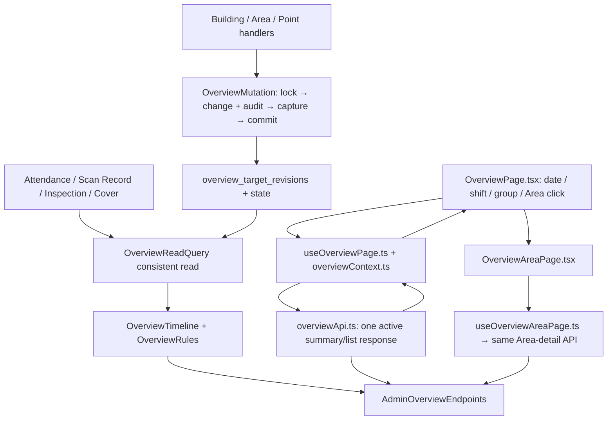

# Combined Overview Dashboard Implementation Plan

> **For agentic workers:** REQUIRED SUB-SKILL: Use sp-subagent-driven-development (recommended) or sp-executing-plans to implement this plan task-by-task. Steps use checkbox (`- [ ]`) syntax for tracking.

**Goal:** เพิ่มหน้าภาพรวมสำหรับ Admin ตาม Mockup ที่ยืนยัน พร้อมยอดพื้นที่ที่ถูกต้อง รายชื่อที่ตรงกับยอด และการเปิดรายละเอียดเฉพาะ Area ในวัน/กะเดิม

**Architecture:** เก็บภาพ structural target เริ่มต้นและ revisions ใน transaction เดียวกับการแก้ตั้งค่า ใช้ pure temporal projection รวมกับ operational facts ใน consistent read เพื่อสร้าง summary/list/detail จาก predicates ชุดเดียว React เก็บบริบทใน URL ใช้ RTK Query และแยก hooks ออกจาก UI; เส้นทางเดิมเพิ่มโหมด overview โดยแยกจากการอ่านปกติ

**Tech Stack:** .NET 10, ASP.NET Core minimal APIs, EF Core 10.0.12/Oracle MySQL provider เดิม, MySQL, xUnit/SQLite และ isolated MySQL tests; React 19, TypeScript 6, React Router 7, Redux Toolkit/RTK Query, Tailwind 4, lucide-react, Vitest/Testing Library, Playwright เดิม

**Spec:** [2026-11-16-combined-overview-dashboard-design.md](../specs/2026-11-16-combined-overview-dashboard-design.md) — อ่านพร้อม ADR facility-0114–0130 และ `CONTEXT.md`

## Global Constraints

ข้อความต่อไปนี้คัดจาก spec และมีผลกับทุก task:

- “ทุก endpoint ใช้ Admin-only authorization และตรวจบัญชี active เช่นเดียวกับ endpoints Admin เดิม ไม่ส่ง QR token, hash, รหัสผ่าน หรือ raw GPS ใน overview DTO”
- “ตัวเลขทุกกลุ่มนับ **Area ID ไม่ซ้ำภายในกลุ่ม** ไม่ใช่จำนวนคน จำนวนการสแกน หรือจำนวนครั้งที่ตรวจ”
- “`null` หมายถึงคำนวณไม่ได้; `0` ใช้เฉพาะเมื่อข้อมูลครบและไม่มีรายการจริง”
- “ใช้ Enterprise Light, shared controls, Tailwind tokens และระบบตัวอักษร/ขนาดเป้ากดเดิม ไม่เปลี่ยน home redirect หรือชื่อ route เดิมโดยอัตโนมัติ”
- “รายชื่ออยู่ใต้ภาพรวมตามแบบที่ยืนยัน แสดงรหัส/ชื่อ Area ตึก เหตุผลหรือความคืบหน้ารายจุด และปุ่มดูพื้นที่ มี paging เริ่มต้น 5 Area ต่อหน้าตาม Mockup ไม่เพิ่มตัวเลือกขนาดหน้าในรุ่นนี้ และไม่เปลี่ยนยอดกลุ่มตาม page”
- “ตรวจ 1280 px และ 375 px ตามมาตรฐานโครงการ ตาราง scroll ภายในเมื่อจำเป็น ไม่ทำให้ทั้งหน้าเลื่อนแนวนอน”
- “กะที่ปิดรับแล้วอ่านใหม่เมื่อเปิด/เปลี่ยนตัวกรอง และเมื่อมีการแก้ลงเวลาที่กระทบ slot นั้น”
- “การอนุมัติเอกสารหรือแผนไม่ยกเลิกคำสั่ง “อย่าเพิ่ง implement”; ต้องมีคำสั่งให้เริ่มพัฒนาแยกต่างหาก”

**สถานะ 16 พ.ย. 2026:** เจ้าของเรียก `sp-writing-plans` หลังได้รับ spec จึงเดินหน้าขั้นแผนนี้ การพัฒนายังพักอยู่ ทุก checkbox ยังไม่เริ่ม; โค้ด/คำสั่งด้านล่างเป็นคำแนะนำสำหรับการพัฒนาภายหลัง ไม่ใช่สิ่งที่รันแล้ว

## ทบทวนสมมติฐานกับ ADR 0131–0193 (2026-11-17)

ผลทบทวนเต็มอยู่ที่ [2026-11-17 overview plan assumption delta](../reviews/2026-11-17-overview-plan-assumption-delta.md) ข้อผูกพันเพิ่มเติมกับแผนนี้ (ไม่เปลี่ยนตัวเลข/กติกา 0114–0130 และไม่ใช่ product decision ใหม่):

- **การลงเวลา:** ก่อนมี Area Transfer, entry นับจาก `ShiftAttendance.AreaId` ของ `ShiftIn` ซึ่งยังถูกต้องทั้งกะสี่และหกปุ่ม; เมื่อ 0203/0204 ขึ้นใช้ ต้องรวมหลักฐานยืนยันถึงพื้นที่ปลายทางโดยไม่สร้าง ShiftIn ซ้ำ (ดู D7); ห้าม hard-code ว่าทุกกะมีสี่ปุ่ม. ถ้าหกปุ่ม (0146/0164/0168/0169) หรือการลา (0156–0158) ขึ้นก่อนงานนี้ Task 7–9 ต้อง rebase ตาม D2–D3 ในเอกสารทบทวน
- **วันหยุด/ลา:** ไม่ปิด Area ไม่ลดรอบ และไม่เปลี่ยนสามหมวดหรือตัวหาร (0136/0158); “รอจัดคนทำแทน” ไม่นับเป็น covered; `ShiftIn` ที่ป้ายของ Area ที่คนแทนได้รับมอบหมายนับเป็น entry ของ Area นั้น (0155)
- **ค่าเริ่มต้น:** ทุกตึก + กะตามนาฬิกา และวันที่ของกะดึกคือ shift start date (0183/0184); ภาพรวมไม่รับกลไกจำสัปดาห์/ตัวกรองของหน้า schedule (0180–0182/0185) — คืนบริบทจาก URL ตาม Task 7
- **ความสด:** read หลังต่อกลับที่ล้มเหลวต้องคงสถานะ “อาจไม่เป็นปัจจุบัน” จนอ่านสำเร็จ (0172)
- **เมนู:** ภาพรวม → สถานะจุด → การเข้างาน → ตารางงาน → รายการที่ขึ้นเตือน → สรุปการตรวจ → ส่งออก Excel (0178)

**ข้อผูกพันเพิ่มหลังยืนยัน Area Transfer (0203–0204):** หาก transfer ขึ้นก่อนหรือพร้อมภาพรวม Task 5/6/7/9/10/11 ต้องปรับ projection/DTO/detail/live events/acceptance เพื่อแยกคำสั่งย้ายกับหลักฐานถึงปลายทางจริง คง initial ShiftIn และประวัติ A ไม่สร้าง ShiftIn ใหม่ที่ B ไม่รีเซ็ตพัก ไม่แสดงว่าถึง B ก่อนยืนยัน และไม่แสดงผู้ย้ายรับผิดชอบปัจจุบันสองพื้นที่พร้อมกัน ต้องปิดสัญญาการรวมหลักฐาน/สถานะ current coverage ใน spec ก่อนทำส่วนนี้ ห้ามถือว่าสูตร ShiftIn-only ในตัวอย่าง task ด้านล่างครอบ transfer แล้ว ไม่เพิ่มหมวด/แก้ตัวหารเอง ถ้าภาพรวมขึ้นก่อน transfer ใช้ฐานเดิมได้ แต่ต้องทำ integration ก่อนเปิด transfer จริง ดู [D7](../reviews/2026-11-17-overview-plan-assumption-delta.md) กรณี 0200–0202 ต้องแสดงเวลาออกจริง เหตุพักที่ไม่เกี่ยวข้องเพราะลา และ conflict วันลาแยกจากข้อเท็จจริงการเข้างาน โดยไม่แต่งเวลา/เพิ่มสถานะ pending ที่บล็อกงานเอง

---

## Read first, scope and working agreement

Repository root: `/Users/macbookair/Projects/Janitorial-Management-Dashboard`. Paths ในรายการ Files เป็น paths จาก root นี้ คำสั่ง backend รันจาก root; คำสั่ง frontend ที่ขึ้นต้น `npm --prefix frontend` รันจาก root เช่นกัน

อ่าน `docs/handoff.md` ก่อนเริ่ม execution ตรวจ diff แล้วสร้าง worktree/branch `codex/combined-overview-dashboard` ตาม workflow ที่เลือก ฐานที่ตรวจล่าสุด (17 พ.ย. 2026) คือ `master` `55932c6` สะอาด ไม่มีไฟล์ค้าง: spec/ADR 0114–0193 ถูก merge ผ่าน PR #154 แล้ว และ `.postman/`/`postman/` ถูก cleanup ออกไป อย่า reset/stash หรือย้ายไฟล์โดยพลการ และไม่ใช้ `git add .`

เป็นแผนเดียวเพราะ storage history → projection → drill-through เป็น dependency ของ feature เดียวกัน ไม่มี subsystem อิสระที่ใช้งานแทน feature นี้ได้ Task boundaries เป็นหน่วยที่รัน tests และ review ได้แยกกัน ต้องทำตาม dependency: 1 → 2 → 3 → 4 → 5 → 6 → 7 → 8 → 9 → 10 → 11

ใช้ [Mockup source](/Users/macbookair/.codex/visualizations/2026/11/16/01a1e200-ca3c-7c62-9a26-60b1ec6ac403/facility-overview.html) และ [preview](/Users/macbookair/.codex/visualizations/2026/11/16/01a1e200-ca3c-7c62-9a26-60b1ec6ac403/facility-overview-preview.html) เป็น visual reference ไม่ copy synthetic counts/date bounds เข้า production ไม่เพิ่ม chart/UI/date library ไม่ใช้ MUI/DataGrid: ข้อกำหนด Tailwind/shared Table ของโครงการและ spec มีผลเหนือ stack example ใน skill `react-structure` แต่ใช้โครงแยก hook/UI/type และ flowchart ของ skill นั้น

Commit examples ใช้ `(#1)` จาก map `facility-poc` ใน AGENTS.md; ไม่อ้างว่าได้สร้าง feature ticket ใหม่ ก่อน commit จริงอ่าน `ticket-trace` และตรวจ convention อีกครั้ง ทุก commit รวม handoff ของ task นั้น เฉพาะหลังได้รับอนุญาต execution แล้ว ไม่มี push/PR/deploy ในแผนนี้

## File structure and ownership

| Boundary | Files created | Existing files changed | Responsibility |
|---|---|---|---|
| Pure temporal model | `Application/Overview/OverviewTargets.cs`, `OverviewFacts.cs`, `OverviewTime.cs`, `OverviewTimeline.cs`, `OverviewRules.cs`, `OverviewAvailability.cs`, `OverviewProjection.cs` | none of the existing round/export rules | Types, original receiving policy, temporal targets, membership and nullable counts |
| Persistence | `Domain/Entities/OverviewTargetRevision.cs`, `OverviewTargetState.cs`; `Infrastructure/Persistence/Overview/OverviewTargetModel.cs`, `OverviewTargetRecorder.cs`, `OverviewMutation.cs`, `OverviewHistoryBootstrap.cs`, `OverviewReadQuery.cs`, `OverviewFactLoader.cs`; generated migration | `AppDbContext.cs`, `ScanRecord.cs`, setup endpoints, `Program.cs`, retention runner | Atomic complete images, stable origin, consistent batched reads |
| API | `Api/Endpoints/AdminOverviewEndpoints.cs`, `OverviewNotifications.cs`; `Api/DTOs/OverviewDtos.cs` | endpoint registration, setup post-commit notifications | Admin-only reads, precise query validation and explicit null DTOs |
| Shared frontend read boundary | `frontend/src/shared/overview/types.ts`, `overviewContext.ts`, `overviewApi.ts`, `useOverviewSource.ts`, `useOverviewRefresh.ts` | `baseApi.ts`, `scanHub.ts`, mutation tag invalidations | Shared across pages without breaking ESLint page-to-page import rules |
| Overview page | `frontend/src/pages/overview/index.ts`; `OverviewPage/{OverviewPage.tsx,useOverviewPage.ts,type.ts}`, `CoveragePanel/{CoveragePanel.tsx,type.ts}`, `FollowUpGroups/{FollowUpGroups.tsx,type.ts}`, `BuildingComparison/{BuildingComparison.tsx,type.ts}`, `RoundHistory/{RoundHistory.tsx,type.ts}`, `AreaResults/{AreaResults.tsx,type.ts}` | `router.tsx`, `AdminNav.tsx` | Accepted layout and one active summary/list response |
| Scoped destination | `frontend/src/shared/overview/OverviewAreaPage/{OverviewAreaPage.tsx,useOverviewAreaPage.ts,type.ts}`, `AreaAttendance/{AreaAttendance.tsx,type.ts}`, `AreaWork/{AreaWork.tsx,type.ts}` | existing Dashboard/Attendance entry components; extract their existing logic to adjacent hooks | Strict source=overview dispatch; exact Area/date/shift; legacy branch untouched semantically |
| Tests/docs | exact test files listed per task | code map, retention guide, handover, handoff | Trace requirements, isolate DB writes, record actual results |

Backend shorthand in the table is only for readability: `Application` = `backend/src/JanitorialManagementDashboard.Application`; `Domain` = `backend/src/JanitorialManagementDashboard.Domain`; `Infrastructure` = `backend/src/JanitorialManagementDashboard.Infrastructure`; `Api` = `backend/src/JanitorialManagementDashboard.Api`. Each task lists exact paths. Do not create interfaces/classes merely to match layer names; the pure model and one read service are sufficient.



Flowchart is reviewable before implementation; this planning request does not start the changes shown.

## Contract choices locked by this plan

- Group keys are lower camel case: `entered`, `covered`, `unassigned`, `notEntered`, `submitted`, `incomplete`, `inspected`, `pendingInspection`, `noSubmission`, `rework`, `issue`, `overdue`, `upcoming`, `noRounds`, `missedCleaning`, `missedInspection`. Chart slices only use disjoint staffing keys; follow-up groups may overlap.
- Query API uses `shiftDate`, `shift=Day|Night`, `buildingId`; UI URL uses `date`, `shift`, `building`. Overview URL also keeps `group` and `page` (default `notEntered`, 1). Destination adds `source=overview`, `areaId`, `view=cleaning|inspection|attendance`, optional `roundKey`, and `page`. No external return URL.
- A revision stores all structural rows, including inactive rows and CreatedAt values, in ID order. Effective timestamp is UTC with MySQL microsecond precision. `(EffectiveAt, Id)` orders simultaneous revisions; JSON hashing ignores no structural field. No personnel or complete sign entities are serialized; the non-secret point sign code is a structural label.
- An obligation identifies a window origin and its copied start/end in one slot. A roundKey also carries its activation revision ID, so edits to the same window and later restoration are distinguishable. A rename does not create a fresh obligation. Only membership/window/eligibility changes end or create obligations. Current labels use evaluation target; finalized outcomes retain labels/ownership for the interval that ended. An Area move does not finalize a still-current round or create a second cleaning task: keep its origin/key and counted submissions under the effective new ownership. Already-finalized rounds retain their original ownership/labels; do not relocate those outcomes to the new building.
- Exact reads are scoped by stable IDs. A selected Area that stops matching its group is still returned as that Area with `matchesGroup=false`. An Area outside the requested building/current-or-historical round context returns 404, never all Areas.
- Current-slot Admin actions remain available through existing correction/cover components only after a fresh current board row validates user/slot/Area. Closed/old-round/receiving-only destinations are read views; no retrospective inspection or cover action.

## Task 1: Define temporal targets and receiving-window evaluation

**Files:**
- Create: `backend/src/JanitorialManagementDashboard.Application/Overview/OverviewTargets.cs`
- Create: `backend/src/JanitorialManagementDashboard.Application/Overview/OverviewTime.cs`
- Create: `backend/src/JanitorialManagementDashboard.Application/Overview/OverviewTimeline.cs`
- Create: `backend/tests/JanitorialManagementDashboard.UnitTests/OverviewTimeTests.cs`
- Create: `backend/tests/JanitorialManagementDashboard.UnitTests/OverviewTimelineTests.cs`

**Interfaces:**
- Consumes existing `ShiftSlot`, `ShiftCalendar.StartUtc/EndUtc/ToUtc`, `Shift`, `ShiftPattern`.
- Produces the records below, `OverviewTime.Evaluate(ShiftSlot, DateTime, IReadOnlyList<TargetRevision>) : OverviewMoment`, and `OverviewTimeline.Build(ShiftSlot, OverviewMoment, IReadOnlyList<TargetRevision>) : TargetTimeline`.
- Produces `OverviewTimeline.RoundKey(ShiftSlot slot, RoundObligation round) : string` and `FindRound(TargetTimeline timeline, string key) : RoundObligation?`. Keys are opaque values emitted by server; clients do not construct them.

- [ ] **Step 1: Add time boundary tests, run red.**

```csharp
using JanitorialManagementDashboard.Application.Overview;
using JanitorialManagementDashboard.Application.Shifts;
using JanitorialManagementDashboard.Domain.Enums;

namespace JanitorialManagementDashboard.UnitTests;
public class OverviewTimeTests
{
    private static TargetRevision Policy(DateTime at, int closes, long id = 1) =>
        new(id, at, new(1, new(60, closes), [], [], [], []));

    [Fact]
    public void Day_is_still_receiving_at_inclusive_20_00_boundary()
    {
        var slot = new ShiftSlot(new(2026, 11, 16), Shift.Day);
        var end = ShiftCalendar.EndUtc(slot);
        var history = new[] { Policy(ShiftCalendar.StartUtc(slot).AddDays(-1), 60) };
        Assert.Equal("receiving", OverviewTime.Evaluate(slot, end.AddMinutes(60), history).Phase);
        var closed = OverviewTime.Evaluate(slot, end.AddMinutes(60).AddTicks(10), history);
        Assert.Equal("closed", closed.Phase);
        Assert.Equal(end.AddMinutes(60), closed.EvaluationUtc);
    }

    [Fact]
    public void New_policy_does_not_reopen_a_closed_slot()
    {
        var slot = new ShiftSlot(new(2026, 11, 16), Shift.Day);
        var end = ShiftCalendar.EndUtc(slot);
        var history = new[] {
            Policy(end.AddDays(-1), 60), Policy(end.AddMinutes(90), 180, 2)
        };
        var result = OverviewTime.Evaluate(slot, end.AddHours(3), history);
        Assert.Equal(end.AddHours(1), result.CloseUtc);
        Assert.Equal("closed", result.Phase);
    }
}
```

Run: `dotnet test backend/tests/JanitorialManagementDashboard.UnitTests --filter 'FullyQualifiedName~OverviewTimeTests'`. Expect compile failure for new types, not a connection/configuration failure.

- [ ] **Step 2: Define structural types; no entity navigation/secret fields.**

Place in `Application.Overview`:

```csharp
public sealed record ReceivingPolicy(int OpensMinutesBeforeShift, int ClosesMinutesAfterShift);
public sealed record TargetBuilding(int Id, string Code, string Name, bool IsActive, DateTime CreatedAt);
public sealed record TargetArea(int Id, int BuildingId, string Code, string Name,
    bool IsActive, ShiftPattern ShiftPattern, DateTime CreatedAt);
public sealed record TargetPoint(int Id, int AreaId, string? Code, string Name, int SortOrder,
    bool IsActive, DateTime CreatedAt);
public sealed record TargetWindow(int Id, int PointId, Shift Shift,
    TimeOnly Start, TimeOnly End, DateTime CreatedAt);
public sealed record TargetImage(int SchemaVersion, ReceivingPolicy Policy,
    IReadOnlyList<TargetBuilding> Buildings, IReadOnlyList<TargetArea> Areas,
    IReadOnlyList<TargetPoint> Points, IReadOnlyList<TargetWindow> Windows,
    DateTime? CaptureStartedAtUtc = null, DateTime? CoverageGapFromUtc = null);
public sealed record TargetRevision(long Id, DateTime EffectiveAt, TargetImage Image);
public sealed record OverviewMoment(string Phase, DateTime EvaluationUtc,
    DateTime? CloseUtc, bool PolicyComplete);
public sealed record RoundObligation(int PointId, int AreaId, int BuildingId,
    string AreaCode, string AreaName, string BuildingCode, string BuildingName,
    int OriginId, TimeOnly Start, TimeOnly End, DateTime ActiveFromUtc,
    DateTime? FinalizedAtUtc, long ActivationRevisionId, string? FinalizedReason);
public sealed record TargetTimeline(TargetImage? Current, long? CurrentRevisionId,
    IReadOnlyList<RoundObligation> Rounds, bool CurrentComplete, bool HistoryComplete);
```

- [ ] **Step 3: Implement receiving policy sweep; test future/night/unknown cases.**

Use successive policy intervals covering the selected shift. First possible close is `EndUtc + closes`; if policy changes before that instant, recalculate in the new interval. If a new shorter policy is already past its own deadline while the slot was still open, closure is its effective instant. A later revision cannot reopen an interval already closed. At equality with the next policy's effective time apply the next policy before deciding closure. If coverage starts after shift end, `PolicyComplete=false`, `CloseUtc=null` for history; do not assume current settings governed the earlier end.

The loop's decisive comparison is:

```csharp
var candidate = ShiftCalendar.EndUtc(slot).AddMinutes(policy.ClosesMinutesAfterShift);
if (candidate < intervalStart) candidate = intervalStart;
if (nextPolicyAt is null || candidate < nextPolicyAt.Value)
    return candidate;
```

`Evaluate` returns `notStarted` before `StartUtc`, `running` through scheduled end minus an instant, `receiving` from scheduled end through inclusive close, `closed` only after it. For a closed slot set evaluation to close; otherwise use now. Default slot remains `ShiftCalendar.SlotAt(now)`, including Night date before 07:00. Add explicit tests for 03:00 → previous date Night, upcoming same-day shift, increase/decrease policy during receiving, changes exactly at close, baseline during a running shift, missing policy at old shift end, and identical timestamps ordered by revision ID. Do not modify `AttendanceCalendar` or `InspectionEndpoints`.

- [ ] **Step 4: Implement target timeline using explicit interval boundaries.**

Start with this deterministic boundary set, then add each eligible window's activation instant before sweeping:

```csharp
var start = ShiftCalendar.StartUtc(slot);
var boundaries = revisions.Where(r => r.EffectiveAt > start && r.EffectiveAt <= moment.EvaluationUtc)
    .Select(r => r.EffectiveAt).Append(start).Append(moment.EvaluationUtc)
    .Distinct().Order().ToList();
var ordered = revisions.OrderBy(r => r.EffectiveAt).ThenBy(r => r.Id).ToArray();
foreach (var boundary in boundaries)
{
    var effective = ordered.LastOrDefault(r => r.EffectiveAt <= boundary);
    if (effective is null) continue;
    foreach (var point in effective.Image.Points.Where(p => p.IsActive && p.CreatedAt <= boundary))
    {
        var current = effective.Image.Windows.Where(w => w.PointId == point.Id && w.Shift == slot.Shift
            && w.CreatedAt <= boundary && ShiftCalendar.ToUtc(slot, w.Start) <= boundary)
            .OrderByDescending(w => ShiftCalendar.ToUtc(slot, w.Start)).ThenByDescending(w => w.Id)
            .FirstOrDefault();
        // current is the candidate; Area/Building eligibility and the prior interval decide its obligation.
    }
}
```

Complete boundaries from shift start, evaluation, revision instants in between, and `max(window.CreatedAt, point.CreatedAt, area.CreatedAt, roundStartUtc)` when the window exists in that revision. At each interval start select the last effective image, active Building/Area/Point, appropriate Day/Night pattern, and each point's latest started window; future windows stay upcoming. At a revision change do not backdate a newly added window into an earlier interval. Close obligations on supersession, removal/deactivation or receiving closure with reason `superseded`, `configurationChanged`, or `slotClosed`. Merely passing window EndUtc never finalizes the current round.

Keep the last interval's active work for current completion even after slot closure; the same round also appears in finalized history. A baseline starting mid-shift can give complete current targets while `HistoryComplete=false`. Preserve labels/ownership of already-finalized obligations; an ownership-only move updates the still-current obligation without finalizing or restarting it; do not discard removed origins or move their old building totals to the new building. Encode round keys as `date:shift:pointId:originId:activationRevisionId:HHmm-HHmm`, parse with exact formats and match a built obligation rather than trusting user-supplied IDs.

Add `OverviewTimelineTests` with actual two-revision fixtures built from the records above: afternoon start resets current work while morning remains; removed Night windows through DayOnly stay in old history; delete/recreate at identical times uses different origins; edit same window and restore its old times uses different activation keys; rename changes labels without doubling obligations; Area move carries submitted round facts without creating extra cleaning work. Verify a shift with no overview reads still reconstructs all these intervals.

- [ ] **Step 5: Run both pure test classes, inspect diff and commit.**

Run: `dotnet test backend/tests/JanitorialManagementDashboard.UnitTests --filter 'FullyQualifiedName~OverviewTimeTests|FullyQualifiedName~OverviewTimelineTests'`. Expect all cases green. Append actual result/remaining work to `docs/handoff.md`.

```bash
git add backend/src/JanitorialManagementDashboard.Application/Overview/OverviewTargets.cs backend/src/JanitorialManagementDashboard.Application/Overview/OverviewTime.cs backend/src/JanitorialManagementDashboard.Application/Overview/OverviewTimeline.cs backend/tests/JanitorialManagementDashboard.UnitTests/OverviewTimeTests.cs backend/tests/JanitorialManagementDashboard.UnitTests/OverviewTimelineTests.cs docs/handoff.md
git commit -m "feat: model overview target timelines and receiving windows (#1)"
```

## Task 2: Persist revisions and server-stamped round origin

**Files:**
- Create: `backend/src/JanitorialManagementDashboard.Domain/Entities/OverviewTargetRevision.cs`
- Create: `backend/src/JanitorialManagementDashboard.Domain/Entities/OverviewTargetState.cs`
- Create: `backend/src/JanitorialManagementDashboard.Infrastructure/Persistence/Overview/OverviewTargetModel.cs`
- Modify: `backend/src/JanitorialManagementDashboard.Infrastructure/Persistence/AppDbContext.cs` (`DbSet` declarations and `OnModelCreating`)
- Modify: `backend/src/JanitorialManagementDashboard.Domain/Entities/ScanRecord.cs` (next to `RoundWindowId`)
- Modify: `backend/src/JanitorialManagementDashboard.Api/Endpoints/ScanRecordEndpoints.cs` (`new ScanRecord`)
- Generate: migration named `OverviewTargetHistory` and its Designer in `backend/src/JanitorialManagementDashboard.Infrastructure/Migrations/`; modify `AppDbContextModelSnapshot.cs`. EF generates the timestamp prefix at execution time; `OverviewTargetHistory` is the exact migration name. These two generated filenames are the only paths not knowable until scaffolding; stage the exact pair printed then, never a wildcard over unrelated migrations.
- Create: `backend/tests/JanitorialManagementDashboard.ApiTests/Persistence/OverviewTargetModelTests.cs`
- Modify: `backend/tests/JanitorialManagementDashboard.ApiTests/Points/ScanRecordEndpointTests.cs`
- Modify: `backend/tests/JanitorialManagementDashboard.ApiTests/Infrastructure/TestData.cs` (new synthetic Scan Records stamp origin)
- Modify: `backend/tools/JanitorialManagementDashboard.E2ESeed/Program.cs` (new synthetic Scan Records stamp origin)

**Interfaces:**
- Consumes Task 1 `TargetImage` serialized as a JSON string.
- Produces `AppDbContext.OverviewTargetRevisions : DbSet<OverviewTargetRevision>` and `.OverviewTargetStates : DbSet<OverviewTargetState>`; `ScanRecord.RoundOriginId : int?`.

- [ ] **Step 1: Add model test and red run.**

```csharp
[Fact]
public async Task Origin_is_not_a_foreign_key_and_survives_round_removal()
{
    using var factory = new JanitorialApiFactory();
    await factory.WithDbAsync(async db =>
    {
        var scanType = db.Model.FindEntityType(typeof(ScanRecord))!;
        Assert.DoesNotContain(scanType.GetForeignKeys(), fk =>
            fk.Properties.Any(p => p.Name == nameof(ScanRecord.RoundOriginId)));
        var sign = await db.Signs.SingleAsync(s => s.QrToken == "token-restroom-m1");
        var window = await db.PointRoundWindows.FirstAsync(w => w.ServicePointId == sign.ServicePointId);
        var cleaner = await db.Users.SingleAsync(u => u.EmployeeId == "1000001");
        var scan = new ScanRecord { ServicePointId = sign.ServicePointId!.Value,
            SignId = sign.Id, UserId = cleaner.Id, ShiftDate = new(2026, 11, 16),
            Shift = window.Shift, RoundWindowId = window.Id, RoundOriginId = window.Id,
            RoundStart = window.StartTime, RoundEnd = window.EndTime,
            Placement = Placement.OnTime, SubmittedAt = new(2026, 11, 16, 2, 0, 0, DateTimeKind.Utc) };
        db.ScanRecords.Add(scan);
        await db.SaveChangesAsync();
        var origin = window.Id;
        db.PointRoundWindows.Remove(window);
        await db.SaveChangesAsync();
        await db.Entry(scan).ReloadAsync();
        Assert.Null(scan.RoundWindowId);
        Assert.Equal(origin, scan.RoundOriginId);
    });
}
```

Use existing entity/EF imports. Run: `dotnet test backend/tests/JanitorialManagementDashboard.ApiTests --filter 'FullyQualifiedName~OverviewTargetModelTests'`; expect missing property failure.

- [ ] **Step 2: Add entities and model configuration.**

```csharp
public class OverviewTargetRevision
{
    public long Id { get; set; }
    public DateTime EffectiveAt { get; set; }
    public int SchemaVersion { get; set; } = 1;
    public string PayloadHash { get; set; } = string.Empty;
    public string Payload { get; set; } = string.Empty;
}
public class OverviewTargetState
{
    public int Id { get; set; } = 1;
    public long? LatestRevisionId { get; set; }
    public OverviewTargetRevision? LatestRevision { get; set; }
}
```

Entities use `Domain.Entities`. In `OverviewTargetModel.Configure(ModelBuilder modelBuilder)`, map tables `overview_target_revisions`, `overview_target_state`, JSON Payload, SHA256 hash length 64, `(EffectiveAt, Id)` index; state PK Id and nullable revision FK Restrict. Seed only the singleton state row `{ Id=1 }` with `HasData`, not a target image. Map EffectiveAt to `datetime(6)`. Invoke configure before existing `UseSnakeCaseColumns()`. Add nullable scalar RoundOriginId without navigation or relationship. Preserve existing nullable RoundWindowId FK SetNull.

- [ ] **Step 3: Generate migration and include evidence-only backfill.**

```bash
dotnet tool restore
dotnet ef migrations add OverviewTargetHistory --project backend/src/JanitorialManagementDashboard.Infrastructure --startup-project backend/src/JanitorialManagementDashboard.Api --output-dir Migrations
```

The command scaffolds files; do not start the API or apply migration to the owner's database. Add this SQL after adding nullable `round_origin_id` and before completing Up:

```csharp
migrationBuilder.Sql("UPDATE scan_records SET round_origin_id = round_window_id WHERE round_window_id IS NOT NULL AND placement <> 'OFF_ROUND'");
```

Down drops only the two new tables and new column in FK-safe order. Check the actual stored Placement converter value against `UpperSnakeEnumConverter<Placement>`; it is `OFF_ROUND`, not a new enum. Unlinked old records stay null. Do not rewrite times/placement or infer from audit text.

- [ ] **Step 4: Stamp server-created placed scans and fixtures.**

```csharp
RoundWindowId = placed.Round?.Id,
RoundOriginId = placed.Round?.Id,
RoundStart = placed.Round?.Start,
RoundEnd = placed.Round?.End,
```

In `TestData.AddScanAsync` use `round?.Id`; E2E generated round scan uses `window.Id`. Do not add a request field, non-null constraint, or global origin validator. Extend existing endpoint test to compare persisted RoundOriginId with placed window; OffRound stays null and old request JSON is unchanged.

- [ ] **Step 5: Run model/scan tests and commit.**

Run: `dotnet test backend/tests/JanitorialManagementDashboard.ApiTests --filter 'FullyQualifiedName~OverviewTargetModelTests|FullyQualifiedName~ScanRecordEndpointTests|FullyQualifiedName~SchemaRuleTests'`. Later Task 11 verifies real migration upgrade/backfill on MySQL; SQLite EnsureCreated is not migration evidence. Stage only named files and exact generated migration/Designer/snapshot paths shown by `git status --short`, plus handoff.

Commit: `feat: persist overview history and stable round origins (#1)`.

## Task 3: Capture complete target images atomically with supported setup writes

**Files:**
- Create: `backend/src/JanitorialManagementDashboard.Infrastructure/Persistence/Overview/OverviewTargetRecorder.cs`
- Create: `backend/src/JanitorialManagementDashboard.Infrastructure/Persistence/Overview/OverviewMutation.cs`
- Create: `backend/src/JanitorialManagementDashboard.Infrastructure/Persistence/Overview/OverviewHistoryBootstrap.cs`
- Modify: `backend/src/JanitorialManagementDashboard.Api/Endpoints/AdminBuildingEndpoints.cs` (Create/Rename/SetActive)
- Modify: `backend/src/JanitorialManagementDashboard.Api/Endpoints/AdminAreaEndpoints.cs` (Create/Update/SetActive, including DayOnly window removal)
- Modify: `backend/src/JanitorialManagementDashboard.Api/Endpoints/AdminPointEndpoints.cs` (Create/Update/SetActive, including all window replacements)
- Modify: `backend/src/JanitorialManagementDashboard.Api/Program.cs` (DI and after migrations/seed/FirstAdmin, before endpoint serving)
- Modify: `backend/tests/JanitorialManagementDashboard.ApiTests/Infrastructure/JanitorialApiFactory.cs` (create singleton row for SQLite EnsureCreated via model seed; no implicit fabricated historical baseline)
- Create: `backend/tests/JanitorialManagementDashboard.ApiTests/Infrastructure/OverviewTestData.cs`
- Create: `backend/tests/JanitorialManagementDashboard.ApiTests/Admin/OverviewCaptureTests.cs`

**Interfaces:**
- `OverviewTargetRecorder(AppDbContext db, AttendanceSettings settings, TimeProvider clock)` exposes `ReadImageAsync(CancellationToken) : Task<TargetImage>` and `CaptureAsync(CancellationToken ct, DateTime? coverageGapFromUtc = null) : Task<long>`; caller owns transaction+state lock. Capture reads full final configuration, writes only when canonical hash differs; returns current revision ID on no-op.
- `OverviewMutation.LockStateAsync(AppDbContext db, CancellationToken ct) : Task<OverviewTargetState>` is a shared database row-lock primitive called only within an already-open transaction; recorder/bootstrap/pruning reuse it without causing extra capture.
- `OverviewMutation(AppDbContext db, OverviewTargetRecorder recorder)` exposes `BeginAsync(CancellationToken) : Task<OverviewMutationLease>`. Lease implements `IAsyncDisposable`, exposes `CommitAsync(CancellationToken ct, DateTime? coverageGapFromUtc = null) : Task<long>`; dispose before commit rolls back and clears tracked mutations. No nested transactions in callers.
- `OverviewHistoryBootstrap.EnsureAsync(AppDbContext db, AttendanceSettings settings, TimeProvider clock, CancellationToken ct) : Task<long>` starts lease and captures baseline/policy change; used after startup initialization and explicitly by new test fixtures.
- `OverviewTestData.StartHistoryAsync(JanitorialApiFactory factory, DateTimeOffset at) : Task<long>` sets factory clock, calls bootstrap via a fresh scope, and returns revision. New tests must call it after fixture configuration, at/before the first reported shift; it never invents an earlier timestamp than requested.

- [ ] **Step 1: Add rename/no-op endpoint tests and run red.**

```csharp
[Fact]
public async Task Setup_rename_and_revision_commit_together_without_duplicate_noop()
{
    using var factory = new JanitorialApiFactory();
    var (admin, _, _) = await AuthApi.LoggedInAdminAsync(factory);
    await OverviewTestData.StartHistoryAsync(factory, ThaiClock.At(8, 6, 0));
    var id = await AdminSetupApi.BuildingIdAsync(factory);
    factory.Clock.SetUtcNow(ThaiClock.At(8, 9, 0));
    Assert.Equal(HttpStatusCode.OK, (await admin.PutAsJsonAsync(
        $"/api/admin/buildings/{id}", new { name = "อาคารใหม่" })).StatusCode);
    await admin.PutAsJsonAsync($"/api/admin/buildings/{id}", new { name = "อาคารใหม่" });
    await factory.WithDbAsync(async db =>
    {
        var revisions = await db.OverviewTargetRevisions.OrderBy(r => r.Id).ToListAsync();
        Assert.Equal(2, revisions.Count);
        Assert.Contains("อาคารใหม่", System.Text.Json.JsonSerializer.Deserialize<TargetImage>(revisions[1].Payload)!
            .Buildings.Select(b => b.Name));
        Assert.Equal(revisions[1].Id, (await db.OverviewTargetStates.SingleAsync()).LatestRevisionId);
    });
}
```

Use the existing `TestTimeProvider.SetUtcNow(DateTimeOffset)`; login before moving the business clock because JWT validation uses real time. Run `dotnet test backend/tests/JanitorialManagementDashboard.ApiTests --filter 'FullyQualifiedName~OverviewCaptureTests'`; expect missing new service/helper failure.

- [ ] **Step 2: Implement singleton serialization lease.**

For MySQL begin ReadCommitted transaction and lock row via tracked `FromSqlRaw("SELECT * FROM overview_target_state WHERE id = 1 FOR UPDATE")`. Test provider identity through `db.Database.ProviderName == "Microsoft.EntityFrameworkCore.Sqlite"` without adding a SQLite dependency to Infrastructure. For SQLite test transaction use Serializable and normal tracked `SingleAsync`; SQLite does not prove MySQL locking. Acquire lock before loading any structural row to mutate, including ReadForm validation and active-point/Area conflict checks. The authenticated active-user check may precede the lock; setup reads may not. Use no synchronous IO or process-local semaphore as database serialization.

```csharp
await using var change = await mutation.BeginAsync(ct);
// The existing handler reads and changes its configuration here, within this lease.
await db.SaveChangesAsync(ct);
await change.CommitAsync(ct);
```

`CommitAsync` calls recorder after all original SaveChanges/audit saves, then commits once. On exception dispose/rollback before probing for unique-code conflict; do not query using a failed transaction. Keep original error/status behavior for existing validation and uniqueness conflicts. Snapshot failure is a failed save with a retry message, not a successful response without history. If commit succeeds but a later read/push fails, never roll back a committed setup change or return a false duplicate-code error.

- [ ] **Step 3: Implement deterministic structural capture and startup bootstrap.**

```csharp
var json = System.Text.Json.JsonSerializer.Serialize(image);
var hash = Convert.ToHexString(System.Security.Cryptography.SHA256.HashData(
    System.Text.Encoding.UTF8.GetBytes(json)));
```

`ReadImageAsync` uses four AsNoTracking ordered queries for Buildings, Areas, ServicePoints and PointRoundWindows, each projection constructing Task 1 records. Policy is `new(settings.OpensMinutesBeforeShift, settings.ClosesMinutesAfterShift)`. No Users join or generic EF entity serialization. For structural point Code only, left-join Signs by ServicePointId and project `Sign.Code`; never serialize the Sign entity, QR token or location. A missing sign code remains null with an explanation instead of an invented code. For no-op comparison normalize both candidate and locked-head images with CaptureStartedAtUtc/CoverageGapFromUtc set to null, so transient coverage metadata cannot create revisions. Compare canonical structural JSON and schema version; no-op returns existing ID. Before hashing the stored payload, set CaptureStartedAtUtc from the first capture (carry from previous image), and set CoverageGapFromUtc only on the new exceptional startup-mismatch revision, not on later normal revisions. On change use `clock.GetUtcNow().UtcDateTime`, SaveChanges revision then set state.LatestRevisionId and save. Same-time writes are ordered by generated revision ID. Store microseconds and use that same precision in replay.

Call bootstrap in Program's non-Testing initialization block after migration/Development seed/FirstAdmin. At a restart changed receiving policy generates a revision even without an Admin change; unchanged structure/policy does not. In Testing skip Program baseline: `OverviewTestData.StartHistoryAsync` explicitly captures after fixture setup. For legacy setup tests that do not call it, BeginAsync can bootstrap the first full *pre-mutation* image under lock at the test clock; this baseline is only from that instant, never retroactively complete.

`OverviewTestData.StartHistoryAsync` is only for new isolated synthetic fixtures. Login first. Before first capture, move future seeded structural CreatedAt values back to that fixture baseline (the seed otherwise stamps real November time while ThaiClock fixtures use October). Do not reset existing history or perform this in production:

```csharp
factory.Clock.SetUtcNow(at);
await factory.WithDbAsync(async db =>
{
    if (await db.OverviewTargetRevisions.AnyAsync())
        throw new InvalidOperationException("History already started in this fixture");
    var instant = at.UtcDateTime;
    await db.Buildings.Where(x => x.CreatedAt > instant).ExecuteUpdateAsync(s => s.SetProperty(x => x.CreatedAt, instant));
    await db.Areas.Where(x => x.CreatedAt > instant).ExecuteUpdateAsync(s => s.SetProperty(x => x.CreatedAt, instant));
    await db.ServicePoints.Where(x => x.CreatedAt > instant).ExecuteUpdateAsync(s => s.SetProperty(x => x.CreatedAt, instant));
    await db.PointRoundWindows.Where(x => x.CreatedAt > instant).ExecuteUpdateAsync(s => s.SetProperty(x => x.CreatedAt, instant));
    revisionId = await OverviewHistoryBootstrap.EnsureAsync(db,
        factory.Services.GetRequiredService<AttendanceSettings>(), factory.Clock, CancellationToken.None);
});
```

Declare `long revisionId = 0` before this body and return it. Subsequent policy-restart tests call bootstrap directly at their later clock, not StartHistoryAsync again. New windows created later keep their real fixture mutation time.

Direct SQL changes outside supported handlers are outside guaranteed capture. If startup notices a structural hash change since head, capture it at startup and label earlier coverage since previous head as unproven rather than asserting a precise mutation time. Set the Task 1 `CoverageGapFromUtc` metadata in the revision payload for this exceptional startup mismatch; its gap ends at that revision EffectiveAt. Bootstrap passes `coverageGapFromUtc=previousHead.EffectiveAt` to the lease commit only for an unexpected structural mismatch; normal handlers and policy-only changes leave it null. Policy-only change does not imply a structural gap. `OverviewAvailability` in Task 4 consumes this interval. This preserves honest availability without changing operational writes.

- [ ] **Step 4: Wrap Building writes and run the existing Building suite.**

Inject scoped OverviewMutation into create/rename/active handlers and lambdas. Replace their own BeginTransaction/Commit blocks with the lease, retaining both SaveChanges for generated ID + audit. Lock before duplicate-name/code/active-children reads. Capture names, active status and IDs. On no-op do not append revision/audit. Run `dotnet test backend/tests/JanitorialManagementDashboard.ApiTests --filter 'FullyQualifiedName~BuildingAdminEndpointTests|FullyQualifiedName~OverviewCaptureTests'`.

- [ ] **Step 5: Wrap Area writes and run the existing Area suite.**

Use the same lease call above before Area/form/roster configuration reads; retain AreaCleaners and existing audit behavior inside transaction. DayOnly removal must finish before capture. Staff-only changes do not append target revision if structural hash is unchanged. Verify point/window rows removed via Area update appear in the preceding image and disappear together in the final image. Run filter `FullyQualifiedName~AreaAdminEndpointTests|FullyQualifiedName~OverviewCaptureTests`.

- [ ] **Step 6: Wrap Point writes, then test rollback and secret exclusion.**

Use the same lease call before Point/Area/window reads. Create's two saves must yield one final revision with the new point and all windows, never an intermediate image missing windows. Update/activate/deactivate get outer transaction; preserve sign creation/location rules and existing removal behavior. Add a SQLite SaveChangesInterceptor that throws when a new OverviewTargetRevision is saved: assert changed name/windows and AuditEntry are rolled back and head unchanged in a fresh DbContext; then remove fault and assert next save succeeds. Add a payload property-name assertion forbidding `User`, `SecretHash`, `QrToken`, `Latitude`, `Longitude`, `DisplayName`, `Phone`.

Run: `dotnet test backend/tests/JanitorialManagementDashboard.ApiTests --filter 'FullyQualifiedName~OverviewCaptureTests|FullyQualifiedName~PointAdminEndpointTests|FullyQualifiedName~AreaAdminEndpointTests|FullyQualifiedName~BuildingAdminEndpointTests'`.

- [ ] **Step 7: Commit this independently tested capture boundary.**

Review exact changed files, update `docs/handoff.md`, stage only Task 3 files and the new optional metadata property in `OverviewTargets.cs`. Commit `feat: capture target revisions atomically with setup changes (#1)`. MySQL concurrent-admin verification is Task 11, not claimed by these SQLite tests.

## Task 4: Make availability and retention boundaries explicit

**Files:**
- Create: `backend/src/JanitorialManagementDashboard.Application/Overview/OverviewAvailability.cs`
- Create: `backend/src/JanitorialManagementDashboard.Infrastructure/Persistence/Retention/OverviewTargetRetention.cs`
- Modify: `backend/src/JanitorialManagementDashboard.Infrastructure/Persistence/Retention/RetentionRunner.cs` (invoke target pruning after source cleanup)
- Create: `backend/tests/JanitorialManagementDashboard.UnitTests/OverviewAvailabilityTests.cs`
- Create: `backend/tests/JanitorialManagementDashboard.ApiTests/Retention/OverviewRetentionTests.cs`

**Interfaces:**
- `OverviewAvailability.Calculate(ShiftSlot slot, OverviewMoment moment, TargetTimeline timeline, DetailCoverage coverage) : SectionAvailability`.
- `DetailCoverage(DateTime AttendanceAfterUtc, DateOnly WorkFromShiftDate, DateTime? TargetCaptureFromUtc, bool IssueStateKnown, IReadOnlyList<(DateTime From, DateTime To)> Gaps)`.
- `Availability(string State, string[] Reasons)` where State is `complete|partial|unavailable|notStarted`.
- `SectionAvailability(Availability Entry, Availability Work, Availability Inspection, Availability History, Availability Issue)`.
- `OverviewTargetRetention.PruneAsync(AppDbContext db, DateTime nowUtc, RetentionSettings settings, CancellationToken ct) : Task<int>`. Revision deletion count does not change meaning of RetentionResult.RecordsDeleted.

- [ ] **Step 1: Add boundary tests and red run.**

```csharp
[Fact]
public void Mid_shift_baseline_cannot_certify_prior_rounds()
{
    var slot = new ShiftSlot(new(2026, 11, 16), Shift.Day);
    var start = ShiftCalendar.StartUtc(slot);
    var moment = new OverviewMoment("running", start.AddHours(4), start.AddHours(13), true);
    var target = new TargetTimeline(new(1, new(60, 60), [], [], [], []), 1, [], true, false);
    var coverage = new DetailCoverage(start.AddYears(-1), new(2025, 12, 1),
        start.AddHours(3), true, []);
    var result = OverviewAvailability.Calculate(slot, moment, target, coverage);
    Assert.Equal("complete", result.Work.State);
    Assert.Equal("partial", result.History.State);
}
```

Run `dotnet test backend/tests/JanitorialManagementDashboard.UnitTests --filter 'FullyQualifiedName~OverviewAvailabilityTests'`; expect missing new type failure. Add cases for no events but complete targets (true zero), prebaseline, one partially purged attendance window, archived work month, notStarted and a structural gap during the selected slot.

- [ ] **Step 2: Implement section-specific coverage decisions.**

Calculate conservative annual cutoff `now.AddYears(-settings.RecordYears)`; work cutoff uses first Thai month day one calendar year earlier, matching RetentionArchive. The attendance slot is complete only when its earliest allowed event is strictly after annual deletion cutoff, not merely its calendar date. Full selected-slot history needs receiving policy and target coverage across its required intervals. Current work can be complete with a recent baseline; old-round history cannot. Do not derive coverage from min event timestamp.

```csharp
var earliestAttendance = ShiftCalendar.StartUtc(slot)
    .AddMinutes(-policy.OpensMinutesBeforeShift);
var attendanceRetained = earliestAttendance > coverage.AttendanceAfterUtc;
var workRetained = slot.ShiftDate >= coverage.WorkFromShiftDate;
var state = moment.Phase == "notStarted" ? "notStarted"
    : !workRetained ? "unavailable"
    : !timeline.CurrentComplete ? "partial" : "complete";
```

Evaluate multiple recorded policies for earliest allowed event; use the earliest valid opening across applicable intervals. `policy` above is each Task 1 recorded ReceivingPolicy, never current settings applied to old slots. Build metadata date range by iterating candidate dates/Day/Night through the same coverage rules; scan at most configured retention years, not all revisions per date. Return fully supported slots and section reasons; the UI may still select partial slots with an explanation. When target revision schema is unknown or payload invalid, return partial/unavailable for that section and log revision ID only. Do not treat deserialization failure as an empty image.

Issue is known if a latest retained submission exists at/before evaluation, or complete structural creation/retention evidence proves no older record can exist. Otherwise mark Issue partial; do not create a false zero. Coverage gaps stored on revision mark the affected interval only.

- [ ] **Step 3: Prune target history while retaining an anchor.**

Compute a conservative lower instant before the earliest relevant attendance/work interval, including permitted opening offset and one overnight boundary. Keep the last revision at/before that instant and every later revision; always keep state.LatestRevisionId. If no earlier revision exists, delete none and preserve honest capture-from. Do not use the retained anchor timestamp as proof that original feature capture started then; preserve that coverage fact in payload metadata when pruning. Use Task 1 `CaptureStartedAtUtc`, set on first capture and carry unchanged on later images; when null for a legacy schema, use only provable revision coverage. Do not extend source record lifetimes.

```csharp
var anchor = await db.OverviewTargetRevisions.AsNoTracking()
    .Where(r => r.EffectiveAt <= lowerUtc)
    .OrderByDescending(r => r.EffectiveAt).ThenByDescending(r => r.Id)
    .Select(r => (long?)r.Id).FirstOrDefaultAsync(ct);
```

Open a ReadCommitted transaction, call Task3 `OverviewMutation.LockStateAsync`, delete only revisions strictly before the chosen anchor in chronological order (tuple EffectiveAt/Id), never the head or anchor. Commit each pruning batch directly without calling capture CommitAsync. Work in bounded batches; do not hold a transaction across existing entire source-retention loop. Existing readers use repeatable-read and therefore cannot observe half of the pruning transaction. Existing source pruning may race separately: section coverage uses the conservative retention policy, not the accidental presence of one old row. A source-retention batch is already atomic; consistent read sees its before or after state.

- [ ] **Step 4: Add retention integration tests, run and commit.**

Create three old revisions plus anchor/head in an isolated factory, run `RetentionRunner`, assert old unnecessary revisions removed, anchor/head retained and source counts/GPS/archives follow existing rules. Add no-anchor and same-time revision cases. Run `dotnet test backend/tests/JanitorialManagementDashboard.ApiTests --filter 'FullyQualifiedName~OverviewRetentionTests|FullyQualifiedName~RetentionCalendarTests|FullyQualifiedName~RetentionTests'` plus pure availability tests. Record results/handoff, commit `feat: expose honest overview history availability and prune target revisions (#1)`.

## Task 5: Calculate Area metrics and group membership from one projection

**Files:**
- Create: `backend/src/JanitorialManagementDashboard.Application/Overview/OverviewFacts.cs`
- Create: `backend/src/JanitorialManagementDashboard.Application/Overview/OverviewRules.cs`
- Create: `backend/src/JanitorialManagementDashboard.Application/Overview/OverviewProjection.cs`
- Create: `backend/tests/JanitorialManagementDashboard.UnitTests/OverviewRulesTests.cs`
- Create: `backend/tests/JanitorialManagementDashboard.UnitTests/OverviewProjectionTests.cs`

**Interfaces:**
- Consumes Task 1 targets/obligations, Task 4 availability and the immutable facts below.
- `OverviewRules.Work(IReadOnlyList<OverviewPoint> points) : AreaWork`.
- `OverviewRules.Entry(int areaId, DateTime evaluationUtc, IReadOnlyList<OverviewAttendance> attendance, IReadOnlyList<OverviewCover> covers) : string` returning `entered|covered|unassigned`.
- `OverviewRules.Latest(ShiftSlot slot, RoundObligation round, IReadOnlyList<OverviewSubmission> scans, IReadOnlyList<OverviewInspection> inspections, DateTime at) : OverviewPoint`.
- `OverviewProjection.Build(ShiftSlot slot, OverviewMoment moment, TargetTimeline targets, OverviewFacts facts, SectionAvailability availability, int? buildingId) : OverviewSnapshot`.
- `OverviewProjection.Members(OverviewSnapshot snapshot, string group) : IReadOnlyList<OverviewArea>`; summary counts are derived from this exact collection, not separately implemented filters.

- [ ] **Step 1: Add pure completion tests and run red.**

```csharp
[Fact]
public void Four_of_five_submitted_and_inspected_is_not_whole_area_completion()
{
    var points = Enumerable.Range(1, 5).Select(i => new OverviewPoint(
        i, true, i < 5, i < 5, false, false, false, false,
        i < 5 ? (long?)i : null, i < 5 ? (long?)i : null)).ToArray();
    var work = OverviewRules.Work(points);
    Assert.Equal(5, work.DuePoints);
    Assert.Equal(4, work.SubmittedPoints);
    Assert.False(work.Submitted);
    Assert.False(work.Inspected);
    Assert.False(work.PendingInspection);
    Assert.False(work.NoSubmission);
    Assert.True(work.Incomplete);
}

[Fact]
public void Rework_is_inspected_until_a_new_submission_arrives()
{
    var rework = new OverviewPoint(1, true, true, true, true, false, false, false, 10, 20);
    Assert.True(OverviewRules.Work([rework]).Inspected);
    var resubmitted = rework with { IsInspected = false, NeedsRework = false,
        SubmissionId = 11, InspectionId = null };
    var work = OverviewRules.Work([resubmitted]);
    Assert.False(work.Inspected);
    Assert.True(work.PendingInspection);
    Assert.True(work.Submitted);
}
```

Run `dotnet test backend/tests/JanitorialManagementDashboard.UnitTests --filter 'FullyQualifiedName~OverviewRulesTests'`. Expect missing new types.

- [ ] **Step 2: Define immutable fact and projection records.**

```csharp
public sealed record OverviewSubmission(long Id, int PointId, DateOnly ShiftDate, Shift Shift, int? OriginId,
    int? ExistingWindowId, TimeOnly? RoundStart, TimeOnly? RoundEnd,
    Placement Placement, CleaningStatus Status, DateTime SubmittedAt,
    int UserId, string? IssueTags, string? Note);
public sealed record OverviewInspection(long Id, long SubmissionId,
    InspectionResult Result, DateTime InspectedAt, int SupervisorId, string? Defect);
public sealed record OverviewAttendance(long Id, int AreaId, int UserId,
    AttendanceEvent Event, DateTime OccurredAt, bool Edited);
public sealed record OverviewCover(int Id, int AreaId, int UserId,
    DateTime AssignedAt, DateTime? CancelledAt);
public sealed record OverviewPerson(int Id, string DisplayName);
public sealed record OverviewFacts(IReadOnlyList<OverviewSubmission> Submissions,
    IReadOnlyList<OverviewInspection> Inspections,
    IReadOnlyList<OverviewAttendance> Attendance, IReadOnlyList<OverviewCover> Covers,
    IReadOnlyList<OverviewPerson> People, bool OriginsComplete, bool IssueStateKnown);
public sealed record OverviewPoint(int PointId, bool IsDue, bool IsSubmitted,
    bool IsInspected, bool NeedsRework, bool IsIssue, bool IsOverdue,
    bool IsUpcoming, long? SubmissionId, long? InspectionId);
public sealed record AreaWork(int DuePoints, int SubmittedPoints, int InspectedPoints,
    bool Submitted, bool Inspected, bool Incomplete, bool PendingInspection,
    bool NoSubmission, bool Rework, bool Issue, bool Overdue);
public sealed record OverviewRoundResult(string RoundKey, RoundObligation Round,
    string Outcome, long? SubmissionId, long? InspectionId);
public sealed record OverviewArea(int Id, int BuildingId, string Code, string Name,
    string BuildingCode, string BuildingName, string Entry, AreaWork Work,
    IReadOnlyList<OverviewPoint> Points, IReadOnlyList<OverviewRoundResult> History,
    IReadOnlySet<string> Groups);
public sealed record OverviewSnapshot(ShiftSlot Slot, OverviewMoment Moment,
    TargetTimeline Targets, SectionAvailability Availability,
    IReadOnlyList<OverviewArea> Areas);
```

`OverviewFacts.Submissions` includes selected-slot work plus each relevant point's last retained submission at/before evaluation for Issue; its ShiftDate/Shift fields let Latest exclude other slots from progress. Current slot filtering must never infer slot from SubmittedAt wall time. All constructing tests must pass both fields. `OverviewProjection` may carry additional private dictionaries, but public contracts above remain the boundaries for later tasks.

- [ ] **Step 3: Implement non-vacuous completion and entry partition.**

```csharp
public static AreaWork Work(IReadOnlyList<OverviewPoint> points)
{
    var due = points.Where(p => p.IsDue).ToArray();
    var submitted = due.Count(p => p.IsSubmitted);
    var inspected = due.Count(p => p.IsInspected);
    return new(due.Length, submitted, inspected,
        due.Length > 0 && submitted == due.Length,
        due.Length > 0 && inspected == due.Length,
        due.Any(p => !p.IsSubmitted),
        due.Any(p => p.IsSubmitted && !p.IsInspected),
        due.Length > 0 && submitted == 0,
        due.Any(p => p.NeedsRework), points.Any(p => p.IsIssue),
        due.Any(p => p.IsOverdue));
}
public static string Entry(int areaId, DateTime evaluationUtc,
    IReadOnlyList<OverviewAttendance> attendance, IReadOnlyList<OverviewCover> covers)
{
    if (attendance.Any(a => a.AreaId == areaId && a.Event == AttendanceEvent.ShiftIn
        && a.OccurredAt <= evaluationUtc)) return "entered";
    return covers.Any(c => c.AreaId == areaId && c.AssignedAt <= evaluationUtc
        && (c.CancelledAt is null || c.CancelledAt > evaluationUtc)) ? "covered" : "unassigned";
}
```

Attendance/cover input is already scoped to slot in the loader. Never join ShiftIn to current active regular Cleaner as a membership condition. Break/ShiftOut remain supporting facts. Add 100 distinct target Areas, 90 ShiftIns, five active covers and five absent; assert partition90/5/5, notEntered10. Add ShiftOut/break and reassigned/inactive-person cases; duplicates count once per Area.

- [ ] **Step 4: Match latest round work and inspected submission identity.**

```csharp
var candidates = scans.Where(s => s.PointId == round.PointId
    && s.ShiftDate == slot.ShiftDate && s.Shift == slot.Shift
    && s.Placement != Placement.OffRound && s.SubmittedAt <= at
    && (s.OriginId ?? s.ExistingWindowId) == round.OriginId
    && s.RoundStart == round.Start && s.RoundEnd == round.End);
var latest = candidates.OrderByDescending(s => s.SubmittedAt).ThenByDescending(s => s.Id).FirstOrDefault();
var inspection = latest is null ? null : inspections
    .Where(i => i.SubmissionId == latest.Id && i.InspectedAt <= at)
    .OrderByDescending(i => i.InspectedAt).ThenByDescending(i => i.Id).FirstOrDefault();
```

If Origin/FK are both null, accept a candidate only if copied times + point + slot + recorded target intervals leave exactly one possible origin. If zero/multiple candidates, preserve the actual record in detail and set `OriginsComplete=false` for affected progress/history; do not assign arbitrarily. When a window's same ID/time returns after an edit, use active intervals and submitted timestamp to attach historical episode; progress may carry facts only where legacy current-window semantics actually carry them. For an obligation finalized on supersession/removal, `at` is that finalization instant, excluding later submissions; exactly-at-transition facts choose the interval whose placed origin/copied times match, otherwise availability is partial.

NeedsRework means latest submitted record's latest inspection says Rework and no newer counted submission exists; latest new record without inspection is PendingInspection. Issue uses latest scan for the point at/before evaluation across slots/placements, independently from current progress. Set `IsOverdue` only if due with no counted scan and evaluation > window EndUtc. Do not call private `RoundRules` or change its legacy behavior.

- [ ] **Step 5: Build group membership, history outcomes and building summaries.**

Use the fixed group allowlist including `overdue` as a follow-up metric. For every target Area generate a HashSet of groups from Work/Entry; `notEntered` iff Entry != entered; `upcoming` iff no due points and at least one next round; `noRounds` iff no due or future configured round. Zero-due Areas never enter incomplete/submitted/inspected. Work/history need separate historical-owner views if an Area moved during the slot; retain `(AreaId, BuildingId)` internally then distinct by Area ID within the selected group/building. Whole-factory total never doubles that Area.

History outcomes use latest counted submission at finalization: none → `notDone`; latest uninspected → `notInspected`; latest inspected Rework → `notReworked`; otherwise `passed`. `missedInspection` includes only notInspected, never notReworked. Top groups count distinct Areas, details carry all missed round keys. A successful later round cannot remove old failures. For a closed slot include final round in history; receiving period excludes still-editable final round. Deleted/config-changed rounds display their reason and have no action.

`Members` is the only source for cardinalities:

```csharp
public static IReadOnlyList<OverviewArea> Members(OverviewSnapshot snapshot, string group) =>
    snapshot.Areas.Where(a => a.Groups.Contains(group))
        .GroupBy(a => a.Id).Select(g => g.First())
        .OrderBy(a => a.BuildingCode, StringComparer.Ordinal)
        .ThenBy(a => a.Code, StringComparer.Ordinal).ThenBy(a => a.Id).ToArray();
```

Apply the historical building filter when constructing a group's view, before distinct ID selection; do not let current labels silently overwrite old ownership. Entry denominator is required current structural Areas; work/inspection denominator is Areas with DuePoints>0. Per-building values repeat these exact denominators. Availability incomplete returns nullable totals and known observed members, never claims an exhaustive missing list.

- [ ] **Step 6: Run predicates/projection tests and commit.**

Add tests for partial+pending overlap, four inspected of five with no pending, 5/5 Rework coverage then resubmission reset, OffRound ignored for completion but included Issue, equal-time IDs, Issue after historical evaluation excluded, no-round/upcoming separation, missing origin ambiguity, canceled round, previous miss/current pass, receiving-end late scan and uninspected late correction. Run `dotnet test backend/tests/JanitorialManagementDashboard.UnitTests --filter 'FullyQualifiedName~Overview'`. Record handoff and commit `feat: calculate overview area metrics and matching groups (#1)`.

## Task 6: Add consistent Admin summary, list and Area-detail endpoints

**Files:**
- Create: `backend/src/JanitorialManagementDashboard.Infrastructure/Persistence/Overview/OverviewReadQuery.cs`
- Create: `backend/src/JanitorialManagementDashboard.Infrastructure/Persistence/Overview/OverviewFactLoader.cs`
- Create: `backend/src/JanitorialManagementDashboard.Api/DTOs/OverviewDtos.cs`
- Create: `backend/src/JanitorialManagementDashboard.Api/Endpoints/AdminOverviewEndpoints.cs`
- Modify: `backend/src/JanitorialManagementDashboard.Api/Program.cs`
- Create: `backend/tests/JanitorialManagementDashboard.ApiTests/Admin/OverviewEndpointTests.cs`
- Create: `backend/tests/JanitorialManagementDashboard.ApiTests/Admin/OverviewDetailTests.cs`

**Interfaces:**
- `OverviewReadQuery.ReadAsync(ShiftSlot slot, int? buildingId, CancellationToken ct) : Task<OverviewRead>`.
- `OverviewRead(OverviewSnapshot Snapshot, OverviewFacts Facts, DateTime ReadAtUtc, OverviewRange Range)`; `OverviewRange(DateOnly? CompleteFrom, DateOnly? CompleteThrough, DateTime? CaptureStartedAtUtc)`.
- `OverviewFactLoader.LoadAsync(AppDbContext db, ShiftSlot slot, OverviewMoment moment, TargetTimeline timeline, CancellationToken ct) : Task<OverviewFacts>`.
- `AdminOverviewEndpoints` implements private handlers `SummaryAsync`, `AreasAsync`, `AreaAsync`, each returning `Task<IResult>`; bind query strings/IDs and inject `ClaimsPrincipal`, `AppDbContext`, `TimeProvider`, `OverviewReadQuery`. `AreaAsync` additionally binds `int areaId`; no public write method.
- Exact routes: GET `/api/admin/overview`, `/api/admin/overview/areas`, `/api/admin/overview/areas/{areaId:int}`. DTO schema below is mirrored in TypeScript Task 7.

- [ ] **Step 1: Add authorization/validation tests and run red.**

```csharp
[Fact]
public async Task Only_Admin_may_read_overview()
{
    using var factory = new JanitorialApiFactory();
    Assert.Equal(HttpStatusCode.Unauthorized,
        (await factory.CreateApiClient().GetAsync("/api/admin/overview")).StatusCode);
    var (cleaner, _, _) = await AuthApi.LoggedInAsync(factory);
    Assert.Equal(HttpStatusCode.Forbidden,
        (await cleaner.GetAsync("/api/admin/overview")).StatusCode);
}
[Fact]
public async Task A_date_without_shift_is_rejected_instead_of_reading_current_slot()
{
    using var factory = new JanitorialApiFactory();
    var (admin, _, _) = await AuthApi.LoggedInAdminAsync(factory);
    var result = await admin.GetAsync("/api/admin/overview?shiftDate=2026-11-01");
    Assert.Equal(HttpStatusCode.BadRequest, result.StatusCode);
}
```

Run `dotnet test backend/tests/JanitorialManagementDashboard.ApiTests --filter 'FullyQualifiedName~OverviewEndpointTests'`; expected existing route404 makes these fail.

- [ ] **Step 2: Define explicit-null read DTOs and response identity.**

Use these records in `Api.DTOs`; importing Application types here is allowed. OverviewCount.Value and all unknown numeric DTO properties must have `[property: JsonIgnore(Condition=JsonIgnoreCondition.Never)]` because Program globally omits null. Do not change global JSON behavior.

```csharp
public sealed record OverviewCount(
    [property: JsonIgnore(Condition = JsonIgnoreCondition.Never)] int? Value,
    int Observed, Availability Availability);
public sealed record OverviewContextDto(DateOnly ShiftDate, Shift Shift, int? BuildingId,
    string Phase, bool IsClockCurrent, DateTime EvaluationUtc, DateTime ReadAtUtc, DateTime? CloseUtc,
    long? TargetRevisionId, OverviewRange Range);
public sealed record OverviewMetricDto(OverviewCount Numerator, OverviewCount Denominator);
public sealed record OverviewBuildingDto(int Id, string Code, string Name,
    OverviewMetricDto Entry, OverviewMetricDto Submission, OverviewMetricDto Inspection,
    IReadOnlyDictionary<string, OverviewCount> Groups);
public sealed record OverviewSummaryDto(OverviewContextDto Context,
    SectionAvailability Availability, OverviewMetricDto Entry,
    OverviewMetricDto Submission, OverviewMetricDto Inspection,
    IReadOnlyDictionary<string, OverviewCount> Groups,
    IReadOnlyList<OverviewBuildingDto> Buildings);
public sealed record OverviewAreaRowDto(int AreaId, int BuildingId, string Code,
    string Name, string BuildingCode, string BuildingName, string Entry,
    AreaWork Work, string[] Reasons, string[] RoundKeys);
public sealed record OverviewAreaListDto(OverviewSummaryDto Summary, string Group,
    int Page, int PageSize, OverviewCount Total, IReadOnlyList<OverviewAreaRowDto> Rows);
public sealed record OverviewPointDetailDto(OverviewPoint Work, string? Code, string Name, int SortOrder,
    string? RoundKey, TimeOnly? Start, TimeOnly? End);
public sealed record OverviewAreaDetailDto(OverviewContextDto Context,
    SectionAvailability Availability, OverviewAreaRowDto Area, bool MatchesGroup,
    OverviewFacts Facts, IReadOnlyList<OverviewPointDetailDto> Points,
    IReadOnlyList<OverviewRoundResult> Rounds, string? SelectedRoundKey);
```

The last DTO must filter Facts to this Area's relevant point/attendance/cover/person IDs; never return factory-wide people or facts. Submission Note/IssueTags and Inspection Defect render as text only. No GPS/secrets. Add point name/order/round time labels to detail via `OverviewPointDetailDto(OverviewPoint Work, string? Code, string Name, int SortOrder, string? RoundKey, TimeOnly? Start, TimeOnly? End)` as declared above; this gives Task 9 a usable UI without another current-config request.

- [ ] **Step 3: Implement one consistent read, including batched Issue lookup.**

```csharp
await using var tx = await db.Database.BeginTransactionAsync(
    db.Database.ProviderName == "Microsoft.EntityFrameworkCore.Sqlite" ? System.Data.IsolationLevel.Serializable
        : System.Data.IsolationLevel.RepeatableRead, ct);
var readAt = clock.GetUtcNow().UtcDateTime;
await tx.CommitAsync(ct);
```

Read revisions with one predecessor before slot start and all changes needed through now, not just the latest snapshot. Include policy changes needed to find the first closing boundary. Deserialize checked schema and hashes. Load selected-slot scans for target/history point IDs; inspections in one query by scan IDs; attendance by recorded AreaId/slot; covers by slot and target Area IDs; people in one ID batch. Use AsNoTracking and necessary columns only. Build Issue latest IDs using a grouped Max(SubmittedAt) query plus Max(Id) tie-break, then fetch these records, rather than loading a year of every point's scans. No queries inside loops over Areas/points. For dates before target baseline, first load actual slot-scoped source IDs even if the target timeline is empty, then fetch their retained Area/point labels as unverified historical metadata. These observed rows support partial-history detail; do not invent missing members or exact totals from current configuration. If the requested historical building ownership cannot be proved, mark that scoped section partial and do not silently treat current ownership as historical proof. Area ID/slot of actual events remains inspectable. Unavailable archived dates still return no invented daily reconstruction. If reading current detail still needs a legacy current-person row for actions, that is a separate explicit current read, never membership input.

Replay targets, derive DetailCoverage from retained policy/baseline/archive boundaries, run projection once. Summary and list within a request use this same OverviewRead. The list endpoint includes refreshed Summary even when page/category changed. Clamp page to last valid page after concurrent membership shrink, returning effective page; total remains full group count. At complete empty return page1/rows[]/total0. Partial lists return observed rows, total.Value=null and nonzero Total.Observed where known.

- [ ] **Step 4: Map query validation and Admin security.**

```csharp
var group = app.MapGroup("/api/admin/overview").RequireAuthorization(AuthSetup.AdminOnly);
group.MapGet("", SummaryAsync);
group.MapGet("/areas", AreasAsync);
group.MapGet("/areas/{areaId:int}", AreaAsync);
```

Each handler calls `CurrentUser.LoadAsync` and returns401 for inactive/missing user, consistent with Admin endpoints. Parse date with exact yyyy-MM-dd and enum from allowlisted Day/Night; both absent → server current; one absent →400; future Thai date →400; later shift today →notStarted. Positive IDs, group allowlist from Task 5 including overdue, page>=1, pageSize1–50 default5; duplicate/conflicting query values →400. Unknown building in this temporal context →404, not a query ignored by code. Unknown/foreign roundKey→404; malformed→400. Area detail looks up identity before rechecking membership and returns matchesGroup=false when state changed. Historical moved/deactivated Area is resolvable from target images even if current active list omits it. No changes to old endpoints' validation.

- [ ] **Step 5: Assert metric/list/detail equality, availability and request race behavior.**

Login before setting fixture clock (JwtBearer validates JWT time using real clock). Use `OverviewTestData.StartHistoryAsync` then API writes/fixture facts. For each group, request summary/list, assert list total equals summary.Groups[group].Value and union of page IDs has that distinct count; detail identifies the same Area. Test page2, out-of-range clamping and zero-row complete list. In separate API calls mutate facts and assert list returns both updated Summary and Rows. Test inactive Admin, Supervisor403, invalid date/one missing pair/group/page/area/roundKey, Night date mapping, receiving final round, policy restart, actual old point metadata and explicit null JSON. Test direct `/api/service-points` and `/api/admin/attendance` without new context preserve existing behavior.

Run `dotnet test backend/tests/JanitorialManagementDashboard.ApiTests --filter 'FullyQualifiedName~OverviewEndpointTests|FullyQualifiedName~OverviewDetailTests|FullyQualifiedName~AttendanceBoardEndpointTests|FullyQualifiedName~ServicePointEndpointTests|FullyQualifiedName~DeactivatedAdminTests'`. The existing attendance route is `/api/admin/attendance` (GET mapping `/` on that group); do not introduce an alias endpoint.

- [ ] **Step 6: Commit read boundary.**

Update handoff, stage Task6 files only and commit `feat: add consistent admin overview summary and drill-through reads (#1)`. Record MySQL/retention race verification pending Task11 rather than claiming SQLite proves it.

## Task 7: Share typed frontend reads and URL context across the three pages

**Files:**
- Create: `frontend/src/shared/overview/types.ts`
- Create: `frontend/src/shared/overview/overviewContext.ts`
- Create: `frontend/src/shared/overview/overviewApi.ts`
- Create: `frontend/src/shared/overview/useOverviewSource.ts`
- Create: `frontend/src/shared/overview/overviewContext.test.ts`
- Create: `frontend/src/shared/overview/overviewApi.test.ts`
- Create: `frontend/src/test/overviewFixtures.ts`
- Modify: `frontend/src/shared/api/baseApi.ts` (Overview tag only)

**Interfaces:**
- `readOverviewContext(params: URLSearchParams, destination?: boolean): ContextResult`, `overviewParams(context: OverviewSelection): URLSearchParams`, `areaHref(context: OverviewSelection, areaId: number, view: OverviewView, roundKey?: string): string`, `overviewHref(context: OverviewSelection): string`.
- `useOverviewSource(): boolean` tests only `params.get('source') === 'overview'`; strict validation occurs in the new component, not before legacy route selection.
- RTK hooks `useGetOverviewQuery(args: OverviewArgs)`, `useGetOverviewAreasQuery(args: OverviewListArgs)`, `useGetOverviewAreaQuery(args: OverviewDetailArgs)`; public types below.

- [ ] **Step 1: Add URL round-trip tests and run red.**

```ts
import { describe, expect, it } from 'vitest';
import { areaHref, overviewHref, readOverviewContext } from './overviewContext';

it('preserves slot, building, group and page through a scoped Area', () => {
  const context = { date: '2026-11-04', shift: 'Night' as const,
    building: 2, group: 'pendingInspection' as const, page: 2 };
  const href = areaHref(context, 17, 'inspection');
  const params = new URL(href, 'http://localhost').searchParams;
  expect(params.get('source')).toBe('overview');
  expect(params.get('areaId')).toBe('17');
  const parsed = readOverviewContext(params, true);
  expect(parsed.ok).toBe(true);
  if (parsed.ok) expect(overviewHref(parsed.context)).toBe(overviewHref(context));
});

it.each(['?date=2026-11-04', '?areaId=0&source=overview',
  '?date=2026-02-31&shift=Day', '?group=unknown', '?page=0'])
('rejects malformed overview context %s', search => {
  expect(readOverviewContext(new URLSearchParams(search)).ok).toBe(false);
});
```

Run `npm --prefix frontend test -- src/shared/overview/overviewContext.test.ts`; expect unresolved module.

- [ ] **Step 2: Define exact wire types.**

```ts
import type { Shift } from '../api/types';
export type OverviewGroup = 'entered' | 'covered' | 'unassigned' | 'notEntered'
  | 'submitted' | 'incomplete' | 'inspected' | 'pendingInspection' | 'noSubmission'
  | 'rework' | 'issue' | 'overdue' | 'upcoming' | 'noRounds'
  | 'missedCleaning' | 'missedInspection';
export type OverviewView = 'attendance' | 'cleaning' | 'inspection';
export interface OverviewSelection { date?: string; shift?: Shift; building?: number;
  group: OverviewGroup; page: number; areaId?: number; view?: OverviewView; roundKey?: string }
export type ContextResult = { ok: true; context: OverviewSelection } | { ok: false; message: string };
export interface OverviewArgs { shiftDate?: string; shift?: Shift; buildingId?: number }
export interface OverviewListArgs extends OverviewArgs { group: OverviewGroup; page: number; pageSize: 5 }
export interface OverviewDetailArgs extends OverviewArgs { areaId: number; group: OverviewGroup; roundKey?: string }
export interface Availability { state: 'complete' | 'partial' | 'unavailable' | 'notStarted'; reasons: string[] }
export interface OverviewCount { value: number | null; observed: number; availability: Availability }
```

Define the remaining wire types in `types.ts` with these exact names and fields:

```ts
export interface SectionAvailability { entry:Availability; work:Availability;
  inspection:Availability; history:Availability; issue:Availability }
export interface OverviewRange { completeFrom?:string|null; completeThrough?:string|null;
  captureStartedAtUtc?:string|null }
export interface OverviewContext { shiftDate:string; shift:Shift; buildingId?:number|null;
  phase:'running'|'receiving'|'closed'|'notStarted'; isClockCurrent:boolean; evaluationUtc:string; readAtUtc:string;
  closeUtc?:string|null; targetRevisionId?:number|null; range:OverviewRange }
export interface OverviewMetric { numerator:OverviewCount; denominator:OverviewCount }
export interface OverviewBuilding { id:number; code:string; name:string;
  entry:OverviewMetric; submission:OverviewMetric; inspection:OverviewMetric;
  groups:Record<OverviewGroup,OverviewCount> }
export interface OverviewSummary { context:OverviewContext; availability:SectionAvailability;
  entry:OverviewMetric; submission:OverviewMetric; inspection:OverviewMetric;
  groups:Record<OverviewGroup,OverviewCount>; buildings:OverviewBuilding[] }
export interface AreaWork { duePoints:number; submittedPoints:number; inspectedPoints:number;
  submitted:boolean; inspected:boolean; incomplete:boolean; pendingInspection:boolean;
  noSubmission:boolean; rework:boolean; issue:boolean; overdue:boolean }
export interface OverviewPoint { pointId:number; isDue:boolean; isSubmitted:boolean;
  isInspected:boolean; needsRework:boolean; isIssue:boolean; isOverdue:boolean; isUpcoming:boolean;
  submissionId?:number|null; inspectionId?:number|null }
export interface OverviewPointDetail { work:OverviewPoint; code?:string|null; name:string; sortOrder:number;
  roundKey?:string|null; start?:string|null; end?:string|null }
export interface OverviewAreaRow { areaId:number; buildingId:number; code:string; name:string;
  buildingCode:string; buildingName:string; entry:'entered'|'covered'|'unassigned';
  work:AreaWork; reasons:string[]; roundKeys:string[] }
export interface OverviewAreaList { summary:OverviewSummary; group:OverviewGroup;
  page:number; pageSize:number; total:OverviewCount; rows:OverviewAreaRow[] }
export interface OverviewSubmission { id:number; pointId:number; shiftDate:string; shift:Shift;
  originId?:number|null; existingWindowId?:number|null; roundStart?:string|null; roundEnd?:string|null;
  placement:'OnTime'|'Late'|'Rework'|'OffRound'; status:'Normal'|'Issue'; submittedAt:string;
  userId:number; issueTags?:string|null; note?:string|null }
export interface OverviewInspection { id:number; submissionId:number; result:'Passed'|'Rework';
  inspectedAt:string; supervisorId:number; defect?:string|null }
export interface OverviewAttendance { id:number; areaId:number; userId:number;
  event:'ShiftIn'|'BreakOut'|'BreakIn'|'ShiftOut'; occurredAt:string; edited:boolean }
export interface OverviewCover { id:number; areaId:number; userId:number; assignedAt:string;
  cancelledAt?:string|null }
export interface OverviewFacts { submissions:OverviewSubmission[]; inspections:OverviewInspection[];
  attendance:OverviewAttendance[]; covers:OverviewCover[]; people:{id:number;displayName:string}[];
  originsComplete:boolean; issueStateKnown:boolean }
export interface RoundObligation { pointId:number; areaId:number; buildingId:number; areaCode:string;
  areaName:string; buildingCode:string; buildingName:string; originId:number; start:string; end:string;
  activeFromUtc:string; finalizedAtUtc?:string|null; activationRevisionId:number; finalizedReason?:string|null }
export interface OverviewRoundResult { roundKey:string; round:RoundObligation;
  outcome:'notDone'|'notInspected'|'notReworked'|'passed'; submissionId?:number|null; inspectionId?:number|null }
export interface OverviewAreaDetail { context:OverviewContext; availability:SectionAvailability;
  area:OverviewAreaRow; matchesGroup:boolean; facts:OverviewFacts; points:OverviewPointDetail[];
  rounds:OverviewRoundResult[]; selectedRoundKey?:string|null }
```

DateOnly/TimeOnly/DateTime are strings; nullable fields other than OverviewCount.value may be omitted under the server's global null policy, hence the optional members. Count.value guarantees explicit null via Task6 DTO annotation. Import no types from `pages/*` into shared; this preserves boundary lint.

- [ ] **Step 3: Implement strict internal URL construction.**

```ts
export function overviewHref(context: OverviewSelection): string {
  const params = overviewParams(context);
  params.delete('source'); params.delete('areaId'); params.delete('view'); params.delete('roundKey');
  return `/admin/overview?${params.toString()}`;
}
export function areaHref(context: OverviewSelection, areaId: number,
  view: OverviewView, roundKey?: string): string {
  const params = overviewParams({ ...context, areaId, view, roundKey });
  params.set('source', 'overview');
  const path = view === 'attendance' ? '/admin/attendance' : '/dashboard';
  return `${path}?${params.toString()}`;
}
```

`overviewParams` emits date/shift together, building only if chosen, group and page, then optional areaId/view/roundKey with URLSearchParams encoding. Parser requires exact real calendar date, pair date/shift, allowlisted group, safe positive integer IDs/page, one value per known key; destination additionally requires date/shift/areaId/view. Default overview has neither date nor shift (server chooses), group notEntered/page1. Invalid destination never becomes a plain legacy URL. Ignore unrecognized non-context UI parameters only if they cannot alter target; explicitly reject arbitrary returnUrl/redirect. Browser Back and explicit Back use this same builder; no sessionStorage-only context.

- [ ] **Step 4: Inject endpoints and test actual outgoing query keys.**

```ts
const overviewApi = baseApi.injectEndpoints({ endpoints: build => ({
  getOverview: build.query<OverviewSummary, OverviewArgs>({
    query: args => ({ url: '/admin/overview', params: args }), providesTags: ['Overview'],
  }),
  getOverviewAreas: build.query<OverviewAreaList, OverviewListArgs>({
    query: args => ({ url: '/admin/overview/areas', params: args }), providesTags: ['Overview'],
  }),
  getOverviewArea: build.query<OverviewAreaDetail, OverviewDetailArgs>({
    query: ({ areaId, ...params }) => ({ url: `/admin/overview/areas/${areaId}`, params }),
    providesTags: ['Overview'],
  }),
}) });
export const { useGetOverviewQuery, useGetOverviewAreasQuery, useGetOverviewAreaQuery } = overviewApi;
```

Add Overview to existing baseApi tagTypes; don't create another API/store/cache. API tests use fakeServer and makeStore, dispatch endpoints with context, assert exact search values, no undefined strings, detail AreaId in path, list pageSize5 and explicit null survives fetch. `overviewFixtures.ts` exports a fully typed `overviewFixture(overrides?: Partial<OverviewAreaList>): OverviewAreaList` with synthetic100/90/5/5, complete availability, consistent groups/rows (first five of ten notEntered); source state stays entirely in tests. It also exports `overviewDetailFixture(): OverviewAreaDetail` for Area91, with only that Area's facts and point names. Keep DTO properties identical to Task6, no `as unknown as` to hide missing fields.

- [ ] **Step 5: Run URL/API tests, lint shared changes and commit.**

Run `npm --prefix frontend test -- src/shared/overview/overviewContext.test.ts src/shared/overview/overviewApi.test.ts`, then `npm --prefix frontend run lint`. Update handoff; commit `feat: share typed overview reads and drill-through URL context (#1)`.

## Task 8: Render the accepted overview and matching Area list

**Files:**
- Create: `frontend/src/pages/overview/index.ts`
- Create: `frontend/src/pages/overview/OverviewPage/OverviewPage.tsx`
- Create: `frontend/src/pages/overview/OverviewPage/useOverviewPage.ts`
- Create: `frontend/src/pages/overview/OverviewPage/type.ts`
- Create: `frontend/src/pages/overview/CoveragePanel/CoveragePanel.tsx`
- Create: `frontend/src/pages/overview/CoveragePanel/type.ts`
- Create: `frontend/src/pages/overview/FollowUpGroups/FollowUpGroups.tsx`
- Create: `frontend/src/pages/overview/FollowUpGroups/type.ts`
- Create: `frontend/src/pages/overview/BuildingComparison/BuildingComparison.tsx`
- Create: `frontend/src/pages/overview/BuildingComparison/type.ts`
- Create: `frontend/src/pages/overview/RoundHistory/RoundHistory.tsx`
- Create: `frontend/src/pages/overview/RoundHistory/type.ts`
- Create: `frontend/src/pages/overview/AreaResults/AreaResults.tsx`
- Create: `frontend/src/pages/overview/AreaResults/type.ts`
- Modify: `frontend/src/router.tsx` (Admin lazy route)
- Modify: `frontend/src/shared/components/AdminNav.tsx` (one navigation link/icon; no unrelated refactor)
- Create: `frontend/src/pages/overview/OverviewPage.test.tsx`
- Modify: `frontend/src/router.test.tsx`, `frontend/src/shared/components/AdminNav.test.tsx`

**Interfaces:**
- `useOverviewPage(): OverviewPageModel` defined in page `type.ts`: `selection: OverviewSelection`, `response?: OverviewAreaList`, `loading: boolean`, `refreshing: boolean`, `error?: string`, `changed: boolean`, `onDate(date:string):void`, `onShift(shift:Shift):void`, `onBuilding(id?:number):void`, `onGroup(group:OverviewGroup):void`, `onPage(page:number):void`, `retry():void`, `href(areaId:number,view:OverviewView,roundKey?:string):string`.
- Pure child components consume props from this model/typed DTOs; no own API reads or duplicate business metrics.

- [ ] **Step 1: Add page integration test with real store/router and fake HTTP.**

```tsx
import { expect, it } from 'vitest';
import { screen, within } from '@testing-library/react';
import { fakeServer } from '../../test/fakeServer';
import { adminSession } from '../../test/adminFixtures';
import { overviewFixture } from '../../test/overviewFixtures';
import { renderApp } from '../../test/renderApp';

it('shows the matching list below the overview and keeps category count independent of paging', async () => {
  fakeServer({ ...adminSession,
    'GET /api/admin/alerts': () => ({ status: 200, body: [] }),
    'GET /api/admin/overview/areas': () => ({ status: 200, body: overviewFixture() }),
  });
  await renderApp('/admin/overview?date=2026-11-16&shift=Day&group=notEntered&page=1');
  expect(await screen.findByRole('heading', { name: 'ภาพรวมการดูแลพื้นที่' })).toBeVisible();
  const results = screen.getByRole('region', { name: 'พื้นที่ที่ยังไม่ลงเวลา' });
  expect(within(results).getAllByRole('link', { name: /ดูพื้นที่/ })).toHaveLength(5);
  expect(within(results).getByText('แสดง 1–5 จาก 10 พื้นที่')).toBeVisible();
  expect(screen.getByRole('button', { name: 'ยังไม่ลงเวลา 10 พื้นที่' })).toBeVisible();
});
```

Run `npm --prefix frontend test -- src/pages/overview/OverviewPage.test.tsx`; expect route/page missing. Fake any existing shell route requested by renderApp rather than disabling shell/auth.

- [ ] **Step 2: Add lazy guarded route and the menu link.**

```tsx
{ path: 'admin/overview', lazy: async () => ({ Component: (await import('./pages/overview')).OverviewPage }) },
```

Place under existing Admin/AppLayout wide branch before dashboard. Export only OverviewPage through pages/overview/index.ts. Add `{ to:'/admin/overview', label:'ภาพรวม', Icon:ChartNoAxesCombined, counted:false }` above สถานะจุด using existing named lucide import. Keep the new Admin `ตารางงาน` entry after `การเข้างาน` (facility-0178); the resulting order is ภาพรวม → สถานะจุด → การเข้างาน → ตารางงาน → รายการที่ขึ้นเตือน → สรุปการตรวจ → ส่งออก Excel. Keep HomeRedirect and existing menu labels/order otherwise unchanged. Route tests assert Cleaner/Supervisor denied, Admin allowed, default Admin home still Dashboard, and no overview UI import in phone's eager route bundle.

- [ ] **Step 3: Implement selection/query hook with response identity.**

Use useSearchParams + strict parser; invalid context returns an error view with no query (`skipToken`). Valid query is only `useGetOverviewAreasQuery` for selected group/page; its returned Summary drives all cards, buildings and history. Do not separately render summary from a different cache entry. Use `currentData`, not `data`, while argument changes; show loading for the new context until it arrives. On first server-default response replace URL with effective date/shift once, retaining group/page. A filter/group change resets page1; page click preserves slot/group. Effective clamped page from server replaces stale page in URL without a request loop. Background refresh keeps the entire previous response visible with stale/error text and read timestamp; it never mixes new rows with old totals.

```ts
const args: OverviewListArgs = { shiftDate: selection.date, shift: selection.shift,
  buildingId: selection.building, group: selection.group, page: selection.page, pageSize: 5 };
const query = useGetOverviewAreasQuery(args, { ...freshOnOpen, refetchOnFocus: true });
const response = query.currentData;
```

All event handlers and transformations live in useOverviewPage, not TSX. Supply panel view models with strings/percentages prepared there; null/denominator0 produces no misleading percentage. Poll/live wiring is Task10. Tests in this task can use freshOnOpen only.

- [ ] **Step 4: Implement three progress panels and follow-up groups.**

```tsx
export function CoveragePanel({ title, metric, groups, onGroup }: CoveragePanelProps) {
  return <section className="flex min-w-0 flex-col gap-3 rounded-lg border border-border bg-surface p-4">
    <h2 className="text-lg font-semibold">{title}</h2>
    <p className="text-3xl font-bold tabular-nums">{metric.text}</p>
    <p className="text-text-2">{metric.explanation}</p>
    <div className="flex flex-wrap gap-2">
      {groups.map(group => <Button key={group.key} size="desk"
        onClick={() => onGroup(group.key)} aria-pressed={group.selected}>
        {group.label} {group.text} พื้นที่
      </Button>)}
    </div>
  </section>;
}
```

`CoveragePanelProps` in its type.ts contains title:string, metric:{text:string;explanation:string}, groups:{key:OverviewGroup;label:string;text:string;selected:boolean}[], onGroup callback. Import shared Button; add the ring/progress rendering matching the accepted mockup using inline SVG/CSS tokens, with accessible text/buttons beside it. SVG is decorative `aria-hidden`, never the only hit target or numerical explanation; no color-only arcs. Staffing disjoint90/5/5 can form one ring; overlapping problem groups are separate buttons, never combined pie slices. Work/inspection use their own due-Area denominator and supporting point counts, not staffing target. Put exact user-facing metric names from CONTEXT.md above numbers.

- [ ] **Step 5: Implement building/history sections and the Area results.**

Use pure BuildingComparison with per-building Entry/Submission/Inspection values and click handler that changes building+group/page1. History heading comes from context.phase (`ผลรอบในกะนี้` for closed; `รอบที่ผ่านมาในกะนี้` for running/receiving); separate canceled reason and notReworked details. AreaResults uses shared Table within its own overflow box, five rows/page with code/name/building/reasons/point counts, labelled view links and previous/next. Link view derives from group: staffing→attendance, inspection/history-inspection→inspection, remaining work→cleaning; round keys are links per round inside selected Area/detail when more than one. Never pick one missed round arbitrarily and hide others.

Render available observed rows even when total.Value=null; wording `รายการที่ยืนยันได้`/`—` with reason, not “ทั้งหมด”. Complete empty, partial, notStarted, loading, fetch error with retry and stale previous response are separate branches. Announce category+result count/read update through `role=status` without moving keyboard focus on every poll. Date/shift/building have visible labels and available range/help from server, not mockup dates.

- [ ] **Step 6: Run behavioral/accessibility integration tests and commit.**

Add tests: clicking entered90 vs missing10 requests distinct groups; page2 keeps10 count; filter resets page; delayed old response cannot replace newly selected context; null renders — with explanation and no0%; complete empty differs from partial; Rework count distinct from inspected; no current-live label on closed history; group buttons reachable by keyboard with aria-pressed. Test menu lazy route and ordinary pages. Run `npm --prefix frontend test -- src/pages/overview/OverviewPage.test.tsx src/router.test.tsx src/shared/components/AdminNav.test.tsx`, then lint. Update handoff and commit `feat: render admin overview with matching area results (#1)`.

## Task 9: Add explicit scoped modes to Attendance and point Dashboard

**Files:**
- Create: `frontend/src/shared/overview/OverviewAreaPage/OverviewAreaPage.tsx`
- Create: `frontend/src/shared/overview/OverviewAreaPage/useOverviewAreaPage.ts`
- Create: `frontend/src/shared/overview/OverviewAreaPage/type.ts`
- Create: `frontend/src/shared/overview/AreaAttendance/AreaAttendance.tsx`
- Create: `frontend/src/shared/overview/AreaAttendance/type.ts`
- Create: `frontend/src/shared/overview/AreaWork/AreaWork.tsx`
- Create: `frontend/src/shared/overview/AreaWork/type.ts`
- Modify: `frontend/src/pages/dashboard/DashboardPage.tsx` (entry dispatch only)
- Create: `frontend/src/pages/dashboard/LegacyDashboardPage/LegacyDashboardPage.tsx`
- Create: `frontend/src/pages/dashboard/LegacyDashboardPage/useLegacyDashboardPage.ts`
- Create: `frontend/src/pages/dashboard/LegacyDashboardPage/type.ts` (extract existing JSX/logic, retaining current helper sections)
- Modify: `frontend/src/pages/attendance/AttendancePage.tsx` (entry dispatch only)
- Create: `frontend/src/pages/attendance/LegacyAttendancePage/LegacyAttendancePage.tsx`
- Create: `frontend/src/pages/attendance/LegacyAttendancePage/useLegacyAttendancePage.ts`
- Create: `frontend/src/pages/attendance/LegacyAttendancePage/type.ts` (extract existing JSX/logic)
- Create: `frontend/src/pages/attendance/OverviewAttendanceActions/OverviewAttendanceActions.tsx`
- Create: `frontend/src/pages/attendance/OverviewAttendanceActions/useOverviewAttendanceActions.ts`
- Create: `frontend/src/pages/attendance/OverviewAttendanceActions/type.ts`
- Create: `frontend/src/shared/overview/OverviewAreaPage.test.tsx`
- Modify: `frontend/src/pages/dashboard/DashboardPage.test.tsx`, `frontend/src/pages/attendance/AttendancePage.test.tsx`, `AttendanceCorrection.test.tsx`

**Interfaces:**
- `OverviewAreaPage({ view: 'attendance'|'cleaning'|'inspection' })` only uses shared overview API/context; no imports from other pages.
- `useOverviewAreaPage(view:OverviewView): OverviewAreaPageModel` with `detail?:OverviewAreaDetail`, `loading:boolean`, `error?:string`, `backHref:string`, `readOnly:boolean`, `stateChanged:boolean`, `retry():void`. Component type.ts defines this record.
- `OverviewAttendanceActions({ areaId:number, shiftDate:string, shift:Shift })` lives within attendance page, uses current existing AttendanceBoard/CorrectionForm/CoverDrawer only after current row verification; shared overview display accepts an optional ReactNode actions prop, never imports attendance page code.

- [ ] **Step 1: Add a scoped route test and run red.**

```tsx
it('opens only the selected Area and preserves context after refresh and Back', async () => {
  const detail = overviewDetailFixture();
  fakeServer({ ...adminSession,
    'GET /api/admin/alerts': () => ({ status: 200, body: [] }),
    'GET /api/admin/overview/areas/91': () => ({ status: 200, body: detail }),
    'GET /api/admin/overview/areas': () => ({ status: 200, body: overviewFixture() }),
  });
  const { user, router } = await renderApp('/dashboard?source=overview&date=2026-11-16&shift=Day&group=incomplete&page=2&areaId=91&view=cleaning');
  expect(await screen.findByRole('heading', { name: /AR091/ })).toBeVisible();
  expect(screen.queryByRole('heading', { name: /AR092/ })).not.toBeInTheDocument();
  await user.click(screen.getByRole('link', { name: 'กลับภาพรวม' }));
  expect(router.state.location.pathname).toBe('/admin/overview');
  const params = new URLSearchParams(router.state.location.search);
  expect(params.get('date')).toBe('2026-11-16');
  expect(params.get('group')).toBe('incomplete');
  expect(params.get('page')).toBe('2');
});
```

Use the same imports/test harness as Task8. A separate test opens the destination URL directly in a fresh renderApp to prove it does not depend on navigation memory. Run `npm --prefix frontend test -- src/shared/overview/OverviewAreaPage.test.tsx`; expect old Dashboard lacks scoped header/back link.

- [ ] **Step 2: Add dispatcher entry components without conditional hook trees.**

```tsx
export function DashboardPage() {
  const fromOverview = useOverviewSource();
  return fromOverview ? <OverviewAreaPage view="cleaning" /> : <LegacyDashboardPage />;
}
```

Dashboard destination reads allowlisted `view` from validated URL in hook, so inspection links display inspection emphasis; the prop is route fallback only. Attendance similarly dispatches to scoped view plus its page-local current-action adapter or LegacyAttendancePage. Strict invalid source=overview renders an error, never Legacy. Extract existing legacy hook logic once into useLegacyDashboardPage/useLegacyAttendancePage and keep existing UI sections/components/queries/Redux filters unchanged. Fix relative imports to new folders and test all original suites. No new source validation for ordinary `/dashboard` or ordinary Attendance links; old `fill` links still work.

- [ ] **Step 3: Implement scope header, attendance and work detail.**

```tsx
export function OverviewAreaPage({ view, actions }: OverviewAreaPageProps) {
  const model = useOverviewAreaPage(view);
  return <main className="flex min-w-0 flex-col gap-6 text-sm text-text">
    <Link className={linkClass} to={model.backHref}>กลับภาพรวม</Link>
    {model.loading && <PageLoading lines={3}>กำลังโหลดพื้นที่...</PageLoading>}
    {model.error && <Note tone="error" onRetry={model.retry}>{model.error}</Note>}
    {model.detail && <>
      <h1 className="text-2xl font-bold">{model.detail.area.code} {model.detail.area.name}</h1>
      <p>{model.periodText}</p>
      {model.stateChanged && <Note tone="info">สถานะพื้นที่เปลี่ยนจากรายการที่เลือกแล้ว</Note>}
      {model.readOnly && <Note tone="info">ประวัติสำหรับอ่านข้อมูล</Note>}
      {model.view === 'attendance'
        ? <AreaAttendance detail={model.detail} /> : <AreaWork detail={model.detail} />}
      {!model.readOnly && actions}
    </>}
  </main>;
}
```

Add `periodText:string` and `view:OverviewView` to model, `actions?:ReactNode` to props. Header includes selected date, Day/Night, building historical name and receiving/closed explanation. AreaAttendance lists only that Area's ShiftIn/break/out events, edited marker, cover assignment status vs recorded entry and referenced people. If six-action attendance or recorded leave ships before this task, rebase this list on the accepted lifecycle: legacy four-action shifts stay as recorded (facility-0164), a new shift may show six actions, a deliberate skip stays visibly empty (facility-0153), and a Supervisor-entered time keeps its reason and provenance (facility-0154). Never fabricate break-2 or a time, and do not hard-code four actions in UI text. AreaWork shows point names, submitted/required counts, latest submission/result IDs and times, Issue separately, next rounds and selected history with finalization/cancellation reason. Show every relevant missed round link when Area has multiple; selecting one sets exact emitted roundKey and reads that round. Do not use current ServicePoints endpoint or its current PointTile to replace historical truth.

The API fills context.isClockCurrent using `slot == ShiftCalendar.SlotAt(readAtUtc)`; the browser uses this flag rather than its local time to authorize the current-mode adapter. Hook parses full context before fetching; invalid input skips request. `readOnly` is true when selected slot is not the clock current slot, selected old round exists, or phase is receiving/closed/notStarted. Facts may still refresh during receiving even though actions hidden. API404/error/partial states retain exact requested context and retry link; never query a fallback Area. `matchesGroup=false` shows change notice but retains Area ID.

- [ ] **Step 4: Preserve existing current-slot correction and cover actions safely.**

The attendance page's adapter makes a fresh current AttendanceBoard read only when `readOnly=false`. Find row by exact AreaId and check returned slot equals scoped slot; on a changed user/Area/slot, close pending form/Drawer and require a fresh open. Use current cleaner ID from row, not OverviewFacts.People as command target. Existing CorrectionForm requires full board, row, cleaner; reuse unchanged. Existing CoverDrawer receives current slot and scoped Area. On success invalidate Overview plus existing AttendanceBoard/Alerts tags, retaining the scoped URL. Do not add a historical write endpoint or inspection button for Admin.

```tsx
<CorrectionForm key={`${board.shiftDate}:${board.shift}:${row.areaId}:${row.cleaner.id}`}
  board={board} row={row} cleaner={row.cleaner}
  onDone={onCorrected} onCancel={onCancel} />
```

Adapter hook returns board/row/open-form model and handlers; UI only composes existing form/Drawer. Group/page/date do not disappear when opening or closing an action. Test a Cleaner reassignment while an action request is delayed: stale row never sends a correction for old user, and new response cannot close an unrelated form.

- [ ] **Step 5: Run scoped and legacy regressions, lint and commit.**

Test both destination routes, inspection view, selected old round, moved/deactivated historical Area, matchesGroup=false, malformed context error, current action adapter and historical action absence. Test browser router Back/Forward, direct refresh URL and no Redux search mutation. Run `npm --prefix frontend test -- src/shared/overview/OverviewAreaPage.test.tsx src/pages/dashboard/DashboardPage.test.tsx src/pages/attendance/AttendancePage.test.tsx src/pages/attendance/AttendanceCorrection.test.tsx`, then lint. Update handoff and commit `feat: drill through overview to scoped area details (#1)`.

## Task 10: Refresh complete projections on live events and time boundaries

**Files:**
- Create: `backend/src/JanitorialManagementDashboard.Api/Endpoints/OverviewNotifications.cs`
- Modify: `backend/src/JanitorialManagementDashboard.Api/Endpoints/AdminBuildingEndpoints.cs`, `AdminAreaEndpoints.cs`, `AdminPointEndpoints.cs` (notify after committed lease)
- Modify: `backend/src/JanitorialManagementDashboard.Api/Hubs/ScanHub.cs` (document new notification)
- Modify: `frontend/src/shared/api/scanHub.ts` (optional OverviewChanged callback and default no-op)
- Modify: `frontend/src/shared/overview/overviewApi.ts` (cache-owned hub subscription)
- Create: `frontend/src/shared/overview/useOverviewRefresh.ts`
- Modify: `frontend/src/pages/overview/OverviewPage/useOverviewPage.ts`, `frontend/src/shared/overview/OverviewAreaPage/useOverviewAreaPage.ts`
- Modify: `frontend/src/shared/api/adminSetupApi.ts`, `frontend/src/pages/buildings/buildingsApi.ts`, `frontend/src/pages/attendance/attendanceApi.ts` (Overview invalidation on successful relevant local mutations)
- Create: `frontend/src/shared/overview/overviewLive.test.tsx`
- Modify: `frontend/src/shared/api/scanHub.test.ts`
- Create: `backend/tests/JanitorialManagementDashboard.ApiTests/Admin/OverviewLiveTests.cs`

**Interfaces:**
- `OverviewNotifications.SendAsync(IHubContext<ScanHub> hub, AppDbContext db, ILogger logger, long revisionId) : Task` sends `OverviewChanged` to `ActiveAdmins.IdsAsync(db)` only, payload `{ revisionId }`.
- `ScanHubFollow.onOverview?: (change: {revisionId:number}) => void`.
- `useOverviewRefresh(context?:OverviewContext): { pollingInterval:number; refetchOnFocus:boolean }` returns30,000 while running/receiving/unknown initial, 0 when closed; notStarted today polls to transition into the slot. FreshOnOpen applies to every mode.

- [ ] **Step 1: Add live projection invalidation test and run red.**

Use fakeSignalR's existing fixture to emit ScanRecorded/InspectionRecorded/AttendanceRecorded after first overview response. FakeServer increments a response revision with matching Summary and Rows. Assert the visible rows and total both move to the returned set, and a pushed legacy PointCard never directly patches the aggregate. Emit OverviewChanged from another Admin; assert a new GET. Import `hub` from the existing fakeSignalR fixture and use `hub.latest().push(eventName, payload)`; no new fake transport.

```ts
const invalidate = () => { dispatch(baseApi.util.invalidateTags(['Overview'])); };
```

Add this actual failing integration case beside the callback wiring:

```tsx
import { act, screen, waitFor } from '@testing-library/react';
import { expect, it } from 'vitest';
import { hub } from '../../test/fakeSignalR';
import { fakeServer } from '../../test/fakeServer';
import { adminSession } from '../../test/adminFixtures';
import { overviewFixture } from '../../test/overviewFixtures';
import { renderApp } from '../../test/renderApp';

it('asks for a complete aggregate after a target revision event', async () => {
  const { calls } = fakeServer({ ...adminSession,
    'GET /api/admin/alerts': () => ({ status:200, body:[] }),
    'GET /api/admin/overview/areas': () => ({ status:200, body:overviewFixture() }),
  });
  await renderApp('/admin/overview');
  await screen.findByRole('heading', { name:'ภาพรวมการดูแลพื้นที่' });
  await waitFor(() => expect(hub.connections.length).toBeGreaterThan(0));
  const before = calls.filter(call => call.path === '/api/admin/overview/areas').length;
  act(() => { hub.latest().push('OverviewChanged', { revisionId:2 }); });
  await waitFor(() => expect(calls.filter(call => call.path === '/api/admin/overview/areas').length)
    .toBeGreaterThan(before));
});
```

This callback must be the single aggregate update mechanism for all four event kinds. Test no subscription/retained cached data starts a second connection after StrictMode remount; removed cache entry stops it. Run `npm --prefix frontend test -- src/shared/overview/overviewLive.test.tsx`; expect target-change/live refetch assertions fail before wiring.

- [ ] **Step 2: Add post-commit active-Admin target notification.**

```csharp
try
{
    await hub.Clients.Users(await ActiveAdmins.IdsAsync(db))
        .SendAsync("OverviewChanged", new { RevisionId = revisionId });
}
catch (Exception error)
{
    logger.LogWarning(error, "Overview revision {RevisionId} is saved; notification failed", revisionId);
}
```

Call only after transaction commit; on snapshot/mutation rollback send nothing. Best-effort notification failure cannot turn a committed setup into a failed save. Do not broadcast to old role groups or all connected users. Test deactivated Admin stops receiving despite an existing connection; Cleaner/Supervisor never receive this event; rollback produces none; hub failure still yields successful setup. Reuse existing HubClient infrastructure and `ActiveAdmins` pattern.

- [ ] **Step 3: Add cache-owned follower and local mutation invalidation.**

```ts
await followScanHub({ key: `overview:${JSON.stringify(args)}`,
  cacheDataLoaded, cacheEntryRemoved, dispatch,
  accessToken: () => getValidAccessToken(() => getState() as RootState, dispatch),
  serverTimeoutMs: ADMIN_HUB_SERVER_TIMEOUT_MS,
  onPoint: invalidate, onAttendance: invalidate, onOverview: invalidate, onMissed: invalidate });
```

Use onCacheEntryAdded on the active list/detail read. Do not subscribe separately to summary while list already owns the page. For cached inactive queries, retain normal RTK cache cleanup; tests count connection disposal and avoid a loop where every GET reopens a hub. Register an empty OverviewChanged handler for followers without callback, preserving existing point/attendance consumers without console warnings. Invalidate all Overview entries for point events because existing PointCard may describe clock shift while a Cleaner just submitted their own previous shift in receiving hour. Attendance event identifies slot but global Overview invalidation is acceptable for this feature; no numeric patch. Relevant setup/correction/cover mutations invalidate Overview after success on the initiating client too. Existing scan/inspection events already originate after saving; no duplicate event payload redesign.

- [ ] **Step 4: Apply polling/focus behavior and stale-data messaging.**

```ts
return { pollingInterval: context?.phase === 'closed' ? 0 : 30_000,
  refetchOnFocus: context?.phase !== 'closed' };
```

Use the server phase/CloseUtc, not a hardcoded19:00 cutoff. `readAtUtc` reflects response time; `evaluationUtc` can remain at original close on historical reads. When a response crosses to closed, polling stops. Closed context still refetches on mount/filter and receives attendance-correction invalidation. A query error with retained last response shows read timestamp plus “ข้อมูลอาจยังไม่ล่าสุด” and retry; current LiveBadge follows the new hub key using existing reconnect semantics. A reconnect recovery read that fails keeps the “ข้อมูลอาจยังไม่ล่าสุด” wording until a read succeeds (facility-0172); a completed transport retry is not proof that the projection is fresh. Do not show current live status as proof of complete historical targets. Test focus and30s refetch with fake timers, receiving after19:00, exact inclusive20:00 boundary, no closed polling, reconnect refetch, target update, failed poll recovery, and rapid selection while an event request is in flight.

- [ ] **Step 5: Run live regressions and commit.**

Run `npm --prefix frontend test -- src/shared/overview/overviewLive.test.tsx src/shared/api/scanHub.test.ts src/shared/components/LiveBadge.test.tsx`; backend filter `FullyQualifiedName~OverviewLiveTests|FullyQualifiedName~LiveUpdateFailureTests|FullyQualifiedName~DeactivatedAdminLiveTests`. Update handoff; commit `feat: refresh overview projections after live and target changes (#1)`.

## Task 11: Prove migration, concurrency and browser acceptance; finish documentation

**Files:**
- Create: `backend/tests/JanitorialManagementDashboard.ApiTests/Persistence/MySqlOverviewTests.cs`
- Create: `backend/tests/JanitorialManagementDashboard.ApiTests/Retention/OverviewReadRaceTests.cs`
- Create: `frontend/e2e/desktop/overview.spec.ts`
- Modify: `backend/tools/JanitorialManagementDashboard.E2ESeed/Program.cs` (runner-owned target baseline for synthetic history)
- Create: `backend/tools/JanitorialManagementDashboard.E2ESeed/OverviewSeed.cs`
- Modify: `frontend/e2e/support/seed.ts` (typed manifest overview fixture IDs/range/count fields)
- Modify: `docs/code-map.md`, `docs/data-retention.md`, `docs/handover.md`, `docs/testing/e2e.md`, `docs/handoff.md`
- Create: `docs/testing/overview-dashboard-acceptance.md`

**Interfaces:**
- Uses only public contracts from Tasks1–10; no production API for forging snapshots/clock.
- `OverviewSeed.CaptureAsync(AppDbContext db, DateTime baselineUtc, AttendanceSettings policy, CancellationToken ct) : Task` called only in the isolated E2E seed tool, after all structural synthetic setup and before seed returns. It creates deliberate synthetic target history coverage for its known fixture period; it never backdates production bootstrap.

- [ ] **Step 1: Add isolated MySQL migration-upgrade test.**

```csharp
[Collection("MySQL")]
public class MySqlOverviewTests
{
    [MySqlFact]
    public async Task Upgrades_existing_records_without_inventing_unlinked_origins()
    {
        var options = new DbContextOptionsBuilder<AppDbContext>()
            .UseMySQL(MySqlTestDatabase.ConnectionString()).Options;
        await using var db = new AppDbContext(options);
        await db.Database.EnsureDeletedAsync();
        var migrator = db.GetService<Microsoft.EntityFrameworkCore.Migrations.IMigrator>();
        await migrator.MigrateAsync("20261103080826_PointMonthlySummaries");
        await DbInitializer.SeedAsync(db, new Pbkdf2PasswordHasher(iterations: 1_000));
        await migrator.MigrateAsync();
        Assert.False(db.Database.HasPendingModelChanges());
        Assert.Equal(1, await db.OverviewTargetStates.CountAsync());
        Assert.Empty(await db.OverviewTargetRevisions.ToListAsync());
    }
}
```

Before the upgrade add two raw old-schema Scan Records using known seeded FK IDs: one placed with existing RoundWindowId and one placed with null FK/copied times. Use parameterized `ExecuteSqlInterpolatedAsync`, required fields from the previous migration, never the new entity mapping before its column exists. After upgrade assert first RoundOriginId equals FK, second remains null. Add OffRound row to prove no fake origin. Test Down to previous migration only in this owned disposable DB, then Up again; operational record counts survive. Always finally `EnsureDeletedAsync` for this fixture, as existing MySQL tests do. Connection goes through `MySqlTestDatabase.ConnectionString()`, which rejects non-`facility_*_test` names. Never print credentials or point this at the phone-trial/real database.

Run `dotnet test backend/tests/JanitorialManagementDashboard.ApiTests --filter 'FullyQualifiedName~MySqlOverviewTests'` only with FACILITY_MYSQL_TEST supplied privately. Without it tests skip; record that as unverified, not pass.

- [ ] **Step 2: Add MySQL concurrent setup/rollback tests using two DbContexts.**

Use two independent connections, explicit TaskCompletionSource barriers and bounded cancellation (10s); no sleep-based races. WriterA acquires singleton lock and renames Building; WriterB begins another mutation and attempts Area/Point change. Assert B cannot capture until A commits, then revisions are coherent complete images in ID order. Throw before A commit and assert neither its target nor audit/revision survives; B then succeeds. Repeat Area DayOnly deletes Night windows and Point create's intermediate SaveChanges, proving no half-image can become head. Same timestamp revisions sort by ID; identical-code conflict remains existing409 semantics.

```csharp
var entered = new TaskCompletionSource(TaskCreationOptions.RunContinuationsAsynchronously);
var release = new TaskCompletionSource(TaskCreationOptions.RunContinuationsAsynchronously);
using var timeout = new CancellationTokenSource(TimeSpan.FromSeconds(10));
```

Create tasks that await these gates around actual `OverviewMutation.BeginAsync`/CommitAsync; assert database state from a fresh third context after completion. Do not use a single shared DbContext or SQLite to claim concurrent serialization.

- [ ] **Step 3: Add consistent-read/retention race tests.**

Reader opens RepeatableRead, loads target, signals writer, waits for source archive/prune commit, then loads facts and summary/list. Within the original read, counts/rows reflect one consistent snapshot; a new read sees pruned facts with partial/unavailable availability. Add retention-anchor deletion race under singleton lock; head FK and required anchor remain. Include a date with genuine zero events and full target history and one with partial annual attendance deletion: only the latter reports unknown. Verify archive dates/attendance open-window boundaries, midnight Night, receiving-policy change, and Issue whose earlier source has been removed. Run these against MySQL as well as the existing deterministic SQLite availability tests.

- [ ] **Step 4: Prepare deterministic E2E baseline without fabricating real history.**

Only in the runner-owned tool, after verifying its ownership marker, replace the initial startup-only target baseline once with a synthetic baseline for the known fixture period. Delete state FK first, then those initialization-only revisions in a transaction; insert the deterministic image/baseline and repoint state atomically. On the second invocation detect the existing synthetic fixture identity/hash and leave history unchanged. Do not append an older EffectiveAt while keeping a later incompatible head. Capture current synthetic structural setup at/before its manifest's historical fixture period; seed is known setup, not reconstruction of a user database. Stamp CaptureStartedAtUtc and RoundOriginId. Existing tool can be invoked twice: compare image hash and identity, do not append duplicate baseline or shift its timestamp. Extend dataset manifest with overview supported dates and expected entry/work/inspection counts computed independently from fixture construction, not by calling the API under test. Keep current live-workflow Areas empty as existing scenarios require. Do not add test-only endpoints to the production API. The source code is test tooling only; retained artifacts remain ignored under runner `.run/`.

- [ ] **Step 5: Add end-to-end drill-through tests and run targeted suite.**

```ts
import { expect, test } from '../support/test.ts';
import { loginAsAdmin } from '../support/login.ts';
import { sidewaysOverflow } from '../support/pageWatch.ts';

test('overview keeps the exact Area and context through detail and refresh', async ({ page }) => {
  await loginAsAdmin(page);
  await page.goto('/admin/overview');
  await expect(page.getByRole('heading', { name: 'ภาพรวมการดูแลพื้นที่' })).toBeVisible();
  await page.getByRole('button', { name: /^ยังไม่ลงเวลา \d+ พื้นที่$/ }).click();
  const results = page.getByRole('region', { name: 'พื้นที่ที่ยังไม่ลงเวลา' });
  const link = results.getByRole('link', { name: /ดูพื้นที่/ }).first();
  const destination = await link.getAttribute('href');
  expect(destination).toContain('source=overview');
  await link.click();
  const params = new URL(page.url()).searchParams;
  expect(params.get('areaId')).toBeTruthy();
  await page.reload();
  await expect(page.getByRole('link', { name: 'กลับภาพรวม' })).toBeVisible();
  expect(new URL(page.url()).searchParams.get('areaId')).toBe(params.get('areaId'));
  await page.getByRole('link', { name: 'กลับภาพรวม' }).click();
  expect(new URL(page.url()).searchParams.get('group')).toBe('notEntered');
  expect(await sidewaysOverflow(page)).toBe(0);
});
```

Add cases using manifest-supported historical date/Night/building, list page2 and all five entries; assert actual Area header matches link ID/code and no other Area cards. Add work/inspection/Issue groups and exact roundKey navigation; old-round controls read-only. For race tests delay real GET with route fallback (not fake answer), select a second filter, release first, assert second selection persists. Test keyboard activation/focus/labels/status text, error/retry with aborted real read, complete-empty versus prebaseline partial explanation. Run1280×900 and375×812 with screenshots and no horizontal page overflow; inspect images against accepted Mockup. Do not call mocked screenshots an end-to-end data test.

```bash
npm --prefix frontend run e2e -- --dataset medium --project=desktop --grep overview
```

This runner creates/owns/destroys its own database and local API. It does not reuse an existing server. Existing baseline current data are small; medium provides paging/history. Use normal headed mode unless user chooses unattended; no real personnel. Retain evidence path printed by the runner.

- [ ] **Step 6: Run final required checks after fixes.**

```bash
dotnet test backend/JanitorialManagementDashboard.slnx
npm --prefix frontend test
npm --prefix frontend run lint
npm --prefix frontend run build
python3 -m unittest discover -s scripts -p test_e2e_runner.py
npm --prefix frontend run e2e -- --dataset medium --project=desktop
npm --prefix frontend run e2e -- --dataset baseline --project=phone
```

Full backend run must include isolated MySQL tests when FACILITY_MYSQL_TEST is set; a skip is listed separately. Phone E2E proves ordinary QR submission/inspection not affected by optional overview mode; desktop covers old setup/report/attendance paths whose writes now use coordinator. Do not repeatedly run broad suites once passed unless a new change/failure warrants it. Record main JS gzip ≤200kB and CSS gzip from actual build; no dependency added. The build artifacts are local; no publish/deploy step. Real iPhone/Android visual field checks cannot be replaced by browser emulation: record them as owner checks if devices are unavailable, without claiming completed.

- [ ] **Step 7: Update docs with shipped behavior and evidence, self-review then commit.**

`docs/code-map.md`: new route/API/read/history files and optional mode boundaries. `docs/data-retention.md`: structural revision anchor pruning, original capture start, section availability and unchanged source retention. `docs/handover.md`: startup baseline/policy revision, backup/restore of both tables and origin column, do not promise dates before capture; migration reviewed on disposable DB. `docs/testing/e2e.md`: new fixture metadata/cases. `docs/testing/overview-dashboard-acceptance.md`: actual commands/date/commit/DB isolation, pass/fail/skip counts, artifact paths, visual checks and pending real-device checks; never populate this report with anticipated passes from this plan. `docs/handoff.md`: branch/worktree, completed tasks, tests, owner checks and how to restart test build.

Check `git diff --check`, scope, no secrets/real personnel, names match CONTEXT.md. Review original spec's acceptance table against results below. Commit only Task11/test/docs files with `test: verify overview history and drill-through acceptance (#1)`. Stop and report. No merge/deploy or user-message sending is authorized by this plan.

## Spec coverage and self-review record

| Spec section / acceptance | Implementation tasks | Verification |
|---|---|---|
| §1–2 Admin overview/layout/limits | 7–9 | route/nav, UI integration and browser1280/375 |
| §3 Day/Night, receiving grace, policy history, future shift | 1,3,4,6,10 | temporal unit tests + API receiving cases + polling tests |
| §4.1 100/90/5/5; entry survives break/out/reassignment | 5,6,8,9 | unit partition + API list equality + historical detail |
| §4.2 whole-Area4/5, Rework coverage/reset, no vacuous completion | 5,6,8 | predicate tests and rendered counts |
| §4.2 overlap, OffRound, Issue as-of and missing source | 4–6 | independent Issue coverage, temporal facts tests |
| §4.3 earlier misses, current late work, final round and canceled rounds | 1,5,6,9 | timeline/outcome tests + exact emitted roundKey detail |
| §5.1 original100 target, no-reader shifts, atomic setup and policy changes | 1–3,11 | immutable revisions, rollback/concurrency on MySQL |
| §5.2 removed/recreated windows and nullable legacy origins | 2,5,11 | migration/backfill, ambiguity, deletion and new IDs |
| §5.3 temporal ownership and per-building denominator | 1,5,6,8 | moved Area fixtures, group/list/building alignment |
| §6 section availability, real detail range, anchor pruning and races | 4,6,11 | calendar cutoffs, partial/no-data separation, MySQL read race |
| §7 one projection, nullable DTOs, Admin security, paging | 5–7 | list/summary equality, wire null, role tests, max50 validation |
| §8 deep links/Back/Refresh/old modes and current actions | 7–9,11 | URL tests, legacy regression, browser navigation and stale-person guard |
| §8 refresh30s/events/focus, stale/error/loading/accessibility | 8,10,11 | cache/race/timer tests, live events, keyboard and visual review |
| §9 local-source evidence | all | existing source paths verified before planning; runtime evidence is future work |
| §10 all acceptance scenarios | 1–11 | named tests + final report, no assumed results |
| §11 authorization | all | plan only now; explicit execution order still required |

Plan self-review: dependencies and names checked against this spec; count/list/detail share OverviewSnapshot and one membership function. Pure Application types do not reference EF or API DTOs; shared frontend imports no page module. Extra internal metadata (`CaptureStartedAtUtc`, `CoverageGapFromUtc`) supports the spec's honest capture coverage and does not store personnel. No independent feature, scheduler, new role, chart dependency, new report/export or historical write permission was added.

## Execution handoff — waiting for the owner's choice

แผนเสร็จแล้วและยังไม่เริ่มพัฒนา เลือกเมื่อพร้อมอนุญาต execution:

1. **Subagent-Driven (recommended):** ใช้ `sp-subagent-driven-development` แบ่ง agent ใหม่ต่อ task และ review ระหว่างงาน
2. **Inline Execution:** ใช้ `sp-executing-plans` ทำใน session เดียวเป็นชุด พร้อมจุดตรวจ

ทั้งสองทางต้องอ่าน spec/plan/handoff จาก checkout เดียวกันและยึดคำสั่งของเจ้าของ การตอบเลือกวิธีพร้อมสั่งเริ่มจึงเป็นคำสั่ง execution; การรับทราบแผนเฉย ๆ ยังไม่ยกเลิก implementation hold

**สัญญา D7 ยืนยันแล้ว:** [0216](../../adr/facility-0216-overview-entry-includes-confirmed-transfer-arrival.md) และ [scheduling spec §13](../specs/2026-11-17-cleaner-scheduling-design.md) กำหนดให้ entry ใช้ initial ShiftIn หรือ confirmed destination arrival นับ Area ไม่ซ้ำ คง A ที่เคยเข้าจนจบ slot และนับ B หลังยืนยันเท่านั้น ไม่เพิ่มหมวด/ตัวหาร และแยก current responsibility ตัวอย่าง task/code เดิมต้อง rebase ตามสัญญานี้ก่อน implement ร่วมกับ transfer ไม่ใช่ยังรอเลือกวิธีนับ และไม่ใช่เริ่มพัฒนาแล้ว
