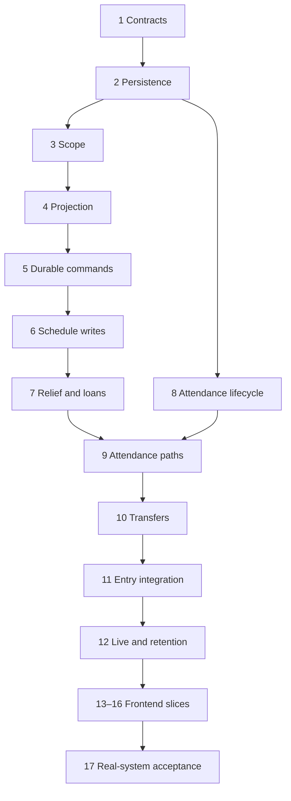
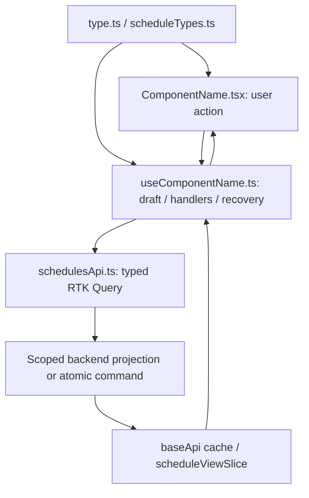

# Cleaner Scheduling Implementation Plan

> **For agentic workers:** REQUIRED SUB-SKILL: Use sp-subagent-driven-development (recommended) or sp-executing-plans to implement this plan task-by-task. Steps use checkbox (`- [ ]`) syntax for tracking.

**Goal:** Build the approved Supervisor/Admin scheduling and Cleaner own-schedule workflow, lifecycle-aware attendance and authorised midshift transfers, preserving facts and integrating Area entry evidence with the overview.

**Architecture:** Effective-dated schedule records feed one scoped projection/eligibility service. Atomic versioned commands store audit and durable idempotent results; attendance and transfer arrival remain independent actual facts. React pages use RTK Query and scoped invalidation, with UI/hooks/types separated.

**Tech Stack:** Existing .NET 10/EF Core/MySQL backend, xUnit/SQLite plus owned real-MySQL tests; existing React 19/TypeScript/Redux Toolkit/React Router/Tailwind 4/Vitest/Playwright. Keep installed versions from lockfiles; no UI-library or runtime dependency addition required.

**Spec:** [Approved scheduling spec](../specs/2026-11-17-cleaner-scheduling-design.md). Owner approved the written spec on 17 November 2026 (Asia/Bangkok): “อนุมัติ spec เขียนแผนต่อ”. ADRs through 0222 and their amendments are binding.

## Global Constraints

- “การอนุมัติ spec/plan ไม่ยกเลิกคำสั่งพัก implementation ต้องมีคำสั่งเริ่มพัฒนาแยกต่างหาก”
- “ครอบคลุม: Supervisor หลายตึกในกะตน, Admin ทุกตึกทุกกะ”
- “คัดลอกใช้ stable user ID ภายใน current authorised target roster เท่านั้น”
- “บันทึกหลายแถวเป็นหนึ่ง atomic command สำหรับแถวที่ submit เท่านั้น ไม่บังคับทั้งสัปดาห์”
- “ไม่แปลง entry metricเป็นcurrent headcount”
- “เก็บ actual timestamps เป็น UTC; ShiftDate เป็นวันเริ่มกะตามไทย แสดง timezone Asia/Bangkok”
- “ไม่มี global required version บน auth/scan/inspection ที่ไม่ consume สัญญาเปลี่ยนนี้”
- “ไม่ hard-code วันที่ทดสอบใน product”
- “ไม่สร้างสิทธิ์สแกนข้าม Area หรือ workflow งานย่อยใหม่จากคำบอกเล่า”
- “ไม่ทำ auto cancellation/compensatory day/relief move”
- “ไม่ใช้ฐานข้อมูลเจ้าของเป็นฐานทิ้ง”
- All tasks inherit spec §§1–16, including scoped rights, legacy compatibility, stale-input preservation, command expiry and retention; the quotations above do not narrow the rest of the spec.
- Follow `docs/agents/frontend-standards.md` and `design-system/janitorial/MASTER.md`. Tailwind/shared controls prevail over the local react-structure skill's conflicting MUI/DataGrid examples. Use that skill's UI/hook/type separation, not its incompatible UI stack. No MUI, DataGrid Premium, new CSS files, external fonts or icon-only actions.
- Main JS stays within the existing 200 kB gzip budget; phone body ≥16 px, Admin ≥14 px, nothing <13 px; phone targets ≥48 px and primary ≥56 px, Admin ≥36 px; labelled focusable controls and words on status.
- Commands below are future execution instructions, not commands already run. Keep new features disabled until activation prerequisites and acceptance pass. Never run database migrations/servers from a documentation-only planning turn.

---



## Read first, scope and execution agreement

Repository root: `/Users/macbookair/Projects/Janitorial-Management-Dashboard`. Every path below is relative to that root. Read `docs/handoff.md` first and inspect `git status --short --branch` before execution. At writing, `master` has the accumulated uncommitted design work from this session: preserve it, do not reset/clean or accidentally stage it with source commits. Create `codex/cleaner-scheduling` or an authorised isolated worktree at execution time. Do not assume a reboot-persistent API/database/tunnel or the old E2E reports exist.

The scheduling subsystems share authority, effective assignments, slot lifecycle and actual evidence, so this is one integrated plan with four review phases, not independently deployed speculative services. The overview is a separate existing workstream: [overview plan](2026-11-16-combined-overview-dashboard.md). Task 11 supplies a tested evidence adapter and rebases that plan's consuming contract; it does not reproduce its 11 tasks or silently implement the whole overview.

All planned commits reference tracker map `#1` (`facility-poc`) and name only the task's source/test/doc files. Check current issue-tracker/ticket-trace instructions before an actual commit. No issue creation, PR, push or merge is authorised by writing this plan.

**Test commands:** unit project `backend/tests/JanitorialManagementDashboard.UnitTests`; API project `backend/tests/JanitorialManagementDashboard.ApiTests`. Run with `dotnet test <project> --filter FullyQualifiedName~<test class>`. API `JanitorialApiFactory` uses synthetic SQLite and a movable clock; it is not evidence of MySQL lock/migration behaviour. Real MySQL tests require `FACILITY_MYSQL_TEST` pointing to one explicitly owned throwaway database, configured privately, never printed. Use `MySqlTestDatabase` ownership checks and current `docs/testing/e2e.md`; do not put connection strings/root passwords in this document or shell history.

## File structure and shared interfaces

| Area | Files and responsibility |
|---|---|
| Pure domain contracts | `backend/src/JanitorialManagementDashboard.Application/Scheduling/{ScheduleTypes,ScheduleRules,ScheduleResolver,ScheduleAuthority,ScheduleEntryEvidence}.cs` |
| Attendance lifecycle | `backend/src/JanitorialManagementDashboard.Application/Attendance/{AttendanceLifecycle,AttendanceApplicability}.cs`, existing `AttendanceRules.cs`/`AttendanceCalendar.cs` |
| Entities | New `backend/src/JanitorialManagementDashboard.Domain/Entities/Scheduling/` records listed in Task 2; existing `ShiftAttendance.cs` remains actual facts |
| EF mapping/read | `backend/src/JanitorialManagementDashboard.Infrastructure/Persistence/Scheduling/{SchedulingModel,ScheduleStore}.cs`; `AppDbContext.cs` delegates mapping |
| Atomic writes | `backend/src/JanitorialManagementDashboard.Api/Scheduling/{ScheduleCommandService,ScheduleCommandTokenService,ScheduleCommandHandlers,ReliefCommandHandlers,TransferCommandService}.cs` |
| HTTP DTO/routes | `backend/src/JanitorialManagementDashboard.Api/DTOs/ScheduleDtos.cs`; endpoints `ScheduleEndpoints.cs`, `TeamAttendanceEndpoints.cs`, `AreaTransferEndpoints.cs` |
| Live/retention | `backend/src/JanitorialManagementDashboard.Api/Scheduling/ScheduleNotifications.cs`; existing retention runner/cleanup plus `SchedulingRetention.cs` |
| Frontend shared contracts | `frontend/src/shared/api/scheduleTypes.ts`, `frontend/src/pages/schedules/schedulesApi.ts`, `frontend/src/pages/schedules/scheduleRules.ts` |
| Page/component layout | Every new component has `<Name>/<Name>.tsx`, `<Name>/use<Name>.ts`, `<Name>/type.ts`; add Redux slice only for state actually shared across page navigation |
| Test groups | New unit `Scheduling/`, API `Scheduling/`, frontend tests beside their subject, E2E `desktop/scheduling.spec.ts`, `phone/schedule-attendance.spec.ts` |

**Contract notation:** C# namespaces are `JanitorialManagementDashboard.Application.Scheduling` for scheduling records/rules and existing domain namespaces for UserRole/Shift/AttendanceEvent. DTO string values use one explicit JSON converter; never rely on incompatible C#/TS casing defaults. IDs are existing integer user/Area/building IDs; revisions are `long`, command/transfer IDs are `Guid`, dates are `DateOnly`, instants are UTC `DateTimeOffset`. HTTP instants are ISO UTC; weekStart/ShiftDate are ISO dates. JS does not round-trip revisions beyond safe integer range: serialize revisions as decimal strings in DTOs.

Task 1 defines the pure input records; Task 4 owns projection records; Task 5 owns envelope/result/token records; Task 8 owns lifecycle/gap records; Task 10 owns transfer records. Do not invent a second type with the same conceptual name in another task.

### Canonical records for the cross-task seams

Create the following in Task 1's `ScheduleTypes.cs` and extend in Task 4 as indicated. These spellings/types are shared contracts; ORM entities are separate and mapped into these pure inputs. Add `using JanitorialManagementDashboard.Domain.Enums;` and namespace `JanitorialManagementDashboard.Application.Scheduling`.

```csharp
public sealed record ScheduleSlot(DateOnly ShiftDate, Shift Shift);
public sealed record ScopePeriod(int SupervisorId, int BuildingId, Shift Shift, DateOnly From, DateOnly? Until);
public sealed record ScheduleCell(int UserId, DateOnly Date, int? AreaId, int? BreakGroup,
    bool IsDayOff, bool IsLeave, bool IsUnset, string Revision);
public sealed record ResolvedValue<T>(T Value, Guid? SourceId, string SourceKind, string Revision);
public sealed record BaselineFact(Guid Id, DateOnly From, DateOnly? Until, DayOfWeek? Weekday,
    int? AreaId, int? BreakGroup, string Revision);
public sealed record DatedFact(Guid Id, DateOnly Date, int? AreaId, int? BreakGroup, string Revision);
public sealed record LeaveFact(Guid Id, DateTimeOffset Start, DateTimeOffset End, bool Cancelled, string Revision);
public sealed record TransferFact(Guid Id, int FromAreaId, int ToAreaId, DateTimeOffset EffectiveAt,
    DateTimeOffset? ConfirmedAt, bool Cancelled, string Revision);
public sealed record ScheduleProblem(string Code, string Message, DateOnly Date);
public sealed record ScheduleDay(DateOnly Date, ResolvedValue<int?> Area,
    ResolvedValue<int?> BreakGroup, bool IsDayOff, bool IsLeave, bool IsUnset,
    string Availability, IReadOnlyList<ScheduleProblem> Problems);
public sealed record SchedulePersonWeek(int UserId, string DisplayName, string CleanerKind,
    int? HomeBuildingId, IReadOnlyList<ScheduleDay> Days);
public sealed record ScheduleProjection(DateOnly WeekStart, IReadOnlyList<SchedulePersonWeek> Rows,
    string Revision, DateTimeOffset ReadAt, string Availability);
public sealed record ScheduleInput(int UserId, DateOnly HistoryStartsAt,
    IReadOnlyList<BaselineFact> Baselines, IReadOnlySet<DateOnly>? DaysOff,
    IReadOnlyList<DatedFact> Exceptions, IReadOnlyList<LeaveFact> Leaves,
    IReadOnlyList<TransferFact> Transfers)
{
    public static ScheduleInput Empty(DateOnly historyStartsAt) =>
        new(0, historyStartsAt, [], null, [], [], []);
}
```

Store/DTO projections additionally expose underlying assignment, corrected-versus-original plan references, applicability/gap/loan fields where the spec requires them; add them as named optional extension records in the owning task, not by changing the meaning of Area/Revision/Availability above. Pure ScheduleInput is per person; building/role filtering is performed before constructing it.

**Token/config boundary:** Task 5 adds lazy, purpose-specific private `Scheduling:CommandSigningKey` configuration, registered through DI only for the new scheduling command service. It must not make login/legacy startup require a new secret when scheduling is disabled. Add `SchedulingSettings.Enabled` (default false) and `HistoryStartsAt` in Application/Scheduling/SchedulingSettings.cs; new management readers/writers and menu exposure are enabled together only after data setup. Existing entered slots and dual-lifecycle actual readers/writers must remain operable when disabling future scheduling changes. The initial selected activation slot is persisted by the validated Task 8 activation preparation service; repeated startup loads it rather than attempting late reactivation.

For new endpoint tests, configure JanitorialApiFactory.ConfigureTestServices with the synthetic token service/settings before its first request; do not hard-code a production default key. Task 17 injects a random per-run private key/Enabled setting into the owned API's environment in `scripts/e2e.py`, without changing the owner's app settings. Retain the current test clock for exact boundary cases and real runtime clock for browser cases.

## Phase A — dated data, scope and reliable writes

### Task 1: Establish pure schedule contracts and deterministic calendar rules

**Files:** Create `Application/Scheduling/ScheduleTypes.cs`, `ScheduleRules.cs` under the backend Application project; create `backend/tests/JanitorialManagementDashboard.UnitTests/Scheduling/ScheduleRulesTests.cs`.

**Interfaces:**
- Produces `ScheduleSlot(DateOnly ShiftDate, Shift Shift)`, `ScheduleCell(int UserId, DateOnly Date, int? AreaId, int? BreakGroup, bool IsDayOff, bool IsLeave, bool IsUnset, string Revision)`, `ScopePeriod(int SupervisorId, int BuildingId, Shift Shift, DateOnly From, DateOnly? Until)`.
- Produces `DateOnly ScheduleRules.WeekStart(DateOnly date)` and `IReadOnlyDictionary<int,DateOnly?> FillUnset(IReadOnlyDictionary<int,DateOnly?> target, IReadOnlyDictionary<int,DateOnly?> source, DateOnly targetWeek)`; source dates map by weekday, only target roster IDs are considered.

- [ ] Write this scenario test plus empty-source/removed-person cases. It exercises protection of local values, Monday mapping and source membership together.

```csharp
[Fact]
public void Copy_preserves_local_values_and_only_fills_target_members()
{
    var target = new Dictionary<int, DateOnly?> { [1] = new(2026, 11, 25), [2] = null, [3] = null };
    var source = new Dictionary<int, DateOnly?> { [1] = new(2026, 11, 16), [2] = new(2026, 11, 16), [9] = new(2026, 11, 18) };
    var actual = ScheduleRules.FillUnset(target, source, new DateOnly(2026, 11, 23));
    Assert.Equal(new DateOnly(2026, 11, 25), actual[1]);
    Assert.Equal(new DateOnly(2026, 11, 23), actual[2]);
    Assert.Null(actual[3]);
    Assert.False(actual.ContainsKey(9));
}
```

- [ ] Run `dotnet test backend/tests/JanitorialManagementDashboard.UnitTests --filter FullyQualifiedName~ScheduleRulesTests`; expect missing new types/methods.
- [ ] Implement the two pure functions, then add Sunday/Monday/night-start-date cases. Use the person's resolved slot date, not the wall-clock Monday, when calling WeekStart for an ongoing night shift.

```csharp
public static DateOnly WeekStart(DateOnly date) =>
    date.AddDays(-(((int)date.DayOfWeek + 6) % 7));

public static IReadOnlyDictionary<int, DateOnly?> FillUnset(
    IReadOnlyDictionary<int, DateOnly?> target,
    IReadOnlyDictionary<int, DateOnly?> source, DateOnly targetWeek)
{
    var monday = WeekStart(targetWeek);
    return target.ToDictionary(x => x.Key, x => x.Value ??
        (source.TryGetValue(x.Key, out var previous) && previous is { } day
            ? monday.AddDays(((int)day.DayOfWeek + 6) % 7) : (DateOnly?)null));
}
```

- [ ] Run the same test filter; expect pass without database or device time dependence.
- [ ] Commit only these three files: `git commit -m "feat: define dated schedule calendar contracts (refs #1)"` after an explicit `git add` of them.

### Task 2: Persist scheduling facts and migrate safely without guessed history

**Files:** Create Domain `Entities/Scheduling/` files `SupervisorScopePeriod.cs`, `CleanerProfilePeriod.cs`, `ScheduleBaseline.cs`, `WeeklyDayOff.cs`, `ScheduleException.cs`, `ReliefAssignment.cs`, `AreaTransfer.cs`, `AreaTransferConfirmation.cs`, `AttendanceSlotLifecycle.cs`, `AttendanceGap.cs`, `ScheduleAnchor.cs`, `ScheduleScopeAnchor.cs`, `ScheduleCommandReceipt.cs`, `ScheduleChange.cs`; create Infrastructure `Persistence/Scheduling/SchedulingModel.cs`, `ScheduleStore.cs`; modify `AppDbContext.cs`, `AppDbContextModelSnapshot.cs`; create migration `AddCleanerScheduling` via EF migration tooling at execution, not by guessing its generated timestamp. Create API `Scheduling/SchedulePersistenceTests.cs` and `Scheduling/MySqlScheduleMigrationTests.cs`.

**Interfaces:** Produces DbSets with the entity names above; `ScheduleAnchor` has stable unique `(PersonId, ShiftDate, Shift)` and a separate baseline-head anchor per person to serialize empty-row creates/range edits. `ScheduleScopeAnchor` has unique `(BuildingId, Shift)` and serialises regular Supervisor period edits, including overlapping future ranges across different people. Baselines use effective range, version, weekday-cell rows; weekly off dates are explicit child rows, with absent selection represented separately from a confirmed empty choice. `AreaTransferConfirmation.TransferId` is unique. `ScheduleCommandReceipt.CommandId` is unique. Actual `ShiftAttendance.EventType` stored legacy strings remain unchanged.

- [ ] Add persistence tests asserting round-trip unset versus selected Monday, two buildings for one Supervisor, reject overlapping regular building ownership, unique transfer confirmation and unique command identity. Add this stored-value assertion against a fresh schema.

```csharp
[Fact]
public async Task Schema_keeps_legacy_attendance_values_readable()
{
    using var factory = new JanitorialApiFactory();
    await factory.WithDbAsync(async db =>
    {
        var person = await db.Users.SingleAsync(u => u.EmployeeId == "1000001");
        var row = new ShiftAttendance {
            UserId = person.Id, AreaId = person.AreaId!.Value,
            ShiftDate = new DateOnly(2026, 11, 17), Shift = Shift.Day,
            EventType = AttendanceEvent.BreakOut, Source = AttendanceSource.AdminAdd,
            OccurredAt = new DateTime(2026, 11, 17, 3, 0, 0, DateTimeKind.Utc),
            CreatedAt = new DateTime(2026, 11, 17, 3, 0, 0, DateTimeKind.Utc) };
        db.ShiftAttendances.Add(row);
        await db.SaveChangesAsync();
        var raw = await db.Database.SqlQueryRaw<string>(
            "SELECT event_type AS Value FROM shift_attendances WHERE id = {0}", row.Id).SingleAsync();
        Assert.Equal("BREAK_OUT", raw);
        db.ChangeTracker.Clear();
        Assert.Equal(AttendanceEvent.BreakOut,
            (await db.ShiftAttendances.SingleAsync(x => x.Id == row.Id)).EventType);
    });
}
```

- [ ] Run `dotnet test backend/tests/JanitorialManagementDashboard.ApiTests --filter FullyQualifiedName~SchedulePersistenceTests`; expect missing entity/model failure.
- [ ] Implement mappings with Restrict FKs, required provenance, UTC timestamp precision, unique command/confirmation keys and stable anchor keys. Keep legacy `User.CleanerSlot`; replace one-building SupervisorSlot enforcement only when the new period ownership constraint/locked validation covers it. Add public static `SchedulingModel.Configure(ModelBuilder model)` and call it from `OnModelCreating`.

```csharp
model.Entity<ScheduleScopeAnchor>()
    .HasIndex(x => new { x.BuildingId, x.Shift }).IsUnique();
model.Entity<AreaTransferConfirmation>()
    .HasIndex(x => x.TransferId).IsUnique();
model.Entity<ScheduleCommandReceipt>()
    .HasIndex(x => x.CommandId).IsUnique();
model.Entity<ScheduleAnchor>()
    .HasIndex(x => new { x.PersonId, x.ShiftDate, x.Shift }).IsUnique();
```

- [ ] Generate/review `AddCleanerScheduling`; inspect Up/Down SQL and snapshot. Use the repository tool manifest: `dotnet tool restore`, then `dotnet ef migrations add AddCleanerScheduling --project backend/src/JanitorialManagementDashboard.Infrastructure --startup-project backend/src/JanitorialManagementDashboard.Api`. Ensure the design-time wwwroot directory exists with `mkdir -p backend/src/JanitorialManagementDashboard.Api/wwwroot` if needed. Generate SQL with `dotnet ef migrations script --idempotent --project backend/src/JanitorialManagementDashboard.Infrastructure --startup-project backend/src/JanitorialManagementDashboard.Api --output /private/tmp/scheduling-migration-review.sql`; this generates a review file, not a database update. Migration backfills only known current regular Area/building/shift at the chosen history-start instant, not imaginary relief identity, past off dates or missing groups. Add a test upgrading a database with legacy attendance then reading the exact same event names/Area/times, and a fresh-database test. Existing migration pattern and provider-specific computed columns must remain valid for SQLite and MySQL.
- [ ] Run persistence tests and the owned-MySQL migration filter with `FACILITY_MYSQL_TEST` configured privately; require executed MySQL cases, not skipped. Verify fresh schema, upgrade and second no-change migration run.
- [ ] Commit the named entities/mapping/migration/tests with `feat: persist effective dated scheduling records (refs #1)`.

### Task 3: Share dated Supervisor scope across management, work and inspection

**Files:** Create Application `Scheduling/ScheduleAuthority.cs`; create API `Scheduling/ScheduleScopeReader.cs`; modify `Application/Inspections/SupervisorScope.cs`, API `Endpoints/MyBuildingEndpoints.cs`, `InspectionEndpoints.cs`, `PointNotifications.cs`, account/building validation where `SupervisorSlot` was used; create unit `Scheduling/ScheduleAuthorityTests.cs`, API `Scheduling/ScheduleScopeEndpointTests.cs`; extend existing `SupervisorScopeTests.cs` and inspection/cover tests.

**Interfaces:** Consumes ScopePeriod and current role/active account. Produces `bool ScheduleAuthority.CanManage(UserRole role, int actorId, int buildingId, Shift shift, DateOnly date, IReadOnlyCollection<ScopePeriod> periods)` and `Task<IReadOnlyList<ScopePeriod>> ScheduleScopeReader.ReadAsync(int actorId, CancellationToken ct)`. Historical correction additionally requires current authorised visibility, as spec §3; Admin global bypass applies only to scope, never to data validity.

- [ ] Write table tests for assigned A+B/day, denied C/day and A/night, expired membership, historical membership without present access, Admin all-building and deactivated account. Preserve temporary inspection cover and clock-window eligibility tests separately.

```csharp
[Fact]
public void Same_supervisor_can_manage_two_buildings_but_not_other_shift()
{
    var day = new DateOnly(2026, 11, 17);
    ScopePeriod[] scope = [new(10, 1, Shift.Day, day, null), new(10, 2, Shift.Day, day, null)];
    Assert.True(ScheduleAuthority.CanManage(UserRole.Supervisor, 10, 2, Shift.Day, day, scope));
    Assert.False(ScheduleAuthority.CanManage(UserRole.Supervisor, 10, 2, Shift.Night, day, scope));
}
```

- [ ] Run the unit filter; expect missing ScheduleAuthority.
- [ ] When changing regular Supervisor membership, acquire the stable building/shift ScheduleScopeAnchor before checking period overlap, so different-person writes cannot both claim the same building/shift. Add a real-MySQL two-writer period-overlap test to ScheduleScopeEndpointTests. Implement authority using active server identity plus dated membership; consumers load periods once and pass to shared rules. The pure core has this condition, with active/current-access checks in the scoped reader.

```csharp
return role == UserRole.Admin ||
    (role == UserRole.Supervisor && periods.Any(p =>
        p.SupervisorId == actorId && p.BuildingId == buildingId && p.Shift == shift &&
        p.From <= date && (p.Until is null || date < p.Until.Value)));
```

- [ ] Add API tests using `AuthApi.LoggedInAsEmployeeAsync`/`LoggedInAdminAsync`; query/body forging must return forbidden and not mutate. Use the new membership resolver for MyBuilding/inspection/notifications, retaining inspection timing/cover rules. Run `ScheduleScope`, `SupervisorScope`, `Inspection` and `SupervisorCover` filters.
- [ ] Commit only task files with `feat: apply shared multi building supervisor scope (refs #1)`.

### Task 4: Resolve dated schedules, weekly choices and historical availability

**Files:** Create Application `Scheduling/ScheduleResolver.cs`; extend `ScheduleTypes.cs`; implement Infrastructure `ScheduleStore.cs` scoped reads; create unit `Scheduling/ScheduleResolverTests.cs`, API `Scheduling/ScheduleReadTests.cs`.

**Interfaces:** Produces `ScheduleProjection(WeekStart, Rows, Revision, ReadAt, Availability)`, per-field `ResolvedValue<T>(Value, SourceId, SourceKind, Revision)`, and per-day `ScheduleDay` with underlying Area/group, explicit off/leave state, gaps/conflicts and original/corrected history. `ScheduleResolver.Resolve(ScheduleInput input, DateOnly date)` is pure; `ScheduleStore.ReadWeekAsync(int actorId, DateOnly weekStart, int? buildingId, Shift? shift, CancellationToken ct)` reads authorised inputs and returns projection. Define `ScheduleInput` as person/profile periods, baseline versions, weekly choices, exceptions, leave intervals and transfer evidence; do not read mutable User fields inside the pure resolver.

- [ ] Write scenario tests: new Wednesday Area leaves Tuesday unchanged; dated break override survives baseline change; explicit no-choice is unset; historical date before baseline unavailable, not today’s Area; leave/off keeps underlying eligible Area for record-first check-in.

```csharp
[Fact]
public void Unavailable_history_is_not_a_zero_or_a_guessed_assignment()
{
    var input = ScheduleInput.Empty(new DateOnly(2026, 11, 17));
    var day = ScheduleResolver.Resolve(input, new DateOnly(2026, 11, 16));
    Assert.Equal("unavailable", day.Availability);
    Assert.Null(day.Area.Value);
}
```

- [ ] Run `ScheduleResolverTests`; expect missing resolver/input/day contracts.
- [ ] Implement source precedence field-by-field. The boundary predicate is explicit; conflict stops incompatible writes without deleting applicable dated settings.

```csharp
static bool Applies(DateOnly from, DateOnly? until, DateOnly date) =>
    from <= date && (until is null || date < until.Value);
```

- [ ] Read each week in a consistent database snapshot, returning row revisions/provenance and retained-history availability. Add own-only/assigned-scope API read tests, false-zero/history tests and a read racing a multi-row write; the projection may be before or after, never half of each. Run `ScheduleResolverTests` and `ScheduleReadTests`.
- [ ] Commit with `feat: resolve dated roster projections and history (refs #1)`.

### Task 5: Make schedule commands atomic, versioned and safely repeatable

**Files:** Create API `Scheduling/ScheduleCommandService.cs`, `ScheduleCommandTokenService.cs`; create DTO `ScheduleDtos.cs`; create Application `Scheduling/ScheduleCommandTypes.cs` and `SchedulingSettings.cs`; create API `Scheduling/ScheduleCommandTests.cs`, `MySqlScheduleCommandRaceTests.cs`; register services in `Program.cs`.

**Interfaces:** Produces `ScheduleCommandEnvelope(string Token, Guid CommandId, IReadOnlyDictionary<string,string> ExpectedRevisions, string Kind, JsonElement Payload)`, `CommandResult(Guid CommandId, string Outcome, IReadOnlyDictionary<string,string> Revisions, IReadOnlyList<RowProblem> Problems)`, `RowProblem(string RowId,string Code,string Message)`. `ScheduleCommandService.ExecuteAsync(int actorId, ScheduleCommandEnvelope command, CancellationToken ct)` and `ReadResultAsync(int actorId, Guid id, CancellationToken ct)`; `ScheduleCommandTokenService.Issue(int actorId, DateTimeOffset now)` and `Verify(string token,int actorId,DateTimeOffset now)` return bound command identity/expiry. Keep signing material private and purpose-separated; no new auth API required input.

- [ ] Add tests for duplicate same identity/payload→same result/one audit; changed payload→conflict; stale revision→zero changes; commit then connection loss→status finds original; expired token cannot restart after receipt purge; foreign actor cannot inspect result. Use factory TestTimeProvider instead of sleeps.

```csharp
[Fact]
public void Command_token_is_bound_to_actor_and_expires()
{
    var service = new ScheduleCommandTokenService("synthetic-test-key-32-bytes-minimum-only");
    var now = DateTimeOffset.Parse("2026-11-17T00:00:00Z");
    var token = service.Issue(10, now);
    Assert.True(service.Verify(token.Value, 10, now).Accepted);
    Assert.False(service.Verify(token.Value, 11, now).Accepted);
    Assert.False(service.Verify(token.Value, 10, now.AddHours(25)).Accepted);
}
```

- [ ] Run `ScheduleCommandTests`; expect missing command/token service. Define token return records `IssuedCommandToken(Guid Id,string Value,DateTimeOffset ExpiresAt)` and `VerifiedCommandToken(bool Accepted,Guid Id)` in ScheduleCommandTypes.
- [ ] Implement 24-hour immutable server-signed purpose/actor/id/issue/expiry claims. Verify signature/actor, then return a retained existing receipt for same payload even after its start-window expiry; only a new mutation must pass unexpired issuance. Compute deterministic canonical payload fingerprint, including operation and expected revisions, not a hash of arbitrary JSON property order.

```csharp
var canonical = JsonSerializer.Serialize(new { command.Kind, Revisions = sortedRevisions, Payload = canonicalPayload });
var fingerprint = Convert.ToHexString(SHA256.HashData(Encoding.UTF8.GetBytes(canonical)));
```

Here `sortedRevisions` is the ordinal-key sorted revision dictionary and `canonicalPayload` is a recursively ordinal-key-normalised JSON object, preserving array order. Implement both as local helper methods in this service and test reordered JSON keys without reordered rows.

- [ ] Execute: begin transaction → lock stable anchors in sorted key order → re-read current scope/revisions/assignments → validate all submitted rows → write rows+ScheduleChange+receipt → commit → notify. Roll back on any row failure. Use a provider-aware anchor-lock method in ScheduleStore; MySQL `SELECT ... FOR UPDATE` must execute inside the transaction, with unique anchor creation/retry for empty slots. Never infer MySQL exclusion from a SQLite pass.
- [ ] Run command filters including real-MySQL two-connection duplicate/stale/phantom-create races; require one committed business result/audit, not two successful independent creates.
- [ ] Commit with `feat: execute versioned scheduling commands once (refs #1)`.

### Task 6: Expose authorised schedule reads and explicit roster/baseline/leave changes

**Files:** Create API `Endpoints/ScheduleEndpoints.cs`, `Scheduling/ScheduleCommandHandlers.cs`; extend ScheduleDtos; modify Program.cs mapping; create API `Scheduling/ScheduleWriteTests.cs`, `ScheduleHistoryCorrectionTests.cs`.

**Interfaces:** Map GET `/api/schedules/me`, GET `/api/schedules`, POST `/api/schedules/command-tokens`, POST `/api/schedules/commands`, GET `/api/schedules/commands/{id}`. Command kinds: `set-weekly-days-off`, `set-regular-baseline`, `set-relief-baseline`, `set-dated-area`, `set-dated-break`, `record-leave`, `cancel-leave`, `correct-plan`. Each payload uses person/date or effectiveFrom, values and reason where required; changed rows have expected revisions. `ScheduleCommandHandlers.ValidateAndApplyAsync(actorId, kind, payload, ct)` runs only inside Task 5 transaction.

- [ ] Write endpoint tests: unauthenticated→401, Cleaner management→403; own-read forged target ignored/rejected; submitted partial roster succeeds visibly incomplete; one stale row rejects all; no-op leaves history unchanged; regular baseline start must be future while explicit reasoned plan correction is its own path.

```csharp
[Fact]
public async Task Cleaner_cannot_write_management_commands()
{
    using var factory = new JanitorialApiFactory();
    var (client, _, _) = await AuthApi.LoggedInAsync(factory);
    var response = await client.PostAsJsonAsync("/api/schedules/commands", new { kind = "set-weekly-days-off" });
    Assert.Equal(HttpStatusCode.Forbidden, response.StatusCode);
}
```

- [ ] Run `ScheduleWriteTests`; expect route not found before mapping.
- [ ] Map the new group as authenticated and apply a non-Cleaner management-write authorisation policy before request-body binding; a missing/invalid body must not make an unauthorised Cleaner request reach the handler. Read actor from CurrentUser and call the shared authority. Keep role checks scoped to this group; do not widen AdminAttendance/legacy cover groups.

```csharp
var group = app.MapGroup("/api/schedules").RequireAuthorization();
group.MapGet("/me", ReadMineAsync);
group.MapGet("", ReadManagedAsync);
group.MapPost("/command-tokens", IssueTokenAsync);
group.MapPost("/commands", ExecuteAsync);
group.MapGet("/commands/{id:guid}", ReadResultAsync);
```

Define these handler signatures in `ScheduleEndpoints`: `Task<IResult> ReadMineAsync(DateOnly weekStart, ClaimsPrincipal principal, AppDbContext db, ScheduleStore store, CancellationToken ct)`, `Task<IResult> ReadManagedAsync(DateOnly weekStart, int? buildingId, Shift? shift, ClaimsPrincipal principal, AppDbContext db, ScheduleStore store, CancellationToken ct)`, `Task<IResult> IssueTokenAsync(ClaimsPrincipal principal, AppDbContext db, ScheduleCommandTokenService tokens, TimeProvider clock)`, `Task<IResult> ExecuteAsync(ScheduleCommandEnvelope request, ClaimsPrincipal principal, AppDbContext db, ScheduleCommandService commands, CancellationToken ct)`, and `Task<IResult> ReadResultAsync(Guid id, ClaimsPrincipal principal, AppDbContext db, ScheduleCommandService commands, CancellationToken ct)`. `MapScheduleEndpoints(IEndpointRouteBuilder app)` is the sixth registration entry point. Load the actor with existing `CurrentUser.LoadAsync(principal, db)`; never treat CurrentUser as an injectable identity instance. For weekly edits change only submitted choices in the target week; server rechecks dates/membership. For future baselines preserve earlier versions and applicable dated breaks; incompatible dated settings return affected-date conflicts. Leave intervals remain separate from scans; no request/approval workflow, no inferred hourly errands.

- [ ] Implement `correct-plan` with required trimmed reason (1–500 chars), original+corrected revisions and no actual-table updates. Run ScheduleWrite, ScheduleHistoryCorrection, existing account/area setup and legacy cover endpoint filters; expect old caller contracts unchanged.
- [ ] Commit with `feat: add scoped roster baseline and leave endpoints (refs #1)`.

### Task 7: Assign relief staff and record outside-agreed loans without new approval screens

**Files:** Create API `Scheduling/ReliefCommandHandlers.cs`; extend ScheduleDtos/command dispatch; modify account creation/edit DTOs and checks in `Endpoints/AdminAccountEndpoints.cs`, `Endpoints/AccountChecks.cs`, `Endpoints/AccountView.cs` and `DTOs/AccountDtos.cs`, plus their tests; create `Scheduling/ReliefAssignmentTests.cs`, `ReliefLoanTests.cs`; extend ScheduleStore.

**Interfaces:** New command `assign-relief` payload `ReliefAssignmentRequest(int UserId,int AreaId,DateOnly ShiftDate,Shift Shift,int? ReplacedUserId,int? BreakGroup,int SourceBuildingId,int? SourceSupervisorId,bool AgreementReported,string? Reason)`. Candidate lookup GET `/api/schedules/relief-candidates?employeeId=&sourceBuildingId=&date=&shift=` returns only minimal identity/home building/regular shift plus eligible/conflict status, not another team's full schedule. New profile setup distinguishes regular/relief and effective home building without fabricating history.

- [ ] Add tests: same-shift relief with no regular Area is selectable; standalone group missing is rejected; replaced-person group inherited with dated override; loan requires reported source agreement if different Supervisor; same Supervisor two buildings has no fake second approver; currently assigned person conflict does not mutate source work.

```csharp
[Fact]
public void Standalone_relief_work_cannot_guess_a_break_group()
{
    var result = ReliefAssignmentRules.ValidateGroup(replacedGroup: null, explicitGroup: null);
    Assert.Equal("break-group-required", result.Code);
    Assert.True(ReliefAssignmentRules.ValidateGroup(null, 2).Accepted);
}
```

Create pure Application `Scheduling/ReliefAssignmentRules.cs` with result `ReliefGroupResult(bool Accepted,int? Group,string? Code)`. Select explicit valid group 1/2, otherwise inherit replaced group, otherwise return required; reject other values.

- [ ] Run ReliefAssignment/ReliefLoan test filters; expect missing candidate route/rules.
- [ ] Implement command validation against active relief profile, regular shift, destination rights, source identity/actual responsible Supervisor and locked person/slot assignments. The recorded agreement is destination actor attestation, not source authenticated approval; do not claim it verifies an external conversation. Source currently assigned duty must be explicitly reconciled through authorised actions; no auto-delete.

```csharp
public static ReliefGroupResult ValidateGroup(int? replacedGroup, int? explicitGroup)
{
    var group = explicitGroup ?? replacedGroup;
    return group is 1 or 2 ? new(true, group, null) : new(false, null, "break-group-required");
}
```

- [ ] Run all new tests plus account create/edit and existing CoverAssignment candidates tests. Existing regular Cleaner cover callers must not suddenly require relief profile/group; no blanket conversion of old cover records.
- [ ] Commit with `feat: schedule relief duties and agreed cross building loans (refs #1)`.

## Phase B — actual attendance, movement and evidence

### Task 8: Implement slot-versioned four/six-action rules and explicit gaps

**Files:** Create Application `Attendance/AttendanceLifecycle.cs`, `AttendanceApplicability.cs`; modify existing `AttendanceRules.cs`, Domain `Enums/AttendanceEvent.cs`; extend slot/gap mapping and add migration only if Task 2 schema needs adjustment; create unit `Scheduling/AttendanceLifecycleTests.cs`, `AttendanceApplicabilityTests.cs`; extend existing AttendanceRulesTests/AttendanceCalendarTests.

**Interfaces:** `enum AttendanceLifecycleVersion { Legacy4, Numbered6 }`; `AttendanceLifecycle.Order(version)` returns immutable ordered event list; `NextActions(version, recorded, skipped)` returns permitted next actual events plus required gap markers; `AttendanceApplicability.NotApplicable(expectedAt, actualOut, leaveStart, leaveEnd)` is a derived classification, never an inserted event. New enum names Break1Out/Break1In/Break2Out/Break2In map to new stored strings; keep all four old strings and old DTO meaning intact.

- [ ] Add tests for normal six actions, explicit skip, ShiftIn not skippable, no actions after final ShiftOut, legacy events not re-labelled, and pre-departure missing versus post-departure covered action.

```csharp
[Fact]
public void Half_day_departure_exempts_only_future_actions_inside_leave()
{
    var departure = DateTimeOffset.Parse("2026-11-17T06:00:00Z");
    var end = departure.AddHours(6);
    Assert.True(AttendanceApplicability.NotApplicable(departure.AddHours(3), departure, departure, end));
    Assert.False(AttendanceApplicability.NotApplicable(departure.AddHours(-2), departure, departure, end));
}
```

- [ ] Run lifecycle/applicability tests; expect missing new contracts.
- [ ] Implement expected-action evaluation per slot and this applicability predicate. Skip markers have no OccurredAt and never count as scanned evidence. Actual times remain strictly ordered by present action ordinal; missing paired events are allowed only as explicit gaps, not fabricated pair times.

```csharp
public static bool NotApplicable(DateTimeOffset expectedAt, DateTimeOffset actualOut,
    DateTimeOffset leaveStart, DateTimeOffset leaveEnd) =>
    expectedAt >= actualOut && expectedAt >= leaveStart && expectedAt < leaveEnd;
```

- [ ] Implement immutable lifecycle lookup/activation validation before the receiving window opens; reject selected boundary with existing legacy facts; legacy ongoing slots/corrections stay Legacy4 through their receiving window. Test exact before/at/after window edges with AttendanceCalendar; no runtime fixed rollout date.
- [ ] Run old AttendanceRules/Calendar tests plus new filters.
- [ ] Commit with `feat: version attendance actions and explicit missing scans (refs #1)`.

### Task 9: Apply effective Area eligibility and scoped actual-time corrections

**Files:** Modify API `Endpoints/AttendanceEndpoints.cs`, `AdminAttendanceEndpoints.cs`, `ScanRecordEndpoints.cs`, `MyWorkEndpoints.cs`, DTO attendance models and existing `Application/Attendance/AreaAttendance.cs`; create `Endpoints/TeamAttendanceEndpoints.cs`, API `Scheduling/EffectiveAttendanceTests.cs`, `MissingTeamAttendanceTests.cs`; extend `Attendance/AttendanceEndpointTests.cs`, `Admin/AttendanceCorrectionEndpointTests.cs` and work-submission tests.

**Interfaces:** Attendance read adds `lifecycleVersion`, allowed actions, gaps, per-action applicability and actual provenance. New-flow writes add contract marker + state revision + explicit gap confirmations only on the changed consuming route. `TeamAttendanceEndpoints` POST `/api/team-attendance/missing` takes person/slot/action/Thai time/reason and expected actual-state revision. Produces policy-owned eligible underlying Area even during recorded off/leave, with separate conflict marker.

- [ ] Add API tests for dedicated relief assigned sign, unassigned relief/home-building-only rejection, old slot/page compatibility, new slot stale-page refusal before write, legitimate leave/off entry preserved with conflict, actual final out13 closing submission, missing-time Supervisor add versus existing-scan overwrite denied.

```csharp
[Fact]
public async Task Unauthenticated_missing_time_entry_is_rejected()
{
    using var factory = new JanitorialApiFactory();
    var response = await factory.CreateApiClient().PostAsJsonAsync("/api/team-attendance/missing", new { });
    Assert.Equal(HttpStatusCode.Unauthorized, response.StatusCode);
}
```

- [ ] Run EffectiveAttendance/MissingTeamAttendance tests; expect absent new route or old own-Area/lifecycle assumptions to fail.
- [ ] Replace only consuming eligibility/rule calls. Do not erase underlying Area when leave/off exists; absence is a conflict for explicit correction, not a newly hidden pending entry. Preserve GPS missing→reject and out-of-radius→flag policy; preserve own-shift receiving windows and account checks.

```csharp
var onDuty = facts.Any(x => x.EventType == AttendanceEvent.ShiftIn) &&
             !facts.Any(x => x.EventType == AttendanceEvent.ShiftOut);
```

Use this unchanged submission principle with current authorised duty Area; do not generate BreakIn from a submission. For correction, validate reason 1–500 chars, actual event absence, current+historical scope, window and recorded ordinal order; append correction provenance. Extend AttendanceSource by a new SupervisorAdd value without renaming Scan/AdminAdd/AdminEdit.

- [ ] Add race tests for two fills of the same missing action and cancellation of leave while reading actual times; keep first committed actual fact and return conflict/current result. Run attendance, correction, scan submission and legacy cover filters.
- [ ] Commit with `feat: bind actual attendance to effective scoped duties (refs #1)`.

### Task 10: Transfer an entered person with one authorised destination confirmation

**Files:** Create API `Scheduling/TransferCommandService.cs`, `Endpoints/AreaTransferEndpoints.cs`; extend command handlers/DTOs/store/projection; create pure Application `Scheduling/TransferRules.cs`; create API `Scheduling/AreaTransferTests.cs`, `MySqlTransferRaceTests.cs`; extend effective attendance/MyWork tests.

**Interfaces:** Transfer command payload `(PersonId,Slot,FromAreaId,ToAreaId,EffectiveAt,Reason,ExpectedRevision)` returns instruction ID/revision. `TransferCommandService.ConfirmAsync(int actorId, Guid transferId, string expectedRevision, string qrToken, GpsInputDto gps, CancellationToken ct)` (define `GpsInputDto(double? Latitude,double? Longitude,double? AccuracyM)` in ScheduleDtos, then validate through existing GpsInput) returns `TransferResult(Guid Id,string State,DateTimeOffset? ConfirmedAt,string Revision)`. Cancellation uses the schedule command envelope; confirmation is independently idempotent by instruction ID. `TransferRules.CanCancel(bool hasConfirmation)` and `TransferRules.BreakStateAfterArrival(string before)` are pure.

- [ ] Test instruction13/arrival13:05 preserving initial07, wrong destination/other person/before-effective/outside-slot denied, no GPS rejected/radius flagged, confirmation duplicate returning same fact, no second ShiftIn/ShiftOut, ongoing break unchanged, and current duty sign switches only through authorised state.

```csharp
[Theory]
[InlineData("working")]
[InlineData("break1")]
[InlineData("break2")]
public void Arrival_does_not_fabricate_an_attendance_transition(string before) =>
    Assert.Equal(before, TransferRules.BreakStateAfterArrival(before));
```

- [ ] Run AreaTransfer tests; expect missing route/service/rules.
- [ ] Implement instruction revision lock shared by cancel/confirm. Actual arrival records server time/sign/GPS; effectiveAt is not a source departure scan. Confirmation never enters the normal break/final-action repeat-ignore clock. Retain original AreaId on old facts; a new forward move is required after confirmation.

```csharp
public static bool CanCancel(bool hasConfirmation) => !hasConfirmation;
public static string BreakStateAfterArrival(string before) => before;
```

These helpers document the invariants; HTTP handlers must enforce them inside the same locked state read, not trust a client boolean. Before arrival do not authorise B actual actions as proof of arrival; require explicit confirmation first. Keep current responsibility separate from last confirmed Area/time. Missing confirmation stays visible; do not convert Service Point submission into transfer arrival.

- [ ] Run real-MySQL cancel-versus-confirm and duplicate-confirm races using two independently scoped DbContexts; one state transition wins and all history remains. Add break-group snapshot tests: already-started cycle keeps its plan/progress, a new group cannot generate past events.
- [ ] Commit with `feat: confirm authorised midshift area transfers (refs #1)`.

### Task 11: Close overview D7 with a shared actual-entry evidence projection

**Files:** Create Application `Scheduling/ScheduleEntryEvidence.cs`; modify AreaAttendance summary adapter, relevant attendance DTOs and existing AttendanceBoard endpoint; create unit `Scheduling/ScheduleEntryEvidenceTests.cs`, API `Scheduling/ScheduleEntryProjectionTests.cs`; rebase `docs/superpowers/plans/2026-11-16-combined-overview-dashboard.md` Tasks 5/6/7/9/10/11 to consume this contract when executed. If overview source already exists at execution, integrate the actual files named by that plan after inspecting the checkout; do not create a second overview API in this task.

**Interfaces:** `AreaEntryEvidence(int AreaId,DateOnly ShiftDate,Shift Shift,DateTimeOffset RecordedAt,string Kind,Guid? TransferId)`. `ScheduleEntryEvidence.EnteredAreas(ScheduleSlot slot,IEnumerable<AreaEntryEvidence> evidence)` returns `IReadOnlySet<int>`. Store adapter emits legitimate initial ShiftIn or confirmed transfer-arrival only, never instruction/loan/skip/pending replacement. A current-responsibility projection is a separate DTO.

- [ ] Add the entry-persistence scenario and partition tests. A and B can both have historical entry from the same person; current person responsibility still has one effective destination.

```csharp
[Fact]
public void Confirmed_arrival_adds_destination_without_removing_origin_entry()
{
    var date = new DateOnly(2026, 11, 17);
    AreaEntryEvidence[] facts = [
        new(1, date, Shift.Day, DateTimeOffset.Parse("2026-11-17T00:00:00Z"), "shift-in", null),
        new(2, date, Shift.Day, DateTimeOffset.Parse("2026-11-17T06:05:00Z"), "transfer-arrival", Guid.NewGuid())];
    Assert.True(ScheduleEntryEvidence.EnteredAreas(new(date, Shift.Day), facts).SetEquals([1, 2]));
}
```

- [ ] Run entry projection tests; expect missing evidence contract.
- [ ] Implement distinct Area selection filtered by recorded slot and legitimate kind, with evidence validated by the store. Preserve all three categories and target denominator.

```csharp
return evidence.Where(x => x.ShiftDate == slot.ShiftDate && x.Shift == slot.Shift)
    .Where(x => x.Kind is "shift-in" or "transfer-arrival")
    .Select(x => x.AreaId).ToHashSet();
```

- [ ] Add API read test with instruction only→B assigned/no entry, confirmation→B entered, later ShiftOut→A/B still entered, leave/off conflicts not hiding actual entry, cancelled instruction not adding evidence and historical target retained. Drill-down must label evidence provenance and current state separately. Existing overview task snippets that count only ShiftIn are replaced with this adapter, not a synthetic second ShiftIn.
- [ ] Run entry/AreaAttendance/AttendanceBoard tests and applicable overview tests if source exists.
- [ ] Commit with `feat: project transfer aware area entry evidence (refs #1)`.

### Task 12: Recover live views and prune new personal details without losing active configuration

**Files:** Create API `Scheduling/ScheduleNotifications.cs`; modify PointNotifications/Program registration as consuming scope changes require; create Infrastructure `Persistence/Retention/SchedulingRetention.cs`; extend `RetentionRunner.cs`, `RetentionCleanup.cs`; create API `Scheduling/ScheduleLiveTests.cs`, `Retention/SchedulingRetentionTests.cs`, `Retention/MySqlSchedulingRetentionTests.cs`.

**Interfaces:** `ScheduleNotifications.ChangedAsync(ScheduleChangeScope scope,CancellationToken ct)` sends only invalidation identity/revision to active authorised account IDs after commit. `ScheduleChangeScope` contains affected person/building/slot IDs, not entire schedule payload. `SchedulingRetention.PruneAsync(DateTime utcNow,RetentionSettings settings,CancellationToken ct)` keeps active/future baseline anchors, removes obsolete personal detail at configured boundaries and clears GPS separately.

- [ ] Test reading during reconnect failure, no event to deactivated/other-team accounts, dirty-client input preserved, missing pushed event recoverable by read, live send failure not rolling back committed command, GPS purge retaining non-GPS fact and old command never reapplying after receipt purge.

```csharp
[Fact]
public void Active_baseline_is_not_obsolete_merely_because_it_is_old()
{
    var from = new DateOnly(2024, 1, 1);
    Assert.True(SchedulingRetentionRules.KeepBaselineAnchor(from, until: null, new DateOnly(2026, 11, 17)));
}
```

Create pure Application `Scheduling/SchedulingRetentionRules.cs`, method `KeepBaselineAnchor(DateOnly from, DateOnly? until, DateOnly earliestRetained)` returning true for open/future coverage or the anchor spanning earliest retained date; prune superseded versions only after determining needed anchors from neighbours, not from CreatedAt alone.

- [ ] Run live/retention filters; expect missing notification/retention handling.
- [ ] Implement recipient re-resolution at send time, with existing ScanHub per-active-user pattern. Never expose a third-party schedule in broadcast. Use existing configured GpsDays/RecordYears. Record unavailable when support detail is pruned; do not rebuild old facts from new defaults.

```csharp
public static bool KeepBaselineAnchor(DateOnly from, DateOnly? until, DateOnly earliestRetained) =>
    (from <= earliestRetained && (until is null || until.Value > earliestRetained)) || from > earliestRetained;
```

`from` remains part of the signature for selecting/diagnosing future anchors; the caller must retain the latest predecessor needed to interpret retained dates as well as all non-superseded active/future periods. Add overlapping-version and exact-boundary tests so this row predicate is not used as the entire pruning algorithm.

- [ ] Run existing retention rollback/GPS/orphan tests plus the new real-MySQL retention cases; verify command expiry refusal independently of receipt existence.
- [ ] Commit with `feat: refresh and retain scoped scheduling records safely (refs #1)`.

## Phase C — front-end user flows



This is the React function/data flow to review at execution: JSX renders named hook outputs, hooks own effects/dispatch/validation and command recovery, and shared transport types come from the API seam. It does not authorise implementation now.

### Task 13: Add typed schedule reads, navigation and ongoing-use filter memory

**Files:** Create `frontend/src/shared/api/scheduleTypes.ts`; create `frontend/src/pages/schedules/schedulesApi.ts`, `scheduleRules.ts`, `scheduleRules.test.ts`, `index.ts`; create components `SchedulePage/SchedulePage.tsx`, `SchedulePage/useSchedulePage.ts`, `SchedulePage/type.ts`, `SchedulePage/SchedulePage.test.tsx`; add slice `frontend/src/pages/schedules/scheduleViewSlice.ts` to existing `frontend/src/store/index.ts`; modify `shared/api/baseApi.ts`, `router.tsx`, `shared/components/AdminNav.tsx`, `pages/my-work/MyWorkPage.tsx`, `pages/my-building/MyBuildingPage.tsx` and navigation tests.

**Interfaces:** TS `ScheduleProjection`, `ScheduleDay`, `ScheduleCommandEnvelope`, `CommandResult`, `TransferResult` mirror Tasks 1/4/5/10 with revisions as strings and explicit lifecycle/action unions. Query endpoints `getMySchedule`, `getManagedSchedule`, `getScheduleCommandResult`; mutation endpoints `issueScheduleCommandToken`, `executeScheduleCommand`, `confirmAreaTransfer`. `scheduleViewSlice` stores in-memory week/building/shift per actor role/use, resets on logout, has no storage persistence. New routes `/my-schedule`, `/schedule-management`, `/admin/schedules`; role guards and existing login landing remain.

- [ ] Write Vitest tests for first-open current week, Sunday-night→Monday start-week exception, return restores selection, reload/new instance uses defaults, forbidden stale filter removed, foreign date parsing and unavailable versus empty. Add this pure selection test.

```ts
it('restores a deliberately selected week before applying initial defaults', () => {
  expect(resolveScheduleWeek('2026-11-23', '2026-11-16')).toBe('2026-11-23');
});
```

Define `resolveScheduleWeek(restored: string | undefined, initial: string): string` in scheduleRules; validate ISO weeks at parsing boundary.

- [ ] Run `npm --prefix frontend test -- src/pages/schedules/scheduleRules.test.ts`; expect unresolved imports/method.
- [ ] Implement typed RTK endpoints on baseApi, tags `Schedules` and scoped slot/person IDs, fresh-on-open, relevant invalidation, visible-page 30-second fallback/focus/reconnect refetch. Protect selected context from late responses. Keep stale badge until a successful relevant read; a request start or hub reconnect alone is not success.

```ts
export function resolveScheduleWeek(restored: string | undefined, initial: string): string {
  return restored ?? initial;
}
```

- [ ] Render read-only own view and management table shell through hooks. Add nav placement/guards and text-only states; week selection does not request QR/GPS. New Admin page lazy-loads so phone bundle is not forced to import management editors. Run schedule/navigation tests plus `npm --prefix frontend run lint` and build.
- [ ] Commit with `feat: show authorised weekly schedules and navigation (refs #1)`.

### Task 14: Edit weekly days off, baselines and leave through review and reliable save

**Files:** Create component folders under `frontend/src/pages/schedules/`: `WeeklyOffEditor/`, `RegularBaselineEditor/`, `DatedScheduleEditor/`, `ScheduleReview/`, `ScheduleConflict/`, `ScheduleHistory/`, each with UI/hook/type files and scenario tests; add `commandRules.ts`, `commandRules.test.ts`; extend schedulesApi. Modify SchedulePage hook to open authorised editors.

**Interfaces:** Each hook returns `draft`, `problems`, `beforeAfter`, `canReview`, `review()`, `backToEdit()`, `cancel()`, `save()`. Command runner state is `editing | reviewing | sending | uncertain | committed | conflict`; `resolveCommandUi(current,outcome)` is pure and shared. `copyOffChoices` consumes keyed target/source dates and returns new draft plus missing-source IDs; never calls a mutation.

- [ ] Test local Monday preserved, source gap remains unset, removed member not added, cancel restores saved values, review/back retains input, partial roster remains visibly incomplete, one invalid submitted row prevents batch success, dirty navigation guard, baseline-versus-dated distinction and reasoned correction label.

```ts
it('keeps an uncertain save uncertain until the command result is known', () => {
  expect(resolveCommandUi('sending', 'network-error')).toBe('uncertain');
  expect(resolveCommandUi('uncertain', 'lookup-failed')).toBe('uncertain');
  expect(resolveCommandUi('uncertain', 'committed')).toBe('committed');
});
```

Define input/output unions in commandRules, then implement transitions without allowing `uncertain → sending-new-command` as an automatic retry.

- [ ] Run `npm --prefix frontend test -- src/pages/schedules/commandRules.test.ts`; expect missing runner function.
- [ ] Implement token issuance before first mutation, stable identity for retry, payload fingerprint consistency, lookup before a new mutation after uncertainty, stale-version comparison and scope-safe current values. RTK 401 refresh retries preserve the exact original command identity/body; do not mint a new command during reauth. No offline mutation queue.

```ts
export function resolveCommandUi(current: CommandUi, outcome: CommandOutcome): CommandUi {
  if (outcome === 'committed') return 'committed';
  if (outcome === 'stale') return 'conflict';
  if (outcome === 'network-error' || outcome === 'lookup-failed') return 'uncertain';
  return current;
}
```

Define `CommandUi` with the states above and `CommandOutcome = 'committed' | 'stale' | 'network-error' | 'lookup-failed'`. Business validation errors return to editing with row problems via hook logic, not this network-state helper.

- [ ] Build labelled fields/review summaries using existing `Button.tsx`, `Modal.tsx` (exports Drawer), `Note.tsx`, `Field.tsx` and `Badge.tsx` components; `StatusChip.tsx` is only for PointStatus and must not receive scheduling states. Inspect canonical mockup layout and capture PNGs of new edit/review/error surfaces at desktop/phone widths before calling them complete. Run editor interaction tests, lint/build.
- [ ] Commit with `feat: review and safely save weekly and dated schedules (refs #1)`.

### Task 15: Manage relief patterns and record already-agreed loans

**Files:** Create `ReliefRosterEditor/`, `ReliefAssignmentEditor/`, `ReliefLoanEditor/` under pages/schedules with UI/hook/type/test files; extend ScheduleReview and schedulesApi; add profile fields to `frontend/src/pages/accounts/CreateAccountForm.tsx`, `useCreateAccountForm.ts`, `EditAccountForm.tsx`, `useEditAccountForm.ts`, `accountFormTypes.ts`, `accountsApi.ts` and `accountRules.ts`; modify route-scoped page composition only.

**Interfaces:** Relief rows carry home building separately from weekday destination. Loan form fields mirror ReliefAssignmentRequest and explicit outside-agreement attestation. Candidate query requires employee code/source building and current same-shift scope. No request queue, source approval button or third-party schedule viewer.

- [ ] Write component test for standalone group requirement and source agreement attestation. Provide API fixture responses through existing test harness, with missing group in the form; assert no mutation is sent before correction.

```tsx
await user.click(screen.getByRole('button', { name: 'ตรวจทาน' }));
expect(screen.getByText('เลือกกลุ่มพักครั้งที่ 1')).toBeVisible();
expect(executeScheduleCommand).not.toHaveBeenCalled();
```

The test supplies `executeScheduleCommand` as the mock returned by schedulesApi mutation hook and a seeded selected standalone person/Area with group unset. Add separate successful inherited-group and multi-building own-scope cases.

- [ ] Run `npm --prefix frontend test -- src/pages/schedules/ReliefAssignmentEditor`; expect absent component/form.
- [ ] Implement weekly multi-person cells Area/off/unset, effective date/review, explicit versus inherited group wording, six-day completeness indicator and minimal candidate search. Never infer available from home building or choose a new Area when regular staff return. A server conflict preserves draft and names only authorised details.

```tsx
<Note tone="info">ตกลงกับซุปตึกต้นทางก่อน แล้วจึงบันทึกงานที่นี่</Note>
<span className="text-text-2">ตึกประจำ: {row.homeBuildingCode}</span>
```

Existing `StatusChip` accepts PointStatus, not arbitrary children; do not pass schedule states or home-building codes into it. Use the neutral text above for the home building and labelled Note/Badge for scheduling conflicts. No approval success message impersonating source Supervisor.

- [ ] Capture PNGs of relief grid, standalone group, loan review and assignment conflict; inspect with desktop/375/320 layout and keyboard tests. Run account regression tests, lint/build.
- [ ] Commit with `feat: edit relief rosters and record agreed loans (refs #1)`.

### Task 16: Render lifecycle-aware attendance, missing-time entry and transfer arrival

**Files:** Move the UI from `frontend/src/pages/check-in/CheckInPage.tsx` to `frontend/src/pages/check-in/CheckInPage/CheckInPage.tsx`, extract logic into `CheckInPage/useCheckInPage.ts` and `CheckInPage/type.ts`, and keep the original root file as a one-line public re-export so existing imports remain valid; update `AttendanceTimeline.tsx`, `checkInApi.ts`, shared API attendance types and `pages/attendance/attendanceRules.ts`. Add component folders `pages/schedules/TeamMissingTime/` and `TransferInstruction/`; update attendance board/correction UI preserving Admin rights; add tests beside each subject and extend `CheckInPage.test.tsx`, `AttendanceCorrection.test.tsx`.

**Interfaces:** UI consumes server allowed actions/gap IDs/lifecycleVersion/applicability, never derives intent solely from clock. Distinct kinds `missing`, `skipped`, `not-applicable` have no invented actual timestamp. Destination confirmation uses Task 10 endpoint and ID/revision; normal record endpoint stays for attendance. Hook exports actions and outcomes, JSX contains no fetching/state/business logic.

- [ ] Write scenarios: old 4-action timeline; six-action normal; explicit skipped prior break; leave final out13 with later N/A and earlier missing; leave/off conflict not blocking eligible ShiftIn; Supervisor missing-time reason versus disabled overwrite; new-flow stale page refresh; pending B instruction versus confirmed B arrival and no break reset.

```tsx
expect(screen.getByText('ไม่ต้องลงเวลาเนื่องจากลา')).toBeVisible();
expect(screen.getByText('ไม่ได้สแกน')).toBeVisible();
expect(screen.queryByText('กลับจากพัก 2: 17:00')).not.toBeInTheDocument();
```

Seed this test with recorded half-day leave/final out and an earlier missing event, not a component mock that hides the state computation.

- [ ] Run new/extended attendance UI tests; expect old fixed four-event rendering to fail the new cases.
- [ ] Render explicit action labels and warnings. For destination arrival expose “ยืนยันเข้าพื้นที่ใหม่” only when server allows that current transfer at this sign. Successful confirmation does not show “เข้างานใหม่” or “กลับจากพัก”; re-read current plan and attendance. Supervisor instruction UI uses scoped people/Areas/time/reason and immutable confirmed-history display.

```tsx
<Button size="main" disabled={busy} onClick={confirmDestination}>
  ยืนยันเข้าพื้นที่ใหม่
</Button>
```

`confirmDestination` comes from the hook and reads a fresh GPS fix, sends current transfer identity/revision, handles cancellation-won conflicts and preserves recorded response time. Do not apply the normal attendance repeat-ignore timestamp to this separate request.

- [ ] Run attendance/check-in/scan/MyWork regression tests, lint/build and bundle check. Capture actual page screenshots for normal/legacy/skip/N/A/transfer before declaring UI complete.
- [ ] Commit with `feat: show six action attendance and confirmed area moves (refs #1)`.

## Phase D — release-proof acceptance and owner handoff

### Task 17: Prove the approved scenarios with real persistence and browser workflows

**Files:** Create E2E `frontend/e2e/desktop/scheduling.spec.ts`, `frontend/e2e/phone/schedule-attendance.spec.ts`; extend `frontend/e2e/support/seed.ts`, `attendance.ts`, `scripts/e2e.py`, `backend/tools/JanitorialManagementDashboard.E2ESeed/Program.cs` and its existing project `backend/tools/JanitorialManagementDashboard.E2ESeed/JanitorialManagementDashboard.E2ESeed.csproj`; extend this owned-run seed/profile rather than introducing another fixed database. Add `docs/testing/scheduling.md`; update `docs/handover.md`, `docs/handoff.md`, architecture/code-map/user documentation where the shipped behaviour changes.

**Interfaces:** Add synthetic roster manifest entries under existing run-owned manifest: Supervisor A+B/C, regular/relief identities, home/destination Areas/sign tokens, scenario slot/date and selected activation boundary. Expose no credential/token in public docs. Add support `openSchedule(page, route, weekStart)` and `recordTransferArrival(page, destinationSignUrl)` with real API waits; do not replace end-to-end database/API results with mocked success.

- [x] Add failing E2E for save week/off then Cleaner read, one stale competing editor, source-agreed loan, partial leave final out, and A→B transfer. This assertion proves an accepted arrival record, not merely a button click.

```ts
const saved = page.waitForResponse(r =>
  r.url().includes('/api/area-transfers/') && r.url().endsWith('/confirm') && r.request().method() === 'POST');
await page.getByRole('button', { name: 'ยืนยันเข้าพื้นที่ใหม่', exact: true }).click();
expect((await saved).ok()).toBe(true);
await expect(page.getByText('ยืนยันถึงพื้นที่ใหม่แล้ว')).toBeVisible();
```

Use run-owned fixture person already ShiftIn at A, an authorised effective instruction and destination sign route. Browser scenarios use the actual current server slot and relative instants inside its receiving window, not fixed 13:00 examples; deterministic exact 13:00/13:05 and rollout-boundary tests belong to factory/API tests with TestTimeProvider. Seed lifecycle metadata as synthetic history prepared before that slot opened; do not call an activation API late or claim E2E_SEED_NOW changes the API clock. For rapid functional browser scans only, run `Attendance__RepeatIgnoreMinutes=0 npm --prefix frontend run e2e -- --dataset large --grep scheduling`; keep the real five-minute guard covered in API tests. The override is inherited only by the owned run, never written into production configuration. Use no shared test-only clock endpoint in production. Then assert initial ShiftIn remains once, A old work still exists and B evidence count changes only after confirmation through an independent API/database read in the fixture test. A pending instruction is not a successful arrival.

- [x] Run the focused tests through owned runner before implementation completion; expect missing scenario fixtures/selectors until the preceding tasks are integrated. Use `npm --prefix frontend run e2e -- --dataset large` for the full run; for focus use `npm --prefix frontend run e2e -- --dataset large --grep scheduling` because scripts/e2e.py forwards remaining args to Playwright. Do not bypass ownership via naked Playwright against a real deployment.
- [x] Complete fixture/profile integration using existing owned lifecycle and deterministic slot clock. Update `shiftInIfOffered` to accept both legacy and numbered break labels without treating a failure as success. Keep isolated tests independent of mutation order. Use two real contexts and awaited requests for races; no sleeps or retry masking.
- [x] Run unit/API suites, frontend test/lint/build, and configured real-MySQL scheduling/migration/retention races; all required cases must execute. Then run Chromium/WebKit/Firefox owned E2E as supported. Inspect desktop1280/phone375/320 PNGs for schedule/review/conflict/attendance/transfer and browser errors; record actual pass/skip counts and owned evidence paths. Existing OS/camera/GPS/real-phone limitations remain stated, not counted as verified production behaviour.

```bash
dotnet test backend/tests/JanitorialManagementDashboard.UnitTests
dotnet test backend/tests/JanitorialManagementDashboard.ApiTests
npm --prefix frontend run lint
npm --prefix frontend test
npm --prefix frontend run build
npm --prefix frontend run e2e -- --dataset large
```

- [x] Write operations handoff from actual shipped code: current build/branch, migrations and verified database target (redacted), initial incomplete-data setup, scope/profile entry, configured retention, cutover preconditions and stale-client behaviour. Rollback must not reinterpret a slot already using Numbered6 or delete transfer facts; disable future activation/routes safely while preserving reads, and use a forward corrective deployment for persisted new facts. Do not give a destructive Down-migration recipe as a routine rollback.
- [x] Match all A01–A29 below to retained evidence and update handoff. Commit only this task's files with `test: prove scheduling lifecycle and transfer acceptance (refs #1)`. Publication/merge/deployment still require the owner's instructions; plan completion alone does not send messages or open external writes.

## Spec coverage and self-review

| Spec / acceptance | Tasks |
|---|---|
| §§1–3 scope, existing source compatibility; A01 | 1–4, 7, 9, 17 |
| §4 role navigation/default week/return/accessibility; A20/A29 | 13–17 |
| §5 baseline/weekly copy/history/incomplete/batch; A02–A08/A28 | 1–6, 14–15 |
| §6 relief and outside-agreed borrowing; A09/A10 | 3, 5, 7, 15, 17 |
| §7 partial leave/final departure/record-first conflicts; A15–A17 | 6, 8–9, 14, 16–17 |
| §8 four/six actions, skip, correction and cutover; A11–A14/A20/A21 | 2, 8–9, 16–17 |
| §9 transfer instruction/arrival/break/cancel; A22–A24 | 5, 10, 12, 16–17 |
| §10 schema/provenance/effective read/history; A03/A27/A28 | 1–4, 8, 10, 12 |
| §11 scoped API/revisions/commands/replay; A02/A18/A19 | 3, 5–7, 9–10, 14, 17 |
| §12 live/reconnect/retention; A26/A27 | 5, 12–14, 17 |
| §13 overview entry evidence/current responsibility; A25 | 11–12, 16–17 plus existing overview plan rebase |
| §14 migration/backfill/legacy compatibility | 2–3, 7–9, 12, 17 |
| §§15–16 complete acceptance and handoff | 17; no completed checkbox until evidence exists |

Self-review checklist run while writing: all A01–A29 assigned; command and transport revision types agree; legacy event strings not renamed; actual arrival separate from initial ShiftIn; transfer confirmation is not a break-return/reset; stable person/slot anchor prevents empty-row races; no full-roster gate disguised as atomic batch; no source approval button; no silent conflict blocks or auto reassignment; own-regular profile is not invented relief home affiliation; effective baseline anchors survive personal-detail pruning; new command identities cannot be recreated after expiry. Code blocks are implementation/test excerpts with the named containing files, not claims that the whole future system is already implemented.

Future paths marked Create do not exist yet; existing account, store, shared component and seed-project paths were checked directly. Preserve their exports when integrating. The checked execution baseline is local `master` at `704d578` with design working edits; no fetch was performed. The map is verified against current repository paths at planning time; no tests, migration, runtime, database or app source were changed to produce this document.

## Execution handoff — waiting for the owner's choice

Plan complete. Two execution options after the owner explicitly says to start:

1. **Subagent-Driven (recommended):** use `sp-subagent-driven-development`, fresh agent per task, task review between deliverables.
2. **Inline Execution:** use `sp-executing-plans`, execute tasks in this session with checkpoints.

Choosing an execution style without an explicit start instruction does not revoke the implementation hold. First execution step reads the current spec/plan/handoff together and preserves the existing design working tree.

**Checkbox policy at closeout (2026-11-18):** tasks 1–16 were executed with per-task commits, review rounds and verification counts recorded in [the handoff](../../handoff.md) and the SDD workspace ledger; their steps stay unticked because the closing session did not personally re-check each one. Task 17's six steps are ticked because its evidence was re-run and inspected on `86ec116`.
