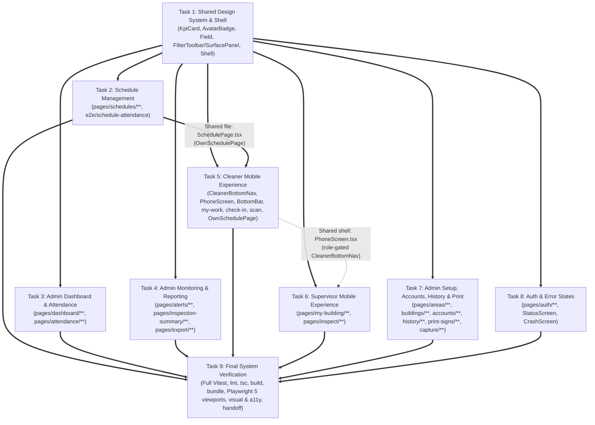

# UX/UI Redesign Implementation Plan (Approved 9-Task Revision)

> **For agentic workers:** REQUIRED SUB-SKILL: Use `sp-subagent-driven-development` (recommended) or `sp-executing-plans` to implement this plan task-by-task **only after explicit owner authorization to begin execution**. Steps use checkbox (`- [ ]`) syntax for tracking.

**Date:** 2026-11-19 (Asia/Bangkok)  
**Status:** Finalized 9-task execution-ready plan. **Planning-only — awaiting explicit implementation authorization.**  
**Baseline Commit:** `45a88f6` on `codex/cleaner-scheduling` (includes `48f6081` UX-01–03 and `45a88f6` idempotent Numbered6 attendance replay fix; do not repeat or modify that completed work).  
**Provenance:** Reconciled from the original 6-task technical baseline (`2026-11-19-ux-ui-redesign-implementation.md`), the 9-task review candidate (`2026-11-19-ux-ui-redesign-implementation-revised.md`), and the owner's final decisions (Expanded Scope + R-01 through R-05).

**Goal:** Deliver a complete, token-compliant UX/UI redesign across all 21 application routes (plus fallback/error screens) for Guest, Cleaner, Supervisor, and Admin roles based on `docs/design/ux-audit/mockups.html` and remaining UX audit items (`UX-04`, `UX-05`), while preserving 100% of existing business logic, API contracts, role authorization, QR/GPS security invariants, and printed QR sign geometry.

**Architecture:** Establish reusable, token-compliant shared UI primitives (`KpiCard`, `AvatarBadge`, `Field` `errorId`, shared `FilterToolbar` / `SurfacePanel` conventions, Enterprise Light shell alignment) in `frontend/src/shared/components/` using Tailwind 4 `@theme` tokens and `lucide-react` icons. Incrementally upgrade Schedule Management (clean cells, contextual action bar, 9 editors), Admin Dashboard & Attendance, Admin Monitoring & Reporting, Cleaner Mobile Suite (`CleanerBottomNav` + inline QR guidance), Supervisor Mobile Suite, Admin Setup/Accounts/History/Print screen controls (`UX-05`), and Authentication & Error States (`UX-04`), followed by full integrated verification across all 5 viewports (`320px`, `375px`, `430px`, `1024px`, `1280px`). Every new or refactored multi-state component separates presentation (`ComponentName.tsx`), state/handlers (`useComponentName.ts`), and types (`type.ts`).

**Tech Stack:** React 19, TypeScript 6, React Router 7, Redux Toolkit / RTK Query, Tailwind CSS 4 (`frontend/src/index.css` `@theme` tokens), `lucide-react`, Vitest + React Testing Library (`NODE_ENV=test`), Playwright E2E.

**Spec & Reference Documents:**
- [docs/design/ux-audit/mockups.html](../../design/ux-audit/mockups.html)
- [docs/design/ux-audit/README.md](../../design/ux-audit/README.md)
- [design-system/janitorial/MASTER.md](../../../design-system/janitorial/MASTER.md)
- [docs/agents/frontend-standards.md](../../agents/frontend-standards.md)
- [AGENTS.md](../../../AGENTS.md)
- [docs/handoff.md](../../handoff.md)

---

## Approved Final Decisions (R-01 through R-05)

These decisions are final for this implementation plan and must not be reversed or silently altered:

| ID | Decision | Implementation Consequence |
|---|---|---|
| **Scope** | **APPROVED — Expand 6 to 9 tasks** | Cover the complete application across Guest, Cleaner, Supervisor, and Admin roles (all 21 routes plus fallback/error screens, dialogs, and drawers). |
| **R-01** | **Option A — 4-Tab Cleaner Bottom Navigation** | Implement `CleanerBottomNav` with 4 tabs: `งานของฉัน`, `ลงเวลา`, `สแกน QR`, `ตารางเวร`. For `ลงเวลา` and `สแกน QR` when on non-tokenized routes, display clear inline camera-scan guidance (`Note tone="info" status`). Never fabricate QR tokens, bypass GPS/security requirements (`facility-0059`, `0060`), or expose unauthorized navigation routes. |
| **R-02** | **Keep Historical Time-Series Chart in Held Combined Overview Plan** | Keep the historical `07:00–19:00` time-series chart and cross-domain overview in the separate, currently paused plan (`docs/superpowers/plans/2026-11-16-combined-overview-dashboard.md`). For this redesign, `/dashboard` displays only metrics backed by existing real API data (`GET /api/service-points` and `GET /api/admin/buildings`). Never introduce synthetic metrics, fake employee headcounts, or unnecessary backend changes. |
| **R-03** | **Option A — Omit Decorative Global Topbar** | Do not add a decorative desktop global topbar. Preserve page-specific search controls, existing operational status indicators (`LiveBadge`), and the authoritative Admin alert navigation (`AdminNav` `รายการที่ขึ้นเตือน` with its 48px count badge slot). Do not implement nonfunctional `⌘K` global search or icon-only notification bell controls. |
| **R-04** | **Option A — Retain Enterprise Light White Admin Sidebar** | Retain the existing Enterprise Light white Admin sidebar (`bg-surface` per `facility-0087`). Do not introduce a Navy sidebar, runtime theme toggle, or unnecessary sidebar color tokens. Improve visual consistency strictly within the approved Enterprise Light theme. |
| **R-05** | **Preserve Deferred Scheduling Feature-Flag Behavior** | Preserve the previously deferred scheduling feature-flag behavior (`Scheduling__Enabled=false` default, empty scheduling 404, and current frontend fallback). Do not silently change the owner's rollout decisions. |

---

## Global Non-Negotiable Constraints

- **No backend, API, auth, or business-rule changes:** Preserve all business logic, backend API contracts, request/response shapes, role-based authorization (`cleaner`, `supervisor`, `admin`), scheduling/attendance semantics, and audit trails.
- **QR & GPS security invariants (`facility-0035`, `0037`, `0041`, `0048`, `0059`, `0060`):** Cleaners and Supervisors obtain QR tokens exclusively by scanning physical signs; never expose or fabricate QR tokens in navigation bars, cards, or links.
- **Authoritative real data only:** Do not add fake, synthetic, or hard-coded metrics to production components. Never relabel Area counts as Cleaner headcounts (`facility-0050`, `0116`).
- **Tailwind 4 `@theme` tokens only (`facility-0086`):** `frontend/src/index.css` is the sole CSS file. Never introduce raw hex values, raw Tailwind palette classes (`bg-blue-600`), dynamic class interpolation (`` `bg-${x}` ``), additional CSS files, or external UI/chart libraries.
- **Permanent Lucide iconography (`facility-0088`, `AGENTS.md`):** Use `lucide-react` exclusively (one named import per icon, stroke width `2`, `aria-hidden="true"`). Never use emojis, Unicode pictograms, or decorative symbols in UI, code, or documentation. Pair every action icon with a clear Thai text label (only owner-approved icon-only exceptions: `Toast` close button with `aria-label` and D4 round-window pill close control).
- **Accessibility & typography floors (`facility-0072`, `0087`):** Device system fonts only; minimum text contrast `>= 4.5:1`, icon/control border contrast `>= 3:1`; phone body `>= 16px` (`text-base`), Admin body `>= 14px` (`text-sm`), global floor `13px` (`text-xs`, except printed QR sign tokens `--text-sign-*`); touch/click targets `>= 48px` (`min-h-12`) on phone, `56px` (`min-h-14`) full-width on primary phone actions, `>= 36px` (`min-h-9`) on Admin desktop.
- **Printed QR sign preservation (`facility-0087` rule 8):** Preserve `SignCard.tsx`, `QrCode.tsx`, A4 sheet geometry (`210mm x 297mm`, `8mm` margin), and `@page` print CSS unchanged; only on-screen controls/chrome on `/admin/print` may be aligned.
- **Bundle & test budgets (`facility-0062`):** Keep main JS bundle `<= 200 kB` gzip, preserving `lazy()` loading on all Admin routes. Run all frontend Vitest suites with `NODE_ENV=test` (shell defaults to `NODE_ENV=production`).
- **Repository state preservation:** Never reset, stash, clean, or discard unrelated uncommitted local edits (agent skill scripts, `AGENTS.md`, `frontend-standards.md`, `mockups.html`, `handoff.md`, `handover.md`, `.commandcode/`, `docs/how-to-run-local.html`, `2026-11-19-ux-ui-redesign-implementation-revised.md`). Commit each verified task separately with explicit file staging.

---

## Phase 1 — Existing Application Inspection Summary

### 1.1 Current Frontend Architecture & State Management

- **Routing (`frontend/src/router.tsx`, `facility-0026`, `facility-0062`):**
  - Data-driven `RouteObject[]` fed to `createBrowserRouter` in `main.tsx` and `createMemoryRouter` in `renderApp.tsx`.
  - Entry-chunk phone/guest routes: `/`, `/login`, `/login/admin`, `/my-work`, `/my-schedule`, `/check-in/:token`, `/scan/:token` (`ByRole`: `cleaner -> ScanPage`, `supervisor -> InspectPage`), `/my-building`, `/schedule-management`, `*` (`StatusScreen`), and root `errorElement` (`CrashScreen`) / `hydrateFallbackElement` (`Splash`).
  - Lazy-loaded Admin routes: `/dashboard`, `/admin/attendance`, `/admin/schedules`, `/admin/alerts`, `/admin/inspection-summary`, `/admin/export`, `/admin/areas/:areaId?`, `/admin/areas/new`, `/admin/areas/:areaId/edit`, `/admin/areas/:areaId/capture`, `/admin/buildings`, `/admin/print`, `/admin/accounts`, `/admin/history`.
- **Data Fetching & Live Updates (`frontend/src/shared/api/`):**
  - RTK Query (`baseApi`) owns all REST reads and mutations (`facility-0022`).
  - SignalR (`scanHub.ts`) pushes real-time invalidations/patches (`ScanRecorded`, `InspectionRecorded`, `AttendanceRecorded`, `ScheduleChanged`) with a `10s` Admin server timeout (`facility-0107`) and immediate refetch on reconnect (`facility-0064`).
  - Minimal Redux slices: `authSlice`, `hubSlice`, `dashboardSlice`, `scheduleViewSlice` (cleared on reload per `facility-0218`).
- **Completed Foundations (Already Committed — Do Not Redo):**
  - `48f6081`: `UX-01` (`CheckInPage` pending-aware read retry), `UX-02` (`AppLayout` / `AdminNav` mobile disclosure, skip link, compact Supervisor header), `UX-03` (`HorizontalScrollArea` keyboard scroll regions, sticky roster name column, mobile scroll hints).
  - `45a88f6`: Idempotent `Numbered6` attendance replay before state revision check in `AttendanceEndpoints.RecordAsync`.

### 1.2 Architecture & Component Data Flow

```mermaid
flowchart TD
    subgraph Shared["Task 1: frontend/src/shared/components"]
        KPI["KpiCard"]
        AV["AvatarBadge"]
        FLD["Field (errorId + aria-describedby)"]
        FTB["FilterToolbar / SurfacePanel conventions"]
        SHELL["AppLayout / AdminNav (Enterprise Light)"]
        BOX["Table & HorizontalScrollArea"]
    end

    subgraph Schedules["Task 2: pages/schedules"]
        SP["SchedulePage / useSchedulePage"]
        SBAR["ScheduleContextBar"]
        SSUM["ScheduleSummaryCards"]
        SED["9 Lazy Editors + ReliefDuties + RelatedTransfers"]
        SP --> SBAR & SSUM & SED & KPI & AV & BOX & FTB
    end

    subgraph AdminLive["Task 3: pages/dashboard & attendance"]
        DB["DashboardPage / Filters / BuildingSummary"]
        AT["AttendancePage / BoardControls / AttendanceTable / CorrectionForm / CoverDrawer"]
        DB --> KPI & BOX & FTB
        AT --> KPI & AV & BOX & FTB
    end

    subgraph AdminReport["Task 4: pages/alerts & inspection-summary & export"]
        AL["AlertsPage / EmptyAreas / CoversThisShift / AlertTable / CoverForm"]
        IS["InspectionSummaryPage / SummaryTable"]
        EX["ExportPage / ExportBuildings"]
        AL --> KPI & FTB & BOX
        IS --> KPI & FTB & BOX
        EX --> FTB
    end

    subgraph CleanerMobile["Task 5: Cleaner Mobile"]
        BNAV["CleanerBottomNav (R-01)"]
        PS["PhoneScreen / BottomBar stacking"]
        MW["MyWorkPage / NextJob / WorkGroup"]
        OS["OwnSchedulePage"]
        CI["CheckInPage / AttendanceTimeline"]
        SC["ScanPage / SubmitForm / SubmitResult"]
        PS --> BNAV
        MW & OS & CI & SC --> PS
    end

    subgraph SupMobile["Task 6: Supervisor Mobile"]
        MB["MyBuildingPage / BuildingCard"]
        IN["InspectPage / InspectForm / InspectResult"]
        MB & IN --> PS
    end

    subgraph AdminSetup["Task 7: Admin Setup, History & Print"]
        AR["AreasPage / AreaFormPage / CapturePage / Drawers"]
        BD["BuildingsPage / BuildingDrawer"]
        AC["AccountsPage / AccountForms"]
        HI["HistoryPage / HistoryControls"]
        PR["PrintSignsPage (screen chrome only)"]
        AR & BD & AC & HI & PR --> FTB & BOX
    end

    subgraph AuthFallback["Task 8: Auth & Fallbacks"]
        LG["LoginPage (UX-04) / AdminLoginPage"]
        ST["StatusScreen / CrashScreen"]
        LG --> FLD
    end
```

---

## Phase 2 — Complete Design-to-Code Mapping & Feature Preservation Matrix

### 2.1 Complete Route & Component Coverage (All 21 Routes + Fallbacks)

| Role | Route | Page / Components | Dialogs, Drawers & States | Primary Task | Visual Reference |
|---|---|---|---|---|---|
| All | `/` | `HomeRedirect` | Role redirect, `Splash` | 8, 9 | Router contract |
| Guest | `/login` | `LoginPage`, `useLogin` | `UX-04` 401 vs 429/503 error association, deep QR redirect | 8 | `README.md` F04/UX-04 |
| Guest | `/login/admin` | `AdminLoginPage`, `useAdminLoginPage` | Show/hide password, 401 vs 429/503, Enterprise Light card | 8 | `MASTER.md` D0 |
| All | `*`, Error | `StatusScreen`, `CrashScreen`, `Splash` | 404, 403, route crash reload | 8 | `MASTER.md` States |
| Cleaner | `/my-work` | `MyWorkPage`, `NextJob`, `WorkGroup` | `CleanerBottomNav`, 4 mini KPIs, Shift Banner, `OffShift`, retry | 5 | `mockups.html` 2057–2176 |
| Cleaner | `/my-schedule` | `OwnSchedulePage` (in `SchedulePage.tsx`) | `CleanerBottomNav`, today highlight, week nav, unavailable/empty | 5 (after 2) | `mockups.html` 2178–2248 |
| Cleaner | `/check-in/:token` | `CheckInPage`, `AttendanceTimeline` | `CleanerBottomNav` + `BottomBar` stacking, gap confirmation, transfer arrival, `UX-01` retry, `BlockedScanScreen`, `LocationHelp` | 5 | `mockups.html` 2250–2326 |
| Cleaner | `/scan/:token` | `ScanPage`, `SubmitForm`, `SubmitResult`, `OffDuty`, `SendFailed` | `CleanerBottomNav` + `BottomBar` stacking, `ChoiceTile`, `ToggleChip`, GPS/blocked states | 5 | `mockups.html` 2328–2391 |
| Supervisor | `/my-building` | `MyBuildingPage`, `BuildingCard` | 3 real KPI tiles (`รอตรวจ`, `รอแม่บ้านแก้`, `ตรวจผ่าน`), cover banner, off-shift warn, no `CleanerBottomNav` | 6 | `MASTER.md` M15 + `mockups.html` phone conventions |
| Supervisor | `/scan/:token` | `InspectPage`, `InspectForm`, `InspectResult`, `InspectSendFailed`, `NothingToInspect` | `ChoiceTile` (`สะอาด`/`ไม่สะอาด`), 409 concurrency reload, `DistanceLine`, GPS/blocked states | 6 | `MASTER.md` M2/M6–M8/M12/M16 |
| Supervisor | `/schedule-management` | `ScheduleManagementPage`, `SchedulePage`, `ScheduleContextBar`, `ScheduleSummaryCards` | Compact Supervisor header, 9 lazy editors, `ReliefDuties`, `RelatedTransfers`, `ScheduleConflict`, `ScheduleReview`, `ScheduleHistory` | 2 | `mockups.html` 1527–1741, 2434–2511 |
| Admin | `/admin/schedules` | `AdminSchedulesPage`, `SchedulePage`, `ScheduleContextBar`, `ScheduleSummaryCards` | Building/shift filters, 9 lazy editors, `ReliefDuties`, `RelatedTransfers` | 2 | `mockups.html` 1527–1741, 2434–2511 |
| Admin | `/dashboard` | `DashboardPage`, `Filters`, `BuildingSummary`, `PointTile` | 6 status KPI filter cards, real `BuildingSummary` (buttons only, zero `<a>` in `<main>`), `QuietArea` | 3 | `mockups.html` 1277–1522 (filtered by R-02) |
| Admin | `/admin/attendance` | `AttendancePage`, `BoardControls`, `AttendanceTable`, `CorrectionForm`, `CoverDrawer` | 5 `KpiCard` tiles (`as="li"`), `FilterToolbar`, `AvatarBadge`, Legacy4/Numbered6 columns, `CorrectionForm` modal, `CoverDrawer` | 3 | `mockups.html` 1746–1904 |
| Admin | `/admin/alerts` | `AlertsPage`, `EmptyAreas`, `CoversThisShift`, `AlertTable`, `CoverForm` | Shift-ahead picker, inline `CoverForm`, alert tabs, review filter, `Toast`, read retry | 4 | `MASTER.md` D3 + Task 1 shared patterns |
| Admin | `/admin/inspection-summary` | `InspectionSummaryPage`, `SummaryTable`, `SummaryRowDetails` | Date presets/custom range, shift/building filters, non-ranking info note, expandable row details, read retry | 4 | `MASTER.md` D7 + Task 1 shared patterns |
| Admin | `/admin/export` | `ExportPage`, `ExportBuildings` | Dataset cards, date range, building picker, PDPA acknowledgement, summary aside, read retry | 4 | `MASTER.md` D8 + Task 1 shared patterns |
| Admin | `/admin/areas/:areaId?`, `/new`, `/edit` | `AreasPage`, `AreaList`, `AreaDetailPanel`, `AreaFormPage`, `AreaEditorDrawer`, `PointEditor`, `PointTable`, `SignPanel`, `CheckInSignManagement` | `UX-05` read retry, drawers, `ConfirmationDialog`, unsaved-change protection | 7 | `mockups.html` 1909–2052, `README.md` UX-05 |
| Admin | `/admin/areas/:areaId/capture` | `CapturePage` | Phone-width GPS capture, `UX-05` read retry | 7 | `MASTER.md` M17, `README.md` UX-05 |
| Admin | `/admin/buildings` | `BuildingsPage`, `BuildingTable`, `BuildingDrawer` | `UX-05` read retry, drawer consistency | 7 | `mockups.html` 1909–2052, `README.md` UX-05 |
| Admin | `/admin/accounts` | `AccountsPage`, `AccountTable`, `CreateAccountForm`, `EditAccountForm`, `SecretForms`, `DeactivateConfirm` | Role tabs, status filter, search, drawers, independent credential saves | 7 | `mockups.html` 1909–2052 |
| Admin | `/admin/history` | `HistoryPage`, `HistoryControls`, `HistoryTable`, `HistoryChangeValue` | `UX-05` log query retry, actor retry, cursor pagination | 7 | `mockups.html` 1909–2052, `README.md` UX-05 |
| Admin | `/admin/print` | `PrintSignsPage`, `SignCard`, `QrCode` | On-screen toolbar alignment only; printed A4 `SignCard`/`QrCode`/`@page` untouched | 7 | `MASTER.md` D5 (`facility-0087` rule 8) |

### 2.2 Feature Preservation Matrix

Every existing user action across all routes and roles is preserved with zero silent removals:

| Role | Route | Existing Action / Feature | Current Trigger | Target Location & Trigger | Preserved Contract / Test Selector |
|---|---|---|---|---|---|
| Guest | `/login` | Employee login (`employeeId` + `phone`), deep QR redirect | `LoginPage` form + `เข้าสู่ระบบ` | Enhanced with dual-field `aria-invalid` & `aria-describedby` on 401 (`UX-04`), valid on 429/503 | `POST /api/auth/login`, `location.state` |
| Guest | `/login/admin` | Admin login (`username` + `password`) + show/hide | `AdminLoginPage` form | Visually aligned Enterprise Light card; same 401 vs 429/503 contract | `POST /api/auth/login` |
| Cleaner | `/my-work` | Urgent job (`ทำอันนี้ก่อน`), progress, grouped lists, `ตารางของฉัน`, `อัปเดต`, `ออกจากระบบ` | `NextJob`, `Progress`, `WorkGroup`, `ScheduleLink`, footer | 4 mini KPI tiles + Shift Banner + `NextJob` `MapPin` badge + `CleanerBottomNav` (`ตารางเวร` distinct from `ScheduleLink` `ตารางของฉัน`) | `h2` list `['ทำอันนี้ก่อน','ต้องทำต่อ','ส่งแล้ว','ยังไม่ต้องทำ']`, `progressbar` `"ความคืบหน้า"` |
| Cleaner | `/my-schedule` | Week step (`สัปดาห์ก่อนหน้า`, `สัปดาห์ถัดไป`), `อัปเดต`, return `งานของฉัน` | `WeekControls`, `BottomBar`, `PhoneHeader` | Today highlight, semantic day pills + `CleanerBottomNav` | `GET /api/schedules/me` |
| Cleaner | `/check-in/:token` | 4/6-step timeline, record attendance, gap confirmation, transfer arrival, `UX-01` retry | `AttendanceTimeline`, `BottomBar` | Enhanced step cards + gap box + `BottomBar` stacked cleanly above `CleanerBottomNav` | `POST /api/attendance`, `POST /api/area-transfers/:id/confirm`, `list` `"วันนี้"` |
| Cleaner | `/scan/:token` | `เรียบร้อย` / `พบปัญหา`, `ToggleChip` tags, `หมายเหตุ`, `ส่งงาน` | `SubmitForm`, `BottomBar` | Enhanced `ChoiceTile` badges + `BottomBar` stacked above `CleanerBottomNav` | `POST /api/scan-records` |
| Supervisor | `/my-building` | 3 counts (`รอตรวจ`, `รอแม่บ้านแก้`, `ตรวจผ่าน`), `จัดตารางงาน`, building point cards, `อัปเดต`, `ออกจากระบบ` | `PhoneHeader` `Summary`, `ScheduleLink`, `BuildingList`, footer | Enhanced hierarchy, `BuildingCard` alignment, Lucide icons; no `CleanerBottomNav`, no QR links | `list` `"สรุปการตรวจ"`, `link` `"จัดตารางงาน"`, `GET /api/my-building` |
| Supervisor | `/scan/:token` | Inspect (`สะอาด` / `ไม่สะอาด`), defect note, `บันทึกผลตรวจ`, 409 reload, GPS/blocked | `InspectForm`, `InspectResult`, `NothingToInspect` | Aligned `ChoiceTile` and result/error states; no `CleanerBottomNav` | `POST /api/inspections`, `facility-0029`, 409 refresh |
| Supervisor & Admin | `/schedule-management`, `/admin/schedules` | Week step, `อัปเดต`, Admin building/shift filters, 9 editors, `ReliefDuties`, `RelatedTransfers`, history | Inline buttons inside every row/cell + top buttons | Clean interactive cells (`aria-pressed`), 4 `KpiCard` summary cards, `ScheduleContextBar` (`role="region"`), top global actions | All 9 editor flows, `GET /api/schedules`, `POST /api/schedules/commands` |
| Admin | `/dashboard` | 6 status cards, building select, `มีปัญหาที่แจ้ง`, search, `เรียงพื้นที่ที่มีปัญหาขึ้นก่อน`, `QuietArea` | `Filters`, `DashboardPage` | Enhanced 6 status cards + real `BuildingSummary` (buttons only, zero `<a>` in `<main>`) | `GET /api/service-points`, `GET /api/admin/buildings`, `DashboardPage.test.tsx` |
| Admin | `/admin/attendance` | 5 counts, shift/date/building/search filters, 25-row pagination, 4/6 lifecycle cols, `แก้เวลา`, `หาคนทำแทน` | `Tiles`, `BoardControls`, `AttendanceTable`, `CorrectionForm`, `CoverDrawer` | `KpiCard as="li"` (exact `listitem` text), `FilterToolbar`, `AvatarBadge` in `Who`, aligned overlays | `GET /api/admin/attendance`, `PUT /api/admin/attendance`, covers |
| Admin | `/admin/alerts` | Shift-ahead empty areas, assign/cancel cover, scan alert tabs (`สแกนผิดที่`, `สแกนไกลป้าย`, `ลืมลงเวลาเลิกงาน`), review filter | `EmptyAreas`, `CoversThisShift`, `CoverForm`, `AlertTable` | Shared KPI/toolbar/icon alignment, full `CoverForm` & read-retry audit | `GET /api/admin/alerts`, `POST /api/cover-assignments` |
| Admin | `/admin/inspection-summary` | Date presets/custom range, shift/building filter, non-ranking note, expandable supervisor rows | `InspectionSummaryPage`, `SummaryTable`, `SummaryRowDetails` | Shared toolbar/header alignment, authentic aggregate KPIs (no ranking/scoring), read retry | `GET /api/admin/inspection-summary`, `facility-0100` |
| Admin | `/admin/export` | Dataset checkboxes, date range (1–31 days), building selector, PDPA ack, Excel download | `ExportPage`, `ExportBuildings` | Shared surface/header alignment, consistent responsive grid, read retry | `POST /api/admin/export`, PDPA gate unchanged |
| Admin | `/admin/areas/*`, `/capture`, `/buildings`, `/accounts`, `/history`, `/print` | Full CRUD, QR sign rotate/capture, role tabs, credential resets, audit log filters, print sheets | Setup pages, drawers, modals, `SignCard` | Section icons, unified toolbars/drawers, `UX-05` scoped read retries; printed QR layout untouched | All D4/D5/D6/D9/D10/D15/M17 tests |

### 2.3 Prototype-Only Elements Excluded by Approved Decisions

1. **Direct bottom-nav/card navigation to `/check-in/:token` or `/scan/:token` without scanning a physical QR sign** -> Replaced by R-01 Option A inline camera-scan guidance (`facility-0059`, `0060`).
2. **Historical `07:00–19:00` time-series chart, `/dashboard` date/shift picker, and `"168 / 170 คน"` headcount** -> Excluded per R-02; remains in the held Combined Overview Dashboard plan (`2026-11-16-combined-overview-dashboard.md`).
3. **Global desktop topbar (`⌘K` search + icon-only notification bell)** -> Excluded per R-03 Option A; retain page-scoped search and `AdminNav` alert badge.
4. **Navy sidebar theme toggle and prototype studio switcher** -> Excluded per R-04 Option A; retain Enterprise Light white sidebar (`bg-surface`).
5. **Client-side `"แสดงครบ 6 ขั้นตอน (Numbered6)"` checkbox on `/admin/attendance`** -> Excluded; table columns are strictly driven by `board.lifecycleVersion` from the API.

---

## Phase 3 — Architecture, Tokens, and Shared Component Conventions

### 3.1 Design Tokens (`frontend/src/index.css` `@theme`)

`frontend/src/index.css` requires **zero new color tokens** (R-04). All tasks use the existing `@theme` tokens:
- **Surfaces:** `bg-bg` (`#f4f6f8`), `bg-surface` (`#ffffff`), `bg-surface-2` (`#f9fafb`), `bg-skeleton` (`#e9edf1`).
- **Typography:** `text-text` (`#202936`, 14.5:1), `text-text-2` (`#667085`, 4.8:1), `text-text-3` (`#344054`).
- **Borders:** `border-border` (`#e0e5eb` dividers), `border-border-control` (`#858f9e` controls, 3.3:1).
- **Interactive Accent:** `bg-accent` / `text-accent` / `border-accent` (`#2457c5`, 6.5:1), `hover:bg-accent-hover` (`#1d4aa8`), `bg-accent-subtle` (`#eef3fc`), `text-on-accent` (`#ffffff`).
- **Semantic Status:** `rework` (`#b42318`), `overdue` (`#b45309`), `pending` (`#0b6e8a`), `passed` (`#16803c`), `break` (`#6941c6`), `idle` (`#5b6474`) with `-bg`, `-border`, and `-strong` variants.
- **Printed Sign (D5 only):** `--color-sign-*` and `--text-sign-*` tokens remain exclusive to `SignCard.tsx` and `PrintSignsPage.tsx`.

### 3.2 Shared Primitives Established in Task 1

1. **`KpiCard` (`frontend/src/shared/components/KpiCard/`):** `size-10 rounded-full` semantic icon badge (`blue`, `green`, `amber`, `red`, `purple`, `neutral`), `text-xs font-semibold text-text-2` label, `text-2xl font-bold tabular-nums` value with optional `unit`, optional accessible `role="progressbar"`, and `as?: 'div' | 'li'` (preserving `<ul aria-label="...">` listitem semantics).
2. **`AvatarBadge` (`frontend/src/shared/components/AvatarBadge/`):** `aria-hidden="true"` `size-8.5 rounded-full font-bold text-sm` initial badge (`blue`, `teal`, `amber`, `purple`, `neutral`).
3. **`Field` `errorId` (`frontend/src/shared/components/Field.tsx`):** Optional `errorId?: string` appended to `aria-describedby` alongside `helpId` and any child `aria-describedby`, without altering behavior when `errorId` is omitted.
4. **`FilterToolbar` & `SurfacePanel` (`frontend/src/shared/components/SurfacePanel.tsx` or `Boxes.tsx`):** Thin, token-backed layout wrappers (`rounded-lg border border-border bg-surface px-4 py-3` for filter toolbars; `rounded-xl border border-border bg-surface` for structured content panels) so pages share consistent spacing, borders, and responsive wrapping without duplicating class strings or introducing `@apply`.

---

## Phase 4 — Dependency Graph, Conflict Analysis, and Execution Sequence

### 4.1 Explicit Dependency Graph

*Legend: Solid thick arrows (`==>`) = hard dependencies; dashed arrows (`-.->`) = shared-shell integration dependency.*

### 4.2 File-Level Merge Conflict & Parallelization Analysis

| Potential Conflict Surface | Conflicting Tasks | Mitigation / Ordering Rule |
|---|---|---|
| `frontend/src/pages/schedules/SchedulePage/SchedulePage.tsx` | **Task 2** (`ManagementWeekPage`) vs. **Task 5** (`OwnSchedulePage`) | **Hard sequence:** Run Task 5 **after** Task 2 merges (or have Task 2 keep `OwnSchedulePage` cleanly separated so Task 5 only updates `OwnSchedulePage` after Task 2 lands). Never edit `SchedulePage.tsx` concurrently. |
| `frontend/src/shared/components/PhoneScreen.tsx` & `BottomBar.tsx` | **Task 5** (adds `CleanerBottomNav` & stacking) vs. **Task 6** (Supervisor phone screens consume `PhoneScreen`) | **Soft sequence:** Task 5 exclusively owns `PhoneScreen.tsx` and `BottomBar.tsx`. Task 6 only edits `pages/my-building/**` and `pages/inspect/**` and verifies after Task 5 that `CleanerBottomNav` never renders for Supervisors. |
| `frontend/src/shared/components/StatusScreen.tsx` & `CrashScreen.tsx` | **Task 8** (edits fallback screens) vs. **Tasks 5, 6, 7** (consume `StatusScreen`) | Task 8 exclusively owns `StatusScreen.tsx` and `CrashScreen.tsx` and preserves their prop interfaces unchanged; Tasks 5–7 do not edit these files. |
| `frontend/src/shared/components/Boxes.tsx`, `Field.tsx`, `AppLayout.tsx`, `AdminNav.tsx` | **Task 1** vs. **Tasks 2–8** | **Hard sequence:** Task 1 completes and merges first; Tasks 2–8 treat Task 1 shared primitives as read-only (any missing shared prop requires a coordinated stop, not an ad-hoc edit). |
| `frontend/src/index.css` | All tasks | **Read-only** across Tasks 1–9 (no new tokens per R-04; `@page` print CSS untouched). |
| `docs/handoff.md` & `frontend/e2e/desktop/ux-01-03-review-regressions.spec.ts` | **Task 9** | Owned exclusively by Task 9 during final verification. |

### 4.3 Execution Waves & Integration Checkpoints

1. **Wave 0 (Sequential — Foundation):** Execute **Task 1**.
   - **Integration Checkpoint 1:** Run `NODE_ENV=test npm --prefix frontend test -- --run src/shared/components`, `npm --prefix frontend run lint`, and `npm --prefix frontend run build`. Merge/commit Task 1 before starting Wave 1.
2. **Wave 1 (Parallelizable in Isolated Worktrees — Disjoint File Sets):** Execute **Tasks 2, 3, 4, 7, 8** (concurrently only if each worker uses a dedicated git worktree and disjoint file ownership; otherwise run sequentially in order `2 -> 3 -> 4 -> 7 -> 8`).
   - **Integration Checkpoint 2:** Integrate Wave 1 tasks onto the integration branch. Run full `NODE_ENV=test npm --prefix frontend test -- --run`, `lint`, and `build` before starting Wave 2.
3. **Wave 2 (Sequential Mobile Integration):** Execute **Task 5** (after Task 2 is integrated), then **Task 6** (verifying Supervisor screens against Task 5's `PhoneScreen.tsx`).
   - **Integration Checkpoint 3:** Integrate Wave 2 tasks. Run full `NODE_ENV=test npm --prefix frontend test -- --run`, `lint`, and `build`.
4. **Wave 3 (Sequential — Final Verification & Handoff):** Execute **Task 9** on the fully integrated head.

---

## Phase 5 — Detailed Nine-Task Implementation Plan & Acceptance Criteria

---

### Task 1 — Shared Design System and Application Shell

1. **Exact implementation objective:** Create the reusable shared UI primitives (`KpiCard`, `AvatarBadge`, `FilterToolbar`/`SurfacePanel`), extend `Field` with optional `errorId` support for `aria-describedby` composition, and verify Enterprise Light `AppLayout`/`AdminNav` alignment (R-03, R-04) and permanent Lucide iconography rules (`facility-0088`).
2. **Scope and affected files:**
   - Create: `frontend/src/shared/components/KpiCard/type.ts`, `KpiCard.tsx`, `KpiCard.test.tsx`
   - Create: `frontend/src/shared/components/AvatarBadge/type.ts`, `AvatarBadge.tsx`
   - Create: `frontend/src/shared/components/SurfacePanel.tsx` (exports `SurfacePanel` and `FilterToolbar`)
   - Modify: `frontend/src/shared/components/Field.tsx`, `frontend/src/shared/components/Field.test.tsx`
   - Audit/Align (only if spacing/consistency drift exists): `frontend/src/shared/components/AppLayout.tsx`, `frontend/src/shared/components/AdminNav.tsx`
3. **Existing requirements and relevant contracts:** `facility-0086` (Tailwind 4 tokens only), `facility-0087` (Enterprise Light, contrast, type/target minimums), `facility-0088` (Lucide icons, no emojis, no icon-only actions), `UX-02` (existing mobile Admin disclosure & skip link), `UX-04` (`Field` `errorId`), R-03 (no decorative topbar), R-04 (retain white `bg-surface` Admin sidebar).
4. **Approved visual references:** `docs/design/ux-audit/mockups.html` lines 405–453 (`.kpi-card`, `.kpi-icon-circle`, `.kpi-progress-row`), lines 530–544 (`.emp-avatar`), `design-system/janitorial/MASTER.md`.
5. **Feature preservation requirements:**
   - `Field` without `errorId` produces byte-identical `aria-describedby` to current behavior.
   - `AdminNav` keeps all 11 navigation links, active `aria-current="page"`, 48px alert count slot (`999+` cap), Escape/focus-return mobile disclosure, and `SkipToContent`.
   - No decorative global topbar, no Navy sidebar, no theme toggle, no new color tokens in `index.css`.
6. **Accessibility expectations:** `KpiCard` `progressbar` exposes `aria-label`, `aria-valuemin="0"`, `aria-valuemax="100"`, `aria-valuenow`; `AvatarBadge` has `aria-hidden="true"`; all Lucide icons have `aria-hidden="true"`; `Field` concatenates `helpId`, `errorId`, and existing child `aria-describedby` cleanly; visible `focusRing` on all interactive shell controls.
7. **Responsive breakpoints:** Verified at `320px`, `375px`, `430px`, `1024px`, `1280px` (Admin sidebar persists at `>= 1024px`, collapses into `เมนูแอดมิน` disclosure at `< 1024px`).
8. **Required tests:** `KpiCard.test.tsx` (covering `div` and `as="li"` textContent compatibility, `progressbar`, `AvatarBadge` Thai/Latin initial extraction), `Field.test.tsx` (combining `helpId` + `errorId`), `AdminNav.test.tsx`, `Boxes.test.tsx`.
9. **Visual verification requirements:** Verified in consumer tasks (Tasks 2–8) and Task 9 screenshots; inspect `AdminNav` at `375px` and `1280px` if touched.
10. **Definition of Done:** All shared component tests pass under `NODE_ENV=test`, `npm --prefix frontend run lint` and `npm --prefix frontend run build` pass, zero raw hex/palette classes or emojis introduced, committed cleanly as Task 1.

**Implementation Checklist:**
- [ ] Write failing tests in `KpiCard.test.tsx` (testing `KpiCard` `div`/`li` modes, `progressbar`, `AvatarBadge`) and `Field.test.tsx` (`errorId` composition).
- [ ] Run `NODE_ENV=test npm --prefix frontend test -- --run src/shared/components/KpiCard/KpiCard.test.tsx src/shared/components/Field.test.tsx` and confirm RED.
- [ ] Implement `KpiCard/type.ts`, `KpiCard/KpiCard.tsx`, `AvatarBadge/type.ts`, `AvatarBadge/AvatarBadge.tsx`, `SurfacePanel.tsx` (`SurfacePanel`, `FilterToolbar`), and `Field.tsx` `errorId`.
- [ ] Audit `AppLayout.tsx` and `AdminNav.tsx` for spacing/icon consistency within Enterprise Light (R-03, R-04).
- [ ] Run `NODE_ENV=test npm --prefix frontend test -- --run src/shared/components` and `npm --prefix frontend run lint` and confirm GREEN.
- [ ] Commit Task 1 with `NODE_ENV=test`.

---

### Task 2 — Schedule Management

1. **Exact implementation objective:** Refactor `/admin/schedules` and `/schedule-management` to the approved Clean Roster design: replace repeated per-cell inline action stacks with clean state-first interactive cells, add 4 real-data `KpiCard` summary cards (`ScheduleSummaryCards`), add `ScheduleContextBar` below the table for all per-person/per-day actions, add `AvatarBadge` to sticky person row headers, and visually align `ReliefDuties`, `RelatedTransfers`, `ScheduleConflict`, `ScheduleReview`, `ScheduleHistory`, and all 9 schedule editors for mobile and desktop.
2. **Scope and affected files:**
   - Modify: `frontend/src/pages/schedules/SchedulePage/type.ts`, `useSchedulePage.ts`, `SchedulePage.tsx`, `SchedulePage.test.tsx`
   - Create: `frontend/src/pages/schedules/SchedulePage/ScheduleSummaryCards.tsx`, `ScheduleContextBar.tsx`
   - Align (visual/responsive/icon consistency only, preserving all command logic):
     - `frontend/src/pages/schedules/WeeklyOffEditor/`
     - `frontend/src/pages/schedules/RegularBaselineEditor/`
     - `frontend/src/pages/schedules/DatedScheduleEditor/` (+ `DatedScheduleEditor.test.tsx` cell selection update)
     - `frontend/src/pages/schedules/ReliefRosterEditor/`
     - `frontend/src/pages/schedules/ReliefAssignmentEditor/`
     - `frontend/src/pages/schedules/ReliefLoanEditor/`
     - `frontend/src/pages/schedules/TeamMissingTime/`
     - `frontend/src/pages/schedules/TransferInstruction/`
     - `frontend/src/pages/schedules/ScheduleHistory/`, `ScheduleConflict/`, `ScheduleReview/`
   - Modify: `frontend/e2e/phone/schedule-attendance.spec.ts` (select target cell before clicking contextual dated edit button)
   - *Note:* Leave `OwnSchedulePage` (`/my-schedule`) behavior intact for Task 5 (do not mix Cleaner bottom nav into Task 2).
3. **Existing requirements and relevant contracts:** `facility-0176–0222` (schedule authority, effective dates, revisions, command tokens, durable receipts, relief loan attestation, midshift transfer, missing-time correction, in-memory selection `facility-0218`, R-05 deferred feature flag untouched).
4. **Approved visual references:** `docs/design/ux-audit/mockups.html` lines 1527–1741 (`renderScheduleContent`) and lines 2434–2511 (`renderScheduleRedesignExploration`).
5. **Feature preservation requirements:**
   - Every existing action remains reachable: global actions (`จัดวันหยุดรายสัปดาห์`, `จัดตารางประจำสแปร์`, `มอบหมายงานสแปร์`, `บันทึกการยืมสแปร์`) in top toolbar; per-cell/per-person actions (`แก้เฉพาะวันที่` / `แก้ไขแผนย้อนหลัง`, `แก้ตารางประจำ`, `เพิ่มเวลาที่ขาด`, `ย้ายพื้นที่`, `ประวัติการแก้ไขแผน`) in `ScheduleContextBar`.
   - Admin vs. Supervisor permission gates unchanged (Supervisor-only `TeamSlotActions`; Admin building/shift filters).
   - `ReliefDuties` (`งานสแปร์ที่บันทึก`), `RelatedTransfers` (`การย้ายพื้นที่ที่เกี่ยวข้อง`), stale/reconnecting banner, filter-dropped note (`facility-0185`), empty/unavailable week states preserved verbatim.
   - Default selection picks `week.rows[0]` + `businessDate` (or first day in week) on load so `ScheduleContextBar` is immediately populated.
6. **Accessibility expectations:**
   - Sticky leading column (`sticky left-0 z-10` on `<th scope="row">`, `z-20` on `<th scope="col">`) inside `<HorizontalScrollArea label="ตารางงานรายสัปดาห์" leadingOverlayWidth={160}>` with `UX-03` Tab/Shift+Tab scroll-padding preserved.
   - Every day cell button has `aria-pressed={isSelected}` and explicit `aria-label="เลือกช่อง ${person.displayName} ${formatWeekday(day.date)} ${formatShiftDate(day.date)}"`.
   - `ScheduleContextBar` uses `<section role="region" aria-label="คำสั่งตามบริบทของช่องที่เลือก">` and preserves exact `aria-label` patterns on contextual action buttons.
   - All 9 editor modals/drawers retain native `<dialog>` focus management and Escape dismissal.
7. **Responsive breakpoints:** `320px`, `375px`, `430px`, `1024px`, `1280px` — zero document horizontal overflow; sticky name column stays visible during horizontal roster scroll; all 9 editors usable without clipping at `320px` and `375px`.
8. **Required tests:** All suites under `frontend/src/pages/schedules/**` (`SchedulePage.test.tsx`, `DatedScheduleEditor.test.tsx`, `RegularBaselineEditor.test.tsx`, `WeeklyOffEditor.test.tsx`, `ReliefRosterEditor.test.tsx`, `ReliefAssignmentEditor.test.tsx`, `ReliefLoanEditor.test.tsx`, `TeamMissingTime.test.tsx`, `TransferInstruction.test.tsx`, `ScheduleHistory.test.tsx`, `ScheduleConflict.test.tsx`, `ScheduleReview.test.tsx`, `scheduleRules.test.ts`, `commandRules.test.ts`).
9. **Visual verification requirements:** Screenshots of `/admin/schedules` (`1280px`, `1024px`, `430px`, `375px`, `320px`), `/schedule-management` (`1280px`, `375px`, `320px`), and open schedule editor dialog at `375px` and `1280px`.
10. **Definition of Done:** All schedule unit tests pass under `NODE_ENV=test`, lint and build pass, zero inline cell action stacks remain, all 9 editors verified responsive, committed cleanly as Task 2.

**Implementation Checklist:**
- [ ] Write failing tests in `SchedulePage.test.tsx` for 4 `ScheduleSummaryCards`, clean cell selection (`aria-pressed`), and `ScheduleContextBar` switching between today (`แก้เฉพาะวันที่`) and past (`แก้ไขแผนย้อนหลัง`).
- [ ] Extend `type.ts` and `useSchedulePage.ts` with `businessDate`, `selectedCell`, and `selectCell`.
- [ ] Create `ScheduleSummaryCards.tsx` and `ScheduleContextBar.tsx` using `KpiCard` and `Button`.
- [ ] Update `SchedulePage.tsx` (`ManagementWeekPage`, `ManagementWeek`, `Cell`) with `AvatarBadge`, clean status pills (`ทำงาน`, `ลา`, `หยุด`, `ไม่กำหนด`, `ไม่มีข้อมูล`), today highlight, and `FilterToolbar`.
- [ ] Align visual/responsive layout and Lucide icons across `ReliefDuties`, `RelatedTransfers`, and the 9 lazy schedule editors.
- [ ] Update `DatedScheduleEditor.test.tsx` and `frontend/e2e/phone/schedule-attendance.spec.ts` to select the target cell before invoking contextual actions.
- [ ] Run `NODE_ENV=test npm --prefix frontend test -- --run src/pages/schedules` and `npm --prefix frontend run lint` and confirm GREEN.
- [ ] Commit Task 2 with `NODE_ENV=test`.

---

### Task 3 — Admin Dashboard and Attendance

1. **Exact implementation objective:** Upgrade `/dashboard` (6 status KPI filter cards + real API-backed `BuildingSummary` progress table) and `/admin/attendance` (5 `KpiCard` summary tiles, unified `FilterToolbar` in `BoardControls`, `AvatarBadge` in `AttendanceTable` cleaner rows, and visual alignment of `CorrectionForm` and `CoverDrawer`), strictly adhering to R-02, R-03, and R-04.
2. **Scope and affected files:**
   - Create: `frontend/src/pages/dashboard/BuildingSummary.tsx`
   - Modify: `frontend/src/pages/dashboard/DashboardPage.tsx`, `Filters.tsx`, `DashboardPage.test.tsx`, `DashboardFilters.test.tsx`
   - Modify: `frontend/src/pages/attendance/AttendancePage.tsx`, `BoardControls.tsx`, `AttendanceTable.tsx`, `CorrectionForm.tsx`, `CoverDrawer.tsx`, `AttendancePage.test.tsx`
3. **Existing requirements and relevant contracts:** `GET /api/service-points`, `GET /api/admin/buildings`, `GET /api/admin/attendance`, `PUT /api/admin/attendance`, `POST/DELETE /api/cover-assignments`, SignalR live updates, `facility-0027`, `0050`, `0051`, `0059`, `0100`, `0116`, R-02 (no synthetic chart or fake employee headcount; Area counts stay Area counts), R-03 (no global topbar).
4. **Approved visual references:** `docs/design/ux-audit/mockups.html` lines 1277–1522 (`renderDashboardContent`, excluding prototype-only chart/headcount per R-02) and lines 1746–1904 (`renderAttendanceContent`, excluding prototype-only `Numbered6` checkbox).
5. **Feature preservation requirements:**
   - `/dashboard`: zero `<a>` link elements inside `<main>` (`DashboardPage.test.tsx` line 111); `BuildingSummary` uses `<h2>` and `<button type="button">` (never `<h3>` or `<a>`, preserving `AreaSection` `h3` assertions); simultaneous `pointsLoading || buildingsLoading` guard, `QuietArea` folding, `ล้างตัวกรอง`, and `LiveBadge` preserved.
   - `/admin/attendance`: `<ul aria-label="สรุปกะนี้">` with `<KpiCard as="li" />` preserves exact `listitem` text (`พื้นที่ที่ต้องมีคน6`, `มีคนแล้ว3`, etc.); dynamic 4-column (`Legacy4`) and 6-column (`Numbered6`) table columns driven strictly by `board.lifecycleVersion`; URL search params (`?date&shift&building`), 25-row pagination, `?fill=` stale note, `entry`/`responsibility` indicators, `CorrectionForm` modal, and `CoverDrawer` preserved.
6. **Accessibility expectations:** Status filter cards retain `aria-pressed`; `BuildingSummary` progress bars have `role="progressbar"` with `aria-label="ความคืบหน้าตึก {code}"`; `AvatarBadge` is `aria-hidden="true"`; `AttendanceTable` remains inside `HorizontalScrollArea` with keyboard scrolling at narrow widths; `CorrectionForm` (`Modal`) and `CoverDrawer` (`Drawer`) preserve focus trap and Escape dismissal.
7. **Responsive breakpoints:** `320px`, `375px`, `430px`, `1024px`, `1280px` — zero page-level horizontal overflow; `AttendanceTable` scrolls smoothly inside its `HorizontalScrollArea` at `< 1024px` and fits cleanly without redundant tab stops when width allows.
8. **Required tests:** `DashboardPage.test.tsx`, `DashboardFilters.test.tsx`, `boardRules.test.ts`, `AttendancePage.test.tsx`, `AttendanceCorrection.test.tsx`, `attendanceRules.test.ts`.
9. **Visual verification requirements:** Screenshots of `/dashboard` and `/admin/attendance` (plus open `CorrectionForm` / `CoverDrawer`) at `320px`, `375px`, `430px`, `1024px`, `1280px`.
10. **Definition of Done:** All dashboard and attendance tests pass under `NODE_ENV=test`, lint and build pass, zero synthetic data or `<a>` in `/dashboard` `<main>`, committed cleanly as Task 3.

**Implementation Checklist:**
- [ ] Write failing test in `DashboardPage.test.tsx` for `BuildingSummary` rendering and building filter button click, plus test in `AttendancePage.test.tsx` verifying `KpiCard` tiles and `AvatarBadge` rows preserve existing selectors.
- [ ] Create `BuildingSummary.tsx` (100% derived from `PointCard[]` and `useBuildingNames()`, button-only filter controls).
- [ ] Upgrade `Filters.tsx` status cards with circular semantic icon containers and integrate `BuildingSummary` into `DashboardPage.tsx`.
- [ ] Upgrade `AttendancePage.tsx` `Tiles` to `<KpiCard as="li" />`, wrap `BoardControls.tsx` in `FilterToolbar`, add `AvatarBadge` to cleaner identity in `AttendanceTable.tsx`, and align `CorrectionForm.tsx` / `CoverDrawer.tsx` spacing and icons.
- [ ] Run `NODE_ENV=test npm --prefix frontend test -- --run src/pages/dashboard src/pages/attendance` and `npm --prefix frontend run lint` and confirm GREEN.
- [ ] Commit Task 3 with `NODE_ENV=test`.

---

### Task 4 — Admin Monitoring and Reporting

1. **Exact implementation objective:** Align `/admin/alerts`, `/admin/inspection-summary`, and `/admin/export` to the shared Enterprise Light design system (consistent page headings with Lucide icons, authentic API-backed KPI summary cards where supported, `FilterToolbar` / `SurfacePanel` wrappers, accessible status indicators, `CoverForm` alignment, and read-retry audit).
2. **Scope and affected files:**
   - Modify: `frontend/src/pages/alerts/AlertsPage.tsx`, `EmptyAreas.tsx`, `CoversThisShift.tsx`, `AlertTable.tsx`, `CoverForm.tsx`, `alertStyles.ts`, `AlertsPage.test.tsx`, `AlertCovers.test.tsx`
   - Modify: `frontend/src/pages/inspection-summary/InspectionSummaryPage.tsx`, `SummaryTable.tsx`, `SummaryRowDetails.tsx`, `InspectionSummaryPage.test.tsx`
   - Modify: `frontend/src/pages/export/ExportPage.tsx`, `ExportBuildings.tsx`, `ExportPage.test.tsx`
3. **Existing requirements and relevant contracts:** `facility-0035`, `0037`, `0041`, `0048`, `0051`, `0053`, `0075`, `0084`, `0100` (inspection summary is strictly coverage information — **never a score or ranking**), PDPA acknowledgement gate on `/admin/export`, shift-ahead cover selection up to 7 days on `/admin/alerts`, `Toast` notifications, `MoreInfo` disclosures.
4. **Approved visual references:** `design-system/janitorial/MASTER.md` (D3, D7, D8), `docs/agents/frontend-standards.md`, Task 1 shared `KpiCard` / `FilterToolbar` / `SurfacePanel` patterns.
5. **Feature preservation requirements:**
   - `/admin/alerts`: Preserve `EmptyAreas` shift-ahead slot picker, inline `CoverForm` open/close/auto-close on shift change, `CoversThisShift` cancel flow, 3 alert tabs (`สแกนผิดที่`, `สแกนไกลป้าย`, `ลืมลงเวลาเลิกงาน`) with unreviewed counts, `เมื่อวาน`/`วันนี้` toggle, `ยังไม่ได้คุย`/`คุยแล้ว`/`ทั้งหมด` filter, review action + `Toast`, and read-error `onRetry` on both `alerts` and `board` reads (add `onRetry` on `EmptyAreas` board error if missing).
   - `/admin/inspection-summary`: Preserve non-ranking `Note tone="info"`, preset/custom date range, shift & building filters, expandable `SummaryRowDetails`, `MoreInfo`, and `onRetry`. Any optional KPI summary row must derive strictly from `page.rows` (e.g., total inspections recorded, areas/points covered, uninspected submissions) without computing a score, grade, or ranking.
   - `/admin/export`: Preserve dataset selection (`exportSets`), 1–31 day range validation, building selection (`ExportBuildings` + retry), PDPA warning & mandatory checkbox gate, Excel download & audit trail, and sticky/side `สรุปไฟล์` panel. Do not alter export payload or generated Excel schema.
6. **Accessibility expectations:** Real `role="tablist"` / `role="tab"` / `role="tabpanel"` keyboard navigation on `AlertsPage`; accessible `aria-expanded` on `SummaryRowDetails`; visible labels on all date/select/checkbox controls; `focusRing` on all interactive controls; `>= 36px` Admin targets; `aria-hidden="true"` on all Lucide icons.
7. **Responsive breakpoints:** `320px`, `375px`, `430px`, `1024px`, `1280px` — two-column `/admin/export` (`minmax(0,1fr)_280px`) stacks cleanly to 1 column at `< 1024px`; `AlertTable` and `SummaryTable` scroll inside `HorizontalScrollArea` without document overflow; `EmptyAreas` + `CoversThisShift` wrap cleanly on narrow viewports.
8. **Required tests:** `AlertsPage.test.tsx`, `AlertCovers.test.tsx`, `alertRules.test.ts`, `InspectionSummaryPage.test.tsx`, `summaryRules.test.ts`, `ExportPage.test.tsx`, `exportRules.test.ts`.
9. **Visual verification requirements:** Screenshots of `/admin/alerts` (including open `CoverForm`), `/admin/inspection-summary` (including expanded row), and `/admin/export` at `320px`, `375px`, `430px`, `1024px`, `1280px`.
10. **Definition of Done:** All monitoring and reporting tests pass under `NODE_ENV=test`, lint and build pass, zero synthetic/ranking metrics added, read-retry verified on all error states, committed cleanly as Task 4.

**Implementation Checklist:**
- [ ] Audit `AlertsPage`, `EmptyAreas`, `InspectionSummaryPage`, and `ExportPage` for any read-error `Note` missing `onRetry` and write failing tests for any gaps plus new KPI/toolbar semantics.
- [ ] Align `AlertsPage.tsx`, `EmptyAreas.tsx`, `CoversThisShift.tsx`, `CoverForm.tsx`, and `AlertTable.tsx` using `SurfacePanel`/`FilterToolbar`, consistent header icons (`TriangleAlert`), and `KpiCard` summary (only real counts from `boardNow` + `alerts.data`).
- [ ] Align `InspectionSummaryPage.tsx`, `SummaryTable.tsx`, and `SummaryRowDetails.tsx` using `FilterToolbar`, header icon (`ClipboardCheck`), and non-ranking coverage layout.
- [ ] Align `ExportPage.tsx` and `ExportBuildings.tsx` using consistent header icon (`FileSpreadsheet`), `SurfacePanel` styling, and responsive padding.
- [ ] Run `NODE_ENV=test npm --prefix frontend test -- --run src/pages/alerts src/pages/inspection-summary src/pages/export` and `npm --prefix frontend run lint` and confirm GREEN.
- [ ] Commit Task 4 with `NODE_ENV=test`.

---

### Task 5 — Cleaner Mobile Experience

1. **Exact implementation objective:** Implement the approved Cleaner Mobile Suite redesign across `/my-work`, `/my-schedule`, `/check-in/:token`, and `/scan/:token`: build the R-01 Option A 4-tab `CleanerBottomNav` (`งานของฉัน`, `ลงเวลา`, `สแกน QR`, `ตารางเวร`) with inline physical QR scan guidance on non-tokenized routes, ensure clean `BottomBar` + `CleanerBottomNav` vertical stacking in `PhoneScreen`, add the Shift Banner card, 4 real-data Mini KPI tiles, and `NextJob` `MapPin` badge on `/my-work`, polish day cards on `/my-schedule` (`OwnSchedulePage`), and polish `AttendanceTimeline` / gap confirmation on `/check-in/:token` and `ChoiceTile` cards on `/scan/:token`.
2. **Scope and affected files:**
   - Create: `frontend/src/shared/components/CleanerBottomNav/type.ts`, `useCleanerBottomNav.ts`, `CleanerBottomNav.tsx`, `CleanerBottomNav.test.tsx`
   - Modify: `frontend/src/shared/components/PhoneScreen.tsx`, `frontend/src/shared/components/BottomBar.tsx` (clean stacking when `bottom` and `CleanerBottomNav` coexist)
   - Modify: `frontend/src/pages/my-work/MyWorkPage.tsx`, `NextJob.tsx`, `WorkGroup.tsx`, `MyWorkPage.test.tsx`
   - Modify: `frontend/src/pages/schedules/SchedulePage/SchedulePage.tsx` (`OwnSchedulePage` section only — **after Task 2**)
   - Modify: `frontend/src/pages/check-in/CheckInPage/CheckInPage.tsx`, `AttendanceTimeline.tsx`, `CheckInPage.test.tsx`
   - Modify: `frontend/src/pages/scan/ScanPage.tsx`, `SubmitForm.tsx`, `SubmitResult.tsx`, `ScanPage.test.tsx`
3. **Existing requirements and relevant contracts:** R-01 Option A (`งานของฉัน`, `ลงเวลา`, `สแกน QR`, `ตารางเวร`), `facility-0035`, `0037`, `0041`, `0048`, `0059`, `0060` (no QR tokens fabricated or exposed), `UX-01` (`CheckInPage` pending-aware read retry), `facility-0176` (`OwnSchedulePage`), `45a88f6` (Numbered6 attendance lifecycle, gap confirmation, midshift transfer arrival).
4. **Approved visual references:** `docs/design/ux-audit/mockups.html` lines 2057–2391 (`renderBottomNav`, `renderPhoneMyWork`, `renderPhoneSchedule`, `renderPhoneCheckIn`, `renderPhoneScanAndSubmit`).
5. **Feature preservation requirements:**
   - `CleanerBottomNav` renders **only** when `user?.role === 'cleaner'` (never for Supervisor on `/my-building` or `/scan/:token`, never for Admin on `/admin/areas/:areaId/capture`).
   - Tab 4 label is `ตารางเวร` (per R-01 and `mockups.html` line 2062), keeping it distinct from `<ScheduleLink />` (`ตารางของฉัน`) on `MyWorkPage`.
   - Tapping `ลงเวลา` or `สแกน QR` from `/my-work` or `/my-schedule` toggles an inline `<Note tone="info" status>` camera-scan instruction banner and never navigates to a fake token URL; on `/check-in/:token` or `/scan/:token`, the corresponding tab renders `aria-current="page"`.
   - `MyWorkPage` preserves exact `<h2>` list (`['ทำอันนี้ก่อน', 'ต้องทำต่อ', 'ส่งแล้ว', 'ยังไม่ต้องทำ']`), `<h3>` point names, `attendanceLine` text, `role="progressbar"` `"ความคืบหน้า"`, non-link QR prompt in `NextJob`, `OffShift`, footer `อัปเดต`, and `LogoutButton`.
   - `CheckInPage` preserves `UX-01` read retry, `AttendanceTimeline` `<ol aria-label="วันนี้">`, gap confirmation (`ยืนยันและบันทึก` / `ยกเลิก`), transfer confirmation (`ยืนยันเข้าพื้นที่ใหม่`), `BlockedScanScreen`, and `LocationHelp`.
   - `ScanPage` preserves `SubmitForm` radio inputs, `ToggleChip` issue tags, `TextArea`, `SubmitResult`, `OffDuty`, and `SendFailed`.
6. **Accessibility expectations:** `CleanerBottomNav` uses `<nav aria-label="เมนูหลักแม่บ้าน">`; all 4 nav tabs `>= 48px` (`min-h-14`); primary `BottomBar` buttons `56px` (`min-h-14`) full-width; inline QR guidance uses `role="status"` (`Note status`); `BottomBar` and `CleanerBottomNav` never overlap or obscure focused controls in normal, retry, gap, transfer, or error states; phone body `>= 16px`, nothing `< 13px`; `env(safe-area-inset-bottom)` respected.
7. **Responsive breakpoints:** `320px`, `375px`, `430px` (primary phone column `max-w-mobile` 480px) plus `1024px`, `1280px` centered column check — zero horizontal overflow at `320px`, including 4-column `MiniKpis` and 4-column `CleanerBottomNav` (verify Thai labels do not clip or overflow at `320px`).
8. **Required tests:** `CleanerBottomNav.test.tsx`, `MyWorkPage.test.tsx`, `SchedulePage.test.tsx` (`OwnSchedulePage` cases), `CheckInPage.test.tsx`, `ScanPage.test.tsx`.
9. **Visual verification requirements:** Screenshots at `320px`, `375px`, `430px` for `/my-work` (normal + QR guidance banner open), `/my-schedule`, `/check-in/:token` (normal + gap confirmation + read retry), and `/scan/:token` (`SubmitForm` + `SubmitResult` + `BlockedScanScreen`).
10. **Definition of Done:** All Cleaner mobile tests pass under `NODE_ENV=test`, lint and build pass, zero overlap between `BottomBar` and `CleanerBottomNav` across all states at `320px`/`375px`/`430px`, committed cleanly as Task 5.

**Implementation Checklist:**
- [ ] Write failing tests in `CleanerBottomNav.test.tsx` (role gating, active route detection, inline QR guidance toggle, no fake token URLs) and `MyWorkPage.test.tsx` (4 mini KPI tiles, preserved `h2`/`h3` hierarchy).
- [ ] Implement `CleanerBottomNav/` (`type.ts`, `useCleanerBottomNav.ts`, `CleanerBottomNav.tsx`) with tabs `งานของฉัน`, `ลงเวลา`, `สแกน QR`, `ตารางเวร`.
- [ ] Update `PhoneScreen.tsx` and `BottomBar.tsx` so `BottomBar` stacks cleanly above `CleanerBottomNav` without overlapping or double safe-area bottom margins.
- [ ] Update `MyWorkPage.tsx` (Shift Banner card + 4 `MiniKpis` from `ordered`) and `NextJob.tsx` (`MapPin` fixture icon badge).
- [ ] Polish `OwnSchedulePage` day cards in `SchedulePage.tsx` (today highlight, semantic pill badge, provenance facts).
- [ ] Polish `CheckInPage.tsx` / `AttendanceTimeline.tsx` (step cards, gap confirmation emphasis) and `SubmitForm.tsx` (`ChoiceTile` circular icon badges).
- [ ] Run `NODE_ENV=test npm --prefix frontend test -- --run src/shared/components/CleanerBottomNav src/pages/my-work src/pages/check-in src/pages/scan src/pages/schedules/SchedulePage/SchedulePage.test.tsx` and `npm --prefix frontend run lint` and confirm GREEN.
- [ ] Commit Task 5 with `NODE_ENV=test`.

---

### Task 6 — Supervisor Mobile Experience

1. **Exact implementation objective:** Upgrade the Supervisor mobile screens (`/my-building` and Supervisor `/scan/:token` inspection workflow) to match the redesigned phone visual language: improved building/shift header hierarchy, 3 authentic summary tiles (`รอตรวจ`, `รอแม่บ้านแก้`, `ตรวจผ่าน`), polished `BuildingCard` rows, consistent `ChoiceTile` inspection controls (`สะอาด` / `ไม่สะอาด`), clear result/error/concurrency states, and consistent `lucide-react` iconography — while confirming `CleanerBottomNav` never renders for Supervisors.
2. **Scope and affected files:**
   - Modify: `frontend/src/pages/my-building/MyBuildingPage.tsx`, `BuildingCard.tsx`, `MyBuildingPage.test.tsx`
   - Modify: `frontend/src/pages/inspect/InspectPage.tsx`, `InspectForm.tsx`, `InspectHeading.tsx`, `InspectResult.tsx`, `InspectSendFailed.tsx`, `NothingToInspect.tsx`, `DistanceLine.tsx`, `InspectPage.test.tsx`
3. **Existing requirements and relevant contracts:** `facility-0029` (Supervisor inspection workflow), `facility-0037`, `0047`, `0048`, `0052` (draft preserved on send failure for `ส่งใหม่`), `facility-0057`, `0059` (no QR links on `MyBuildingPage` cards), `facility-0177`, `0179` (`จัดตารางงาน` link before building list), 409 concurrency refresh (`CHANGED` notice), GPS geofencing & `BlockedScanScreen`.
4. **Approved visual references:** `design-system/janitorial/MASTER.md` & `pages/phone.md` (M2, M6, M7, M8, M12, M15, M16), `docs/design/ux-audit/mockups.html` phone card and `ChoiceTile` conventions.
5. **Feature preservation requirements:**
   - `/my-building`: Preserve `<ul aria-label="สรุปการตรวจ">` with exact 3 counts (`รอตรวจ`, `รอแม่บ้านแก้`, `ตรวจผ่าน`) from `MyBuilding` API data (never invented counts), `จัดตารางงาน` link to `/schedule-management`, cover building label `(ตรวจแทนกะนี้)`, off-shift warning (`ตอนนี้ไม่ใช่กะของคุณ ดูได้ แต่สแกนตรวจไม่ได้`), non-link point cards, read-error `onRetry` (add `onRetry={() => void refetch()}` to `MyBuildingPage` read error `Note`), `liveLine`, `อัปเดต`, and `LogoutButton`.
   - `/scan/:token` (Supervisor): Preserve `InspectForm` `ChoiceTile` (`สะอาด` / `ไม่สะอาด`), defect note, `บันทึกผลตรวจ` 56px button, 409 state-changed reload (`CHANGED`), `NothingToInspect`, `InspectResult`, `InspectSendFailed` (`ส่งใหม่` preserving draft), `LocationHelp`, `BlockedScanScreen`, and `OpenFailed` retry.
   - `CleanerBottomNav` must NOT appear for `role === 'supervisor'`.
6. **Accessibility expectations:** `>= 48px` touch targets (`56px` full-width primary action in `BottomBar`); `>= 16px` phone body text; status always paired with Thai words (`StatusChip`); `aria-hidden="true"` on all Lucide icons; visible focus rings; zero emojis.
7. **Responsive breakpoints:** `320px`, `375px`, `430px` (plus `1024px`, `1280px` centered column check) — zero horizontal overflow, 3-tile `Summary` grid readable without text truncation or collision at `320px`.
8. **Required tests:** `MyBuildingPage.test.tsx` (including read-error retry and absence of `CleanerBottomNav`), `buildingRules.test.ts`, `InspectPage.test.tsx` (including 409 concurrency, GPS failure, blocked scan, send failure retry, and absence of `CleanerBottomNav`).
9. **Visual verification requirements:** Screenshots at `320px`, `375px`, `430px` for `/my-building` (with pending/rework/passed points and cover section) and Supervisor `/scan/:token` (`InspectForm`, `InspectResult`, `NothingToInspect`, `InspectSendFailed`).
10. **Definition of Done:** All Supervisor mobile tests pass under `NODE_ENV=test`, lint and build pass, zero QR/GPS or permission regressions, verified at `320px`/`375px`/`430px`, committed cleanly as Task 6.

**Implementation Checklist:**
- [ ] Write failing test in `MyBuildingPage.test.tsx` for read-error retry (`ลองอีกครั้ง`) and asserting `CleanerBottomNav` is absent for Supervisors.
- [ ] Enhance `MyBuildingPage.tsx` (header hierarchy, 3-tile summary styling, read-error `onRetry`, consistent Lucide icons) and `BuildingCard.tsx` (visual alignment, clear status/point hierarchy, non-link QR guidance).
- [ ] Align `InspectForm.tsx` (`ChoiceTile` circular icon badges matching Cleaner `SubmitForm`), `InspectHeading.tsx`, `InspectResult.tsx`, `InspectSendFailed.tsx`, `NothingToInspect.tsx`, and `DistanceLine.tsx`.
- [ ] Run `NODE_ENV=test npm --prefix frontend test -- --run src/pages/my-building src/pages/inspect` and `npm --prefix frontend run lint` and confirm GREEN.
- [ ] Commit Task 6 with `NODE_ENV=test`.

---

### Task 7 — Admin Setup, Accounts, History, and Print Controls

1. **Exact implementation objective:** Implement `UX-05` scoped read-error retry handlers across Admin Setup and History pages (`HistoryPage`, `BuildingsPage`, `AreasPage`, `AreaFormPage`, `CapturePage`), align section headers, `FilterToolbar`/`SurfacePanel` framing, Lucide iconography, and drawer/dialog visual consistency across Areas, Buildings, Accounts, Audit History, and on-screen `/admin/print` controls — while preserving printed QR sign layouts (`SignCard`, `QrCode`, `@page`) untouched.
2. **Scope and affected files:**
   - Modify: `frontend/src/pages/areas/useAreasPage.ts`, `AreasPage.tsx`, `AreaList.tsx`, `AreaDetailPanel.tsx`, `AreaFormPage.tsx`, `AreaEditorDrawer.tsx`, `PointEditor.tsx`, `PointTable.tsx`, `SignPanel.tsx`, `CheckInSignManagement.tsx`, `AreasPage.test.tsx`, `AreaFormPage.test.tsx`
   - Modify: `frontend/src/pages/capture/CapturePage.tsx`, `CapturePage.test.tsx`
   - Modify: `frontend/src/pages/buildings/BuildingsPage.tsx`, `BuildingTable.tsx`, `BuildingDrawer.tsx`, `BuildingsPage.test.tsx`
   - Modify: `frontend/src/pages/accounts/AccountsPage.tsx`, `AccountTable.tsx`, `CreateAccountForm.tsx`, `EditAccountForm.tsx`, `SecretForms.tsx`, `DeactivateConfirm.tsx`, `AccountsPage.test.tsx`, `AccountActions.test.tsx`
   - Modify: `frontend/src/pages/history/HistoryPage.tsx`, `HistoryControls.tsx`, `HistoryTable.tsx`, `HistoryPage.test.tsx`
   - Modify (on-screen chrome only): `frontend/src/pages/print-signs/PrintSignsPage.tsx`, `PrintSignsPage.test.tsx`
   - **Do NOT modify:** `frontend/src/pages/print-signs/SignCard.tsx`, `frontend/src/pages/print-signs/QrCode.tsx`, `@page` rules in `frontend/src/index.css`.
3. **Existing requirements and relevant contracts:** `facility-0020`, `0021`, `0045`, `0056`, `0057`, `0087` rule 8 (printed QR sign geometry), `0090`, `0100–0101` (drawers, confirmations, action placement by object acted on), `UX-05` (scoped query retries preserving filters/form state and distinguishing permanent 404 from transient errors).
4. **Approved visual references:** `docs/design/ux-audit/mockups.html` lines 1909–2052 (`renderAdminSetupGrid`), `docs/design/ux-audit/README.md` (`F05`/`UX-05`), `design-system/janitorial/MASTER.md` (D4, D5, D6, D9, D10, D15, M17).
5. **Feature preservation requirements:**
   - `UX-05` retries refetch **only** the failed read query (`view.log.refetch()`, `buildings.refetch()`, `retryError()` in `useAreasPage`, load-error `onRetry` in `AreaFormPage` and `CapturePage`) — never re-submitting mutations, never clearing URL filters or unsaved form drafts, and preserving dedicated 404/not-found states.
   - Action placement follows `MASTER.md`: `+ เพิ่มพื้นที่` stays at list top (full page `/admin/areas/new`); `แก้ไขพื้นที่` stays in Area header (opens `AreaEditorDrawer`); independent profile vs. phone/password saves in `EditAccountForm` preserved; `ConfirmationDialog` (`role="alertdialog"`) preserved.
   - `PrintSignsPage`: only `print:hidden` header/toolbar/controls may be aligned; A4 sheet (`210mm x 297mm`), `SignCard`, `QrCode`, and `print:*` classes stay byte-for-byte compatible with printed output.
6. **Accessibility expectations:** Preserve exact `<h1>` text names alongside `aria-hidden="true"` Lucide icons (`MapPin`, `Building2`, `Users`, `History`, `Printer`); `role="tablist"` keyboard nav on `AccountsPage`; `HorizontalScrollArea` on all wide tables; native `<dialog>` focus capture/restoration on all drawers and modals; no nested `<form>` submits; D4 round-window pill `24px` close button exception preserved (`MASTER.md`).
7. **Responsive breakpoints:** `320px`, `375px`, `430px`, `1024px`, `1280px` — drawers usable at `320px`/`375px` (`max-w-full`), tables scroll within `HorizontalScrollArea`, `/admin/areas/:areaId/capture` fits `max-w-mobile` cleanly, `/admin/print` screen preview scrolls horizontally inside its `overflow-x-auto` container without widening the document.
8. **Required tests:** `AreasPage.test.tsx`, `AreaFormPage.test.tsx`, `PointEditor.test.tsx`, `SignPanel.test.tsx`, `SetupDismissal.test.tsx`, `CapturePage.test.tsx`, `BuildingsPage.test.tsx`, `AccountsPage.test.tsx`, `AccountActions.test.tsx`, `HistoryPage.test.tsx`, `PrintSignsPage.test.tsx`.
9. **Visual verification requirements:** Screenshots of `/admin/areas`, `/admin/buildings`, `/admin/accounts`, `/admin/history`, `/admin/print` (screen view), and `/admin/areas/:areaId/capture` at `320px`, `375px`, `430px`, `1024px`, `1280px` (plus one open drawer at `375px` and `1280px`).
10. **Definition of Done:** All 11 setup/history/print test suites pass under `NODE_ENV=test`, lint and build pass, `SignCard.tsx` and `QrCode.tsx` untouched (`git diff` verified), `UX-05` retries verified on all 5 pages, committed cleanly as Task 7.

**Implementation Checklist:**
- [ ] Write failing `UX-05` read-retry tests in `HistoryPage.test.tsx`, `BuildingsPage.test.tsx`, `AreasPage.test.tsx`, `AreaFormPage.test.tsx`, and `CapturePage.test.tsx`.
- [ ] Implement scoped `onRetry` handlers in `HistoryPage.tsx`, `BuildingsPage.tsx`, `useAreasPage.ts` / `AreasPage.tsx`, `AreaFormPage.tsx`, and `CapturePage.tsx` (preserving filters, form state, and 404 distinction).
- [ ] Add semantic header icons (`MapPin`, `Building2`, `Users`, `History`, `Printer`) and align `FilterToolbar`/`SurfacePanel` and drawer/dialog spacing across Areas, Buildings, Accounts, History, and `PrintSignsPage` (`print:hidden` sections only).
- [ ] Run `NODE_ENV=test npm --prefix frontend test -- --run src/pages/areas src/pages/capture src/pages/buildings src/pages/accounts src/pages/history src/pages/print-signs` and `npm --prefix frontend run lint` and confirm GREEN.
- [ ] Commit Task 7 with `NODE_ENV=test`.

---

### Task 8 — Authentication and Error States

1. **Exact implementation objective:** Implement `UX-04` dual-field credential error association on Employee Login (`/login`), align Admin Login (`/login/admin`) visual framing and error handling consistency, and ensure `StatusScreen` and `CrashScreen` share consistent Enterprise Light visual polish, Lucide iconography, and responsive behavior across mobile and desktop.
2. **Scope and affected files:**
   - Modify: `frontend/src/pages/auth/useLogin.ts`, `frontend/src/pages/auth/LoginPage.tsx`, `frontend/src/pages/auth/LoginPage.test.tsx`
   - Modify: `frontend/src/pages/auth/AdminLoginPage.tsx` (and `useAdminLoginPage.ts` only if needed for parity)
   - Modify: `frontend/src/shared/components/StatusScreen.tsx`, `frontend/src/shared/components/CrashScreen.tsx`, `frontend/src/shared/components/PageState.test.tsx`
3. **Existing requirements and relevant contracts:** `facility-0002`, `0011–0018`, `0023`, `0068` (`CrashScreen` logs only to browser console, never leaks stack/secrets), `UX-04` (`F04`), deep QR return (`location.state`), opaque auth error text (`รหัสพนักงานหรือเบอร์โทรไม่ถูกต้อง`), 401 vs. 429/503/network distinction.
4. **Approved visual references:** `docs/design/ux-audit/README.md` (`F04`/`UX-04`), `design-system/janitorial/MASTER.md` (D0, M0, States).
5. **Feature preservation requirements:**
   - On `/login`: `401` sets `credentialInvalid: true`, sets `aria-invalid="true"` on both `รหัสพนักงาน` and `เบอร์โทรศัพท์`, and passes `errorId` to both `<Field>` components so `aria-describedby` includes both static `help` and the error `Note`.
   - On `/login`: `429`, `500`/`503`, or network failure keeps `credentialInvalid: false` (no `aria-invalid` on inputs) and displays the service error `<Note tone="error">`.
   - Typed `employeeId` and `phone` are never cleared on failed login; autofill attributes (`autoComplete="username"`, `autoComplete="current-password"`) and deep QR redirect (`returnsToPage`, `redirectTo`) remain intact.
   - `/login/admin` preserves show/hide password toggle, 401 vs. 429/503 handling, `buildCommit` footer, and link to `/login`.
   - `StatusScreen` and `CrashScreen` preserve their exact props interfaces (`title`, `detail`, `linkTo`, `linkText`) and `window.location.reload()` behavior.
6. **Accessibility expectations:** `toHaveAccessibleDescription` on both `/login` inputs includes both static hint and credential error on `401`; `Note tone="error"` announces via `role="alert"`; `aria-busy={isLoading}` on forms; `>= 48px` / `56px` phone targets on `/login`, `>= 36px` (`h-10`) targets on `/login/admin`; `aria-hidden="true"` on Lucide icons in `StatusScreen`/`CrashScreen`.
7. **Responsive breakpoints:** `320px`, `375px`, `430px`, `1024px`, `1280px` — forms and fallback screens center cleanly with zero horizontal overflow and comfortable spacing at all 5 widths.
8. **Required tests:** `LoginPage.test.tsx` (401 dual-field `aria-invalid` + `toHaveAccessibleDescription`, 429/503 valid inputs, input retention, deep QR redirect, Admin login parity), `PageState.test.tsx` (`StatusScreen`, `CrashScreen`).
9. **Visual verification requirements:** Screenshots at `320px`, `375px`, `430px`, `1024px`, `1280px` for `/login` (normal + 401 error + 503 error), `/login/admin` (normal + 401 error), and `StatusScreen` (404 `*` route).
10. **Definition of Done:** All auth and fallback tests pass under `NODE_ENV=test`, lint and build pass, `UX-04` verified across 401/429/503/network cases, committed cleanly as Task 8.

**Implementation Checklist:**
- [ ] Write failing test in `LoginPage.test.tsx` for `401` dual-field `aria-invalid` + `aria-describedby` and `429`/`503` leaving inputs valid (`UX-04`).
- [ ] Update `useLogin.ts` to expose `credentialInvalid: isStatus(error, 401)` and update `LoginPage.tsx` with `errorId = useId()`, `
<Note tone="error">...</Note>
`, `Field errorId`, and `aria-invalid`.
- [ ] Align `AdminLoginPage.tsx`, `StatusScreen.tsx`, and `CrashScreen.tsx` visual consistency and Lucide iconography.
- [ ] Run `NODE_ENV=test npm --prefix frontend test -- --run src/pages/auth src/shared/components/PageState.test.tsx` and `npm --prefix frontend run lint` and confirm GREEN.
- [ ] Commit Task 8 with `NODE_ENV=test`.

---

### Task 9 — Final System Verification

1. **Exact implementation objective:** Verify the fully integrated Tasks 1–8 implementation across all automated quality gates, bundle-size budgets, 5 responsive viewports, WCAG 2.2 AA accessibility checks, visual regression against `docs/design/ux-audit/mockups.html`, and critical cross-role workflows, then record accurate evidence in `docs/handoff.md`.
2. **Scope and affected files:**
   - Modify: `frontend/e2e/desktop/ux-01-03-review-regressions.spec.ts` (or add a dedicated redesign regression spec under `frontend/e2e/desktop/`) covering all 5 viewports and redesigned interactions across Guest, Cleaner, Supervisor, and Admin
   - Modify: `docs/handoff.md` (reconciling existing uncommitted entries, never overwriting)
   - Artifacts/Screenshots (gitignored): `.run/ux-redesign/`
3. **Existing requirements and relevant contracts:** `facility-0062` (main JS bundle `<= 200 kB` gzip), `facility-0086–0088`, `AGENTS.md` (zero emojis, Lucide only), `NODE_ENV=test` for Vitest, accurate reporting of pass/fail/skip and environment boundaries (never claim MySQL-gated or real-device checks ran if not executed).
4. **Approved visual references:** `docs/design/ux-audit/mockups.html` and `docs/design/ux-audit/README.md` (subject to approved R-01 through R-05 overrides).
5. **Feature preservation requirements:**
   - Full role-boundary verification: Guest, Cleaner, Supervisor, Admin access and redirects.
   - QR/GPS security verification: zero `qrToken` leakage in DOM/API responses on non-token routes; `readLocation()` still invoked on `/check-in/:token` and `/scan/:token`.
   - Print layout verification: `/admin/print` A4 sheet and `SignCard` intact (`git diff` confirms `SignCard.tsx`, `QrCode.tsx`, `@page` untouched).
   - R-05 verification: `Scheduling__Enabled=false` default behavior untouched.
6. **Accessibility expectations:**
   - Skip link (`ข้ามไปเนื้อหาหลัก`), Escape dismissal & focus restoration on mobile `AdminNav` and native `<dialog>` modals/drawers.
   - Keyboard arrow/Home/End scrolling on overflowing `HorizontalScrollArea` tables and Tab/Shift+Tab scroll-padding on sticky roster column.
   - `UX-04` accessible descriptions on `/login`; `aria-pressed` on schedule cells and dashboard filters; `aria-hidden="true"` on all `<svg>` icons; zero emojis in rendered UI DOM.
   - Touch/click target checks (`>= 48px` phone, `56px` primary phone, `>= 36px` Admin) and font floor (`>= 13px`, `>= 16px` phone body, `>= 14px` Admin body).
7. **Responsive breakpoints:** Explicit Playwright assertions (`document.documentElement.scrollWidth <= window.innerWidth` and unobstructed controls) at all 5 widths:
   - `320px` (`320x720`)
   - `375px` (`375x812`)
   - `430px` (`430x932`)
   - `1024px` (`1024x768`)
   - `1280px` (`1280x800`)
8. **Required tests:**
   - Full frontend Vitest suite: `NODE_ENV=test npm --prefix frontend test -- --run`
   - ESLint: `npm --prefix frontend run lint`
   - TypeScript typecheck: `npx --prefix frontend tsc --noEmit`
   - Production build + gzip bundle check: `npm --prefix frontend run build`
   - Playwright E2E regression across Guest, Cleaner, Supervisor, and Admin workflows (including `ux-01-03-review-regressions.spec.ts`, `schedule-attendance.spec.ts`, `dashboard.spec.ts`, `attendance.spec.ts`, `reports.spec.ts`, `admin-workflows.spec.ts`, `print.spec.ts`, `login.spec.ts`, `my-work.spec.ts`, `check-in.spec.ts`, `rework-flow.spec.ts`, `access.spec.ts`).
   - `git diff --check`
9. **Visual verification requirements:** Capture and inspect actual screenshots in `.run/ux-redesign/` against `docs/design/ux-audit/mockups.html` across all 5 viewports and all 4 roles, explicitly verifying:
   - Passing automated tests are **not** treated as sufficient proof of visual correctness; every key screen and overlay must be visually inspected for alignment, contrast, truncation, overlap (`BottomBar` vs. `CleanerBottomNav`), and adherence to R-01–R-05.
10. **Definition of Done:** All automated suites pass with 0 failures, main JS bundle `<= 200 kB` gzip, all 5 viewports visually inspected with zero overflow or obstructed controls, independent diff review completed, and `docs/handoff.md` updated with exact counts, bundle sizes, screenshot paths, and any remaining environment caveats (e.g., real-device GPS, screen readers, MySQL-gated backend suites if not run).

**Implementation Checklist:**
- [ ] Verify Tasks 1–8 are merged cleanly onto the integration head.
- [ ] Run full Vitest (`NODE_ENV=test`), ESLint, `tsc --noEmit`, `vite build`, and verify main JS gzip `<= 200 kB`.
- [ ] Extend and run Playwright E2E and 5-viewport (`320`, `375`, `430`, `1024`, `1280px`) responsive, accessibility, and critical-workflow checks.
- [ ] Visually inspect captured screenshots in `.run/ux-redesign/` against `mockups.html` and R-01–R-05.
- [ ] Run `git diff --check`, confirm `SignCard.tsx`/`QrCode.tsx`/`@page` and unrelated local work are untouched.
- [ ] Reconcile and update `docs/handoff.md` with exact verification evidence and commit Task 9.

---

## Phase 6 — Per-Task Verification Strategy

Every task (Tasks 1–8) must satisfy these local gates before moving to the next wave:
1. **TDD where behavior or structure changes:** Write failing Vitest/RTL tests first, confirm RED, implement, confirm GREEN under `NODE_ENV=test`.
2. **Accessible-query discipline:** Query strictly by `getByRole`, `getByLabelText`, and visible Thai text — never by CSS class or `data-testid` (`docs/agents/frontend-standards.md`).
3. **Static checks:** `npm --prefix frontend run lint` and `npx --prefix frontend tsc --noEmit` exit `0`.
4. **Standards audit:** Zero raw hex/palette classes, zero dynamic Tailwind class strings, zero emojis, every Lucide icon has `aria-hidden="true"` and a Thai text label, no new CSS files.
5. **Visual spot-check:** Render modified routes in Chromium at phone (`320px`, `375px`, `430px`) and/or desktop (`1024px`, `1280px`) before closing the task; never rely solely on jsdom unit tests for layout correctness.

---

## Phase 7 — Remaining Risks and Unresolved Operational Items

All 5 design decisions (**R-01 through R-05**) are **resolved and approved**. The remaining risks are operational/execution risks to manage during implementation:

| Risk ID | Area | Risk Description | Mitigation |
|---|---|---|---|
| **OP-01** | `SchedulePage.tsx` ownership | `OwnSchedulePage` (`/my-schedule`, Task 5) and `ManagementWeekPage` (`/admin/schedules` & `/schedule-management`, Task 2) share `SchedulePage.tsx`. | Enforce hard sequence **Task 2 -> Task 5**; do not run concurrently. |
| **OP-02** | `PhoneScreen.tsx` / `BottomBar.tsx` stacking | Adding `CleanerBottomNav` to `PhoneScreen.tsx` in Task 5 could cause overlap with `BottomBar` on `/check-in/:token` (gap confirmation / retry) or `/scan/:token`, or accidentally appear for Supervisors (Task 6). | Strictly gate `CleanerBottomNav` on `user?.role === 'cleaner'`; test normal, retry, gap, transfer, and error states at `320px`/`375px`/`430px` in Tasks 5, 6, and 9. |
| **OP-03** | Narrow `320px` Thai label wrapping | 4-column `MiniKpis` and 4-column `CleanerBottomNav` (`งานของฉัน`, `ลงเวลา`, `สแกน QR`, `ตารางเวร`), plus 3-tile `Summary` on `/my-building`, can clip or wrap awkwardly at `320px`. | Verify exact rendered geometry at `320px` in Playwright and visually inspect screenshots; keep minimum `13px` (`text-xs`) floor. |
| **OP-04** | Existing E2E & unit test coupling | Moving schedule cell actions into `ScheduleContextBar` requires clicking a cell first (`DatedScheduleEditor.test.tsx`, `schedule-attendance.spec.ts`); `DashboardPage.test.tsx` forbids `<a>` in `<main>`; `MyWorkPage.test.tsx` asserts exact `h2` list; `AttendancePage.test.tsx` asserts exact `listitem` text. | Documented explicitly in Tasks 2, 3, and 5 acceptance criteria and verified at every checkpoint. |
| **OP-05** | `NODE_ENV=production` shell trap | This machine's shell exports `NODE_ENV=production`, causing Vitest to load production React (`React.act is not a function`). | Always prefix Vitest and commit hooks with `NODE_ENV=test`. |
| **OP-06** | Uncommitted local repository state | Multiple unrelated local files are currently modified or untracked on `codex/cleaner-scheduling`. | Stage files explicitly per task; never use `git add -A`, `git reset`, `git stash`, or `git clean`. |
| **OP-07** | Real-device, screen-reader, and MySQL-gated checks | Chromium Playwright fixtures validate synthetic/local flows but do not substitute for physical iOS/Android GPS + font checks, manual screen-reader testing, or MySQL-gated backend suites. | Record exact scope of executed vs. unexecuted checks transparently in `docs/handoff.md` during Task 9. |
