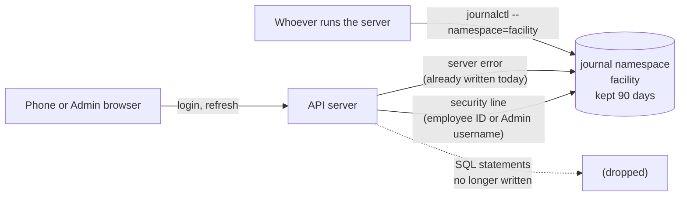
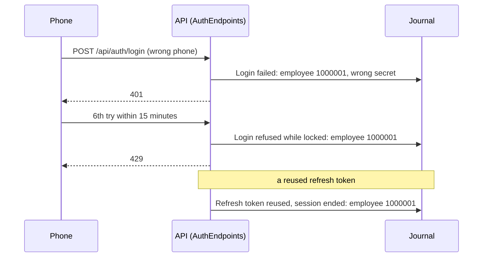

# Server Log: security events and server errors in the server's journal



- Date: 2026-10-29
- Decisions: facility-0095 (what the log answers), 0096 (journal only), 0097 (name the account by employee ID, never the typed text), 0098 (90 days), 0099 (own journal namespace)
- Glossary: **Server Log** in `CONTEXT.md`, separate from **Audit Log** (D9)
- Origin: the owner asked whether the project needs logging; grilled on 2026-10-29

## 1. Why

The Audit Log (D9) already records every Admin change. What it cannot answer:

- **Is someone guessing a login?** A failed login is counted only in memory (`LoginThrottle`, cleared on restart), a lockout answers 429 and writes nothing, and a reused refresh token ends the session with no trace (facility-0015).
- **Why did the server fail?** This part already works (see 2), but the journal is flooded with SQL statements and has no retention period, so the useful lines are hard to find and personal data stays for years.

## 2. What the server writes today (measured 2026-10-29)

Built API, Production, throwaway `facility_logcheck_test`, port 5102, default settings (`Default: Information`, `Microsoft.AspNetCore: Warning`):

| Event | What reached the console |
|---|---|
| First start (migrations on an empty database) | 510 lines, almost all `Microsoft.EntityFrameworkCore.Database.Command` (every SQL statement, values hidden as `'?'`) |
| 5 failed logins, then a 6th answered 429 | 36 lines, all SQL statements; nothing says a login failed or was locked |
| A request after the database was dropped (500) | 66 lines: EF Core errors plus `Microsoft.AspNetCore.Server.Kestrel[13] ... An unhandled exception was thrown by the application.` with the stack trace |
| Typed employee IDs and phone numbers | Appeared 0 times in the whole log |

So server errors are already logged (decision C needs no new code), SQL statements are the noise, and the security events are missing.

## 3. Design

### 3.1 Security lines (new)

One `Warning` line per event, from one logger category `FacilityRealtime.Security`, so `grep -A1 FacilityRealtime.Security` finds them all.



| Event | Where in code | Line |
|---|---|---|
| Login failed, account found | `AuthEndpoints.LoginAsync`, the `401` after the secret check | `Login failed: employee {EmployeeId}, {Reason}` (Admin: `admin {Username}`). `Reason` is `wrong secret` or `account turned off` |
| Login failed, no such account | same place, `user is null` | `Login failed: unknown account ({Kind} login)`. `Kind` is `employee` or `admin`; the typed text is never written |
| Login refused while locked | `AuthEndpoints.LoginAsync`, when `throttle.TryBeginAttempt` is false (the `429`) | `Login refused while locked: employee {EmployeeId}`, or `unknown account ({Kind} login)`. One line per refused attempt: repeated lines show the guessing goes on |
| Refresh token reused | `AuthEndpoints.RefreshAsync`, `RefreshDecision.ReuseDetected` | `Refresh token reused, session ended: employee {EmployeeId}` (Admin: `admin {Username}`) |

Account naming (facility-0097): Cleaners and Supervisors by employee ID, Admins by username, nothing else.

### 3.2 Never in the Server Log

Phone numbers, passwords, token values (access, refresh, QR Token), GPS coordinates, and the typed login text of an unknown account. `EnableSensitiveDataLogging` (which would put SQL values in the log) stays off in every environment.

### 3.3 SQL statements out

`appsettings.json`, under `Logging:LogLevel`: `"Microsoft.EntityFrameworkCore.Database.Command": "Warning"`. Failed SQL is still logged as an error; migration lines (`Microsoft.EntityFrameworkCore.Migrations`, "Applying migration …") stay. Development inherits this key.

### 3.4 Server errors

No code change: the Kestrel line plus EF Core's errors already carry the exception (section 2).

### 3.5 Journal namespace and 90 days (deploy guide)

`docs/handover.md` §2.5:

- `facility.service` gets `LogNamespace=facility` under `[Service]`.
- New file `/etc/systemd/journald@facility.conf`:

  ```ini
  [Journal]
  MaxRetentionSec=90day
  MaxFileSec=1day
  ```

  `MaxFileSec=1day` starts a new journal file each day, so deletion at 90 days happens day by day instead of waiting for a large file to age out.
- Every read command becomes `sudo journalctl --namespace=facility -u facility` (§2.5, §3 and the "system does not start" part). Security lines only: add `| grep -A1 FacilityRealtime.Security`. If the log is empty because the service died before writing, `systemctl status facility` or `--namespace=+facility` shows systemd's own lines.
- Needs systemd 245 or later.

### 3.6 Docs

- ADR facility-0055: an amendment line adding Server Log, 90 days.
- ADR facility-0093: an amendment line pointing to the namespace and the new read command.
- `docs/code-map.md`: where the security lines are written.
- `docs/handoff.md`: after the work, as always.

## 4. Tests

- **API tests** (capture log output through the test factory): a wrong phone writes the employee line with `wrong secret`; a turned-off account writes `account turned off`; an unknown employee ID writes `unknown account (employee login)` and neither the typed ID nor the phone appears in any captured line; the 6th attempt writes the locked line; a reused refresh token writes the reuse line; an Admin's failure names the username and not the password. Each new test fails before the change.
- **Config**: a test that the EF command category resolves to `Warning` from `appsettings.json`.
- **Measured again** the way section 2 did: the first start and the 6 logins no longer print SQL statements, and the security lines appear.
- **Not testable on the Mac** (no systemd): the namespace and the 90 days. Check on the first Linux server, like `facility.test.sh`'s GNU `stat` path (`docs/handover.md` §2.3).

## 5. Out of scope

- **IP address in security lines.** Behind Caddy every request comes from `localhost`, so it would need forwarded-header setup, and it is personal data. Not decided by the owner; raise it if a real incident needs it.
- **Successful logins**, page visits (facility-0095), an Admin screen (facility-0096), anything from the phone (facility-0068), alerts or messages to anyone.
- **A Windows server.** Decisions 0096, 0098 and 0099 assume Linux's journal; if IT picks Windows, they are made again (facility-0093 leaves the OS open).

## 6. Risks

- One line per refused login while locked: a scripted attacker can write many lines. journald's own rate limit caps it, and the 90 days caps the total.
- A database error message can quote a value (for example MySQL's "Duplicate entry '…'"). Employee IDs may appear that way; phones are stored only as hashes and GPS has no unique index, so neither appears.
