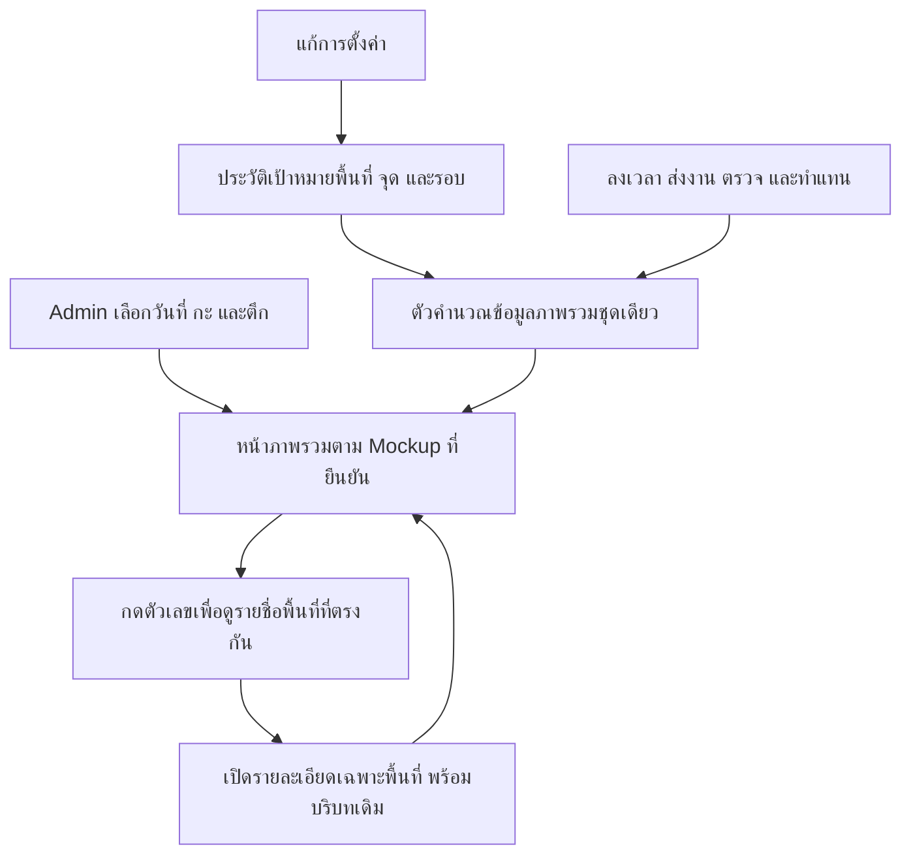
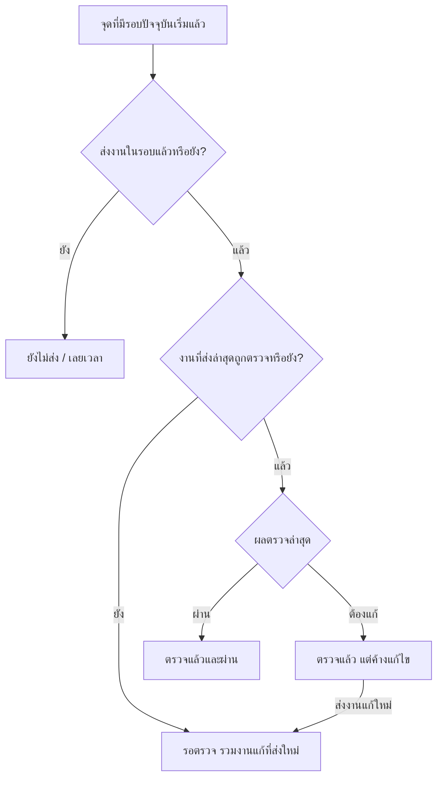
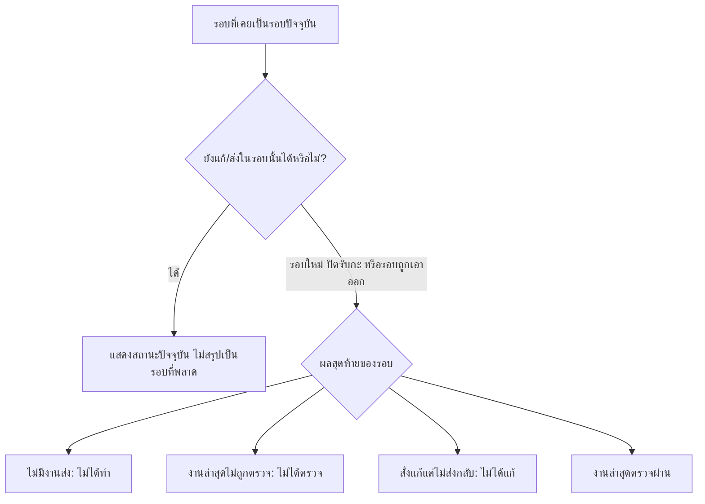
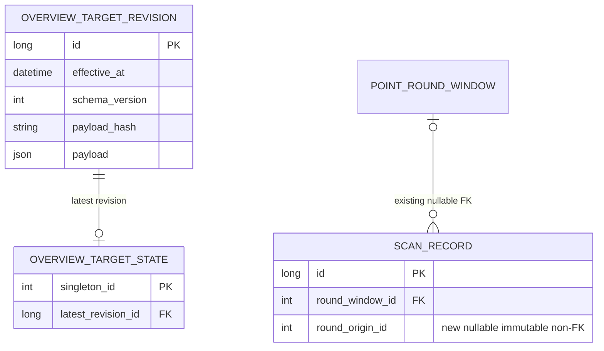
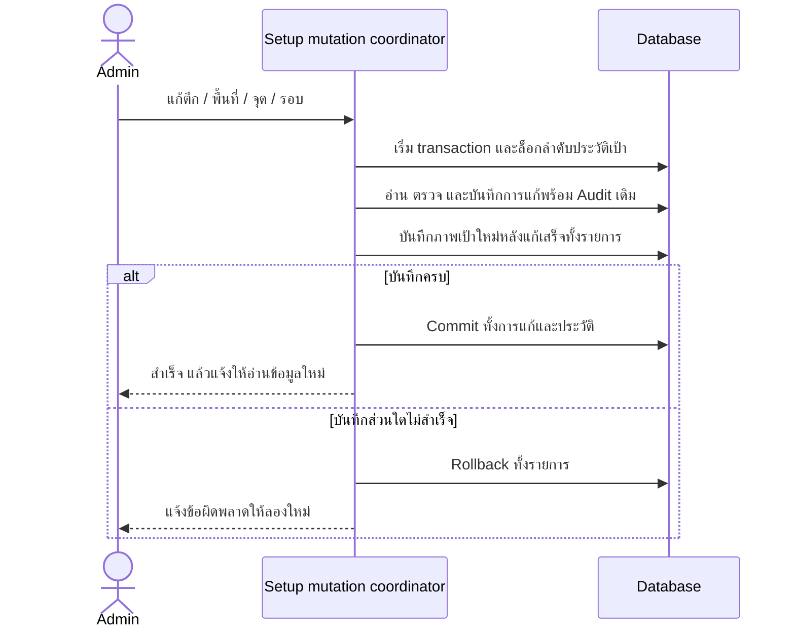
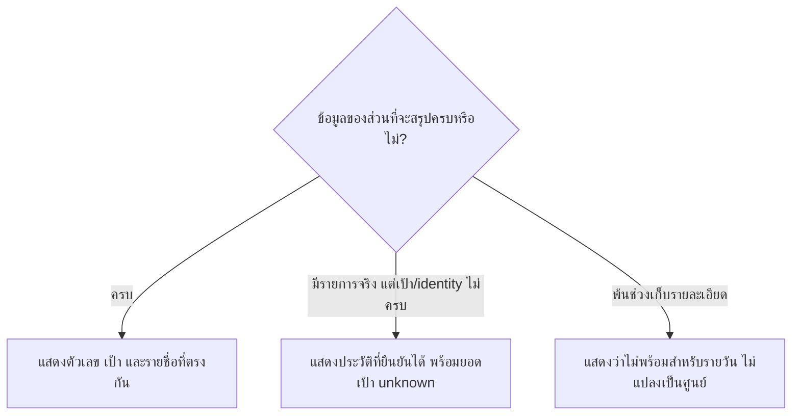
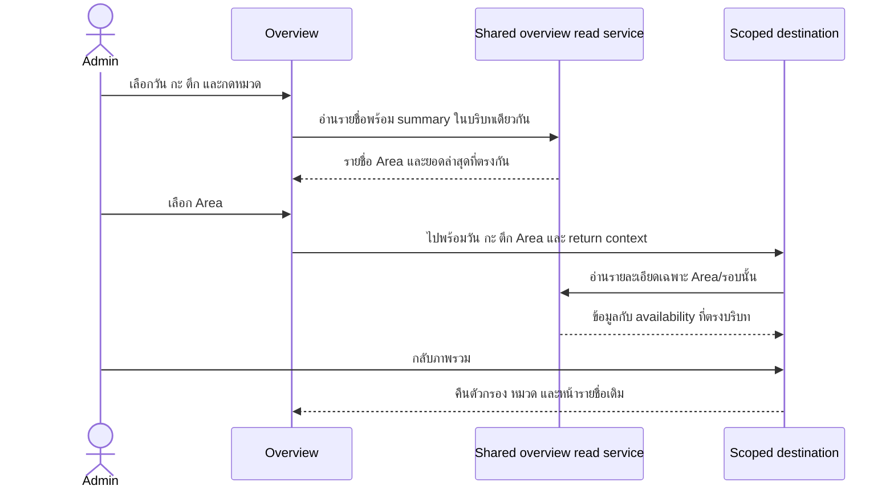

# แบบออกแบบหน้าภาพรวมการดูแลพื้นที่

**สถานะ: ยอมรับเป็นฐานสำหรับเขียนแผน — ยังไม่อนุญาตให้ implement**

วันที่: 16 พฤศจิกายน 2026 (Asia/Bangkok)

ฐานตรวจสอบ: local `master`, commit `7853ae6`; อ่าน source โดยไม่เริ่ม API หรือแก้ฐานข้อมูล

ผู้ใช้ยืนยัน Mockup แล้ว และตอบ “OK” ยืนยันสรุปข้อตกลง 0114–0127 ก่อนเขียนเอกสารนี้ หลังได้รับเอกสาร ผู้ใช้เรียก `sp-writing-plans` เพื่อให้เดินหน้าวางแผน จึงใช้เอกสารและ ADR 0128–0130 เป็นฐานสำหรับ [implementation plan](../plans/2026-11-16-combined-overview-dashboard.md) การให้เขียนแผนเป็นคนละขั้นกับการอนุญาตลงมือพัฒนา; คำสั่งพัก implementation ยังมีผลอยู่

## 1. สิ่งที่ผู้บริหารจะได้

เพิ่มเมนู **ภาพรวม** สำหรับบัญชี Admin แสดงหน้าเดียวตาม Mockup: การลงเวลาเข้าพื้นที่ การส่งงานครบ และการตรวจครบ พร้อมรายการที่ต้องตาม สรุปแต่ละตึก และรอบก่อนที่ไม่ได้ทำหรือไม่ได้ตรวจ เปิดมาที่กะปัจจุบัน เลือกวัน กะเช้า/ดึก และตึกได้

กดตัวเลขหรือหมวดในกราฟแล้วได้รายชื่อพื้นที่ที่ตรงกับตัวเลขนั้น เลือกพื้นที่เพื่อเปิดหน้ารายละเอียดที่กรองเฉพาะพื้นที่ วันที่และกะเดิม กลับแล้วตัวกรองและรายการที่เลือกยังอยู่

Mockup ที่ยืนยันเป็นแหล่งอ้างอิงหน้าตาและการคลิก:

- [ต้นฉบับที่แก้ไขได้](/Users/macbookair/.codex/visualizations/2026/11/16/01a1e200-ca3c-7c62-9a26-60b1ec6ac403/facility-overview.html)
- [หน้าพรีวิว](/Users/macbookair/.codex/visualizations/2026/11/16/01a1e200-ca3c-7c62-9a26-60b1ec6ac403/facility-overview-preview.html)

ตัวเลข 100/90 ชื่อพื้นที่ และวันที่ใน Mockup เป็นข้อมูลสมมุติ ไม่ใช่จำนวนพื้นที่จริงหรือหลักฐานว่ามีประวัติวันนั้น ระบบจริงอ่านจำนวนและช่วงวันที่ที่มีข้อมูลจาก server ไม่ใช้ค่าเหล่านี้เป็นค่าคงที่

## 2. ขอบเขตและผลกระทบที่ต้องทราบก่อนพัฒนา

| ส่วน | งานที่อยู่ในแบบนี้ |
|---|---|
| หน้าภาพรวมใหม่ | สามกลุ่มความคืบหน้า รายการติดตาม เปรียบเทียบตึก ประวัติรอบ และรายชื่อพื้นที่ |
| การอ่านข้อมูล | ตัวคำนวณฝั่ง server สำหรับวัน/กะ/ตึก รวมถึงรายชื่อและรายละเอียดจากกติกาเดียวกัน |
| หน้าปลายทาง | เพิ่มโหมดจากภาพรวมในหน้าการเข้างานและสถานะจุด เพื่อรับบริบทและแสดง Area เดียว |
| ฐานข้อมูล | เพิ่มประวัติเป้าหมายเชิงโครงสร้าง และเลขต้นทางของรอบที่ไม่หายเมื่อแก้/ลบ window |
| หน้าตั้งค่า | บันทึกประวัติเป้าหมายพร้อมการแก้ตึก/พื้นที่/จุด/รอบใน transaction เดียวกัน |
| อายุข้อมูล | ล้างประวัติเป้าหมายที่พ้นช่วงใช้งานร่วมกับงาน retention เดิม ไม่เพิ่มอายุข้อมูลรายครั้ง |
| เอกสารและการตรวจ | ปรับ code map/คำอธิบายวิธีนับ และตรวจตัวเลข รายชื่อ การกดต่อ และการถดถอยของงานเดิม |

ขอบเขตนี้ไม่เพิ่มบทบาทผู้ใช้ ไม่เพิ่มการลงเวลาสำหรับคนทำแทน ไม่เปลี่ยนกฎส่งงาน/ตรวจ/แก้ และไม่เพิ่มรายงานแนวโน้มหรือการส่งออกชุดใหม่ หน้าสรุปการตรวจรายหัวหน้างานและ Excel เดิมยังใช้กติกาเดิม การ deploy และเผยแพร่ไม่รวมอยู่ในการอนุมัติแบบนี้

**ผลกระทบสำคัญ:** ประวัติเป้าหมายเป็นส่วนเพิ่มจริงในฐานข้อมูล ไม่ใช่แค่การจัดกราฟ การแก้ตั้งค่าที่เปลี่ยนเป้าหมายต้องบันทึกการแก้และประวัติให้สำเร็จด้วยกัน ถ้าการบันทึกประวัติล้มเหลว ให้ rollback การแก้ครั้งนั้นและแจ้งให้ลองใหม่ เพื่อไม่ให้รายงานอ้างว่ารู้เป้าเก่าทั้งที่ประวัติหาย

## 3. เวลาและฐานนับ

ใช้ `ShiftCalendar` เดิม: เช้า 07:00–19:00 และดึก 19:00–07:00 วันที่ของกะดึกคือวันที่เริ่มกะ เช่น 03:00 ของวันที่ 17 อยู่ในกะดึกวันที่ 16 ไม่ใช่กะดึกวันที่ 17

| โหมด | เวลาประเมินและคำที่ใช้ |
|---|---|
| กะกำลังดำเนินอยู่ | ประเมิน ณ เวลา server ปัจจุบัน แสดงงานที่ต้องตามตอนนี้ |
| หมดกะตามเวลา แต่ยังเปิดรับข้อมูล | แสดง “หมดกะแล้ว ยังรับข้อมูลถึง…” และอัปเดตต่อถึงเวลาปิดหน้าต่าง แม่บ้านยังอาจส่งงานได้ตามสิทธิ์เดิม แต่ไม่แสดงว่าหัวหน้าตรวจรอบเก่าได้ |
| ปิดรับข้อมูลของกะแล้ว | ประเมินเป้าหมาย ณ เวลาปิดรับของกะนั้น แสดงผลรอบสุดท้ายและผลรอบในกะ ไม่ใช้คำว่าต้องไปทำตอนนี้ |
| กะยังไม่เริ่ม | แสดงว่ายังไม่เริ่มกะ ไม่สร้างยอดขาดคน/ไม่ได้ทำจากอนาคต |
| ประวัติเป้าหมายหรือรายละเอียดไม่ครบ | แสดงข้อมูลที่ยืนยันได้ พร้อมสถานะไม่ครบ ยอดที่คำนวณไม่ได้เป็น unknown ไม่ใช่ 0 |

ตัวเลขปัจจุบันไม่ใช่ผลสะสมตลอดกะ เมื่อรอบใหม่เริ่ม ยอดส่งครบ/ตรวจครบอาจลดลงได้ ส่วนผลรอบก่อนยังอยู่แยกกัน การแก้ข้อมูลลงเวลาโดย Admin ที่ระบบอนุญาตยังสะท้อนค่าที่แก้แล้วและมีเครื่องหมายแก้ไข ประวัติเป้าหมายไม่ได้ทำให้ผลการทำงานหรือรายการแก้ไขถูกล็อกแก้ไม่ได้

ใช้ `closeUtc = EndUtc(slot) + AttendanceSettings.ClosesMinutesAfterShift` และถือว่าปิดเมื่อ `now > closeUtc` ตามขอบเวลา inclusive เดิม เป้าหมายใช้ revision ณ `min(now, closeUtc)` ไม่ใช้ revision วันหลังมาเปลี่ยนกะที่ปิดแล้ว ไม่เปลี่ยนค่าหน้าต่างเดิมซึ่งค่าเริ่มต้นเปิดก่อน/ปิดหลัง 60 นาที

ค่า AttendanceSettings ในการอ่านกะเก่าหมายถึง receiving policy ที่บันทึกว่ามีผลกับกะนั้น ตามข้อ 5.1 ไม่ใช่ค่าปัจจุบันจาก configuration ที่นำไปใช้ย้อนหลัง

event ที่ระบบผูกไว้กับกะนั้นอ่านตาม slot จริง รวมลงเวลาก่อน/หลังกะและ Scan Record ของแม่บ้านที่ยังส่งได้ตาม `AttendanceCalendar` ไม่ทิ้งรายการเพียงเพราะเวลาจริงอยู่นอก 07:00/19:00 ในทางกลับกัน Supervisor ใช้ `ShiftCalendar.SlotAt` และไม่มีสิทธิ์ตรวจรอบเก่าต่อในช่วงนี้ ถ้าส่งแก้หลังเวลาหัวหน้าตรวจได้แล้ว จะสะท้อนว่างานล่าสุดไม่ได้ตรวจ ไม่สร้างปุ่มตรวจย้อนหลังให้

### ฐานนับสามกลุ่ม

1. **ฐานคน:** พื้นที่เปิดใช้งานและต้องมีคนในกะ ตามเป้าหมาย ณ เวลาประเมิน แม้ยังไม่ได้มอบหมายแม่บ้านก็ยังเป็นพื้นที่ที่ต้องมีคน พื้นที่กะเช้าอย่างเดียวไม่นับในกะดึก
2. **ฐานงานปัจจุบัน:** พื้นที่ที่มีอย่างน้อยหนึ่งจุดเปิดใช้งาน ซึ่งมีรอบปัจจุบันเริ่มแล้ว ในแต่ละจุดใช้รอบล่าสุดที่เวลาเริ่มผ่านมาแล้วตามกติกาเดิม
3. **ฐานตรวจครบ:** ใช้พื้นที่และจุดที่ถึงรอบในข้อ 2 เช่นเดียวกับการส่งงาน เพื่อบอกว่าทั้งพื้นที่ตรวจครบหรือยัง แยกพื้นที่ที่ยังไม่มีงานให้ตรวจออกจากคิวที่หัวหน้าตรวจได้แล้ว

พื้นที่ที่ยังไม่มีจุดถึงรอบไม่ถูกนับว่าส่งครบ/ตรวจครบด้วยเงื่อนไขว่างเปล่า ให้แยก “ยังไม่ถึงรอบ” ถ้ามีรอบถัดไป หรือ “ยังไม่ได้ตั้งรอบในกะนี้” ถ้าไม่มีรอบ ไม่ใช้สองคำนี้แทนกัน พื้นที่หนึ่งอาจมีบางจุดถึงรอบแล้วและบางจุดยังไม่ถึงรอบ ให้นับเฉพาะจุดที่ถึงรอบในเป้าปัจจุบัน และมีรายละเอียดของรอบถัดไป

## 4. กติกาตัวเลขและรายชื่อ

ตัวเลขทุกกลุ่มนับ **Area ID ไม่ซ้ำภายในกลุ่ม** ไม่ใช่จำนวนคน จำนวนการสแกน หรือจำนวนครั้งที่ตรวจ กลุ่มติดตามต่างกลุ่มซ้ำ Area เดียวกันได้ จึงไม่วาด pie เดียวที่นำทุกกลุ่มปัญหามาบวกเป็น 100%

### 4.1 การลงเวลาเข้าพื้นที่

| หมวด | เงื่อนไข |
|---|---|
| ลงเวลาแล้ว | มี Shift-In ของกะนั้นที่บันทึก Area ID นี้ รวมรายการแก้โดย Admin; พัก/เลิกงานภายหลังไม่ทำให้หลุดจากยอด |
| มอบหมายทำแทนแล้ว | ยังไม่มี Shift-In ของแม่บ้านประจำใน Area นี้ แต่มี Cover Assignment ของพื้นที่และกะนั้น |
| ยังไม่มอบหมายทำแทน | ไม่มี Shift-In และไม่มี Cover Assignment ที่มีผลในบริบทนั้น |
| ยังไม่ลงเวลา | รวมสองกลุ่มหลัง ใช้สำหรับปุ่มดูรายชื่อที่ยังไม่มีบันทึกลงเวลาเข้า |

สามกลุ่มหลักต้องรวมเท่ากับฐานคน เช่น 90 + 5 + 5 = 100 การลงเวลาที่ Area ของตัวเองของคนทำแทนไม่ใช่หลักฐานเข้าพื้นที่ปลายทาง การมอบหมายอย่างเดียวไม่ถูกนับเป็นลงเวลาแล้ว

อ่านจาก `ShiftAttendance.AreaId` และกะที่บันทึกจริง ไม่ join เฉพาะแม่บ้านประจำที่ยัง active อยู่ตอนเปิดรายงาน เพราะอาจย้ายหรือปิดบัญชีไปแล้ว Cover ย้อนหลังต้องพิจารณา `AssignedAt` และ `CancelledAt` ตามช่วงเวลาที่แสดง การยกเลิกในวันหลังไม่ลบความจริงว่าเคยได้รับมอบหมายในกะเก่า ชื่อบุคคลเป็นข้อมูลประกอบจากรายการที่อ้างอิง ไม่ใช้ชื่อเป็น key

### 4.2 การส่งงานครบและการตรวจครบ

ผลต้องแก้ถือว่าได้รับการตรวจแล้ว แต่เมื่อมีการส่งใหม่ต้องตรวจงานล่าสุด จึงไม่ใช้เพียงการเคยตรวจหนึ่งครั้งเป็นตัวรับรองงานใหม่

| ตัวเลข/รายการ | เงื่อนไขระดับ Area |
|---|---|
| ส่งงานครบ | ทุกจุดในฐานงานปัจจุบันมีการส่งที่นับรอบแล้ว |
| ส่งงานยังไม่ครบ | อย่างน้อยหนึ่งจุดในฐานนั้นยังไม่มีการส่งงาน |
| ตรวจครบ | ทุกจุดในฐานนั้นมีการตรวจงานที่ส่งล่าสุดแล้ว รวมผล Rework |
| มีงานรอตรวจ | อย่างน้อยหนึ่งจุดส่งแล้วแต่งานล่าสุดยังไม่ตรวจ รวมงานแก้ที่เพิ่งส่ง |
| ยังไม่มีงานให้ตรวจ | มีงานถึงรอบ แต่ยังไม่มีจุดส่งงานมาให้ตรวจเลย |
| มีงานเลยเวลา | อย่างน้อยหนึ่งจุดพ้นเวลารอบแล้ว ยังไม่มีงานส่งของรอบนั้น |
| มีงานต้องแก้ | อย่างน้อยหนึ่งจุดมีผล Rework ล่าสุดและยังไม่มีงานแก้ส่งกลับ |
| แม่บ้านแจ้งปัญหา | อย่างน้อยหนึ่งจุดมี Issue ที่ยังมีผลตามหลักรายการส่งล่าสุด ไม่ตีความว่าเป็นผลตรวจไม่ผ่าน |

ตัวเลขจำนวนจุดเป็นข้อมูลประกอบ เช่น Area หนึ่งส่ง 4/5 จุด ยังนับส่งครบ 0/1 Area หากตรวจทั้ง 5 จุดแล้วแต่ให้แก้หนึ่งจุด นับตรวจครบ 1/1; เมื่อส่งแก้ใหม่ นับตรวจครบ 0/1 จนตรวจงานแก้

Area ที่ส่งบางจุดและมีงานรอตรวจอยู่แล้วต้องอยู่ได้ทั้งกลุ่ม “ทำไม่ครบ” และ “มีงานรอตรวจ” ไม่รอให้แม่บ้านส่งครบทั้ง Area ก่อนจะแสดงคิวตรวจ ตัวเลขส่งครบไม่ลดเพราะผลต้องแก้เพียงอย่างเดียว; งานค้างแก้มีรายการแยก

ถ้าส่ง 4/5 จุดและตรวจทั้ง 4 จุดแล้ว พื้นที่ยังไม่ตรวจครบทั้งพื้นที่ แต่ไม่มีงานรอตรวจในมือหัวหน้าในขณะนั้น ให้เห็นว่ายังค้างการส่งอีกหนึ่งจุด ไม่ย้ายพื้นที่นี้ไปเป็นรอตรวจโดยอัตโนมัติ รายการย่อย “รอตรวจ” และ “ยังไม่มีงานให้ตรวจ” เป็นเหตุผลติดตาม ไม่ได้อ้างว่าแบ่งทุก Area ที่ยังไม่ตรวจครบเป็นสองกลุ่มที่ครอบคลุมทั้งหมด

การส่ง Off-Round ไม่นับในความคืบหน้าของรอบ Late และ Rework ที่ระบบวางไว้ในรอบนับตามรอบนั้น ใช้ ID และเวลาเรียงอย่างแน่นอนเมื่อเวลาซ้ำกัน ผลตรวจต้องอ้างอิง submission ล่าสุด ไม่ใช้ผลของ submission เก่ามารับรองงานใหม่

Issue เป็นข้อมูลแยกจาก Point Status ตามระบบเดิม ดูรายการส่งล่าสุดที่เก็บอยู่ ณ/ก่อนเวลาของบริบทนั้น รวมรายการนอกรอบ ไม่ดึงรายการที่เกิดในวันหลังมาเปลี่ยนผลของวันเก่า หากแหล่งข้อมูลที่จำเป็นพ้น retention จนยืนยันสถานะไม่ได้ ให้รายงานความไม่ครบของหมวดนี้ ไม่แสดงเป็นไม่มีปัญหาอย่างแน่นอน

### 4.3 รอบก่อนที่ไม่ได้ทำหรือไม่ได้ตรวจ

การพ้นเวลาสิ้นสุดของ window อย่างเดียวไม่ทำให้เป็นรอบที่พลาดถาวร เพราะระบบยังรับส่งช้าหรือแก้งานก่อนรอบถัดไปได้ เมื่อเริ่มรอบใหม่จึงสรุปรอบก่อนแยกจากงานปัจจุบัน รอบสุดท้ายของกะรอปิดหน้าต่างรับงานด้วย ไม่สรุปไม่ได้ทำถาวรทันทีที่ 07:00/19:00 ถ้าการตั้งค่าทำให้รอบเดิมไม่เปิดรับงานแล้ว ให้เก็บผลรอบเดิมพร้อมเหตุผลว่าถูกเปลี่ยน/ยกเลิก ไม่แสดงเป็นงานที่ยังไปตรวจได้

ในกะที่ปิดรับแล้ว ส่วนนี้สรุป **ทุกรอบที่จบในกะ** รวมรอบสุดท้าย ใช้หัวข้อ “ผลรอบในกะนี้”; ในกะกำลังทำงานใช้ “รอบที่ผ่านมาในกะนี้” ช่วงรอปิดรับแยกรอบที่สรุปแล้วออกจากรอบสุดท้ายที่ผลยังเปลี่ยนได้ ปุ่มหลักตาม Mockup คือพื้นที่ที่มีรอบไม่ได้ทำและพื้นที่ที่มีรอบไม่ได้ตรวจ รายละเอียดรอบแสดงไม่ได้แก้ด้วย เพื่อไม่ตีความ Rework ว่าไม่เคยตรวจ

แต่ละปุ่มนับ Area ไม่ซ้ำ พร้อมจำนวนรอบประกอบเมื่อเปิดรายละเอียด ไม่ใช่ใช้จำนวนรอบเป็นจำนวนพื้นที่ ยอดส่วนนี้อาจซ้ำกับผลรอบสุดท้ายในกะที่จบแล้ว จึงไม่บวกเป็นยอดพื้นที่รวม การกดรอบเก่าพาไปประวัติของรอบนั้น ไม่เปิดปุ่มให้ตรวจย้อนหลัง

## 5. การเก็บเป้าหมายให้ย้อนหลังถูกต้อง — ข้อเสนอทางเทคนิค

แนวทางส่วนนี้ใช้เป็นฐานสำหรับแผนตามคำสั่ง `sp-writing-plans` ของเจ้าของ รายละเอียดอยู่ใน ADR สถานะ `accepted` (ยอมรับแบบ ไม่ใช่พัฒนาเสร็จ): [0128](../../adr/facility-0128-overview-target-configuration-revisions.md), [0129](../../adr/facility-0129-overview-preserves-round-origin-identity.md), [0130](../../adr/facility-0130-overview-shares-scoped-read-model.md)

### 5.1 ประวัติการตั้งค่าที่ใช้คำนวณเป้า

ตารางใหม่เก็บประวัติเป้าหมายเชิงโครงสร้าง ส่วนเลข origin เป็นค่าคัดลอกใน Scan Record ไม่ผูก FK กลับไปยัง window ที่ลบได้

เพิ่ม `overview_target_revisions` เก็บภาพข้อมูลเชิงโครงสร้างทั้งหมดเป็น JSON ที่มี schema version, ลำดับ revision และเวลาเริ่มมีผล พร้อม `overview_target_state` หนึ่งแถวสำหรับล็อกและระบุ revision ล่าสุด ภาพต้องประกอบด้วย Building/Area/Point IDs, รหัสและชื่อ, ความสัมพันธ์, สถานะเปิดใช้, Shift Pattern, ลำดับจุด, Window ID/กะ/เวลา/CreatedAt รวมค่า opens/closes ของนโยบายรับข้อมูลที่ใช้งาน ไม่ใส่ชื่อบุคลากร เบอร์โทร hash/secret, QR token หรือ GPS

เก็บ receiving-policy version ไว้ด้วยเพื่อไม่ใช้ค่า configuration ในวันหลังเลื่อนเวลาปิดกะเก่า การเปลี่ยนนโยบายเมื่อ restart ต้องเริ่ม revision ใหม่และรักษาช่วงนโยบายเดิมไว้ การเปลี่ยนขณะที่ slot ยังรับข้อมูลใช้ช่วงเวลาของแต่ละ policy ที่มีผลจริง; slot ที่ปิดไปแล้วไม่ถูกเปิดย้อนหลังในรายงานเพราะนโยบายใหม่ หากขอบเวลาพิสูจน์ไม่ได้ให้ลด availability แทนการเดา

จับภาพเริ่มต้นหลัง migration/seed ของระบบและก่อนเปิดรับ request; ใน Testing ให้ fixture เริ่มต้น history อย่างชัดเจน หลังจากนั้นทุกการเปลี่ยน structural target ผ่าน Building/Area/Point handlers ใช้ coordinator เดียวกัน ล็อกก่อนอ่าน configuration ที่กำลังแก้ และจับภาพหลัง persist การแก้ทั้งรายการ ไม่จับทุก `SaveChanges` เพราะบาง handler บันทึกหลายขั้นใน transaction เดียว

รวมกรณีเปลี่ยน Area เป็นกะเช้าอย่างเดียวซึ่งลบ night windows ด้วย ไม่จับเฉพาะหน้าจอแก้รอบ แก้ชื่อหรือย้ายตึกต้องรักษาป้ายชื่อและ ownership ของประวัติเก่าเช่นกัน การแก้บัญชี รหัสผ่าน ป้าย QR token หรือการอ่านหน้าจอไม่สร้าง revision ถ้าเป้าเชิงโครงสร้างไม่เปลี่ยน

ประวัตินี้ไม่ freeze การทำงานทั้งกะ: การแก้ตั้งค่าขณะที่กะยังรับงานมีผลตามการทำงานเดิม ภาพรวมใช้ revision ณ เวลาประเมิน ส่วนรายงานกะเก่าไม่อ่าน revision ที่เกิดหลังหน้าต่างรับงานของกะนั้นปิด ไม่เพิ่มงาน scheduler เพื่อคอยถ่ายรูปทุกกะ เพราะ timeline ใช้คำนวณกะที่ไม่มีใครเปิดหน้าจอได้ด้วย

### 5.2 รหัสรอบที่คงอยู่หลังแก้ตาราง

เพิ่ม `ScanRecord.RoundOriginId` แบบ nullable และไม่เป็น FK โดยคัดลอกจาก round ที่ระบบวางงานให้ตอนบันทึก `RoundWindowId` เดิมยังทำงานเหมือนเดิมและยังเป็น null ได้เมื่อ window ถูกลบ; `RoundOriginId` ไม่เปลี่ยนตามการลบนั้น การส่งนอกรอบยังเป็น null

จับคู่เป้าและงานด้วย `(PointId, ShiftDate, Shift, RoundOriginId)` ไม่ใช้ชื่อ และไม่ใช้เวลาเริ่ม/จบอย่างเดียว เพราะลบแล้วสร้าง window เวลาเดิมอาจเป็นคนละตัว การตรวจผูกกับ Scan Record เดิมจึงตาม identity นี้ได้

ข้อมูลเก่าที่ FK ยังอยู่ backfill ได้จากหลักฐานนั้นเท่านั้น ถ้า FK หาย ใช้เวลาและประวัติเป้าจับคู่ได้เฉพาะเมื่อพิสูจน์ได้ว่าเหลือผู้สมัครเดียว มิฉะนั้นให้เป็นประวัติไม่ครบ ไม่มีการเดา origin จาก audit ข้อความ

นี่เป็นค่าที่ server เติมให้ ไม่เพิ่ม input บังคับจากมือถือ ไม่เพิ่ม validation ของ origin กับ callers เก่าทั้งระบบ และไม่เปลี่ยนกฎตรวจสิทธิ์/ลงเวลา/GPS หรือการวางงานเข้ารอบ

### 5.3 การคำนวณจาก timeline

อ่าน revision ก่อน/ตรงเวลาเริ่มกะและ revision ที่เปลี่ยนจนถึงเวลาประเมินหรือ closeUtc แล้วแบ่งช่วงตามเวลาที่เป้าเปลี่ยนและเวลาเริ่มรอบ ในแต่ละช่วงเลือก Area/Point ที่มีผลและรอบล่าสุดที่เริ่มแล้วตามหลัก `PointStatusCalculator` รวบรวม obligation ของแต่ละ origin ที่เคยเป็นรอบปัจจุบันจริงของ slot นั้น รวมช่วงหลังเวลาหมดกะที่แม่บ้านยังส่งงานได้

รอบที่เพิ่มระหว่างกะเริ่มมีผลตั้งแต่การเปลี่ยนตั้งค่ามีผล ไม่ย้อนสร้าง obligation ก่อนที่มันมีอยู่ รอบที่ถูกเอาออกภายหลังยังมีหลักฐานอยู่ใน revision และไม่หายจากประวัติผลรอบที่เคยมีผล การลบ/สร้างใหม่เวลาเดิมไม่ทำให้ปะปน origin เก่ากับใหม่

ยอดหลักใช้เป้าปัจจุบัน ณ เวลาประเมิน; ผลรอบก่อนใช้เป้า/ownership ที่มีผลกับรอบนั้น ถ้า Area ย้ายตึกภายในกะ รายละเอียดต้องบอกตึกของรอบเก่าอย่างชัดเจน การกรองตึกกับรอบเก่าใช้ตึกที่รอบนั้นเคยมีผล ดังนั้นสรุปตึกแต่ละส่วนยึดบริบทเดียวกับรายชื่อของส่วนนั้น ไม่โยนประวัติตึกเก่าไปให้ตึกใหม่

ไม่ใช้ `ExportRules.MissedRounds` หรือ `InspectionHistory.FinishedRounds` ตรง ๆ สำหรับรอบก่อนในกะที่กำลังทำงาน เพราะ helper เดิมรอปิดหน้าต่างลงเวลาทั้งกะ ส่วนภาพรวมต้องแสดงผลรอบที่ถูกแทนแล้วระหว่างกะ แบบใหม่นี้ใช้หลักฐาน timeline จริง และไม่เปลี่ยนกติกา Excel เดิม

## 6. ประวัติไม่ครบ อายุข้อมูล และความพร้อมเริ่มใช้งาน

API ส่ง availability **แยกตามส่วน** (`complete`, `partial`, `unavailable`, `notStarted`) พร้อมเหตุผลและช่วงวันที่ที่ใช้ได้ `null` หมายถึงคำนวณไม่ได้; `0` ใช้เฉพาะเมื่อข้อมูลครบและไม่มีรายการจริง ช่องตัวเลขที่ไม่ครบใช้ “—” และอธิบายใกล้ช่องนั้น ปุ่มดูรายการจริงยังใช้ได้เมื่อมีรายการ แต่ต้องไม่เรียกรายการนั้นว่ารายชื่อที่ขาดทั้งหมดหากไม่รู้ฐานเป้า

เริ่มเก็บ target baseline เวลา T: เป้าปัจจุบัน ณ/หลัง T ใช้ได้ถ้า revision ปัจจุบันครบ แต่ผลรอบก่อน T ยังพิสูจน์ครบไม่ได้ กะเก่าทั้งกะต้องมี configuration coverage ตลอดช่วงที่นำมาคำนวณก่อนจะแสดงยอดแน่นอน ไม่เติมวันเก่าจากการตั้งค่าปัจจุบันหรือถือว่ามีเป้า 0 ก่อน baseline

ช่วงรายวัน/รายกะต้องอยู่ในรายละเอียดที่ยังเก็บจริงและมีประวัติเป้าครบ ไม่ใช่บังคับย้อนหลังได้ 365 วันจากวันที่ติดตั้ง โดยทั่วไปได้ประมาณหนึ่งปีตาม `RetentionSettings.RecordYears` หากเปิดใช้ฟีเจอร์ใหม่ได้หนึ่งเดือน จะรับรองประวัติเป้าครบได้เฉพาะช่วงที่เก็บแล้ว

ตัดกะที่อาจถูก retention ลบเพียงบางรายการออกจากช่วง `complete` โดยคำนึงถึงหน้าต่างลงเวลาก่อน/หลังกะและ cutoffs ของข้อมูลแต่ละชุด ไม่คำนวณ min date จากแถวแรก/แถวสุดท้ายอย่างเดียว เพราะวันซึ่งไม่มี event จริงยังอาจเป็นวันไม่มีคนเข้าได้เมื่อ target history ยืนยันว่ามีเป้า

ล้าง revisions ที่ไม่จำเป็นต่อช่วงรายละเอียดที่ยังอ่านได้ผ่าน retention runner เดิม เก็บ baseline หนึ่งชุดที่จำเป็นต่อการตีความ oldest supported interval และ revision หลัง baseline นั้น ภาพเชิงโครงสร้างไม่มีข้อมูลบุคลากร/รายการงาน; การเก็บ baseline ไม่ขยายอายุ attendance, Scan Record, Inspection Record หรือ Cover Assignment ไม่เพิ่มประวัติรายคนหรือ daily aggregate ระยะยาวจาก monthly summaries

การอ่านซึ่งแข่งกับ retention ต้องได้ snapshot ข้อมูลที่สอดคล้องกันในหนึ่ง transaction ไม่คืนเป้าเดิมกับ source ที่ถูกลบครึ่งทาง ถ้าประวัติไม่พอให้คืน availability ไม่ครบ แม้วันที่ยังเลือกได้จากส่วนอื่นก็ตาม

## 7. API และความสอดคล้องของตัวเลขกับรายชื่อ

ใช้บริการคำนวณ Admin overview ฝั่ง server ชุดเดียว แยกจากการรวมยอดของ endpoints เดิม ซึ่งมีความหมายต่างกัน

| Read endpoint ที่เสนอ | ข้อมูลสำคัญ |
|---|---|
| `GET /api/admin/overview` | วัน/กะที่มีผล เวลาอ่าน availability เป้าหมาย สามกลุ่มหลัก รายการติดตาม รายตึก และผลรอบก่อน |
| `GET /api/admin/overview/areas` | Area list ตาม group พร้อม paging และ summary/context ที่คำนวณในการอ่านเดียวกัน |
| `GET /api/admin/overview/areas/{areaId}` | เฉพาะ Area ในบริบทนั้น: การลงเวลา การทำแทน จุด งานล่าสุด ผลตรวจ และประวัติรอบที่เกี่ยวข้อง |

Query: `shiftDate`, `shift`, `buildingId`; list เพิ่ม `group`, `page`, `pageSize` (page เริ่ม 1, ค่าเริ่ม 5 Area ต่อหน้า, อนุญาต 1–50); detail รับ `group` และ `roundKey` เมื่อมาจากผลรอบเก่า อนุญาต `group` จากรายการที่กำหนดเท่านั้น ใช้ Area/Building IDs ที่เสถียร ไม่ใช้การค้นหาข้อความชื่อเพื่อรับรองการกรอง

เมื่อไม่ระบุวันและกะทั้งคู่ ให้ server เลือกกะปัจจุบันผ่าน `ShiftCalendar` ถ้าระบุเพียงตัวเดียว รูปแบบผิด หรือวันที่อนาคต ให้แจ้ง validation error; กะวันนี้ที่ยังไม่เริ่มคืน `notStarted` ไม่มีการ fallback ไป current shift เงียบ ๆ

DTO ส่วนสำคัญ: effective slot, evaluation time, read timestamp, target revision/coverage metadata, availability รายส่วน, numerator/denominator ที่ nullable, stable group keys, distinct Area IDs/codes/names, matching reasons/point counts, source record IDs, current-round identity และ pagination หมวดประวัติอาจรวม Area ที่ปิด/ย้ายภายหลังโดยใช้ historical labels

อ่าน target และ facts แบบ consistent read (MySQL repeatable-read transaction) ทุก count/list/detail ใช้ projection และ predicates เดียวกัน ไม่มี query ทีละจุด รายชื่อคืนยอดและ summary จากการอ่านเดียวกัน; เมื่อข้อมูลเปลี่ยนระหว่างที่ผู้ใช้กด ให้ UI อัปเดตทั้งตัวเลขและรายชื่อเป็นชุดล่าสุดพร้อมบอกว่าอัปเดตแล้ว ไม่อ้างว่าจำนวนจาก request เก่าเป็น snapshot ที่ล็อกไว้ตลอดการใช้งาน

การกด Area ซึ่งเพิ่งเปลี่ยนสถานะยังเปิด Area เดิมและแสดงสถานะล่าสุดในบริบทเดิมได้ พร้อมข้อความว่าสถานะเปลี่ยนแล้ว ห้ามพาไป Area อื่นเพื่อให้ยังตรงกับ group เก่า

ทุก endpoint ใช้ Admin-only authorization และตรวจบัญชี active เช่นเดียวกับ endpoints Admin เดิม ไม่ส่ง QR token, hash, รหัสผ่าน หรือ raw GPS ใน overview DTO

## 8. หน้าจอและการกดดูต่อ

เพิ่ม lazy-loaded route `/admin/overview` ใต้ Admin guard และเมนูภาพรวมเหนือสถานะจุด ใช้ Enterprise Light, shared controls, Tailwind tokens และระบบตัวอักษร/ขนาดเป้ากดเดิม ไม่เปลี่ยน home redirect หรือชื่อ route เดิมโดยอัตโนมัติ

| สิ่งที่กด | หน้าปลายทางที่เสนอ |
|---|---|
| รายการเข้าพื้นที่/ทำแทน | `/admin/attendance?source=overview&date=...&shift=...&building=...&areaId=...` |
| งานทำความสะอาด/ตรวจ/ปัญหา | `/dashboard?source=overview&date=...&shift=...&building=...&areaId=...` เพิ่ม `view=cleaning` หรือ `view=inspection` ตามกลุ่ม |
| รอบก่อนที่ไม่ได้ทำ/ตรวจ | point destination เดียวกัน เพิ่ม stable `roundKey` และโหมดประวัติ ไม่แปลงเป็นรอบปัจจุบัน |

หน้าปลายทางใช้ overview Area-detail read เฉพาะเมื่อ `source=overview` ไม่ใช้ Redux search เพื่อแกล้งกรอง Area และไม่ส่ง historical context ไปยัง endpoint เดิมซึ่งอ่านเฉพาะกะปัจจุบัน แสดงชื่อพื้นที่ วันที่ กะ ตึก และคำว่าประวัติเมื่อเป็นกะ/รอบเก่าในหัวหน้าอย่างชัดเจน

return context เป็นพารามิเตอร์หมวด/หน้ารายชื่อและ slot ที่ระบบประกอบกลับ `/admin/overview` เอง ไม่รับ arbitrary return URL เมื่อ refresh หรือใช้ Back/Forward ต้องคืนบริบทจาก URL ได้ การเปลี่ยนกะทำให้ paging กลับหน้าแรก

กติกา context บังคับ **เฉพาะโหมดใหม่**: ลิงก์ `/dashboard`, `/admin/attendance` และ endpoint เดิมที่ไม่ส่ง `source=overview` ทำงานเหมือนเดิม ไม่บังคับ client ของมือถือหรือหน้าอื่นส่งวัน/Area ใหม่ โหมด overview ที่ข้อมูลไม่ถูกต้องแสดง error/ไม่พบพื้นที่ ห้ามเงียบแล้วโชว์ทุกพื้นที่หรือกะปัจจุบัน

กะ/รอบเก่าเป็นมุมมองอ่าน ไม่มีปุ่มตรวจย้อนหลังหรือมอบหมายงานกะเก่า กะที่พ้นเวลาตามนาฬิกาแต่ยังรับข้อมูลต้องแสดงข้อเท็จจริงที่ยังอัปเดตอยู่ โดยไม่เพิ่มสิทธิ์ตรวจให้ Supervisor การกระทำของ Admin ในกะปัจจุบันใช้ authorization และเงื่อนไขเดิม หาก snapshot/รายชื่อเปลี่ยนจนไม่ตรงผู้รับผิดชอบปัจจุบัน ต้องอ่านค่าปัจจุบันก่อนเปิด action; ห้ามใช้บุคคลจาก snapshot ส่งคำสั่งแก้เวลา/ทำแทนโดยไม่ตรวจเงื่อนไขเดิม

### รายละเอียดหน้าภาพรวม

- การลงเวลาใช้สามส่วนที่ไม่ซ้ำกันจริง ส่วนส่งงานและตรวจแสดง progress ต่อเป้าจุดที่ถึงรอบแล้ว กดได้ทั้งค่าหลักและรายการย่อยพร้อมข้อความกำกับ
- สรุปรายตึกใช้ denominator ของ metric นั้น ไม่เอาฐานคนมาแทนฐานงานที่ถึงเวลาแล้ว
- รายชื่ออยู่ใต้ภาพรวมตามแบบที่ยืนยัน แสดงรหัส/ชื่อ Area ตึก เหตุผลหรือความคืบหน้ารายจุด และปุ่มดูพื้นที่ มี paging เริ่มต้น 5 Area ต่อหน้าตาม Mockup ไม่เพิ่มตัวเลือกขนาดหน้าในรุ่นนี้ และไม่เปลี่ยนยอดกลุ่มตาม page
- ประวัติเป้าหมาย incomplete เป็นสถานะข้อมูล ไม่ใช้สี “เลยเวลา” เพื่อกล่าวหาว่าไม่มีคนหรือไม่ได้ทำ
- ทุก status มีคำกำกับ ไม่ใช้สีอย่างเดียว ปุ่มกราฟมีชื่อและเข้าถึงด้วย keyboard มี focus ชัดเจน และประกาศผลเมื่อเลือกหมวด
- ตรวจ 1280 px และ 375 px ตามมาตรฐานโครงการ ตาราง scroll ภายในเมื่อจำเป็น ไม่ทำให้ทั้งหน้าเลื่อนแนวนอน

### การอัปเดตและสถานะผิดพลาด

กะปัจจุบัน refetch เมื่อเปิด/กลับมา focus และทุก 30 วินาทีตาม `livePoll` ใช้การแจ้งเปลี่ยน scan/inspection/attendance เดิมเพื่อ invalidate ทั้ง projection ที่เกี่ยวข้อง ไม่ patch ตัวเลขแยกจนยอดกับ list ไม่ตรง การแก้ target ส่ง invalidation หลัง commit และ poll ต้องกู้กรณีพลาด notification ได้ด้วย

กะที่ปิดรับแล้วอ่านใหม่เมื่อเปิด/เปลี่ยนตัวกรอง และเมื่อมีการแก้ลงเวลาที่กระทบ slot นั้น ช่วงหมดกะแล้วแต่ยังเปิดรับข้อมูลต้อง refresh ต่อจนปิด ทั้ง attendance และ Scan Records ข้อมูลเก่าไม่ใช้ live badge ของกะปัจจุบันมารับรองว่าประวัติครบ

Loading มีข้อความ/โครงร่าง Error ระบุส่วนที่อ่านไม่ได้พร้อมลองใหม่ ถ้าถือค่าครั้งก่อนอยู่ต้องบอกเวลาและความเก่า ไม่แสดงเป็นข้อมูลล่าสุด Empty ของ group หมายถึงไม่มี Area ตรงกลุ่มภายใต้ข้อมูลที่ครบ; ข้อมูลไม่ครบใช้ข้อความและ availability อีกแบบ แยกสองสถานะนี้

## 9. หลักฐานจากระบบเดิมที่ตรวจแล้ว

ข้อเสนอในเอกสารไม่อ้างว่า endpoint/ตารางใหม่มีอยู่แล้ว ตรวจจากไฟล์จริงดังนี้:

| ข้อเท็จจริงที่ใช้วางแบบ | หลักฐาน source |
|---|---|
| จุดบน Dashboard อ่านกะปัจจุบันและ active config; latest scan ใช้ข้ามกะ | [PointBoardQuery](../../../backend/src/JanitorialManagementDashboard.Infrastructure/Persistence/PointBoardQuery.cs) |
| รอบล่าสุดเริ่มแล้วเป็น current; ส่งใหม่กลับรอตรวจ | [RoundRules](../../../backend/src/JanitorialManagementDashboard.Application/Rounds/RoundRules.cs), [PointStatusCalculator](../../../backend/src/JanitorialManagementDashboard.Application/Rounds/PointStatusCalculator.cs) |
| หัวหน้าตรวจงานล่าสุดของ current round และห้ามตรวจขณะยังไม่ส่งแก้ | [InspectionRules](../../../backend/src/JanitorialManagementDashboard.Application/Inspections/InspectionRules.cs) |
| รอบที่ส่งงานแล้วมีเวลารอบคัดลอก; FK อาจหาย | [ScanRecord](../../../backend/src/JanitorialManagementDashboard.Domain/Entities/ScanRecord.cs), [RoundWindowRemoval](../../../backend/src/JanitorialManagementDashboard.Infrastructure/Persistence/RoundWindowRemoval.cs) |
| ประวัติเดิมรอปิดหน้าต่างกะและใช้ current place metadata บางส่วน | [InspectionHistory](../../../backend/src/JanitorialManagementDashboard.Application/Inspections/InspectionHistory.cs), [InspectionHistoryQuery](../../../backend/src/JanitorialManagementDashboard.Infrastructure/Persistence/InspectionHistoryQuery.cs), [ExportRules](../../../backend/src/JanitorialManagementDashboard.Application/Export/ExportRules.cs) |
| การลงเวลาเก็บ Area ณ ที่เกิดเหตุ แต่ Board เดิมอิงผู้ประจำปัจจุบัน | [ShiftAttendance](../../../backend/src/JanitorialManagementDashboard.Domain/Entities/ShiftAttendance.cs), [AttendanceBoard](../../../backend/src/JanitorialManagementDashboard.Api/Endpoints/AttendanceBoard.cs) |
| Covered คือมีการมอบหมาย ไม่ใช่หลักฐานเข้า Area ปลายทาง | [AreaAttendance](../../../backend/src/JanitorialManagementDashboard.Application/Attendance/AreaAttendance.cs), [AttendanceBoard](../../../backend/src/JanitorialManagementDashboard.Api/Endpoints/AttendanceBoard.cs) |
| Area เปลี่ยนเป็น DayOnly ลบ night windows; ต้องจับการเปลี่ยนผ่าน path นี้ด้วย | [AdminAreaEndpoints](../../../backend/src/JanitorialManagementDashboard.Api/Endpoints/AdminAreaEndpoints.cs) |
| ตั้งค่าบาง handler มีหลาย SaveChanges; บาง update เดิมไม่มี outer transaction แบบ create | [AdminPointEndpoints](../../../backend/src/JanitorialManagementDashboard.Api/Endpoints/AdminPointEndpoints.cs), [AdminBuildingEndpoints](../../../backend/src/JanitorialManagementDashboard.Api/Endpoints/AdminBuildingEndpoints.cs) |
| การบันทึก Scan Record มีจุดเติม server-side origin ได้โดยไม่เพิ่ม request input | [ScanRecordEndpoints](../../../backend/src/JanitorialManagementDashboard.Api/Endpoints/ScanRecordEndpoints.cs) |
| migration/Development seed เกิดก่อนเปิด endpoint; seed เดิมทำเมื่อยังไม่มี user | [Program](../../../backend/src/JanitorialManagementDashboard.Api/Program.cs), [DbInitializer](../../../backend/src/JanitorialManagementDashboard.Infrastructure/Persistence/DbInitializer.cs) |
| อายุ attendance เป็น calendar year; archive งานเป็นเดือนเต็ม | [RetentionRunner](../../../backend/src/JanitorialManagementDashboard.Infrastructure/Persistence/Retention/RetentionRunner.cs), [คู่มือ retention](../../data-retention.md) |
| หน้าต่างลงเวลาครอบคลุมก่อน/หลังกะ ค่าเริ่ม 60 นาที | [AttendanceSettings](../../../backend/src/JanitorialManagementDashboard.Application/Attendance/AttendanceSettings.cs), [AttendanceCalendar](../../../backend/src/JanitorialManagementDashboard.Application/Attendance/AttendanceCalendar.cs) |
| Cleaner ส่งงานตามกะตัวเองในหน้าต่างนั้น แต่ Supervisor ตรวจตามกะของนาฬิกา | [ScanRecordEndpoints](../../../backend/src/JanitorialManagementDashboard.Api/Endpoints/ScanRecordEndpoints.cs), [InspectionEndpoints](../../../backend/src/JanitorialManagementDashboard.Api/Endpoints/InspectionEndpoints.cs) |
| route Admin lazy-loaded; Dashboard filters เป็น Redux, Attendance URL ยังไม่มี exact Area filter | [router](../../../frontend/src/router.tsx), [dashboardSlice](../../../frontend/src/store/slices/dashboardSlice.ts), [attendanceRules](../../../frontend/src/pages/attendance/attendanceRules.ts) |
| live reads ใช้ 30 วินาทีและ shared RTK Query | [baseApi](../../../frontend/src/shared/api/baseApi.ts) |

ขอบเขตความเชื่อมั่นนี้เป็นการอ่าน checkout ไม่ใช่การตรวจ production หรือฐานข้อมูลผู้ใช้จริง ยังไม่มีการรัน migration หรือทดสอบ implementation ที่ยังไม่ได้เขียน

## 10. เกณฑ์รับงานสำหรับแผนพัฒนาภายหลัง

| สถานการณ์ | ผลที่ต้องได้ |
|---|---|
| 100 Area, ลงเวลา 90, cover อีก 5 | สามหมวด 90/5/5 และปุ่มยังไม่ลงเวลาได้ 10 Area ตรงกัน |
| คนลงเวลาแล้วพัก/เลิกงาน | ยังคงยอดลงเวลาแล้ว มีสถานะประกอบถูกต้อง |
| คนถูกย้าย Area หรือปิดบัญชีในวันหลัง | ประวัติ entry ยังคงตาม Area ID ของ event ไม่หายจากยอดเดิม |
| หนึ่ง Area มี 5 จุด ส่ง 4 | ส่งครบ 0/1; รายละเอียด 4/5 และเห็นจุดที่เหลือ |
| ส่งบางจุดแล้วมีงานรอตรวจ | Area อยู่ทั้งทำไม่ครบและมีงานรอตรวจ |
| ตรวจ 5 จุด มี Rework หนึ่งจุด | ตรวจครบ 1/1, ต้องแก้ 1 Area |
| ส่งงานแก้ใหม่และยังไม่ตรวจ | ตรวจครบลดเป็น 0/1, อยู่รอตรวจ, ประวัติผลเดิมยังอยู่ |
| ยังไม่ถึงรอบ/ไม่มีรอบในกะ | ไม่ถูกนับเป็นทำไม่ครบหรือส่งครบแบบว่างเปล่า แสดงเหตุผลให้ถูกประเภท |
| รอบก่อนพลาด แต่รอบใหม่ผ่าน | ผลพลาดของรอบก่อนยังอยู่ และกดดูรอบนั้นได้ |
| รอบเลยเวลาแต่ยังเป็น current และส่งช้าได้ | เป็นงานติดตามปัจจุบัน ไม่รีบสรุปว่าพลาดถาวร |
| เช้าหมด 19:00 แต่แม่บ้านส่งได้ถึง 20:00 ตามค่าเดิม | ระหว่างนั้นผลยังอัปเดต ไม่สรุปไม่ได้ทำถาวร และไม่เปิดตรวจย้อนหลังให้หัวหน้า |
| เปลี่ยนนโยบายหน้าต่างรับข้อมูลเมื่อ restart | ขอบเวลาของกะเก่าใช้ policy ที่บันทึกไว้ ไม่ถูกเลื่อนด้วยค่าปัจจุบัน |
| ปิด Area วันนี้ แต่เมื่อวานมีเป้า 100 | เมื่อวานยัง 100; ทุกหมวดและ list ใช้เป้าเก่า |
| ลบ window/ลบ night windows ผ่าน Area/สร้างเวลาเดิมใหม่ | เป้าและงาน origin เก่าไม่หายหรือปนกับตัวใหม่ |
| แก้ตั้งค่าระหว่างกะ | งานปัจจุบันสอดคล้อง workflow เดิม ประวัติเปลี่ยนตามช่วงจริง ไม่มี snapshot ค้างครึ่งรายการ |
| สอง Admin แก้เป้าพร้อมกัน/transaction ล้มเหลว | ประวัติเรียงแน่นอน จับภาพครบหลัง mutation; rollback ไม่มี revision เกินหรือหาย |
| ไม่มีใครเปิดภาพรวมทั้งกะ หรือ API ปิดช่วงเปลี่ยนกะ | timeline ยังคำนวณกะได้จาก baseline ที่มี ไม่ต้องพึ่งคนเปิดหน้าหรือ scheduler |
| วันก่อน baseline/ใกล้เส้น retention/ข้อมูลถูก archive แล้ว | แสดง partial/unavailable ไม่สร้างยอด absent/ไม่ได้ทำจากข้อมูลที่ไม่มี |
| เปิดจากภาพรวมไป Area แล้ว Back/Refresh | Area/date/shift/building/group/page ถูกต้อง ไม่หลุดไปทุกพื้นที่หรือกะปัจจุบัน |
| ข้อมูลเปลี่ยนระหว่างกด/เปลี่ยนตัวกรองเร็ว | UI ใช้ response ของบริบทล่าสุด ยอดและ list อัปเดตพร้อมกัน |
| เข้า endpoint ใหม่ด้วย Cleaner/Supervisor/บัญชีปิด | ไม่เข้าถึงข้อมูล Admin |
| เปิดเส้นทางเดิมโดยไม่มี overview context | พฤติกรรมและ validation เดิมยังทำงาน รวมมือถือส่งงาน/ตรวจ |

การตรวจ implementation ภายหลังต้องมี unit tests ของ predicates/temporal targets, API tests บนฐานทดสอบที่แยกเพื่อยืนยัน migration/transaction/retention กับ MySQL จริง และ browser tests ของ drill-through/Back/ตัวกรองเร็ว/ขนาดจอ ตามกติกาโครงการ ไม่ใช้ฐานข้อมูลผู้ใช้เป็นฐานทิ้งทดสอบ

## 11. จุดอนุมัติ

ข้อตกลงผลิตภัณฑ์ที่ยืนยันแล้วอยู่ใน [0114](../../adr/facility-0114-overview-dashboard-admin-audience.md) ถึง [0127](../../adr/facility-0127-overview-history-preserves-original-shift-target.md) โดย [0125](../../adr/facility-0125-overview-inspection-completion-tracks-latest-submission.md) ขยายความเรื่องงานแก้ และ [0126](../../adr/facility-0126-overview-history-uses-retained-detail-window.md) จำกัดช่วงรายละเอียด

เจ้าของให้เดินหน้าขั้นแผนด้วยการเรียก `sp-writing-plans` หลังได้รับเอกสารนี้ จึงยอมรับแนวทาง transaction ประวัติเป้า, origin ของรอบ และ overview read mode ใน ADR 0128–0130 เป็นฐานวางแผน รายละเอียดแบ่งงานอยู่ใน [implementation plan](../plans/2026-11-16-combined-overview-dashboard.md) การอนุมัติเอกสารหรือแผนไม่ยกเลิกคำสั่ง “อย่าเพิ่ง implement”; ต้องมีคำสั่งให้เริ่มพัฒนาแยกต่างหาก

## 12. ทบทวนสมมติฐานหลังเขียนแบบ (2026-11-17)

หลังเอกสารนี้และแผนถูกเขียน มี ADR ชุดจัดตารางงาน 0131–0193 เพิ่มเข้ามา จึงทบทวนสมมติฐานที่อาจกระทบแล้วใน [เอกสารทบทวน](../reviews/2026-11-17-overview-plan-assumption-delta.md) สรุปข้อผูกพัน (ไม่แก้ข้อ 1–11 และไม่ใช่การอนุมัติ implement):

- 0136/0158: วันหยุด/ลาของแม่บ้านประจำไม่ปิด Area ไม่ลดรอบ และไม่เปลี่ยนสามหมวดหรือตัวหาร; “รอจัดคนทำแทน” ไม่นับเป็น covered และ 0156 ยืนยันว่าการลาไม่ใช่หลักฐานเวลาทำงาน
- 0155: `ShiftIn` ที่ป้ายของ Area ที่คนแทนได้รับมอบหมายนับเป็น entry ของ Area นั้น
- 0146/0164/0168/0169: entry ยังนับจาก `ShiftIn`; หน้ารายละเอียดต้องแสดง lifecycle ตามกะ (สี่หรือหกปุ่ม) ไม่แต่ง break-2 และไม่ hard-code สี่ปุ่มในข้อความ UI
- 0183/0184: ค่าเริ่มต้นของ Admin คือทุกตึก + กะตามนาฬิกา และกะดึกใช้ shift start date
- 0172: refetch หลังต่อกลับ และ read ที่ล้มเหลวต้องไม่เคลียร์สถานะ “อาจไม่เป็นปัจจุบัน”
- 0178: ลำดับเมนู Admin คือ ภาพรวม → สถานะจุด → การเข้างาน → ตารางงาน → รายการที่ขึ้นเตือน → สรุปการตรวจ → ส่งออก Excel

ADR 0114–0130 ยังเป็นข้อตกลงที่ใช้ และการทบทวนนี้ไม่เปลี่ยนตัวเลข กติกา หรือสิทธิ์ใด ๆ
