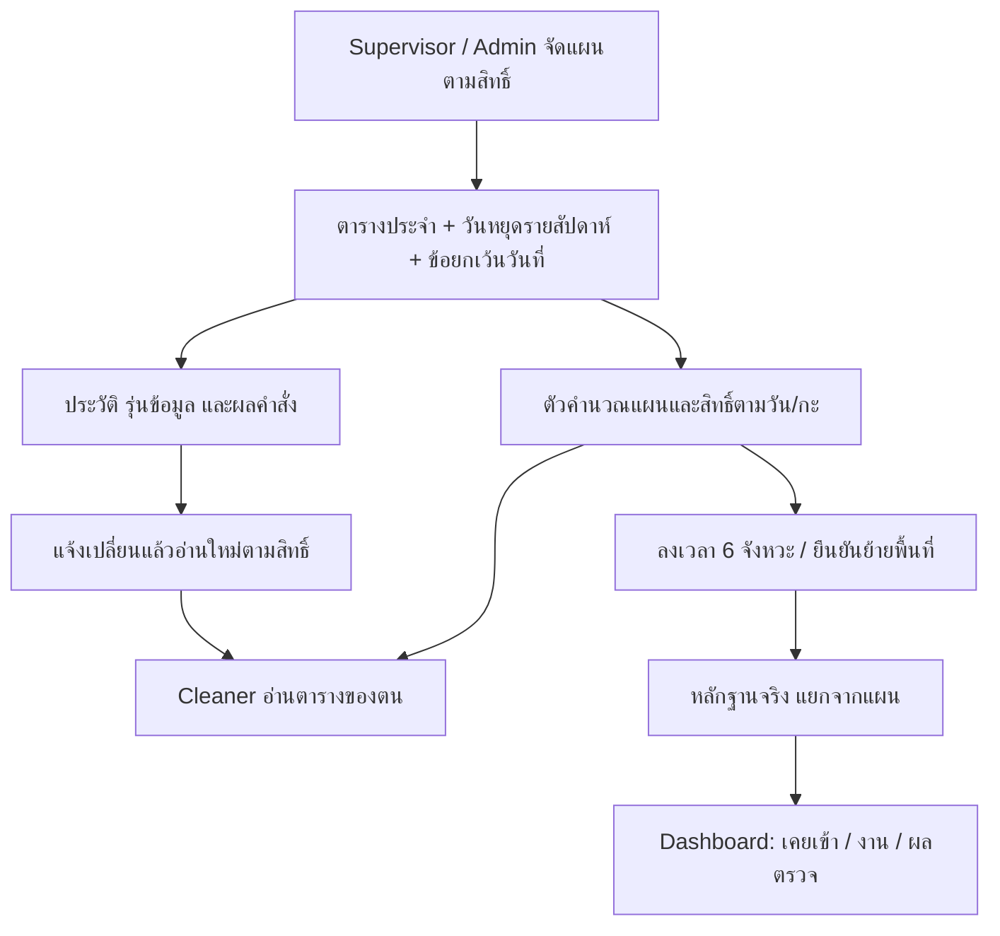
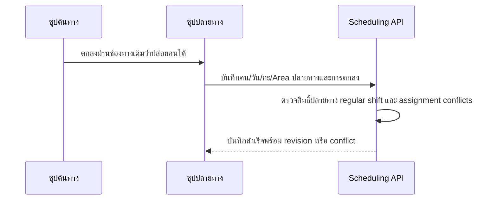
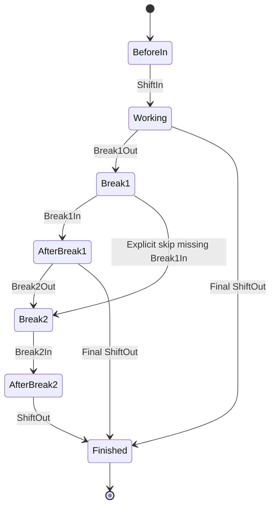
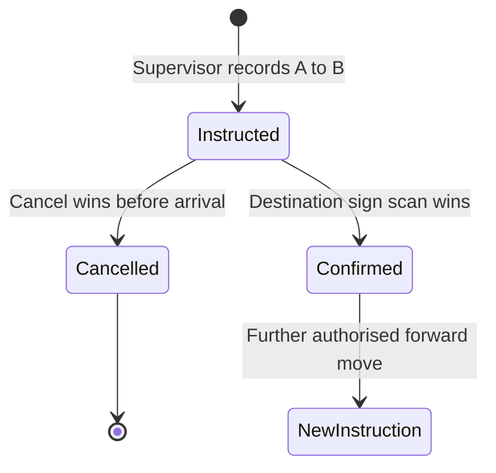
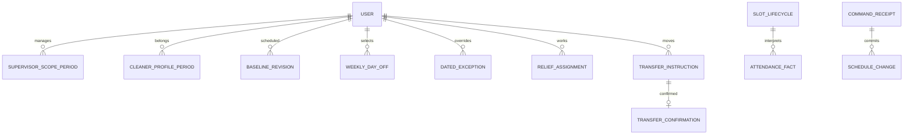
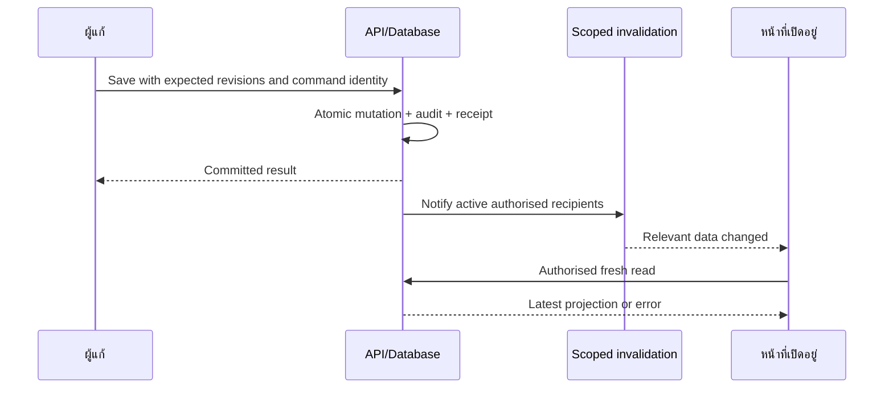

# แบบออกแบบตารางงานแม่บ้านและการลงเวลา

> Updated 2026-11-20. Six attendance actions apply to every shift. The cutover and legacy lifecycle provisions below are superseded. Writes use the current attendance revision and explicit gap confirmation.

วันที่ 17 พฤศจิกายน 2026 (Asia/Bangkok) · **เจ้าของอนุมัติ spec แล้ว 17 พฤศจิกายน 2026**

เจ้าของยืนยัน recap และสั่งเขียน spec แล้ว จากนั้นอนุมัติฉบับนี้ด้วย “อนุมัติ spec เขียนแผนต่อ” การอนุมัติเป็นฐานเขียน implementation plan ไม่ใช่คำสั่ง implement, migrate, deploy, commit หรือ publish ดู [implementation plan](../plans/2026-11-17-cleaner-scheduling.md)

## 1. ฐานข้อกำหนดและขอบเขต

ใช้ [requirements](../../requirements-gathering/2026-11-16-supervisor-scheduling-requirements.md), [คำตอบ 5 เรื่อง](../../requirements-gathering/2026-11-16-supervisor-workflow-confirmation.md), [closeout ที่ยืนยันแล้ว](../../requirements-gathering/2026-11-17-scheduling-design-closeout.md), [CONTEXT](../../../CONTEXT.md) และ [ADR index](../../adr/README.md) เป็นฐาน ข้อตกลง scheduling เริ่ม 0131 และล่าสุด 0222; อ่าน amendment ล่าสุดของแต่ละหัวข้อ ข้อความ pending ในบันทึกเก่าไม่ใช่สถานะปัจจุบัน

ครอบคลุม: Supervisor หลายตึกในกะตน, Admin ทุกตึกทุกกะ, regular/relief schedules, วันหยุดตามสัปดาห์, ลาเต็มกะ/ครึ่งวัน, กลุ่มพัก, สแปร์ยืมข้ามตึกหลังตกลง, เวลา 6 จังหวะพร้อมประวัติแบบเก่า, เติมเวลาที่ขาด, ย้ายพื้นที่ระหว่างกะ, history/concurrency/live updates และ integration ของ Dashboard

ไม่เพิ่ม payroll, คิด OT/สาย/กลับก่อน, การขอลา/อนุมัติลาในเว็บ, การกดอนุมัติยืมสแปร์ในเว็บ, งานรายชั่วโมงออกไปทำธุระแล้วกลับ (0196), ย้ายกะรายวัน, paper import/print/export/monthly view หรือระบบจัดคนอัตโนมัติ

คนช่วยเก็บขยะ/เติมกระดาษตาม 0195 ไม่ถูกนับเป็นคนรับผิดชอบแทนทั้ง Area ไม่สร้างสิทธิ์สแกนข้าม Area หรือ workflow งานย่อยใหม่จากคำบอกเล่า ต้องใช้สิทธิ์เดิมที่มีหลักฐานรองรับ หากต้องการให้มี workflow ช่วยงานเฉพาะจุดภายหลัง ให้ยืนยัน requirement เพิ่ม ไม่อ้างว่าฉบับนี้รองรับแล้ว

คำว่า “ออก OT” ไม่ถูกแปลงเป็นเวลาเดียวทั้งโรงงาน เก็บช่วงลาที่ตกลงและเวลาออกจริงตามกรณีที่บันทึก ไม่สร้างกะประจำสั้นลงหรือคำนวณค่าจ้าง

## 2. หลักฐานระบบเดิมที่ตรวจจริง

| Source | สิ่งที่มีจริง | งานที่แบบนี้ต้องเพิ่ม/รักษา |
|---|---|---|
| [User](../../../backend/src/JanitorialManagementDashboard.Domain/Entities/User.cs) | AreaId/BuildingId ปัจจุบันอย่างละค่าและ regular Shift | ข้อมูล dated scope/baseline เพิ่ม ไม่ใช้ค่าปัจจุบันสร้างประวัติย้อนหลัง |
| [AppDbContext](../../../backend/src/JanitorialManagementDashboard.Infrastructure/Persistence/AppDbContext.cs) | SupervisorSlot unique หนึ่งตึก/กะ; attendance event เป็น UpperSnake string และ unique ตามคน/slot/event | รองรับ membership หลายตึกแต่ยัง unique ต่อตึก/กะ; ห้ามเปลี่ยนชื่อ stored event เก่า |
| [SupervisorScope](../../../backend/src/JanitorialManagementDashboard.Application/Inspections/SupervisorScope.cs) | ตรวจ ownBuildingId เดียว | resolver ชุดตึกใช้ร่วมกับ view/schedule/inspection; ไม่ตัด temporary inspection cover เดิม |
| [AttendanceRules](../../../backend/src/JanitorialManagementDashboard.Application/Attendance/AttendanceRules.cs) | 4 เหตุการณ์, ส่งงานตั้งแต่ ShiftIn จน ShiftOut | lifecycle ต่อ slot, numbered breaks, explicit missing states; ShiftOut ยังปิด submission |
| [AttendanceEndpoints](../../../backend/src/JanitorialManagementDashboard.Api/Endpoints/AttendanceEndpoints.cs) | ป้ายต้องตรง User.AreaId, unique event, GPS, receiving-window | ตรวจ effective Area และ transfer confirmation แยก; ไม่เปิด arbitrary Area |
| [AttendanceCalendar](../../../backend/src/JanitorialManagementDashboard.Application/Attendance/AttendanceCalendar.cs) | คนใช้กะตน; กะดึกใช้วันเริ่มกะ; window ตั้งค่าได้และรวมขอบ | ใช้กติกา attribution/window เดิม ไม่ใช้ clock shift แทนกะของ Cleaner |
| [CoverAssignmentEndpoints](../../../backend/src/JanitorialManagementDashboard.Api/Endpoints/CoverAssignmentEndpoints.cs) | Admin-only, Cleaner candidates ต้องมี AreaId | dedicated relief และ Supervisor scheduling เป็น consuming paths ใหม่; ไม่เพียงเปิด role บน endpoint เก่า |
| [AdminAttendanceEndpoints](../../../backend/src/JanitorialManagementDashboard.Api/Endpoints/AdminAttendanceEndpoints.cs) | เพิ่ม/แก้เวลา พร้อมเหตุผลและ provenance | Admin รักษาสิทธิ์เดิม; Supervisor เติมเฉพาะช่องว่างใน scope |
| [AreaAttendance](../../../backend/src/JanitorialManagementDashboard.Application/Attendance/AreaAttendance.cs) | สรุป regular events 4 ค่า + cover boolean | แยก historical entry, current responsibility และ transfer pending/arrival |
| [ScanHub](../../../backend/src/JanitorialManagementDashboard.Api/Hubs/ScanHub.cs), [PointNotifications](../../../backend/src/JanitorialManagementDashboard.Api/Endpoints/PointNotifications.cs) | ส่งให้ active account IDs ณ เวลาส่ง ไม่พึ่ง group ค้าง | แจ้ง schedule invalidation แบบ scoped แล้วอ่านใหม่ ห้ามส่งข้อมูลบุคคลให้ผู้หมดสิทธิ์ |
| [myWorkApi](../../../frontend/src/shared/api/myWorkApi.ts) | invalidate/refetch ผ่าน hub, fresh-on-open | reuse รูปแบบ recovery; schedule อ่านแยกโดยไม่แก้ card จาก event |
| [RetentionSettings](../../../backend/src/JanitorialManagementDashboard.Application/Retention/RetentionSettings.cs) | ค่าเริ่มต้น GPS 90 วัน, detail 1 ปี ปรับตั้งค่าได้ | ข้อมูลใหม่เข้าวงจร retention เดิม ไม่ถือว่าค่าตั้งต้นเป็นข้อบังคับคงที่ |

ทั้งหมดเป็น source observations ระหว่างเขียน spec ไม่ใช่ผลรันทดสอบหรือหลักฐานว่าฟีเจอร์ใหม่มีแล้ว

## 3. สิทธิ์และคำศัพท์

| Actor | อ่าน | เขียน |
|---|---|---|
| Cleaner | ตารางและเวลาของตัวเอง รวม relief destination | ลงเวลาจริง/ข้าม break ที่ลืมอย่างชัดแจ้ง/ยืนยันปลายทางที่ได้รับมอบหมาย; ไม่แก้แผนหรือเติมเวลาเก่าเอง |
| Supervisor | ตึกที่รับผิดชอบในกะตน; ข้อมูลที่จำเป็นต่อการจัดคน | ตารางในขอบเขต, บันทึกลา, ยืมหลังตกลง, คำสั่งย้าย, เติมเวลาที่ขาดพร้อมเหตุผล |
| Admin | ทุกตึกทุกกะ | จัดแผนทุกขอบเขตและสิทธิ์แก้ actual times ตามเดิม พร้อมเหตุผล/ประวัติ |

ตรวจ role/active account และสิทธิ์ปัจจุบันทุก read/write ไม่เชื่อ userId/buildingId หรือรายการ candidates ที่ client ส่งมา การแก้ย้อนหลังโดย Supervisor ต้องอยู่ทั้งในขอบเขตที่ปัจจุบันยังได้รับอนุญาตและความรับผิดชอบของวันที่แก้; ถ้าไม่ผ่านให้ Admin จัดการ ไม่ขยายสิทธิ์เพราะวันนี้เพิ่งรับตึกมา Cleaner อ่านประวัติตนได้ตาม retention

Supervisor หนึ่งคนรับผิดชอบหลายตึกได้ แต่ตึก/กะหนึ่งมี regular Supervisor คนเดียว ข้อมูล assignment ระบุช่วงมีผลและต้องไม่ทับซ้อนกันแบบ regular responsibility สิทธิ์ inspection เดิมเรื่องเวลา/รอบ/temporary cover ไม่ถูกยกเลิกเพราะเพิ่มชุดตึก

Relief Cleaner ไม่มี regular Area แต่มีกะและ home building. Home building ไม่จำกัด destination ที่ได้รับมอบหมายอย่างถูกต้อง และไม่เท่ากับสิทธิ์ให้ทุก Supervisor เลือกได้เสรี

## 4. หน้าจอและการนำทาง

Layout baseline: canonical mockup `/Users/macbookair/.codex/visualizations/2026/11/16/01a1e35a-cb6e-7920-87dc-50ada17b12f4/facility-scheduling.html` เป็นแบบเดิมที่ยืนยันของตารางหลัก/วันหยุด/Area-break editor; ไม่อ้างว่าได้จำลองทุก flow 0194–0222 หรือ relief editor ใหม่ ภาพตรวจใช้ PNG ในแชตเพราะเจ้าของเปิด preview ไม่ได้ ส่วนใหม่ใช้โครง Enterprise Light, Tailwind/shared controls และลำดับ edit → review → save ตามแบบเดิม รายละเอียด responsive ต้องตรวจ desktop/phone ใน implementation

| หน้า | พฤติกรรมที่ต้องเห็น |
|---|---|
| Cleaner: ตารางของฉัน | ทางเข้าก่อน My Work; own read-only week/day, Area, กลุ่มพัก, วันหยุด/ลา, unset/conflict และคำสั่งย้าย |
| Supervisor: จัดตารางงาน | ทางเข้าก่อนรายการตึก; ตารางรวมคนในตึกที่รับผิดชอบและกะตน |
| Admin: ตารางงาน | หลังการเข้างาน; ตัวกรองทุกตึก/ทุกกะ; history ว่าใครแก้อะไร |
| วันหยุดรายสัปดาห์ | แถวเป็นคน อ้างอิงสัปดาห์ก่อน เลือกสัปดาห์เป้าหมาย คัดลอกเฉพาะ unset → ปรับ → review → save |
| Regular baseline | เลือกคน/Area/กลุ่มพัก วันเริ่มอนาคตรวมกลางสัปดาห์ แสดง before/after และวันที่ขัดแย้ง; ไม่รวม repeating day-off ตัวเดียวแทน weekly choices |
| Relief baseline | ตารางรวมรายคน 7 วัน ช่อง Area/หยุด/unset แยก home building/destination เลือกวันเริ่มใช้และ review; แก้เฉพาะวันที่เป็นคนละ action กับเปลี่ยน pattern |
| Selected date | Area/กลุ่มพัก/ลา/การมอบหมายคนแทน; วันย้ายแสดง A → B พร้อมเวลาแผน/ยืนยันและ drill-down ไม่ซ่อนงานช่วงแรกด้วยค่า current Area ตัวเดียว; การแก้วันนี้และการย้ายหลังเริ่มแยกจาก future baseline |
| Actual attendance | plan vs actual 4/6 actions ตาม slot; missing/skipped/not-applicable/source/reason อ่านได้ชัด |
| Transfer | Supervisor ระบุคน A → B/เวลามีผล; Cleaner เห็นคำสั่ง แล้วสแกน B กด “ยืนยันเข้าพื้นที่ใหม่”; มีผลยืนยัน/ยังไม่ยืนยัน/ยกเลิก |

แรกเปิดเป็นสัปดาห์นี้ ยกเว้นกะดึกที่กำลังทำใช้สัปดาห์วันเริ่มกะ; Admin เริ่มทุกตึก+clock shift โดยกะดึกใช้วันเริ่มกะ; Supervisor เริ่มทุก assigned buildings+กะตน กลับจากหน้าอื่นระหว่าง ongoing use จำ week/filters ที่ยังมีสิทธิ์ Reload/logout/new login/new tab ใช้ initial defaults ไม่ทำ durable saved filters เลือกอ่าน week ใดก็ได้ทีละสัปดาห์แต่ไม่แปลว่ามีข้อมูล/มีสิทธิ์แก้

ค้าง input แล้วเปลี่ยนหน้า/สัปดาห์ให้เลือกอยู่ต่อหรือทิ้ง input; review กลับไป edit คงค่าไว้ ข้อมูลใหม่เข้าระหว่างแก้แจ้งให้เปรียบเทียบ ไม่ merge หรือเขียนทับ local input เอง ข้อมูลไม่ครบแสดงชื่อคน/วันที่; ไม่ทำให้ save สำเร็จดูเหมือน roster ครบ

## 5. ตาราง แหล่งที่มา และการบันทึก

Regular Area/first-break baseline ใช้ซ้ำตามช่วงวันที่มีผล ส่วนวันหยุดกำหนดแยกสัปดาห์ ไม่บังคับ weekday เดิมหรือจำนวนวันจาก fixture และไม่คัดลอกอัตโนมัติ Relief pattern ใช้ซ้ำรายสัปดาห์และมี dated exceptions เป้าหมายงานครบ 6 วันแสดงเป็นการตรวจความครบ; ยอมบันทึกส่วนที่จัดแล้วโดยแสดงยังไม่ครบ ไม่ต้องเดาให้เต็มหรือเพิ่มปุ่มเผยแพร่

คัดลอกใช้ stable user ID ภายใน current authorised target roster เท่านั้น ไม่จับคู่ชื่อ ไม่เพิ่มคนที่พ้น target membership; saved/local target choice ชนะเสมอ ไม่มี source ให้คง unset และแจ้งรายชื่อ source week ไม่เปลี่ยน คัดลอกไม่บันทึกลา/Area/กลุ่มพัก/สแปร์/actual times

Resolver ให้ provenance ต่อ field: dated explicit choice → applicable versioned baseline. วันหยุด/ลาเป็น absence interval ของคน ไม่ปิด Area ไม่ลดรอบ และไม่เป็น proof of physical absence. Dated first-break override ที่ยังใช้ได้ชนะ default ใหม่ (0189) แต่ถ้าขัดกับ Area/วันไม่ทำงานต้องแสดง conflict และให้แก้ ไม่ลบเงียบ ๆ Unset ไม่เท่ากับ working ที่ยืนยันแล้ว

Relief แทน regular คนใดรับกลุ่มพักของคนนั้นเป็น default (0152) และปรับเฉพาะวันที่ได้ Standalone assignment ที่ไม่ได้แทนใครต้องเลือกกลุ่มพักชัดเจนก่อนบันทึก working row; ไม่ทำให้ช่องนี้กลายเป็น required input ของ endpoint เก่าที่ไม่ใช้ schedule

บันทึกหลายแถวเป็นหนึ่ง atomic command สำหรับแถวที่ submit เท่านั้น ไม่บังคับทั้งสัปดาห์ มี conflict ในแถวใดให้ reject ทั้ง command พร้อม row errors และคง local input การตรวจคนเดียวทับซ้อนงานหลักในกะต้องทำจาก assignment จริง ไม่เชื่อสถานะว่างที่เห็นค้างไว้; ไม่มีการย้าย/ลบ existing assignment อัตโนมัติ

แก้แผนย้อนหลังต้องเหตุผลและ before/after audit เก็บ revision เดิม ข้อมูลจริงและภาพเป้าเก่ายังคงเดิม แสดง original plan กับ corrected plan แยกกัน ไม่เรียก correction ว่า original และไม่ใช้แก้แผนเพื่ออนุญาต scan ย้อนหลัง Baseline editor ปกติยังเลือกวันเริ่มอนาคตตาม 0187

## 6. การยืมสแปร์ข้ามตึก

กรณีคนละซุป ต้นทางตกลงก่อนปลายทางจัดงาน (0206) ปลายทางบันทึกหลังตกลง ไม่มี approval workflow ในเว็บ (0207) แสดงเป็น “บันทึกโดยซุปปลายทางว่าตกลงนอกเว็บแล้ว” ไม่ปลอมว่า source Supervisor กดอนุมัติในระบบ ระบุ source building/responsible Supervisor และ destination building/Area/วันที่/กะ/คนที่ยืมตามข้อมูลอ้างอิง

การค้นเพื่อยืมให้ใช้รหัสพนักงานและตึกต้นทางที่ผู้บันทึกระบุ แสดงเฉพาะ active relief ในกะเดียวกันและ identity/home-building ที่จำเป็น ไม่เผยตารางของตึกอื่นทั้งหมด ไม่เปิดหน้าแก้ source schedules และต้องเช็กซ้ำตอน save หาก person มี existing conflicting duty ให้แจ้งว่าต้องจัดรายการเดิมให้ถูกก่อน ไม่ยกเลิก/โยกให้เอง การตกลงนอกเว็บไม่ใช่ token ยกเว้น conflict validation

ถ้า source/destination เป็นตึกของซุปคนเดียวไม่สร้าง second actor. Admin ใช้สิทธิ์กว้างเดิมพร้อม audit. Loan เป็นแผน ไม่ใช่ entry evidence. ก่อนเริ่มกะใช้ initial ShiftIn ที่ Area ที่ได้รับมอบหมาย หากเริ่มงานแล้วต้องใช้ transfer ตามข้อ 9

## 7. การลาและกลับมาทำงานวันลา/วันหยุด

| กรณี | ผล |
|---|---|
| ลาเต็มกะตกลงแล้วแต่ยังไม่มีคนแทน | save leave ได้ แสดงรอจัดคนทำแทน; ไม่ถือว่า Area ปิด/มีคนเข้า |
| ออกครึ่งวัน/กรณีออก OT ที่แจ้ง | ไม่มีคนรับหน้าที่แทนจนจบกะ; ไม่สร้าง partial replacement โดยสมมติว่ามีคนเริ่มแทน 13:00 |
| ออกครึ่งวันและไม่กลับ | ใช้ existing ShiftOut ตามเวลาสแกนจริง เช่น 13:00; leave เป็นแยก record; จบ submission ของ slot |
| จังหวะพักหลัง final departure | ถ้า expected instant ของ action อยู่หลัง/เท่ากับ actual departure และอยู่ใน recorded applicable leave ให้ not-applicable เนื่องจากลา; ไม่สร้าง actual event |
| สแกนที่ลืมก่อน final departure | คง missing/skipped ไม่ถูกล้างเพราะมีลา |
| ไม่เคยมีลา/ช่วงลาชนไม่ตรงกับเวลาออก | เก็บทั้งสองค่าตามจริงและ conflict ให้ตรวจ; ไม่สมมติว่า early checkout ทุกครั้งเป็น authorised leave |
| มาทำงานวันลา | otherwise eligible actual ShiftIn ได้ก่อนยกเลิกในเว็บ มี visible leave conflict; Supervisor/Admin ยกเลิกลา explicit ตาม 0198/0202 |
| มาทำงานวันหยุด | otherwise eligible actual ShiftIn ได้ก่อนปรับตาราง มี visible off-day conflict; Supervisor ปรับ explicit ตาม 0205 |

สำหรับ day-off/leave check-in ให้ตรวจ Area จาก underlying baseline/dated assignment ที่มีสิทธิ์อยู่ ไม่ลบทิ้งเพียงเพราะมี absence record แล้วจึงบอกว่าไม่มีสิทธิ์จนตรวจรับเข้าไม่ได้ สแปร์ที่ไม่มี destination assignment ยังไม่เกิดสิทธิ์จาก home building อย่างเดียว Conflict ไม่ยกเว้น account/shift/sign/window checks

Conflict เคลียร์หลัง correction command สำเร็จ ไม่ใช่แค่กดปุ่มหรืออ่านใหม่พลาด ไม่เลื่อน timestamp ของ scan ไปเวลาแก้แผน ไม่ซ่อน entry จริงไว้เป็น pending และไม่สร้าง submission block เพิ่มจาก conflict ลา/หยุด ไม่ทำ auto cancellation/compensatory day/relief move คนที่จัดไว้แล้วไม่ถูกลบ; Supervisor ต้องจัด staffing conflict อย่างชัดเจนและการย้ายจริงใช้ข้อ 9

การเปลี่ยน recorded leave ภายหลังทำให้สถานะ derived not-applicable ถูกประเมินจากแผนรุ่นที่แสดง โดยเก็บ previous evaluation/provenance ที่ตรวจได้ ไม่แก้ event จริง ค่า not-applicable ต่างจาก missing และไม่เป็น actual break scan

## 8. Attendance lifecycle และเวลาที่ขาด

Diagram แสดง normal path และตัวอย่าง skip ไม่ใช่รายการ transition ทั้งหมด Contract กลางเป็น ordered action list ต่อ lifecycle: legacy = ShiftIn/BreakOut/BreakIn/ShiftOut; new = ShiftIn/Break1Out/Break1In/Break2Out/Break2In/ShiftOut. ชื่อ enum/API ที่ใช้จริงต้องสอดคล้องกัน แต่ stored legacy strings ทั้งสี่และความหมายเดิมคงไว้ (DB ใช้ UpperSnake string ไม่ใช่ numeric enum)

Server ส่ง allowed actual actions และ intermediate gaps ที่ต้องยืนยันข้าม ถ้าจะบันทึก action ถัดไปเกิน expected intermediate break ให้ Cleaner ยืนยัน gap IDs จาก revision ล่าสุด ส่ง skipped markers ไม่ใช่ guessed times ห้ามข้าม ShiftIn, ทำหลัง final ShiftOut, ซ้ำ event หรือย้อนลำดับ Actual recorded times ต้องเรียงตาม ordinal ของ lifecycle; skipped intermediate actions ไม่ได้บังคับให้คู่ของมันมี event ปลอม

ShiftOut เป็น final action หลัง ShiftIn ได้โดยข้าม intermediate break อย่าง explicit ตามที่ server ระบุ ไม่เดาเจตนาจากนาฬิกา หากลาออกจริงให้ใช้ N/A เฉพาะตามข้อ 7 ส่วนต้นช่วงที่ลืมยัง missing การส่งงานหลัง ShiftIn ก่อน ShiftOut ทำได้ระหว่างพัก/แม้ลืมกลับพัก ไม่ใช้ Service Point submission เติม BreakIn

Supervisor เติม missing actual time ได้เมื่อยืนยันความจริงแล้ว ต้อง reason ไม่เกินขีดจำกัดเดิม 500 ตัวอักษร, provenance actor/enteredAt/occurredAt และตรวจ order/window ตาม lifecycle ของ slot ไม่เขียนทับ actual scan ที่มีอยู่ Admin คง correction rights เดิม ผู้ที่หมดสิทธิ์ทีมย้อนหลังให้ Admin แก้ ไม่พึ่ง User.AreaId ปัจจุบันเพื่อหาประวัติ

### Cutover

มี lifecycle version ต่อ `(ShiftDate, Shift)` ทั้ง slot และ activation boundary ที่เลือกก่อน receiving window เปิด Slot ที่เคยมี legacy event แล้วเลือกเป็น first new slot ไม่ได้ กะที่เริ่มเก่าอยู่ต่อจนจบ window; old corrections ยังตีความแบบเก่า ไม่เพิ่ม break-2 ย้อนหลัง

Attendance read ให้ version/contract marker. Attendance writes ที่ consume new flow ต้อง marker และ expected slot state; stale incompatible page ได้ refresh-required ก่อนเขียน ไม่มี global required version บน auth/scan/inspection ที่ไม่ consume สัญญาเปลี่ยนนี้ Deployment slot จริงให้ผู้ deploy เลือกและตรวจ preconditions ภายหลัง ไม่ hard-code วันที่ทดสอบใน product

## 9. ย้าย Area หลังเริ่มกะ

คำสั่งมี revision/from/to/effectiveAt/actor/reason และอ้าง slot/คน. ก่อน effective time ยังไม่อนุญาตใช้ destination transfer confirmation; เมื่อถึงเวลาให้แสดง “สั่งย้ายแล้ว ยังไม่ยืนยันถึงพื้นที่ใหม่” ไม่ใส่ arrivalTime ตาม effectiveAt

คนที่ entered แล้วสแกน Check-In Sign ที่ destination กด “ยืนยันเข้าพื้นที่ใหม่” หนึ่งครั้ง ใช้ token/GPS policy เดิม ผูก transferId/current revision และ actual server timestamp. Source origin departure ไม่ต้องมี scan ใหม่ ดังนั้น effectiveAt ไม่ใช่หลักฐาน physical departure. ไม่สร้าง ShiftOut/ShiftIn เพิ่ม ไม่ reset breaks ไม่ย้าย Scan Records/Inspection Records เก่า

การยืนยันระหว่างพักไม่เป็น BreakIn และไม่เปลี่ยน current break status. ถ้า first-break cycle เริ่มแล้ว เก็บแผนของรอบที่เริ่มไว้จนรอบนั้นจบ; group ใหม่มีผลกับแผนที่ยังไม่เริ่มโดยไม่สร้าง past actions. เวลา scan คลาดแผนอย่างเดียวไม่ปฏิเสธตาม 0149 เมื่อมีคำสั่งมีผลแล้ว การลงเวลาที่ B ต้องยืนยันปลายทางตาม transfer ก่อน; arrival ไม่ใช่ BreakIn/ShiftIn แล้วจึงทำ actual action ถัดไปตามสิทธิ์ที่ B ได้ ห้ามบันทึก actual action ที่ A ต่อหลัง effective responsibility ออกไปแล้ว และไม่ใช้ destination instruction เพียงอย่างเดียวสร้าง arrival evidence การยืนยัน transfer ไม่เข้าสู่ repeat-ignore clock ของ break/final action จนปฏิเสธ action ที่ถูกต้องเพียงเพราะเพิ่งยืนยันปลายทาง; deduplicate confirmation ด้วย instruction identity ของมันเอง

cancel และ confirm ต้องแข่งบน revision/lock เดียวกัน ใคร commit ก่อนอีกฝ่ายเห็น conflict. Repeated same confirmation คืนผลเดิม ไม่สร้าง arrival ซ้ำ After confirmed ห้ามลบ actual arrival จาก schedule screen; คำสั่งถัดไปเป็น forward record. ถ้ายังไม่ยืนยันคง pending arrival และไม่เดาว่าไปถึงแล้ว หากลืมให้ผู้มีสิทธิ์ตรวจ/แก้ตาม actual-evidence correction contract ไม่ให้หน้าแผนปลอม scan/GPS หรือ historical confirmation

ช่วง pending ไม่มีการอ้างว่าคนอยู่สองพื้นที่พร้อมกัน: แสดง responsibility ตาม effective instruction และ last confirmed Area/time แยกกัน ไม่อ้างว่าตำแหน่งล่าสุดยัง physically occupied ต่อเนื่อง ก่อนถึง B ยังไม่มี entry evidence ที่ B. Operational readiness ไม่ถือว่า instruction สำเร็จจนมี evidence

## 10. รูปข้อมูลเชิงตรรกะ

นี่คือ logical schema สำหรับ migration design ใน plan ไม่ใช่ schema ที่สร้างแล้ว

| Record | Fields/constraints สำคัญ |
|---|---|
| SupervisorScopePeriod | UserId, BuildingId, Shift, effective date range, revision; หนึ่ง regular owner ต่อตึก/กะ/ช่วง |
| CleanerProfilePeriod | UserId, regular/relief, home building, shift, effective range; current User fields เป็น compatibility projection ไม่ใช่ historical truth |
| BaselineRevision | person, effectiveFrom/To, regular Area/group หรือ relief weekday cells; immutable prior revisions; source references |
| WeeklyDayOff | person, weekStart, selected dates, revision; unset แยกจาก explicit choices; ไม่ auto-fill |
| DatedException/Leave | person, ShiftDate/Shift, Area/group override หรือ interval, original/revised/cancelled history, actor/reason; retain applicable precedence |
| ReliefAssignment/Loan | person, slot/Area, source regular person เมื่อมี, explicit group เมื่อ standalone, source home building/agreement reported by/destination actor; conflict with other main-duty interval |
| TransferInstruction | slot/person/from/to/effectiveAt/revision, instruction/cancel history; at most one unresolved next move per person |
| TransferConfirmation | instructionId unique, actual destination Area/sign/GPS/time/source; ไม่ใช่ ShiftIn; retained history |
| SlotLifecycle | unique date/shift, version and activation metadata; never reinterpret recorded old slot |
| AttendanceFact/Gap | unique person/slot/action for actual facts, source/recordedAt/occurredAt; gap reason/status separate from actual time; eligibility snapshot/source assignment |
| CommandReceipt/Change | command identity, actor, payload fingerprint, expected revisions, result/revisions/time, audit changes; same transaction as business mutation |

เก็บ actual timestamps เป็น UTC; ShiftDate เป็นวันเริ่มกะตามไทย แสดง timezone Asia/Bangkok; intervals ใช้ start-inclusive/end-exclusive ในแผน ไม่เปลี่ยน receiving window ที่มี inclusive boundaries ของระบบเดิม

Scoped projection ตอบ provenance/revision/availability/conflicts และ last successfully read time ไม่สร้าง history จาก current defaults หรือจาก inferred helper presence ข้อมูลก่อน baseline/history coverage แจ้ง unavailable; staffing gaps หลังเริ่มมี history แสดง unset แทน unavailable

## 11. API และ concurrency contract

ชื่อ route ด้านล่างเป็น contract ของแบบ ไม่ได้เพิ่ม endpoints แล้ว ทุก write ตรวจสิทธิ์และ current facts ฝั่ง server

| Method/route ที่เสนอ | Purpose |
|---|---|
| GET `/api/schedules/me?weekStart=` | own authorised weekly projection |
| GET `/api/schedules?weekStart=&buildingId=&shift=` | scoped management projection; Supervisor ไม่เปลี่ยน query ไปเกิน scope |
| POST `/api/schedules/commands` | submitted batch of dated/baseline/off/leave/loan/transfer instruction/cancellation/plan correction with expected revisions |
| GET `/api/schedules/commands/{id}` | actor/scoped command result for uncertain writes; ห้าม enumerate คนอื่น |
| POST `/api/schedules/command-tokens` | short-lived server-issued command identity for a proposed mutation, bound to actor and issuance time |
| POST `/api/attendance` | initial/break/final actions with slot lifecycle marker on changed consuming path |
| POST `/api/area-transfers/{id}/confirm` | destination sign arrival for current authorised instruction |
| POST `/api/team-attendance/missing` | scoped missing-time addition with reason; existing Admin correction route retains broader rights |

Reads send projection revision plus row/resource revisions; write identifies operation/changed rows and all relevant expected revisions. Include schedule/assignment/transfer state revisions where eligibility depends on them. Use stable lock order by scope/slot/person for a multi-row command; lock stable person/slot or baseline-head anchors even when target assignment rows do not yet exist, so two creates cannot both observe an empty slot. Re-evaluate availability after lock. Token/result writes are in the same transaction as mutation/audit. After commit only, send invalidation; failed push never rolls back committed facts

Within retained results, lookup the existing committed receipt before deciding whether an otherwise valid token is too old to start a mutation. Same identity + same payload returns original committed result; same identity + different payload is conflict. A stale expected revision rejects without mutation, preserving client input for before/after comparison. A command not known committed is not reported successful; lookup failure remains uncertain. No blind retry as a new command until the old result is resolved

For bounded receipt storage, use a server-signed, purpose-bound command token containing immutable identity/actor/issuance/expiry (24 hours for starting a new command); never accept a client-reissued timestamp for the same identity. Validate token purpose/signature and authenticated actor; retain verification-key availability through outstanding token validity without storing secrets in application records. Retain response/receipt for the normal retained-detail window. After response is purged, expired identities are still refused without applying; identity cannot be refreshed/reused with a new issue time. Status outside retention reports result unavailable, not safe-to-retry. Token expiry does not revoke a committed result or allow a second application. Status lookup rechecks identity ownership and applicable scope; permission loss does not leak the payload or authorise automatic resubmission

Machine errors distinguish unauthorised, stale revision, staffing overlap, refresh-required lifecycle, command payload mismatch, command expired and history unavailable. Include affected row IDs/current authorised projection where appropriate, not hidden other-team schedules. No success partial batch or automatic merge

## 12. Live data, retention และความผิดพลาด

ใช้ server-to-client invalidation ตาม active IDs ณ เวลาส่ง แบบ ScanHub เดิม ไม่ให้ client join arbitrary team group Read-only refetch เมื่อเปิด/focus/reconnect/relevant event และ fallback 30 วินาทีเมื่อหน้า visible. Dirty form แจ้ง newer revision แต่ไม่ล้าง local input. Reconnect/read failed ต้องคง stale badge จน read สำเร็จจริง Mutation offline ไม่เข้า queue อัตโนมัติ

Schedule/transfer/attendance corrections ทำให้ affected slots และ related authorised person/building views invalidate รวม stale account rights ต้องตรวจใหม่ Deactivated account ไม่ได้ event เพิ่มและอ่าน/เขียนถูกปฏิเสธ ไม่มีข้อมูลจริงอยู่ใน broadcast payload ที่คนอื่นนำไปใช้ข้ามสิทธิ์ได้

Retention ใช้ settings ของโครงการ: GPS ล้างตาม GpsDays, personal detail ตาม RecordYears รวม schedule revisions, audit/transfer facts และ receipt payload; อย่าขยาย retention โดยสร้าง snapshot สำเนาที่ไม่ถูกล้าง. active/current/future configuration และ baseline anchor ที่ยังจำเป็นต่อการคำนวณปัจจุบันไม่ถูกลบเพราะ CreatedAt เกิน detail retention; prune obsolete historical versions และ supporting anchors เฉพาะที่ไม่จำเป็นกับช่วงข้อมูลที่ยังเก็บ ก่อน prune รักษา boundary/version จำเป็นสำหรับ detail ที่ยังอยู่เท่านั้น เมื่อตัดจนไม่มีหลักฐานเพียงพอส่ง unavailable ไม่ย้อนสร้างชื่อ/ตารางจากปัจจุบัน Receipt refusal-after-expiry ป้องกัน duplicate โดยไม่ต้องเก็บ personal payload ตลอดไป. ไม่ใส่เบอร์โทร ชื่อจริงหรือ secrets ลง fixture/เอกสาร public

## 13. Dashboard และผลต่อแผนเดิม

รายละเอียดเดิมอยู่ใน [overview spec](2026-11-16-combined-overview-dashboard-design.md), [plan](../plans/2026-11-16-combined-overview-dashboard.md) และ [D7](../reviews/2026-11-17-overview-plan-assumption-delta.md)

**สัญญาปิด D7 (0216):** entry evidence ของ Area/slot เป็น initial ShiftIn ที่ถูกต้องหรือ destination arrival confirmation ที่ถูกต้อง นับ Area ID ไม่ซ้ำ ไม่ใช่จำนวนคน/events. A ที่เคยเข้าแล้วนับต่อจนจบ slot แม้ย้าย/พัก/เลิกงาน; B ไม่ได้ entry จาก instruction อย่างเดียว แต่ได้จาก actual confirmation. คนเดียวจึงมี historical entry สอง Area ได้โดยไม่แปลว่ากำลังทำสอง Area พร้อมกัน

สามหมวดยังคง entered / assigned-without-entry / unassigned-without-entry โดย assignment sources รวม effective relief/loan/transfer instruction ที่จัดตามสิทธิ์ ที่ได้รับมอบหมายใน scope ไม่ใช่แค่มีชื่อว่างใน fixture ทั้งสามรวมเท่าฐานพื้นที่ต้องมีคนของกะตาม target snapshot. ไม่เปลี่ยน rounds/targets เพราะวันหยุด/ลา/ย้ายคน และไม่เอา pending replacement/arrival มานับเป็น actual entry

Area detail แสดง initial/break/final facts, transfer instruction/arrival/cancellation, leave/off conflict, not-applicable vs missing และ actual source/reason. Current responsibility/last confirmed location/time แยกจาก historical entered count; ไม่อ้าง continuous tracking หรือย้าย actual AreaId ย้อนหลัง Source Area อาจไม่มีคนรับช่วงหลังย้าย ต้องแสดงข้อเท็จจริงแทนบอกว่าปิดงาน/มีคนอยู่ต่อโดยอัตโนมัติ

ถ้า overview ขึ้นก่อน scheduling ใช้ old sources ได้ แต่ก่อนเปิด transfer ต้องเพิ่ม projection/DTO/drill-down/events/tests ตามสัญญานี้ หาก scheduling ขึ้นก่อน overview ให้แผน overview rebase จาก lifecycle/assignment/entry-evidence ใหม่ ห้ามใช้ตัวอย่าง ShiftIn-only ต่อแล้วถือว่าครบ การเขียน spec นี้ไม่เริ่มทำ Task ใดของแผน Dashboard

## 14. Compatibility และข้อมูลเริ่มต้น

เพิ่มตารางก่อนสลับ readers/writers; backfill current regular profile/Area/group ที่ยืนยันได้เป็น baseline effective ณ จุดเริ่มเก็บประวัติ ไม่สร้างชื่อสแปร์หรือวันหยุด/ลา/กลุ่มพักที่ไม่เคยเก็บจากการเดา ค่า missing setup แสดง incomplete ให้ผู้มีสิทธิ์จัดให้ครบ ไม่ block unrelated legacy flows ด้วย required input ใหม่

Supervisor building membership เริ่มจาก known current BuildingId ของแต่ละบัญชี; ขยายหลายตึกด้วย explicit data entry และตรวจ unique responsibility. อย่า copy BuildingId ของ Cleaner เป็น home building ของ relief โดยไม่รู้ identity/roleจริง Current fields ที่ยังใช้ใน legacy paths ไม่ถูกลบใน migration แรก

เก็บ legacy cover/inspection paths ที่ไม่ถูก supersede ตามสิทธิ์เดิม ใช้ compatibility adapter กับ eligibility resolver ใน paths ที่ต้องเปลี่ยน ไม่ blanket-convert old cover ให้เป็น relief duty; source semantics ต่างกัน Old audit/events/exports ยังอ่านความหมายเดิม. Cutover ตรวจ earliest receiving และ old events ก่อนยืนยัน enablement เป็นขั้น operations ของผู้ deploy ในอนาคต ไม่ run migration/server/database จากงานเอกสารนี้

## 15. เกณฑ์ตรวจรับ

| # | สถานการณ์ | Expected result |
|---|---|---|
| A01 | Supervisor หลายตึก/gate คนละกะ/ปลอม query | เห็น/แก้เฉพาะ assigned scope; Admin global; Cleaner own-only |
| A02 | คนเดียว duplicate assignment บันทึกพร้อมกันสองซุป | commit ได้แค่ชุดที่ไม่ขัดแย้ง; อีกชุดได้ conflict ไม่มี partial/audit ซ้ำ |
| A03 | เปลี่ยน Area วันพุธ | วันก่อนหน้าเดิม; applicable dated break override คงอยู่; conflict ไม่ลบเงียบ |
| A04 | วันหยุดสัปดาห์ใหม่ต่างจากก่อน | week isolation; unset ไม่กลายเป็น working/off โดยเดา |
| A05 | คัดลอกหลายครั้ง มี local Monday/saved target/source gaps/คนพ้นทีม | ID matching, fill-only, Monday ไม่หลุดเพราะ falsy, source unchanged, gaps visible |
| A06 | คัดลอกแล้วยกเลิก/กลับจาก review | ไม่บันทึกเอง; กลับแก้คงค่า; ยกเลิกคืน saved values |
| A07 | submit บางคนและหนึ่งแถวในชุด invalid | partial roster save allowed; submitted batch atomic; incomplete visible |
| A08 | relief standalone ไม่มี group / แทน regular มี dated group | standalone working row rejectedจนเลือก; replaced default+override ถูกต้อง |
| A09 | loan คนละซุปหลัง outside agreement | destination actor records attestation not source signature; no in-app approval; no broad source edit |
| A10 | loan คนละกะ/active conflicting assignment | reject; no auto removal/move; same Supervisor two buildingsไม่สร้าง second actor |
| A11 | full six-action normal lifecycle / legacy slot | correct action set; old four factsไม่เพิ่ม Break2/missing เทียม |
| A12 | skip Break1In ไป Break2Out | explicit gap confirmation, actual next time recorded, missing stays empty |
| A13 | submit during break/missing return/final ShiftOut | until final out allowed; after final out denied; no auto BreakIn |
| A14 | Supervisor เติม missing/พยายาม overwrite/out-of-scope | reason+valid order/window/provenance; overwrite/out-of-scope denied; Admin rightsเดิม |
| A15 | half-day final out13, leave13–19, break16 | actual out13; later covered actions N/A; earlier missing remains; no generated19 |
| A16 | out13 without leave or leave starts later | no fabricated authorised leave; mismatch visible; actual time unchanged |
| A17 | leave/off-day eligible in07, explicit correction07:10 | actual07 preserved; conflict until saved; no hidden pending block/auto move |
| A18 | command repeat/same key changedpayload/staleversion | original result/no dup; mismatch reject; stale compare preserves input |
| A19 | timeout after commit / status unavailable / identity expired | lookup result before another mutation; unknown explicit; expired old identity never reapplies |
| A20 | night Sunday to Monday, before/after window boundary | correct own slot/start-date/week; initial Admin clock-shift rule; inclusive receiving boundaries preserved |
| A21 | old page hits new slot / activation slot already legacy received | refresh-required no writes; invalid boundary cannot enable; ongoing old slot remains old |
| A22 | transfer plan13, actualB13:05 | original ShiftIn07; distinct confirmation13:05; no second ShiftIn/fake source departure |
| A23 | transfer during break/after break1 | status and recorded progress unchanged; confirmation not BreakIn; no reset/fabricated past action |
| A24 | cancel vs confirm races/repeated destination scan/confirmed arrival then cancel | one wins at revision; duplicate returns original; confirmed fact retained and forward correction path |
| A25 | instruction pending/confirmed/cancelled in overview | B entry only confirmed; A historical entry persists; distinctArea count; current person not shown working two Areas |
| A26 | live save while another edits/offline/reconnect read failure/account deactivation | dirty input preserved; stale not cleared by failed read; no offline queue/unauthorised recipients |
| A27 | prehistory/retained boundary/purged GPS/detail/command result | unavailable distinguished from zero/unset; no reconstruction/leak; expiry cannot revive command |
| A28 | regular pattern edit vs reasoned historical plan correction | original revisions retained; correction labelled; actual scans/work/targets untouched |
| A29 | desktop/phone/keyboard/error states | no page overflow at 1280/375/320; shared controls, readable status/errors; focus and accessible labels |

Implementation ต้องมี unit tests ของ resolver/lifecycle/metrics, isolated real-MySQL API/concurrency/migration/retention tests และ browser tests ของ role scope, edit-review-save, actual sign/transfer, navigation/reconnect และ responsive ตามมาตรฐานโครงการ ไม่ใช้ฐานข้อมูลเจ้าของเป็นฐานทิ้ง ไม่อ้างว่า unit mocks ยืนยัน transaction หรือ physical arrival แล้ว

## 16. ผล self-review และจุดอนุมัติ

ตรวจ load-bearing claims จาก source ในข้อ 2 แล้ว โดยเฉพาะ string enum storage, one-building scope, own-Area sign check, actual-versus-plan/time-window, active-ID notifications และ retention settings. ตรวจว่าไม่มีข้อความให้เดา field answers ทั้งห้า ไม่มี hourly-errand featureแอบกลับมา ไม่มี global required fields ที่ทำ legacy callersพัง และไม่แปลง entry metricเป็นcurrent headcount

เอกสารนี้เลือกสัญญาข้อมูล/พฤติกรรมและกรณีขอบที่จำเป็น แต่ไม่มี implementation steps หรือ task checkbox. Mockupเดิมอ้างเป็น layout baselineเท่านั้น ส่วน flowใหม่ระบุในข้อ4/6/9และ acceptance cases ไม่อ้างว่าสกรีนช็อตเดิมพิสูจน์ flowใหม่แล้ว

**เจ้าของอนุมัติ spec ฉบับนี้แล้ว** ใช้ `sp-writing-plans` จัด [implementation plan](../plans/2026-11-17-cleaner-scheduling.md) ที่ยึด spec/ADRs/overview integration จาก checkoutเดียวกัน การอนุมัติ spec/plan ไม่ยกเลิกคำสั่งพัก implementation ต้องมีคำสั่งเริ่มพัฒนาแยกต่างหาก
