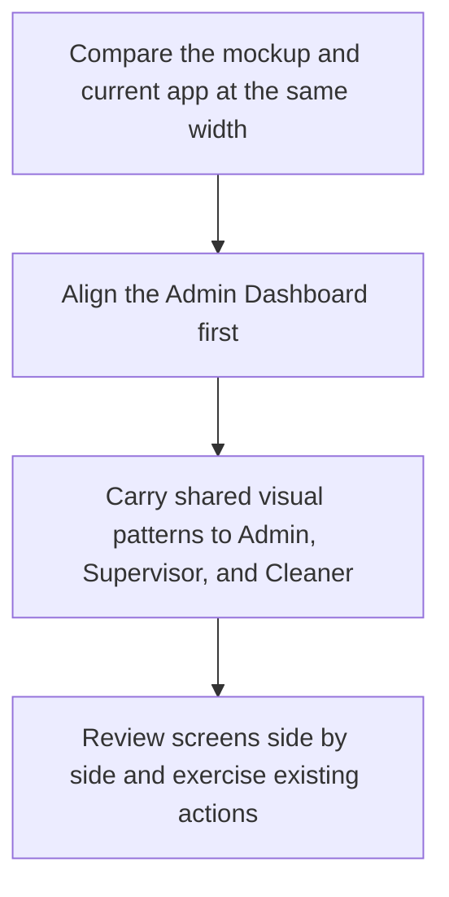

# Align existing screens with the UX/UI mockup

Status: approved by the owner on 19 November 2026. Scope decision: [facility-0223](../../adr/facility-0223-match-the-mockup-for-existing-features.md). [Implementation plan](../plans/2026-11-19-existing-ui-mockup-alignment.md).

## Goal and reference

Match the composition, spacing, typography, and component appearance of the [UX/UI mockup](../../design/ux-audit/mockups.html) for features in the app today. Use the individual screen previews as the reference. Apply the current [design system](../../../design-system/janitorial/MASTER.md) and the earlier [R-01 through R-05 decisions](../plans/2026-11-19-ux-ui-redesign-implementation.md#approved-final-decisions-r-01-through-r-05) when the prototype depicts a different behavior or the design system requires a different control. The Admin sidebar uses the light variant. The existing per-page search stays with its filters, and the historical trend remains in the separate [Combined Overview plan](../plans/2026-11-16-combined-overview-dashboard.md).

## Screen targets

| Surface | Existing entry points | Target |
|---|---|---|
| Admin shell and Dashboard | `/dashboard`, `AppLayout`, `AdminNav`, `DashboardPage`, `Filters`, `BuildingSummary` | Match the light sidebar's grouping, active row, and account area within the current shell. Align the page heading, real status card grid, filter row, and building progress panel to the Dashboard preview. Keep the live badge and mobile menu. The bars retain their actual per-building counts and percentages. |
| Admin attendance and schedule | `/admin/attendance`, `/admin/schedules` | Match the title, summary card row, filter spacing, and table/header treatment in the dedicated previews. Keep the existing attendance columns, correction and cover actions, roster controls, and horizontal table scrolling. Evaluate the schedule using an existing enabled development fixture as well as the normal unavailable state. |
| Other Admin screens | `/admin/areas`, `/admin/buildings`, `/admin/accounts`, `/admin/history`, `/admin/alerts`, `/admin/inspection-summary`, `/admin/export`, `/admin/print`, and area forms and capture | Apply the Admin preview's heading, card, toolbar, and list patterns where they fit each screen. Apply the same hierarchy to existing overlays and forms. Preserve the printed sheet and QR layout. |
| Supervisor | `/my-building`, `/schedule-management`, `/scan/:token` | Use the mobile preview's header, surface, and choice styles for building work and inspection. Use the roster preview for Schedule Management with the existing Supervisor header and scope. |
| Cleaner | `/my-work`, `/my-schedule`, `/check-in/:token`, `/scan/:token` | Match the phone previews for headers, status cards, weekly rows, attendance steps, and submission choices. Apply the existing four-tab navigation and keep the primary action visible above it and the phone safe area. |

For surfaces without a dedicated scene, carry over the shared visual treatment. Their existing content hierarchy and actions determine the screen layout. Confirm any shared style change in login and fallback screens that consume the affected component.

## Implementation constraints

- Reuse the existing `KpiCard`, `SurfacePanel`, `FilterToolbar`, `AvatarBadge`, and phone components. Change shared styles only when the same visual change is appropriate for their callers. Keep route specific layout in the page.
- Use Tailwind semantic tokens and Lucide beside meaningful Thai action labels. Keep the existing contrast, touch targets, skip link, focus visibility, keyboard scrolling, and dialog focus return. The current design system governs the mobile and desktop breakpoints.
- Use actual app state to display counts, people, buildings, and schedules. Preserve current filter behavior, live updates, scheduling availability, role access, valid QR entry and GPS checks, and existing endpoint contracts.

## Acceptance

1. Compare the Admin Dashboard first, then the other represented scenes, at phone widths of 320 and 375 px and desktop widths of 1024 and 1280 px as applicable. Use the corresponding individual Mockup scene and the same screen state for each comparison. Capture the current and final app and retain a short record of the differences fixed and any intentional differences required by the design system or existing workflow.
2. Review heading and grid alignment, card and filter spacing, text hierarchy, and status appearance. At narrow widths, the page fits the viewport, tables scroll inside their regions, and sticky controls leave the final content and primary action reachable.
3. Check normal, empty, loading, and error states where they apply, plus one overlay on each changed Admin surface that uses one. A keyboard user can reach the same controls and return to the opener after closing a dialog.
4. Exercise existing Dashboard filters and building progress, attendance actions, a permitted roster interaction, Cleaner check-in or submission through a valid QR path, and Supervisor inspection using synthetic development data. Confirm each role sees the actions granted by the current app and that the print output still uses the existing layout.
