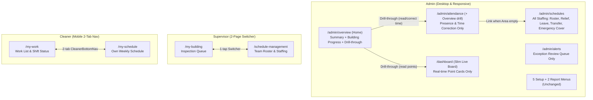
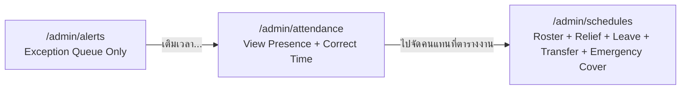

# Final UX/UI Streamlining & Motion Design Spec

- **Date:** 2026-11-19 (Asia/Bangkok)
- **Branch:** `codex/cleaner-scheduling`
- **Confirmed Mockup:** [admin-ux-mockup.html](file:///Users/macbookair/.gemini/antigravity/brain/11a60f15-c10c-467c-9174-7751836fe83c/admin-ux-mockup.html)
- **ADRs:** [facility-0224](../../adr/facility-0224-admin-overview-home-and-slim-live-point-board.md), [facility-0225](../../adr/facility-0225-consolidate-cover-assignment-under-schedules.md), [facility-0226](../../adr/facility-0226-keep-admin-setup-and-report-menus-distinct.md), [facility-0227](../../adr/facility-0227-simplify-cleaner-bottom-nav-to-two-real-tabs.md), [facility-0228](../../adr/facility-0228-supervisor-consistent-two-page-switcher.md), [facility-0229](../../adr/facility-0229-subtle-snappy-motion-system.md)
- **Scope:** Frontend-only UX/UI consolidation and CSS motion polish. No backend API, database schema, authentication, or business-rule changes.

## Overview Architecture

## 1. Admin Home & Slim Live Point Board (`facility-0224`)

- **Admin Landing Page:** Change `homeOf('admin')` in `frontend/src/shared/auth/roles.ts` from `'/dashboard'` to `'/admin/overview'`.
- **Slim Live Point Board (`/dashboard`):**
  - Remove `<BuildingSummary />` from `frontend/src/pages/dashboard/LegacyDashboardPage/LegacyDashboardPage.tsx`.
  - Delete `frontend/src/pages/dashboard/BuildingSummary.tsx` (zero remaining consumers; per `AGENTS.md` development stage rule: delete what nothing uses).
  - Keep `Filters`, `MoreInfo`, problem-first folding (`AreaSection` / `QuietArea`), live SignalR badge, and eager building-name queries so `/dashboard` remains a fast, zero-CLS live monitor wall without duplicating `/admin/overview`'s per-building summaries.

## 2. Single-Purpose Operations Screens (`facility-0225`)

- **Alerts (`/admin/alerts`):**
  - Remove `<EmptyAreas />` and `<CoversThisShift />` from `frontend/src/pages/alerts/AlertsPage.tsx`.
  - Delete `frontend/src/pages/alerts/EmptyAreas.tsx` and `frontend/src/pages/alerts/CoversThisShift.tsx` if unused elsewhere (active cover cancellation moves into the Schedules cover flow).
  - Keep the KPI summary for alert counts, filters, and the exception queue (`BlockedScan`, `SubmissionGps`, `InspectionGps`, `MissingShiftOut`) with "คุยแล้ว ปิดเตือน" and "เติมเวลา..." actions.
- **Attendance (`/admin/attendance` & Overview drill-through):**
  - Remove the header "มอบหมายทำแทน" button, row cover button, and `<CoverDrawer />` state from `frontend/src/pages/attendance/LegacyAttendancePage/LegacyAttendancePage.tsx`, `useLegacyAttendancePage.ts`, and `AttendanceTable.tsx`.
  - Remove the "มอบหมายทำแทน" button and `<CoverDrawer />` from `frontend/src/pages/attendance/OverviewAttendanceActions/OverviewAttendanceActions.tsx` and `useOverviewAttendanceActions.ts`.
  - On rows with `state === 'Empty'` (no assigned Cleaner), provide a clean navigation link `ไปจัดคนแทนที่ตารางงาน` pointing to `/admin/schedules`.
  - Keep all time viewing, pagination, search, filters, and `CorrectionForm` (time editing with reason and audit trail) intact.
- **Schedules (`/admin/schedules`):**
  - Move `CoverDrawer.tsx` to `frontend/src/pages/schedules/CoverDrawer/` (or `shared/cover/CoverDrawer.tsx`) and expose an `มอบหมายทำแทนฉุกเฉิน` action in Admin `SchedulePage` (and active cover list/cancellation inside the cover drawer or context bar) using the existing `/api/admin/cover-assignments` endpoints.
  - Keep all existing dated scheduling editors (baseline, weekly days-off, dated override, leave, relief assignment/loan, midshift transfer, missing time).

## 3. Admin Setup & Report Menus (`facility-0226`)

- Keep the 5 setup links (`พื้นที่และป้าย`, `ตึก`, `พิมพ์ป้าย`, `บัญชีผู้ใช้`, `ประวัติการแก้ไข`) and 2 report links (`สรุปการตรวจ`, `ส่งออก Excel`) distinct in `AdminNav.tsx`.
- In `AdminNav.tsx`, keep `ภาพรวม` first under `ติดตามงาน` followed by `สถานะจุด`, `การเข้างาน`, `ตารางงาน`, `รายการที่ขึ้นเตือน`, `สรุปการตรวจ`, `ส่งออก Excel`.

## 4. Cleaner Mobile Navigation (`facility-0227`)

- Simplify `frontend/src/shared/components/CleanerBottomNav/CleanerBottomNav.tsx` and `useCleanerBottomNav.ts` from 4 tabs to **2 real navigation tabs**:
  1. `งานของฉัน` (`/my-work`)
  2. `ตารางของฉัน` (`/my-schedule`)
- Remove the non-camera `สแกน QR` tab (and its inline guidance popover/drawer) and the duplicate `บัญชี` tab (the top bar in `AppLayout.tsx` already shows user name and `ออกจากระบบ`).
- Preserve role gating (`cleaner` only), `BottomBar` stacking height above `CleanerBottomNav` on `/check-in/:token` and `/scan/:token`, and `>= 48 px` touch targets.

## 5. Supervisor Two-Page Switcher (`facility-0228`)

- Create a focused `SupervisorNav` component (`frontend/src/shared/components/SupervisorNav/SupervisorNav.tsx`) offering a consistent 2-button switcher:
  - `ตึกของฉัน` (`/my-building`)
  - `จัดตารางงาน` (`/schedule-management`)
- Render `SupervisorNav` consistently on both `/my-building` (`MyBuildingPage.tsx`) and Supervisor `/schedule-management` (`SchedulePage.tsx`), replacing the one-off forward link on `MyBuildingPage` and ad-hoc back link on `SchedulePage`.
- Keep `aria-current="page"`, `>= 48 px` touch height on phone widths, `>= 36 px` on desktop, and zero horizontal overflow at `320 px` and `375 px`.

## 6. Subtle & Snappy Motion System (`facility-0229`)

- Define pure CSS keyframes and utility classes in `frontend/src/index.css` (zero external libraries, keeping main JS bundle `<= 200 kB gzip` and `CLS = 0`):
  - **View / Tab fade-in:** `150ms cubic-bezier(0.16, 1, 0.3, 1)` opacity + subtle `translateY(4px)` (or opacity-only on layout-shift-monitored pages so `CLS === 0`).
  - **Drawer:** `200ms cubic-bezier(0.16, 1, 0.3, 1)` slide-in (`translateX`) + `160ms` backdrop opacity fade (`Drawer.tsx`).
  - **Modal / ConfirmationDialog:** `180ms cubic-bezier(0.16, 1, 0.3, 1)` subtle scale (`0.98 -> 1`) + opacity fade (`Modal.tsx`).
  - **Toast:** `180ms` slide-up + fade-in (`Toast.tsx`).
  - **Interactive controls:** `transition-colors duration-150` + subtle press feedback (`active:scale-[0.98]`) on `Button` and clickable cards (`Button.tsx`).
- **Accessibility & CLS Guard:**
  - Wrap animations with `@media (prefers-reduced-motion: reduce)` override setting `animation-duration: 0.01ms !important; transition-duration: 0.01ms !important;`.
  - Animate only GPU-composited properties (`transform`, `opacity`, `background-color`, `border-color`) — never `width`, `height`, `margin`, or `padding` — so Chromium `layoutShiftTotal` remains `0`.
  - Keep print stylesheets (`@media print` / `PrintSignsPage`) completely static and byte-identical.

## 7. Verification Strategy

- Update affected unit/integration tests (`roles`, `DashboardPage.test.tsx`, `AlertsPage.test.tsx`, `AlertCovers.test.tsx` -> move cover tests to schedule suite, `AttendancePage.test.tsx`, `OverviewPage.test.tsx`, `CleanerBottomNav.test.tsx`, `MyBuildingPage.test.tsx`, `SchedulePage.test.tsx`).
- Update affected E2E tests (`dashboard.spec.ts`, `attendance.spec.ts`, `alerts` / `scheduling.spec.ts`, `login.spec.ts` where Admin landing route is asserted).
- Verify: `NODE_ENV=test npm --prefix frontend test`, `npm --prefix frontend run lint`, `npm --prefix frontend run build` (main JS gzip `<= 200 kB`), and Chromium E2E (`medium` desktop + `large` full suite) with zero horizontal overflow and zero layout shift.
