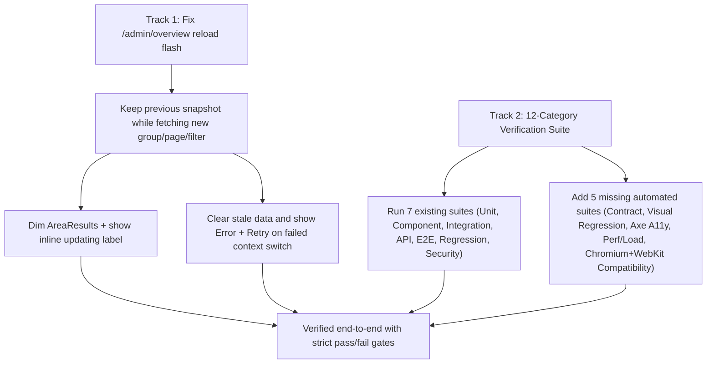
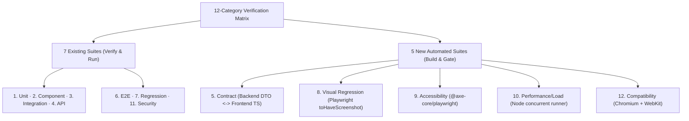

# Design Spec: Overview Smooth Transition & 12-Category Verification Suite

- **Date:** 2026-11-20
- **ADRs:** [facility-0233](../../adr/facility-0233-overview-smooth-transition-without-page-unmount.md), [facility-0234](../../adr/facility-0234-twelve-category-verification-suite.md), [facility-0235](../../adr/facility-0235-strict-automated-gates-for-visual-and-load-tests.md)
- **Confirmed UI Mockup:** [overview-transition-mockup.html](file:///Users/macbookair/.gemini/antigravity/brain/c65295b4-3524-4a56-97ac-64838d7cc3cf/overview-transition-mockup.html) (Option A)

## Overview



This design covers two linked deliverables:
1. **Eliminating the reload-like flash on `/admin/overview`** when clicking follow-up bars, coverage group pills, building comparison bars, pagination buttons, or filters (`facility-0233`).
2. **Establishing a complete, repeatable 12-category automated verification matrix** by running the 7 existing test layers and building strict automated gates for the 5 missing layers (`facility-0234`, `facility-0235`).

---

## Track 1: Overview Smooth Transition (`facility-0233`)

### Verified Root Cause

In `frontend/src/pages/overview/OverviewPage/useOverviewPage.ts`, `rawResponse` reads `query.currentData`, which RTK Query resets to `undefined` the instant `queryArgs` changes (`group`, `page`, `buildingId`, `shiftDate`, `shift`). When `response === undefined`, `loading` flips to `true`, causing `OverviewPage.tsx` to unmount the entire `{model.response && (...)}` body (donut charts, follow-up bars, building comparison, round history, and area results table) and replace it with `<PageLoading>กำลังโหลดภาพรวม...</PageLoading>`, then remount everything once the HTTP response returns.

### Target State Machine

```mermaid
sequenceDiagram
    participant U as Admin User
    participant P as OverviewPage
    participant H as useOverviewPage
    participant API as GET /api/admin/overview/areas

    U->>P: Click bar / group pill / page / filter
    P->>H: Update URL searchParams (new queryArgs)
    H->>API: Fetch new queryArgs
    H-->>P: Keep previous snapshot visible + set updating=true + highlight newly selected group
    P-->>U: Charts stay mounted and AreaResults tints its background and shows "กำลังอัปเดต..."
    alt Request succeeds (200)
        API-->>H: New OverviewAreaList
        H-->>P: Replace snapshot + updating=false
        P-->>U: Smooth swap to new rows and counts
    else Request fails (4xx/5xx/network) on new context
        API-->>H: Error
        H-->>P: Clear stale snapshot + set error
        P-->>U: Hide stale table rows; show error Note + "ลองอีกครั้ง"
    end
```

### Exact Behavior Rules

1. **Initial load (no prior snapshot) or uncanonical default-slot rollover (`!selection.date || !selection.shift`):**
   - Preserve existing behavior: show `<PageLoading lines={3}>กำลังโหลดภาพรวม...</PageLoading>` until the first canonical response arrives (keeps the rollover tests in `OverviewPage.test.tsx` intact).
2. **Subsequent context switches (clicking a group, follow-up bar, building bar, page button, date, shift, or building filter) while waiting for the new selection without a request error:**
   - Keep the last valid `OverviewAreaList` mounted, including its context label and links. Treat a cached target as pending until a fresh request succeeds.
   - Do **not** render full-page `<PageLoading>` or unmount the charts/sections.
   - Reflect the newly clicked `selection.group` / `selection.building` immediately in the active pressed states (`aria-pressed`) so the click feels instant.
   - Pass `updating: boolean` to `AreaResults` (`AreaResultsProps`):
     - Render an inline `"กำลังอัปเดต..."` status badge next to the `AreaResults` context text.
     - Tint the table background and set `aria-busy={updating || undefined}` on the wrapper. Preserve text and control contrast and keep row height stable.
     - Disable pagination buttons while `updating` is true.
   - Suppress the top-level `"กำลังอัปเดตข้อมูล..."` `Note` banner during interactive context switches (avoiding vertical layout shift above the charts).
3. **Failed context switch, including a previously cached target:**
   - Drop `retainedResponse` immediately so stale rows from the previous group/slot are never shown under a failed request.
   - Render the error `<Note tone="error" onRetry={model.retry}>` cleanly.
4. **Failed background refresh (`query.error` when `response !== undefined` for the same context):**
   - Preserve existing behavior: keep `response` visible under the amber warning `<Note tone="warn" onRetry={model.retry}>`.

### Files to Modify (Track 1)

- `frontend/src/pages/overview/OverviewPage/useOverviewPage.ts` — retain last valid `OverviewAreaList` during in-flight context switches (`!query.error && !isUncanonicalSlot`), clear on error/invalid context, expose `updating` to `AreaResults`.
- `frontend/src/pages/overview/OverviewPage/OverviewPage.tsx` — keep body mounted when `displayResponse` exists, avoid top-banner layout jump on interactive switches.
- `frontend/src/pages/overview/AreaResults/type.ts` & `AreaResults.tsx` — add `updating?: boolean`, subtle background tint, `aria-busy`, and inline `"กำลังอัปเดต..."` indicator.
- `frontend/src/pages/overview/OverviewPage.test.tsx` — add regression tests verifying:
  - Charts and table stay mounted (no full-page `กำลังโหลดภาพรวม...`) while switching groups/pages, with `AreaResults` showing `"กำลังอัปเดต..."` and `aria-busy="true"`.
  - Failed context switch still clears stale rows and shows error + retry.

---

## Track 2: 12-Category Automated Verification Suite (`facility-0234`, `facility-0235`)



### Existing 7 Categories (Verified in Repo — Run & Include in Final Report)

| # | Category | Existing Command / Suite |
|---|---|---|
| 1 | **Unit Test** | `dotnet test backend/tests/JanitorialManagementDashboard.UnitTests` + Vitest rule/util specs |
| 2 | **Component Test** | `NODE_ENV=test npm --prefix frontend test` (82 files, 775 tests) |
| 3 | **Integration Test** | `FACILITY_MYSQL_TEST=... dotnet test backend/tests/JanitorialManagementDashboard.ApiTests` (MySQL persistence + transactional races) |
| 4 | **API Test** | `dotnet test backend/tests/JanitorialManagementDashboard.ApiTests` (Auth, Attendance, Points, Inspections, Admin, Scheduling, Overview, Retention) |
| 6 | **E2E Test** | `E2E_HEADLESS=1 npm --prefix frontend run e2e -- --dataset large` (18 Playwright specs across desktop & phone) |
| 7 | **Regression Test** | Existing regression specs (`ux-01-03-review-regressions.spec.ts`, Vitest, ApiTests) + **new** Overview smooth-transition regression test |
| 11 | **Security Test** | `SecurityHeaderTests.cs`, Auth/RBAC/Throttle/IDOR tests in `ApiTests`, and `frontend/e2e/phone/access.spec.ts` |

### 5 New Automated Suites to Build (Strict Pass/Fail Gates)

#### Category 5: Contract Test (Backend DTO <-> Frontend TypeScript)
- **Mechanism:** Add a Backend API test (`backend/tests/JanitorialManagementDashboard.ApiTests/Contract/ApiContractTests.cs`) that hits key endpoints (`/api/auth/login`, `/api/admin/overview/areas`, `/api/admin/overview/areas/{id}`, `/api/my-work`, `/api/attendance/signs/{token}`, `/api/service-points`) and validates the serialized camelCase JSON property names and enum string values against the exact contract expected by `frontend/src/shared/api/types.ts` and `frontend/src/shared/overview/types.ts` (and optionally exports/checks a shared contract fixture consumed by a Vitest contract test `frontend/src/shared/api/contract.test.ts`).
- **Gate:** Fails immediately if any required JSON field is renamed, missing, or has an unexpected enum value.

#### Category 8: Visual Regression Test (`facility-0235`)
- **Mechanism:** Add `frontend/e2e/desktop/visual-regression.spec.ts` and `frontend/e2e/phone/visual-regression.spec.ts` using Playwright's `expect(page).toHaveScreenshot(...)` with deterministic masking of live clocks/timestamps (`mask` locators for `<time>` / clock text) and `animations: 'disabled'`.
- **Screens covered:**
  - Desktop (`1280x800`): `/admin/overview`, `/admin/schedules`, `/dashboard`, `/admin/attendance`
  - Phone (`375x812`): `/my-work`, `/my-schedule`, `/my-building`, `/my-account`
- **Gate:** Strict pixel diff threshold (`maxDiffPixelRatio: 0.01`). Maintain macOS Chromium baselines with `--update-snapshots=all`. The visual suite uses a fixed browser clock and typed responses for live point and scheduling screens, and reads the historical Overview and Attendance projections from the isolated medium dataset. The functional suites use live API responses.

#### Category 9: Accessibility Test (`@axe-core/playwright`)
- **Mechanism:** Add `@axe-core/playwright` as a `devDependency` in `frontend/package.json`, and create `frontend/e2e/desktop/accessibility.spec.ts` and `frontend/e2e/phone/accessibility.spec.ts`.
- **Screens & interactions covered:** `/login`, `/login/admin`, `/admin/overview`, `/admin/schedules`, `/admin/attendance`, `/admin/areas`, `/my-work`, `/my-building` — running `new AxeBuilder({ page }).withTags(['wcag2a', 'wcag2aa', 'wcag22aa']).analyze()` plus keyboard `Tab` / `Escape` drawer dismissal assertions.
- **Gate:** Fails on any `critical` or `serious` WCAG violation (zero tolerance).

#### Category 10: Performance / Load Test (`facility-0235`)
- **Mechanism:** Add a self-contained Node.js load benchmark script `scripts/load-test.mjs` (zero external binaries required; runs against the isolated loopback API started with `--dataset large` containing 70+ Areas).
- **Scenarios:**
  - Concurrent Admin Overview reads (`GET /api/admin/overview/areas` with 10 concurrent virtual users x 50 requests).
  - Concurrent Dashboard & Cleaner My Work reads (`GET /api/service-points`, `GET /api/my-work` with 10 concurrent users x 50 requests).
- **Gate:** Prints p50 / p95 / p99 and error rate; **exits non-zero** if error rate > 0% OR `p95 > 500ms` (Overview) OR `p95 > 200ms` (My Work / Service Points).

#### Category 12: Compatibility Test (Cross-Browser)
- **Mechanism:** Leverage existing `frontend/playwright.config.ts` (`E2E_BROWSER=webkit` — WebKit binary `webkit-2370` is already installed on this machine) and add a convenience npm script (`"e2e:compat"` or documented matrix invocation in `scripts/e2e.sh`) that runs core desktop + phone flows (`overview.spec.ts`, `my-work.spec.ts`, `check-in.spec.ts`, `login.spec.ts`) on **both Chromium and WebKit (Safari engine)**.
- **Gate:** Fails if any core flow breaks on either Chromium or WebKit.

---

## Verification & Rollout

- Track 1 changes are verified with `npm --prefix frontend run lint`, `NODE_ENV=test npm --prefix frontend test`, `npm --prefix frontend run build`, and Playwright `overview.spec.ts`.
- Track 2 adds each missing test layer incrementally, verifies each gate green against isolated synthetic databases (never touching `facility_dashboard`), and updates `docs/handoff.md` with the 12-category pass/fail scorecard.
