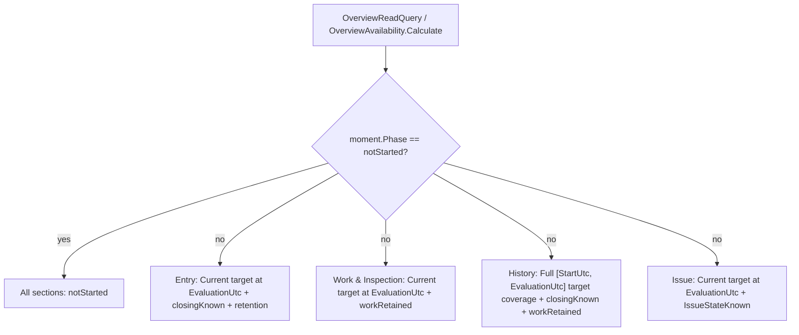
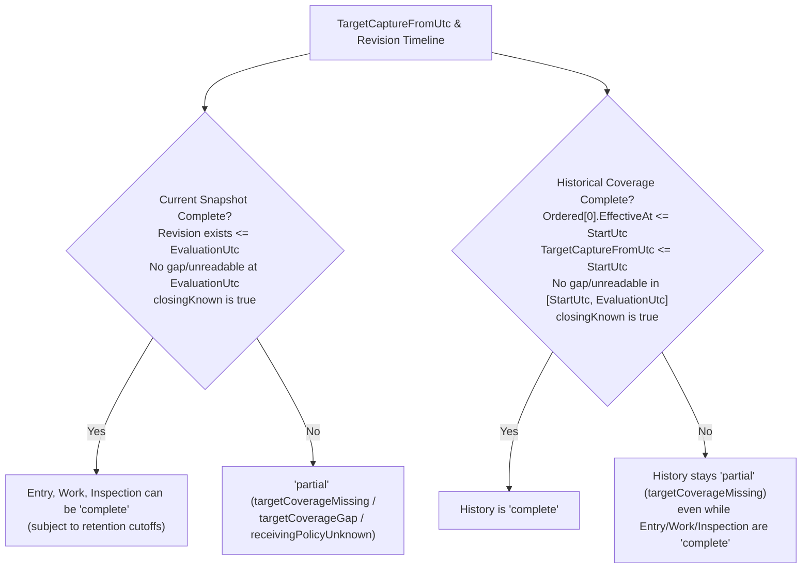
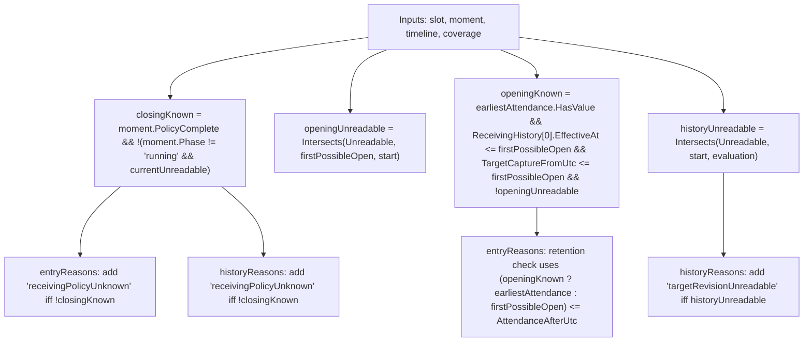

# Overview Entry Availability Fix Design



This diagram summarizes the decoupled per-section evaluation in `OverviewAvailability.Calculate`, where `Entry` depends on the current target snapshot and closing policy while `History` independently requires continuous target coverage from `StartUtc`.

**Date:** 2026-11-21 (Asia/Bangkok)  
**Status:** Proposed — awaiting owner approval before `sp-writing-plans`  
**Decision Record:** [facility-0237](../../adr/facility-0237-overview-entry-decoupled-from-preshift-opening-policy.md)  
**Primary Source Base:** `master` (`f9c3644`)

---

## 1. Problem Statement & Verified Root Cause

When deploying the application to a fresh production database during an active shift (for example, after `01:00` for the `07:00–19:00` Day shift, or after `13:00` for the `19:00–07:00` Night shift), creating an Area and having a Cleaner scan `ShiftIn` produces a valid attendance record (`AR02 Canteen`, `ลงเวลาเข้างาน 09:40` on `/admin/attendance`), yet the Overview page (`/admin/overview`) fails to display the Entry donut chart (`พื้นที่ที่ลงเวลาเข้าแล้ว`):

- The donut center shows `—` instead of `1/1 (100%)`.
- The sub-label shows `พบ 1 พื้นที่` instead of `จาก 1 พื้นที่`.
- The panel displays the warning `ยังไม่ทราบเวลาปิดรับข้อมูล`.
- All three Entry breakdown pills (`ลงเวลาแล้ว`, `มอบหมายทำแทนแล้ว`, `ยังไม่มอบหมายทำแทน`) show `— พื้นที่`.

### Verified Fail Path

1. On initial server boot, [Program.cs](../../../backend/src/JanitorialManagementDashboard.Api/Program.cs#L251-L252) runs `OverviewHistoryBootstrap.EnsureAsync`, which calls `OverviewTargetRecorder.CaptureAsync` and records the initial `OverviewTargetRevision` with `EffectiveAt = now` and `CaptureStartedAtUtc = now` (e.g. `09:00`).
2. Subsequent Area/Building/Point edits during the shift create new revisions that carry `CaptureStartedAtUtc` forward from that first capture ([OverviewTargetRecorder.cs](../../../backend/src/JanitorialManagementDashboard.Infrastructure/Persistence/Overview/OverviewTargetRecorder.cs#L69-L74)).
3. The Cleaner check-in (`ShiftIn`) is loaded by `OverviewFactLoader` and projected into `OverviewGroupKeys.Entered` by `OverviewProjection`, yielding `enteredCount = 1` and `denominatorObserved = 1` in `AdminOverviewEndpoints.BuildEntryMetric`.
4. However, [OverviewAvailability.Calculate](../../../backend/src/JanitorialManagementDashboard.Application/Overview/OverviewAvailability.cs#L50-L67) computes:
   ```csharp
   var firstPossibleOpen = FirstPossibleOpen(slot); // StartUtc(slot) - 360 minutes (01:00 / 13:00)
   var openingKnown = earliestAttendance.HasValue
       && timeline.ReceivingHistory[0].EffectiveAt <= firstPossibleOpen
       && coverage.TargetCaptureFromUtc.GetValueOrDefault() <= firstPossibleOpen;
   var receivingKnown = moment.PolicyComplete && openingKnown && !policyUnreadable;
   if (!receivingKnown) entryReasons.Add("receivingPolicyUnknown");
   ```
   Because `CaptureStartedAtUtc` (`09:00`) is later than `firstPossibleOpen` (`01:00`), `openingKnown` evaluates to `false`, downgrading `availability.Entry` to `"partial"` with `"receivingPolicyUnknown"`.
5. `AdminOverviewEndpoints.ToCount` maps any non-`"complete"` availability to `value: null` while preserving `observed: 1`, which causes `useOverviewPage.ts` to translate `receivingPolicyUnknown` as `ยังไม่ทราบเวลาปิดรับข้อมูล` and hide the Entry donut ring.

---

## 2. Current Target Snapshot Completeness vs. Historical Target Coverage

A core distinction in the Overview model is the boundary between **current target snapshot completeness** (what is needed to report the current staffing/work/inspection state at `EvaluationUtc`) and **historical target coverage** (what is needed to certify every past round obligation across an entire shift).



The flowchart above shows how current snapshot completeness and historical coverage evaluate different time bounds from the same revision timeline so that live operational counts are never blocked by missing pre-deployment history, while round history never claims completeness without full-shift evidence.

| Dimension | Current Target Snapshot Completeness | Historical Target Coverage |
|---|---|---|
| **Sections governed** | `Entry`, `Work`, `Inspection`, `Issue` | `History` (`รอบที่ผ่านมาในกะนี้` / `ผลรอบในกะนี้`) and `CalculateSupportedBounds` (`CompleteFrom..CompleteThrough`) |
| **Time window required** | Point-in-time at `EvaluationUtc = min(now, closeUtc)` (plus `[EndUtc, EvaluationUtc]` unreadable check when shift is past `EndUtc`) | Full shift span from `StartUtc` (`07:00` or `19:00`) through `EvaluationUtc` |
| **First deployment mid-shift (e.g. `09:00` during `07:00–19:00` Day)** | **Complete** (`EffectiveAt <= EvaluationUtc`, `CaptureStartedAtUtc <= EvaluationUtc`, `closingKnown == true`). `Entry`, `Work`, and `Inspection` show live ratios (`1/1 (100%)`). | **Partial** (`targetCoverageMissing`), because target configuration prior to `09:00` was not captured (`CaptureStartedAtUtc > StartUtc`). |
| **Area added, renamed, moved, or deactivated during an active shift** | **Complete** as soon as the setup transaction commits a new `OverviewTargetRevision` at `EffectiveAt <= EvaluationUtc`. `Entry` reflects the active target Areas at `EvaluationUtc` together with all recorded `ShiftIn` and confirmed-transfer evidence for `(ShiftDate, Shift)`. | **Complete** if baseline existed by `StartUtc` and no structural gap/unreadable interval occurred in `[StartUtc, EvaluationUtc]`; `OverviewTimeline` splits round obligations across revision boundaries cleanly. |
| **Shift that already ended before first deployment (e.g. yesterday's shift)** | **Partial** (`targetCoverageMissing` and `receivingPolicyUnknown`), because `EvaluationUtc` (yesterday's close) precedes `CaptureStartedAtUtc`, and `ReceivingClose(EndUtc, ordered)` has no revision `<= EndUtc`. | **Partial** (`targetCoverageMissing` and `receivingPolicyUnknown`). |

---

## 3. Exact Behavioral Change (`OverviewAvailability.cs`)

Only [OverviewAvailability.Calculate](../../../backend/src/JanitorialManagementDashboard.Application/Overview/OverviewAvailability.cs#L40-L91) requires modification. No changes are needed in `AdminOverviewEndpoints.cs`, `OverviewProjection.cs`, `OverviewFactLoader.cs`, `OverviewTime.cs`, `OverviewTimeline.cs`, or any frontend files (`useOverviewPage.ts`, `CoveragePanel.tsx`).

### Updated Availability Logic



As illustrated in the decision graph, `closingKnown` and `openingKnown` are separated so that `receivingPolicyUnknown` tracks only closing policy uncertainty, while `openingKnown` continues to tighten the 1-year attendance expiry check with its conservative fallback.

Specifically, in `OverviewAvailability.Calculate`:

1. **Separate closing policy knowledge from pre-shift opening knowledge:**
   - Replace `var policyUnreadable = Intersects(coverage.UnreadableTargetIntervals, firstPossibleOpen, evaluation);` with two targeted interval checks:
     - `var openingUnreadable = Intersects(coverage.UnreadableTargetIntervals, firstPossibleOpen, start);`
     - `var historyUnreadable = Intersects(coverage.UnreadableTargetIntervals, start, evaluation);`
   - Keep `currentUnreadable` unchanged:
     `Intersects(coverage.UnreadableTargetIntervals, moment.Phase == "running" ? evaluation : ShiftCalendar.EndUtc(slot), evaluation)`
   - Define `closingKnown`:
     ```csharp
     var closingKnown = moment.PolicyComplete && !(moment.Phase != "running" && currentUnreadable);
     ```
     - While a shift is `"running"` (`now < EndUtc`), `moment.PolicyComplete` is `true` whenever at least one valid revision exists at or before `now` (because `ReceivingClose(EndUtc, ordered)` finds that revision `<= EndUtc` and projects `closeUtc = EndUtc + ClosesMinutesAfterShift`).
     - Once a shift has passed `EndUtc` (`"receiving"` or `"closed"`), `closingKnown` requires both `moment.PolicyComplete` (a revision at or before `EndUtc`) and `!currentUnreadable` (no unreadable interval overlapping `[EndUtc, EvaluationUtc]`). If a shift ended before first deployment, `ReceivingClose` returns `null`, `moment.PolicyComplete` is `false`, `closingKnown` is `false`, and `"receivingPolicyUnknown"` is emitted as before.
   - Define `openingKnown`:
     ```csharp
     var openingKnown = earliestAttendance.HasValue
         && timeline.ReceivingHistory[0].EffectiveAt <= firstPossibleOpen
         && coverage.TargetCaptureFromUtc.GetValueOrDefault() <= firstPossibleOpen
         && !openingUnreadable;
     ```
2. **Entry reasons (`entryReasons`):**
   - Start with `current` (`targetCoverageMissing` when `!timeline.CurrentComplete || coverage.TargetCaptureFromUtc > evaluation`, `targetCoverageGap`, `targetRevisionUnreadable`).
   - Emit `"receivingPolicyUnknown"` only when `!closingKnown`.
   - Keep the 1-year attendance expiry check with conservative fallback:
     ```csharp
     if ((openingKnown ? earliestAttendance : firstPossibleOpen) <= coverage.AttendanceAfterUtc)
         entryReasons.Add("attendancePartlyExpired");
     ```
   - Keep the existing `lastPossibleAttendance <= coverage.AttendanceAfterUtc` -> `new Availability("unavailable", ["attendanceExpired"])` safeguard completely unchanged.
3. **History reasons (`historyReasons`):**
   - Keep `if (!timeline.HistoryComplete || coverage.TargetCaptureFromUtc > start) historyReasons.Add("targetCoverageMissing");` unchanged.
   - Change `if (!receivingKnown)` to `if (!closingKnown) historyReasons.Add("receivingPolicyUnknown");` (so an unreadable interval strictly before `StartUtc` does not fabricate `"receivingPolicyUnknown"` when the shift itself `[StartUtc, EvaluationUtc]` is readable).
   - Keep `if (Intersects(gaps, start, evaluation)) historyReasons.Add("targetCoverageGap");`.
   - Use `if (historyUnreadable) historyReasons.Add("targetRevisionUnreadable");`.

---

## 4. Preserved Business Rules & Retention Safeguards

- **Entry Partition & Denominator Rules:** `ScheduleEntryEvidence.EntryOf`, `OverviewRules.Entry`, `OverviewGroupKeys` (`entered`, `covered`, `unassigned`, `notEntered`), and `AdminOverviewEndpoints.BuildEntryMetric` remain unchanged. An active Area in the shift with a recorded `ShiftIn` or confirmed transfer arrival counts as `entered`; one without entry and with a live Cover/Relief/Transfer instruction counts as `covered`; otherwise `unassigned`.
- **Retention Safeguards:**
  - `attendancePartlyExpired` uses the configured `earliestAttendance` only when the full pre-shift opening timeline `[firstPossibleOpen, start]` was captured and readable (`openingKnown`); otherwise it conservatively falls back to `firstPossibleOpen` (`StartUtc - 360 min`).
  - `attendanceExpired` (`unavailable`) continues to evaluate `lastPossibleAttendance` (falling back to `Earlier(readAt, LastPossibleClose(slot))` when closing policy is unavailable or unreadable) against `AttendanceAfterUtc`.
  - `workArchived` (`unavailable`) continues to enforce `slot.ShiftDate >= coverage.WorkFromShiftDate`.
- **Supported Date Range (`CalculateSupportedBounds`):** `CalculateSupportedBounds` continues to require all 5 sections (`Entry`, `Work`, `Inspection`, `History`, `Issue`) to be `"complete"`, so a mid-shift deployment date is excluded from `range.completeFrom..completeThrough` until the first shift with complete prior-round `History`.
- **Pre-Baseline Shifts:** Shifts that already ended before `CaptureStartedAtUtc` continue to yield `availability.Entry.State == "partial"` with `receivingPolicyUnknown` and `targetCoverageMissing` (`value: null` totals), never fabricating denominators or check-in coverage.
- **No Unrelated Changes:** No changes to database schema, `OverviewTargetRecorder`, `OverviewHistoryBootstrap`, `RetentionRunner`, endpoints, DTOs, or React components.

---

## 5. Regression Test Plan

### 5.1 Unit Tests (`OverviewAvailabilityTests.cs`)

Update and expand [OverviewAvailabilityTests.cs](../../../backend/tests/JanitorialManagementDashboard.UnitTests/OverviewAvailabilityTests.cs):

1. **Mid-shift first deployment (`Mid_shift_baseline_cannot_certify_prior_rounds`):**
   - Baseline captured at `Start + 3h` (`10:00`), read at `Start + 4h` (`11:00`).
   - Assert `Entry.State == "complete"` (empty reasons) and `Work.State == "complete"` while `History.State == "partial"` (`targetCoverageMissing` in reasons).
2. **Pre-shift capture after `FirstPossibleOpen`:**
   - Baseline captured at `Start - 30m` (`06:30`, after `01:00` `firstPossibleOpen` but before `07:00` `StartUtc`).
   - Assert both `Entry.State == "complete"` and `History.State == "complete"`.
3. **Unknown closing policy:**
   - Capture started after shift end (`End + 10m`, read at `End + 20m`): assert `Entry.State == "partial"` and `History.State == "partial"`, both containing `"receivingPolicyUnknown"`.
   - Existing `Unreadable_policy_uses_the_latest_possible_close_for_attendance_expiry` continues to verify unreadable revision overlapping `[EndUtc, EvaluationUtc]` triggers `"receivingPolicyUnknown"` and `"targetRevisionUnreadable"` (`partial` at `+15m`, `unavailable` at `+360m`).
4. **Retention fallback when opening policy is unknown:**
   - Capture started mid-shift (or at `Start - 30m`, after `firstPossibleOpen`) on a slot 1 year old where `firstPossibleOpen <= AttendanceAfterUtc` even though `Start - OpensMinutesBeforeShift > AttendanceAfterUtc`.
   - Assert `Entry.State == "partial"` containing `"attendancePartlyExpired"` (and NOT `"receivingPolicyUnknown"`).

### 5.2 API Regression Test (`OverviewEndpointTests.cs`)

Add an end-to-end integration test in [OverviewEndpointTests.cs](../../../backend/tests/JanitorialManagementDashboard.ApiTests/Admin/OverviewEndpointTests.cs):

- Simulate first deployment mid-shift on `2026-10-08` Day shift (`09:00` Thai):
  - Set clock to `09:00` Thai, call `OverviewTestData.StartHistoryAsync`, create a new Building, new Area, and new Day Cleaner (or activate an Area mid-shift), then have the Cleaner check in (`ShiftIn`) at `09:40` Thai.
  - Query `GET /api/admin/overview?shiftDate=2026-10-08&shift=Day` and `GET /api/admin/overview/areas?shiftDate=2026-10-08&shift=Day&group=entered` at `09:41` Thai.
  - Assert:
    - `availability.entry.state == "complete"` with empty `reasons`, while `availability.history.state == "partial"` with `"targetCoverageMissing"`.
    - `entry.numerator.value` and `entry.denominator.value` are non-null integers matching the active Areas (including the newly created Area, counted as `entered`), and `groups.entered.value` matches the returned `rows` from `/areas?group=entered`.
  - Query yesterday's already-ended shift (`2026-10-07` Day) and assert `availability.entry.state == "partial"` with `"receivingPolicyUnknown"` and `value: null`.
