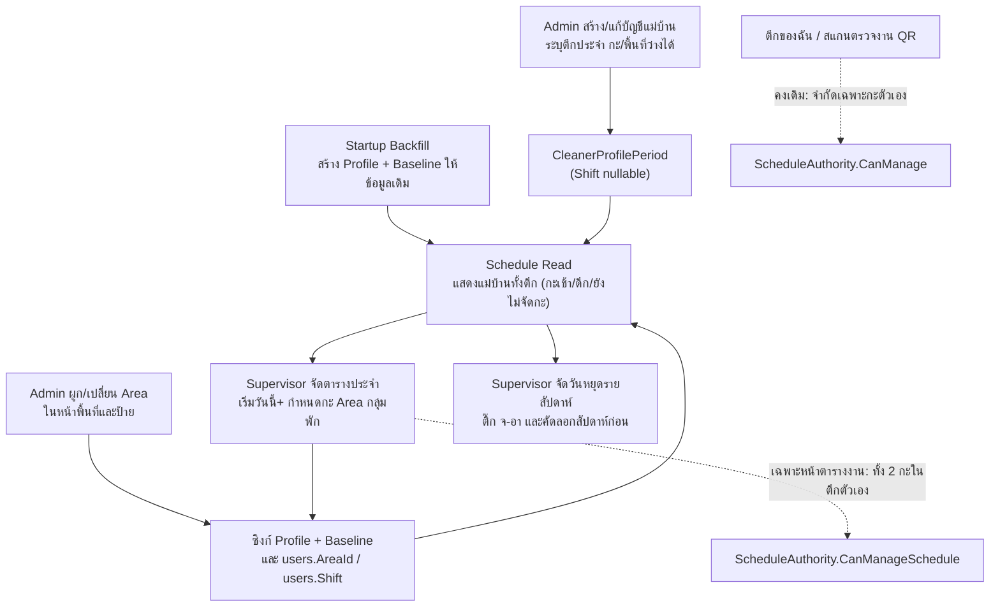
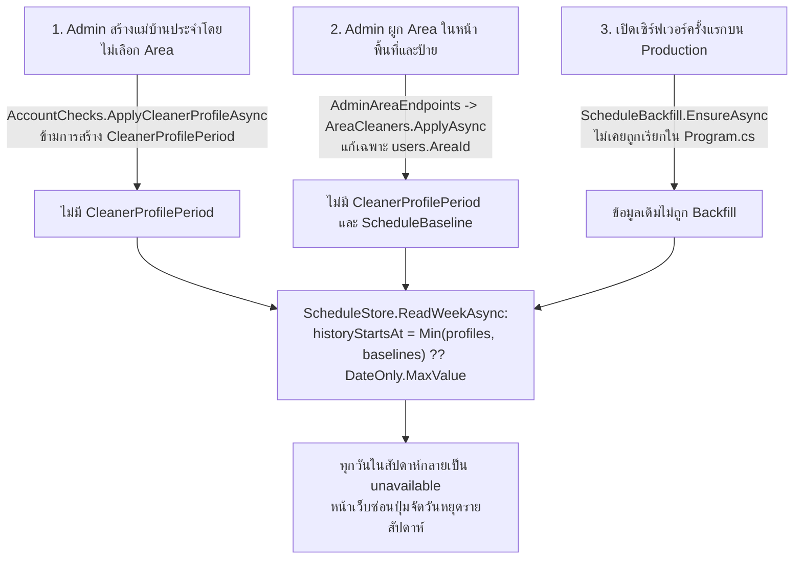
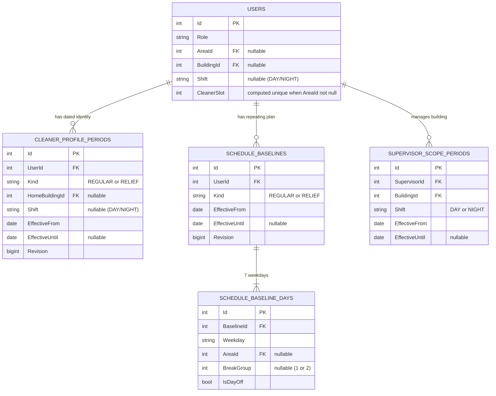
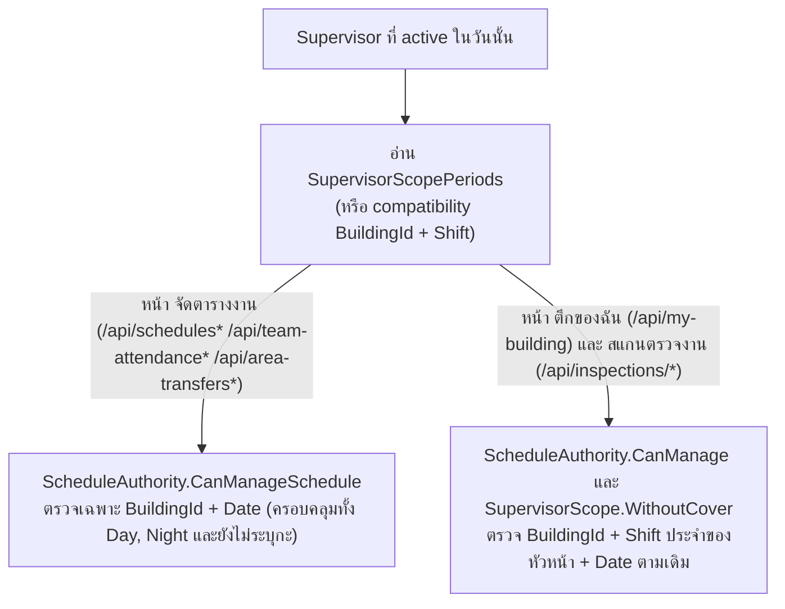
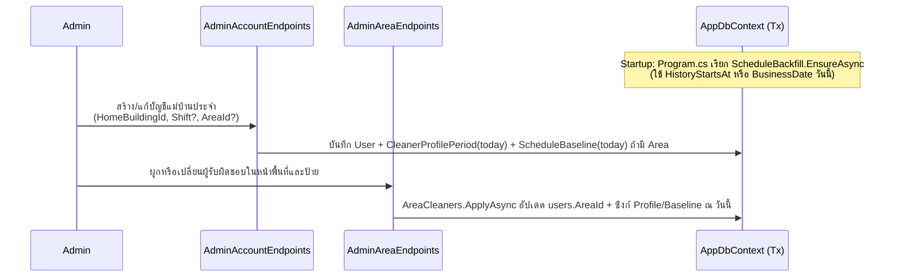
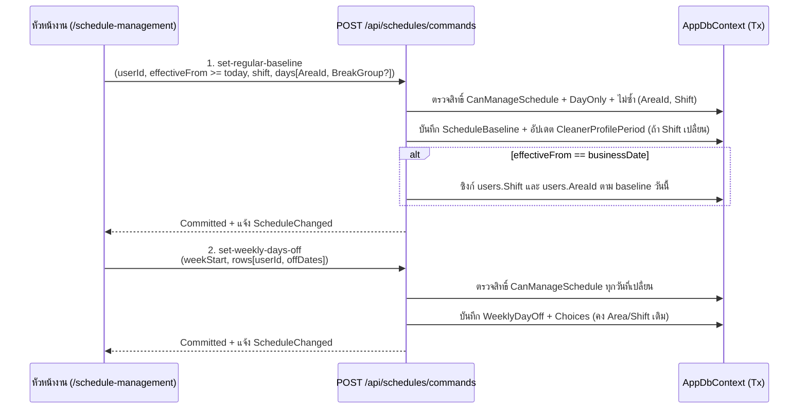

# แบบออกแบบการแก้ปัญหาตารางงานบน Production และให้หัวหน้างานจัดกะ พื้นที่ และวันหยุดให้แม่บ้าน

วันที่ 21 พฤศจิกายน 2026 (Asia/Bangkok) · สถานะ: **ร่างรอเจ้าของอนุมัติ**

เอกสารนี้ออกแบบจากผลสืบสวนปัญหาบน Production (`f9c3644`) และการตกลงรายละเอียดร่วมกับเจ้าของระบบ เพื่อแก้ปัญหาหน้าตารางงานขึ้น `"ไม่มีข้อมูลของสัปดาห์นี้"` และเปิดให้หัวหน้างานจัดกะ พื้นที่ประจำ กลุ่มพัก และวันหยุดรายสัปดาห์ให้แม่บ้านในตึกที่รับผิดชอบได้ครบถ้วน โดยมี [facility-0238](../../adr/facility-0238-schedule-backfill-and-area-sync.md) ถึง [facility-0241](../../adr/facility-0241-regular-baseline-allows-today-start-shift-and-optional-break-group.md) เป็นฐาน

---

## 1. สาเหตุบน Production (`f9c3644`) และแนวทางแก้ไขระดับระบบ

จากเหตุการณ์จริงเมื่อ Admin สร้างบัญชีแม่บ้านประจำก่อนแล้วจึงไป Assign พื้นที่ให้ภายหลัง หน้า `/admin/schedules` (และ `/schedule-management`) แสดงข้อความเตือน `"ไม่มีข้อมูลของสัปดาห์นี้ / ไม่พบข้อมูลย้อนหลังของสัปดาห์นี้"` และไม่มีปุ่ม `"จัดวันหยุดรายสัปดาห์"` ตามสาเหตุที่ยืนยันแล้วในโค้ดดังนี้:

แผนภาพด้านบนแสดงจุดขาด 3 จุดที่ทำให้ `historyStartsAt` กลายเป็น `DateOnly.MaxValue` ทั้งที่ในตาราง `users` มีข้อมูล `AreaId` และ `Shift` อยู่แล้ว

แนวทางแก้ไขครอบคลุม 4 ส่วนทำงานร่วมกัน:
1. **Backfill อัตโนมัติตอนเริ่มระบบ:** เรียก `ScheduleBackfill.EnsureAsync` ใน `Program.cs` (ภายใต้บล็อก `!app.Environment.IsEnvironment("Testing")` หลัง `MigrateAsync` / `SeedAsync` / `FirstAdmin.EnsureAsync`) เพื่อสร้าง `CleanerProfilePeriod`, `ScheduleBaseline` และ `SupervisorScopePeriod` ให้บัญชีที่เปิดใช้งานอยู่ซึ่งยังไม่มีข้อมูลตารางงาน
2. **ซิงก์ข้อมูลตารางทุกจุดที่แก้คนหรือพื้นที่:** ให้ `AdminAccountEndpoints` และ `AdminAreaEndpoints` (`AreaCleaners.ApplyAsync`) อัปเดต `CleanerProfilePeriod` และ `ScheduleBaseline` ภายใน transaction เดียวกันเสมอ
3. **เปิดให้ Admin สร้างแม่บ้านประจำโดยระบุแค่ตึกประจำ:** ปล่อย `Shift` และ `AreaId` ว่างไว้ให้หัวหน้างานเป็นผู้จัดในหน้าจัดตารางงาน
4. **ตรวจค่า Environment บน Production:** การกดบันทึกคำสั่งตารางงาน (`POST /api/schedules/command-tokens` และ `POST /api/schedules/commands`) ต้องตั้งค่า `Scheduling__CommandSigningKey` ที่มีความยาวอย่างน้อย 32 bytes บนเซิร์ฟเวอร์ (ตาม [handover.md](../../handover.md#210-เตรียมตารางงานและการลงเวลา-6-ขั้น)) มิฉะนั้นหน้าอ่านตารางจะแสดงได้แต่คำสั่งบันทึกจะไม่ผ่าน

---

## 2. โครงสร้างข้อมูลและ Database Migration

แผนภาพโครงสร้างข้อมูลแสดงความสัมพันธ์ของ `CLEANER_PROFILE_PERIODS` ที่ปรับ `Shift` ให้เป็น nullable เพื่อรองรับแม่บ้านประจำที่สร้างจากตึกประจำก่อนจัดกะและพื้นที่

รายละเอียดการปรับ Entity และ Migration:
1. **`CleanerProfilePeriod.Shift`** ([CleanerProfilePeriod.cs](../../../backend/src/JanitorialManagementDashboard.Domain/Entities/Scheduling/CleanerProfilePeriod.cs)): เปลี่ยนชนิดจาก `Shift` เป็น `Shift?` และเพิ่ม Migration `MakeCleanerProfileShiftNullable` ใน `SchedulingModel.Configure` (`x.Shift` เป็น optional string length 10 บนทั้ง MySQL และ SQLite)
2. **Constraint บน `users.CleanerSlot`** ([AppDbContext.cs](../../../backend/src/JanitorialManagementDashboard.Infrastructure/Persistence/AppDbContext.cs)): `CleanerSlot` คำนวณจาก `area_id * 2 + (CASE WHEN shift = 'NIGHT' THEN 1 ELSE 0 END)` ดังนั้น `users.AreaId` จะมีค่าได้เฉพาะเมื่อ `users.Shift` มีค่าเท่านั้น (ห้ามเก็บ `AreaId != null` คู่กับ `Shift == null`) เพื่อป้องกันการชนกันใน unique index กับกะเช้า
3. **`ScheduleBaselineDay.BreakGroup`**: คงเป็น nullable `int?` ตาม constraint เดิมใน `SchedulingModel` (`ck_schedule_baseline_days_shape`) ซึ่งรองรับการบันทึก Area โดยยังไม่กำหนดกลุ่มพักอยู่แล้ว

---

## 3. สิทธิ์และขอบเขตการทำงานของหัวหน้างาน (Scheduling vs Inspection)

ตาม [facility-0240](../../adr/facility-0240-supervisor-schedules-both-shifts-within-assigned-buildings.md) การขยายสิทธิ์ของหัวหน้างานครอบคลุมทั้ง **กะเช้าและกะดึกภายในตึกที่รับผิดชอบเฉพาะงานจัดตารางงาน** เพื่อแยกขอบเขตจากงานเดินตรวจหน้างานอย่างชัดเจน

แผนภาพแยกเส้นทางตรวจสิทธิ์ 2 กลุ่มชัดเจนเพื่อไม่ให้การเปิดทั้งสองกะในหน้าตารางงานไปลดการป้องกันการสแกนตรวจงานข้ามกะ:

1. **`ScheduleAuthority`** ([ScheduleAuthority.cs](../../../backend/src/JanitorialManagementDashboard.Application/Scheduling/ScheduleAuthority.cs)):
   - คง `CanManage(...)` และ `CanCorrectHistory(...)` ไว้ตามเดิมสำหรับงานตรวจจุดและ `/my-building` (`MyBuildingEndpoints`, `SupervisorScope.WithoutCover` ใน `InspectionEndpoints`)
   - เพิ่ม `CanManageSchedule(UserRole role, int actorId, int buildingId, DateOnly date, IReadOnlyCollection<ScopePeriod> periods)` และ `CanCorrectScheduleHistory(UserRole role, int actorId, int buildingId, DateOnly editedDate, DateOnly businessDate, IReadOnlyCollection<ScopePeriod> periods)` สำหรับ Admin (ทุกตึก) หรือ active Supervisor ที่มี `ScopePeriod` ครอบคลุม `buildingId` และ `date` โดยไม่กรองตาม `period.Shift`
2. **ผู้บริโภคสิทธิ์การจัดตารางที่อัปเดตให้ใช้ `CanManageSchedule` / `CanCorrectScheduleHistory`**:
   - `ScheduleStore.ReadWeekAsync` (`authorised`, `destinations`, `DatesThisReadCovers`, `ReadDay`, `ReadReliefAsync`, `transferSlots`): หัวหน้างานเห็นแม่บ้านประจำ สแปร์ งานยืมสแปร์ และตัวเลือกพื้นที่ปลายทาง **ทั้งกะเช้าและกะดึก** ของตึกที่ตนรับผิดชอบ รวมถึงแม่บ้านประจำของตึกนั้นที่ยังไม่มีกะ (`Shift == null`)
   - `ScheduleCommandService`: `ActorAuthority.HoldsScope` ตรวจ scope ของ receipt ระดับ `BuildingId` สำหรับ Supervisor
   - `ScheduleCommandHandlers` (`SetWeeklyDaysOffHandler`, `ScheduleBaselineWrite`, `ScheduleDatedWrite`, `RecordLeaveHandler`, `CancelLeaveHandler`), `AssignReliefHandler`, `InstructTransferHandler`, `CancelTransferHandler`, `TeamAttendanceEndpoints`, `ScheduleEndpoints.ReadReliefCandidateAsync`: ใช้ `CanManageSchedule` / `CanCorrectScheduleHistory`
   - **ข้อยกเว้นการยืมสแปร์ข้ามตึก (`ResponsibleSupervisorAsync` / `AssignReliefHandler`):** การหาหัวหน้าผู้รับผิดชอบตึกต้นทางเพื่อระบุชื่อในการตกลงนอกเว็บยังคงค้นหาตาม `(BuildingId, Shift)` เดิมก่อน หรือหากไม่พบในกะนั้นจึง fallback เป็นหัวหน้าผู้รับผิดชอบตึกนั้นในวันนั้นได้ (และถ้าผู้บันทึกเป็นหัวหน้าตึกต้นทางของตึกนั้นอยู่แล้ว ไม่ต้องระบุหัวหน้าตึกอื่นซ้ำ)
   - `ScheduleNotifications` (`ScheduleScopeReader.SupervisorsOfAsync` ใน `TargetsAsync`): ส่ง invalidation `ScheduleChanged` ให้หัวหน้าทุกคนที่ดูแลตึกที่ได้รับผลกระทบในวันนั้น (ไม่จำกัดเฉพาะกะของหัวหน้าคนเดียว) เพื่อให้หน้าที่เปิดค้างของหัวหน้าตึกนั้นรีเฟรชเมื่อมีการจัดคนข้ามกะ
3. **`ScheduleStore.MembershipSlots` และ `HomeBuilding`**:
   - เปลี่ยนจาก `ScopePeriod` ภายใน `MembershipSlots` เป็น internal `CleanerMembershipSlot(int BuildingId, Shift? Shift, DateOnly From, DateOnly? Until)` เพื่อให้รองรับแม่บ้านประจำที่ `CleanerProfilePeriod.Shift == null` ได้โดยไม่หลุดจากตารางของหัวหน้างาน
   - ตัวกรอง `shift` บน `GET /api/schedules?weekStart=&buildingId=&shift=`:
     - เมื่อไม่ส่ง `shift` (ค่าเริ่มต้นของ Supervisor = `"ทุกกะ"`): แสดงทั้งกะเช้า กะดึก และคนที่ยังไม่กำหนดกะในตึกที่รับผิดชอบ
     - เมื่อส่ง `shift=Day` หรือ `shift=Night`: กรองแสดงเฉพาะคนที่อยู่ในกะนั้น **และ** แม่บ้านประจำที่ยังไม่กำหนดกะ (`Shift == null`) ยังปรากฏให้เห็นหรือมีตัวกรองชัดเจนเพื่อไม่ให้คนใหม่หายไปจากหน้าจอเมื่อกำลังจัดกะเช้า/กะดึก

---

## 4. การสร้าง/แก้ไขบัญชี การผูกพื้นที่ และ Backfill ข้อมูลเดิม

แผนภาพลำดับการทำงานแสดง 3 ช่องทางที่ต้องสร้างและรักษาข้อมูลตารางให้สอดคล้องกันเสมอ:

### 4.1 Startup Backfill (`Program.cs` และ `ScheduleBackfill.cs`)
- ใน `Program.cs` (ภายใต้ `!app.Environment.IsEnvironment("Testing")` หลัง `FirstAdmin.EnsureAsync`): เรียก `ScheduleBackfill.EnsureAsync(db, historyStartsAt, ct)` โดย `historyStartsAt` ใช้ `schedulingSettings.HistoryStartsAt ?? ScheduleAuthority.BusinessDate(clock.GetUtcNow().UtcDateTime)`
- `ScheduleBackfill.EnsureAsync`:
  - แม่บ้านที่เปิดใช้งานอยู่ (`Role == UserRole.Cleaner && IsActive`):
    - หากยังไม่มี `CleanerProfilePeriod`: สร้าง `CleanerProfilePeriod` (`Regular`, `HomeBuildingId = cleaner.Area?.BuildingId ?? cleaner.BuildingId`, `Shift = cleaner.Shift`, `EffectiveFrom = historyStartsAt`) เมื่อทราบ `HomeBuildingId` หรือ `AreaId`
    - หากยังไม่มี `ScheduleBaseline` และ `cleaner.AreaId != null`: สร้าง `ScheduleBaseline` (`Regular`, `EffectiveFrom = historyStartsAt`) ที่ทุกวันในสัปดาห์มี `AreaId = cleaner.AreaId`, `BreakGroup = null`, `IsDayOff = false`
  - หัวหน้างานที่เปิดใช้งานอยู่ (`Role == UserRole.Supervisor && IsActive && BuildingId != null && Shift != null`): สร้าง `SupervisorScopePeriod` ตามเดิมเมื่อยังไม่มี
  - ไม่แก้ไขหรือเขียนทับบัญชีที่มี `CleanerProfilePeriod` หรือ `ScheduleBaseline` อยู่แล้ว (idempotent)

### 4.2 บัญชีแม่บ้านประจำ (`AccountDtos`, `AccountChecks`, `AdminAccountEndpoints`, `AccountView`)
- **การรับค่าสำหรับแม่บ้านประจำ (`CleanerKind == Regular` หรือไม่ระบุ):**
  - รองรับ `HomeBuildingId` สำหรับแม่บ้านประจำด้วย (จากเดิมที่รับเฉพาะ `Relief`) โดยหากส่ง `AreaId` มาด้วย ระบบกำหนด `HomeBuildingId = area.BuildingId` (และหากส่งทั้งคู่ไม่ตรงกันให้ปฏิเสธ `400`)
  - หากไม่ส่ง `AreaId`: ต้องระบุ `HomeBuildingId` (ตึกประจำที่ใช้งานอยู่) เพื่อรู้ว่าแม่บ้านคนนี้อยู่ในความรับผิดชอบของหัวหน้าตึกใด ส่วน `Shift` เป็น optional (`null` ได้เมื่อยังไม่จัดกะ)
  - กรณีมี `AreaId`: `Shift` ยังต้องระบุและต้องผ่านการตรวจไม่ซ้ำ `(AreaId, Shift)` และ `Area.ShiftPattern` (`DayOnly` รับเฉพาะ `Day`)
  - เพื่อความเข้ากันได้กับผู้เรียกเก่าที่ส่ง `Cleaner` พร้อม `Shift` แต่ไม่ส่งทั้ง `AreaId` และ `HomeBuildingId`: ให้ปฏิเสธด้วยข้อความชัดเจนว่าต้องเลือกตึกประจำ (สำหรับสแปร์หรือคนยังไม่มีพื้นที่) หรือเลือกพื้นที่ประจำ (สำหรับกรณีทดสอบเดิมที่ต้องปรับตาม `facility-0239`)
- **การเขียนข้อมูลเมื่อสร้าง/แก้บัญชี (`AdminAccountEndpoints.CreateAsync` / `UpdateAsync`):**
  - เมื่อ `AreaId` เป็น `null` แต่ทราบ `HomeBuildingId`: เขียน `CleanerProfilePeriod` (`Kind = Regular`, `HomeBuildingId`, `Shift` ตามที่ส่งหรือ `null`, `EffectiveFrom = businessDate`) ตั้งแต่ตอนสร้างบัญชีเพื่อให้แม่บ้านปรากฏในหน้าตารางงานทันที
  - เมื่อระบุ `AreaId` และ `Shift`: นอกจากเขียน `CleanerProfilePeriod` แล้ว ให้สร้างหรืออัปเดต `ScheduleBaseline` (`Kind = Regular`, `EffectiveFrom = businessDate`, ทุกวันในสัปดาห์เป็น `AreaId` นั้นโดยคง `BreakGroup`/`IsDayOff` เดิมไว้ถ้ามีเวอร์ชันวันนี้หรือก่อนหน้า)
  - เมื่อเปิดใช้งานบัญชีกลับ (`SetActiveAsync(..., true)`): ตรวจ slot และซิงก์ profile/baseline ถ้าจำเป็น ส่วนตอนปิดใช้งาน (`SetActiveAsync(..., false)`): ล้าง `users.AreaId = null` และปิด baseline ตั้งแต่วันนี้หรือตัดช่วงตามความจำเป็นโดยยังคงประวัติย้อนหลัง
- **`AccountView`:** แสดง `HomeBuildingId` และ `HomeBuildingCode` สำหรับแม่บ้านประจำด้วย (จาก `CleanerProfilePeriod` ปัจจุบัน หรือ `Area.BuildingId` ตามลำดับ) และแสดง `CleanerKind = Regular` แม้ยังไม่มี `AreaId` หากมี profile เป็น `Regular`

### 4.3 หน้าพื้นที่และป้าย (`AdminAreaEndpoints` และ `AreaCleaners.ApplyAsync`)
- เมื่อ Admin สร้างหรือแก้ไข Area (`POST /api/admin/areas`, `PUT /api/admin/areas/{id}`):
  - แม่บ้านที่ **ถูกถอดออกจาก Area** (`leaving`): นอกจากตั้ง `leaving.AreaId = null` แล้ว ต้องอัปเดต `ScheduleBaseline` ที่มีผลตั้งแต่วันนี้ (`businessDate`) ให้วันที่เคยชี้ไปที่ `areaId` นี้กลายเป็น `AreaId = null, BreakGroup = null` (คง `HomeBuildingId` และ `Shift` ของแม่บ้านไว้)
  - แม่บ้านที่ **ถูกผูกเข้า Area** (`dayCleaner` / `nightCleaner`): ตั้ง `cleaner.AreaId = areaId`, ซิงก์ `CleanerProfilePeriod` (`EffectiveFrom = businessDate`, `HomeBuildingId = area.BuildingId`, `Shift = cleaner.Shift`), และสร้าง/แบ่ง `ScheduleBaseline` ที่มีผลตั้งแต่ `businessDate` (ทุกวันทำงานที่ไม่ใช่วันหยุดใน baseline ชี้ไปที่ `areaId`) ภายใน transaction เดียวกัน
  - ปิดการทำงานในจุด `AdminAreaEndpoints.UpdateAsync` ควบคู่กับการเรียก `ScheduleNotifications` (หลัง commit) เพื่อให้หน้าที่เปิดตารางงานอยู่รีเฟรชทันทีเมื่อ Admin เปลี่ยนผู้รับผิดชอบพื้นที่

---

## 5. ขั้นตอนจัดตารางงานของหัวหน้างาน (กะ, พื้นที่, กลุ่มพัก, วันหยุดรายสัปดาห์)

แผนภาพลำดับการทำงานแสดง 2 ขั้นตอนหลักที่หัวหน้างานใช้จัดตารางให้แม่บ้านประจำ 1 และแม่บ้านประจำ 2 ตามตัวอย่าง Requirement (แม่บ้าน 1 อยู่ Area 1 หยุดอาทิตย์, แม่บ้าน 2 อยู่ Area 2 หยุดเสาร์):

### 5.1 คำสั่ง `set-regular-baseline` (`ScheduleBaselineWrite` & `SchedulePayload`)
1. **Payload ขยายฟิลด์ `shift` (optional):**
   - `SchedulePayload.BaselineRequest` รับ `Shift? Shift` ในระดับ request (เช่น `"Day"` หรือ `"Night"`)
   - สำหรับแม่บ้านที่ยังไม่มี `Shift` ใน `CleanerProfilePeriod` ณ `EffectiveFrom`: คำสั่ง `set-regular-baseline` **ต้อง** ระบุ `Shift` มิฉะนั้นปฏิเสธด้วย `RowInvalid`
   - หากส่ง `Shift` ต่างจาก `CleanerProfilePeriod.Shift` เดิมของวัน `EffectiveFrom`:
     - อัปเดตหรือแบ่งช่วง `CleanerProfilePeriod` ณ `EffectiveFrom` ให้เป็น `Shift` ใหม่ (ใช้ pattern เดียวกับการแบ่ง version ของ baseline: ปิดช่วงเก่าที่ `EffectiveUntil = EffectiveFrom` หรือแก้ในที่เดิมถ้า `EffectiveFrom` เท่ากัน)
2. **วันที่เริ่มใช้ (`EffectiveFrom`):**
   - ยอมรับ `EffectiveFrom >= actor.BusinessDate` (ตั้งแต่วันนี้เป็นต้นไป แก้ข้อจำกัดเดิมของ `facility-0187` ที่บังคับพรุ่งนี้)
   - วันย้อนหลัง (`EffectiveFrom < actor.BusinessDate`) ยังคงไม่อนุญาตใน baseline editor และให้ใช้คำสั่ง `correct-plan` พร้อมเหตุผลตาม `facility-0214`
3. **ความถูกต้องของ Area, กะ และกลุ่มพัก:**
   - ทุกวันที่ระบุ `AreaId` (เมื่อ `!IsDayOff`):
     - `Area` ต้องยังเปิดใช้งานอยู่ และต้องอยู่ใน `HomeBuildingId` ของแม่บ้าน (หรือถ้า `HomeBuildingId == null` ให้ใช้ตึกที่หัวหน้ามีสิทธิ์)
     - ตรวจ `Area.HasShift(effectiveShift)`: หาก Area ทำเฉพาะกะเช้า (`ShiftPattern.DayOnly`) ห้ามลงกะดึก (`Shift.Night`)
     - **ห้ามลงซ้ำ Area + กะเดียวกันหลายคน:** ตรวจกับแม่บ้านประจำคนอื่นที่มี baseline หรือ dated override ทับซ้อนกับช่วง `[EffectiveFrom, nextFrom)` บน `(AreaId, effectiveShift)` (ยกเว้นวันที่คนนั้นระบุเป็นวันหยุด/ลา หรือถูกทับโดย version ที่ใหม่กว่า) — เมื่อซ้ำให้ปฏิเสธทั้ง command พร้อมระบุชื่อแม่บ้านที่ครอง `(AreaId, Shift)` นั้นอยู่
   - `BreakGroup`: อนุญาตให้เป็น `null` (ยังไม่กำหนด) หรือ `1` / `2`
   - **การซิงก์เมื่อเริ่มใช้วันนี้ (`EffectiveFrom == actor.BusinessDate`):**
     - อัปเดต `users.Shift = effectiveShift` และ `users.AreaId` เป็น `AreaId` ของวันทำงานวันนี้ (หรือวันแรกที่มี Area ใน baseline หากวันนี้เป็นวันหยุด หรือ `null` หาก baseline ใหม่ไม่ได้ระบุ Area เลย) ภายใน transaction เดียวกัน เพื่อให้เส้นทางที่อ่าน `users` (เช่น หน้าบัญชี, หน้าพื้นที่, `CleanerSlot`) ตรงกับตารางงานทันที (และเคารพกฎ `users.CleanerSlot`: ล้าง `AreaId` ของผู้ที่ออกก่อนกำหนดให้ผู้ที่เข้าใหม่ใน transaction เดียวกัน)
   - **Revision Key:** คง key `baseline:{userId}:regular` และล็อก `LockBaselineHeadAsync` (และเพิ่มการล็อก `(AreaId, Shift)` หรือ scope building anchor ใน `PlanLocksAsync`) เพื่อให้การแก้ไขพร้อมกันไม่ทำให้สองคนได้ Area + กะเดียวกัน

### 5.2 หน้าจัดวันหยุดรายสัปดาห์ (`set-weekly-days-off` / `WeeklyOffEditor`)
- ไม่เปลี่ยนแปลงรูปแบบหน้า `WeeklyOffEditor` ([facility-0190](../../adr/facility-0190-supervisor-selects-cleaner-days-off-by-week.md), [facility-0191](../../adr/facility-0191-weekly-days-off-use-the-multi-person-roster-layout.md)):
  - หัวหน้างานกด **"จัดวันหยุดรายสัปดาห์"** เพื่อติ๊กวันหยุด จ–อา ของแม่บ้านหลายคนในสัปดาห์เป้าหมายพร้อมกัน (เช่น แม่บ้าน 1 ติ๊กวันอาทิตย์, แม่บ้าน 2 ติ๊กวันเสาร์) แล้วตรวจสอบสรุปก่อนบันทึก
  - `SetWeeklyDaysOffHandler` ตรวจสิทธิ์ด้วย `CanManageSchedule` / `CanCorrectScheduleHistory` ตาม `HomeBuildingId` (โดยไม่ต้องรอให้แม่บ้านมี `Shift` หรือ `AreaId` ก่อน แค่รู้ `HomeBuildingId` ก็สามารถจัดวันหยุดล่วงหน้าได้)

---

## 6. การปรับหน้าจอ Frontend

### 6.1 หน้าบัญชีผู้ใช้ (`CreateAccountForm.tsx`, `EditAccountForm.tsx`, `useCreateAccountForm.ts`, `useEditAccountForm.ts`, `accountRules.ts`, `accountsApi.ts`)
- สำหรับบทบาท **แม่บ้าน (`Cleaner`)** ประเภท **แม่บ้านประจำ (`Regular`)**:
  - เพิ่มฟิลด์ **"ตึกประจำ" (`homeBuildingId`)** เป็นฟิลด์บังคับ
  - ฟิลด์ **"พื้นที่ประจำ" (`areaId`)** เป็นตัวเลือกเพิ่มเติม (ค่าเริ่มต้น `"— ให้หัวหน้าจัดในตารางงาน —"` หรือปล่อยว่างได้) โดยกรองรายการ Area ตามตึกประจำที่เลือก (หรือเลือก Area แล้ว auto-fill ตึกประจำให้ตรงกัน)
  - ฟิลด์ **กะ (`ShiftChoice`)**: มีตัวเลือกให้ปล่อยว่างได้ (**"ยังไม่ระบุกะ (ให้หัวหน้าจัด)"**) สำหรับแม่บ้านประจำที่ยังไม่ได้เลือก Area
  - เมื่อเลือก `areaId` แล้ว จึงบังคับเลือก `Day` / `Night` และแสดงสถานะ `"กะเช้ามีคนแล้ว"` / `"ทำเฉพาะกะเช้า"` ตามเดิม
  - ในตารางรายชื่อ (`placeText` ใน `accountRules.ts`): แม่บ้านประจำที่ยังไม่ระบุกะ/พื้นที่ แสดงข้อความชัดเจน เช่น `"ตึก B1 · ยังไม่จัดกะและพื้นที่"`

### 6.2 หน้าจัดตารางงาน (`SchedulePage.tsx`, `useSchedulePage.ts`, `ScheduleContextBar.tsx`, `ScheduleActionsMenu.tsx`, `scheduleRules.ts`, `schedulesApi.ts`)
- **ตัวกรองกะสำหรับหัวหน้างาน:** เพิ่ม `Segmented` / `Select` เลือกกะ (`ทุกกะ`, `กะเช้า`, `กะดึก`) ให้ `role === 'supervisor'` ใช้ได้เช่นเดียวกับ Admin โดยค่าเริ่มต้นของหัวหน้างานเปิดที่ **`ทุกกะ`** (`shift: undefined`) เพื่อเห็นแม่บ้านทั้งตึกในหน้าเดียวทันที (ทั้งกะเช้า กะดึก และคนที่ยังไม่จัดกะ)
- **แถวของแม่บ้านที่ยังไม่จัดกะ/พื้นที่:** แสดงป้ายสถานะในแถวชื่อ (เช่น `"ยังไม่จัดกะ"` / `"ยังไม่จัดพื้นที่"`) และใน `ScheduleContextBar` มีปุ่มหลัก **"ตั้งตารางประจำ"** (เรียก `openBaseline(person)`) ให้กดเข้าไปจัดกะและพื้นที่ได้ทันทีโดยไม่ต้องรอวันถัดไป
- **คำสั่งรองรับ:** `SchedulePage` อนุญาตให้เปิด `openBaseline` กับแม่บ้านประจำที่อยู่ในสิทธิ์ `CanManageSchedule` ของหัวหน้างาน แม้บางช่องในสัปดาห์จะยัง `Shift == null` (ตรวจสอบจากสิทธิ์แก้ไขระดับคน/ตึกจาก API โดยเพิ่ม flag เช่น `canEditBaseline` บน `SchedulePersonDto` หรือตรวจจาก `day.edit?.canChange` ซึ่งเปิด `true` สำหรับวันที่อยู่ใน `ScopePeriod` ของหัวหน้าแม้วันนั้นยังไม่ระบุกะ)

### 6.3 หน้าตั้งตารางประจำ (`RegularBaselineEditor.tsx`, `useRegularBaselineEditor.ts`, `RegularBaselineEditor/type.ts`)
- **วันเริ่มใช้ (`effectiveFrom`):** เปลี่ยนค่าต่ำสุด `min` และค่าเริ่มต้นจาก `tomorrow` เป็น **`today`** (`clockSlot(new Date()).startDate`) เพื่อให้จัดตารางที่มีผลตั้งแต่วันนี้ได้ทันที
- **ตัวเลือกกะ (`shift`):** เพิ่มฟิลด์ **"กะ"** (`กะเช้า` / `กะดึก`), pre-fill จาก `person.days` ของวันที่เลือก (ถ้ามี), และกรองรายการ Area ตามกะที่เลือก (เช่น Area `DayOnly` ไม่แสดงเมื่อเลือกกะดึก หรือแสดงคำอธิบาย)
- **พื้นที่ประจำ (`areaId`):** คงรายการ Area ที่ใช้งานอยู่ของตึกแม่บ้านคนนั้น (ดึงจาก `current?.edit?.areas` หรือ `week.destinations` ของตึกและกะที่เลือกเมื่อแม่บ้านยังไม่มี `Shift` เดิม)
- **กลุ่มพัก (`breakGroup`):** เป็นทางเลือก (ตัวเลือก `"— ยังไม่กำหนด —"`, `"กลุ่ม 1"`, `"กลุ่ม 2"`), ไม่บล็อกปุ่ม **"ตรวจสอบก่อนบันทึก"** เมื่อยังไม่เลือกกลุ่มพัก
- **สรุปก่อนบันทึก (`beforeAfter`):** แสดง กะ + พื้นที่ + กลุ่มพัก (หรือ `"ยังไม่กำหนด"`) ทั้งก่อนและหลังแก้ไขอย่างชัดเจน

---

## 7. ขอบเขตที่ไม่รวมอยู่ในงานนี้

- ไม่เพิ่มระบบจัดตารางอัตโนมัติ (auto-scheduling) หรือการสลับกะอัตโนมัติ
- ไม่เปลี่ยนสิทธิ์การสแกนตรวจงาน QR และหน้า **"ตึกของฉัน"** ของหัวหน้างาน (ยังคงจำกัดเฉพาะกะประจำของหัวหน้าคนนั้นตาม `facility-0048`)
- ไม่เปลี่ยนกติกาการยืมสแปร์ข้ามตึก (`facility-0206`, `facility-0207`) หรือคำสั่งย้ายพื้นที่ระหว่างกะ (`facility-0203`, `facility-0204`)
- ไม่รวมหน้าตาการจัดตารางประจำสแปร์ (Relief) ให้เปลี่ยนวันเริ่มเป็นวันนี้ หากไม่ได้ระบุไว้ใน Requirement (คงพฤติกรรม `SetReliefBaselineHandler` ตามเดิม เว้นแต่ใช้ `CanManageSchedule` ด้านสิทธิ์ตึก)

---

## 8. เกณฑ์ตรวจรับและแผนการตรวจสอบ (Acceptance & Verification)

| # | กรณีทดสอบ | ผลที่ต้องผ่าน |
|---|---|---|
| AC-01 | Startup Backfill และข้อมูลเดิมแบบ Production `f9c3644` | บัญชีแม่บ้านที่มี `AreaId`/`Shift` อยู่แล้ว หรือถูก Assign ผ่านหน้าพื้นที่และป้าย มี `CleanerProfilePeriod` และ `ScheduleBaseline` ครบ; หน้า `/admin/schedules` และ `/schedule-management` ไม่ขึ้น `"ไม่มีข้อมูลของสัปดาห์นี้"` และเปิดจัดตารางได้ทันที |
| AC-02 | Admin สร้างแม่บ้านประจำโดยเลือกเฉพาะ **ตึกประจำ** (ปล่อยกะและพื้นที่ว่าง) | บันทึกสำเร็จ; `CleanerProfilePeriod` มี `Shift = null` และ `HomeBuildingId` ตรงตามที่เลือก; แม่บ้านปรากฏในหน้า `/schedule-management` ของหัวหน้าตึกนั้นทันที |
| AC-03 | หัวหน้างานเห็นและจัดตารางทั้ง **กะเช้าและกะดึก** ในตึกตัวเอง | หัวหน้าตึก A (กะเช้า) เปิด `/schedule-management` เห็นแม่บ้านกะเช้า กะดึก และคนที่ยังไม่จัดกะในตึก A, กรองตามกะได้, แก้ไขตารางได้ทั้ง 2 กะ; ตึก B ที่ไม่ได้รับผิดชอบยังถูกปฏิเสธ `403` / ไม่แสดงข้อมูล |
| AC-04 | การตรวจงานหน้างานของหัวหน้างานยังจำกัดเฉพาะกะตัวเอง | หัวหน้าตึก A (กะเช้า) เปิด `/my-building` ในกะดึกยังมี `CanInspect = false`, และสแกน QR ตรวจงานในกะดึกยังบันทึกเป็น `BlockedScan` (`OutsideShift`) ตามเดิม |
| AC-05 | หัวหน้างานจัดกะ + พื้นที่ (เริ่มวันนี้ได้, กลุ่มพักไม่บังคับ) | หัวหน้าเลือก `effectiveFrom = today`, `Shift = Day`, `Area = AR01`, `BreakGroup = null` -> กดบันทึกสำเร็จ; `users.AreaId` และ `users.Shift` ซิงก์ตามทันที; แม่บ้านสแกนลงเวลาที่ป้าย `AR01` และส่งงานได้ |
| AC-06 | ป้องกัน Area + กะชนกัน และป้องกันลง Area `DayOnly` ในกะดึก | จัดแม่บ้าน 2 คนลง `(AR01, Day)` ในช่วงวันที่ซ้อนกันถูกปฏิเสธ; จัดคนลง Area `DayOnly` ด้วยกะ `Night` ถูกปฏิเสธ |
| AC-07 | หัวหน้างานจัดวันหยุดรายสัปดาห์แยกคน (แม่บ้าน 1 หยุดอาทิตย์, แม่บ้าน 2 หยุดเสาร์) | กด `"จัดวันหยุดรายสัปดาห์"` ติ๊กวันหยุดแยกแต่ละคนแล้วบันทึกสำเร็จ; แม่บ้านเปิด `/my-schedule` เห็นพื้นที่และวันหยุดตรงตามที่หัวหน้าจัด |
| AC-08 | ซิงก์จากหน้าพื้นที่และป้าย | Admin เปลี่ยนผู้รับผิดชอบ Area ในหน้า `/admin/areas` แล้ว `CleanerProfilePeriod` + `ScheduleBaseline` ของทั้งคนที่ออกและคนที่เข้าถูกอัปเดตให้ตรงกัน |

### แผนการทดสอบที่ต้องรันเมื่อ implement
- **Backend Unit Tests:** `ScheduleAuthorityTests` (ครอบคลุม `CanManageSchedule` vs `CanManage`), `ScheduleResolverTests`, กฎซิงก์/ตรวจสอบพื้นที่ซ้ำ
- **Backend API + MySQL Migration Tests:** ทดสอบการรัน migration `MakeCleanerProfileShiftNullable` บน schema จริง, `ScheduleBackfill`, `AdminAccountEndpoints`, `AdminAreaEndpoints`, `ScheduleEndpoints` (รวม cross-shift supervisor scheduling, negative tests ตึกอื่น, และ `InspectionEndpoints` / `MyBuildingEndpoints` ยังบล็อกข้ามกะ)
- **Frontend Vitest + Lint + Typecheck + Build:** ทดสอบ `AccountsPage` / `CreateAccountForm` / `EditAccountForm`, `SchedulePage` (Supervisor filter, unassigned Cleaner), `RegularBaselineEditor` (`today`, `shift`, optional `breakGroup`), และตรวจขนาด bundle `<= 200 kB` gzip
- **Playwright E2E:** จำลอง flow จริงตั้งแต่ Admin สร้างแม่บ้านประจำ 2 คน (ระบุแค่ตึก) -> หัวหน้าตึกเปิด `/schedule-management` จัดแม่บ้าน 1 อยู่ Area 1 (หยุดอาทิตย์) และแม่บ้าน 2 อยู่ Area 2 (หยุดเสาร์) -> ตรวจหน้า `/my-schedule` ของแม่บ้านทั้งสองคน และตรวจ responsive บน desktop และ mobile (`320px`, `375px`, `1280px`)

---

## 9. ผลตรวจทบทวนสเปกและยืนยันความจริงจากโค้ด (Step 5a)

- ยืนยันแล้วว่า `CleanerProfilePeriod.Shift` ในโค้ดปัจจุบันเป็น non-nullable `Shift` ([CleanerProfilePeriod.cs](../../../backend/src/JanitorialManagementDashboard.Domain/Entities/Scheduling/CleanerProfilePeriod.cs#L26)) จึงจำเป็นต้องมี Migration `MakeCleanerProfileShiftNullable`
- ยืนยันแล้วว่า `User.CleanerSlot` ใน [AppDbContext.cs](../../../backend/src/JanitorialManagementDashboard.Infrastructure/Persistence/AppDbContext.cs#L126-L128) ใช้ `area_id * 2 + (CASE WHEN shift = 'NIGHT' THEN 1 ELSE 0 END)` จึงต้องรักษาเงื่อนไขว่าเมื่อ `users.AreaId` ไม่เป็น null ค่า `users.Shift` ต้องไม่เป็น null
- ยืนยันแล้วว่า `ScheduleBaselineDay.BreakGroup` เป็น nullable อยู่แล้วภายใต้ `ck_schedule_baseline_days_shape` ใน [SchedulingModel.cs](../../../backend/src/JanitorialManagementDashboard.Infrastructure/Persistence/Scheduling/SchedulingModel.cs#L55-L58)
- ยืนยันแล้วว่า `InspectionEndpoints.VisitAsync` ใช้ `SupervisorScope.WithoutCover` และ `MyBuildingEndpoints.GetAsync` ใช้ `ScheduleAuthority.CanManage` จึงสามารถแยก `ScheduleAuthority.CanManageSchedule` ออกมาเฉพาะงานตารางงานได้โดยไม่กระทบสิทธิ์การตรวจงานหน้างาน
- ตรวจสอบความสอดคล้องแล้วว่าไม่มี placeholder, ไม่มีข้อขัดแย้งภายในเอกสาร และทุกข้อตกลงเชื่อมโยงกับ [facility-0238](../../adr/facility-0238-schedule-backfill-and-area-sync.md)–[facility-0241](../../adr/facility-0241-regular-baseline-allows-today-start-shift-and-optional-break-group.md) ครบถ้วน
